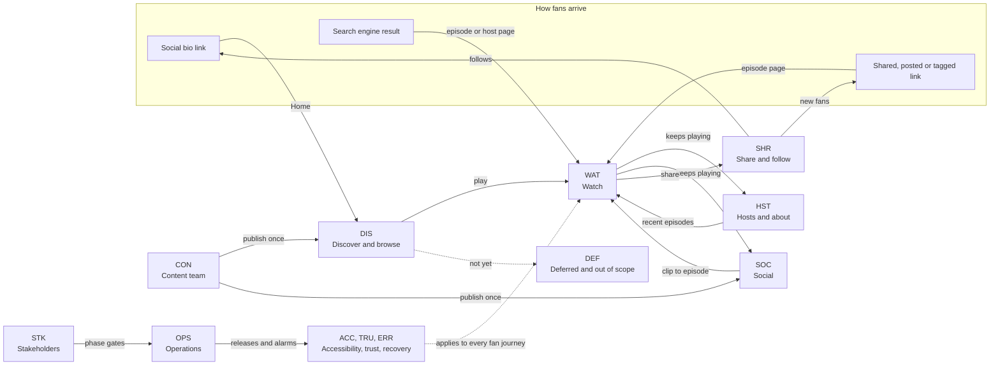

# ExtraTime — Business Requirements Document

*The conversation beyond the game*

| Field | Value |
|---|---|
| Document | ExtraTime website — Business Requirements Document (BRD) |
| Version | 0.1 |
| Status | Draft for review |
| Date | 2026-11-08 |
| Owner | Product owner (CEO) |
| Authors | Business Analysis |
| Reviewers | Founders (Shungu Dutiro, Henry Nzuzi), Content lead, Engineering Lead, Legal adviser (consent, privacy and safety sections) |
| Related | HLD v0.2 (`football-podcast-website-hld.md`) |

## Table of Contents

- [1. Executive Summary](#1-executive-summary)
- [2. Business Context & Objectives](#2-business-context--objectives)
- [3. Scope](#3-scope)
- [4. Stakeholders & Personas](#4-stakeholders--personas)
- [5. Customer Journey Catalog](#5-customer-journey-catalog)
  - [5.1 How to Read the Catalog](#51-how-to-read-the-catalog)
  - [5.2 Journey Summary](#52-journey-summary)
  - [5.3 Discover & Browse](#53-discover--browse)
  - [5.4 Watch](#54-watch)
  - [5.5 Hosts & About](#55-hosts--about)
  - [5.6 Social](#56-social)
  - [5.7 Share & Follow](#57-share--follow)
  - [5.8 Accessibility & Devices](#58-accessibility--devices)
  - [5.9 Trust, Privacy & Consent](#59-trust-privacy--consent)
  - [5.10 Errors & Recovery](#510-errors--recovery)
  - [5.11 Content Team](#511-content-team)
  - [5.12 Operations](#512-operations)
  - [5.13 Stakeholders](#513-stakeholders)
  - [5.14 Deferred & Out-of-Scope Journeys](#514-deferred--out-of-scope-journeys)
- [6. Business Requirements](#6-business-requirements)
- [7. Assumptions, Constraints & Dependencies](#7-assumptions-constraints--dependencies)
- [8. Risks & Open Questions](#8-risks--open-questions)
- [9. Approval & Sign-off](#9-approval--sign-off)
- [Appendix A: Journey Traceability Matrix](#appendix-a-journey-traceability-matrix)
- [Appendix B: Glossary](#appendix-b-glossary)
- [Appendix C: Notes for the HLD and LLD Owners](#appendix-c-notes-for-the-hld-and-lld-owners)

## 1. Executive Summary

- **Purpose.** ExtraTime needs one fast, shareable home for *The conversation beyond the game*: the episode archive, a player that keeps playing while fans explore, the hosts and the show's social clips, gathered from YouTube and Instagram (and Facebook once a Page exists) with no extra publishing work, within platform policies and US$120 a month.
- **Who it serves.** The eight personas in the HLD (Regular Fan, Social Newcomer, Archive Explorer, Aspiring Player, Commuter Listener, Content Team, CEO / Stakeholder, Engineer / Operator) plus two proposed for approval (Partner or Guest; Parent or Youth Leader). The core audience is young, mostly mobile and arrives from social apps.
- **What this BRD adds.** A catalog of 87 customer journeys in 12 areas that the product must support or has consciously excluded: 58 Must, 14 Should, 1 Could and 14 Won't (now), each traced to the HLD journeys J1-J12 and requirements FR-01 to FR-26 and NFR-01 to NFR-12. The HLD journeys remain the persona narratives; this catalog is the full list.
- **Phasing.** Phase 1 (local demo on visual fixtures of the 7 real episodes, no audio; CEO demo in the week of 2026-12-07) first demonstrates 38 journeys; Phase 2 (live data on localhost, to 2027-01-15) adds 13; Phase 3 (public launch in the week of 2027-02-15) adds 22; 14 are deferred or out of scope. Under the product owner's lean Phase 1 decision, 13 journeys (marked ‡) show only part of their outcome at the demo; the rest is required by the Phase 2 exit on 2027-01-15, unless a Phase 3 part is named (§5.1).
- **Business rules.** Publish once; the Content Team owns host bios and approves every editorial change; host photos only with recorded consent; no YouTube embed or analytics before consent; WCAG 2.2 AA; no ads or betting brands; replies to young people only from a shared ExtraTime inbox; no accounts, comments, payments, native apps, live coverage or CMS in Phases 1-3; audio-only listening waits for an RSS/MP3 source (Q2).
- **New requirements.** 40 of the 78 business requirements in §6 are new and marked "New — add to HLD" for the engineers; two more (BR-58, BR-76) are design notes, now in Appendix C. The most important: the publishing conventions extend to chapter timestamps and the site address (BR-69), because clips link to their episodes only if episode codes appear from 2026-12-04 (A7, BR-21); old episode links must survive title edits; playback must start within two taps, consent included; and an under-18 audience needs a safeguarding position, a rule for replying to young people and a named owner for takedown and data requests.
- **Decisions needed** (in date order): Q3 Meta asset ownership and BQ-14 demo notice (2026-11-20); BQ-16 brand assets (2026-11-23); BQ-15 offline demo artwork (2026-11-27); BQ-03 bio link and Home's featured episode, BQ-10 interim privacy pages and BQ-17 Season 1 line-up (2026-12-04); Q2 audio, Q19 Facebook and TikTok, BQ-02 clip-to-episode linking and its 80% target, and BQ-08 promotions (2026-12-07); Q20 audience and language (2027-01-04); Q1 domain, Q4 hosting, Q10 budget, BQ-09 retired-host addresses and BQ-13 old-link redirects (2027-01-15); Q7 contact route, BQ-06 request owners, BQ-07 caption scope and BQ-18 safeguarding lead (2027-01-18); Q5 consent and analytics, BQ-05 Children's Code and BQ-12 monthly KPIs (2027-01-29); Q11 support model and BQ-04 out-of-hours removal (2027-02-05); BQ-11 channel repointing (2027-02-12); BQ-01 personas, with BRD approval. The Engineering Lead's questions (Q9, Q14, Q15) are in §8.

## 2. Business Context & Objectives

### 2.1 About ExtraTIME

ExtraTime (styled ExtraTIME on its channels) is a football conversation series founded by Shungu Dutiro and Henry Nzuzi. Its slogan, *The conversation beyond the game*, sums up the mission: to help young people see their value beyond what they do on the pitch, through conversations with coaches, players and creatives about identity, purpose, mentorship and life after the final whistle. In the channel's own words, ExtraTime is "a platform on the mission to empower young people to realise the importance of self-value and authenticity", "detaching your identity from what you do to who you are in pursuit of your craft", through "empowering conversations and initiatives".

**Channels** (YouTube checked 2026-11-08)

| Channel | Handle | Status | Role for the website |
|---|---|---|---|
| YouTube | [@extratimeorg](https://www.youtube.com/@extratimeorg) | 7 public episodes since 2024-06-10, all embeddable; about 1,860 views and 88 likes in total | Source of every episode; plays in the site's player |
| Instagram | [@extra.timeorg](https://www.instagram.com/extra.timeorg) | Exists; posting frequency and last post not yet checked | Social feed source (live from Phase 2) |
| TikTok | [@extra.timeorg](https://www.tiktok.com/@extra.timeorg) | Exists; promoted in episode descriptions; posting frequency not yet checked | Follow link only; not a feed source in Phases 1-3 (Q19) |
| Facebook | Unconfirmed | No Page confirmed (Q19) | Feed and video source only once a Page exists |
| Audio / podcast apps | None | No RSS feed or podcast host (A2) | Audio-only listening waits for a source (Q2) |

**Episodes published** (titles as published, decorative emoji removed; views on 2026-11-08)

| Published | Episode | Featuring | Length | Views |
|---|---|---|---|---|
| 2024-06-10 | JOURNEY (opens Season 1, "a 5-part series"; the other parts are not yet identified, BQ-17) | Not named in the description | 67 min | 332 |
| 2024-10-14 | AUTHENTICITY (Season 1, second episode) | Visual artist Kay Kay Ribane | 24 min | 81 |
| 2025-02-17 | Meet The Founders \|\| Passion to Purpose | Shungu Dutiro and Henry Nzuzi | 16 min | 288 |
| 2025-03-19 | Purpose - Bigger Than Football | Coach Cavin Johnson and Jesse Donn (former Bafana Bafana and SuperSport United player) | 33 min | 206 |
| 2025-05-22 | Purpose - Bigger Than Football Pt.2 | Coach Cavin Johnson and Jesse Donn | 42 min | 51 |
| 2025-07-08 | Full Circle - Coach Pitso Mosimane | Coach Pitso Mosimane (Pitso Mosimane Soccer Schools) | 58 min | 541 |
| 2026-04-22 | Plus que le football : construire son identité \| ExtraTime Kinshasa (French) | Presented by Daniel and Haggi | 50 min | 365 |

What this means for the website:

- **Long-form, evergreen conversations.** Episodes run 16 to 67 minutes and stay relevant for years, so the archive, search, chapters and resume matter more than a news-style front page.
- **Low, irregular cadence.** Seven episodes in 29 months, the latest in April 2026. Weekly clips (BA-06) and the launch content plan (BR-77) keep the site from looking dormant (risk RB-05).
- **The newest episode is the French-language Kinshasa special (2026-04-22).** Unless a new episode is published first, it heads Home at the CEO demo and at launch. The launch content plan (BR-77) and the bio-link decision (BQ-03) cover this.
- **Content is not yet "site-ready".** Titles carry no episode codes, descriptions have no chapter timestamps, which episodes make up Season 1 is not stated (BQ-17), one description misspells the TikTok handle ("@extre.timeorg") and thumbnails are 480x360. The publishing conventions (A7) and corrections (CJ-CON-03, CJ-CON-04) close these gaps.
- **Two languages, two regions so far.** One French-language special was filmed in Kinshasa, and the other guests are South African. The audience is assumed to span South Africa, DR Congo and the UK diaspora until Q20 confirms it (BA-01).

### 2.2 Business Problem

A fan who sees a Reel or a TikTok clip has no easy route to the full conversation: a profile bio holds one link, captions carry no episode link, and the archive exists only as YouTube's upload list. Host bios live nowhere. There is no single place that ties episodes, hosts and clips together, keeps playing while fans explore, or gives every episode a link that previews well in a group chat.

This matters to the mission and the business:

- **Reach.** Most new fans meet ExtraTIME through a short clip; if the clip does not lead to the full conversation, the message about identity and purpose is lost in a 30-second edit.
- **The young audience.** The Aspiring Player, a 17-year-old in a school or academy team, is mostly on a phone, often inside the Instagram or TikTok in-app browser and often on prepaid data. The site has to be fast, light and simple there.
- **Trust.** Parents, teachers, coaches and partners decide whether to recommend the show. The site has to be safe for under-18s: no ads or betting brands, no tracking before consent, no comments or direct messages.
- **A small team.** One to three engineers, a part-time Content Team and US$120 a month. The site cannot add publishing work or need an operations team.

**Problem statement** (HLD 1.2): ExtraTime needs one fast, shareable home for the conversation beyond the game that gathers its YouTube, Instagram and Facebook content and keeps playing while fans explore, without adding publishing work, breaching platform policies or exceeding a small team's budget.

### 2.3 Business Objectives & Success Metrics

Where no baseline exists, the first full month after launch (to mid-March 2027) sets it, and the CEO sets the target at the first monthly review (CJ-STK-04). Audience measures depend on Q5 (consented, cookieless analytics); because analytics load only after opt-in (CJ-TRU-06), they under-count, so the monthly report states the share of visits that allow analytics. True returning-visitor rates cannot be measured without visitor identifiers, so BO-05 uses proxies.

| ID | Objective | KPI | Target | How measured | Phase | HLD goal |
|---|---|---|---|---|---|---|
| BO-01 | Prove the experience early | CEO approval of Phase 2 at the demo | Approved in the week of 2026-12-07, with Q2 and Q19 decided | Demo sign-off recorded (§9); a non-engineer completes the 7-minute dry run | 1 | G1 |
| BO-02 | Real, fresh content with no extra publishing work | Publishing tools used besides the platforms; time from upload to the site | None: nothing is entered anywhere except YouTube, Instagram and TikTok. The only additions are the agreed conventions inside existing titles, descriptions, captions and bios (episode code, chapter timestamps, site link, bio link, reviewed captions; BR-14, BR-21, BR-69, BR-70). YouTube within 21 minutes, Instagram and Facebook within 16 minutes of going public (NFR-04; one reload allowed) | Timed publish before the DNS cut-over; content-age alarm; Content Team check after each release | 2 (tracked) / 3 (binding) | G3, G4 |
| BO-03 | Turn clips into full conversations | Share of new clips linked to their full episode; play starts from social-referral landings | At least 80% of clips published after the conventions are adopted (proposed; approved with BQ-02); referral play-start rate: baseline in month 1 | Each month the Content lead reports new clips with and without a full-episode link (from BR-68, or a manual check of the month's clips if BR-68 is not built); referral play starts from consented analytics (BR-72, Q5) | 2 / 3 | Problem (HLD 1.2) |
| BO-04 | Uninterrupted playback | Playback across navigation; resume on the same device | Five route changes without interruption; resume within ±5 s | Phase 1 exit criteria; Phase 1 iteration tests | 1 | G2 |
| BO-05 | Return engagement | Resumed-episode play starts per month and visits arriving from bookmarks or typed addresses (proxies; no visitor identifiers) | Baseline in month 1; target at the first monthly review | Cookieless analytics events (BR-72, Q5), read against the analytics opt-in share (CJ-TRU-06); play starts per visit is reported as a supporting engagement measure | 3 | New |
| BO-06 | Sharing | Shares per 100 episode-page visits; visits arriving from shared links | Baseline in month 1; target at the first monthly review | Share event and referral counts (BR-72, Q5), read against the analytics opt-in share (CJ-TRU-06) | 3 | New |
| BO-07 | Grow the show's own channels | Net new YouTube subscribers and Instagram and TikTok followers per month; follow-link taps from the site | Baseline from January 2027 platform figures; growth target set by the CEO at the first monthly review | Platform analytics reported monthly by the Content lead; follow-link tap events, read against the analytics opt-in share (CJ-TRU-06) | 3 | New |
| BO-08 | Fast on the phones fans use | Core Web Vitals at mobile p75 | LCP ≤ 2.5 s, INP ≤ 200 ms, CLS ≤ 0.1 | Lab checks from Phase 3; real-user measurement after launch | 3 (tracked locally in 1-2) | G5 |
| BO-09 | Accessible to everyone | WCAG 2.2 AA on every Must journey | No blockers in manual keyboard and screen-reader passes (Phase 1); automated checks pass on every release (Phase 3) | Manual audit with VoiceOver, TalkBack and NVDA; automated checks | 1 / 3 | G5 |
| BO-10 | Launch safely and on time | Live on the custom domain over HTTPS; monthly availability | Week of 2027-02-15; site 99.9%, API 99.5% | Go-live checklist; uptime checks | 3 | G6 |
| BO-11 | Stay affordable | Monthly spend for staging and production | Within US$120 (estimate ~US$85); raised only by a recorded CEO decision | Budget alerts at 50/80/100%; monthly 30-minute review | 3 | G7 |
| BO-12 | Open doors for the mission | Partnership, guest, press and talk enquiries received through the contact route per month, by request type | Baseline in month 1; target at the first monthly review | Hosted-form submission counts (BR-59), reported monthly by the Content lead | 3 | New |

## 3. Scope

### 3.1 In Scope by Phase

| Phase | Dates | Business outcome | What fans and the team can do | Journeys first demonstrable |
|---|---|---|---|---|
| 1. Local Functional Demo | 2026-11-16 to 2026-12-04; CEO demo in the week of 2026-12-07 | The CEO sees the whole experience on a laptop and approves Phase 2 | Home, archive with search, episode and host pages, a docked YouTube player that keeps playing (YouTube's own controls), share and follow links, a social feed of mock posts and About; on visual fixtures of the 7 real episodes and the founders; no audio | 38 |
| Phase 1 iteration (lean Phase 1) | After the demo (from 2026-12-07), alongside Phase 2; complete by the Phase 2 exit (2027-01-15) and accepted there (CJ-STK-02) | Cheap follow-ups that complete the Phase 1 journeys marked ‡ | Archive filters and pagination, custom player controls and queue, resume, keyboard shortcuts and the "updates delayed" notice | Counted under Phase 1 |
| 2. Platform Integration | 2026-12-07 to 2027-01-15 (break 2026-12-21 to 2027-01-01) | Real content flows through the unchanged experience with no extra publishing work; the CEO approves Phase 3 | Live YouTube and Instagram content (Facebook if a Page exists), chapters, clip-to-episode matching, editorial corrections, automatic refresh and graceful failure, still on localhost | 13 |
| 3. Full Production Launch | 2027-01-18 to 2027-02-12; go/no-go 2027-02-12; launch in the week of 2027-02-15, then about two weeks of hypercare | ExtraTime is public on its own domain, safe, compliant, monitored and within budget | Consent, analytics choice and legal pages, rich link previews, search indexing, release pipeline and rollback, alarms, incident response and runbooks, budget controls, channel bios pointing at the site, hypercare exit | 22 |
| Deferred / out of scope | Not in Phases 1-3 | Consciously excluded, each with an alternative and a revisit trigger (§5.14) | Audio-only listening, TikTok feed, topic and guest filters, timestamp sharing, transcripts, guest pages, initiatives page and others | 14 |

Counts use the first phase named in each journey's Phase column (§5.1).

### 3.2 Out of Scope

The product owner has excluded these from Phases 1-3; additions go through the scope-change process (BR-35, CJ-STK-05).

| Item | Status | What fans get instead | Journey |
|---|---|---|---|
| User accounts, sign-in, personalization, cross-device resume | Out of scope (HLD 3.4) | Same-device resume; follows on the platforms | CJ-DEF-06 |
| Comments and other user-generated content | Out of scope | Comments and likes on YouTube, Instagram and TikTok | CJ-DEF-06, CJ-SHR-03 |
| Payments, donations, memberships, merchandise, sponsorship at launch | Out of scope (Q8: no sponsorship at launch) | The contact route | CJ-DEF-08 |
| Native apps, push notifications, an installable app | Out of scope | Platform follows; the browser's own bookmark | CJ-DEF-05 |
| Live streaming and live match coverage | Out of scope | Watch live on YouTube through the follow link | CJ-DEF-07 |
| A CMS or database; publishing to the platforms | Out of scope (HLD 3.4, D3) | Reviewed editorial changes made by an engineer | CJ-DEF-09 |
| A French (or any non-English) interface | Out of scope (localization) | French episodes findable and playable inside the English interface | CJ-DEF-10, CJ-DIS-06 |
| Audio-only, background or offline listening on the site | Deferred until an RSS/MP3 source is confirmed (Q2); no audio in the demo | The visible mini-player on mobile | CJ-DEF-03, CJ-WAT-06 |
| TikTok in the social feed | Deferred (Q19) | A TikTok follow link | CJ-DEF-04 |
| Self-hosting, transcoding or downloading media | Out of scope (HLD 3.4) | Podcast apps, once an RSS source exists | CJ-DEF-03 |
| Mock-only simulation features | Out of scope (product owner) | Mock data is visual fixtures only; degraded states come from editing source-status data | CJ-STK-01 |
| Guest profile pages | Not planned | Guests appear on their episode pages and in search | CJ-DEF-14 |

## 4. Stakeholders & Personas

### 4.1 Stakeholders

| Stakeholder | Role | Interest | Responsibility | Sign-off |
|---|---|---|---|---|
| Product owner (CEO or delegate) | Sponsor and decision-maker | A convincing experience early; budget and launch date | Scope, onboarding track, budget, CEO-owned open questions, scope changes | BRD; Phase 2 at the demo; Phase 3 at the Phase 2 exit; go-live; hypercare exit |
| Founders: Shungu Dutiro and Henry Nzuzi | Founders and hosts | The mission and brand represented faithfully; their own bios and images | Approve their bios and photo consent; review brand, mission and persona content | BRD (brand, mission, personas) |
| Content lead | Leads the Content Team | Publish once; editorial control without a CMS | Publishing conventions (A7), bios, captions, editorial corrections, staging approval, takedown requests, launch content plan | BRD (content rules); every editorial change on staging |
| Content Team (hosts and producer) | Publish on YouTube and Instagram | No double entry; the site reflects what they publish | Publish with episode codes and timestamps; check the site after each release; repoint bios at launch | None |
| Engineering Lead | Lead engineer | Feasible, traceable scope | Architecture, accounts and credentials, traceability into the LLD | BRD (feasibility and traceability) |
| Release managers (Engineering Lead plus one engineer) | The only people who can promote to production | Safe, reversible releases | Promotion, rollback, urgent removals | Go-live checklist, with the product owner |
| Engineers / operators (1-3) | Build, release and monitor | Clear, testable requirements | Implement, test, run the runbooks | None |
| Legal adviser (external) | Privacy, terms and consent | Compliance with UK GDPR, PECR, POPIA and platform terms | Consent and legal-page wording; Children's Code position (BQ-05); review of the safeguarding rule (BQ-18) | Legal pages and consent wording (Q5) |
| Guests, partners and press | People featured in episodes; academies, clubs, schools, brands, journalists | Accurate credit; a way to get in touch | Consulted on corrections and takedowns | None |
| Audience | Fans, young players, parents and youth leaders | Represented by the personas below | None | None |
| Platforms (YouTube, Meta) | Policy owners | Policy compliance | Their policies constrain the design (§7) | None |

### 4.2 Personas

Personas are referred to only by these descriptive names; the BRD uses no aliases or first names for them. The first eight are copied word for word from HLD 2.1; the last two are proposed and need product-owner approval (BQ-01).

| Persona | Description | Needs | Status | Journeys |
|---|---|---|---|---|
| Regular Fan | Watches or listens every week, on desktop and mobile | The newest episode in one tap; a player that never stops; social catch-up | HLD 2.1 | 34 |
| Social Newcomer | First visit on mobile from a social post or shared link, often in the Instagram or Facebook in-app browser | The exact episode, fast; who the hosts are; a reason to follow | HLD 2.1 | 24 |
| Archive Explorer | Hunts for one conversation (a guest, a theme such as identity or mentorship, a series); long desktop or tablet sessions | Search and filters by topic, guest, host and season; chapters | HLD 2.1 | 19 |
| Aspiring Player | 17, plays for a school or academy team; the young audience ExtraTIME's mission speaks to; mostly mobile | Honest advice from coaches and players on identity, mentorship and life beyond the game; easy to share with teammates | HLD 2.1 | 29 |
| Commuter Listener | Audio-first on the bus or train; phone in pocket, headphones, patchy signal | Background audio, lock-screen controls, resume | HLD 2.1 | 6 |
| Content Team | Hosts and producer; publish with platform tools; own host bios. Engineers make bio and override edits as reviewed JSON changes, approved on staging | Publish once; the site updates itself; no second CMS | HLD 2.1 | 14 |
| CEO / Stakeholder | Sponsors the site; judges the Phase 1 demo on a laptop, then staging | A convincing experience early; confidence in budget and launch date | HLD 2.1 | 12 |
| Engineer / Operator | 1-3 engineers on macOS + VS Code who build, release and monitor; AWS and GitHub from Phase 3 | One contract, safe releases, clear alarms, little operations work | HLD 2.1 | 23 |
| Partner or Guest | Proposed, needs product-owner approval. Organisations and people who want to work with ExtraTIME: youth academies, clubs, schools, coaches, brands, journalists and the guests featured in episodes; arrive from referrals, search or a shared episode, often on desktop | The mission and recent guests at a glance; a partnership, guest or press contact that reaches the founders; trustworthy previews of the episode they appear in | Proposed (BQ-01) | 7 |
| Parent or Youth Leader | Proposed, needs product-owner approval. A parent, guardian, teacher or academy coach responsible for the under-18 players ExtraTIME's mission speaks to; decides whether to recommend the site, shows episodes to their group and may act for a young person on data or takedown requests | Evidence the site is safe for young people (no ads or betting brands, no tracking before consent, no comments or DMs, replies only from a shared ExtraTime inbox); suitable episodes that are easy to share with a group; a clear way to ask for data or content to be removed | Proposed (BQ-01) | 5 |

"Journeys" counts the catalog journeys (§5) that name the persona.

**Proposed HLD 2.1 edits** (for the HLD owner; they keep the personas honest about audio, which waits for Q2, about the show's cadence and about the TikTok entry point):

- Commuter Listener needs: "Visible mobile playback and resume now; background audio and lock-screen controls once an RSS/MP3 source exists (Q2)".
- Regular Fan description: "Comes back for each new episode and the week's clips, watching now and listening once audio exists (Q2), on desktop and mobile".
- Social Newcomer description: "First visit on mobile from a social post or shared link, often in the Instagram, TikTok or Facebook in-app browser".

## 5. Customer Journey Catalog

### 5.1 How to Read the Catalog

- **What the catalog is.** HLD journeys J1-J12 are persona narratives that explain why the requirements exist. This catalog is the complete list of customer journeys the product is required to support, plus the journeys it consciously does not support (§5.14). Every journey traces to the HLD; IDs are fixed and are never renumbered.
- **IDs.** `CJ-{area}-{nn}`, where the area is one of DIS (Discover & browse), WAT (Watch), HST (Hosts & about), SOC (Social), SHR (Share & follow), ACC (Accessibility & devices), TRU (Trust, privacy & consent), ERR (Errors & recovery), CON (Content team), OPS (Operations), STK (Stakeholders) and DEF (Deferred & out of scope).
- **Columns.** *Journey*: what the person is trying to do. *Persona(s)*: who does it, by persona description only (§4.2); Partner or Guest and Parent or Youth Leader are proposed personas (BQ-01). *Trigger*: what starts the journey. *Key steps*: the main path, separated by →. *Success outcome*: the measurable result that proves the journey works. *Priority*, *Phase* and *HLD trace* are explained below.
- **Priority (MoSCoW).** *Must*: required at the exit of each phase named in the journey's Phase column, for the part stated for that phase; for ‡ journeys, see the next bullet. *Should*: expected; may move to a later iteration only with product-owner agreement. *Could*: built if time allows. *Won't (now)*: consciously not supported in Phases 1-3, with an alternative and a revisit trigger. Every journey in §5.14 is Won't (now); its Reason column gives the priority it would take if promoted (BQ-08) or once its revisit trigger fires.
- **Phase.** *1*: Local Functional Demo on localhost with visual fixtures (code complete 2026-12-04; CEO demo in the week of 2026-12-07). *2*: Platform Integration, live data on localhost (to 2027-01-15). *3*: Full Production Launch (launch in the week of 2027-02-15). *Deferred*: not in Phases 1-3, with a revisit trigger. *Out of scope*: excluded by HLD 3.4 or by a product-owner decision. A compound value such as "1 (fixtures) / 2 (live)" means the journey is first demonstrable in Phase 1 in the stated form and complete in the later phase; each phase's exit checks the part named for it. Summary counts use the first phase named.
- **‡ (lean Phase 1).** On 2026-11-08 the product owner made Phase 1 deliberately lean (HLD 5.2 and HLD Appendix B). For a journey marked ‡, only the part named in the table below as "At the demo" is required at the Phase 1 exit (code complete 2026-12-04). The rest is required by the Phase 2 exit (2027-01-15), through the Phase 1 iteration or Phase 2, except any part the table assigns to Phase 3. The Must rule applies to each part at its own exit, and the Phase 2 exit demonstrates the ‡ remainders (CJ-STK-02).
- **HLD trace.** HLD journeys, then HLD requirements, separated by ·. "None" means the journey traces to another HLD section instead (named in brackets): CJ-OPS-02 (onboarding) and CJ-STK-05 (governance) trace to the delivery plan and risks, CJ-HST-03 traces to the proposed HLD journey J13 (BQ-01), and the out-of-scope journeys are left untraced on purpose. References written as "HLD 3.4" are to sections of the HLD; § references are to this BRD. Gaps found while building the catalog are business requirements marked "New — add to HLD" in §6.

**Lean Phase 1 alignment**

| Journey | At the demo (Phase 1 exit, 2026-12-04) | By the Phase 2 exit (2027-01-15) |
|---|---|---|
| CJ-DIS-04 | The newest-first archive with search (FR-02). | Host and platform filters, pagination, and filters, page and scroll restored on Back (Phase 1 iteration); oldest-first sorting once BR-40 is accepted; the season filter once episodes carry season numbers (CJ-CON-03 or BR-66, BQ-17). |
| CJ-WAT-03 | Playback across every route with YouTube's built-in controls, the now-playing link and close. | Custom player controls, including expand and collapse (Phase 1 iteration, FR-07). |
| CJ-WAT-04 | Nothing: the queue is not in the demo. | The queue (Phase 1 iteration, FR-07); it moves to Phase 2 if cut. |
| CJ-WAT-05 | Nothing: resume is not in the demo. | Resume on the same device (Phase 1 iteration, FR-08); dropping removed or renamed episodes needs live data (Phase 2). |
| CJ-WAT-08 | YouTube's own play button when the browser blocks scripted play (FR-01). | The phone and in-app playback test (Phase 2 week 1, risk R16). Phase 3: the in-app check before each release. |
| CJ-ACC-01 | A manual keyboard pass with no blockers. | Keyboard operation of the custom controls, and keyboard shortcuts (Phase 1 iteration). |
| CJ-ACC-02 | A manual screen-reader pass with no blockers: landmarks, headings, control names, playback state and error states. | Announcements for pagination and the source-status notice, which arrive with those features (Phase 1 iteration). Phase 3: the scripted VoiceOver, TalkBack and NVDA runs. |
| CJ-ACC-05 | A phone reaches the local build over the same Wi-Fi or a secure tunnel, plays with YouTube's own play button and shares with copy link. | The in-app playback test (Phase 2 week 1, R16). Phase 3: the in-app check on staging before each release. |
| CJ-ACC-06 | Sized loading placeholders, Retry after a failed request, and the episode text with Watch on YouTube when the video fails. | The offline notice and the position kept on reconnect (BR-57, once accepted, with resume). Phase 3: the 2.5-second check in the lab on a slow-connection profile (BO-08). |
| CJ-ERR-01 | Every source status in the fixtures is served without breaking a page. | The visible "updates delayed" notice (Phase 1 iteration); real failures and recovery (Phase 2). |
| CJ-ERR-03 | A plain message and Watch on YouTube when YouTube cannot play; the episode page stays readable. | The next-episode offer, with the queue (Phase 1 iteration); removal from the catalog needs live data (Phase 2). |
| CJ-OPS-01 | One command starts the whole site on a laptop, with its health check. | The readiness and API documentation pages (Phase 2, FR-23); live content with personal limited-access logins (Phase 2). |
| CJ-STK-01 | The storyline on fixtures, with the "updates delayed" notice narrated (BQ-14 default). | The notice shown live at the Phase 2 exit (CJ-STK-02), unless the Phase 1 iteration delivers it before the demo. |

### 5.2 Journey Summary

| Area | Journeys | Must | Should | Could | Won't (now) | Phase 1 | Phase 2 | Phase 3 | Deferred / Out |
|---|---|---|---|---|---|---|---|---|---|
| [DIS Discover & browse](#53-discover--browse) | 8 | 5 | 2 | 1 | 0 | 7 | 0 | 1 | 0 |
| [WAT Watch](#54-watch) | 8 | 5 | 3 | 0 | 0 | 7 | 1 | 0 | 0 |
| [HST Hosts & about](#55-hosts--about) | 3 | 2 | 1 | 0 | 0 | 3 | 0 | 0 | 0 |
| [SOC Social](#56-social) | 3 | 2 | 1 | 0 | 0 | 2 | 1 | 0 | 0 |
| [SHR Share & follow](#57-share--follow) | 5 | 4 | 1 | 0 | 0 | 3 | 0 | 2 | 0 |
| [ACC Accessibility & devices](#58-accessibility--devices) | 6 | 6 | 0 | 0 | 0 | 6 | 0 | 0 | 0 |
| [TRU Trust, privacy & consent](#59-trust-privacy--consent) | 6 | 6 | 0 | 0 | 0 | 1 | 0 | 5 | 0 |
| [ERR Errors & recovery](#510-errors--recovery) | 8 | 7 | 1 | 0 | 0 | 4 | 1 | 3 | 0 |
| [CON Content team](#511-content-team) | 9 | 6 | 3 | 0 | 0 | 1 | 6 | 2 | 0 |
| [OPS Operations](#512-operations) | 11 | 10 | 1 | 0 | 0 | 2 | 3 | 6 | 0 |
| [STK Stakeholders](#513-stakeholders) | 6 | 5 | 1 | 0 | 0 | 2 | 1 | 3 | 0 |
| [DEF Deferred & out of scope](#514-deferred--out-of-scope-journeys) | 14 | 0 | 0 | 0 | 14 | 0 | 0 | 0 | 14 |
| **Total** | **87** | **58** | **14** | **1** | **14** | **38** | **13** | **22** | **14** |

Phase columns count each journey once, under the first phase named in its Phase column; 13 Phase 1 journeys are marked ‡ (lean Phase 1, §5.1).

How the journey areas connect: fans arrive by a bio link, a shared link or a search result, and every fan journey runs inside the accessibility, trust and recovery areas; the Content Team, operations and stakeholder journeys keep the catalog fresh, running and governed.

### 5.3 Discover & Browse

How fans find the right conversation: from Home, a bio link, a shared link, the archive, search or a search engine.

| ID | Journey | Persona(s) | Trigger | Key steps | Success outcome | Priority | Phase | HLD trace |
|---|---|---|---|---|---|---|---|---|
| CJ-DIS-01 | Catch the latest episode from Home | Regular Fan | A new episode drops (e.g., "Full Circle" with Coach Pitso Mosimane) and the Regular Fan wants to watch it tonight. | Opens Home: brand, slogan and the featured latest episode → Taps play on the hero; the visible YouTube mini-player docks and plays → Scrolls the latest-episodes rail → Opens the episode page while playback continues | The Regular Fan goes from landing to watching the newest conversation in one tap (at most two with first-visit consent or blocked scripted playback), and from Phase 2 each new upload reaches Home within 21 minutes of going public (one reload allowed). | Must | 1 (fixtures) / 2 (live) | J1 · FR-01, FR-06, FR-09, NFR-01, NFR-03, NFR-04 |
| CJ-DIS-02 | Arrive from a social bio link | Social Newcomer | A Reel captioned "Coach Cavin Johnson on mentorship: full conversation, link in bio" prompts the Social Newcomer to tap the bio link inside the Instagram or TikTok app. | The bio link opens the promoted episode's page if the Content Team has repointed it (BQ-03 default), otherwise Home in the in-app browser → Home leads with the newest episode, the slogan, the hosts strip and follow links → Finds the promoted episode in the hero, the latest-episodes rail, social highlights or a featured-episode override (BR-70) → Opens it and taps play (through the consent facade from Phase 3) | The Social Newcomer lands directly on the promoted episode, or reaches it in one tap from Home's hero, its latest-episodes rail or a featured-episode override (BR-70), and the page appears within 2.5 seconds on a typical phone in the in-app browser (NFR-01). | Must | 1 (phone on the same Wi-Fi) / 3 (live bio link) | J2 · FR-01, FR-04, FR-09, FR-13, FR-16, FR-25, NFR-01, NFR-07, NFR-12 |
| CJ-DIS-03 | Open a shared, posted or tagged episode link cold | Social Newcomer, Aspiring Player | A teammate's WhatsApp message, a Facebook post or an Instagram Story link sticker points to one episode, often with tracking tags (fbclid, igsh, utm_\*) or a QR-code campaign tag added. | Taps the link; the episode page loads directly, with no detour through Home → The page shows in full on first load (title, summary, hosts, guests, platform links), and tracking tags never cause an error → The share action and search engines use the clean address → Taps play (consent facade from Phase 3), then explores more episodes, the hosts or the follow links | Every link to an episode, with or without tracking tags, opens that episode within 2.5 seconds on a typical phone (NFR-01) and shows at least three more-episodes cards, the host links and the follow links on the same page. | Must | 1 (in the site) / 3 (public links and previews) | J2, J8 · FR-04, FR-09, FR-14, FR-16, FR-25, NFR-01, NFR-07, NFR-12 |
| CJ-DIS-04 | Browse and filter the archive by season, host or platform | Archive Explorer | Wants every conversation a particular host led, or, once episodes carry season numbers (CJ-CON-03 or BR-66), to work through Season 1, outside YouTube's upload list. | Opens Episodes, newest first (oldest-first sorting once BR-40 is accepted) → Filters by season, host or platform; filters, sort and page persist in the address → Opens episodes in place or in new tabs (cards are real links) → Browser Back restores the filters, page and scroll position without interrupting playback | The Archive Explorer reaches the right subset in at most three interactions, every filtered view is a stable address that survives reload, Back and open-in-new-tab, and with several tabs open only one plays at a time. | Must | 1 (newest-first list and search) / 2 (season filter, once season numbers exist) ‡ | J3 · FR-02, FR-06, NFR-01 |
| CJ-DIS-05 | Search the archive by guest or theme | Archive Explorer, Aspiring Player | An Aspiring Player remembers a conversation about identity beyond football with a former Bafana Bafana player. | Opens Episodes and searches "identity" or "Jesse Donn" → Results match titles, summaries, guests and tags within the active filters, and the result count is announced → Opens "Purpose - Bigger Than Football" → Plays it (from Phase 2, and once its description has chapter timestamps, jumps to its "Mentorship" chapter, CJ-CON-03) | The right conversation is found and playing in under a minute. | Should | 1 | J3 · FR-03, FR-04, FR-05, NFR-01 |
| CJ-DIS-06 | Find and watch French-language episodes | Aspiring Player, Social Newcomer, Archive Explorer | A French-speaking Aspiring Player in Kinshasa sees a French Reel, or searches "identité" or "Kinshasa". | Searches in French or browses Episodes → Opens "Plus que le football : construire son identité \| ExtraTime Kinshasa", its French title and description shown as published inside the English interface → Plays it in the mini-player with YouTube captions where available → Shares it with French-speaking teammates | Searching "identité", "identite" or "Kinshasa" lists the Kinshasa special first; its page shows the French title and description as published, read in French by screen readers; it plays in the mini-player; and from Phase 3 its share preview shows the French title. | Should | 1 | J3, J8 · FR-03, FR-04, FR-09, FR-14, NFR-05 |
| CJ-DIS-07 | Follow a multi-part series in order | Regular Fan, Archive Explorer | Finishes "Purpose - Bigger Than Football" (Pt.1) and wants Pt.2 next. | Reaches the end of Pt.1 on its episode page → Finds Pt.2 first under more episodes → Plays it or queues it → Pt.2 plays in the persistent player | Each part of a multi-part conversation (the two-part Purpose, and Season 1 once its parts are confirmed, BQ-17) links to its next part in one tap. | Could | 1 (fixtures) / 2 (overrides) | J3, J4 · FR-04, FR-07, FR-19 |
| CJ-DIS-08 | Find ExtraTime through a search engine | Social Newcomer, Archive Explorer, Partner or Guest | Searches "Pitso Mosimane ExtraTime" or "ExtraTime football conversation" on Google or Bing. | The result shows the canonical episode page with its own title and snippet → Taps through; the episode page loads directly → Plays the episode or explores the hosts and the archive | Every episode and host page is indexed under its canonical URL with its own title and description, and no staging page appears in results. | Must | 3 | J2, J8 · FR-04, FR-14, FR-15, NFR-01 |

### 5.4 Watch

How fans watch: the episode page, chapters, the persistent player, the queue, resume and playback on phones, tablets and restrictive browsers, always within YouTube's policies.

| ID | Journey | Persona(s) | Trigger | Key steps | Success outcome | Priority | Phase | HLD trace |
|---|---|---|---|---|---|---|---|---|
| CJ-WAT-01 | Read an episode page and choose where to watch | Social Newcomer, Archive Explorer | Opens an episode from Home, the archive, a host profile, a clip or a shared link. | Reads the title, summary, show notes, guests and hosts → Sees platform badges: Watch on YouTube, plus the Facebook copy when matched → Plays in the site player or opens the platform original → Picks a more-episodes card | Every episode page plays in place, shows YouTube attribution and links its original YouTube video and any matched Facebook copy. | Must | 1 | J2, J3 · FR-04, FR-09, FR-14, FR-20, NFR-07 |
| CJ-WAT-02 | Start an episode at a chapter | Archive Explorer, Aspiring Player | Wants only the mentorship part of "Purpose - Bigger Than Football" (identity, mentorship and guidance). | Opens the episode page → Scans the chapter list → Selects "Mentorship" → The player seeks to the chapter start (±1 s) and plays | Selecting a chapter starts playback within ±1 s of its start time, and episodes without chapters show no empty chapter list. | Should | 2 (once descriptions carry timestamps, CJ-CON-03) | J3 · FR-05, FR-06, FR-07 |
| CJ-WAT-03 | Keep playing and control the player while exploring | Regular Fan, Aspiring Player | Mid-episode, the Regular Fan wants to read a host bio, check the latest clips and speed up playback. | Starts an episode, then visits Hosts, a profile and Social; the mini-player stays visible and playing on every route, including 404 and error pages → Plays, pauses, seeks, skips, sets 1.25x speed and adjusts volume or mute → Expands or collapses the dock (collapsing pauses) → Taps the now-playing link to return to the episode → Closes the player; the video unloads and the dock and bar disappear | Playback survives five route changes uninterrupted, the video stays visible at ≥ 200x200 px throughout, every control works by pointer, touch and keyboard, and closing the player unloads the video, so nothing keeps playing or stays loaded out of sight (BR-46). | Must | 1 ‡ | J4, J1 · FR-06, FR-07, FR-09, NFR-05 |
| CJ-WAT-04 | Queue the next episode | Regular Fan, Archive Explorer | Wants to line up another conversation to play after the current one. | Taps play next or add to queue on an episode card or page → Sees the queue from the player bar → Removes an episode from the queue or clears it → The current episode ends and the next one starts → Where scripted playback is blocked, taps once more to start it | A queued episode starts when the current one ends (after one tap where the browser blocks scripted playback), the queue survives a reload, and any queued episode can be removed. | Should | 1 (moves to 2 if cut) ‡ | J4 · FR-07, FR-08 |
| CJ-WAT-05 | Resume where I left off | Regular Fan, Commuter Listener | Closed the tab mid-episode last night, or lost signal on the train, and returns on the same browser. | Returns to the site → The player restores the episode, position, volume, speed and queue, paused → If the saved episode was hidden, removed or renamed, the player drops it with a short message instead of loading a dead video → Taps play to continue; where storage is blocked (e.g., Safari private mode) the player still works, without saving | A reload restores episode, position (±5 s), volume, speed and queue, paused, with no account, and stale or unavailable saved state never breaks the player. | Should | 1 (saved on the device) / 2 (removed or renamed episodes) ‡ | J4 · FR-08, FR-19, NFR-07 |
| CJ-WAT-06 | Watch on a phone or tablet in the visible mini-player | Commuter Listener, Aspiring Player, Archive Explorer | On the bus with headphones, starts an episode on a 360 px phone and may turn it to landscape; or on an iPad or Android tablet in portrait or landscape. | Starts an episode → The YouTube dock shows full width at 16:9 (at least 200 px tall) above the fixed player bar → Keeps browsing with nothing hidden behind the dock → Turns to landscape or uses YouTube's fullscreen control | On a 360 px phone the dock stays ≥ 200x200 px and unobscured, no content or focus is hidden behind it, and no page scrolls sideways in portrait or landscape; on tablets the player follows the same screen-width layout rules (never the device type the browser reports), checked on an iPad and an Android tablet. | Must | 1 | J1, J4 · FR-06, FR-09, NFR-05, NFR-12 |
| CJ-WAT-07 | Leave the page mid-episode: lock the phone, switch apps or change tabs | Commuter Listener, Aspiring Player, Regular Fan | Locks the phone or switches apps on the train, or switches tabs or minimises the browser on a desktop, expecting the audio to keep playing. | The YouTube player pauses on mobile and desktop alike, because only audio (once a source exists) may play in a hidden page (HLD 4.3) → Returns to the tab → The player shows the episode at its last position → One tap resumes playback | Playback never breaches YouTube policy, site copy never promises background audio, and the position is kept within the open tab (±5 s) so one tap resumes. | Must | 1 | J4, J5 · FR-06, FR-08, FR-09, NFR-07 |
| CJ-WAT-08 | Start playback when the browser blocks scripted play | Social Newcomer, Aspiring Player, Regular Fan | In iOS Safari or the Instagram, TikTok or Facebook in-app browser, the first tap on play does not start the video. | Taps play on the hero, the episode page or the queue → The browser stops the video starting by itself, so the player shows YouTube's own play button → Taps it once and playback starts → Moving on to the next queued episode in these browsers also waits for a tap | Playback starts within two taps, including the Phase 3 consent tap, on every listed browser and never fails silently. | Must | 1 (YouTube's own play button as fallback) / 2 (phone and in-app playback test, R16) / 3 (in-app check before each release) ‡ | J1, J2 · FR-01, FR-07, FR-09, FR-25, NFR-12 |

### 5.5 Hosts & About

How fans meet the people behind the conversations, learn the mission and get in touch.

| ID | Journey | Persona(s) | Trigger | Key steps | Success outcome | Priority | Phase | HLD trace |
|---|---|---|---|---|---|---|---|---|
| CJ-HST-01 | Meet the hosts | Social Newcomer, Regular Fan | Wants to know who is behind the conversations. | Taps a host chip on an episode, the Home hosts strip or Hosts in the navigation → Sees the founders, Shungu Dutiro and Henry Nzuzi → Opens a profile: bio, role, social links and recent episodes → Plays a recent episode or shares the profile | Every host is one tap from any episode, and each profile shows bio, role, links and playable recent episodes at a shareable URL. | Must | 1 | J6 · FR-01, FR-04, FR-11, FR-14, NFR-05 |
| CJ-HST-02 | Learn the mission and contact the hosts | Social Newcomer, Aspiring Player | Moved by an episode, wants to know what ExtraTime stands for or to ask the hosts a question. | Opens About from the footer → Reads the story, the mission and the slogan "The conversation beyond the game" → Taps the contact route → Sends a question through the hosted form off-site | About shows the story, slogan and a working contact route. A question sent through it reaches a shared ExtraTime inbox the founders can see (never a host's personal account), every reply comes from that shared inbox, and the privacy page names the form provider, what it collects and how long messages are kept. | Must | 1 placeholder / 3 live | J6 · FR-24, NFR-07 |
| CJ-HST-03 | Propose a collaboration, guest appearance or talk | Partner or Guest | A youth academy, club, school, coach, brand or journalist wants to collaborate, appear on the show or invite the founders to speak. | Arrives at Home or About from a referral or a search → Reads the mission and recent guests, such as Coach Pitso Mosimane and Coach Cavin Johnson → Picks the partnership, guest or press option on the contact route → Sends an enquiry that reaches the founders | About offers a partnership, guest and press option on the contact route, and every enquiry sent through it reaches the founders' shared ExtraTime inbox. | Should | 1 placeholder / 3 live | None (proposed J13) · FR-24 |

### 5.6 Social

How fans catch up on the show's clips in one place and get from a clip to the full conversation.

| ID | Journey | Persona(s) | Trigger | Key steps | Success outcome | Priority | Phase | HLD trace |
|---|---|---|---|---|---|---|---|---|
| CJ-SOC-01 | Catch up on the social feed by platform | Regular Fan | Midweek, wants the week's clips without opening several apps. | Opens Social: posts newest first, each crediting its platform, with YouTube Shorts joining from Phase 2 → Filters to Instagram; Facebook shows as not yet available, not as an error, until a Page exists → Loads more, 12 at a time → Opens a post's original on its platform | One feed shows the show's latest clips with every post linking its original, and from Phase 2 new Instagram and Facebook posts appear within 16 minutes of going public (one reload allowed). | Must | 1 (mock) / 2 (live) | J7 · FR-12, FR-13, FR-20, FR-21, NFR-01, NFR-04 |
| CJ-SOC-02 | Go from a clip to its full episode | Social Newcomer, Regular Fan | A Reel of Coach Cavin Johnson on mentorship, in the feed or the Home social highlights, makes the Social Newcomer want the full conversation. | Taps the post's related-episode link → The episode page opens → Taps play → Uses Back to return to the same place in the feed, with the pages already loaded, while playback continues | Every matched post opens its episode in one tap, and Back returns to the same feed position without interrupting playback. | Should | 2 | J7, J2 · FR-06, FR-13, FR-20 |
| CJ-SOC-03 | See posts whose images expired or were withheld | Regular Fan | An Instagram image link has expired, or Instagram leaves out the image of a Reel that uses copyrighted music. | The card shows the post's thumbnail instead → With no thumbnail, a placeholder with View on Instagram appears → Caption, date and related-episode link still show → Reserved space means nothing jumps | The feed never shows a broken image or jumps while loading, and every post still opens its original. | Must | 1 | J7 · FR-12, FR-13, NFR-01 |

### 5.7 Share & Follow

How fans pass the conversation on and follow the show where the platforms count it.

| ID | Journey | Persona(s) | Trigger | Key steps | Success outcome | Priority | Phase | HLD trace |
|---|---|---|---|---|---|---|---|---|
| CJ-SHR-01 | Share an episode or host profile | Aspiring Player, Regular Fan | Wants teammates to hear Coach Pitso Mosimane on giving back. | Taps share on the episode or host page → Uses the native share sheet on mobile, or copy link on desktop and wherever no share sheet exists → Sends the link in WhatsApp or a team group chat → Teammates open the same page | Every share yields the canonical, readable URL with no tracking or player state attached, and it reopens the same page. | Must | 1 | J8 · FR-14 |
| CJ-SHR-02 | See a rich preview when a link is shared | Aspiring Player, Social Newcomer, Content Team, Partner or Guest | An episode or host URL is pasted into WhatsApp, an Instagram DM, Facebook, X, iMessage, LinkedIn or Slack, for example by a featured guest sharing their episode. | The messaging app reads the link → The site gives it the episode's title, description and artwork → The message shows a preview card → The recipient taps through | Each episode and host link shows its title and artwork in WhatsApp, Instagram DMs, Facebook, X, iMessage, LinkedIn and Slack, and the sitemap lists every episode and host. | Must | 3 | J2, J8 · FR-15 |
| CJ-SHR-03 | Follow, subscribe or react on the show's own channels | Social Newcomer, Regular Fan, Aspiring Player | Enjoyed an episode and wants future episodes in their own feeds, or wants to like, comment or ask a question in public. | Taps a follow link in the header, footer, a host profile or an empty state, or Watch on YouTube on the episode page → Opens YouTube @extratimeorg, Instagram @extra.timeorg or TikTok @extra.timeorg in its app → Subscribes, follows, likes or comments there → Returns to the site to keep browsing | Every follow link opens a confirmed ExtraTIME profile and every episode and post links its original, so follows and engagement land on the platforms that count them. | Must | 1 | J8, J7 · FR-04, FR-13, FR-16 |
| CJ-SHR-04 | Reach the site by the bare domain, .co.uk, http, a QR code or a spoken address | Social Newcomer, Regular Fan, Aspiring Player | Types the domain without www, uses the .co.uk, follows an `http://` link, scans a QR code on a poster, or types the address heard at a school talk. | Every form of the address forwards in one step to the official secure address, keeping the page asked for → Later visits stay secure → QR campaign tags are ignored (CJ-DIS-03) → The official address is shared from then on | Every form of the address lands securely on the same official page in a single step. | Must | 3 | J8 · FR-14, NFR-06 |
| CJ-SHR-05 | Recommend an episode to a team, class or group | Parent or Youth Leader | An academy coach or teacher is planning a session on identity or life beyond football. | Searches the theme or browses Episodes → Checks the summary, guests and length on the episode page → Shares the link in the team's group chat, or plays it full screen in the session → Players open the same page on their phones | A coach or teacher finds a suitable episode and shares it with the group in under two minutes. | Should | 1 | J3, J8 · FR-03, FR-04, FR-14 |

### 5.8 Accessibility & Devices

How the site works for every visitor: keyboard, switch and voice users, screen readers, captions, zoom and motion preferences, in-app browsers, low-end phones and slow connections.

| ID | Journey | Persona(s) | Trigger | Key steps | Success outcome | Priority | Phase | HLD trace |
|---|---|---|---|---|---|---|---|---|
| CJ-ACC-01 | Operate the site by keyboard, switch access or voice control | Archive Explorer, Regular Fan | A visitor who cannot use a mouse or touch screen, or who uses switch access or voice control (e.g., saying "click Play"), wants to find and play an episode. | A skip link jumps to the main content → Tab moves through navigation, filters, cards and the player in order, with focus visible and never hidden by the dock → Play, pause, seek, speed, volume and queue all work from the keyboard, and each visible label is part of its control's spoken name → Focus moves into and out of the YouTube player without getting stuck | Every Must journey can be completed by keyboard alone and by voice command, with player controls large enough to tap on a small phone, to WCAG 2.2 AA. | Must | 1 ‡ | J3, J4 · FR-07, NFR-05 |
| CJ-ACC-02 | Use the site and player with a screen reader | Regular Fan, Archive Explorer | A blind or low-vision visitor uses VoiceOver on iPhone, TalkBack on Android or NVDA on Windows. | Landmarks, headings and meaningful control names (e.g., "Play Full Circle - Coach Pitso Mosimane") give the page structure → Track changes, playback state and source-status notices are announced politely → Search result counts and pagination are announced → Error and retry states are reachable and read out | Every Must journey passes scripted runs with VoiceOver (iOS), TalkBack (Android) and NVDA with Chrome or Firefox (Windows), with no decorative emoji read aloud. | Must | 1 (manual pass) / 3 (scripted screen-reader runs) ‡ | J4, J6 · FR-07, FR-21, NFR-05 |
| CJ-ACC-03 | Follow an episode with captions | Regular Fan, Aspiring Player | A deaf or hard-of-hearing visitor, or someone watching on mute on a noisy bus, wants to follow an episode. | Starts the episode in the dock → Turns on captions with YouTube's control (French captions for the Kinshasa special) → Follows the conversation at any playback speed | The captions control is reachable in the dock on every supported browser; every episode published from launch has captions reviewed by the Content lead, and the accessibility statement lists the episodes that do not (BR-14, BR-56). | Must | 1 (captions control in the dock) / 3 (reviewed captions and accessibility statement) | J4 · NFR-05 |
| CJ-ACC-04 | Browse with reduced motion, zoom, larger text or forced colours | Regular Fan, Archive Explorer | A visitor with vestibular sensitivity or low vision turns on reduce motion, sets text to 200%, zooms to 400% or uses Windows forced-colours (high-contrast) mode. | With reduced motion, transitions and rail scrolling are instant and nothing animates on its own → Text scales to 200% without clipping, and content reflows to one column at 400% zoom → In forced colours, controls, focus rings and player state stay visible → The player bar and dock still leave content visible and focus unobscured | The site honours motion, text-size and colour preferences and meets the WCAG 2.2 AA resize, reflow, contrast and focus-visibility criteria. | Must | 1 | J4 · FR-09, NFR-05, NFR-12 |
| CJ-ACC-05 | Use the site inside the Instagram, Facebook or TikTok in-app browser | Social Newcomer, Aspiring Player | Taps a bio, post or Story link sticker inside the Instagram, Facebook or TikTok app on an Android phone or an iPhone. | The page opens in the in-app browser with sized placeholders and nothing jumping → Plays an episode, using YouTube's own play button where needed (CJ-WAT-08) → Shares with copy link where the native share sheet is unavailable → Can open the page in the system browser from the app's menu; consent and saved position stay in the browser where they were given, so the system browser asks for consent once, and an in-app browser may ask again on a later visit, still within two taps (BR-39) | The busiest entry point passes the manual in-app check in the Instagram, Facebook and TikTok apps on iOS and Android before each release, with playback in at most two taps and a working copy-link share. | Must | 1 (phone over the same Wi-Fi or a secure tunnel) / 2 (in-app playback test, R16) / 3 (check on staging before each release) ‡ | J2, J8 · FR-09, FR-14, FR-25, NFR-12 |
| CJ-ACC-06 | Browse on a low-end phone or a slow, patchy connection | Commuter Listener, Aspiring Player, Social Newcomer | On prepaid mobile data in Johannesburg or Kinshasa, on an entry-level Android phone running Samsung Internet, Opera or an older built-in browser, or on a UK train with drop-outs. | Sized placeholders show while content loads, and the YouTube player loads only on first play → A failed request retries, then offers Retry → When the connection drops, an offline notice appears and the saved position is kept → On reconnect, content refreshes and playback resumes from the saved position; where the video fails, the episode text and Watch on YouTube stay usable | The site loads quickly on entry-level phones and slow data (NFR-01), never jumps around or loses the playback position, and always offers a way to recover. | Must | 1 (placeholders, Retry, Watch on YouTube fallback) / 3 (speed check on a slow-connection profile) ‡ | J1, J2, J4 · FR-08, FR-21, NFR-01, NFR-12 |

### 5.9 Trust, Privacy & Consent

How visitors, parents and partners can trust the site: consent before YouTube or analytics load, clear legal pages and a way to make requests.

| ID | Journey | Persona(s) | Trigger | Key steps | Success outcome | Priority | Phase | HLD trace |
|---|---|---|---|---|---|---|---|---|
| CJ-TRU-01 | Consent to load YouTube on first play, or browse without it | Social Newcomer, Regular Fan | A first-time visitor taps play on any episode on the public site, or declines or ignores the YouTube notice. | The play button is itself a click-to-load placeholder with a one-line notice and a privacy link → Tapping it consents and loads YouTube's privacy-enhanced player, which plays (a second tap on YouTube's own button where the browser blocks scripted play) → Consent is remembered on the device, so later visits play without the notice → Without consent, pages, the archive, hosts and social show in full with no YouTube player or analytics loaded, and Watch on YouTube remains | No YouTube player or analytics loads before consent, consenting plays the episode within two taps, and declining never blocks finding content. | Must | 3 | J2, J12 · FR-04, FR-09, FR-25, NFR-07 |
| CJ-TRU-02 | Change or withdraw privacy choices and clear listening data | Regular Fan, Social Newcomer | Wants to stop YouTube embeds, opt in to or out of analytics, or remove what the site has saved on this device. | Opens Privacy choices from the footer → Opts in to or out of analytics, and withdraws or grants YouTube consent → Withdrawing mid-playback stops and unloads the player, and the next play shows the notice again → Optionally clears saved listening data (episode, position, queue) on this device | Withdrawing consent or clearing saved data takes no more steps than giving consent, as UK GDPR requires, and takes effect at once. | Must | 3 | J12, J2 · FR-08, FR-25, NFR-07 |
| CJ-TRU-03 | Check the privacy, terms, accessibility and safety position before trusting or recommending the site | Social Newcomer, Aspiring Player, Parent or Youth Leader | Wants to know what the site stores and on what terms, or a parent, teacher or academy coach checks the site is suitable before recommending it to their players or children. | Opens /privacy, /terms, /data-deletion or /accessibility from the footer → Reads the inventory: no accounts or first-party cookies, player state only in the browser, platform data only in server memory, contact-form messages held by the form provider, and what loads before consent → Reads the safety position: no ads or betting brands, no tracking before consent, no comments or DMs, replies to young people only from a shared ExtraTime inbox, and the Children's Code position → Follows links to YouTube's Terms and Google's privacy policy, then returns to browsing | The legal pages list every item in the HLD 4.9 data inventory and the contact-form provider, state the safety and Children's Code position and meet the YouTube and Meta legal-page requirements, and the accessibility statement is live (BR-14). | Must | 3 | J12 · FR-25, NFR-07 |
| CJ-TRU-04 | Report a problem, request a takedown or make a data request | Regular Fan, Aspiring Player, Parent or Youth Leader, Partner or Guest | A visitor reports a broken video, a wrong guest name or an accessibility barrier; someone featured in a clip, or the parent of a minor, asks for removal; or a visitor asks what data is held about them and wants it deleted. | Opens the contact route from the footer, About or /data-deletion and picks the request type → The request reaches the Content lead, or the named privacy owner for data requests → Corrections and removals feed CJ-CON-04 or CJ-CON-07; for data requests, the privacy owner finds and deletes the requester's contact-form submissions at the form provider and their emails, explains that server logs keep IP addresses for up to 30 days without linking them to a person, and shows how to clear player data on the device (CJ-TRU-02) → The requester gets a reply within the stated response time (one month for data requests) | Every request reaches a named owner and is answered within its stated response time, takedowns involving minors follow the urgent-hide path, and the requester is told what changed on the site and on the platforms. | Must | 3 | J6, J12 · FR-19, FR-24, FR-25, NFR-07 |
| CJ-TRU-05 | Publish interim privacy and data-deletion URLs for the Meta app | Engineer / Operator, CEO / Stakeholder | Meta app setup in Phase 1 needs privacy-policy and data-deletion URLs by 2026-12-04, long before the site is public. | The CEO and the Legal adviser approve interim privacy and data-deletion text → An engineer publishes it at a named interim public URL → The product owner enters both URLs in the Meta app settings → At launch, the URLs switch to /privacy and /data-deletion and the Meta app settings are updated | The Meta app has working privacy and data-deletion URLs by 2026-12-04 and points at the production pages from launch. | Must | 1 (by 2026-12-04) / 3 (switch at launch) | J12 · FR-25, NFR-07 |
| CJ-TRU-06 | Choose whether to allow analytics | Social Newcomer, Regular Fan, Parent or Youth Leader | A visitor opens the public site with no analytics choice stored. | A one-line analytics notice appears without covering the player, the dock or the main content → Allow and Decline are equally prominent and work from the keyboard → Allow starts cookieless counting from that page; Decline, or ignoring the notice, loads nothing → The choice is remembered and can be changed in Privacy choices (CJ-TRU-02) | Nothing is counted before Allow; the notice appears once per browser and never blocks content or playback; and the monthly report states the share of visits that allow analytics, so the §2.3 KPIs are read against it. | Must | 3 | J12 · FR-25, NFR-07 |

### 5.10 Errors & Recovery

How the site stays useful when something goes wrong: platform outages, unplayable videos, dead ends, renamed episodes, releases, shared networks and browsers that cannot run the site.

| ID | Journey | Persona(s) | Trigger | Key steps | Success outcome | Priority | Phase | HLD trace |
|---|---|---|---|---|---|---|---|---|
| CJ-ERR-01 | Keep browsing when a platform fails | Regular Fan, Social Newcomer, Archive Explorer | On a busy Saturday, Instagram or YouTube stops sending the site new content (an outage, a usage limit or an expired login). | The site keeps showing that platform's last good content (Instagram and Facebook up to 24 hours, YouTube up to 7 days) → Home, Social and Episodes show a small "Instagram updates delayed" or "YouTube updates delayed" notice, and everything else works → After recovery (for YouTube's daily limit, after it resets at midnight Pacific time) the notice clears within one refresh cycle → Past those limits, the empty section shows the notice and follow links, never a bare empty page | One platform failing never blanks a page or shows an error for episodes, hosts or posts, and visitors can see which updates are delayed. | Must | 1 (fixtures) / 2 (real failures) ‡ | J10, J7, J1 · FR-12, FR-21, NFR-02, NFR-04 |
| CJ-ERR-02 | Reach the site when its own server fails | Regular Fan, Social Newcomer | The site's own server fails, or a release goes wrong, while a fan is browsing. | Recently visited pages and shared episode links keep loading from the last saved copy (up to 24 hours) → Anything not saved shows a short "reconnecting" message instead of an error page → The site recovers by itself, or an engineer rolls back, within about 10 minutes → Fresh content returns without a reload | Saved pages keep loading for up to 24 hours, anything else shows a "reconnecting" message that recovers without a reload, and no visitor sees a raw error page. | Must | 3 | J10, J12 · FR-21, FR-26, NFR-02, NFR-11 |
| CJ-ERR-03 | Recover when YouTube cannot play an episode | Regular Fan, Aspiring Player, Social Newcomer | Since the last refresh the video was removed, made private, region-restricted or had embedding turned off, or a school network, a privacy browser or a blocker extension blocks YouTube. | Taps play; the YouTube player reports an error, or does not load within 15 seconds (proposed; the LLD confirms it on a slow connection) → The dock shows a plain message ("Video unavailable" or "YouTube can't load on this network") with Watch on YouTube where that can still work → Artwork falls back to a placeholder, the episode page stays readable and, once the queue exists, the next episode is offered → A removed video leaves the catalog within 6 hours, or sooner through an editorial hide | An unplayable episode always shows a plain explanation and a next step within 15 seconds of the tap, never a broken or silent player. | Must | 1 (message, Watch on YouTube) / 2 (removal from the catalog) ‡ | J1, J4 · FR-04, FR-07, FR-09, FR-19, FR-21 |
| CJ-ERR-04 | Recover from a dead end: unknown link, empty search or stale filter | Social Newcomer, Archive Explorer, Regular Fan | Opens a mistyped address or a hidden or removed episode, gets zero search results, or opens a shared archive address whose season, host or other filter value no longer exists or is malformed. | Unknown addresses and hidden episodes show the "not found" page inside the site, and any playing episode keeps playing → Zero results show an empty state, not an error, offering a broader search (and clear filters once the filter controls exist) → Unknown or malformed filter values in the address (page, season, host, search, platform) are dropped; other tags such as utm_\* are left alone and never cause an error → One tap reaches the latest episode, the archive, search or the follow links | Every dead end offers a one-tap way back into the catalog and never shows an error for something the visitor cannot fix. | Must | 1 | J2, J3, J8 · FR-02, FR-03, FR-04, FR-15, FR-19, FR-21 |
| CJ-ERR-05 | Open an old link after an episode is renamed or recoded | Regular Fan, Aspiring Player | A link shared months ago points at an episode whose YouTube title has since been edited, or that has since gained an episode code. | Opens the old address → The site recognises the episode and loads it → The address bar switches to the episode's current address, and previews use it → Watches and re-shares the current link | Every previously shared episode link keeps opening its episode after title edits and after episode codes are adopted. | Must | 2 | J8 · FR-04, FR-14 |
| CJ-ERR-06 | Keep browsing across a release | Regular Fan, Archive Explorer | A visitor has had the site open for hours with the player running when a new release, or a rollback, goes live. | Opens a page not yet visited → It loads normally even though the site was updated → If it cannot, the site refreshes itself at the next click instead of showing a broken page → The player returns on the same episode and position, paused | No page breaks for a visitor whose visit spans a release or a rollback. | Must | 3 | J4, J12 · FR-06, FR-08, FR-26 |
| CJ-ERR-07 | Browse from a shared network without being blocked | Aspiring Player | A class at school, a team at an academy, or visitors on a mobile network that shares one address among many people (common in South Africa and DR Congo) browse together. | Many pupils or players browse at once from one school, academy or mobile network → Limits are set high enough not to block them → If a limit is hit, a friendly ExtraTime message asks them to try again shortly → Browsing resumes | A class of 30 can browse and play together from one school, academy or mobile network without being blocked, and any limit shows a friendly ExtraTime message that lets them try again. | Must | 3 (the server's own limit from 1) | J2 · FR-21, NFR-06, NFR-12 |
| CJ-ERR-08 | Open the site where JavaScript does not run | Social Newcomer, Aspiring Player | Opens a shared episode link in Opera Mini's data-saving mode, a very old phone browser or a browser with JavaScript turned off. | The page shows a plain message with follow links instead of a blank screen → On an episode link, the page also shows the episode title, summary and a Watch on YouTube link (from Phase 3) → Follow links lead to YouTube, Instagram and TikTok | No entry link ever shows a blank page, and every episode link without JavaScript still names the episode and offers Watch on YouTube. | Should | 1 (plain message) / 3 (episode details on shared links) | J2, J8 · FR-04, FR-15, NFR-12 |

### 5.11 Content Team

How the hosts and producer keep the site right without a second publishing step or a CMS.

| ID | Journey | Persona(s) | Trigger | Key steps | Success outcome | Priority | Phase | HLD trace |
|---|---|---|---|---|---|---|---|---|
| CJ-CON-01 | Publish once and see the episode on the site | Content Team | The producer uploads the next episode to YouTube and a clip as a Reel. | Publishes only on the platforms, with the episode code (e.g., S02E01) in the YouTube title and the Reel caption, and chapter timestamps in the description → Within one refresh cycle the episode, its chapters and the matched Reel appear → Checks Home, the episode page and Social | The Content Team does no double entry, and each upload appears once across platforms within 21 minutes (YouTube) or 16 minutes (Instagram and Facebook) of going public (one reload allowed). | Must | 2 | J9 · FR-05, FR-17, FR-18, FR-20, NFR-04 |
| CJ-CON-02 | Time a release: scheduled upload, Premiere or urgent push | Content Team, Engineer / Operator | An episode is scheduled or premiered on YouTube, or a surprise episode must be on the site now for a launch post. | Schedules, premieres or publishes on YouTube as usual → A scheduled upload appears at the next refresh after it goes public; a Premiere appears only after it ends, because live and upcoming broadcasts are not shown → For an urgent release, an operator refreshes the site and, from Phase 3, clears the site's cached copies → The Content Team confirms the episode on the site before posting the launch announcement | The Content Team has a one-page guide to when each kind of release appears (scheduled upload: the next refresh after it goes public; Premiere: after it ends; urgent: when an operator refreshes), and an urgent release is live as soon as the operator's refresh completes (on every server within one refresh interval), with no code change. | Must | 2 | J9 · FR-17, FR-18, NFR-04 |
| CJ-CON-03 | Add episode codes and chapter timestamps to the back catalog | Content Team | The publishing conventions (A7, due 2026-12-04) are agreed, Season 1's parts are confirmed (BQ-17), and the 7 existing episodes have neither codes nor timestamps. | Adds an episode code (e.g., S01E01) to each existing YouTube title and recent Reel caption → Adds chapter timestamps to each description → Within 6 hours (the next full check of existing videos), or at once after an operator's full refresh, the site shows season numbers, chapters and matched Reels → Checks that links shared before the change still open | Every existing episode has a season number and chapters within 6 hours of each edit, and links shared before the change still open. | Should | 2 | J9, J3 · FR-02, FR-05, FR-14, FR-20 |
| CJ-CON-04 | Correct episode details or artwork | Content Team, Engineer / Operator | A guest's name is missing or misspelt, a tag is wrong, the Kinshasa special must credit Daniel and Haggi rather than the default line-up, a description has a typo (e.g., "@extre.timeorg"), or the 480x360 artwork is too small for large preview cards. | Fixes the text at the source on YouTube where that does not change the episode's address (live within 6 hours, at the next full check), or requests a correction → An engineer makes the correction as a reviewed change, checked automatically → The Content Team approves it on staging → A release manager publishes it, and search, the episode page and previews show the fix | Routine corrections go live within 2 business days, and at-source YouTube fixes within 6 hours, without a CMS. | Must | 2 (staging approval from 3) | J9 · FR-03, FR-04, FR-15, FR-19 |
| CJ-CON-05 | Fix a clip linked to the wrong episode, a misclassified Short or a duplicate | Content Team, Engineer / Operator | A Reel from the Pitso Mosimane episode has no full-episode link or links to the wrong one, a Short is classified as an episode, or a cross-posted video appears twice. | Spots the problem on Social or the episode page → Adds the episode code or YouTube link to the caption on the platform, the preferred fix → The next refresh re-matches it within 16 minutes of the edit → If the caption cannot change, requests a correction from an engineer | Every clip leads to the right full conversation, and no episode appears twice. | Should | 2 | J9, J7 · FR-13, FR-19, FR-20 |
| CJ-CON-06 | Add, update or retire a host profile | Content Team, Engineer / Operator | Final bios and consented photos are ready, a host's role changes, the Kinshasa presenters become regular hosts (Q18), or a host leaves. | The Content lead supplies bio, role, social links and a photo the host has consented to → The host approves the bio text (BR-23) → An engineer updates the profile as a reviewed change → The Content Team checks the profile on localhost or staging → Publishing updates the profile, the hosts strip and host credits | Each host profile shows the approved bio, role, links and a photo with recorded consent, and a retired host's address never becomes a broken link. | Must | 1 (fixture bios on localhost) / 2 (reviewed change) / 3 (staging approval and publishing) | J6, J9 · FR-11, FR-14, FR-19 |
| CJ-CON-07 | Urgently hide an episode or post | Content Team, Engineer / Operator | Content must come down at once: a guest withdraws consent, a minor appears without consent (often reported through CJ-TRU-04), or a legal or safeguarding issue arises. | The Content lead requests an urgent hide → An engineer makes the hide as a reviewed change and a release manager publishes it at once → An operator refreshes the site and clears its cached copies → The Content Team confirms the content is gone from every surface, the sitemap and previews, and its address shows "not found" → The Content lead removes, unlists or edits the original on YouTube, Instagram or TikTok, or records why it stays → An engineer refreshes the cached link previews on Facebook and Instagram (Meta's Sharing Debugger) → The requester is told what was removed, where and when | Sensitive content is off every site surface, the sitemap and fresh link previews within 1 hour of the request, the platform originals are removed or a recorded decision says why not, and the requester is told the outcome. | Must | 3 (hide corrections from 2) | J9 · FR-15, FR-18, FR-19 |
| CJ-CON-08 | Point the show's channels at the site at launch | Content Team | The DNS cut-over completes in the launch week of 2027-02-15. | Updates the Instagram and TikTok bios and the YouTube channel links to the site's official address → Adds the episode's address to each new YouTube description and Reel caption → Checks that each link opens the right page in the in-app browsers → Keeps the bio link current with each promoted clip, or uses a featured-episode override if one is adopted (CJ-DIS-02) | From launch day every ExtraTIME channel bio, and every new episode description, links to the official site. | Must | 3 | J2, J8 · FR-14, FR-16 |
| CJ-CON-09 | Turn on Facebook once a Page exists | Content Team, Engineer / Operator | The CEO confirms or creates an ExtraTIME Facebook Page (Q19), during Phase 2 or after launch. | The business adds the Page to its Meta business portfolio with two or more admins and links it to the Instagram professional account → An engineer sets up the Page's access, runs one test and switches the Facebook source on → The Facebook follow link and feed filter appear → Facebook copies of existing episodes merge with them, without duplicates | Facebook posts and video copies appear within one refresh cycle of switching the source on, with no duplicate episodes and no change to the pages. | Should | 2 or after launch (Q19) | J7, J9 · FR-12, FR-16, FR-20, NFR-07 |

### 5.12 Operations

How a team of one to three engineers builds, connects, releases and runs the site safely with little operations work. Tools and commands for these journeys are in the HLD (HLD 4.10, HLD 4.11) and the LLD.

| ID | Journey | Persona(s) | Trigger | Key steps | Success outcome | Priority | Phase | HLD trace |
|---|---|---|---|---|---|---|---|---|
| CJ-OPS-01 | Set up and run the site locally | Engineer / Operator | A new engineer joins, or a demo machine is being prepared. | Gets access to the code → Starts the whole site on a laptop with one command → Checks that it is healthy and which version is running → From Phase 2, switches to live content using their own limited-access logins | A new engineer runs the whole site within 30 minutes, with the same data format for fixtures and live content. | Must | 1 ‡ | J11, J12 · FR-17, FR-22, FR-23, NFR-09 |
| CJ-OPS-02 | Connect the platform accounts and logins | Engineer / Operator, CEO / Stakeholder | Phase 1 week 1: the onboarding track, the critical path to live data, starts. | The business takes ownership of the YouTube channel, the Instagram professional account and any Facebook Page, with two or more admins → The product owner sets up a Meta business portfolio and a Meta app in development mode, which needs no Meta review → The Engineering Lead creates limited-access YouTube and Meta logins that cannot read fans' messages → One test per platform passes by 2026-12-04, or Phase 2 starts with YouTube only | Live integration starts on 2026-12-07 on business-owned accounts, with limited-access logins and no Meta review. | Must | 1 | None (HLD 5.5, Q3, Q14, C2) · FR-17, NFR-06, NFR-07 |
| CJ-OPS-03 | Check every change before it is accepted | Engineer / Operator | An engineer proposes a change to the site. | An engineer proposes a change → Automatic checks test the site, its accessibility and its security, and block any change that would break the agreed data format or expose a password → Another engineer approves it | Every accepted change passes the automatic checks in under 10 minutes, and no change that breaks the agreed data format or exposes a password is accepted. | Must | 2 (checks on every proposed change) / 3 (data-format and end-to-end checks) | J12 · NFR-06, NFR-09, NFR-10 |
| CJ-OPS-04 | Release through staging to production, and undo a bad release | Engineer / Operator, Content Team | An accepted change is ready, or a check, alarm or report shows a problem after a release. | Each accepted change goes to a private test copy of the site (staging) and is checked → The Content Team approves editorial changes there → A release manager publishes exactly what was tested; failed post-release checks undo it automatically → A later problem is undone by republishing the previous version | The live site changes only through the release process and runs exactly what staging checked, and a bad release is undone within 15 minutes (5 for a fix to the web pages only). | Must | 3 | J12 · FR-23, FR-26, NFR-02, NFR-06, NFR-10, NFR-11 |
| CJ-OPS-05 | Respond to a site outage or freshness alarm | Engineer / Operator | A High alarm fires (more than 1% of requests failing over 5 minutes, or no healthy server) or a Medium one (content over an hour old, repeated platform failures, YouTube's daily limit nearly used). | High alerts reach email and Slack within 5 minutes; Medium alerts reach Slack for the next business day → The operator opens the dashboard and runbook, checking each platform's status and recent releases → Fixes it: undoes a release, refreshes the content or waits for YouTube's daily limit to reset → Confirms recovery and records the cause | Outages alert within 5 minutes, and every alarm has a runbook that the operator follows to recovery, with the cause recorded. | Must | 3 | J10, J12 · FR-23, NFR-02, NFR-04, NFR-11 |
| CJ-OPS-06 | Renew an invalidated Meta login | Engineer / Operator | Meta rejects the site's login after a password change, a removed admin or a security event, and the daily check raises a High alarm. | Instagram and Facebook updates stop, and visitors see the last good posts with a delay notice → The operator follows the runbook with a business-owned admin account → The new login is stored securely and the site picks it up → The next refresh succeeds and the notice clears | Meta content recovers within 4 business hours of the alarm with nothing broken for visitors. | Must | 2 (runbook) / 3 (alarm and secure storage) | J10 · FR-21, NFR-06, NFR-11 |
| CJ-OPS-07 | Absorb a traffic spike and respond to a budget alert | Engineer / Operator, CEO / Stakeholder | A clip goes viral and traffic jumps tenfold, a budget alert fires at 50, 80 or 100% of US$120 (or at 100% of the forecast), or an unusual cost of more than US$20 is flagged. | Saved copies serve most visits while the site adds servers (from 1 to 3) and platform calls stay flat → On a cost alert, the operator checks the largest costs → Applies a cost lever (fewer servers, shorter log retention, fewer metrics) or confirms the growth is real → The CEO decides at the monthly review, or sooner in a viral month, whether to raise the ceiling or change tier | A tenfold spike for 15 minutes is served with no errors or slowdown and no extra platform calls (NFR-03), and spend stays within US$120/month unless the CEO records a decision to raise it. | Must | 3 | J1, J12 · NFR-01, NFR-03, NFR-08 |
| CJ-OPS-08 | Keep security, versions and platform compliance current | Engineer / Operator, CEO / Stakeholder | A regular duty falls due (weekly security updates, scheduled password and key changes, twice-yearly Meta platform updates, a yearly access review), or YouTube or Meta sends a policy notice, audit request or key suspension. | Opens the runbook for the duty or notice → Applies the update, changes the password or key, or answers the audit (e.g., a YouTube API Services audit or a Meta Data Use Checkup) → Releases any change through staging → Records the duty or response as done | Every regular duty and platform notice has a runbook and a logged completion, and no platform access lapses through a missed audit or an unsupported version. | Must | 3 | J10, J12 · NFR-06, NFR-07, NFR-10 |
| CJ-OPS-09 | Revoke access after a leaked login or when someone leaves | Engineer / Operator, CEO / Stakeholder | Automatic scanning finds a password in the code, a platform login or admin key leaks, or an engineer, release manager or platform admin leaves. | Replaces the affected logins first, because removing a Meta admin can invalidate the site's Meta login → Removes the leaked login, or the person's code, hosting and Meta access, keeping at least two release managers and two admins → Reviews logs for misuse → Records the incident or departure | A leaked login is revoked and replaced, and a departing person's access removed, without a Meta outage and without dropping below two release managers or two admins. | Must | 2 (laptop logins) / 3 | J12 · NFR-06, NFR-11 |
| CJ-OPS-10 | Rebuild an environment or recover from a region outage | Engineer / Operator | An environment is damaged or deleted, the London hosting region has an outage, or the domain or its security certificate is at risk of lapsing. | Rebuilds the site's hosting from its stored definition; episodes reload from the platforms and editorial content from the code history → For a region outage, rebuilds in another EU region and points the domain there → Confirms health, shared links and previews with automatic checks → Keeps the domain renewed and its certificate set to renew itself | An environment is rebuilt within 1 hour, a region outage is recovered within 1 business day, and the domain and certificate never lapse. | Should | 3 | J12 · FR-26, NFR-02, NFR-06 |
| CJ-OPS-11 | Respond to a security incident: a hijacked platform account, a compromised site or a personal-data breach | Engineer / Operator, CEO / Stakeholder, Content Team | A platform account is taken over and posts scam or harmful videos; security reports or error monitoring show injected script on the site; or logs, error monitoring or the contact-form provider expose personal data. | Freezes the affected platform at its last good content without a code change, so nothing new from a hijacked account reaches the site → If the site itself is compromised, republishes the last good version → Replaces the logins (CJ-OPS-09) and recovers the account with the platform → The CEO decides whether the breach must be reported to the ICO within 72 hours (and to South Africa's Information Regulator under POPIA) and whether affected people must be told → Records the incident | Content from a hijacked account is off the site within 1 hour of detection, a compromised site is replaced within 15 minutes, and every personal-data breach is assessed and, where required, reported within 72 hours. | Must | 3 (platform freeze from 2) | J10, J12 · FR-19, FR-21, FR-26, NFR-06, NFR-07, NFR-11 |

### 5.13 Stakeholders

How the CEO judges each phase, signs off the launch, reviews audience and cost, and keeps decisions and scope on time.

| ID | Journey | Persona(s) | Trigger | Key steps | Success outcome | Priority | Phase | HLD trace |
|---|---|---|---|---|---|---|---|---|
| CJ-STK-01 | Run the CEO demo on a laptop | CEO / Stakeholder, Engineer / Operator | The CEO demo in the week of 2026-12-07, possibly on unreliable venue Wi-Fi. | An engineer starts the fixture-data site on a MacBook; every page works offline except YouTube videos (and thumbnails, unless bundled) → Walks the 5-7 minute storyline: Home, search, episode, hosts, social → Narrates the "Instagram updates delayed" notice (BQ-14 default: shown live at the Phase 2 exit), or shows it by loading the degraded source-status data if the Phase 1 iteration delivers it before the demo → Shows mobile, the ~US$85 against US$120/month budget and the decisions needed, such as Q2 and Q19 | The CEO approves Phase 2 and records decisions on Q2 and Q19. | Must | 1 ‡ | J11, J10 · FR-21, FR-22, NFR-08, NFR-09 |
| CJ-STK-02 | Confirm live data at the Phase 2 exit | CEO / Stakeholder, Engineer / Operator | The Phase 2 exit on 2027-01-15. | An engineer runs the same site on live content → The automatic checks pass for fixtures and live content with no change to the pages → The demo storyline is repeated on real YouTube and Instagram content, and the ‡ items in the §5.1 alignment table are demonstrated → Breaking one real source (a bad login) shows the notice, then recovery | Real content flows through the Phase 1 experience with zero changes to the pages and no extra publishing steps (G3), every ‡ journey meets its full success outcome apart from any Phase 3 part, and the CEO approves Phase 3. | Must | 2 | J9, J11 · FR-17, FR-21, NFR-10 |
| CJ-STK-03 | Sign off go-live and switch the domain | CEO / Stakeholder, Engineer / Operator, Content Team | The go/no-go on 2027-02-12, then the DNS cut-over in the launch week of 2027-02-15. | Walks the journeys on the private staging site with live content, and the Content Team confirms bios, corrections and link previews → The product owner reviews the go-live checklist (exit criteria, runbooks, removed laptop logins, preview checks, the domain switch plan) and signs → Release managers publish, prepare the domain switch in advance, switch it and confirm with a timed publish (NFR-04) → A fallback plan stays ready that keeps every address secure, because browsers remember the secure-only rule for a year → On a no-go, the product owner records the failed criteria and a new date, the channels are not repointed (CJ-CON-08) and staging stays hidden from search engines | ExtraTime is live on its custom domain over HTTPS in the week of 2027-02-15, with consent, legal pages and alarms working and a tested fallback, or a recorded no-go with a new date. | Must | 3 | J11, J12 · FR-15, FR-25, FR-26, NFR-02, NFR-04, NFR-06 |
| CJ-STK-04 | Review monthly audience and cost | CEO / Stakeholder, Engineer / Operator | The monthly 30-minute review after launch. | Reviews actual spend against US$120, the top five costs and the traffic tier → Reviews consented, cookieless counts of visits, play starts, social-referral landings, shares and contact-route enquiries, with the analytics opt-in share → Decides on tier, server count or scope changes → Records decisions through the HLD 6.2 process | Each month the CEO receives spend, the top costs and audience counts, and records a tier and scope decision. | Should | 3 | J12 · FR-25, NFR-08 |
| CJ-STK-05 | Approve the design, decide open questions and handle scope changes on time | CEO / Stakeholder | The HLD and BRD come up for approval, an HLD 6.2 decision date arrives, or demo feedback asks for something new such as a newsletter or a TikTok feed. | Approves the HLD and BRD (HLD approval 2026-11-13) → Decides each CEO-owned question by its date: Q3 2026-11-20; Q2 and Q19 2026-12-07; Q20 2027-01-04; Q1, Q4 and Q10 2027-01-15; Q7 2027-01-18; Q5 2027-01-29; Q11 2027-02-05 → Past a date, the recommended default is adopted and recorded as an ADR, with the Legal adviser signing off privacy, terms and consent wording (Q5) → A requested addition is estimated, weighed against the cut lines and the out-of-scope list, then accepted, deferred or declined and recorded | Every open question has a recorded decision or adopted default by its date, and every scope change is estimated and recorded before work starts. | Must | 1-3 | None (HLD 6.2, HLD 3.4, R13) · None |
| CJ-STK-06 | Close hypercare and hand over to steady state | CEO / Stakeholder, Engineer / Operator | About two weeks after launch (proposed 2027-03-01). | Reviews alarms, incidents and the hypercare log → Confirms the items allowed to slip into hypercare are done: the security scan, the soak test, and the browser security policy enforced after 7 clean days of report-only checks → Confirms the §2.3 baselines have started and the runbooks are current → The product owner signs the hypercare exit | Hypercare closes on a recorded date with the cut-line items done, no open High alarms and the regular duties (CJ-OPS-08) scheduled. | Must | 3 | J12 · FR-26, NFR-06, NFR-11 |

### 5.14 Deferred & Out-of-Scope Journeys

Journeys that fans or the team will reasonably try, which Phases 1-3 consciously do not support. Each has an alternative in its steps, a reason and a revisit trigger. All are Won't (now); the Reason gives the priority each would take if promoted. Two are candidates to promote (CJ-DEF-01, CJ-DEF-12; BQ-08).

| ID | Journey | Persona(s) | Trigger | Key steps | Success outcome | Priority | Phase | HLD trace | Reason | Revisit trigger |
|---|---|---|---|---|---|---|---|---|---|---|
| CJ-DEF-01 | Filter the archive by topic or guest | Archive Explorer, Aspiring Player | Wants every conversation about identity or mentorship, or every episode with one coach, without guessing a search term. | Opens Episodes → Picks a topic such as Identity, or a guest such as Coach Cavin Johnson → Sees matching episodes, with the choice kept in the URL | The mission's themes and guests are each one tap away from the archive. | Won't (now) | Deferred | J3 · FR-02, FR-03 | FR-02 filters only by season, host and platform; topics and guests are searchable (FR-03) but not filterable, although the Archive Explorer's needs include them. Could if promoted (BQ-08) | Product-owner decision on promotion (BQ-08); an additive change |
| CJ-DEF-02 | Share a moment at a timestamp | Aspiring Player | Wants teammates to hear one two-minute answer, not the whole hour. | Pauses at the moment or picks a chapter → Shares from this point → A teammate opens the link and taps play at that moment | Shared advice lands on the exact moment of the conversation. | Won't (now) | Deferred | J8 · FR-05, FR-14 | FR-14 shares canonical URLs only, and a start time is not one of the address keys. Could if promoted after launch | After launch, if share counts (BO-06) show demand; additive, and it must never auto-play |
| CJ-DEF-03 | Listen audio-only in the background, in a podcast app or offline | Commuter Listener | At the bus stop, starts an audio episode and pockets the phone, wants ExtraTime in a podcast app, or wants episodes saved before a journey with no signal. | Starts an audio episode → Locks the phone; audio continues with lock-screen artwork → Skips back 15 s from the lock screen → Or subscribes through a podcast-app link and downloads episodes there | The Commuter Listener gets uninterrupted audio with lock-screen controls, and podcast apps handle subscriptions and offline downloads. | Won't (now) | When an RSS/MP3 source is confirmed (Q2) | J5, J8 · FR-10, FR-16, NFR-05, NFR-07 | YouTube forbids background and audio-only playback (C1, R5) and no RSS/MP3 source exists (A2); on-site downloads stay excluded. Should once Q2 confirms a source (FR-10) | CEO decision on Q2 (2026-12-07) or a confirmed audio RSS/MP3 source; reviewed transcripts and captions must exist first (Q16) |
| CJ-DEF-04 | See TikTok clips in the social feed | Regular Fan, Aspiring Player | Follows ExtraTIME on TikTok and expects those clips beside Instagram posts and YouTube Shorts. | Opens Social → Looks for a TikTok filter → Follows the TikTok link instead | Not in Phases 1-3: TikTok is a future feed source, reachable now through its follow link. | Won't (now) | Deferred | J7 · FR-12 | Q19 default: TikTok is not a feed source in Phases 1-3 | Q19 (CEO, 2026-12-07) or the post-launch roadmap; a new source is an additive change |
| CJ-DEF-05 | Get new-episode alerts or install the site as an app | Regular Fan | Wants an email or push alert for each new episode, or an ExtraTime icon on the phone's home screen. | Looks for a sign-up, notification or install option → Finds follow links instead → Subscribes on YouTube or follows on Instagram to be notified there, or uses the browser's own add-to-home-screen bookmark | Not supported in Phases 1-3: new episodes are announced through platform follows, and a newsletter arrives only if Q7 chooses one. | Won't (now) | Out of scope (push alerts, installable app) / Deferred (newsletter, Q7) | J8 · FR-16, FR-24 | A newsletter adds personal-data and consent duties (Q7 default: a hosted form); native apps are out of scope | Q7 (CEO, 2027-01-18) if a newsletter is chosen; push or an installable app only through a scope change |
| CJ-DEF-06 | Sign in, personalise or comment | Regular Fan, Aspiring Player, Archive Explorer | Wants a watch list across phone and laptop, "new since your last visit" badges, or to join the conversation under an episode. | Looks for sign-in, a save button, badges or a comment box → Finds none → Uses same-device resume, and comments on YouTube or Instagram instead | Not supported in Phases 1-3: there are no accounts, personalization or user-generated content. | Won't (now) | Out of scope | None (HLD 3.4) · None | Excluded by HLD 3.4; accounts and comments bring privacy, moderation and safeguarding duties, heavier with under-18s in the audience | A scope change only (CJ-STK-05), after a post-launch review |
| CJ-DEF-07 | Watch live match coverage or a live stream | Regular Fan | On matchday, expects live reaction, scores or a live show on the site. | Opens Home during a live YouTube broadcast → The live stream does not appear in the catalog → Watches on YouTube through the follow link | Not supported: ExtraTime is a recorded conversation series, and live or upcoming broadcasts are excluded from the catalog. | Won't (now) | Out of scope | None (HLD 3.4, HLD 4.6) · None | A recorded series; excluded by HLD 3.4 and by the HLD 4.6 rules for which videos count as episodes | If ExtraTIME starts live shows: a small, additive live-now banner linking to YouTube |
| CJ-DEF-08 | Donate, buy merchandise or sponsor the mission | Regular Fan, Partner or Guest | A supporter or a brand wants to fund ExtraTIME's work with young people. | Looks for a support, shop or sponsorship option → Finds none → Uses the contact route instead (CJ-HST-03) | Not supported in Phases 1-3: there are no payments, memberships, e-commerce or sponsorship at launch. | Won't (now) | Out of scope | None (HLD 3.4, Q8) · None | Excluded by HLD 3.4; Q8: no sponsorship at launch; payments add card and consumer-law duties and a datastore | Q8 revisited: original-content pages only, legal review, no betting brands |
| CJ-DEF-09 | Edit site content without an engineer | Content Team | The producer wants to fix a bio or a guest name directly. | Looks for an admin login or editor → Finds none; publishing stays on the platforms → Requests the change through an engineer (CJ-CON-04) | Not supported in Phases 1-3: there is no CMS or database, and platform integrations are read-only. | Won't (now) | Out of scope | None (HLD 3.4, D3) · None | Excluded by HLD 3.4 and D3 (no database) | Q6 and A6: more than one edit a week (Content lead, 2027-03) |
| CJ-DEF-10 | Use the site in French | Aspiring Player, Social Newcomer | A French-speaking visitor wants navigation, labels and pages in French. | Looks for a language switch → Finds the interface in English only → Reads French episode text as published | Not supported: the interface is English only, while French episodes stay findable and playable. | Won't (now) | Out of scope | None (HLD 3.4) · None | Excluded by HLD 3.4 (localization) | Q20 (CEO, 2027-01-04): if French episodes become a regular format |
| CJ-DEF-11 | Cast to a TV or embed an episode on another site | Regular Fan, Partner or Guest | Wants to watch on the living-room TV, or an academy or school wants an episode on its own website. | Looks for a cast or embed option on the episode page → Uses the cast or AirPlay control in YouTube's player or the browser, where available → Or follows Watch on YouTube and copies YouTube's own embed code | Not built in Phases 1-3: casting and embedding are handled by YouTube's own player and site, reached from the episode page. | Won't (now) | Deferred | J4, J8 · FR-04, FR-09 | YouTube's player and site already offer both; embeds copied from YouTube credit YouTube, not the site | Partner demand for site-credited embeds (an additive embed page) |
| CJ-DEF-12 | Find ExtraTime initiatives, events, mentorship programmes or trials | Aspiring Player, Parent or Youth Leader | After an episode, wants to join an ExtraTIME initiative, event, mentorship programme or trial. | Looks on About or Home for initiatives or events → Finds only the mission story and the contact route → Asks through the contact route or follows the channels for announcements | Not supported in Phases 1-3: the site has no initiatives or events page, and enquiries go through the contact route, where replies to under-18s follow BR-59. | Won't (now) | Deferred | J6 · FR-24 | No page or requirement covers initiatives, although the "JOURNEY" description mentions "empowering conversations and initiatives"; any sign-up for under-18s needs safeguarding and legal review. Could if promoted (BQ-08) | Product-owner decision on promotion (BQ-08), or when ExtraTIME announces initiatives: a static section on About |
| CJ-DEF-13 | Read an episode instead of watching it | Aspiring Player, Commuter Listener, Archive Explorer | On prepaid data, somewhere quiet, or using a braille display, wants the conversation as text or to search inside it. | Looks for a transcript on the episode page → Finds none → Uses YouTube's own "Show transcript" through Watch on YouTube, where captions exist | Not supported in Phases 1-3: transcripts are available only on YouTube, where captions exist. | Won't (now) | Deferred | J3, J5 · FR-04, NFR-05 | Q16 limits reviewed transcripts to audio-only episodes; editing hour-long transcripts is Content Team work. Should if promoted | Q16 (Content lead, 2027-01-18) or a confirmed RSS source (BR-08) |
| CJ-DEF-14 | Open a guest's page | Partner or Guest, Archive Explorer | A guest such as Coach Pitso Mosimane, or a fan, wants one page listing every appearance. | Looks for a guest link on the episode page → Finds the guest's name as text → Searches the name in Episodes (CJ-DIS-05) | Not supported: guests appear on their episode pages and in search. | Won't (now) | Deferred | J3 · FR-03, FR-04 | §3.2: guest profile pages are not planned. Could if promoted with BQ-08 | With BQ-08 (topic and guest filters) |

## 6. Business Requirements

Business requirements state what the business needs, independent of design. BR-01 to BR-38 restate the HLD's requirements and the business rules in business terms; BR-10, BR-14 and BR-15 also carry small additions for the HLD. BR-39 to BR-80 are new: they close gaps found while building the catalog and are marked "New — add to HLD" with the HLD item they should extend, so the engineers can carry them into the HLD and LLD. BR-58 and BR-76 are design notes rather than business needs and have moved to Appendix C; their IDs are kept. Priority applies within the phase shown for each journey; references written as "HLD 4.6" are to sections of the HLD.

**Experience requirements and business rules (in the HLD)**

| ID | Requirement | Rationale | Priority | Journeys | HLD trace |
|---|---|---|---|---|---|
| BR-01 | Home leads with the brand, the slogan and the newest episode, playable from the hero, followed by the latest episodes, the hosts, social highlights and follow links; the latest-episodes rail shows at least the six most recent episodes (proposed; product owner to confirm). | Most visits start at Home, from a bio link or a typed address; the newest conversation must be one tap away, and promoted older episodes must stay in reach. | Must | CJ-DIS-01, CJ-DIS-02 | FR-01, FR-09, NFR-01 |
| BR-02 | Fans can browse every episode newest first and filter by season, host and platform, and each view has a shareable address that survives reload and Back. | Today the archive exists only as YouTube's upload list. | Must | CJ-DIS-04, CJ-DIS-07 | FR-02 |
| BR-03 | Fans can search episodes by guest, theme, title, summary or tag, including the French-language episodes. | The Archive Explorer and Aspiring Player remember guests and themes, not titles. | Should | CJ-DIS-05, CJ-DIS-06, CJ-SHR-05 | FR-03 |
| BR-04 | Every episode has its own page and address with title, summary, show notes, guests, hosts, YouTube attribution, links to each platform copy and more episodes; any link to it, including shared and tagged links, opens it directly. | Shared links are how most new fans arrive; YouTube requires attribution. | Must | CJ-DIS-03, CJ-WAT-01, CJ-DIS-08 | FR-04, FR-14, NFR-07 |
| BR-05 | Episodes show chapters where the description has timestamps, and choosing a chapter starts playback there. | Hour-long conversations need a way to jump to the part that matters. | Should | CJ-WAT-02, CJ-DIS-05 | FR-05 |
| BR-06 | One visible player keeps playing across every page, stays at least 200x200 px and unobscured on every screen from 360 px, never plays hidden or audio-only, and still starts where the browser blocks scripted playback. | Uninterrupted playback is the core experience (HLD G2); YouTube forbids hidden or background playback (C1). | Must | CJ-WAT-03, CJ-WAT-06, CJ-WAT-07, CJ-WAT-08 | FR-06, FR-07, FR-09 |
| BR-07 | Fans can queue the next episode and resume where they left off on the same device, with no account. | Episodes run 16 to 67 minutes and are often finished later. | Should | CJ-WAT-04, CJ-WAT-05 | FR-07 (queue), FR-08 |
| BR-08 | When an audio RSS/MP3 source is confirmed, the site adds audio-only listening with lock-screen controls and podcast-app links, with reviewed transcripts and captions first; until then the site never promises background audio. | The Commuter Listener's core need, blocked by YouTube policy (C1, R5) until an audio source exists (Q2). | Should (once Q2 confirms a source) | CJ-DEF-03, CJ-WAT-07 | FR-10, FR-16, NFR-05, Q2, Q16 |
| BR-09 | Every host has a profile (bio, role, social links, recent episodes) with its own address, one tap from any episode. | Host bios live nowhere today; the founders are the face of the mission. | Must | CJ-HST-01 | FR-11, FR-14 |
| BR-10 | About tells the ExtraTime story and mission with the slogan, and offers a working contact route. | Visitors moved by an episode, and partners, need a way to reach the founders; the contact route is also the only way in for takedown, safeguarding and data requests (CJ-TRU-04). | Must (About and placeholder contact route, Phase 1; live contact route, Phase 3) | CJ-HST-02, CJ-HST-03, CJ-TRU-04 | FR-24; New — add to HLD: FR-24 becomes Must (it is already in the lean Phase 1 scope, and the live contact route is needed from Phase 3 by CJ-TRU-04 and BR-59) |
| BR-11 | One social feed shows the show's latest posts newest first, credits each platform, filters by platform and links every post to its original; matched clips also link to their full episode. | Fans want clips without opening several apps; clip-to-episode is the core problem (HLD 1.2). | Must (clip-to-episode Should; BQ-02) | CJ-SOC-01, CJ-SOC-02, CJ-SOC-03, CJ-CON-05 | FR-12, FR-13, FR-20 |
| BR-12 | Any episode or host page can be shared as a clean, readable link that keeps working; every page links to the show's confirmed channels; every form of the address (bare domain, .co.uk, http) reaches the same secure page. | Sharing and follows grow the audience; engagement must land on the platforms that count it. | Must | CJ-SHR-01, CJ-SHR-03, CJ-SHR-04, CJ-SHR-05, CJ-ERR-05 | FR-14, FR-16, NFR-06, Q1 |
| BR-13 | From launch, episode and host links show rich previews (title and artwork) in messaging and social apps, and episode and host pages appear in search engines under their canonical address, never under staging. | Previews drive taps in WhatsApp and team chats; search is how partners and press find the show. | Must | CJ-SHR-02, CJ-DIS-08 | FR-15 |
| BR-14 | Accessibility commitment: every Must journey, the player included, meets WCAG 2.2 AA for keyboard, switch and voice users, screen readers, captions, zoom, text size, forced colours and reduced motion. Every episode published from launch has captions reviewed by the Content lead (WCAG 1.2.2). An accessibility statement at /accessibility, linked from the footer, lists back-catalog episodes still on automatic captions, names YouTube's player controls as third-party content and links the barrier-reporting route (CJ-TRU-04). | Inclusion is part of the mission, and accessibility is a legal expectation; captions are WCAG Level A, and the statement makes the AA claim honest and testable. | Must | CJ-ACC-01, CJ-ACC-02, CJ-ACC-03, CJ-ACC-04, CJ-TRU-03 | NFR-05, Q12; New — add to HLD: the accessibility statement page and its footer link (FR-25) |
| BR-15 | The site works well on phones from 360 px, in the Instagram, Facebook and TikTok in-app browsers and on slow connections: pages appear within 2.5 seconds on a typical phone (NFR-01), nothing jumps while loading, and there is always a way to recover. | The core audience is young, mostly mobile, arrives from social apps (TikTok included) and is often on prepaid data. | Must | CJ-DIS-02, CJ-ACC-05, CJ-ACC-06 | NFR-01, NFR-12; New — add to HLD: NFR-12 adds the TikTok in-app browser |
| BR-16 | Consent and privacy: no YouTube embed or analytics loads before consent; declining never blocks finding content; choices can be changed as easily as they were given; privacy, terms and data-deletion pages are live and in the footer from launch. | UK GDPR and PECR (C3); YouTube and Meta require legal pages (C2). | Must | CJ-TRU-01, CJ-TRU-02, CJ-TRU-03, CJ-TRU-06 | FR-25, NFR-07 |
| BR-17 | Interim privacy and data-deletion pages are public by 2026-12-04 for the Meta app and switch to the site's own pages at launch. | Meta app setup needs them long before launch (HLD 5.5). | Must | CJ-TRU-05 | FR-25, HLD 5.5 |
| BR-18 | One platform failing never blanks a page or shows an error for catalog content: the site keeps its last good content, says which updates are delayed and recovers by itself. | Platforms fail, often at the busiest times (HLD G4). | Must | CJ-ERR-01, CJ-ERR-02 | FR-21, NFR-02 |
| BR-19 | Every dead end (unknown link, hidden episode, empty search, stale filter) and every unplayable episode offers a plain explanation and a one-tap way back into the catalog, and never blames the visitor. | Old links, removed videos and blocked networks are certain to happen. | Must | CJ-ERR-03, CJ-ERR-04 | FR-04, FR-09, FR-21 |
| BR-20 | Publish once: the Content Team publishes only on the platforms; the site updates itself within 21 minutes (YouTube) and 16 minutes (Instagram and Facebook) of going public, with no second entry, and an urgent release needs no code change. | No new publishing work is a founding constraint (HLD 1.2). | Must | CJ-CON-01, CJ-CON-02 | FR-17, FR-18, NFR-04 |
| BR-21 | Publishing conventions: from 2026-12-04 the Content Team puts the episode code (e.g., S02E01) in every YouTube title and in the captions of clips, Shorts and posts, and applies it to the back catalog. | Without codes there are no season numbers, clips rarely match their episodes, and episode addresses depend on titles (A7). | Must (back catalog Should) | CJ-CON-01, CJ-CON-03, CJ-CON-05, CJ-SOC-02 | A7, FR-20, HLD 5.5 |
| BR-22 | Content ownership and approval: the Content lead owns host bios and episode corrections; engineers make them as reviewed changes; the Content Team approves each on staging before release; routine corrections go live within 2 business days. | Editorial control stays with the show without a CMS. | Must | CJ-CON-04, CJ-CON-06 | FR-19, HLD 4.6 |
| BR-23 | Host consent: each host approves their own bio, and photos are published only with the host's recorded consent; demo bios use public channel text only. | Hosts' identities and images; Q18. | Must | CJ-HST-01, CJ-CON-06 | FR-11, FR-19, Q18 |
| BR-24 | Urgent removal: content involving withdrawn consent, a minor shown without consent, or a legal or safeguarding issue is off every site surface, the sitemap and fresh previews within 1 hour of the request; the platform originals are removed or a recorded decision explains why not, and the requester is told the outcome. | A safeguarding duty to an under-18 audience and to guests; a site-only removal leaves the original public. | Must | CJ-CON-07, CJ-TRU-04 | FR-19 |
| BR-25 | Brand usage: running text uses "ExtraTime"; the "ExtraTIME" styling is used where it matches the channels' wordmark; the slogan reads exactly "The conversation beyond the game" on Home and About; channel handles appear exactly (@extratimeorg on YouTube, @extra.timeorg on Instagram and TikTok); colours and type come from one approved set of design tokens. | One recognisable brand across the site and the channels; a mistyped handle sends fans to the wrong account. | Must | CJ-DIS-01, CJ-HST-02, CJ-SHR-03 | FR-01, FR-16, FR-24, D15; BQ-16 |
| BR-26 | No advertising, betting brands or sponsorship at launch; any later sponsorship is limited to original-content pages, reviewed by the Legal adviser and never from betting brands. | YouTube's branding rules (R5) and the trust of young fans and parents. | Must | CJ-DEF-08, CJ-TRU-03 | Q8, R5 |
| BR-27 | Platform compliance: YouTube plays only in a visible player with attribution and a link to YouTube's Terms; platform data stays current (refreshed or removed within 30 days) and never feeds derived scores; Meta content comes only from business-owned accounts, and expiring media links are never stored. | A breach loses API and embed access (C1, C2). | Must | CJ-WAT-01, CJ-WAT-06, CJ-WAT-07, CJ-OPS-08 | FR-09, NFR-07, C1, C2 |
| BR-28 | Account ownership: the business owns the YouTube channel, the Instagram professional account, any Facebook Page and the Meta app, each with at least two admins; credentials are least-privilege, never in the browser and never able to read fans' messages. | Avoids lock-in to one person (R14) and exposure of fans' direct messages (R15). | Must | CJ-OPS-02, CJ-OPS-09 | NFR-06, Q3, R14, R15 |
| BR-29 | Demo data is visual fixtures only: the 7 real episodes and the founders, with no audio, no fictional hosts and no latency or failure simulation; degraded states are shown by editing source-status data. | Product-owner decision: nothing built for the demo is thrown away at integration. | Must | CJ-STK-01, CJ-DEF-03 | FR-22 |
| BR-30 | Budget: staging plus production stays within US$120 a month (estimate ~US$85), with alerts and a monthly 30-minute review; only a recorded CEO decision raises the ceiling; a viral clip that brings ten times the usual traffic for 15 minutes is served with no errors or slowdown and no extra platform calls. | A small business; a viral month is estimated at ~US$331 (Q10), and a viral clip is exactly when the site must hold up. | Must | CJ-OPS-07, CJ-STK-04 | NFR-03, NFR-08, Q10 |
| BR-31 | Safe releases: production changes only through the pipeline after staging checks; a bad release is reversed within 15 minutes; outages alert within 5 minutes; every alarm and token failure has a runbook. | One to three engineers and no operations team (C4). | Must | CJ-OPS-03, CJ-OPS-04, CJ-OPS-05, CJ-OPS-06 | FR-26, NFR-10, NFR-11 |
| BR-32 | Maintainability: a new engineer runs the whole site locally within 30 minutes, on one contract shared by mock and live data. | Key-person risk in a small team (R11). | Must | CJ-OPS-01 | FR-17, FR-22, FR-23, NFR-09 |
| BR-33 | Scheduled duties and recovery: secrets, versions, platform audits, the domain and certificates are kept current through runbooks with logged completion; an environment can be rebuilt within 1 hour and a region outage recovered within 1 business day. | No platform access or domain may lapse; continuity for a small team. | Must (recovery Should) | CJ-OPS-08, CJ-OPS-10 | FR-26, NFR-02, NFR-06, NFR-07, NFR-10 |
| BR-34 | Phase gates: the CEO approves Phase 2 at the demo, Phase 3 at the Phase 2 exit (2027-01-15) and go-live at the go/no-go (2027-02-12), each against recorded exit criteria; and the product owner signs the hypercare exit after launch. | Stage-gated investment; real content is proven before the public launch, and the items allowed to slip into hypercare need a gate. | Must | CJ-STK-01, CJ-STK-02, CJ-STK-03, CJ-STK-06 | FR-17, FR-22, FR-26, HLD 5 |
| BR-35 | Decisions and scope control: every open question is decided, or its default adopted and recorded, by its date; every requested addition is estimated and weighed against the cut lines and the out-of-scope list before work starts. | Scope creep from demo feedback is rated high likelihood (R13). | Must | CJ-STK-05 | HLD 6.2, HLD 3.4, R13 |
| BR-36 | Scope boundary: no accounts, comments, payments, native apps, live coverage or CMS in Phases 1-3; the site sends fans to the platforms for engagement instead. | Product-owner decision; each would add privacy, moderation, safeguarding or datastore duties. | Must | CJ-DEF-05, CJ-DEF-06, CJ-DEF-07, CJ-DEF-08, CJ-DEF-09, CJ-DEF-10 | HLD 3.4 |
| BR-37 | Facebook is switched on without site changes once an ExtraTIME Page exists, with no duplicate episodes. | No Page is confirmed (Q19). | Should | CJ-CON-09 | FR-12, FR-16, FR-20, Q19 |
| BR-38 | Channel repointing: from launch day every channel bio and every new episode description links to the canonical site. | The bio-link journey depends on it (CJ-DIS-02). | Must | CJ-CON-08, CJ-DIS-02 | FR-14, FR-16; owner and date in BR-70 |

**New requirements from the catalog — add to HLD**

| ID | Requirement | Rationale | Priority | Journeys | HLD trace |
|---|---|---|---|---|---|
| BR-39 | Playback starts within two taps, including the one-time consent tap and the blocked-playback fallback, on the hero, the episode page and queue auto-advance; the consent notice is the play button itself. | On iOS and in-app browsers a tap does not carry into a newly loaded player, so a separate consent step would make it three taps. | Must | CJ-DIS-01, CJ-WAT-08, CJ-TRU-01, CJ-ACC-05 | New — add to HLD: restate FR-01's acceptance and J2's success measure; HLD 4.9 |
| BR-40 | The archive can be sorted newest first or oldest first, and the order is kept in the shareable address. | Working through a season or a two-part conversation in order; FR-02 specifies newest first only. | Should | CJ-DIS-04, CJ-DIS-07 | New — add to HLD: FR-02 and the URL state keys |
| BR-41 | Back from an episode restores the archive's filters, page and scroll position and the feed's position without interrupting playback; episode cards are real links that open in a new tab; only one ExtraTime tab plays at a time: starting playback in one tab pauses the others, and the saved state is that of the tab that played last. | Browsing the archive and the feed means many round trips to episodes, often in new tabs. | Should | CJ-DIS-04, CJ-SOC-02 | New — add to HLD: FR-02, FR-08, FR-12 |
| BR-42 | Each part of a multi-part conversation links to the next part, and the order of "more episodes" is defined. | The two-part Purpose, and Season 1 once its parts are confirmed (BQ-17); the HLD has seasons but no series. | Could | CJ-DIS-07 | New — add to HLD: FR-04, FR-19 (a series tag or additive series fields) |
| BR-43 | French episode text is marked as French for screen readers and link previews, and search ignores accents ("identite" finds "identité"). | WCAG 3.1.2 (Language of Parts); the Kinshasa audience. | Should | CJ-DIS-06, CJ-ACC-02 | New — add to HLD: FR-03; an additive episode language field |
| BR-44 | Pausing the YouTube player when a fan switches tab, switches app or locks the phone (HLD 4.3) is tested on mobile and desktop and worded honestly in the interface; keeping the position within an open tab is Must, and resume after the browser discards the tab follows BR-07. | Desktop visitors may not expect a pause in a background tab; YouTube forbids background playback. | Must | CJ-WAT-07, CJ-WAT-06 | New — add to HLD: FR-06 and FR-09 acceptance (hidden-tab pause) |
| BR-45 | On every phone and tablet, in portrait, landscape and at high zoom, the video stays at least 200x200 px and never covers content or focus; tablets follow the same screen-width layout rules as phones and desktops, checked on an iPad and an Android tablet; the smallest supported width (320 or 360 px) is an LLD decision. | A full-width 16:9 video is under 200 px tall below 356 px wide, including at 400% zoom; iPads can present themselves as desktop browsers. | Must | CJ-ACC-04, CJ-WAT-06 | New — add to HLD: FR-09, NFR-05, NFR-12 (tablet check) |
| BR-46 | Closing the player unloads the video rather than hiding it, and any queued episode can be removed or the queue cleared. | HLD v0.2 lists a close control in Phase 1 (FR-07) but does not define it; YouTube forbids hidden playback; a wrong queue entry must be removable. | Must (queue removal Should, with the queue) | CJ-WAT-03, CJ-WAT-04 | New — add to HLD: FR-07 acceptance (close; remove from queue) |
| BR-47 | When YouTube cannot play an episode (removed, private, region-restricted, embedding turned off, or blocked by a school network or a blocker), the player says so plainly within 15 seconds of the tap (proposed; the LLD confirms it), offers Watch on YouTube where it can work and offers the next episode. | Fans in schools and in South Africa and DR Congo will meet blocks and region limits, and a slow block needs a testable limit. | Must (blocked networks Should) | CJ-ERR-03 | New — add to HLD: FR-09 |
| BR-48 | Saved listening state that points at a hidden, removed or renamed episode is dropped with a short message; where the browser blocks storage, the player works without saving. | Stale saved state must never break the player. | Should | CJ-WAT-05 | New — add to HLD: FR-08 |
| BR-49 | Every social post links to its original from Phase 1 (Must); the link to a matched episode stays Should, in Phase 2. | Platform attribution and the Must journeys CJ-SOC-01 and CJ-SHR-03 need the original link from the first demo. | Must | CJ-SOC-01, CJ-SHR-03, CJ-SOC-02 | New — add to HLD: split FR-13 |
| BR-50 | A post whose image expired or was withheld shows its thumbnail, then a placeholder linking the post, with no layout shift. | Since 2026-07-30 Instagram withholds the media of Reels with copyrighted music, so this is a mainstream case. | Must | CJ-SOC-03 | New — add to HLD: FR-12 acceptance |
| BR-51 | Follow links show each confirmed profile: YouTube, Instagram and TikTok (link only), plus Facebook once a Page exists. | FR-16's acceptance assumes an unconfirmed Facebook Page and omits TikTok, which is promoted in episode descriptions. | Must | CJ-SHR-03, CJ-DEF-04 | New — add to HLD: FR-16 acceptance |
| BR-52 | Link previews are checked in WhatsApp, Instagram DMs, Facebook, X, iMessage, LinkedIn and Slack; each page carries its own title and description for search engines; a release check confirms no staging "do not index" marker reaches production; the crop of today's 480x360 artwork is confirmed for large cards. | FR-15 checks only Meta's Sharing Debugger. | Must | CJ-SHR-02, CJ-DIS-08 | New — add to HLD: FR-15 acceptance |
| BR-53 | An episode's earlier addresses keep working after title edits or episode-code adoption and send visitors to its current address. | None of the 7 episodes has a code, so their addresses come from titles; J8 promises that shared links never break. | Must | CJ-ERR-05, CJ-CON-03, CJ-SHR-01 | New — add to HLD: FR-14, before the Phase 2 exit or with codes adopted before launch (BQ-13) |
| BR-54 | Links carrying tracking or campaign tags (Facebook, Instagram, QR codes) open the right page; the tags never cause an error, are never shared onward and do not defeat caching; referral analytics may read them first (Q5). | Most social clicks carry tags. | Must | CJ-DIS-03, CJ-SHR-04 | New — add to HLD: FR-14, NFR-01 |
| BR-55 | Accessibility checks add TalkBack and NVDA alongside VoiceOver, WCAG 2.2 Label in Name and Target Size (player controls at 360 px) and forced-colours mode; decorative emoji in titles are not read aloud. Dark mode stays optional and can be added later. | The young audience is largely on Android, the desktop Archive Explorer often on Windows; real titles carry decorative emoji. | Must | CJ-ACC-01, CJ-ACC-02, CJ-ACC-04 | New — add to HLD: NFR-05 |
| BR-56 | Captions on every new video episode, and on the most-viewed back-catalog episodes, are reviewed by the Content lead so guests' and hosts' names are spelt correctly (Mosimane, Nzuzi, Dutiro); the back-catalog scope and the "Meet The Founders" subtitles follow BQ-07. | Q16 covers reviewed captions only for audio-only episodes, auto-captions mangle names, and BR-14 commits new episodes to reviewed captions. | Must (new episodes) / Should (back catalog) | CJ-ACC-03 | New — add to HLD: NFR-05, Q16 |
| BR-57 | The site shows an offline notice when the connection drops, keeps the playback position and recovers on reconnect; a stalled player offers Retry; a minimum support level covers Samsung Internet, Opera and older Android built-in browsers, with episode text and Watch on YouTube when the video fails; checks include a slow 3G profile. | The young, prepaid audience uses low-end phones and patchy networks. | Should (until accepted) | CJ-ACC-06, CJ-ACC-05, CJ-DIS-02 | New — add to HLD: NFR-01, NFR-12 |
| BR-58 | Moved to Appendix C (a note for the HLD and LLD owners). | — | — | CJ-DIS-02, CJ-ACC-05, CJ-WAT-06, CJ-WAT-08 | — |
| BR-59 | The contact route offers request types (a question for the hosts; partnership, guest or press; a problem report; a takedown; a data request), each routed to a named owner with a stated response time (one month for data requests). Replies come only from a shared ExtraTime mailbox, never from a host's personal email, phone or social account, and never move to personal or private messaging. A request from someone who says they are under 18 for mentorship, trials or a meeting is answered with a parent, guardian, school or academy included, under a written safeguarding policy with a named safeguarding lead (BQ-18). | Nobody owns data-subject or takedown requests today, urgent removals have no public way in, and the contact route must not become the private messaging channel the safety position excludes. | Must | CJ-HST-02, CJ-HST-03, CJ-TRU-04, CJ-DEF-12 | New — add to HLD: FR-24 (BQ-06, BQ-18) |
| BR-60 | Safeguarding and privacy position: the Legal adviser confirms whether the ICO Children's Code applies; the legal pages state the safety position (no ads or betting brands, no tracking before consent, no comments or direct messages, replies to young people only from a shared inbox); the privacy inventory lists what loads before consent (YouTube artwork, Meta images, error monitoring) and names the contact-form provider; the privacy page states the retention period for contact-form submissions and emails. | The core audience includes under-18s, the Parent or Youth Leader decides whether to recommend the site, and ExtraTime is the data controller for contact-form messages held by the provider. | Must (safety statement Should if legal review runs late) | CJ-TRU-01, CJ-TRU-03, CJ-TRU-04, CJ-HST-02 | New — add to HLD: FR-25, NFR-07, Q5 (BQ-05) |
| BR-61 | Withdrawing YouTube consent during playback stops and unloads the player, and a "clear my listening data" control removes saved data from the device. | UK GDPR: withdrawing consent must be as easy as giving it. | Must | CJ-TRU-02 | New — add to HLD: FR-25 |
| BR-62 | The interim privacy and data-deletion pages have a named host and publishing owner by 2026-12-04. | Nothing is public until Phase 3; HLD 5.5 names the CEO and the Legal adviser as owners but no host or publisher. | Must | CJ-TRU-05 | New — add to HLD: HLD 5.5 (BQ-10) |
| BR-63 | Zero search results show an empty state with clear filters and follow links; invalid filter values are dropped from the address; the feed has a defined empty state once Meta posts pass the 24-hour ceiling. | Empty states are described in HLD 4.3 but appear in no requirement's acceptance. | Must (search and filter states Should, with FR-03) | CJ-ERR-04, CJ-ERR-01 | New — add to HLD: FR-02, FR-03, FR-12 |
| BR-64 | Visitors whose session spans a release keep browsing, and the player is restored if a page has to reload. | The persistent player invites sessions that last hours. | Must | CJ-ERR-06 | New — add to HLD: FR-26 |
| BR-65 | A class of 30 on one school, academy or carrier network can browse and play together without being throttled, and any limit shows a branded, retryable message. | Shared network addresses are common in schools and in South Africa and DR Congo; the class-of-30 figure is a proposal for the LLD to confirm by load test. | Must | CJ-ERR-07 | New — add to HLD: NFR-06, FR-21 |
| BR-66 | Editorial corrections can also force or remove a clip's episode match, classify a video as a Short or an episode, set a season number for an uncoded episode, replace episode artwork and hide an individual social post; the 2-business-day routine target becomes part of FR-19's acceptance. | FR-19 covers hosts, guests, tags and hide only, and the season filter must work before the back catalog is coded (BQ-17). | Must (artwork Should) | CJ-CON-04, CJ-CON-05, CJ-CON-07, CJ-DIS-04 | New — add to HLD: FR-19 |
| BR-67 | Urgent removals involving a minor, withdrawn consent or a safeguarding issue are actioned within 1 hour at any time, through a named out-of-hours contact (BQ-04 default); if BQ-04 chooses business hours, BR-24's target is restated to 1 business hour. | FR-19's 1-hour target conflicts with business-hours support (Q11). | Must | CJ-CON-07, CJ-TRU-04 | New — add to HLD: FR-19, Q11 |
| BR-68 | The Content Team can see which clips are matched, unmatched or tied, and the refresh status, without asking an engineer. | BO-03 is measured from the matched and unmatched counts; ties are logged for editorial review only. | Should (matched and unmatched clip counts) / Could (refresh status view) | CJ-CON-01, CJ-CON-02, CJ-CON-05 | New — add to HLD: FR-18, FR-20 |
| BR-69 | The publishing conventions also cover chapter timestamps and the canonical site address in YouTube descriptions and captions; the "@extre.timeorg" typo in the JOURNEY description is fixed; the site never auto-links handles or addresses from descriptions. | A7 covers episode codes only, and an auto-linked typo would send fans to the wrong account. | Should | CJ-CON-03, CJ-WAT-01, CJ-CON-08 | New — add to HLD: A7, HLD 5.5 |
| BR-70 | Bio-link strategy: either the Content Team points the bio link at the promoted episode with each clip, or Home gets a featured-episode override (BQ-03); repointing the channels at launch has a named owner and date (BQ-11). | Bio links land on Home, headed by the newest episode, while Reels often promote older ones. | Should | CJ-DIS-02, CJ-CON-08 | New — add to HLD: FR-01, FR-19, HLD 5.5 |
| BR-71 | Host profiles: a named owner keeps the photo-consent record, and a retired host's address either redirects to Hosts or keeps an alumni profile (BQ-09). | Shared host links must not break, and consent must be provable. | Must | CJ-CON-06, CJ-HST-01 | New — add to HLD: FR-11, FR-14, FR-19 |
| BR-72 | Audience measurement: consented, cookieless events for visits, play starts, social-referral landings, shares and follow-link taps, plus contact-route enquiry counts by type (BO-12), feed a monthly report against the §2.3 objectives, which states the share of visits that allow analytics (CJ-TRU-06). | Launch KPIs appear only in Q5 and HLD 4.10; no requirement defines the events, a report or audience goals. | Should | CJ-SHR-01, CJ-STK-04, CJ-TRU-06 | New — add to HLD: a new FR for analytics events; HLD 4.10, Q5 (BQ-12) |
| BR-73 | Operations runbooks: a forecast-overrun budget alert is routed as Medium rather than in the weekly email; runbooks with owners cover platform policy notices, audits and key suspensions, credential leaks and off-boarding (with a revocation time target) and domain renewal; an environment rebuild drill joins the Phase 3 exit criteria. | No owner or runbook exists today, and a missed notice can lapse platform access. | Must (platform notices Should) | CJ-OPS-07, CJ-OPS-08, CJ-OPS-09, CJ-OPS-10 | New — add to HLD: HLD 4.10, HLD 5.4 |
| BR-74 | The DNS cut-over plan and its fallback, which keeps every address on HTTPS, are written and rehearsed before the go/no-go. | The go-live checklist names them but does not specify them; HSTS lasts a year, so there is no falling back to plain HTTP. | Must | CJ-STK-03 | New — add to HLD: HLD 5.4 |
| BR-75 | The demo script states how artwork appears offline (thumbnails bundled if YouTube's terms allow, or FR-22 restated as "offline except YouTube embeds and thumbnails") and how the degraded notice is narrated or shown (BQ-14; a restart or reload of the source-status data, plus up to 60 s of browser caching). | No simulation code (product-owner decision), and venue Wi-Fi may fail. | Must | CJ-STK-01 | New — add to HLD: FR-22 (BQ-15); the J11 rewording is in Appendix C |
| BR-76 | Moved to Appendix C (a note for the HLD and LLD owners). | — | — | CJ-STK-01 | — |
| BR-77 | Launch content plan: by the Phase 2 exit (2027-01-15) the Content lead and the CEO agree which new episode and weekly clips will be published in the four weeks before launch (week of 2027-02-15), so Home and Social look current, and which episode Home features while the Kinshasa special is the newest (BQ-03). | Seven episodes in 29 months, the latest in April 2026 and in French (RB-05). | Should | CJ-DIS-01, CJ-SOC-01, CJ-CON-01 | New — add to HLD: HLD 5.4, A7 |
| BR-78 | A first visit to the public site asks once, without covering the player or content, whether to allow cookieless analytics, with equally prominent Allow and Decline; nothing is counted before Allow, and the choice can be changed in Privacy choices. | The §2.3 audience KPIs need a real opt-in route; a footer-only option would leave the counts close to zero. | Must | CJ-TRU-06, CJ-STK-04 | New — add to HLD: FR-25 acceptance, Q5 |
| BR-79 | An operator can freeze any platform source at its last good content without a code change, and an incident and data-breach runbook names the decision-maker and the 72-hour reporting duty. | Publish-once automation would carry a hijacked account's posts onto Home within one refresh; UK GDPR requires breach reports within 72 hours. | Must | CJ-OPS-11 | New — add to HLD: FR-21, HLD 4.9, HLD 4.10 (runbooks) |
| BR-80 | Where JavaScript does not run, every page shows a plain message with follow links instead of a blank screen, and from launch each shared episode link also shows the episode title, summary and a Watch on YouTube link. | Data-saving browsers and very old phones are common on prepaid data, and BR-15 promises a way to recover. | Should | CJ-ERR-08 | New — add to HLD: NFR-12 (no-JavaScript fallback), FR-15 (share pages carry a visible title, summary and YouTube link) |

## 7. Assumptions, Constraints & Dependencies

IDs C1-C5 and A1-A7 are the HLD's (HLD 3.3); BC and BA IDs are BRD additions. Platform policies and prices are as of November 2026 and are re-verified in the LLD.

**Constraints**

| ID | Constraint | Business consequence | Journeys |
|---|---|---|---|
| C1 | YouTube: visible embeds at least 200x200 px, never hidden, background or audio-only; platform data refreshed or deleted within 30 days; a daily API quota | No background listening until an audio source exists; the player is always visible | CJ-WAT-06, CJ-WAT-07, CJ-DEF-03 |
| C2 | Meta: business-owned assets, a Development-mode app with Standard Access and admin roles (no App Review); privacy and data-deletion pages required; media links expire | Interim legal pages by 2026-12-04; image fallbacks in the feed | CJ-TRU-05, CJ-OPS-02, CJ-SOC-03 |
| C3 | UK GDPR and PECR: consent before embeds or analytics use device storage | A consent tap before the first play; an analytics choice on the first visit; opt-in analytics under-count | CJ-TRU-01, CJ-TRU-02, CJ-TRU-06, CJ-STK-04 |
| C4 | One to three engineers on macOS and VS Code, no operations team; Phases 1-2 on localhost | Managed services only; business-hours support; out-of-hours limits | CJ-OPS-05, CJ-CON-07 |
| C5 | Phase 1 code complete 2026-12-04; CEO demo in the week of 2026-12-07 | Lean Phase 1; Should items move to the Phase 1 iteration | CJ-STK-01 |
| BC-01 | Budget: staging and production within US$120 a month (Q10) | Mostly fixed-cost hosting; cost levers before tier changes | CJ-OPS-07, CJ-STK-04 |
| BC-02 | No new publishing work for the Content Team | The publish-once rule; conventions live inside existing titles, descriptions, captions and bios (BO-02) | CJ-CON-01 |
| BC-03 | Product-owner scope decisions: no audio in the demo; mock data is visual fixtures only; no accounts, comments, payments, native apps, live coverage or CMS | Several journeys deferred or out of scope (§5.14) | CJ-STK-01, CJ-DEF-03, CJ-DEF-06 to CJ-DEF-09 |

**Assumptions**

| ID | Assumption | If wrong | Owner |
|---|---|---|---|
| A1 | The business administers the YouTube channel, any Facebook Page and a professional Instagram account | Meta sources disabled; YouTube-first launch | CEO (Q3) |
| A2 | No audio RSS feed or podcast host exists yet | Audio-only listening and podcast-app links become possible (CJ-DEF-03) | CEO (Q2) |
| A3 | The catalog stays in the hundreds of items | A datastore or search index is needed | Engineering Lead |
| A4 | About 10,000 visitors a month at launch, growing toward 100,000 | Scaling and cost revisited. BRD note: the 7 videos have about 1,860 lifetime views, so launch traffic may be far lower. Costs are mostly fixed, so the cost estimate stays conservative, but audience baselines (§2.3) must come from measurement, not from A4 | CEO |
| A5 | Phase 1 runs locally; company GitHub organization and private repository by 2026-12-07; company AWS account by 2027-01-18 | Phase 2 checks or Phase 3 start late. HLD 5.5 still lists the GitHub organization for 2026-11-20; the HLD should align the two dates | Engineering Lead |
| A6 | Engineers make editorial changes through reviewed pull requests | Frequent non-engineer edits need a CMS (Q6) | Content lead |
| A7 | The Content Team adopts an episode code in YouTube titles and clip captions by 2026-12-04 | No season numbers; clip matching by title similarity only; episode addresses tied to titles (BR-21, BR-53) | Content lead |
| BA-01 | The core audience is young, mostly mobile, in South Africa, DR Congo and the UK diaspora, often in in-app browsers on prepaid data (Q20) | Device, network and privacy-law priorities change | CEO (Q20) |
| BA-02 | Content readiness: the 7 published episodes; public channel text for demo bios; consented host photos by 2026-11-23; the final line-up and bios by 2027-01-15 (Q18) | Demo or launch on placeholders | Content lead |
| BA-03 | The Content Team publishes at least one episode or clip in the week before cut-over, so freshness can be proven by a timed publish (NFR-04) | Freshness unproven at go-live | Content lead |
| BA-04 | Guests consented to appear in the published episodes and clips; the site only re-presents content that is already public | More takedown requests (CJ-CON-07) | Content lead |
| BA-05 | Fans accept that comments, likes and follows happen on the platforms | Pressure for on-site accounts or comments (CJ-DEF-06) | Product owner |
| BA-06 | The Content Team posts at least one clip a week on Instagram, the social feed's source, from 2027-01-18 | The social feed looks as dormant as the archive (RB-05) | Content lead |

**Dependencies**

| Dependency | Needed by | Owner | Journeys at risk if late |
|---|---|---|---|
| GitHub organization (Team plan), private repository and branch protection (Q9) | 2026-11-20 in HLD 5.5; 2026-12-07 in A5 | Engineering Lead | CJ-OPS-03 |
| Business owns the channel, the Instagram professional account and any Page, with two or more admins (Q3) | 2026-11-20 | CEO | CJ-OPS-02, CJ-SOC-01, CJ-CON-09 |
| Brand assets: wordmark, colours and logo files (BQ-16) | 2026-11-23 | Founders; Content lead | CJ-DIS-01, CJ-HST-02 |
| Consented host photos; real bios if ready (Q18) | 2026-11-23 | Content Team | CJ-HST-01, CJ-CON-06 |
| Meta business portfolio, Development-mode app and asset roles | 2026-11-27 | Product owner | CJ-OPS-02 |
| Restricted YouTube keys, Meta tokens and one test call per platform | 2026-12-04 | Engineering Lead | CJ-STK-02, CJ-CON-01, CJ-SOC-01 |
| Interim privacy and data-deletion pages (BQ-10) | 2026-12-04 | CEO; Legal adviser | CJ-TRU-05 |
| Publishing conventions (A7, BR-21, BR-69) and the Season 1 line-up (BQ-17) | 2026-12-04 | Content lead | CJ-SOC-02, CJ-CON-01, CJ-CON-03, CJ-DIS-04, CJ-DIS-07 |
| Decisions on Q2 (audio) and Q19 (Facebook, TikTok) | 2026-12-07 | CEO | CJ-DEF-03, CJ-CON-09, CJ-SHR-03 |
| Audience and language decision (Q20) | 2027-01-04 | CEO | CJ-DIS-06, CJ-ACC-06, CJ-TRU-03 |
| Domain (Q1), hosting option (Q4) and budget ceiling (Q10) | 2027-01-15 | CEO; Engineering Lead for Q4 | CJ-SHR-04, CJ-CON-08, CJ-STK-03 |
| Final host line-up and bios (Q18) | 2027-01-15 | Content Team | CJ-HST-01, CJ-CON-06 |
| Launch content plan (BR-77) | 2027-01-15 | Content lead; CEO | CJ-DIS-01, CJ-SOC-01 |
| Company AWS account and GitHub environments | 2027-01-18 | Engineering Lead | CJ-OPS-04, CJ-STK-03 |
| Contact route (Q7), request owners (BQ-06) and the safeguarding lead and reply rule (BQ-18) | 2027-01-18 | CEO | CJ-HST-02, CJ-HST-03, CJ-TRU-04 |
| Consent, analytics and legal wording (Q5, BQ-05) | 2027-01-29 | CEO; Legal adviser | CJ-TRU-01, CJ-TRU-02, CJ-TRU-03, CJ-TRU-06, CJ-STK-04 |
| Support model (Q11, BQ-04) | 2027-02-05 | CEO | CJ-CON-07, CJ-OPS-05 |
| Owner for repointing the channels at launch (BQ-11) | 2027-02-12 | CEO | CJ-CON-08, CJ-DIS-02 |

## 8. Risks & Open Questions

**Key business risks** (likelihood/impact before mitigation; HLD risk and question IDs where they exist)

| ID | Risk (rating) | Effect on journeys | Mitigation | Owner | HLD |
|---|---|---|---|---|---|
| RB-01 | Clips stay unlinked to their episodes at launch because episode codes are not adopted in titles and captions (M/H) | Social Newcomers stop at the clip, so the core problem stays unsolved (CJ-SOC-02, CJ-DIS-02) | Adopt the conventions by 2026-12-04 (BR-21); code the back catalog once old links redirect (BR-53); bio-link strategy (BQ-03); decide BQ-02 | Content lead | A7 |
| RB-02 | Meta access is delayed or the accounts stay tied to one person (M/H) | No live Instagram feed; a YouTube-only launch (CJ-SOC-01, CJ-CON-09) | Onboarding from week 1; business ownership with two admins (BR-28); YouTube-only fallback | CEO | R1, R14 |
| RB-03 | Fans expect background or audio-only listening, which YouTube forbids, and a workaround would breach policy (M/H) | The Commuter Listener is disappointed; a breach loses embed access (CJ-WAT-07, CJ-DEF-03) | A visible player; honest interface copy that never promises background audio (BR-44); decide Q2; audio-only only through an RSS/MP3 source (BR-08) | Product owner | R5 |
| RB-04 | A privacy or safeguarding failure involving under-18s: tracking before consent, a minor shown without consent, a private exchange with a minor, or a slow takedown (M/H) | Regulatory and reputational harm; parents and partners stop recommending the show (CJ-TRU-01 to CJ-TRU-04, CJ-CON-07, CJ-HST-02) | Consent gating (BR-16); Children's Code review (BR-60); request routing and the reply rule for young people (BR-59, BQ-18); 1-hour removal with an out-of-hours contact (BR-24, BR-67); no ads or betting brands (BR-26) | CEO; Legal adviser | R12, R5 |
| RB-05 | A low publishing cadence and unready content make the site look dormant or unfinished: seven episodes in 29 months, the newest in French; bios and consented photos late (H/M) | Weak first impressions at launch and few return visits (CJ-DIS-01, CJ-HST-01, CJ-SOC-01) | The launch content plan (BR-77); weekly clips (BA-06); firm dates for bios and photos (§7) | Content lead; CEO | Q18 |
| RB-06 | The CEO demo fails through venue Wi-Fi, the laptop or a YouTube outage (M/H) | Phase 2 approval is delayed (CJ-STK-01) | Offline mode, a rehearsal 48 hours before, a hotspot and a backup recording; the demo script (BR-75) | Engineering Lead | R7 |
| RB-07 | Scope creep from demo feedback, such as a newsletter, a TikTok feed or comments (H/M) | The launch slips and Must journeys are squeezed (all phases) | The out-of-scope list (§3.2); every addition estimated and recorded (BR-35) | CEO | R13 |
| RB-08 | A small team on business-hours support: one absence or an out-of-hours failure stalls releases, takedowns or recovery (H/H) | Slow urgent removals and outage recovery (CJ-CON-07, CJ-OPS-05, CJ-ERR-02) | Runbooks, two active release managers, an out-of-hours safeguarding contact (BQ-04, BR-67), automatic recovery | Engineering Lead; CEO | R11, Q11 |

**Open questions from the HLD** (past the needed-by date the default is adopted and recorded as an ADR, HLD 6.2)

| ID | Question | Recommended default | Owner (needed by) | Journeys affected |
|---|---|---|---|---|
| Q1 | Real domain? | .com and .co.uk; www canonical | CEO (2027-01-15) | CJ-SHR-04, CJ-CON-08, CJ-STK-03 |
| Q2 | Audio RSS feed or podcast host? | YouTube-first; RSS when confirmed | CEO (2026-12-07) | CJ-DEF-03, CJ-WAT-07 |
| Q3 | Who owns the Meta assets? | The company portfolio owns the app, the Page and the professional Instagram account | CEO (2026-11-20) | CJ-OPS-02, CJ-CON-09 |
| Q4 | Hosting Option A or B? | A; E if the spike fails | CEO; Engineering Lead (2027-01-15) | CJ-SHR-04, CJ-STK-03, CJ-OPS-10 |
| Q5 | Analytics and consent; is the player's saved state strictly necessary? | Cookieless analytics; click-to-load embeds; legal review of the notice and the player's storage | CEO; Legal adviser (2027-01-29) | CJ-TRU-01, CJ-TRU-02, CJ-TRU-06, CJ-WAT-05, CJ-STK-04 |
| Q6 | A CMS later? | Reviewed changes in git; revisit above one edit a week | Content lead (2027-03) | CJ-DEF-09, CJ-CON-04 |
| Q7 | Contact form or newsletter sign-up? | A hosted form link, so ExtraTime stores no personal data. BRD note: the form provider holds messages on ExtraTime's behalf, so the privacy page must cover them (BR-60); raise with the HLD owner to reword Q7's "stores no personal data" (Appendix C) | CEO (2027-01-18) | CJ-HST-02, CJ-HST-03, CJ-TRU-04, CJ-DEF-05 |
| Q8 | Sponsorship? (v0.1 default stands) | No sponsorship at launch; if sold, original-content pages only, legal review, no betting brands | CEO | CJ-DEF-08 |
| Q9 | GitHub organization, plan and visibility? | Company organization on GitHub Team, private repository, release-manager-only promotion | Engineering Lead (repo 2026-11-20; pipeline 2027-01-18) | CJ-OPS-03, CJ-OPS-04 |
| Q10 | Monthly budget ceiling? | US$120 (estimate ~US$85; a viral month ~US$331) | CEO (2027-01-15) | CJ-OPS-07, CJ-STK-04 |
| Q11 | Post-launch support model? | UK business hours; runbooks | CEO (2027-02-05) | CJ-CON-07, CJ-OPS-05, CJ-ERR-02 |
| Q12 | Accessibility standard? (v0.1 default stands) | WCAG 2.2 AA | CEO; frontend lead | CJ-ACC-01, CJ-ACC-02, CJ-ACC-04 |
| Q13 | Shorts in the feed? (v0.1 default stands) | Shorts are feed-only | Content lead | CJ-SOC-01, CJ-CON-05 |
| Q14 | Meta token mode: non-expiring or 60-day? | Non-expiring; daily check; yearly rotation | Engineering Lead (2026-12-04) | CJ-OPS-02, CJ-OPS-06 |
| Q15 | Warm-start servers from a saved snapshot? | Only if risk R9 fires; YouTube and editorial data only, 7-day lifecycle | Engineering Lead (2027-01-18) | CJ-ERR-02 |
| Q16 | Who produces transcripts and reviewed captions? | Editors, before any RSS episode ships | Content lead (2027-01-18) | CJ-ACC-03, CJ-DEF-03, CJ-DEF-13 |
| Q18 | Final host line-up and bios; are Daniel and Haggi hosts or guests? | The founders for the demo, with bios from public channel text; full bios and photos before Phase 3 | Content Team (2027-01-15) | CJ-HST-01, CJ-CON-04, CJ-CON-06 |
| Q19 | Does ExtraTIME have a Facebook Page, and should TikTok join the feed? | Facebook built but switched off until a Page exists; TikTok out of scope for Phases 1-3 | CEO (2026-12-07) | CJ-SOC-01, CJ-CON-09, CJ-SHR-03, CJ-DEF-04 |
| Q20 | Where is the audience, and are French episodes a regular format? | A London origin behind global edge locations (including Johannesburg, Cape Town, Lagos and Nairobi); a privacy notice covering UK GDPR and POPIA; an English interface with episode text as published | CEO (2027-01-04) | CJ-DIS-06, CJ-ACC-06, CJ-DEF-10 |

**BRD questions**

| ID | Question | Recommended default | Owner (needed by) | Journeys affected |
|---|---|---|---|---|
| BQ-01 | Approve the proposed personas Partner or Guest and Parent or Youth Leader, and the proposed HLD journey J13 "Partner with the show" (Phase 1 placeholder / 3 live; success: the enquiry reaches the founders; FR-24)? | Approve both personas and add J13 | Product owner (BRD approval) | CJ-DIS-08, CJ-HST-03, CJ-SHR-02, CJ-SHR-05, CJ-TRU-03, CJ-TRU-04, CJ-TRU-06, CJ-DEF-08, CJ-DEF-11, CJ-DEF-12, CJ-DEF-14 |
| BQ-02 | Promote clip-to-episode linking (FR-13's related-episode link and FR-20 matching) to Must, or accept Should explicitly, and approve the 80% clip-linking target in BO-03? | Must for Phase 2, because it is the core problem; it still depends on the conventions (A7); approve the 80% target | Product owner (2026-12-07) | CJ-SOC-02, CJ-CON-05 |
| BQ-03 | Bio-link strategy: repoint the bio link with each promoted clip, or add a featured-episode override on Home; and which episode should Home feature while the Kinshasa special is the newest? | The Content Team repoints the bio link (nothing to build); revisit after launch. This adds one step per promoted clip; the featured-episode override removes it at a small build cost | Content lead; Product owner (2026-12-04) | CJ-DIS-01, CJ-DIS-02, CJ-CON-08 |
| BQ-04 | Out-of-hours urgent removal: name an out-of-hours release manager, or restate the 1-hour target as 1 business hour? | Name one out-of-hours contact for safeguarding takedowns | CEO (2027-02-05, with Q11) | CJ-CON-07, CJ-TRU-04 |
| BQ-05 | Does the ICO Children's Code apply, and what safety position do the legal pages state? | Assume it applies; publish the safety position | Legal adviser; CEO (2027-01-29, with Q5) | CJ-TRU-03, CJ-TRU-04, CJ-HST-02 |
| BQ-06 | Who owns data-subject requests and takedown reports, and what are the response times? | The Content lead for corrections and takedowns, the CEO as privacy owner; one month for data requests | CEO (2027-01-18, with Q7) | CJ-TRU-04 |
| BQ-07 | Which back-catalog episodes get reviewed captions (new episodes are reviewed under BR-14), and are the "Meet The Founders" subtitles burned in? | The most-viewed back-catalog episodes | Content lead (2027-01-18, with Q16) | CJ-ACC-03 |
| BQ-08 | Promote topic and guest filters (CJ-DEF-01) or an initiatives section on About (CJ-DEF-12) into Phases 1-3? | Keep both deferred; revisit at the first monthly review | Product owner (2026-12-07) | CJ-DEF-01, CJ-DEF-12, CJ-DEF-14 |
| BQ-09 | What does a retired host's address do (redirect to Hosts, or an alumni profile), and who keeps the photo-consent record? | An alumni profile; the Content lead keeps the consent record | Content lead (2027-01-15, with Q18) | CJ-CON-06, CJ-HST-01 |
| BQ-10 | Who publishes the interim privacy and data-deletion pages, and where? | The Engineering Lead publishes text approved by the CEO and the Legal adviser on a simple hosted page | CEO; Engineering Lead (2026-12-04) | CJ-TRU-05 |
| BQ-11 | Who repoints the channel bios at launch, and who renews the domain? | The Content lead repoints; the CEO owns domain renewal | CEO (2027-02-12) | CJ-CON-08, CJ-OPS-10 |
| BQ-12 | Which KPIs and audience goals does the monthly report track? | The §2.3 objectives, including BO-12 enquiries, with baselines from the first month | CEO (2027-01-29, with Q5) | CJ-STK-04, CJ-SHR-01, CJ-TRU-06 |
| BQ-13 | Code the back catalog before launch, or build old-link redirects first? | Build old-link redirects before the Phase 2 exit, then code the back catalog | Engineering Lead; Content lead (2027-01-15) | CJ-ERR-05, CJ-CON-03 |
| BQ-14 | Should the CEO demo show the "updates delayed" notice, which the lean Phase 1 moved to the Phase 1 iteration? | Narrate it in the demo and show it live at the Phase 2 exit | Product owner (2026-11-20) | CJ-STK-01, CJ-ERR-01 |
| BQ-15 | Offline demo artwork: bundle thumbnails (if YouTube's terms allow) or accept placeholders offline? | Demo online with a hotspot; placeholders only as the offline fallback | Engineering Lead (2026-11-27) | CJ-STK-01 |
| BQ-16 | Brand usage: does the site's wordmark use "ExtraTIME", as on the channels, and are logo files and brand colours available? | The ExtraTIME wordmark from the channels; "ExtraTime" in running text | Founders; Content lead (2026-11-23) | CJ-DIS-01, CJ-HST-02 |
| BQ-17 | Which published episodes make up Season 1 (JOURNEY opens "a 5-part series"; only AUTHENTICITY is labelled the second), and which season do the others belong to? | The Content lead lists the season and episode code for each of the 7 episodes with the A7 conventions | Content lead (2026-12-04, with A7) | CJ-DIS-04, CJ-DIS-07, CJ-CON-03 |
| BQ-18 | Who is the safeguarding lead, and what is the rule for replying to under-18s? | The CEO; the rule in BR-59, reviewed by the Legal adviser | CEO (2027-01-18, with Q7) | CJ-HST-02, CJ-HST-03, CJ-TRU-04, CJ-DEF-12 |

## 9. Approval & Sign-off

Approval baselines this BRD as v1.0. Each approver confirms the journeys their area must support, the business rules in §6 and the decisions they own; "Approve with changes" lists the changes in the review comments. The HLD is due for approval on 2026-11-13, and the BRD should be approved with it.

| Role | Name | Scope of approval | Decision | Date |
|---|---|---|---|---|
| Product owner (CEO) | TBD | The whole BRD; BQ-01 and BQ-02 | Pending | |
| Founder | Shungu Dutiro | Mission, brand, personas and host content | Pending | |
| Founder | Henry Nzuzi | Mission, brand, personas and host content | Pending | |
| Content lead | TBD | Content rules (BR-20 to BR-25, BR-56, BR-66 to BR-71, BR-77) and the Content Team journeys | Pending | |
| Engineering Lead | TBD | Feasibility, traceability and the 40 new requirements in BR-39 to BR-80 (BR-58 and BR-76 are now notes in Appendix C) | Pending | |
| Legal adviser | TBD | Consent, privacy and safety (BR-16, BR-17, BR-59, BR-60, BR-61, BR-78, BR-79); review only | Pending | |

Decision values: Approve, Approve with changes, Reject.

**Revision history**

| Version | Date | Author | Change |
|---|---|---|---|
| 0.1 | 2026-11-08 | Business Analysis | First draft: catalog of 87 customer journeys traced to HLD v0.2, 78 business requirements (40 new) plus two design notes in Appendix C, risks and open questions; review findings applied before circulation |

## Appendix A: Journey Traceability Matrix

Every catalog journey with its HLD journeys, HLD requirements and phase. "None" means the journey traces to another HLD section (named in §5), to the proposed J13 (CJ-HST-03, BQ-01), or is out of scope on purpose.

| CJ ID | HLD journey | HLD requirements | Phase |
|---|---|---|---|
| CJ-DIS-01 | J1 | FR-01, FR-06, FR-09, NFR-01, NFR-03, NFR-04 | 1 (fixtures) / 2 (live) |
| CJ-DIS-02 | J2 | FR-01, FR-04, FR-09, FR-13, FR-16, FR-25, NFR-01, NFR-07, NFR-12 | 1 (phone on the same Wi-Fi) / 3 (live bio link) |
| CJ-DIS-03 | J2, J8 | FR-04, FR-09, FR-14, FR-16, FR-25, NFR-01, NFR-07, NFR-12 | 1 (in the site) / 3 (public links and previews) |
| CJ-DIS-04 | J3 | FR-02, FR-06, NFR-01 | 1 (newest-first list and search) / 2 (season filter, once season numbers exist) ‡ |
| CJ-DIS-05 | J3 | FR-03, FR-04, FR-05, NFR-01 | 1 |
| CJ-DIS-06 | J3, J8 | FR-03, FR-04, FR-09, FR-14, NFR-05 | 1 |
| CJ-DIS-07 | J3, J4 | FR-04, FR-07, FR-19 | 1 (fixtures) / 2 (overrides) |
| CJ-DIS-08 | J2, J8 | FR-04, FR-14, FR-15, NFR-01 | 3 |
| CJ-WAT-01 | J2, J3 | FR-04, FR-09, FR-14, FR-20, NFR-07 | 1 |
| CJ-WAT-02 | J3 | FR-05, FR-06, FR-07 | 2 (once descriptions carry timestamps, CJ-CON-03) |
| CJ-WAT-03 | J4, J1 | FR-06, FR-07, FR-09, NFR-05 | 1 ‡ |
| CJ-WAT-04 | J4 | FR-07, FR-08 | 1 (moves to 2 if cut) ‡ |
| CJ-WAT-05 | J4 | FR-08, FR-19, NFR-07 | 1 (saved on the device) / 2 (removed or renamed episodes) ‡ |
| CJ-WAT-06 | J1, J4 | FR-06, FR-09, NFR-05, NFR-12 | 1 |
| CJ-WAT-07 | J4, J5 | FR-06, FR-08, FR-09, NFR-07 | 1 |
| CJ-WAT-08 | J1, J2 | FR-01, FR-07, FR-09, FR-25, NFR-12 | 1 (YouTube's own play button as fallback) / 2 (phone and in-app playback test, R16) / 3 (in-app check before each release) ‡ |
| CJ-HST-01 | J6 | FR-01, FR-04, FR-11, FR-14, NFR-05 | 1 |
| CJ-HST-02 | J6 | FR-24, NFR-07 | 1 placeholder / 3 live |
| CJ-HST-03 | None (proposed J13) | FR-24 | 1 placeholder / 3 live |
| CJ-SOC-01 | J7 | FR-12, FR-13, FR-20, FR-21, NFR-01, NFR-04 | 1 (mock) / 2 (live) |
| CJ-SOC-02 | J7, J2 | FR-06, FR-13, FR-20 | 2 |
| CJ-SOC-03 | J7 | FR-12, FR-13, NFR-01 | 1 |
| CJ-SHR-01 | J8 | FR-14 | 1 |
| CJ-SHR-02 | J2, J8 | FR-15 | 3 |
| CJ-SHR-03 | J8, J7 | FR-04, FR-13, FR-16 | 1 |
| CJ-SHR-04 | J8 | FR-14, NFR-06 | 3 |
| CJ-SHR-05 | J3, J8 | FR-03, FR-04, FR-14 | 1 |
| CJ-ACC-01 | J3, J4 | FR-07, NFR-05 | 1 ‡ |
| CJ-ACC-02 | J4, J6 | FR-07, FR-21, NFR-05 | 1 (manual pass) / 3 (scripted screen-reader runs) ‡ |
| CJ-ACC-03 | J4 | NFR-05 | 1 (captions control in the dock) / 3 (reviewed captions and accessibility statement) |
| CJ-ACC-04 | J4 | FR-09, NFR-05, NFR-12 | 1 |
| CJ-ACC-05 | J2, J8 | FR-09, FR-14, FR-25, NFR-12 | 1 (phone over the same Wi-Fi or a secure tunnel) / 2 (in-app playback test, R16) / 3 (check on staging before each release) ‡ |
| CJ-ACC-06 | J1, J2, J4 | FR-08, FR-21, NFR-01, NFR-12 | 1 (placeholders, Retry, Watch on YouTube fallback) / 3 (speed check on a slow-connection profile) ‡ |
| CJ-TRU-01 | J2, J12 | FR-04, FR-09, FR-25, NFR-07 | 3 |
| CJ-TRU-02 | J12, J2 | FR-08, FR-25, NFR-07 | 3 |
| CJ-TRU-03 | J12 | FR-25, NFR-07 | 3 |
| CJ-TRU-04 | J6, J12 | FR-19, FR-24, FR-25, NFR-07 | 3 |
| CJ-TRU-05 | J12 | FR-25, NFR-07 | 1 (by 2026-12-04) / 3 (switch at launch) |
| CJ-TRU-06 | J12 | FR-25, NFR-07 | 3 |
| CJ-ERR-01 | J10, J7, J1 | FR-12, FR-21, NFR-02, NFR-04 | 1 (fixtures) / 2 (real failures) ‡ |
| CJ-ERR-02 | J10, J12 | FR-21, FR-26, NFR-02, NFR-11 | 3 |
| CJ-ERR-03 | J1, J4 | FR-04, FR-07, FR-09, FR-19, FR-21 | 1 (message, Watch on YouTube) / 2 (removal from the catalog) ‡ |
| CJ-ERR-04 | J2, J3, J8 | FR-02, FR-03, FR-04, FR-15, FR-19, FR-21 | 1 |
| CJ-ERR-05 | J8 | FR-04, FR-14 | 2 |
| CJ-ERR-06 | J4, J12 | FR-06, FR-08, FR-26 | 3 |
| CJ-ERR-07 | J2 | FR-21, NFR-06, NFR-12 | 3 (the server's own limit from 1) |
| CJ-ERR-08 | J2, J8 | FR-04, FR-15, NFR-12 | 1 (plain message) / 3 (episode details on shared links) |
| CJ-CON-01 | J9 | FR-05, FR-17, FR-18, FR-20, NFR-04 | 2 |
| CJ-CON-02 | J9 | FR-17, FR-18, NFR-04 | 2 |
| CJ-CON-03 | J9, J3 | FR-02, FR-05, FR-14, FR-20 | 2 |
| CJ-CON-04 | J9 | FR-03, FR-04, FR-15, FR-19 | 2 (staging approval from 3) |
| CJ-CON-05 | J9, J7 | FR-13, FR-19, FR-20 | 2 |
| CJ-CON-06 | J6, J9 | FR-11, FR-14, FR-19 | 1 (fixture bios on localhost) / 2 (reviewed change) / 3 (staging approval and publishing) |
| CJ-CON-07 | J9 | FR-15, FR-18, FR-19 | 3 (hide corrections from 2) |
| CJ-CON-08 | J2, J8 | FR-14, FR-16 | 3 |
| CJ-CON-09 | J7, J9 | FR-12, FR-16, FR-20, NFR-07 | 2 or after launch (Q19) |
| CJ-OPS-01 | J11, J12 | FR-17, FR-22, FR-23, NFR-09 | 1 ‡ |
| CJ-OPS-02 | None (HLD 5.5, Q3, Q14, C2) | FR-17, NFR-06, NFR-07 | 1 |
| CJ-OPS-03 | J12 | NFR-06, NFR-09, NFR-10 | 2 (checks on every proposed change) / 3 (data-format and end-to-end checks) |
| CJ-OPS-04 | J12 | FR-23, FR-26, NFR-02, NFR-06, NFR-10, NFR-11 | 3 |
| CJ-OPS-05 | J10, J12 | FR-23, NFR-02, NFR-04, NFR-11 | 3 |
| CJ-OPS-06 | J10 | FR-21, NFR-06, NFR-11 | 2 (runbook) / 3 (alarm and secure storage) |
| CJ-OPS-07 | J1, J12 | NFR-01, NFR-03, NFR-08 | 3 |
| CJ-OPS-08 | J10, J12 | NFR-06, NFR-07, NFR-10 | 3 |
| CJ-OPS-09 | J12 | NFR-06, NFR-11 | 2 (laptop logins) / 3 |
| CJ-OPS-10 | J12 | FR-26, NFR-02, NFR-06 | 3 |
| CJ-OPS-11 | J10, J12 | FR-19, FR-21, FR-26, NFR-06, NFR-07, NFR-11 | 3 (platform freeze from 2) |
| CJ-STK-01 | J11, J10 | FR-21, FR-22, NFR-08, NFR-09 | 1 ‡ |
| CJ-STK-02 | J9, J11 | FR-17, FR-21, NFR-10 | 2 |
| CJ-STK-03 | J11, J12 | FR-15, FR-25, FR-26, NFR-02, NFR-04, NFR-06 | 3 |
| CJ-STK-04 | J12 | FR-25, NFR-08 | 3 |
| CJ-STK-05 | None (HLD 6.2, HLD 3.4, R13) | None | 1-3 |
| CJ-STK-06 | J12 | FR-26, NFR-06, NFR-11 | 3 |
| CJ-DEF-01 | J3 | FR-02, FR-03 | Deferred |
| CJ-DEF-02 | J8 | FR-05, FR-14 | Deferred |
| CJ-DEF-03 | J5, J8 | FR-10, FR-16, NFR-05, NFR-07 | When an RSS/MP3 source is confirmed (Q2) |
| CJ-DEF-04 | J7 | FR-12 | Deferred |
| CJ-DEF-05 | J8 | FR-16, FR-24 | Out of scope (push alerts, installable app) / Deferred (newsletter, Q7) |
| CJ-DEF-06 | None (HLD 3.4) | None | Out of scope |
| CJ-DEF-07 | None (HLD 3.4, HLD 4.6) | None | Out of scope |
| CJ-DEF-08 | None (HLD 3.4, Q8) | None | Out of scope |
| CJ-DEF-09 | None (HLD 3.4, D3) | None | Out of scope |
| CJ-DEF-10 | None (HLD 3.4) | None | Out of scope |
| CJ-DEF-11 | J4, J8 | FR-04, FR-09 | Deferred |
| CJ-DEF-12 | J6 | FR-24 | Deferred |
| CJ-DEF-13 | J3, J5 | FR-04, NFR-05 | Deferred |
| CJ-DEF-14 | J3 | FR-03, FR-04 | Deferred |

## Appendix B: Glossary

- **ADR:** a short written record of a design or scope decision.
- **Canonical URL:** the one official address of a page, such as an episode's readable address on the `www` domain; shares, previews and search engines use it.
- **Consent facade:** a click-to-load placeholder in place of the YouTube player until the visitor taps it; the tap is the consent, and nothing from YouTube loads before it.
- **Core Web Vitals:** Google's page-experience measures: LCP (how fast the main content appears), INP (how fast the page responds) and CLS (how much the layout jumps).
- **Customer journey (CJ):** a goal a persona pursues on the site, from trigger to success outcome; the unit of this catalog.
- **DNS cut-over:** the moment the domain starts pointing at the new site.
- **Editorial override:** a reviewed correction requested by the Content Team (for example a guest name or a hide) that takes precedence over platform data.
- **Episode code:** a season-and-episode tag such as S02E01 in YouTube titles and clip captions; it gives episodes stable addresses and links clips to their episodes.
- **Hypercare:** about two weeks of closer monitoring after launch, closed by the product owner (CJ-STK-06).
- **ICO Children's Code:** the UK Information Commissioner's Age Appropriate Design Code for online services likely to be used by children.
- **In-app browser:** the browser built into the Instagram, Facebook or TikTok app that opens when a fan taps a link inside the app.
- **Last-known-good:** the most recent valid content from a platform, shown when a refresh fails.
- **Link preview (unfurl):** the title, image and description a messaging or social app shows when a link is pasted.
- **MoSCoW:** prioritization as Must, Should, Could or Won't.
- **Phase 1 iteration:** the cheap follow-ups to the lean Phase 1 after the CEO demo: archive filters, custom player controls and queue, resume, keyboard shortcuts and the "updates delayed" notice; complete by the Phase 2 exit (2027-01-15).
- **Reel, Short, Premiere:** short vertical videos on Instagram and YouTube; a YouTube Premiere is a scheduled first showing.
- **Release manager:** one of the two engineers allowed to publish to the live site.
- **Runbook:** a step-by-step guide for handling a known problem or duty.
- **Slug:** the readable part of an episode's address, such as /episodes/full-circle-coach-pitso-mosimane.
- **Staging:** a private copy of the site where changes are checked and approved before the public sees them.
- **UK GDPR, PECR and POPIA:** UK data-protection law; the UK rules requiring consent for non-essential device storage such as embeds and analytics; South Africa's data-protection law.
- **Visual fixtures:** the Phase 1 mock data: real episode titles, thumbnails and video IDs, the founders and placeholder posts, with no audio and no simulated failures.
- **WCAG 2.2 AA:** the Web Content Accessibility Guidelines 2.2 at level AA, the site's accessibility standard.

## Appendix C: Notes for the HLD and LLD Owners

These items were business requirements in the first draft of this BRD. They are design and document-maintenance instructions rather than business needs, so they are kept here; their IDs stay in §6 and are never reused. Other "New — add to HLD" items are in §6, and the proposed persona edits are in §4.2.

| ID | Note | For | Journeys |
|---|---|---|---|
| BR-58 | Phones can reach the Phase 1-2 local build (over the same Wi-Fi or a secure tunnel) for the playback spike, real-device checks and the demo, because bio links cannot point at the site before launch and a phone cannot open another machine's localhost. Add to HLD 5.2 and HLD 5.3. | HLD owner; Engineering Lead | CJ-DIS-02, CJ-ACC-05, CJ-WAT-06, CJ-WAT-08 |
| BR-75 (part) | Reword J11 step 3 and HLD 4.7 from simulating an outage to loading the degraded source-status data (no simulation code, product-owner decision; BQ-14 default: narrate it at the demo). | HLD owner | CJ-STK-01 |
| BR-76 | The LLD drops the v0.1 latency and failure switches, demo audio and fictional hosts that the archived v0.1 HLD still specifies, and cites its own path and version, because the archive is the LLD's depth reference (HLD 6.3) and stale v0.1 content could resurface. | LLD author (Engineering Lead) | CJ-STK-01 |
| Q7 wording | The hosted form provider holds contact messages on ExtraTime's behalf, and ExtraTime remains the data controller, so Q7's "stores no personal data" should be reworded; the privacy page covers the messages (BR-59, BR-60). | HLD owner | CJ-HST-02, CJ-TRU-04 |
