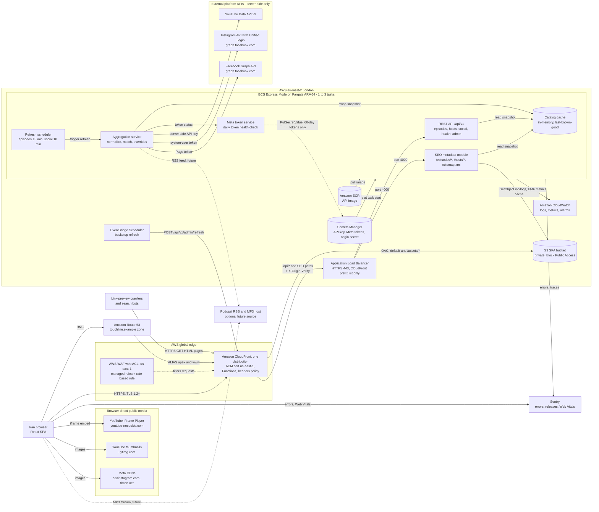
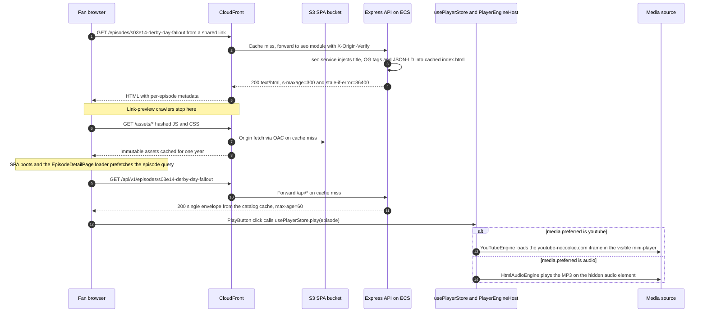
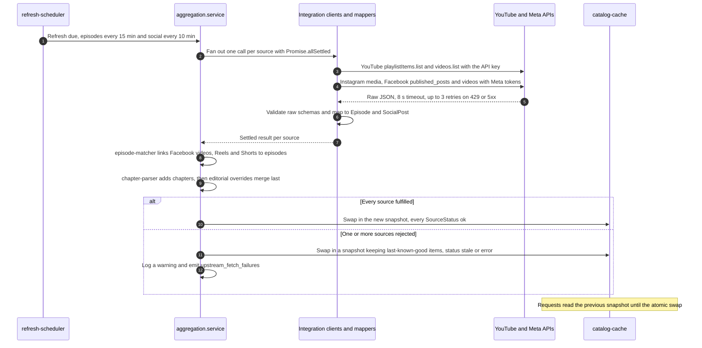
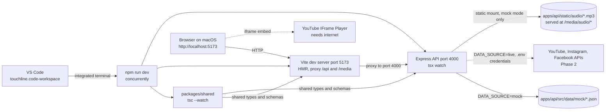
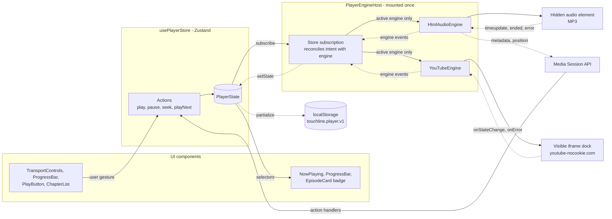
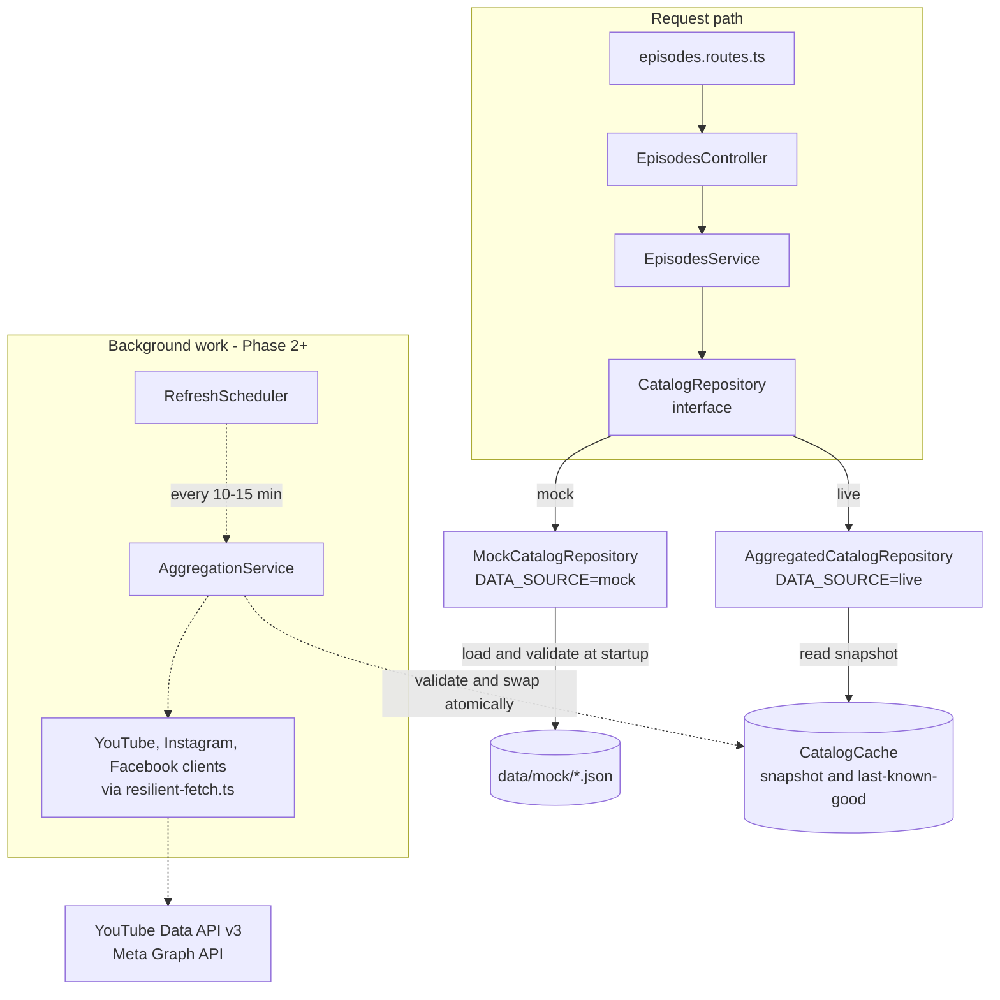
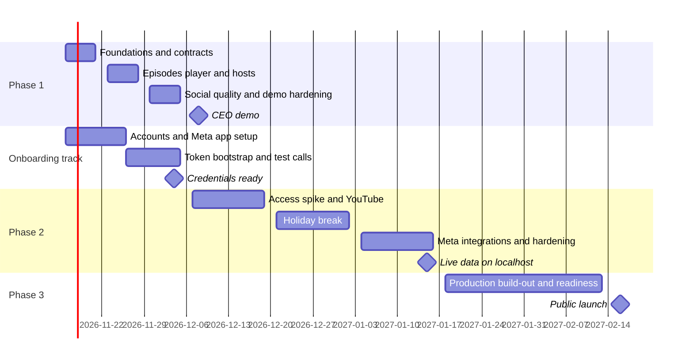
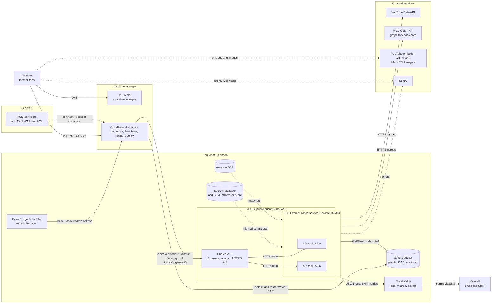
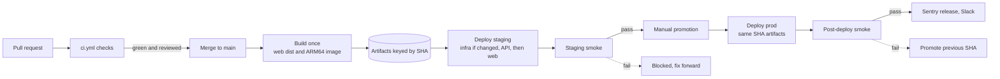

# High-Level Design: Touchline — Football Podcast Website

| Field | Value |
|---|---|
| Version | 0.1 |
| Status | Draft for review |
| Date | 2026-11-07 |
| Author | Solutions Architecture |
| Reviewers | CEO; Engineering Lead — TBD |
| Next review | After the Phase 1 CEO demo (week of 2026-12-07) |

> **Note:** "Touchline" is a working codename (brand undecided, Q1). Domains use the reserved `.example` TLD; the canonical site is `https://www.touchline.example`. Prices, quotas, versions and platform policies are as of Nov 2026; re-verify them at each phase gate.

## Table of Contents

- [Executive Summary](#executive-summary)
- [Scope, Goals & Assumptions](#scope-goals--assumptions)
- [1. System Architecture Overview](#1-system-architecture-overview)
- [2. Frontend Architecture (React)](#2-frontend-architecture-react)
- [3. Backend Architecture (Node.js)](#3-backend-architecture-nodejs)
- [4. Integration & API Contracts](#4-integration--api-contracts)
- [5. Proposed File Structure](#5-proposed-file-structure)
- [6. Phased Delivery Plan](#6-phased-delivery-plan)
- [Appendix A: Risk Register](#appendix-a-risk-register)
- [Appendix B: Open Questions & Decisions Required](#appendix-b-open-questions--decisions-required)
- [Appendix C: Architecture Decision Log](#appendix-c-architecture-decision-log)

## Executive Summary

- **What.** A public, responsive football podcast website: episode archive and pages (show notes, chapters), host bios and a combined social feed, aggregated from YouTube, Instagram and Facebook, where the content stays.
- **Architecture.** A React 19 single-page application (Vite, TypeScript) on a CDN, backed by a Node.js 26 / Express 5 Backend-for-Frontend (BFF) serving a versioned, contract-first REST API (`/api/v1`) defined by Zod schemas in `@touchline/shared` (§1.3, §4.1).
- **Resilience.** A background job refreshes platform data (episodes every 15 minutes, social every 10), never per visitor, so quota use and cost stay flat as traffic grows. On upstream failure, last-known-good data is served and flagged in `meta.sources`. No database in Phases 1-3 (§3.6; P6 in §1.2, ADR-007).
- **Player.** One player, mounted once in the root layout, plays MP3 audio and YouTube embeds across navigation. YouTube policies forbid hidden, background or audio-only playback, so YouTube episodes play in a visible mini-player (≥ 200x200 px); audio-only listening needs an unconfirmed MP3/RSS source (§2.4, Q2).
- **Phases (kickoff 2026-11-16).** Phase 1, mock-data demo: 3 weeks to 2026-12-04; CEO demo week of 2026-12-07. Phase 2, live integration on localhost: 4 working weeks, 2026-12-07 to 2027-01-15, spanning the holiday break. Phase 3, production: 2027-01-18 to 2027-02-12; public launch week of 2027-02-15 (§6.1).
- **Hosting (Option A).** AWS eu-west-2 (London): a private S3 bucket behind one CloudFront distribution that also routes `/api/*` to the Express container on Amazon ECS Express Mode (Fargate); AWS CDK; GitHub Actions via OIDC. AWS App Runner (named in the brief) is ruled out: in maintenance since 2026-04-30 and closed to new customers (§6.4.1).
- **Cost (staging + production, as of Nov 2026 — verify).** Option A: ≈ US$85/month at launch (~10k monthly visitors), mainly the ALB, Fargate tasks, public IPv4 and AWS WAF; ≈ US$142 at ~100k; ≈ US$331 in a ~1M-visitor viral month, when CloudFront and WAF edge charges dominate. Option B (Vercel Pro + Render): ≈ US$59 / 115 / 123, plus unverified viral-month Vercel overage. YouTube and Meta carry media bandwidth. Line items: §6.4.5.
- **Top decisions and risks.**
  1. **Meta platform access** (business portfolio, app and asset roles; App Review and Business Verification only if Advanced Access is needed) is the Phase 2 critical path, starting Phase 1 week 1 (R1, Q3).
  2. **Audio RSS availability** decides whether audio-only and background listening are possible (Q2).
  3. **Brand and domain** must be fixed before Phase 3 DNS, TLS and Meta app settings (Q1).

## Scope, Goals & Assumptions

Anything not under Goals is out of scope for Phases 1-3 unless approved via Appendix B.

### Goals

1. **CEO demo (Phase 1).** By 2026-12-04, every content route (§2.5) works on localhost with mock data (16 episodes, 3 hosts, 24 social posts) on desktop and mobile, offline except YouTube embeds.
2. **Uninterrupted playback.** MP3 and YouTube playback continues across navigation; episode, position, volume and playback rate survive a reload.
3. **Unchanged contract.** By 2027-01-15, `DATA_SOURCE=live` serves real YouTube, Instagram and Facebook content on localhost through the Phase 1 `/api/v1` contract, with no frontend changes.
4. **Freshness.** New YouTube uploads appear within about 21 minutes and new Instagram and Facebook posts within about 16 minutes (YouTube Shorts follow the YouTube cadence, about 21) (refresh interval + 5-minute edge cache + 1-minute browser cache, §3.6); an urgent publish uses the admin refresh plus a CloudFront invalidation.
5. **Graceful degradation.** Losing any one platform never yields a blank page or a 5xx; last-known-good content is shown with the source flagged.
6. **Public launch.** By the week of 2027-02-15, live on the custom domain over HTTPS (TLS 1.2+), deployed only via CI/CD (staging → manual promotion → production, §6.4.3).
7. **Experience quality.** Core Web Vitals "good" at mobile p75 (LCP ≤ 2.5 s, INP ≤ 200 ms, CLS ≤ 0.1) and WCAG 2.2 AA, player included (§1.8, §2.8; Q12).
8. **Shareable episodes.** Episode and host URLs serve per-page title, description, Open Graph/Twitter Card tags and JSON-LD to non-JavaScript crawlers; `/sitemap.xml` lists them (§6.4.4).
9. **Operable, affordable, compliant.** Staging + production stay within the US$120/month launch budget (AWS Budgets alerts at 50/80/100%; §6.4.5, Q10); error tracking, logs, alarms and uptime checks live at launch; `/privacy`, `/terms`, `/data-deletion`, the YouTube Terms link and embed consent are in place.

### Non-Goals

- User accounts, login or personalization; player state lives only in the visitor's browser.
- User-generated content (comments); e-commerce, memberships or payments.
- Self-hosting or transcoding media (Phase 1 demo MP3s are local fixtures only).
- Native mobile apps, live streaming or match coverage, and localization (English only).
- A CMS or database; editorial content is version-controlled JSON (ADR-007).
- Publishing to the platforms; all integrations are read-only.

### Assumptions & Constraints

| ID | Assumption or constraint | Impact if wrong |
|---|---|---|
| A1 | The business owns, or holds admin roles on, the YouTube channel, Facebook Page and a professional (or convertible) Instagram account. | Instagram and Facebook integration is blocked; those sources report `disabled` and the site links out. |
| A2 | Only owned assets are read, so a Development-mode Meta app with Standard Access and admin-role users suffices (no App Review or Business Verification). | Review and verification add weeks of unpredictable Phase 2 lead time (R1). |
| A3 | All needed YouTube data is public: a server-side API key (no OAuth) within the default 10,000-unit daily quota (as of Nov 2026 — verify). | OAuth or a quota extension (needing a YouTube API Compliance Audit); Phases 2-3 slip. |
| A4 | No audio RSS feed or podcast host exists; MP3 playback is limited to demo files (Q2). | If one exists, an `rss` source is added and audio-only listening becomes possible. |
| A5 | The catalog stays in the hundreds of items, so a snapshot fits in memory and services filter, sort and paginate in memory. | A datastore or search index is needed (revisit ADR-007). |
| A6 | 1-3 engineers on macOS + VS Code (Node.js 26, npm, a container runtime); no operations team. | Timeline or tooling changes; operations must stay on managed services. |
| A7 | A company-owned AWS account and GitHub organization exist by 2027-01-18; production in eu-west-2, CloudFront certificates in us-east-1. | Phase 3 starts late; another region changes latency and data residency. |
| A8 | About 10k monthly visitors at launch, growing toward 100k; YouTube and Meta serve all media bandwidth. | Scaling and the cost model (§6.4.5) are revisited (R10). |
| A9 | Brand and domain confirmed by 2027-01-15; `touchline.example` placeholders until then (Q1). | DNS, certificates, Meta app settings and canonical URLs are redone; launch slips. |
| A10 | **Constraint:** YouTube Developer Policies forbid hidden, background, audio-only, obscured or sub-200x200 px playback and require API data to be refreshed or deleted within 30 days. | Loss of API and embed access; the player is designed to comply (§2.4, R5). |
| A11 | **Constraint:** Meta Platform Terms require a public privacy policy and data-deletion instructions and forbid selling Platform Data; signed CDN media URLs expire. | Loss of Meta API access; broken images if media URLs are stored (R8). |
| A12 | **Constraint:** UK GDPR and PECR: embeds and analytics using cookies or device storage need prior consent. | Regulatory exposure; consent and click-to-load embeds are launch blockers (R12). |
| A13 | Engineers maintain editorial content (host bios, episode overrides) as JSON in git, shipped with a normal deploy. | Frequent non-engineer edits require a CMS (Q6). |

## 1. System Architecture Overview

### 1.1 System Summary

Touchline is a public website for a football podcast whose content already lives on YouTube, Instagram and Facebook. A React single-page application (SPA) talks to a Node.js/Express Backend-for-Frontend (BFF), which pulls platform content on a schedule, normalizes it into one catalog of episodes, hosts and social posts (shared Zod schemas), and serves it through a cacheable REST API under `/api/v1`. In production one CloudFront distribution fronts a private S3 bucket (the SPA) and an Amazon ECS Express Mode service on Fargate in eu-west-2 (the API). There is no database: editorial content is version-controlled JSON, and platform data lives in an in-memory catalog refreshed in the background (§3.6).

**Capabilities**

- **Episodes.** Filterable, searchable list; detail pages with show notes, chapters, guests and platform links.
- **Persistent player.** Keeps playing across route changes; MP3 and YouTube engines. YouTube always plays in a visible mini-player, never audio-only (§2.4).
- **Host bios.** Directory and profiles with bios, social links and recent episodes.
- **Unified social feed.** Instagram, Facebook and YouTube Shorts, filterable by platform, with a degraded-source banner.
- **Subscribe links** to the show's channels; **shareable URLs** with per-episode Open Graph previews (Phase 3).

**Actors:** anonymous fans (no accounts); crawlers and link-preview bots, which do not run JavaScript; editors, who change JSON in `apps/api/src/content/` by pull request (no admin UI); and the platforms, whose APIs feed the BFF and whose CDNs serve media to browsers.

### 1.2 Architectural Principles

These six principles bind every later section.

| ID | Principle | Statement | Rationale |
|---|---|---|---|
| P1 | Contract-first | Zod schemas in `packages/shared` (`@touchline/shared`) are the single source of truth for API payload types. | The frontend survives the mock-to-live swap unchanged. |
| P2 | Backend-for-Frontend | The browser never calls the YouTube Data API or Meta Graph APIs; the backend holds every credential and aggregates and normalizes. The browser loads public media directly: YouTube IFrame player (`youtube-nocookie.com`), thumbnails (`i.ytimg.com`), Meta CDN images (`*.cdninstagram.com`, `*.fbcdn.net`). | No secrets in the bundle; quota independent of traffic. |
| P3 | Swappable data sources | `CatalogRepository` has `MockCatalogRepository` (Phase 1) and `AggregatedCatalogRepository` (Phase 2+), selected by `DATA_SOURCE=mock\|live`. | The demo needs no credentials. |
| P4 | Cache-first, degrade gracefully | A background job fetches platform data, never a user request. On upstream failure last-known-good data is served; every response reports per-source status in `meta.sources`. | Platform outages and rate limits never become site outages. |
| P5 | Same-origin everywhere | Locally Vite proxies `/api` to `http://localhost:4000`; in production CloudFront routes `/api/*` to the backend. | No CORS in production; one domain and one relative API base URL. |
| P6 | Boring and cheap | No database in Phases 1-3; a CMS or database only when an open question requires it. | Lowest cost for 1-3 engineers; content reviewed like code. |

### 1.3 Production Architecture Diagram

Phase 3 target; dotted edges are optional. Detail: §6.4.2. Alternatives, and why AWS App Runner is ruled out (closed to new customers since 2026-04-30): §6.4.1.



**Legend: principal flows**

1. **DNS and TLS.** Route 53 ALIAS records point the apex and `www` at CloudFront, which terminates TLS 1.2+ (`TLSv1.2_2021`) with a free ACM certificate issued in us-east-1. A CloudFront Function 301-redirects the apex to `www.touchline.example`, the canonical host (§6.4.2).
2. **Static SPA.** Default and `/assets/*` behaviors read the bucket through Origin Access Control (OAC). Hashed assets are immutable for a year; `index.html` is `no-cache`. A viewer-request function on the default behavior only rewrites extension-less paths to `/index.html` (custom error responses would turn API 404s into `200` HTML).
3. **API.** CloudFront forwards `/api/*` with the secret `X-Origin-Verify` header, whitelisted query strings and no cookies, and honors origin `Cache-Control`. The ALB admits only the CloudFront prefix list; `verify-origin.ts` rejects requests without the header.
4. **SEO previews.** The `seo` module injects title, canonical URL, Open Graph tags and JSON-LD into the current `index.html` (read from S3, cached 60 s). Crawlers stop there; browsers boot the SPA. The headers policy (CSP, `Referrer-Policy: strict-origin-when-cross-origin`) covers these behaviors too (§6.4.4).
5. **Background aggregation.** Each task's scheduler triggers the aggregation service, which calls YouTube and Meta and swaps a new snapshot into the cache. Requests never trigger upstream calls, so call volume grows with task count, not visitors (§3.6, §6.3.5).
6. **Backstop refresh.** EventBridge Scheduler calls the admin refresh (`X-Admin-Key`) through CloudFront (API destination, to be verified, §6.4.2), forcing a refresh on whichever task receives it. A stalled scheduler on another task is caught by the `catalog_age_seconds` alarm (§6.4.4); liveness stays process-only (§3.6).
7. **Browser-direct media.** YouTube and Meta serve video, audio and images, and carry the bandwidth. Signed Meta CDN URLs are re-fetched each refresh, never stored.
8. **Image, secrets, telemetry.** ECS pulls the image from ECR and injects Secrets Manager values as environment variables at task start (§3.8). Telemetry goes to CloudWatch (alarms via SNS) and Sentry.

Platform constraints (as of Nov 2026 — verify):

- **Instagram uses Unified Login** (`graph.facebook.com`); new Meta apps cannot set up Instagram Login. Meta tokens are non-expiring by default; the token service runs a daily health check and alerts on Graph error 190 (§6.3.2).
- **CloudFront pay-as-you-go.** Flat-rate Free and Pro lack the custom cache, origin-request and response-headers policies used here, so the design uses pay-as-you-go plus a separate AWS WAF web ACL from launch (§6.4.2; costs §6.4.5).

### 1.4 Component Responsibilities

Versions as of Nov 2026 — verify (§2.1, §3.1).

| Component | Responsibility | Technology | Phase |
|---|---|---|---|
| Web SPA (`apps/web`) | Pages, routing, data fetching, responsive UI; imports only types from `@touchline/shared` | React 19.2, Vite 8, React Router v8 (data mode), TanStack Query v5 | 1 |
| Persistent player | Playback state, queue, engines, Media Session, shortcuts | Zustand v5, `HtmlAudioEngine`, `YouTubeEngine` | 1 |
| Shared contracts (`packages/shared`) | Schemas, inferred types, constants; source of OpenAPI 3.1 | Zod 4, TypeScript 6 | 1 |
| REST API modules | Validate, call services, return envelopes or Problem Details | Express 5.3, helmet, express-rate-limit, pino-http | 1 |
| Catalog repository | Mock JSON or aggregated live data behind one interface | `CatalogRepository` | 1 (mock), 2 (live) |
| Catalog cache | Current snapshot, stale-while-revalidate, last-known-good | lru-cache, in-process | 2 |
| Aggregation service | Fan-out, episode matching, chapters, editorial overrides | `aggregation/` | 2 |
| Integration clients | Platform HTTP, raw-schema validation, mapping, retries | `resilient-fetch.ts`, per-platform clients | 2 |
| Meta token service | Daily health check; Graph error 190 alerts with re-mint runbook; rotation only with optional 60-day tokens | `meta-token.service.ts` | 2 |
| Scheduler and admin module | In-process timer; authenticated refresh, mounted only when `DATA_SOURCE=live` | `refresh-scheduler.ts`, `POST /api/v1/admin/refresh` | 2 |
| SEO module | Metadata-injected episode and host HTML; `sitemap.xml` | `modules/seo/`, AWS SDK S3 client | 3 |
| Edge | TLS, routing, caching, SPA rewrite, apex-to-www redirect, security headers; private SPA bucket | CloudFront, Functions, AWS WAF, ACM, S3 with OAC | 3 |
| API compute | Container with liveness checks on `/api/v1/health`, auto scaling, canary rollback | ECS Express Mode, Fargate ARM64 0.5 vCPU / 1 GB, 1-3 tasks, ALB, ECR | 3 |
| Platform services | DNS, secrets and configuration, backstop refresh | Route 53, Secrets Manager, SSM Parameter Store, EventBridge Scheduler | 3 |
| Observability | Logs (30 days), metrics, alarms, budgets, errors, uptime | CloudWatch, SNS, Budgets, Sentry, UptimeRobot | 3 |
| Delivery pipeline | Pull-request checks, staging deploy, manual promotion | GitHub Actions with OIDC, AWS CDK | 1 (CI), 3 (CD) |

Backend layering: §3.3. File locations: §5.1.

### 1.5 Key Runtime Flows

#### 1.5.1 Shared Episode Link to Playback

A fan taps a shared episode link on Instagram and presses play.



Notes:

- **Edge caching.** Steps 2-4, 7 and 10-11 run only on a cache miss; no upstream calls (P4).
- **User gesture.** The click satisfies autoplay policies (iOS Safari); `PlayerEngineHost` sits outside the route `Outlet`, so navigation never interrupts playback (§2.4).
- **Other entry points** get the S3 `index.html` and continue from step 6.

#### 1.5.2 Background Catalog Refresh

The only path that calls the platform APIs; it runs in each task.



Notes:

- **Status values.** `stale` while last-known-good data exists, `error` once none is left, `disabled` when turned off by configuration (§4.8).
- **Cold start, liveness and readiness** are owned by §3.6; the ALB checks liveness (`/api/v1/health`) only.
- **Quota:** §6.3.6.

### 1.6 Local Development Topology

Phases 1 and 2 run on a macOS laptop; one root command starts three watchers.



How local matches production:

- **Same origin.** The SPA calls `VITE_API_BASE_URL` (default `/api/v1`); Vite (dev 5173, preview 4173) proxies `/api` and `/media` to port 4000, as CloudFront does in production. `cors` is mounted only when `NODE_ENV=development` and `CORS_ORIGIN` are both set (§3.4).
- **Same API code.** `createApp(container)` is identical everywhere; only environment variables differ (§3.8). `MOCK_LATENCY_MS` and `MOCK_FAIL_SOURCES` demo loading states and the degraded-source banner (§6.2.3).
- **CEO demo.** `npm run demo` runs the built API (`NODE_ENV=production`, `DATA_SOURCE=mock`, `PUBLIC_SITE_URL=http://localhost:4173`) behind `vite preview` on 4173 (§5.4).
- **Known gaps.** The `seo` module, CloudFront Functions and WAF are tested only in staging; every environment polls rather than using webhooks.
- **Pinned toolchain.** `.nvmrc`, `engines` and the `node:26` base image pin Node.js 26, the Active LTS (as of Nov 2026 — verify).

### 1.7 Environments

| Environment | Hosting | Data source | Domain | Purpose | Deploy trigger |
|---|---|---|---|---|---|
| local | macOS: `npm run dev` (5173 + 4000) or `npm run demo` (4173 + 4000) | `mock` (Phase 1); `live` with developer credentials in a git-ignored `.env` (Phase 2) | `http://localhost:5173`, demo `:4173` | Development, CEO demo, Phase 2 live demo | Root scripts |
| staging | AWS eu-west-2, same CDK app, 1 task (0.5 vCPU / 1 GB) | `live`, staging keys, slower refresh | `https://staging.touchline.example` | `smoke:live` gate, Playwright e2e, stakeholder review | Automatic on merge to `main` |
| prod | AWS eu-west-2, 1-3 tasks (minimum 2 at Growth) behind CloudFront | `live`, production credentials | `https://www.touchline.example` | Public website | Manual promotion of staging-tested artifacts (§6.4.3) |

- **Promote, don't rebuild.** Production receives the exact image digest and SPA build verified in staging.
- **Staging stays unindexed** (`robots.txt` disallow, `X-Robots-Tag: noindex`).
- **Production gate.** A manual `workflow_dispatch` promote workflow that only release managers (maintainers listed in `RELEASE_MANAGERS`) can run. Environment required reviewers are added only on GitHub Enterprise or a public repository; private repositories on Free, Pro and Team lack them (as of Nov 2026 — verify).

### 1.8 Non-Functional Requirements

Launch commitments for production. Web Vitals targets use Google's "good" bands (as of Nov 2026 — verify).

| Attribute | Target | How achieved |
|---|---|---|
| Performance (web) | LCP ≤ 2.5 s, INP ≤ 200 ms, CLS ≤ 0.1 at p75 mobile | Edge-cached shell, immutable assets, lazy routes, click-to-load YouTube, sized images (§2.8) |
| Performance (API) | p95 ≤ 200 ms at origin for catalog reads | In-memory snapshot, compression, weak ETags |
| Availability (site) | 99.9% monthly | CloudFront and S3 serve the SPA shell independently of the API. Episode and host deep links are API-rendered: with no healthy task, CloudFront serves the last cached copy for up to 24 h via `stale-if-error`; uncached pages fail until the task is replaced (≤ 10 min at min 1 task; ≈ 0 at min 2) |
| Availability (API) | 99.5% monthly at launch | Liveness checks, task replacement, canary rollback, last-known-good data, `stale-while-revalidate` and `stale-if-error` at the edge; minimum 2 tasks from Growth |
| Freshness | New YouTube upload visible within ~21 min; Instagram/Facebook post within ~16 min (YouTube Shorts ~21 min) | 15/10-min refresh plus `s-maxage=300` and `max-age=60` (§3.6) |
| Scalability | 10x spikes with no manual action | Edge caching; auto scaling to 3 tasks; upstream calls independent of traffic (P4) |
| Security | No browser credentials; TLS 1.2+ on public hops; least privilege | BFF and Secrets Manager; HSTS, CSP, WAF, rate limits; OAC; origin lock-down; GitHub OIDC (§3.9) |
| Privacy | No accounts or personal data stored; UK GDPR/PECR and platform terms | Click-to-load privacy-enhanced YouTube; Meta CDN URLs never persisted; YouTube data refreshed within 30 days; `/privacy`, `/terms`, `/data-deletion` pages (§2.5, §6.4.4) |
| Accessibility | WCAG 2.2 AA | Keyboard-operable player, ARIA sliders, automated checks (§2.7, §2.9) |
| Maintainability | A new engineer runs the stack within 15 minutes of cloning; any layer replaceable alone | npm workspaces, TypeScript strict, shared contracts, layered backend, ADRs, CDK |
| Observability | Errors traceable to a release; alert within 5 min of an outage via CloudFront 5xx and `HealthyHostCount` alarms (about 10 min via uptime checks), and within 2 refresh intervals (≤ 30 min) of a source failure | Structured logs; alarms to SNS; `catalog_age_seconds` alarm; Sentry releases; uptime checks on the home page, `/api/v1/health/ready` and a pinned episode page (§6.4.4) |
| Recoverability | RPO not applicable; RTO ≤ 1 h to rebuild an environment | Stateless containers; everything rebuilt from git, CDK and ECR |
| Cost | Option A ≈ US$85/month at launch, ≈ US$142 at Growth, ≈ US$331 in a viral month (staging + production; §6.4.5) | No database; cache-first aggregation; ARM64 tasks; YouTube and Meta carry media bandwidth; AWS Budgets at US$120/month with 50/80/100% alerts |

## 2. Frontend Architecture (React)

The frontend (`apps/web`, `@touchline/web`) is a client-rendered single-page application. It depends only on the `/api/v1` contract in `@touchline/shared` (P1), never calls YouTube or Meta APIs (P2), and loads only public media directly. Two requirements drive the design: **one persistent player** for MP3 audio and YouTube embeds that survives every route change, and **one build** that runs against mock data locally and live data in production, promoted unchanged to production.

### 2.1 Technology Choices

Versions as of Nov 2026 — verify when scaffolding.

| Concern | Choice | Rationale | Alternatives considered |
|---|---|---|---|
| UI library | React 19.2+ (`react`/`react-dom` 19.2.7 or later) | Mandated; native `<title>`/`<meta>` hoisting | Preact |
| Build | Vite 8 (Rolldown), `@vitejs/plugin-react` 6, via `npm create vite@latest` | Fast HMR, dev/preview proxy, hashed `/assets/*` | Next.js (server runtime the BFF already provides) |
| Language | TypeScript strict; `typescript` pinned `~6.0` | Types from `@touchline/shared`; TS 7 lacks the API typescript-eslint needs | JavaScript with JSDoc |
| Routing | React Router v8, data mode (`createBrowserRouter`, lazy routes) | Loaders, error boundaries, `ScrollRestoration` without SSR | TanStack Router; framework mode (later pre-render path, §2.5) |
| Server state | TanStack Query v5 | Caching, de-duplication, retries, background refresh | SWR; RTK Query |
| Global client state | Zustand v5 with `persist` | Selector subscriptions for a 4 Hz position; no provider (§2.3) | Context, Redux Toolkit, Jotai |
| Styling | CSS Modules with custom-property tokens | Zero runtime, scoped classes | Tailwind; runtime CSS-in-JS |
| Component tests | Vitest 5, React Testing Library, MSW 3 | Reuses Vite config; network-boundary mocks | Jest |
| End-to-end tests | Playwright 1.65 (root `e2e/`) | Chromium, Firefox, WebKit (closest to iOS Safari) | Cypress |
| Errors, Web Vitals | `@sentry/react` ^11 | Release-tied errors, CI-uploaded source maps | CloudWatch RUM |

Pinning and support rules:

- Depend on `react-router@^8`, not `react-router-dom` (its `latest` tag stays 7.x).
- React Router v8 needs Node.js 22.22 or later, which the Node.js 26 Active LTS baseline (§5.3) satisfies.
- Supported browsers: the last two majors of evergreen browsers plus iOS Safari 16.4+, checked by the WebKit Playwright project (§2.9).

### 2.2 Component Hierarchy

`RootLayout` (the root route) stays mounted for the session; only the `Outlet` subtree changes on navigation.

```text
main.tsx                                      # createRoot; removes data-server-meta tags
└── AppProviders                              # QueryClientProvider + top-level error boundary
    └── RouterProvider                        # 'react-router/dom'; routes in app/router.tsx
        └── RootLayout                        # root route; never unmounts
            ├── ScrollRestoration
            ├── SiteHeader
            │   ├── PrimaryNav                # Home, Episodes, Hosts, Social, About
            │   └── SubscribeLinks            # YouTube, Instagram, Facebook
            ├── main > Outlet                 # lazy page chunk
            │   ├── RouteErrorBoundary        # page errors render inside the layout
            │   ├── HomePage
            │   │   ├── HeroFeaturedEpisode   # newest episode + PlayButton
            │   │   ├── LatestEpisodesRail    # EpisodeCard x 6
            │   │   ├── HostsStrip            # HostCard x 3
            │   │   └── SocialHighlights      # SocialPostCard x 6
            │   ├── EpisodesPage
            │   │   ├── EpisodeFilters        # season, host, q
            │   │   ├── EpisodeList           # EpisodeCard, PlatformBadges, PlayButton
            │   │   └── Pagination
            │   ├── EpisodeDetailPage
            │   │   ├── PlayButton
            │   │   ├── PlatformBadges        # "Watch on YouTube" and other links
            │   │   ├── ShowNotes             # linkifyText, never HTML
            │   │   ├── ChapterList           # seeks via the player store
            │   │   └── HostCard x n
            │   ├── HostsPage
            │   │   └── HostGrid -> HostCard
            │   ├── HostDetailPage
            │   │   ├── HostBio -> HostSocialLinks
            │   │   └── EpisodeList           # recentEpisodes
            │   ├── SocialPage
            │   │   ├── PlatformFilter
            │   │   ├── SourceStatusBanner    # driven by meta.sources
            │   │   └── SocialFeed -> SocialPostCard
            │   ├── AboutPage
            │   ├── PrivacyPage               # (P3) static legal page
            │   ├── TermsPage                 # (P3)
            │   ├── DataDeletionPage          # (P3)
            │   └── NotFoundPage
            ├── SiteFooter                    # navigation, legal links, SubscribeLinks
            ├── PersistentPlayer              # visible player bar
            │   ├── NowPlaying
            │   ├── TransportControls
            │   ├── ProgressBar
            │   ├── VolumeControl
            │   ├── PlaybackRateControl
            │   └── QueueDrawer
            └── PlayerEngineHost              # mounted once, outside the Outlet
                ├── HtmlAudioEngine           # one hidden <audio> element
                └── YouTubeEngine             # visible dock, lazy-loaded
```

Shared `components/ui/` primitives are omitted. The brief's four components map to canonical families:

| Brief component | Canonical components | Key props | Data and state |
|---|---|---|---|
| Audio Player | `PersistentPlayer` and children; `PlayButton`; `PlayerEngineHost` | `PlayButton`: `{ episode: PlayableEpisode }` | `usePlayerStore` |
| Episode List | `EpisodeList`, `EpisodeCard`, `EpisodeFilters`, `Pagination`, `PlatformBadges` | `{ episodes: EpisodeSummary[] }` | `['episodes', params]` plus URL state; `EpisodeCard` selects `currentEpisode?.id` |
| Social Feed | `SocialFeed`, `SocialPostCard`, `PlatformFilter`, `SourceStatusBanner` | `{ post: SocialPost }`, `{ sources: SourceStatus[] }` | `['social', params]` (infinite) plus `platform` |
| Host Bios | `HostGrid`, `HostCard`, `HostBio`, `HostSocialLinks` | `{ host: HostSummary; role?: string }` | `['hosts']`, `['host', slug]`, `Episode.hosts` |

Pages own queries and URL parsing. `SocialPostCard` falls back to the thumbnail or a placeholder plus a `permalink` link when `media[].url` is null or expired, and embeds no Meta scripts (§4.7).

### 2.3 State Management Strategy

| Category | Tool | Examples | Rules |
|---|---|---|---|
| Server state | TanStack Query | Episodes, hosts, social feed | Never copied into Zustand; query cache never persisted (§6.3.8) |
| Global client state | Zustand `usePlayerStore` (`features/player/store/playerStore.ts`) | Episode, queue, status, position, volume, rate | One store, player domain only |
| URL state | `useSearchParams` | `page`, `season`, `host`, `q`, `platform` | Source of truth for filters and pagination |
| Local UI state | `useState` / `useReducer` | Drawer open, search draft, image failure | Owning component only |
| Persisted state | `persist` to `localStorage` key `touchline.player.v1` | `currentEpisode`, `positionSeconds`, `volume`, `playbackRate`, `queue`, `episodesRefreshedAt` | Never `status`. `PlayableEpisode` copies are YouTube API data: refreshed on rehydrate, discarded after 30 days (YouTube Developer Policies III.E.4) |

#### Player store

Excerpt with the canonical types; other actions follow the same `set`/`get` pattern, and `playNext()` on an empty queue sets `ended` with position 0.

```ts
import { create } from 'zustand';
import { createJSONStorage, persist } from 'zustand/middleware';
import type { EpisodeSummary } from '@touchline/shared';

export type PlayableEpisode = Pick<EpisodeSummary, 'id' | 'slug' | 'title' | 'artwork' | 'durationSeconds' | 'media'>;
export type PlaybackStatus = 'idle' | 'loading' | 'playing' | 'paused' | 'ended' | 'error';
export type PlaybackRate = 0.75 | 1 | 1.25 | 1.5 | 2;

export interface PlayerState {
  currentEpisode: PlayableEpisode | null;
  queue: PlayableEpisode[];
  status: PlaybackStatus;
  engine: 'audio' | 'youtube' | null;
  positionSeconds: number;
  durationSeconds: number;
  volume: number;
  muted: boolean;
  playbackRate: PlaybackRate;
  errorMessage: string | null;
  episodesRefreshedAt: number | null;
}

export interface PlayerActions {
  play: (episode: PlayableEpisode, options?: { startAtSeconds?: number }) => void;
  pause: () => void;
  resume: () => void;
  togglePlay: () => void;
  seek: (seconds: number) => void;
  skipBy: (deltaSeconds: number) => void;
  setVolume: (volume: number) => void;
  toggleMute: () => void;
  setPlaybackRate: (rate: PlaybackRate) => void;
  enqueue: (episode: PlayableEpisode) => void;
  playNext: () => void;
  clearQueue: () => void;
}

const POSITION_PERSIST_STEP_SECONDS = 5;

export const usePlayerStore = create<PlayerState & PlayerActions>()(
  persist(
    (set, get) => ({
      currentEpisode: null, queue: [], status: 'idle', engine: null, positionSeconds: 0, durationSeconds: 0,
      volume: 0.8, muted: false, playbackRate: 1, errorMessage: null, episodesRefreshedAt: null,
      play: (episode, options) =>
        set({
          currentEpisode: episode,
          engine: episode.media.preferred,
          status: 'loading',
          positionSeconds: options?.startAtSeconds ?? 0,
          durationSeconds: episode.durationSeconds,
          errorMessage: null,
          episodesRefreshedAt: get().episodesRefreshedAt ?? Date.now(),
        }),
      seek: (seconds) => set({ positionSeconds: Math.min(Math.max(seconds, 0), get().durationSeconds) }),
    }),
    {
      name: 'touchline.player.v1',
      version: 1,
      storage: createJSONStorage(() => localStorage),
      partialize: (state) => ({
        currentEpisode: state.currentEpisode,
        queue: state.queue,
        volume: state.volume,
        playbackRate: state.playbackRate,
        episodesRefreshedAt: state.episodesRefreshedAt,
        positionSeconds:
          Math.floor(state.positionSeconds / POSITION_PERSIST_STEP_SECONDS) * POSITION_PERSIST_STEP_SECONDS,
      }),
    },
  ),
);
```

Store conventions:

- **Intent, then truth.** `play()` sets `loading`; the engine reports the real status (§2.4).
- **Quantized position, synchronous hydration.** Storage changes at most every 5 s; `status` starts `idle`, so a reload never auto-plays.
- **Expiring episode copies.** `play()` and `enqueue()` stamp `episodesRefreshedAt` when it is null. `onRehydrateStorage` drops `currentEpisode` and `queue` when the stamp is over 30 days old; otherwise `PlayerEngineHost` refreshes each persisted episode via `['episode', slug]` at startup, removes 404s and resets the stamp.
- **Versioned and fine-grained.** Shape changes bump `version` with a `migrate`; only `ProgressBar` and the time readout subscribe to `positionSeconds`.

**Why Zustand.** React Context re-renders every consumer on each change, so a 4 Hz position would re-render every `PlayButton`. Redux Toolkit is overkill for one domain; Jotai suits independent atoms better than one cohesive player. Zustand needs no provider, offers selector subscriptions, is callable outside React (engines use `getState()`), and weighs about 1 kB.

#### TanStack Query configuration

| Query key | Factory (`features/*/api/*Queries.ts`) | `staleTime` | Used by |
|---|---|---|---|
| `['episodes', params]` | `episodeQueries.list(params)` | 60 s | `HomePage` (`{ page: 1, pageSize: 7 }`), `EpisodesPage` |
| `['episode', slug]` | `episodeQueries.detail(slug)` | 60 s | `EpisodeDetailPage` (loader), player refresh |
| `['hosts']` | `hostQueries.list()` | 60 s | `HostsPage`, `HostsStrip`, `EpisodeFilters` |
| `['host', slug]` | `hostQueries.detail(slug)` | 60 s | `HostDetailPage` (loader) |
| `['social', params]` | `socialQueries.feed(params)` (infinite) | 30 s | `SocialPage`, `SocialHighlights` |

Defaults (`app/queryClient.ts`): `retry` 2 for network errors and 5xx only; `refetchOnWindowFocus` on (responses are edge-cached, §3.6); `placeholderData: keepPreviousData` for pages; the social feed is a `useInfiniteQuery` on `meta.nextCursor` with a "Load more" button, not infinite scroll (keyboard users must reach the footer). Loaders call `queryClient.query({ ...options, staleTime: 'static' })`; `ensureQueryData` is deprecated since 5.107 and not used.

### 2.4 Persistent Audio Player Design

#### Placement and lifecycle

`PlayerEngineHost` renders once inside `RootLayout`, beside `<main><Outlet /></main>`, so route changes never unmount the `<audio>` element or the YouTube iframe; page errors render inside the layout (§2.5). The iframe never moves in the DOM (re-parenting reloads it); the dock changes only through CSS. The audio engine alone keeps playing in hidden tabs and drives lock-screen controls.

`PlayerEngineHost` reconciles store intent with the active engine through `usePlayerStore.subscribe`:

1. **Episode change.** Stop the outgoing engine (destroying a YouTube player, so no hidden iframe remains), then `load(source, positionSeconds)` and `play()` the engine named by `media.preferred`. For audio, `load()` sets `src` synchronously and the host calls `play()` in the same tick without awaiting it, staying inside the click's user activation; the start position applies on `loadedmetadata`. Only YouTube's `load()` is awaited.
2. **Play, pause, volume, rate** map to idempotent engine calls (`setVolume(muted ? 0 : volume)`).
3. **Seeks.** A `positionSeconds` the engine did not report itself becomes `seek()`.
4. **Engine events** (status, progress, duration, errors) are written back with `setState`; `ended` triggers `playNext()`.

#### Playback engines

```ts
import type { PlaybackRate, PlaybackStatus } from '../store/playerStore';

export type PlaybackSource =
  | { kind: 'audio'; url: string; mimeType: string }
  | { kind: 'youtube'; videoId: string };

export interface PlaybackEngineEvents {
  onStatusChange: (status: PlaybackStatus) => void;
  onProgress: (positionSeconds: number, durationSeconds: number) => void;
  onError: (message: string, code: string) => void;
}

/** Imperative adapter around one media technology. Created and owned by PlayerEngineHost. */
export interface PlaybackEngine {
  readonly kind: 'audio' | 'youtube';
  load(source: PlaybackSource, startAtSeconds: number): Promise<void>;
  play(): Promise<void>;
  pause(): void;
  seek(seconds: number): void;
  setVolume(volume: number): void;
  setPlaybackRate(rate: PlaybackRate): void;
  destroy(): void;
}
```

| Aspect | `HtmlAudioEngine` | `YouTubeEngine` |
|---|---|---|
| Source | `media.audio.url` (demo MP3s at `/media/audio/*`; future RSS) | `media.video.videoId` |
| Surface | One reused hidden `<audio preload="metadata">` | `YT.Player` in a visible dock, `host: 'https://www.youtube-nocookie.com'` (undocumented, long-standing) |
| Loading, progress | Eager; `timeupdate` | Imported on first YouTube play (singleton `iframe_api` loader); polls `getCurrentTime()` every 250 ms while playing |
| Options | Not applicable | `playsinline: 1`, `rel: 0`, `enablejsapi: 1`, `origin: window.location.origin`, `autoplay: 0` |
| Errors | `MediaError`; `NotAllowedError` from `play()` | `onError` 2, 5, 100, 101, 150, 153; `onAutoplayBlocked` |

#### YouTube policy constraints

Binding rules from the YouTube Developer Policies and Required Minimum Functionality (as of Nov 2026 — verify):

- **Visible and unobscured.** The dock is never below 200x200 px (480x270 px target, §2.7); controls sit beside or below it, and nothing stacks above it.
- **No audio-only or background mode.** YouTube content is never hidden, offscreen, transparent or shrunk; collapsing the dock pauses first. Audio-only listening needs an MP3/RSS source (Appendix B, Q2).
- **No autoplay.** Playback starts only from a user action with the dock fully visible.
- **Attribution.** The dock and `PlatformBadges` link to `media.video.watchUrl`; same-channel end-screen suggestions cannot be disabled.
- **Referrer and privacy.** HTML carries `Referrer-Policy: strict-origin-when-cross-origin` (else error 153), and the iframe is created only on the first explicit play behind a click-to-load facade (both §6.4.4).

#### Data flow



#### Media Session, keyboard and accessibility

- **Media Session (`useMediaSession`, audio only):** metadata, play/pause/seek handlers, `nexttrack` with a queue, `setPositionState` at most once per second.
- **Shortcuts (`usePlayerKeyboardShortcuts`):** Space toggles play, Left/Right call `skipBy(-15)`/`skipBy(30)`, Escape closes `QueueDrawer`; never fired from text inputs, form controls, links or sliders, or with modifiers.
- **Semantics:** native range inputs with `aria-valuetext` ("12 minutes 4 seconds of 58 minutes"); track changes announced once via `role="status"`.

#### Edge cases

| Scenario | Behavior |
|---|---|
| Autoplay blocked | `NotAllowedError` sets `paused` with "Tap to play"; YouTube `onAutoplayBlocked` asks for the video's own play control. Nothing plays on load or reload |
| iOS Safari | The reused `<audio>` is unlocked by the first gesture, so `playNext()` works; `VolumeControl` is hidden where volume is read-only |
| Errors | Audio `error`, or `stalled` over 10 s, sets `error` with Retry from `positionSeconds`. YouTube 100: "Video unavailable"; 101/150: "Watch on YouTube"; 153: reported to Sentry |
| Resume | Rehydrated state shows "Resume at 12:30"; `resume()` from `idle` plays from the saved position inside the gesture |

### 2.5 Routing Strategy

| Path | Page | Data (query key) | Search params | Lazy |
|---|---|---|---|---|
| `/` | `HomePage` | `['episodes', { page: 1, pageSize: 7 }]`, `['hosts']`, `['social', { limit: 6 }]` | none | Yes |
| `/episodes` | `EpisodesPage` | `['episodes', params]`, `['hosts']` | `page`, `season`, `host`, `q` | Yes |
| `/episodes/:slug` | `EpisodeDetailPage` | `['episode', slug]` (loader) | none | Yes |
| `/hosts` | `HostsPage` | `['hosts']` | none | Yes |
| `/hosts/:slug` | `HostDetailPage` | `['host', slug]` (loader) | none | Yes |
| `/social` | `SocialPage` | `['social', { platform }]` | `platform` | Yes |
| `/about` | `AboutPage` | none | none | Yes |
| `/privacy` (Phase 3) | `PrivacyPage` | none | none | Yes |
| `/terms` (Phase 3) | `TermsPage` | none | none | Yes |
| `/data-deletion` (Phase 3) | `DataDeletionPage` | none | none | Yes |
| `*` | `NotFoundPage` | none | none | No (tiny; also used by `RouteErrorBoundary`) |

Phase 3 adds `/privacy`, `/terms` and `/data-deletion` (`features/legal/pages/`), required by YouTube and Meta terms (§6.4.4), following the `AboutPage` pattern; `SiteFooter` links to them and to the YouTube Terms of Service.

```tsx
import { createBrowserRouter, type LoaderFunctionArgs } from 'react-router';
import { NotFoundPage } from '../components/NotFoundPage';
import { Skeleton } from '../components/ui/Skeleton';
import { episodeQueries } from '../features/episodes/api/episodeQueries';
import { hostQueries } from '../features/hosts/api/hostQueries';
import { queryClient } from './queryClient';
import { RootLayout } from './RootLayout';
import { RouteErrorBoundary } from './RouteErrorBoundary';

function slugFrom({ params }: LoaderFunctionArgs): string {
  if (!params.slug) throw new Response('Not Found', { status: 404 });
  return params.slug;
}

export const router = createBrowserRouter([
  {
    path: '/',
    Component: RootLayout,
    ErrorBoundary: RouteErrorBoundary,
    children: [
      {
        ErrorBoundary: RouteErrorBoundary,
        HydrateFallback: Skeleton,
        children: [
          { index: true, lazy: () => import('../features/home/pages/HomePage') },
          { path: 'episodes', lazy: () => import('../features/episodes/pages/EpisodesPage') },
          {
            path: 'episodes/:slug',
            loader: async (args) => {
              await queryClient.query({ ...episodeQueries.detail(slugFrom(args)), staleTime: 'static' });
              return null;
            },
            lazy: () => import('../features/episodes/pages/EpisodeDetailPage'),
          },
          { path: 'hosts', lazy: () => import('../features/hosts/pages/HostsPage') },
          {
            path: 'hosts/:slug',
            loader: async (args) => {
              await queryClient.query({ ...hostQueries.detail(slugFrom(args)), staleTime: 'static' });
              return null;
            },
            lazy: () => import('../features/hosts/pages/HostDetailPage'),
          },
          { path: 'social', lazy: () => import('../features/social/pages/SocialPage') },
          { path: 'about', lazy: () => import('../features/about/pages/AboutPage') },
          { path: 'privacy', lazy: () => import('../features/legal/pages/PrivacyPage') },
          { path: 'terms', lazy: () => import('../features/legal/pages/TermsPage') },
          { path: 'data-deletion', lazy: () => import('../features/legal/pages/DataDeletionPage') },
          { path: '*', Component: NotFoundPage },
        ],
      },
    ],
  },
]);
```

Router wiring:

- **Imports.** `RouterProvider` from `react-router/dom`; everything else from `react-router`.
- **Lazy routes.** `lazy` resolves to route properties, not a default export: each page module exports its page as `Component` (`export { EpisodesPage as Component }`). Loaders stay static, so they run while the chunk downloads.
- **Pathless child route.** Its `ErrorBoundary` renders page errors inside `RootLayout`, so the player survives (the root one is a last resort); its `HydrateFallback` shows a page `Skeleton` while a cold deep link's chunk and loader resolve.
- **`RouteErrorBoundary`** renders `NotFoundPage` for 404s, reloads once per session when a chunk fails after a deploy (interrupting playback, a rare accepted cost), and otherwise shows `ErrorState` with Retry and reports to Sentry.

URL design rules:

1. **Slugs** are lowercase kebab-case and stable (`s03e14-derby-day-fallout`, `jordan-reyes`); internal IDs never appear in URLs. If the loaded episode's `slug` differs from the URL (matched by its leading episode code, §4.4), `EpisodeDetailPage` calls ``navigate(`/episodes/${episode.slug}`, { replace: true })``.
2. **Search params hold the state.** Pages parse and clamp them; defaults are never written (no `page=1`). Changing a filter resets `page`; `q` is written after a 300 ms debounce with `{ replace: true }`.
3. **Canonical URLs** are `https://www.touchline.example` plus the path (`/episodes` keeps only `page`); views with `q` are `noindex`.

**Code splitting.** The shell carries `RootLayout`, header, footer, player UI, `HtmlAudioEngine`, `apiClient` and the query factories; each page and `YouTubeEngine` are separate chunks. Deploys keep the previous release's `/assets/*` so open tabs can still load chunks (§6.4.3).

**Navigation, 404s and head tags.** On a pathname change `RootLayout` focuses the page `<h1>`. Unknown paths and slugs render `NotFoundPage` (`noindex`) inside the layout; real 404 statuses come from the `seo` module (§6.4.4). Pages render React 19 `<title>`, `<meta name="description">` and `<link rel="canonical">`. Server-provided head tags carry `data-server-meta`; `main.tsx` removes them before the first render, so React owns head metadata without duplicates.

**Deep links.**

| Environment | Mechanism |
|---|---|
| Local dev (:5173), demo (`vite preview`, :4173) | Vite's SPA fallback; `/api` and `/media` proxy to `http://localhost:4000` (§1.6) |
| Production | CloudFront Function on the default S3 behavior rewrites extension-less paths to `/index.html`; `/episodes/*` and `/hosts/*` get `index.html` with injected share tags from the `seo` module (§6.4.4) |

Later option: framework mode with pre-rendering, if the `seo` module becomes a bottleneck.

### 2.6 Data Fetching & API Client

`lib/apiClient.ts` is the only module that calls `fetch`:

1. **Base URL.** `VITE_API_BASE_URL`, default `/api/v1`: same-origin everywhere (P5), `credentials: 'omit'`. `VITE_*` values are public, never secrets.
2. **Typed calls.** `getJson<T>(path, { query, signal, contract })` returns the body typed as `T`, from `import type` envelope types in `@touchline/shared`. Query values are serialized in a stable order so edge cache keys do not fragment (§3.6). Example: `fetchEpisodes(params, signal)` calls `getJson<EpisodeListResponse>('/episodes', { query: params, signal, contract: 'EpisodeListResponse' })`.
3. **Cancellation and timeout.** The query's `AbortSignal` is combined with `AbortSignal.timeout(10_000)` via `AbortSignal.any` when present, otherwise a small combiner (one `AbortController` aborted by either signal).
4. **Validation (development builds and Vitest only).** Behind `import.meta.env.DEV`, the client dynamically imports the named `contract` schema from `@touchline/shared` and parses the body; a mismatch throws an `ApiError` of kind `contract` naming the endpoint and Zod issue paths. Production builds, staging included, compile this out, contain no Zod and trust the typed body, so additive changes never break a page (tolerant-reader rules, §4.11). Drift is caught by server-side snapshot validation and the CI contract gates (§4.11).
5. **Errors.** `application/problem+json` responses become an `ApiError` with `status`, `type`, `title`, `detail`, `requestId` and field `errors` (§4.9); non-JSON failures keep the HTTP status; a rejected `fetch` becomes kind `network`.
6. **Reporting.** 5xx responses and network errors that persist after retries go to Sentry, tagged with `requestId`; the Sentry environment derives from `window.location.hostname`.

```ts
import { keepPreviousData, queryOptions, useQuery } from '@tanstack/react-query';
import { fetchEpisode, fetchEpisodes, type EpisodeListParams } from './episodesApi';

const EPISODES_STALE_TIME_MS = 60_000;

export const episodeQueries = {
  list: (params: EpisodeListParams) =>
    queryOptions({
      queryKey: ['episodes', params],
      queryFn: ({ signal }) => fetchEpisodes(params, signal),
      staleTime: EPISODES_STALE_TIME_MS,
    }),
  detail: (slug: string) =>
    queryOptions({
      queryKey: ['episode', slug],
      queryFn: ({ signal }) => fetchEpisode(slug, signal),
      staleTime: EPISODES_STALE_TIME_MS,
    }),
};

export function useEpisodes(params: EpisodeListParams) {
  return useQuery({ ...episodeQueries.list(params), placeholderData: keepPreviousData });
}
```

| UX state | Trigger | UI |
|---|---|---|
| Initial load | `isPending` | `Skeleton` sized like the content (CLS 0); `aria-busy="true"` |
| Paging or refetch | `isPlaceholderData` | Previous results stay visible, dimmed |
| Empty | `data.length === 0` | `EmptyState` with "Clear filters" |
| Error | `isError` | `ErrorState` with Retry and "Reference: {requestId}" |
| Partial data | A `meta.sources[].status` is `stale` or `error` | `SourceStatusBanner` (`role="status"`), e.g. "Instagram posts may be out of date (last updated 14:05)"; other content renders. `disabled` sources show no banner and are hidden from `PlatformFilter` (§4.8) |
| Offline | `onlineManager` offline | Cached data stays with an offline notice; queries resume on reconnect |

### 2.7 Styling, Responsiveness & Accessibility

**Design tokens** (`styles/tokens.css`, CSS custom properties) are the only values CSS Modules use.

| Group | Examples | Rule |
|---|---|---|
| Color | `--color-bg`, `--color-text`, `--color-accent`, `--color-focus` | Pairs documented with contrast: 4.5:1 body text; 3:1 large text, UI parts, focus rings |
| Spacing and type | `--space-1` (4 px) to `--space-8`; `--font-size-sm` to `--font-size-3xl` via `clamp()` | 4 px scale; `rem` units |
| Layout | `--player-bar-height` (64 px mobile, 80 px desktop), `--content-max-width` (1200 px) | Drives content offsets and `scroll-padding-bottom` |
| Motion | `--duration-fast` (120 ms), `--duration-base` (200 ms) | `0ms` under `prefers-reduced-motion` |
| Stacking | `--z-header`, `--z-drawer`, `--z-player`, `--z-youtube-dock` | The YouTube dock is highest |

**Breakpoints (mobile-first):** base (one column, menu navigation); sm 640 px (two columns); md 960 px (inline navigation, three columns, desktop bar); lg 1280 px (four columns). Slot-dependent cards use container queries.

| Player element | Mobile (below 960 px) | Desktop |
|---|---|---|
| Player bar | Bottom, 64 px plus `env(safe-area-inset-bottom)`: artwork, title, play, skip; tap expands a full-screen sheet | Bottom, 80 px: `NowPlaying` left, transport and progress center, volume, rate, queue right |
| YouTube dock | Full width at 16:9 above the bar, at least 200 px tall; repositioned by CSS only | 480x270 px, bottom-right above the bar |
| Content offset | `padding-bottom` and `scroll-padding-bottom` equal the bar height, plus the dock while YouTube is active | Same |

```css
.youtubeDock {
  position: fixed;
  inset-inline: 0;
  bottom: calc(var(--player-bar-height) + env(safe-area-inset-bottom));
  z-index: var(--z-youtube-dock);
  aspect-ratio: 16 / 9;
  min-width: 200px;
  min-height: 200px;
}

@media (min-width: 960px) {
  .youtubeDock {
    inset-inline: auto var(--space-4);
    width: 480px;
  }
}
```

**WCAG 2.2 AA checklist (app-specific).**

| Criterion | Requirement |
|---|---|
| 2.4.3, 2.4.11 Focus Order, Focus Not Obscured | Skip link; focus to `<h1>` on navigation; `scroll-padding-bottom` clears the bar and dock |
| 4.1.2 Name, Role, Value | Native range inputs with `aria-valuetext`; `PlayButton` labels include the title ("Play Derby Day Fallout") |
| 2.5.7, 2.5.8 Dragging, Target Size | Seek by tap, keyboard, skip buttons or chapters; targets at least 24x24 px, transport 44x44 px |
| 1.2.1, 1.2.2 Audio-only, Captions | Editor-reviewed YouTube captions (auto-captions mangle player and club names); transcripts for MP3 episodes (Appendix B, Q16) |
| 1.4.1, 1.4.3, 1.4.11 Color and Contrast | Checked at token level; badges carry text, not color alone |
| 1.4.2, 2.2.2, 2.1.1, 2.1.2 Audio, Motion, Keyboard | Nothing autoplays; animations stop after 5 s; every player function keyboard-operable; `QueueDrawer` traps focus only while open |
| 4.1.3, 1.4.10 Status Messages, Reflow | "Now playing" and `SourceStatusBanner` use `role="status"`; usable at 320 CSS px with the 200 px dock |

### 2.8 Performance Budget

Targets follow §1.8 (as of Nov 2026 — verify); field data from Sentry, Lighthouse on the demo build before each phase gate.

| Metric | Budget | Technique |
|---|---|---|
| Shell JS (gzip) | 180 KB or less | Lazy pages; `YouTubeEngine` on demand; no Zod or UI kit in production; CI size check |
| Route chunk / total CSS (gzip) | 60 KB / 30 KB or less | Feature folders match routes; CSS Modules split per chunk |
| LCP (p75 mobile) | 2.5 s field, 2.0 s lab | Hero artwork `fetchpriority="high"`; `preconnect` to `i.ytimg.com`; immutable assets; edge-cached API |
| INP (p75) | 200 ms or less | 4 Hz updates confined to `ProgressBar`; `useDeferredValue` for `q` |
| CLS (p75) | 0.1 or less | Image dimensions from the contract; sized skeletons; reserved bar and dock space; font metric overrides |
| Images | 100 KB or less above the fold | `ResponsiveImage` with `sizes`, `srcset` and `loading="lazy"` below the fold |
| YouTube third party | No connection to YouTube hosts before the first explicit play | The IFrame API script is injected on that click; the facade thumbnail is the only YouTube request before it |
| Fonts | 1 family, 2 WOFF2 files at most | System body stack; preloaded subset display font |

Exceeding a budget fails CI; raising one needs an ADR.

### 2.9 Frontend Testing Strategy

| Layer | Tool | Example assertions |
|---|---|---|
| Unit | Vitest | Persisted payload never contains `status`; a 31-day-old payload drops `queue`; `formatDuration(3725)` is `"1:02:05"` |
| Engine | Vitest, stubbed `HTMLMediaElement`, fake `YT.Player` | YouTube error 150 shows "Watch on YouTube" |
| Component | Vitest, React Testing Library, MSW 3, real `apiClient` | Search updates `q`; a 500 shows `ErrorState` with the reference; a stale source shows `SourceStatusBanner` |
| Contract | Vitest with `@touchline/shared` | MSW fixtures parse with the shared schemas, so fixture drift fails the run (complements §4.11) |
| End-to-end | Playwright on `npm run demo` (:4173), Chromium and WebKit, desktop and mobile | An MP3 keeps playing on the same `<audio>` across Home, Hosts and Social; reload shows "Resume at"; a stubbed `iframe_api` yields a dock of at least 200x200 px |
| Accessibility | `@axe-core/playwright` plus manual passes | Zero serious or critical violations on every route; Space in search types a space; VoiceOver pass before the CEO demo and launch |

Setup: `apps/web/vite.config.ts` has its own `test` block (Vitest 5 ignores parent configs); `src/test/setup.ts` starts MSW with `onUnhandledFrame: 'error'`. Coverage target: 80% lines for `features/player` and `lib/`. All layers run on every pull request; post-deploy gates are in §6.4.3; a nightly journey against the real YouTube embed catches IFrame API changes.

## 3. Backend Architecture (Node.js)

The backend (`apps/api`, `@touchline/api`) is a single Express 5 Backend-for-Frontend (BFF): it serves the `@touchline/shared` contract, keeps platform credentials server-side, and turns three platform APIs into one cached catalog. Payloads are in §4, platform integration in §6.3 and hosting in §6.4.2.

### 3.1 Responsibilities & Technology Choices

| Responsibility | Description | Phase |
|---|---|---|
| Serve the contract | Every `/api/v1/*` response matches the shared schemas and envelopes (§4.3); mock and live data are indistinguishable (P1) | 1 |
| Aggregate and normalize | Fetch, validate, map, match and merge platform data (§6.3.4, §6.3.5) | 2 |
| Cache and refresh | A background job refreshes an in-memory snapshot; requests never call upstreams (P4) | 1 / 2 |
| Hold secrets | Platform tokens, the admin key and the origin secret exist only server-side (P2) | 2 / 3 |
| Report source health | Per-platform status in every `meta.sources` and in readiness | 1 |
| Serve SEO HTML | The `seo` module serves the SPA shell with per-page metadata and `/sitemap.xml` (§6.4.4) | 3 |

Out of scope: user accounts, a database (P6) and media hosting.

**Technology choices** (versions as of Nov 2026 — verify)

| Concern | Choice | Rationale |
|---|---|---|
| Runtime | Node.js 26 Active LTS (`.nvmrc`, `engines`, `node:26` image) | One runtime everywhere; meets Vite 8, Vitest 5, MSW 3 minimums |
| Framework | Express 5 (`express@^5.3.0`) | Native async error forwarding; mature; easy for 1-3 engineers |
| Language and build | TypeScript strict, `typescript` pinned `~6.0`; `tsx watch` in dev, `tsc` for builds | TypeScript 7 lacks the programmatic API typescript-eslint needs |
| Validation | Zod 4 via `@touchline/shared` | One schema set for requests, fixtures and tests |
| Logging and hardening | pino 10 + pino-http 11; helmet 8; `compression`; express-rate-limit 8 | Structured, redacted logs; safe defaults (§3.4) |
| Cache and outbound HTTP | lru-cache 11; native `fetch` wrapped by `resilient-fetch.ts` | Single-flight TTL cache; one retry policy (§3.7) |
| API docs | `@asteasolutions/zod-to-openapi` ^9 (OpenAPI 3.1), Swagger UI | Generated from the contract |
| Testing and monitoring | Vitest 5, Supertest, MSW 3; `@sentry/node` ^11 | §3.11, §3.10 |
| AWS SDK v3 (Phase 3) | S3; Secrets Manager only with 60-day Meta tokens | SPA shell for `seo`; rotated Meta tokens (§6.3.2) |

### 3.2 RESTful API Design

**Conventions**

- **Versioning and naming.** Everything lives under `/api/v1`; breaking changes ship as `/api/v2` alongside it (§4.1). Plural nouns, kebab-case paths, camelCase JSON. Reads are `GET`; the only write is the admin refresh; unknown query parameters return 400.
- **Identifiers.** Slugs in URLs (`^[a-z0-9]+(?:-[a-z0-9]+)*$`, at most 120 characters); opaque `id` values in payloads and joins.
- **Formats.** JSON success bodies use the collection, cursor or single envelope with `meta.generatedAt` and `meta.sources` (§4.3); errors are RFC 9457 Problem Details (§4.9).

**Endpoint catalog**

| Method | Path | Purpose | Query / body | Success | Errors | Phase |
|---|---|---|---|---|---|---|
| GET | `/api/v1/health` | Liveness | — | 200 `{ status: "ok", version, commit, uptimeSeconds }` | — | 1 |
| GET | `/api/v1/health/ready` | Readiness with per-source status | — | 200 (§4.8) | 503 until a snapshot exists and at least one source has succeeded | 1 / 2 |
| GET | `/api/v1/episodes` | Episode list | `page` (1), `pageSize` (12, max 50), `season`, `host`, `platform` (`youtube`, `facebook`), `q` (title, summary, guests, tags), `sort` (`-publishedAt`, `publishedAt`) | 200 collection of `EpisodeSummary` | 400, 429, 503 | 1 |
| GET | `/api/v1/episodes/:slug` | Episode detail; falls back to the leading episode code (`s03e14-`), 404 only if neither matches (§4.4) | — | 200 single `Episode` | 400, 404, 429, 503 | 1 |
| GET | `/api/v1/hosts` | All hosts, unpaginated | — | 200 collection of `Host` (`meta.page` = 1) | 429, 503 | 1 |
| GET | `/api/v1/hosts/:slug` | Host detail | — | 200 single `HostDetail` (up to 6 `recentEpisodes`) | 400, 404, 429, 503 | 1 |
| GET | `/api/v1/social/feed` | Merged social feed | `platform` (subset of `instagram,facebook,youtube`), `limit` (12, max 30), `cursor` | 200 cursor collection of `SocialPost` | 400, 429, 503 | 1 |
| POST | `/api/v1/admin/refresh` | Out-of-cycle refresh; mounted only when `DATA_SOURCE=live` | Header `X-Admin-Key`; optional `{ "sources": Platform[] }` | 202 single envelope `{ data: { refreshId, sources, acceptedAt }, meta }` (§4.10) | 400, 401, 413, 429 | 2 |
| GET | `/api/docs` | Swagger UI | — | 200 HTML | Not mounted when `NODE_ENV=production` | 1 |
| GET | `/media/audio/:file` | Demo MP3s from `apps/api/static/audio/` | `Range` | 200 / 206 | 404 | 1-2; only when `DATA_SOURCE=mock` |
| GET | `/episodes/:slug`, `/hosts/:slug` | SPA shell with injected metadata (§6.4.4) | — | 200 `text/html` | 404 shell (`noindex`); 503 HTML with `Retry-After: 60` for an unknown episode slug while the `youtube` source is `error` (§6.4.4) | 3 |
| GET | `/sitemap.xml` | Sitemap from the catalog | — | 200 XML | — | 3 |

Success codes are 200, 202 (admin refresh), 206 (MP3 `Range`) and 304 (ETag match). Error statuses and problem types are defined in §4.9.

**Pagination.** Episodes use `page`/`pageSize`: the in-memory catalog makes `totalItems` free and page URLs shareable and cacheable; a page past the end returns empty `data`. The social feed merges three platforms and changes every 10 minutes, so it uses an opaque base64url keyset cursor (`publishedAt`, `id`) that survives snapshot swaps and hides Meta cursors. Undecodable cursors return 400; `meta.nextCursor` is `null` on the last page.

**OpenAPI.** The shared schemas generate an OpenAPI 3.1 document at startup; Swagger UI is never mounted when `NODE_ENV=production` (staging, production, `npm run demo`). CI publishes the document with every pull request (§4.11). Cache headers are defined in §3.6.

### 3.3 Separation of Concerns (Routes, Controllers, Services)

Each feature lives in `modules/<feature>/` (`.routes.ts`, `.controller.ts`, `.service.ts`, optional `.query-schema.ts`); cross-cutting code lives in role folders (§5.1). ESLint stops `modules/*` importing `integrations/*`, `aggregation/*` or `cache/*`; only `container.ts` wires concrete classes.



Dashed edges are background work, never run inside a request.

| Layer | Must | Must not |
|---|---|---|
| Routes | Map verb and path to middleware and a controller method | Contain logic or parse input |
| Controllers | Validate with Zod, call one service method, wrap the envelope, set cache headers, throw `NotFoundError` on `null` | Compute, know the data source, catch errors |
| Services | Filter, search, sort, paginate, join, encode cursors via `CatalogRepository` | Import Express, read `process.env`, call integrations |
| Repositories (`catalog/`) | Return validated, immutable snapshots and source statuses | Call upstreams on the request path |
| Aggregation and jobs | Fan out with `Promise.allSettled`, match, merge overrides, publish atomically | Run inside a request |
| Integrations | Validate raw responses (`*.raw-schemas.ts`) and map them, via `resilient-fetch.ts` | Leak platform types |

Snippets omit most imports.

**`modules/episodes/episodes.routes.ts`**

```ts
import { Router } from 'express';
import type { EpisodesController } from './episodes.controller.js';

export function createEpisodesRouter(controller: EpisodesController): Router {
  const router = Router();
  router.get('/', controller.list);
  router.get('/:slug', controller.getBySlug);
  return router;
}
```

**`modules/episodes/episodes.controller.ts`**

```ts
export class EpisodesController {
  constructor(private readonly episodesService: EpisodesService) {}

  list = async (req: Request, res: Response): Promise<void> => {
    const query = validateRequest(episodeListQuerySchema, req.query);
    const page = await this.episodesService.listEpisodes(query);
    setCatalogCacheHeaders(res, page);
    res.json(collectionEnvelope(page));
  };

  getBySlug = async (req: Request, res: Response): Promise<void> => {
    const { slug } = validateRequest(episodeSlugParamsSchema, req.params);
    const result = await this.episodesService.getEpisodeBySlug(slug);
    if (result === null) throw new NotFoundError(`No episode matches slug "${slug}".`);
    setCatalogCacheHeaders(res, result);
    res.json(singleEnvelope(result));
  };
}
```

**`modules/episodes/episodes.service.ts`**

```ts
export class EpisodesService {
  constructor(private readonly catalog: CatalogRepository) {}

  async listEpisodes(query: EpisodeListQuery): Promise<PaginatedResult<EpisodeSummary>> {
    const { episodes, generatedAt, sources } = await this.catalog.getSnapshot();
    const matches = episodes.filter((episode) => matchesEpisodeQuery(episode, query)).sort(byPublishedAt(query.sort));
    const start = (query.page - 1) * query.pageSize;
    const items = matches.slice(start, start + query.pageSize).map(toEpisodeSummary);
    const totalPages = Math.ceil(matches.length / query.pageSize);
    return { items, page: query.page, pageSize: query.pageSize, totalItems: matches.length, totalPages, generatedAt, sources };
  }
}
```

`filter()` copies, so `sort()` never mutates the snapshot; search strips diacritics. `getEpisodeBySlug` tries the exact slug, then the leading episode code, else returns `null`.

**`catalog/catalog.repository.ts`**

```ts
import type { Episode, Host, SocialPost, SourceStatus } from '@touchline/shared';

/** Immutable, point-in-time view of everything the API serves; replaced atomically on refresh. */
export interface CatalogSnapshot {
  episodes: Episode[];
  hosts: Host[];
  socialPosts: SocialPost[];
  generatedAt: string;
  sources: SourceStatus[];
}

/** Data-access boundary for services. Implementations never call upstream APIs on the request path. */
export interface CatalogRepository {
  getSnapshot(): Promise<CatalogSnapshot>;
  getSourceStatuses(): SourceStatus[];
}
```

**`container.ts`** (composition root; constructor injection only)

```ts
export function createContainer(config: AppConfig) {
  const runtime = createCatalogRuntime(config);
  return {
    config,
    runtime,
    episodesController: new EpisodesController(new EpisodesService(runtime.catalog)),
    hostsController: new HostsController(new HostsService(runtime.catalog)),
    socialController: new SocialController(new SocialService(runtime.catalog)),
    healthController: new HealthController(runtime, config),
  };
}

function createCatalogRuntime(config: AppConfig): CatalogRuntime {
  if (config.DATA_SOURCE === 'mock') {
    return { catalog: new MockCatalogRepository(config), scheduler: null, isReady: () => true };
  }
  const cache = new CatalogCache();
  const scheduler = new RefreshScheduler(new AggregationService(createPlatformClients(config), cache), config);
  return { catalog: new AggregatedCatalogRepository(cache), scheduler, isReady: () => cache.isReady() };
}
```

`AppConfig` is a discriminated union on `DATA_SOURCE` (§3.8). `createApp(container)` mounts the admin router only when `runtime.scheduler` exists; `server.ts` starts the scheduler, calls `listen()` and stops it on shutdown. Express 5 forwards rejected async handlers to `error-handler.ts`, so there is no `try/catch` or `asyncHandler`; arrow-function methods keep `this` bound.

**Request lifecycle (`GET /api/v1/episodes?season=3&page=1`).** TanStack Query sends a same-origin request; CloudFront's `/api/*` behavior serves hits and forwards misses, with `X-Origin-Verify`, through the ALB to a Fargate task. After the middleware (§3.4), the controller parses the query into `{ page: 1, pageSize: 12, season: 3, sort: '-publishedAt' }`, the service slices the in-memory snapshot with no I/O, and the controller returns the envelope with `Cache-Control` and a weak ETag. `?season=three` instead renders a 400 `validation-error` with `errors: [{ path: "query.season", ... }]`.

### 3.4 Middleware Pipeline

`createApp()` mounts middleware in this order:

1. **`request-id.ts`.** Reuses an inbound `X-Request-Id` only if it is at most 64 characters of `[A-Za-z0-9-]`, else generates a UUID; echoed back. First, so every log line carries it.
2. **`request-logger.ts` (pino-http).** One line per completed request; early, so later failures are logged.
3. **`helmet`.** Referrer-Policy `strict-origin-when-cross-origin`, because the default `no-referrer` breaks YouTube embeds (error 153) in `seo` HTML. JSON routes get CSP `default-src 'none'; frame-ancestors 'none'`; the HTML document CSP is owned by the edge (§6.4.4).
4. **`compression`.** Bodies over about 1 KB.
5. **`cors`.** Only when `NODE_ENV=development` and `CORS_ORIGIN` is set; normal traffic is same-origin (P5).
6. **`express.json({ limit: '16kb' })`.** Only the admin endpoint takes a body.
7. **`rate-limit.ts`.** `RATE_LIMIT_PER_MINUTE` (default 120) per IP on `/api/v1/*`; the admin router adds `RATE_LIMIT_ADMIN_PER_MINUTE` (default 10). Liveness is exempt. `trust proxy` is 2 hops (CloudFront, ALB), so `req.ip` is the viewer, not a spoofable `X-Forwarded-For` entry.
8. **`verify-origin.ts` (Phase 3).** 403 unless `X-Origin-Verify` matches an `ORIGIN_VERIFY_SECRET` value (constant-time). Active whenever the variable is set, never keyed on `NODE_ENV`. `GET /api/v1/health` is exempt because ALB health checks bypass CloudFront.
9. **Routers.** `/api/v1/episodes`, `/hosts`, `/social`, `/health`; `/admin` (live mode); `/api/docs` (non-production); static `/media/audio` (only when `DATA_SOURCE=mock`); `seo` at the root (only when `SITE_BUCKET_NAME` is set).
10. **`not-found.ts`.** 404 Problem Details for unmatched paths. The `seo` router handles its paths first: `/episodes/` and `/hosts/` get a 301 to the slash-less path, and other unmatched `/episodes/*` or `/hosts/*` paths get the HTML 404 shell, so seo behaviors never return JSON (§6.4.4).
11. **`error-handler.ts`.** Last; renders Problem Details (§3.7).

### 3.5 Data Source Abstraction (Mock vs Live)

`DATA_SOURCE=mock|live` is read once in `container.ts` to choose the `CatalogRepository` (P3); it also gates the `/media/audio` mount (mock) and the admin router (live). Services, controllers, the contract and therefore the frontend are identical in both modes.

**Asset URLs.** First-party paths in `data/mock/*.json` and `content/*.json` are stored site-relative (`/media/audio/demo-episode-02.mp3`, `/images/hosts/jordan-reyes.jpg`) and resolved against `PUBLIC_SITE_URL`: `http://localhost:5173` for `npm run dev`, `http://localhost:4173` for `npm run demo`, `https://www.touchline.example` in production. Vite dev and preview proxy `/api` and `/media` to port 4000 (P5); images live in `apps/web/public/images/` (S3 in production). The API never emits `:4000` URLs, which helmet's default `Cross-Origin-Resource-Policy: same-origin` would block.

**`MockCatalogRepository` (Phase 1)**

- **Fail-fast loading.** Fixtures are parsed with the shared schemas and checked for unique IDs and slugs and valid host and `relatedEpisodeId` references; a failure logs the JSON paths and exits before `listen()` (`npm run mocks:validate` runs the same checks in CI).
- **Statuses.** `generatedAt` is the load time; all sources are `ok` unless listed in `MOCK_FAIL_SOURCES`.
- **Toggles (§6.2.3).** `MOCK_LATENCY_MS` delays `getSnapshot()` to show skeletons. `MOCK_FAIL_SOURCES` keeps each listed source's items but reports it `stale`, with `lastSuccessAt` two hours earlier and a user-safe message, mirroring live last-known-good, so the demo never empties the episode list or the player.

**`AggregatedCatalogRepository` (Phase 2+)**

- A thin adapter over `CatalogCache`. Before the first publish, `getSnapshot()` awaits the warm-up for at most 10 s, then throws `ServiceUnavailableError` (§3.6).
- `AggregationService` fills the cache on a schedule (§6.3.5); `content/*.json` is validated fail-fast at startup.

### 3.6 Caching & Background Refresh

#### Catalog cache (`cache/catalog-cache.ts`)

1. **Per-feed entries.** An `LRUCache` keyed by upstream feed. `ttl` (twice the refresh interval) marks staleness, not deletion (`allowStale`, `noDeleteOnStaleGet`); `allowStaleOnFetchRejection` and `noDeleteOnFetchRejection` keep last-known-good data; `cache.fetch()` coalesces concurrent calls, so each feed is single-flight.
2. **Published snapshot.** After any feed settles, `AggregationService` rebuilds the `CatalogSnapshot` from all feeds plus editorial content, validates it and publishes it by swapping one reference. An invalid snapshot is discarded with an error log; the previous one stays live.

| Status | Meaning |
|---|---|
| `ok` | Last refresh succeeded; entry within TTL |
| `stale` | Serving last-known-good after a failed refresh, or past TTL |
| `error` | No usable data: no success since start, or last-known-good past its maximum age (§6.3.7) |
| `disabled` | Switched off on purpose (for example, a future `rss` source) |

#### Cold start (live mode)

1. `server.ts` starts the warm-up at boot and calls `listen()` immediately; the ALB/ECS health check is liveness (`GET /api/v1/health`), 200 once listening.
2. A catalog request that arrives before the first snapshot joins the warm-up (single-flight) for at most 10 s, then gets 503 `service-unavailable` with `Retry-After: 30`.
3. The warm-up has a 20 s deadline (below CloudFront's 30 s origin timeout) and always publishes a snapshot. If every source failed, it holds only hosts from `content/hosts.json`, with `error` statuses, so catalog endpoints return 200 with empty `data`.
4. Failed feeds retry with backoff from 30 s to 5 min until their first success, then follow their normal interval.
5. Readiness returns 503 until a snapshot exists and at least one source has succeeded. Smoke tests and monitors use it; the load balancer never does (§4.8).

#### Refresh scheduler (`jobs/refresh-scheduler.ts`)

- **Cadence.** Episodes every `REFRESH_INTERVAL_EPISODES_MIN` (15), social every `REFRESH_INTERVAL_SOCIAL_MIN` (10), ±10% jitter.
- **No overlap.** A `setTimeout` chain schedules the next run after the current one settles; ticks and admin requests join the in-flight promise. Each cycle has a 60 s deadline, combined with shutdown via `AbortSignal.any()`.
- **Per task.** Each Fargate task runs its own scheduler, so upstream volume scales with task count (at most 3, assumed by §6.3.6). An S3-persisted snapshot for warm starts is a post-launch option if R9 fires (Appendix B, Q15), bound by §6.3.8 retention rules.

**Admin refresh** (live mode): after the admin rate limit, `require-admin-key` and body validation, the controller asks the scheduler to refresh the named sources (default all) and returns 202. Only the receiving task refreshes; EventBridge Scheduler calls it as the backstop (§6.4.2).

#### Cache headers and ETags (`http/cache-headers.ts`)

| Response | `Cache-Control` |
|---|---|
| Catalog `GET`, every source `ok` or `stale` | `public, max-age=60, s-maxage=300, stale-while-revalidate=600, stale-if-error=86400` |
| Catalog `GET`, any source `error` | `public, max-age=0, s-maxage=30, stale-if-error=86400` (the edge does not hold degraded or empty data) |
| Catalog `GET` in mock mode | `no-store` (demos and tests always see current mock statuses) |
| Health, readiness, admin, errors | `no-store` |

- `stale-if-error` lets CloudFront serve the last good copy for up to 24 h while no task is healthy.
- CloudFront honors `no-store` on 404 and never caches 400 or 429 without `max-age`. It would cache 500 and 502-504 for the 10 s Error Caching Minimum TTL by default; production sets `ErrorCachingMinTTL: 0` for them (§6.4.2), so errors are not cached and `stale-if-error` serves the last good copy.
- Weak ETags give 304s until the next publish. The `/api/*` cache key uses whitelisted query strings only (§6.4.2), sent in a fixed order (§2.6).

**Freshness.** Refresh (15/10 min), edge `s-maxage` (5 min) and browser `max-age` (1 min) add up: a new YouTube upload appears within about 21 minutes, an Instagram or Facebook post within about 16 (YouTube Shorts follow the 15-minute YouTube cadence; TanStack Query `staleTime`: §2.3). For urgent publishes, call the admin refresh and invalidate `/api/v1/*`.

### 3.7 Error Handling & Resilience

#### Error taxonomy

| Condition | Raised by | Problem type (§4.9) |
|---|---|---|
| Query, params or body fail Zod; malformed JSON | `ValidationError` (`validate-request.ts`); `express.json` | `validation-error` with `errors[]` |
| Body over 16 KB | `express.json` | `payload-too-large` |
| `X-Admin-Key` missing or wrong (not distinguished) | `UnauthorizedError` (`require-admin-key.ts`) | `unauthorized` |
| `X-Origin-Verify` missing or wrong (Phase 3) | `ForbiddenError` (`verify-origin.ts`) | `forbidden` |
| Unknown slug or route | `NotFoundError` (controller on `null`); `not-found.ts` | `not-found` |
| Rate limit exceeded | `rate-limit.ts` handler | `rate-limited` with `Retry-After`, `RateLimit` |
| No snapshot after the 10 s cold-start wait | `ServiceUnavailableError` (`AggregatedCatalogRepository`) | `service-unavailable` with `Retry-After: 30` |
| Upstream platform failure | Background refresh only | None: reads return 200 with `stale` or `error` in `meta.sources` |
| Anything else | `error-handler.ts` | `internal-error` (generic `detail`) |

Readiness 503 uses its own body (§4.8). Services return `null` and stay HTTP-free; `error-handler.ts` renders `application/problem+json` (`no-store`) with `type` under `https://www.touchline.example/problems/`, `instance` = path plus query string and `requestId` (§4.9), never stack traces or upstream bodies. 5xx are logged at `error` and sent to Sentry; 4xx at `info` only.

#### Upstream timeouts and retries (`resilient-fetch.ts`)

- **Timeout.** 8 s per attempt (`AbortSignal.timeout`), inside the 60 s cycle deadline.
- **Retries.** 429, 5xx and network errors retry up to 3 times with exponential backoff (500 ms base, 8 s cap, full jitter), honoring `Retry-After` up to 60 s; a longer wait marks the source `stale`.
- **No retry.** Other 4xx (for example YouTube `quotaExceeded`, Meta error 190) fail at once and count in `upstream_fetch_failures`. Platform cool-downs (YouTube quota circuit, Meta throttling) are in §6.3.3.

#### Server timeouts and graceful shutdown

- **Timeouts.** `keepAliveTimeout` 65 s, above the ALB's 60 s idle timeout, avoids intermittent 502s. `requestTimeout` 30 s matches CloudFront's origin timeout, and `headersTimeout` is also 30 s because Node requires `headersTimeout` ≤ `requestTimeout`.
- **Shutdown.** On `SIGTERM` (after ECS drains the target) or `SIGINT`: `server.close()`, stop the scheduler and abort refreshes, `server.closeAllConnections()` after about 10 s, flush Sentry and logs, exit 0. The container runs `node`, not `npm`, so signals arrive.
- **Crashes.** `unhandledRejection` or `uncaughtException` logs at `fatal` and exits 1 so ECS replaces the task.

### 3.8 Configuration & Secrets

`config/env.ts` parses `process.env` once with Zod and exits before `listen()` on invalid config, naming variables without echoing values. Other code receives the frozen `AppConfig` through constructors; ESLint forbids `process.env` elsewhere.

```ts
import { z } from 'zod';

const splitList = (value: string): string[] =>
  value.split(',').map((item) => item.trim()).filter((item) => item.length > 0);

const platformList = z.string().default('').transform(splitList).pipe(z.array(z.enum(['youtube', 'instagram', 'facebook'])));
const originSecrets = z.string().transform(splitList).pipe(z.array(z.string().min(32)).min(1).max(2));

const baseEnv = z.object({
  NODE_ENV: z.enum(['development', 'test', 'production']).default('development'),
  PORT: z.coerce.number().int().min(1).max(65535).default(4000),
  LOG_LEVEL: z.enum(['fatal', 'error', 'warn', 'info', 'debug', 'trace', 'silent']).default('info'),
  RELEASE_SHA: z.string().regex(/^[0-9a-f]{40}$/).or(z.literal('dev')).default('dev'),
  PUBLIC_SITE_URL: z.url().default('http://localhost:5173'),
  RATE_LIMIT_PER_MINUTE: z.coerce.number().int().min(1).default(120),
  RATE_LIMIT_ADMIN_PER_MINUTE: z.coerce.number().int().min(1).default(10),
  CORS_ORIGIN: z.url().optional(),
  SENTRY_DSN: z.url().optional(),
  ORIGIN_VERIFY_SECRET: originSecrets.optional(),
  SITE_BUCKET_NAME: z.string().min(3).optional(),
});

const mockEnv = baseEnv.extend({
  DATA_SOURCE: z.literal('mock'),
  MOCK_LATENCY_MS: z.coerce.number().int().min(0).max(5000).default(0),
  MOCK_FAIL_SOURCES: platformList,
});

const liveEnv = baseEnv.extend({
  DATA_SOURCE: z.literal('live'),
  YOUTUBE_API_KEY: z.string().min(1),
  YOUTUBE_CHANNEL_ID: z.string().regex(/^UC[\w-]{22}$/),
  META_APP_ID: z.string().regex(/^\d+$/),
  META_APP_SECRET: z.string().min(1),
  META_GRAPH_API_VERSION: z.string().regex(/^v\d+\.\d+$/).default('v27.0'),
  FACEBOOK_PAGE_ID: z.string().regex(/^\d+$/),
  FACEBOOK_PAGE_ACCESS_TOKEN: z.string().min(1),
  INSTAGRAM_USER_ID: z.string().regex(/^\d+$/),
  INSTAGRAM_ACCESS_TOKEN: z.string().min(1),
  REFRESH_INTERVAL_EPISODES_MIN: z.coerce.number().int().min(1).default(15),
  REFRESH_INTERVAL_SOCIAL_MIN: z.coerce.number().int().min(1).default(10),
  ADMIN_API_KEY: z.string().min(32),
});

const envSchema = z.discriminatedUnion('DATA_SOURCE', [mockEnv, liveEnv]);
export type AppConfig = z.infer<typeof envSchema>;

export function loadConfig(source: NodeJS.ProcessEnv = process.env): Readonly<AppConfig> {
  return Object.freeze(envSchema.parse({ DATA_SOURCE: 'mock', ...source }));
}
```

| Variable | Mode | Default or example | Source in AWS |
|---|---|---|---|
| `NODE_ENV`, `PORT`, `LOG_LEVEL`, `DATA_SOURCE` | All | `development`, `4000`, `info`, `mock` (AWS: `live`) | Task env / SSM |
| `RELEASE_SHA` | All | `dev`; full 40-hex git SHA in images, exposed as health `commit` | Docker build arg |
| `PUBLIC_SITE_URL` | All | `http://localhost:5173` (`npm run demo`: `:4173`); prod `https://www.touchline.example` | SSM |
| `RATE_LIMIT_PER_MINUTE`, `RATE_LIMIT_ADMIN_PER_MINUTE` | All | `120`, `10`; raised for e2e and load tests | SSM |
| `SENTRY_DSN`; `CORS_ORIGIN` (dev only) | Optional | — | SSM |
| `VITE_API_BASE_URL`, `VITE_SENTRY_DSN` | Web build | `/api/v1`; public DSN, one value for every environment (Sentry environment derived from the hostname, §2.6) | GitHub variable read by the build job |
| `MOCK_LATENCY_MS`, `MOCK_FAIL_SOURCES` | Mock | `0`; `instagram` | — |
| `YOUTUBE_CHANNEL_ID`, `META_APP_ID`, `FACEBOOK_PAGE_ID`, `INSTAGRAM_USER_ID`, `META_GRAPH_API_VERSION`, `REFRESH_INTERVAL_*` | Live | `UCt0uchl1neExampleCh4nnl`, fake numeric IDs, `v27.0` (fallback `v26.0`, as of Nov 2026 — verify), `15`/`10` | SSM |
| `YOUTUBE_API_KEY` | Live | Per-environment key restricted to YouTube Data API v3 | Secret `touchline/{env}/youtube` |
| `META_APP_SECRET`, `FACEBOOK_PAGE_ACCESS_TOKEN`, `INSTAGRAM_ACCESS_TOKEN` | Live | Page or system-user token; Business Integration System User token (§6.3.2) | Secret `touchline/{env}/meta` (JSON keys) |
| `ADMIN_API_KEY` | Live | At least 32 random characters | Secret `touchline/{env}/admin-api-key` |
| `ORIGIN_VERIFY_SECRET` | Behind CloudFront | At least 32 characters; `current,next` during rotation | Secret `touchline/{env}/origin-verify` |
| `SITE_BUCKET_NAME` | Phase 3 (enables `seo`) | `touchline-prod-site` | SSM |

- **Local.** A gitignored root `.env` (from `.env.example`) loaded with Node's `--env-file`; CI secret scanning (`gitleaks`) blocks merges that contain secrets (§6.4.3).
- **AWS.** One Secrets Manager secret per integration. The task definition `secrets` block injects each JSON key as an environment variable at task start through the execution role (`valueFrom: <secret-arn>:<jsonKey>::`); non-secret settings come from free SSM standard parameters.
- **Rotation.** Update the secret, then force a new deployment, because injected values change only when tasks are replaced (runbook in §6.4.2). During origin-secret rotation `verify-origin.ts` accepts either value of the `current,next` pair; CloudFront sends one value, set by the edge stack.
- **Meta tokens.** Health checks and optional 60-day rotation: §6.3.2. `VITE_*` values are public and never hold secrets (§2.6).

### 3.9 Security Controls

- **Headers.** helmet with the §3.4 overrides; HSTS and the document CSP are set at the edge (§6.4.4).
- **Input validation.** Strict query objects reject unknown keys; `pageSize` ≤ 50, `limit` ≤ 30, `q` ≤ 100 characters, valid slugs, decodable cursors ≤ 200 characters, bodies ≤ 16 KB.
- **Rate limits.** Origin limits (§3.4) count per task; the edge WAF rate rule is the global control.
- **Admin key.** At least 32 characters; `require-admin-key.ts` compares SHA-256 hashes with `crypto.timingSafeEqual`, after the admin rate limit.
- **Origin protection.** `X-Origin-Verify` backs up the ALB security group (CloudFront origin-facing prefix list only).
- **Redaction.** pino redacts `x-admin-key`, `x-origin-verify`, `authorization` and `cookie`; `resilient-fetch.ts` strips `key`, `access_token` and `appsecret_proof` from logged URLs; Sentry `beforeSend` scrubs the same.
- **Meta request signing.** Graph calls send `appsecret_proof`; "Require App Secret" is on.
- **Output encoding (Phase 3).** `seo` HTML-escapes inserted values and writes `<` as `\u003c` in JSON-LD, so `</script>` cannot break out.
- **Disclosure.** Status messages and Problem Details `detail` never include upstream bodies, token state or hostnames.
- **Supply chain.** `npm ci`, `npm audit --omit=dev` failing CI on high severity, Dependabot, ECR scan on push; multi-stage, non-root image (§6.4.3).
- **Least-privilege IAM** (no wildcard resources; §6.4.2). Execution role: ECR pull, logs, `secretsmanager:GetSecretValue` on the four `touchline/{env}/*` secrets, `ssm:GetParameters` on `/touchline/{env}/*`. Task role: `s3:GetObject` on the site bucket's `index.html`, plus `secretsmanager:GetSecretValue`/`PutSecretValue` on the Meta secret only with 60-day tokens (§6.4.2).
- **Egress allow-list.** `resilient-fetch.ts` allows only `www.googleapis.com`, `www.youtube.com` (feeds) and `graph.facebook.com`; the security group allows outbound TCP 443 only.

### 3.10 Observability

**Logs.** pino JSON to stdout, kept 30 days in CloudWatch Logs; level `info`; `pino-pretty` only in development.

| Field | Source | Example |
|---|---|---|
| `time`, `level`, `msg`, `reqId` | pino, `request-id.ts` | `"level":30`, `0b6c2f2e-5d1a-4c1e-9a77-3f5d2b8e1c40` |
| `req.method`, `req.route`, `res.statusCode`, `responseTime` | pino-http | `GET`, `/api/v1/episodes/:slug`, `200`, `4` |
| `cfId`, `traceId` | `X-Amz-Cf-Id`, `X-Amzn-Trace-Id` | Edge and ALB correlation |
| `service`, `env`, `version`, `commit`, `dataSource` | Config and build | `touchline-api`, `prod`, `0.1.0`, `3f9c2ab4d1e85b07c6a9f2e1d0b3c4a5f6e7d8c9`, `live` |
| `platform`, `operation`, `attempt`, `upstreamStatus`, `reason`, `durationMs`, `metaUsagePct` | `resilient-fetch.ts` | `facebook`, `published_posts`, `1`, `200`, `none`, `182`, `34` (peak Meta usage-header percentage) |

`reqId` is also returned as `X-Request-Id`, tagged on Sentry events and shown in error states (§2.6).

**Metrics.** Embedded Metric Format, namespace `Touchline/Api`, `env` on every metric. §6.4.4 alarms use exactly these names and dimensions and own the thresholds; Logs metric-filter alarms there (for example Meta error 190) sit outside this EMF set.

| Metric | Unit | Dimensions (plus `env`) | Purpose |
|---|---|---|---|
| `http_requests` | Count | `route` (Express template), `statusClass` | Traffic and error rates |
| `http_request_duration_ms` | Milliseconds | — | p50 and p95 latency |
| `upstream_fetch_duration_ms` | Milliseconds | `platform` | Platform latency |
| `upstream_fetch_failures` | Count | `platform` | Failure alarms; cause in the `reason` log field |
| `catalog_age_seconds` | Seconds | — | Age of the oldest enabled source's last success in the snapshot (one value; per-platform detail via `upstream_fetch_failures` and `reason`) |
| `youtube_quota_units_used` | Count | — | Each task emits the units consumed by each refresh run, retries included; the daily estimate is the Sum across tasks and environments since midnight America/Los_Angeles (one Google Cloud project, §6.3.6) |
| `token_days_to_expiry` | Count | `platform` | Only with 60-day Meta tokens; rotation starts at ≤ 10 days (§6.3.2) |

Each dimension combination is a billed custom metric (US$0.30/month, as of Nov 2026 — verify), so dimensions stay few; per-route latency comes from Logs Insights (cost in §6.4.5).

**Errors and traces.** Sentry loads via a `node --import` preload (ESM instrumentation; verify for SDK v11); release = `RELEASE_SHA` (health `commit`); `tracesSampleRate` about 0.1.

**Health.** Contracts are in §4.8. Liveness never checks upstreams, so an outage cannot make ECS replace healthy tasks and lose last-known-good data.

### 3.11 Backend Testing Strategy

| Layer | Tool | Scope |
|---|---|---|
| Unit | Vitest | Services (filters, search, pagination, cursors, slug fallback); matcher, chapter parser, overrides, mappers; `resilient-fetch.ts` (fake timers); `catalog-cache.ts` (swap, statuses, cold start); `cache-headers.ts`; `config/env.ts` |
| Integration | Vitest + Supertest on `createApp(container)` with `MockCatalogRepository` | Every endpoint and status; `Cache-Control` per §3.6 (`no-store` in mock mode; live variants on a stubbed live container), ETag/304, `X-Request-Id`, `RateLimit`; Problem Details for 400-429; origin verification; admin flow on a live container with stubbed clients |
| Contract | Vitest + `@touchline/shared` | Every response parses with its schema; OpenAPI generates; frontend MSW handlers share the schemas (§2.9, §4.11) |
| Platform clients (Phase 2) | Vitest + MSW (`onUnhandledFrame: 'error'`), sanitized recorded fixtures | Mapping, `paging.next` with a page cap, error codes (190, 4/17/32/613, 80001/80002, `quotaExceeded`), timeouts, retries; no network |
| Live smoke (Phase 2+) | `scripts/smoke-live.ts --base-url` | HTTP-only checks of a running API: localhost (`DATA_SOURCE=live`) after an admin refresh, and the post-deploy gate (§6.4.3); never on pull requests |

CI enforces 80% line coverage on services, `aggregation/` and mappers.

## 4. Integration & API Contracts

This section defines the wire contract between `@touchline/web` and `@touchline/api` for every `/api/v1` endpoint in §3.2. It is identical in Phase 1 (`MockCatalogRepository`) and Phase 2+ (`AggregatedCatalogRepository`), so the frontend never changes (P1, P3). Examples share one fictional dataset built around S03E14 "Derby Day Fallout".

### 4.1 Contract Principles & Versioning

#### Field policy

| Rule | Contract |
|---|---|
| Single source of truth | Zod schemas in `@touchline/shared` define every payload and request body; types come from `z.infer` and OpenAPI from the same schemas. |
| Always present | Every documented field is always present. An unknown value is `null`, never omitted; an empty collection is `[]`. Sole exception: Problem Details `errors` (§4.9). |
| Timestamps | ISO 8601 UTC with `Z`; fractional seconds optional (parsers accept both); upstream offsets such as `+0000` normalized. |
| Durations and counts | Integers: durations in seconds, counts as numbers (YouTube's string counts are parsed). |
| IDs | Opaque strings with a type prefix (`ep_`, `host_`, `sp_ig_`, `sp_fb_`, `sp_yt_`, `rf_`). Clients never parse them. |
| Slugs | Lowercase kebab-case, used only for routing (`/episodes/:slug`, `/hosts/:slug`). |
| URLs | Absolute `https`. One exception: `http://localhost` origins on local runs (mock-mode media and first-party images resolved against a localhost `PUBLIC_SITE_URL`, §3.5). |
| Text | Plain text, never HTML; may contain newlines and bare URLs, which the web links via `linkifyText.tsx` without injecting HTML (no XSS from captions). |

#### Compatibility rules within v1

| Non-breaking (stays in v1) | Breaking (goes to `/api/v2`) |
|---|---|
| Add a response field (always present; nullable if it may be unknown) | Remove, rename or retype a field, or change its unit or meaning |
| Add a value to a **response** enum | Make a non-null field nullable |
| Add an endpoint or an optional query parameter | Tighten request validation, or remove a **request** enum value |
| Relax request validation (e.g., raise the `pageSize` maximum); make a nullable field always non-null | Change a default (sort order, `pageSize`) |

Response enums are **open**: clients render unknown values with a fallback. Request enums are **closed**: unknown values get `400 validation-error`.

| Enum (values in §4.4–§4.8) | Client fallback for an unknown value |
|---|---|
| `Platform` (expected addition: `rss`) | Generic "View source" badge from `url`/`permalink` |
| `SocialPost.kind` | Link card (caption plus permalink) |
| `Episode.episodeType` | Render as `full`, no badge |
| `Episode.media.preferred` | Disable in-site play; show the `watchUrl` link-out |
| `Host.role` | Display verbatim |
| `SourceStatus.status` | Treat as degraded; show `SourceStatusBanner` |

#### Versioning and deprecation

1. **Major version in the path.** `/api/v2` is mounted alongside v1 in the same Express app (one router per version per module).
2. **Overlap.** v1 stays up at least 30 days after the last web release that calls it (open tabs keep old bundles); 90 days if an external consumer exists.
3. **Signalling.** During the overlap v1 responses carry `Deprecation` (RFC 9745), `Sunset` (RFC 8594) and a migration `Link`; after the sunset v1 returns `410 gone`.
4. **Deploy order.** Additive: API first, then web. Removal: web stops reading the field first. Web (S3) and API (ECS) deploy independently (§6.4.3), so web N-1 against API N is normal; the tolerant-reader rules (§4.11) cover this skew.

```text
Deprecation: @1819756800
Sunset: Sun, 31 Oct 2027 23:59:59 GMT
Link: <https://www.touchline.example/api-changes/v2>; rel="deprecation"
```

### 4.2 Shared Schema Package

`@touchline/shared` owns the schemas, their inferred types and zod-free constants (`Platform` list, page-size limits, problem-type URIs). Its only runtime dependency is `zod@^4`; it uses no Node or DOM APIs. Layout: §5.1; boundaries and exports: §5.3.

Excerpt from `packages/shared/src/schemas/` (Zod 4 API: `z.iso.datetime()`, `z.url()`, `z.int()`, `error` parameter; zod 4.6.x as of Nov 2026 — verify):

```ts
import { z } from 'zod';

export const PlatformSchema = z.enum(['youtube', 'instagram', 'facebook']);
export const SlugSchema = z.string().regex(/^[a-z0-9]+(?:-[a-z0-9]+)*$/);
export const TimestampSchema = z.iso.datetime();

const LOCAL_HOSTNAMES = new Set(['localhost', '127.0.0.1']);

export const PublicUrlSchema = z.url({ protocol: /^https?$/ }).refine(
  (value) => {
    const url = new URL(value);
    return url.protocol === 'https:' || LOCAL_HOSTNAMES.has(url.hostname);
  },
  { error: 'Must be an absolute https URL (http is accepted for localhost only)' },
);

export const ImageSchema = z.object({
  url: PublicUrlSchema,
  width: z.int().positive(),
  height: z.int().positive(),
  alt: z.string(),
});

export const HostSummarySchema = z.object({
  id: z.string().min(1),
  slug: SlugSchema,
  name: z.string().min(1),
  avatarUrl: PublicUrlSchema,
});

export const EpisodeMediaSchema = z
  .object({
    preferred: z.enum(['audio', 'youtube']),
    audio: z
      .object({ url: PublicUrlSchema, mimeType: z.string(), sizeBytes: z.int().nonnegative().nullable() })
      .nullable(),
    video: z
      .object({
        provider: z.literal('youtube'),
        videoId: z.string().regex(/^[A-Za-z0-9_-]{11}$/),
        embedUrl: PublicUrlSchema,
        watchUrl: PublicUrlSchema,
      })
      .nullable(),
  })
  .refine(
    (media) =>
      media.audio !== null
        ? media.preferred === 'audio'
        : media.preferred === 'youtube' && media.video !== null,
    { error: 'preferred must be "audio" when audio exists, otherwise "youtube" with video', path: ['preferred'] },
  );

export const EpisodeSummarySchema = z.object({
  id: z.string().min(1),
  slug: SlugSchema,
  title: z.string().min(1),
  season: z.int().positive().nullable(),
  episodeNumber: z.int().positive().nullable(),
  episodeType: z.enum(['full', 'bonus', 'trailer']),
  summary: z.string().max(280),
  publishedAt: TimestampSchema,
  durationSeconds: z.int().nonnegative(),
  artwork: ImageSchema,
  hosts: z.array(HostSummarySchema),
  media: EpisodeMediaSchema,
  platforms: z.array(PlatformSchema).min(1),
});

const CountSchema = z.int().nonnegative().nullable();

export const EpisodeSourceSchema = z.object({
  platform: PlatformSchema,
  externalId: z.string().min(1),
  url: PublicUrlSchema,
  publishedAt: TimestampSchema,
  metrics: z.object({ views: CountSchema, likes: CountSchema, comments: CountSchema }).nullable(),
  fetchedAt: TimestampSchema,
});

export const EpisodeSchema = EpisodeSummarySchema.extend({
  description: z.string(),
  updatedAt: TimestampSchema,
  guests: z.array(z.object({ name: z.string().min(1), description: z.string().nullable() })),
  tags: z.array(SlugSchema),
  chapters: z.array(z.object({ startSeconds: z.int().nonnegative(), title: z.string().min(1) })),
  sources: z.array(EpisodeSourceSchema).min(1),
});

export type EpisodeSummary = z.infer<typeof EpisodeSummarySchema>;
export type Episode = z.infer<typeof EpisodeSchema>;
```

`SourceStatusSchema`, the three envelope schemas (§4.3), `HostSchema`, `HostDetailSchema`, `SocialPostSchema`, `ProblemDetailsSchema`, the health schemas and `AdminRefreshRequestSchema` follow the same pattern (fields in §4.3–§4.10).

| Consumer | Usage |
|---|---|
| `apps/api` | Schemas and types; every item is validated before a snapshot is published (§4.11). Query schemas (`*.query-schema.ts`) live next to their routes (§3.3), built from shared enums and limits |
| `apps/web` production code | `import type { Episode } from '@touchline/shared'` only: erased at build, so staging/production bundles contain no Zod |
| `apps/web` dev builds and Vitest | `lib/apiClient.ts` (§2.6) dynamically imports schemas behind `import.meta.env.DEV` and throws a contract error (endpoint plus Zod issue paths) on any mismatch |
| `scripts/`, `e2e/`, MSW handlers | Fixture and response validation (§4.11) |

The production client deliberately skips validation: a strict parse would turn a harmless additive change (a new enum value) into a broken page. Production relies on server-side snapshot validation and the tolerant-reader rules (§4.11).

### 4.3 Response Envelopes

Every catalog response uses one of three envelopes, each `{ "data": ..., "meta": ... }`. Worked examples: collection §4.5, cursor §4.7, single §4.4.

| Endpoint | Envelope | `data` |
|---|---|---|
| `GET /api/v1/episodes` | Collection | `EpisodeSummary[]` |
| `GET /api/v1/episodes/:slug` | Single | `Episode` |
| `GET /api/v1/hosts` | Collection (unpaginated) | `Host[]` |
| `GET /api/v1/hosts/:slug` | Single | `HostDetail` |
| `GET /api/v1/social/feed` | Cursor | `SocialPost[]` |
| `POST /api/v1/admin/refresh` | Single (`202`) | `{ refreshId, sources, acceptedAt }` |
| `GET /api/v1/health`, `/health/ready` | None: bare object (§4.8) | — |
| Any error | Problem Details (§4.9) | — |

| `meta` field | Type | Envelope | Description |
|---|---|---|---|
| `page`, `pageSize` | integer | Collection | Page returned and size applied (default 12, max 50); hosts: `1` and `totalItems` |
| `totalItems`, `totalPages` | integer ≥ 0 | Collection | Matches across pages; `ceil(totalItems / pageSize)`. A page beyond it returns `200` with `data: []` |
| `limit` | integer | Cursor | Applied limit (default 12, max 30) |
| `nextCursor` | string \| null | Cursor | Opaque token; `null` marks the end (§4.7) |
| `generatedAt` | timestamp | All | When the serving snapshot was built (not the response time) |
| `sources` | SourceStatus[] | All | Every platform in enum order, disabled ones included (§4.8) |

| Response header | Value |
|---|---|
| `Content-Type` | `application/json; charset=utf-8`; errors `application/problem+json` |
| `Cache-Control` | Catalog GETs: per §3.6 (normally `public, max-age=60, s-maxage=300, stale-while-revalidate=600, stale-if-error=86400`; shorter when a source is `error`; `no-store` in mock mode). Health, admin, errors: `no-store` |
| `ETag` | Weak (Express default); conditional requests get `304` |
| `X-Request-Id` | Same as Problem Details `requestId` |
| `RateLimit-Policy`, `RateLimit` | IETF draft-8 (`express-rate-limit`) |
| `Deprecation`, `Sunset`, `Link` | Deprecated versions only (§4.1) |

### 4.4 Episode Contract

`GET /api/v1/episodes/s03e14-derby-day-fallout` returns `200` with a single envelope (production values):

```json
{
  "data": {
    "id": "ep_s03e14",
    "slug": "s03e14-derby-day-fallout",
    "title": "Derby Day Fallout",
    "season": 3,
    "episodeNumber": 14,
    "episodeType": "full",
    "summary": "Jordan and Sam pick apart a chaotic derby: the red card that turned the game, the half-time gamble and what the result means for the title race. Plus your questions.",
    "description": "Jordan Reyes and Sam Okafor pick apart a chaotic derby weekend, joined by youth football coach Ellis Marchetti for the tactical breakdown.\n\nChapters\n00:00 Intro\n03:05 Derby reaction\n24:50 Tactical breakdown with Ellis Marchetti\n47:50 Listener questions\n\nSend us your questions: https://www.touchline.example/about",
    "publishedAt": "2026-11-02T18:00:00Z",
    "updatedAt": "2026-11-03T08:20:00Z",
    "durationSeconds": 3725,
    "artwork": {
      "url": "https://i.ytimg.com/vi/Xk3pQ9vL2mA/maxresdefault.jpg",
      "width": 1280,
      "height": 720,
      "alt": "Episode artwork for Derby Day Fallout"
    },
    "hosts": [
      {
        "id": "host_jordan-reyes",
        "slug": "jordan-reyes",
        "name": "Jordan Reyes",
        "avatarUrl": "https://www.touchline.example/images/hosts/jordan-reyes.jpg"
      },
      {
        "id": "host_sam-okafor",
        "slug": "sam-okafor",
        "name": "Sam Okafor",
        "avatarUrl": "https://www.touchline.example/images/hosts/sam-okafor.jpg"
      }
    ],
    "guests": [
      { "name": "Ellis Marchetti", "description": "Youth football coach and tactics writer" }
    ],
    "tags": ["derby", "tactics", "title-race", "listener-questions"],
    "chapters": [
      { "startSeconds": 0, "title": "Intro" },
      { "startSeconds": 185, "title": "Derby reaction" },
      { "startSeconds": 1490, "title": "Tactical breakdown with Ellis Marchetti" },
      { "startSeconds": 2870, "title": "Listener questions" }
    ],
    "media": {
      "preferred": "youtube",
      "audio": null,
      "video": {
        "provider": "youtube",
        "videoId": "Xk3pQ9vL2mA",
        "embedUrl": "https://www.youtube-nocookie.com/embed/Xk3pQ9vL2mA",
        "watchUrl": "https://www.youtube.com/watch?v=Xk3pQ9vL2mA"
      }
    },
    "sources": [
      {
        "platform": "youtube",
        "externalId": "Xk3pQ9vL2mA",
        "url": "https://www.youtube.com/watch?v=Xk3pQ9vL2mA",
        "publishedAt": "2026-11-02T18:00:00Z",
        "metrics": { "views": 48210, "likes": 2140, "comments": 312 },
        "fetchedAt": "2026-11-06T21:45:00Z"
      },
      {
        "platform": "facebook",
        "externalId": "1093847562019384",
        "url": "https://www.facebook.com/watch/?v=1093847562019384",
        "publishedAt": "2026-11-02T19:30:00Z",
        "metrics": { "views": null, "likes": 412, "comments": 37 },
        "fetchedAt": "2026-11-06T21:45:00Z"
      }
    ],
    "platforms": ["youtube", "facebook"]
  },
  "meta": {
    "generatedAt": "2026-11-06T21:45:00Z",
    "sources": [
      { "platform": "youtube", "status": "ok", "lastSuccessAt": "2026-11-06T21:45:00Z", "message": null },
      { "platform": "instagram", "status": "ok", "lastSuccessAt": "2026-11-06T21:40:00Z", "message": null },
      { "platform": "facebook", "status": "ok", "lastSuccessAt": "2026-11-06T21:45:00Z", "message": null }
    ]
  }
}
```

Platform-to-field mappings: §6.3.4. Contract semantics:

| Field | Type | Nullable | Description |
|---|---|---|---|
| `id`, `slug` | string | No | `ep_` + lowercase episode code (`ep_yt_{videoId}` if uncoded); slug = code plus kebab-cased title |
| `title` | string | No | Episode-code prefix removed |
| `season`, `episodeNumber` | integer | Yes | `null` for uncoded bonus or trailer content |
| `episodeType` | enum | No | `full` \| `bonus` \| `trailer` |
| `summary` | string ≤ 280 | No | Cards, `og:description`, meta description |
| `description` | string | No | Plain-text show notes (`linkifyText`) |
| `publishedAt` | timestamp | No | Earliest publication across sources |
| `updatedAt` | timestamp | No | Last observed canonical change; advisory (resets on restart, P6); sitemap `lastmod` |
| `artwork` | Image | No | Best available YouTube thumbnail |
| `hosts`, `guests`, `tags` | arrays | No (may be `[]`) | `HostSummary`; `{ name, description }` (`description` nullable); kebab-case topics searched by `q` |
| `chapters` | Chapter[] | No (may be `[]`) | `{ startSeconds, title }`, ascending, first at `0`, each `< durationSeconds` |
| `media.preferred` | enum | No | Playback engine (§2.4): `audio` when `media.audio` exists, else `youtube` |
| `media.audio` | object | Yes | `sizeBytes` nullable; demo MP3s now, RSS later (Appendix B) |
| `media.video` | object | Yes | `embedUrl` always on `youtube-nocookie.com` |
| `sources[]` | EpisodeSource[] | No (≥ 1) | One per platform copy; `url` is the attribution link-back; `metrics` nullable, inner counts nullable (Facebook `views` always `null`) |
| `platforms` | Platform[] | No (≥ 1) | Distinct `sources[].platform`; badges and `platform` filter |

Contract notes:

- **Raw metrics.** Shown as counts labelled with `fetchedAt`, never derived scores, which YouTube policies forbid (§6.3.8). No dislikes or favorites.
- **Excluded content.** Live/upcoming broadcasts never appear as episodes; Shorts become social posts (§4.7).
- **Slug stability.** A title edit changes the slug, so the API also resolves a slug by its leading episode code (`s03e14-`); the client then replaces the URL with the canonical `slug`, and the SEO module emits the canonical link (§6.4.4). An unmatched code returns `404 not-found`.

**Audio-first episodes.** Each Phase 1 demo MP3 episode is also a YouTube video: it carries `video` and a `youtube` entry in `sources`, with `preferred: "audio"`. Fixtures store the audio path site-relative (`/media/audio/...`), and the API resolves it against `PUBLIC_SITE_URL` (`:5173` under `npm run dev`, `:4173` under `npm run demo`), keeping audio same-origin through the Vite proxy (§3.5). An RSS-only episode first needs `rss` in `Platform`, an additive response-enum change (§4.1).

```json
{
  "media": {
    "preferred": "audio",
    "audio": {
      "url": "http://localhost:5173/media/audio/demo-episode-02.mp3",
      "mimeType": "audio/mpeg",
      "sizeBytes": 28311552
    },
    "video": {
      "provider": "youtube",
      "videoId": "Hn4vB8sQ1zT",
      "embedUrl": "https://www.youtube-nocookie.com/embed/Hn4vB8sQ1zT",
      "watchUrl": "https://www.youtube.com/watch?v=Hn4vB8sQ1zT"
    }
  }
}
```

### 4.5 Episode List Response

`GET /api/v1/episodes?season=3&page=2&pageSize=1`, served in live mode while Instagram is degraded:

```json
{
  "data": [
    {
      "id": "ep_s03e13",
      "slug": "s03e13-pressing-traps-and-late-winners",
      "title": "Pressing Traps and Late Winners",
      "season": 3,
      "episodeNumber": 13,
      "episodeType": "full",
      "summary": "Jordan and Priya break down why high pressing traps keep producing late winners, and whether the data backs up the hype.",
      "publishedAt": "2026-10-26T18:00:00Z",
      "durationSeconds": 3412,
      "artwork": {
        "url": "https://i.ytimg.com/vi/Rt7Wm2Qa9Zc/sddefault.jpg",
        "width": 640,
        "height": 480,
        "alt": "Episode artwork for Pressing Traps and Late Winners"
      },
      "hosts": [
        {
          "id": "host_jordan-reyes",
          "slug": "jordan-reyes",
          "name": "Jordan Reyes",
          "avatarUrl": "https://www.touchline.example/images/hosts/jordan-reyes.jpg"
        },
        {
          "id": "host_priya-nair",
          "slug": "priya-nair",
          "name": "Priya Nair",
          "avatarUrl": "https://www.touchline.example/images/hosts/priya-nair.jpg"
        }
      ],
      "media": {
        "preferred": "youtube",
        "audio": null,
        "video": {
          "provider": "youtube",
          "videoId": "Rt7Wm2Qa9Zc",
          "embedUrl": "https://www.youtube-nocookie.com/embed/Rt7Wm2Qa9Zc",
          "watchUrl": "https://www.youtube.com/watch?v=Rt7Wm2Qa9Zc"
        }
      },
      "platforms": ["youtube"]
    }
  ],
  "meta": {
    "page": 2,
    "pageSize": 1,
    "totalItems": 14,
    "totalPages": 14,
    "generatedAt": "2026-11-06T22:05:00Z",
    "sources": [
      { "platform": "youtube", "status": "ok", "lastSuccessAt": "2026-11-06T22:00:00Z", "message": null },
      { "platform": "instagram", "status": "stale", "lastSuccessAt": "2026-11-06T21:40:00Z", "message": "Instagram posts may be out of date" },
      { "platform": "facebook", "status": "ok", "lastSuccessAt": "2026-11-06T22:00:00Z", "message": null }
    ]
  }
}
```

- **Projection.** List items are `EpisodeSummary` projections of `Episode` (§4.4), omitting `description`, `updatedAt`, `guests`, `tags`, `chapters` and `sources`. This item's artwork is the `standard` thumbnail because the video has no `maxres` image.
- **Ordering.** By `sort` (default `-publishedAt`) with `id` as tie-breaker, so pagination is deterministic.
- **Degraded but serving.** `meta.sources` always lists every platform; the client decides which statuses matter on which page (§2.6, §6.3.7).
- **Query parameters** and their validation: §3.2. Invalid values return `400 validation-error`.

### 4.6 Host Contract

One `Host` object, as returned in the `data` array of `GET /api/v1/hosts`:

```json
{
  "id": "host_jordan-reyes",
  "slug": "jordan-reyes",
  "name": "Jordan Reyes",
  "role": "Lead host",
  "shortBio": "Former semi-pro midfielder turned broadcaster. Leads every full episode and will happily talk pressing triggers for an hour.",
  "bio": "Jordan Reyes played semi-professional football for eight seasons before moving into match commentary and analysis.\n\nJordan founded Touchline in 2024 to give fans a weekly show that treats tactics and terrace culture with equal seriousness.",
  "avatar": {
    "url": "https://www.touchline.example/images/hosts/jordan-reyes.jpg",
    "width": 800,
    "height": 800,
    "alt": "Portrait of Jordan Reyes"
  },
  "favoriteClub": "Northbridge Athletic",
  "socialLinks": [
    { "platform": "instagram", "url": "https://www.instagram.com/jordanreyes_example/", "handle": "jordanreyes_example" },
    { "platform": "youtube", "url": "https://www.youtube.com/@jordanreyes_example", "handle": "jordanreyes_example" }
  ]
}
```

| Field | Type | Nullable | Description |
|---|---|---|---|
| `id`, `slug`, `name` | string | No | `host_` + slug; routing key; display name |
| `role` | enum | No | `Lead host` \| `Co-host` \| `Analyst` \| `Producer` |
| `shortBio` | string ≤ 160 | No | Cards and meta description |
| `bio` | string | No | Plain text; paragraphs separated by `\n\n`, rendered one `<p>` each |
| `avatar` | Image | No | Square, ≥ 400x400. File in `apps/web/public/images/hosts/` (deployed with the SPA); JSON stores `/images/hosts/{slug}.jpg`, which the API resolves against `PUBLIC_SITE_URL` |
| `favoriteClub` | string | Yes | Flavor text |
| `socialLinks` | SocialLink[] | No (may be `[]`) | `handle` without `@` |
| `recentEpisodes` | EpisodeSummary[] | No (may be `[]`) | `HostDetail` only: up to 6, newest first, joined in `hosts.service.ts` |

Host data is editorial in every phase (`data/mock/hosts.json` in Phase 1, `content/hosts.json` from Phase 2), because platform APIs do not provide bios. `GET /api/v1/hosts` wraps `Host[]` in a collection envelope (`page: 1`, `pageSize` = `totalItems`, `totalPages: 1`). `GET /api/v1/hosts/:slug` returns a single envelope whose `data` is the host plus `recentEpisodes` (items shaped as in §4.5); an unknown slug returns `404 not-found`.

### 4.7 Social Feed Contract

`GET /api/v1/social/feed?platform=instagram,facebook&limit=2` returns `200`:

```json
{
  "data": [
    {
      "id": "sp_ig_17958312045561234",
      "platform": "instagram",
      "kind": "video",
      "caption": "Was that ever a red card? Full breakdown in S03E14, out now. Link in bio.",
      "permalink": "https://www.instagram.com/reel/DQf4kEr3eL1/",
      "publishedAt": "2026-11-04T19:05:00Z",
      "media": [
        {
          "type": "video",
          "url": null,
          "thumbnailUrl": "https://scontent.cdninstagram.com/v/fake-path/reel-thumbnail.jpg?oe=6930A1B2",
          "width": null,
          "height": null
        }
      ],
      "author": { "name": "Touchline", "handle": "touchline_example", "avatarUrl": null },
      "metrics": { "likes": 1873, "comments": 64, "shares": null, "views": null },
      "relatedEpisodeId": "ep_s03e14",
      "fetchedAt": "2026-11-06T21:40:00Z"
    },
    {
      "id": "sp_fb_104857392018475_918273645501928",
      "platform": "facebook",
      "kind": "image",
      "caption": "Behind the scenes before recording the derby episode. Who called the result right?",
      "permalink": "https://www.facebook.com/permalink.php?story_fbid=918273645501928&id=104857392018475",
      "publishedAt": "2026-11-03T17:30:00Z",
      "media": [
        {
          "type": "image",
          "url": "https://scontent.xx.fbcdn.net/v/fake-path/studio-photo.jpg?oe=6931B2C3",
          "thumbnailUrl": "https://scontent.xx.fbcdn.net/v/fake-path/studio-photo.jpg?oe=6931B2C3",
          "width": 1080,
          "height": 1350
        }
      ],
      "author": { "name": "Touchline", "handle": null, "avatarUrl": null },
      "metrics": { "likes": 236, "comments": 41, "shares": 12, "views": null },
      "relatedEpisodeId": null,
      "fetchedAt": "2026-11-06T21:45:00Z"
    }
  ],
  "meta": {
    "limit": 2,
    "nextCursor": "eyJ2IjoxLCJwdWJsaXNoZWRBdCI6IjIwMjYtMTEtMDNUMTc6MzA6MDBaIiwiaWQiOiJzcF9mYl8xMDQ4NTczOTIwMTg0NzVfOTE4MjczNjQ1NTAxOTI4In0",
    "generatedAt": "2026-11-06T21:45:00Z",
    "sources": [
      { "platform": "youtube", "status": "ok", "lastSuccessAt": "2026-11-06T21:45:00Z", "message": null },
      { "platform": "instagram", "status": "ok", "lastSuccessAt": "2026-11-06T21:40:00Z", "message": null },
      { "platform": "facebook", "status": "ok", "lastSuccessAt": "2026-11-06T21:45:00Z", "message": null }
    ]
  }
}
```

Field semantics and sources (transforms in §6.3.4; Graph API v27.0 as of Nov 2026 — verify in the §6.3.1 spike):

| Field | Type (nullable) | Contract | Instagram | Facebook | YouTube Short |
|---|---|---|---|---|---|
| `id`, `platform` | string, Platform | Prefix + external ID; origin | `sp_ig_{id}`; `instagram` | `sp_fb_{id}` (`{page-id}_{post-id}`); `facebook` | `sp_yt_{videoId}`; `youtube` |
| `kind` | enum | `image` \| `video` \| `carousel` \| `text` \| `link` | `media_type` (Reels → `video`) | Attachment type; none → `text` | `video` |
| `caption` | string (yes) | Plain text | `caption` (confirm under Unified Login) | `message` | `snippet.title` |
| `permalink` | URL | Attribution link-back | `permalink` | `permalink_url` | `https://www.youtube.com/shorts/{videoId}` |
| `publishedAt` | timestamp | Publication time | `timestamp` | `created_time` → `Z` | `snippet.publishedAt` |
| `media[]` | Media[] (may be `[]`) | `{ type, url, thumbnailUrl, width, height }`, inner fields nullable; images set `thumbnailUrl` = `url` | `media_url` (may be omitted), `thumbnail_url`, carousel `children`; no dimensions | `attachments{media{image{src,width,height}}}`, else `full_picture` with null dimensions | One `video` item: `url: null`, best thumbnail with width/height |
| `author` | object | `{ name, handle, avatarUrl }`; last two nullable | Account `name`; `handle` = `username` | Page name; `handle` null | Channel title; `handle`, `avatarUrl` null |
| `metrics` | object (yes) | `{ likes, comments, shares, views }`, inner values nullable | `like_count` (hidden → `null`), `comments_count`; `shares`, `views` null | Reaction and comment totals, `shares.count`; `views` null | `views`, `likes`, `comments` from `statistics`; `shares` null |

`relatedEpisodeId` (nullable) is the `Episode.id` that `episode-matcher.ts` finds via an episode code, on every platform; `fetchedAt` dates the signed media URLs. Shorts are identified heuristically (§6.3.4). Metrics never include impressions, reach or plays, which Meta has deprecated.

**Cursor semantics**

- **Opaque keyset.** `nextCursor` (base64url) is sent back unchanged as `cursor`; clients never build or decode it. It encodes a format version plus the last item's (`publishedAt`, `id`), the descending sort keys, so new posts never shift later pages and a cursor stays valid across `platform` filters.
- **No upstream leakage.** Cursors never contain Meta or YouTube paging tokens; upstream paging stays inside the integration clients (§6.3.3).
- **End of feed** is `nextCursor: null`, never inferred from `data.length < limit`. A malformed or unsupported cursor returns `400 validation-error` (`path: "query.cursor"`); the client reloads page one.

**Media rules for clients**

- **Missing `media_url`.** Instagram omits it for videos with licensed audio, copyright flags or downloads disabled (since July 2026), so `media[].url` can be `null`. `SocialPostCard` then renders `thumbnailUrl` with a play overlay linking to `permalink`; the backend never re-hosts Meta video.
- **Expiring CDN URLs.** Signed Meta CDN URLs (`*.cdninstagram.com`, `*.fbcdn.net`) are re-fetched every refresh and never persisted beyond the in-memory snapshot. On load failure the client shows a placeholder plus the `permalink` link-out.

### 4.8 Source Status & Health Contracts

`SourceStatus` appears in every enveloped response (`meta.sources`) and in readiness.

| Field | Type | Nullable | Description |
|---|---|---|---|
| `platform`, `status` | Platform, enum | No | Source described; status below |
| `lastSuccessAt` | timestamp | Yes | Last successful refresh; `null` if none since process start |
| `message` | string | Yes | Short, user-safe reason (`null` when `ok`); never tokens, credential-bearing URLs or upstream bodies |

| `status` | Meaning | Data served for that platform | Typical UI (§2.6) |
|---|---|---|---|
| `ok` | Latest refresh succeeded | Current | Nothing |
| `stale` | Latest refresh failed; last-known-good within the staleness window (§6.3.7) | Last-known-good | Informational banner |
| `error` | No usable data (never succeeded, or last-known-good expired) | None | "Temporarily unavailable" banner |
| `disabled` | Intentionally off in config | None | No banner; hidden from `PlatformFilter` |

In mock mode, `MOCK_FAIL_SOURCES` keeps the listed sources' items but marks them `stale` with `lastSuccessAt` two hours earlier, demonstrating the banner without emptying the catalog (§6.2.3).

**`GET /api/v1/health`** (liveness) returns `200` as soon as the process listens, makes no upstream calls, and is the ALB / ECS Express Mode health check:

```json
{
  "status": "ok",
  "version": "0.1.0",
  "commit": "3f9c2ab4d1e85b07c6a9f2e1d0b3c4a5f6e7d8c9",
  "uptimeSeconds": 86342
}
```

**`GET /api/v1/health/ready`** (readiness) returns `200` once a snapshot exists and at least one source has succeeded, even if others are degraded:

```json
{
  "status": "ready",
  "version": "0.1.0",
  "commit": "3f9c2ab4d1e85b07c6a9f2e1d0b3c4a5f6e7d8c9",
  "dataSource": "live",
  "catalogGeneratedAt": "2026-11-06T22:05:00Z",
  "sources": [
    { "platform": "youtube", "status": "ok", "lastSuccessAt": "2026-11-06T22:00:00Z", "message": null },
    { "platform": "instagram", "status": "stale", "lastSuccessAt": "2026-11-06T21:40:00Z", "message": "Instagram posts may be out of date" },
    { "platform": "facebook", "status": "ok", "lastSuccessAt": "2026-11-06T22:00:00Z", "message": null }
  ]
}
```

Otherwise it returns `503` with the same shape and `status: "not_ready"`: `catalogGeneratedAt` is `null` before the warm-up completes, and set (with every source `error`) if the warm-up published an all-failed snapshot.

| Field | Type | Endpoint | Description |
|---|---|---|---|
| `status` | `ok` / `ready` \| `not_ready` | Both | Liveness is always `ok` when it answers |
| `version` | semver string | Both | Package version of `@touchline/api` |
| `commit` | string | Both | Full 40-character git SHA from `RELEASE_SHA` (`dev` locally); same value as the ECR image tag and Sentry release. Deploy gates compare it with the deployed SHA (§6.4.3) |
| `uptimeSeconds` | integer | Liveness | Seconds since process start |
| `dataSource` | `mock` \| `live` | Readiness | Value of `DATA_SOURCE` |
| `catalogGeneratedAt` | timestamp \| null | Readiness | `generatedAt` of the current snapshot |
| `sources` | SourceStatus[] | Readiness | Same entries as `meta.sources` |

Health responses are bare objects with `Cache-Control: no-store`. Cold-start behavior, including the 503 before the first snapshot, is owned by §3.6. **Readiness is never the load-balancer check**, or an upstream outage would make ECS replace healthy tasks and discard last-known-good data; it serves smoke tests and monitors (§6.4.3, §6.4.4). `verify-origin.ts` exempts `GET /api/v1/health` because ALB health checks bypass CloudFront (§3.4).

### 4.9 Error Contract (Problem Details)

Every error is an RFC 9457 Problem Details object (`application/problem+json`, `Cache-Control: no-store`). `error-handler.ts` maps exceptions to these types (§3.7); `lib/apiClient.ts` parses them into `ApiError` (§2.6).

`GET /api/v1/episodes/s03e99-unknown-episode` returns `404`:

```json
{
  "type": "https://www.touchline.example/problems/not-found",
  "title": "Resource not found",
  "status": 404,
  "detail": "No episode matches the slug 's03e99-unknown-episode'.",
  "instance": "/api/v1/episodes/s03e99-unknown-episode",
  "requestId": "6f1d2c9a-3b7e-4f21-9a8c-5e0b7d4a1c33"
}
```

`GET /api/v1/episodes?pageSize=100&sort=popular` returns `400`:

```json
{
  "type": "https://www.touchline.example/problems/validation-error",
  "title": "Invalid request",
  "status": 400,
  "detail": "2 query parameters failed validation.",
  "instance": "/api/v1/episodes?pageSize=100&sort=popular",
  "requestId": "0b8e7c52-91d4-4a6f-8e2b-7f3c1d9a5e04",
  "errors": [
    { "path": "query.pageSize", "message": "Must be at most 50" },
    { "path": "query.sort", "message": "Must be one of: -publishedAt, publishedAt" }
  ]
}
```

| Field | Type | Description |
|---|---|---|
| `type`, `title` | URI, string | Stable problem-type identifier (also a docs link); fixed title per type |
| `status` | integer | Same as the HTTP status |
| `detail` | string | This occurrence, safe to log; the UI shows its own copy |
| `instance` | string | Request path plus query string |
| `requestId` | string | Same as `X-Request-Id`; searchable in logs and Sentry |
| `errors` | array | `validation-error` only: `{ path, message }`, where `path` is `query`, `params` or `body` plus the Zod issue path joined by `.` (e.g., `body.sources.1`) |

Problem types in v1 (prefix `https://www.touchline.example/problems/`), the single catalogue of error statuses:

| Type | Status | Title | Raised when |
|---|---|---|---|
| `validation-error` | 400 | Invalid request | Query, path or body fails Zod validation, an unknown query parameter is sent, or the JSON body is malformed. Includes `errors[]` |
| `unauthorized` | 401 | Authentication required | `X-Admin-Key` missing or invalid on `/api/v1/admin/*` (§4.10) |
| `forbidden` | 403 | Forbidden | Phase 3: `X-Origin-Verify` missing or wrong (traffic bypassed CloudFront) |
| `not-found` | 404 | Resource not found | Unknown slug, or no `/api` route matches |
| `gone` | 410 | API version retired | Request to a sunset API version (§4.1) |
| `payload-too-large` | 413 | Request body too large | Admin request body over 16 KB |
| `rate-limited` | 429 | Too many requests | Over 120 requests/min/IP on `/api/v1/*` or 10/min on `/api/v1/admin/*`; sets `Retry-After` |
| `internal-error` | 500 | Internal server error | Unhandled exception; generic `detail`, never a stack trace |
| `service-unavailable` | 503 | Service unavailable | Cold start: a catalog request waited 10 s and no snapshot was published (§3.6); sets `Retry-After: 30` |

`express-rate-limit` uses a custom handler so `429` uses this shape. Clients handle unknown types by `status` class, so new types are additive. Readiness `503` uses the health body (§4.8), not Problem Details.

### 4.10 Admin Refresh Contract

`POST /api/v1/admin/refresh` asks the backend to refresh sources immediately. Operators and the EventBridge Scheduler backstop (§6.4.2) call it; the web app never does.

```http
POST /api/v1/admin/refresh HTTP/1.1
Host: www.touchline.example
Content-Type: application/json
X-Admin-Key: {ADMIN_API_KEY from AWS Secrets Manager}
```

Request body (optional):

```json
{
  "sources": ["instagram", "facebook"]
}
```

| Field | Type | Required | Rules |
|---|---|---|---|
| `sources` | Platform[] | No | Non-empty, unique, known platforms. Omit to refresh every enabled source. Naming a `disabled` source returns `400 validation-error` |

`202 Accepted` returns immediately, before the refresh runs:

```json
{
  "data": {
    "refreshId": "rf_3k9x7q2m8v",
    "sources": ["instagram", "facebook"],
    "acceptedAt": "2026-11-06T22:07:12Z"
  },
  "meta": {
    "generatedAt": "2026-11-06T22:05:00Z",
    "sources": [
      { "platform": "youtube", "status": "ok", "lastSuccessAt": "2026-11-06T22:00:00Z", "message": null },
      { "platform": "instagram", "status": "stale", "lastSuccessAt": "2026-11-06T21:40:00Z", "message": "Instagram posts may be out of date" },
      { "platform": "facebook", "status": "ok", "lastSuccessAt": "2026-11-06T22:00:00Z", "message": null }
    ]
  }
}
```

`refreshId` is an opaque ID logged on every line of the run; `sources` lists what will be refreshed; `acceptedAt` is the acceptance time.

- **Asynchronous and coalesced.** `meta` shows the pre-refresh state; poll `GET /api/v1/health/ready` until `lastSuccessAt` advances, or search logs for the `refreshId`. A request for a source already refreshing joins that run and returns its `refreshId`.
- **Per task.** The cache is in-process (§3.6), so a call refreshes only the receiving task; each task's scheduler keeps the others current.
- **Authentication.** `require-admin-key.ts` compares `X-Admin-Key` with `ADMIN_API_KEY` in constant time. A missing or wrong key gets `401 unauthorized` (with `WWW-Authenticate: ApiKey realm="touchline-admin"`) without saying which; the key is never logged; retries hit the 10/min/IP limit.
- **Fail closed.** The admin router is mounted only when `DATA_SOURCE=live`, and `config/env.ts` refuses to start live mode without an `ADMIN_API_KEY` of at least 32 characters (§3.8). In mock mode every admin path returns `404 not-found`.
- **Not cacheable.** `Cache-Control: no-store`. The key is server-side only and never appears in a `VITE_*` variable.

### 4.11 Contract Testing & Evolution

The contract is enforced at eight points (tool versions as of Nov 2026 — verify):

| # | Check | Tooling | What it asserts | When |
|---|---|---|---|---|
| 1 | Schema tests | Vitest in `packages/shared` | Every JSON example in §4 is a golden fixture and parses; known-invalid cases (non-https URL, 10-character `videoId`, 281-character `summary`) are rejected | Every PR |
| 2 | Mock fixture validation | `npm run mocks:validate` | `data/mock/*.json` and `content/*.json` parse; host slugs and `relatedEpisodeId`s resolve; IDs and slugs are unique; chapters ascend and stay `< durationSeconds`; demo MP3s exist | Every PR; Phase 1 exit (§6.2.5) |
| 3 | Mapper fixture tests | Vitest in `apps/api` | Anonymized raw responses pass `*.raw-schemas.ts`, the mapper and the canonical schema, including edge fixtures (missing `media_url`, hidden likes, carousels, live videos, Shorts, `+0000`) | Every PR; re-recorded per Meta API version bump |
| 4 | Runtime snapshot validation | `aggregation.service.ts` | Every item parses before the snapshot swap; invalid items are dropped, logged and counted; Zod strips unknown keys | Every refresh |
| 5 | API contract tests | Vitest + Supertest on `createApp()` with `MockCatalogRepository` | Each body parses with its schema; errors parse with `ProblemDetailsSchema` and carry `application/problem+json`; `Cache-Control` matches §3.6 (`no-store` for the mock repository; live variants asserted on a stubbed live container) | Every PR |
| 6 | Frontend tests | Vitest + React Testing Library + MSW 3 | Handlers serve validated fixtures; tolerant-reader tests inject unknown enum values, `null`s and extra fields and assert fallback rendering | Every PR |
| 7 | OpenAPI breaking-change gate | `@asteasolutions/zod-to-openapi` ^9 (OpenAPI 3.1) + `oasdiff breaking` | The generated document shows no breaking change for `/api/v1` against `main`; the committed `docs/api/openapi.v1.json` equals the freshly generated document | Every PR (§6.4.3) |
| 8 | Live smoke | `npm run smoke:live` (`scripts/smoke-live.ts`, HTTP-only against `--base-url`) | A running API's responses parse; on deploys, health `commit` equals the deployed SHA. Source status is reported, and fails the run only with `--require-sources-ok` (Phase 2 and nightly runs only) | Phase 2 on demand; post-deploy gate on staging and production (§6.4.3); nightly against staging |

**Additive change workflow**

1. Add the field to the shared schema (always present; nullable if it can be unknown).
2. Update mock fixtures and the mapper; run `npm run mocks:validate` and the mapper tests.
3. Gate 7 must report non-breaking; otherwise the change goes to `/api/v2` (§4.1).
4. Deploy the API, then the web release that reads the field.

**Tolerant-reader rules for `apps/web`**

- Ignore unknown fields; never spread API objects into component props or DOM attributes.
- Render unknown enum values with the §4.1 fallback; never throw.
- Treat every nullable field as possibly `null`, including inner metric values and `media[]` fields.
- Never parse IDs or cursors. Route by `slug`; paginate with `nextCursor`/`totalPages`, never array lengths.
- Production code has no runtime schema validation; contract errors are caught by the gates above and the dev-only parse (§4.2).

## 5. Proposed File Structure

One npm-workspaces monorepo, opened as a VS Code multi-root workspace. The contract package sits between the two apps (P1), each API layer has its own folder (§3.3), and Phases 2 and 3 add files to folders that already exist, so no phase moves existing code.

### 5.1 Monorepo Directory Tree

End state after Phase 3. Unmarked items exist from Phase 1; (P2) and (P3) mark later additions. Gitignored output (`node_modules/`, `dist/`, `coverage/`, `cdk.out/`, `.env`) is omitted. A folder whose comment lists names or roles holds one file for each, named per §5.3. Items commented "example" show a convention every sibling follows.

```text
touchline/                                               # repo root; open touchline.code-workspace
├── .github/
│   ├── workflows/
│   │   ├── ci.yml                                       # PR checks (§6.4.3)
│   │   ├── deploy.yml                                   # (P3) on main: build once, deploy staging
│   │   └── promote.yml                                  # (P3) manual promotion to production
│   ├── CODEOWNERS                                       # (P3) owners for workflows/ and infra/
│   └── dependabot.yml                                   # npm, Actions, Docker updates
├── .vscode/                                             # settings.json, extensions.json, launch.json, tasks.json (§5.2)
├── apps/
│   ├── web/                                             # @touchline/web: React 19 + Vite 8 SPA
│   │   ├── public/                                      # copied to dist/; S3 in prod (robots.txt: edge stack)
│   │   │   ├── favicon.svg
│   │   │   └── images/                                  # all first-party images
│   │   │       ├── og-default.jpg                       # fallback Open Graph image
│   │   │       ├── hosts/                               # host avatars {slug}.jpg (§4.6)
│   │   │       └── episodes/                            # demo episode artwork
│   │   ├── src/
│   │   │   ├── main.tsx                                 # strips data-server-meta tags; mounts app
│   │   │   ├── app/                                     # application shell
│   │   │   │   ├── AppProviders.tsx                     # QueryClientProvider + top-level boundary
│   │   │   │   ├── router.tsx                           # createBrowserRouter; lazy routes (§2.5)
│   │   │   │   ├── RootLayout.tsx                       # header, Outlet, footer, player, engine host
│   │   │   │   ├── RouteErrorBoundary.tsx               # root + pathless page-error route
│   │   │   │   └── queryClient.ts                       # TanStack Query defaults
│   │   │   ├── features/                                # one folder per product feature
│   │   │   │   ├── player/                              # persistent player (§2.4)
│   │   │   │   │   ├── components/
│   │   │   │   │   │   ├── PersistentPlayer.tsx
│   │   │   │   │   │   ├── PersistentPlayer.module.css  # example colocated CSS Module
│   │   │   │   │   │   ├── NowPlaying.tsx
│   │   │   │   │   │   ├── TransportControls.tsx
│   │   │   │   │   │   ├── ProgressBar.tsx
│   │   │   │   │   │   ├── VolumeControl.tsx
│   │   │   │   │   │   ├── PlaybackRateControl.tsx
│   │   │   │   │   │   ├── QueueDrawer.tsx
│   │   │   │   │   │   └── PlayButton.tsx
│   │   │   │   │   ├── engines/                         # media engines; write to the store
│   │   │   │   │   │   ├── PlaybackEngine.ts            # engine interface
│   │   │   │   │   │   ├── HtmlAudioEngine.ts           # one hidden audio element (MP3)
│   │   │   │   │   │   ├── YouTubeEngine.ts             # IFrame API; visible mini-player
│   │   │   │   │   │   └── PlayerEngineHost.tsx         # mounted once, outside the Outlet
│   │   │   │   │   ├── store/
│   │   │   │   │   │   ├── playerStore.ts               # usePlayerStore: Zustand + persist
│   │   │   │   │   │   └── playerStore.test.ts          # example colocated unit test
│   │   │   │   │   └── hooks/                           # usePlayer, useMediaSession, usePlayerKeyboardShortcuts
│   │   │   │   ├── episodes/
│   │   │   │   │   ├── api/
│   │   │   │   │   │   ├── episodesApi.ts               # typed fetchers
│   │   │   │   │   │   └── episodeQueries.ts            # queryOptions factories
│   │   │   │   │   ├── components/                      # EpisodeCard, EpisodeList, EpisodeFilters, PlatformBadges, ShowNotes, ChapterList, Pagination
│   │   │   │   │   └── pages/
│   │   │   │   │       ├── EpisodesPage.tsx             # /episodes
│   │   │   │   │       └── EpisodeDetailPage.tsx        # /episodes/:slug
│   │   │   │   ├── hosts/
│   │   │   │   │   ├── api/                             # hostsApi, hostQueries
│   │   │   │   │   ├── components/                      # HostCard, HostGrid, HostBio, HostSocialLinks
│   │   │   │   │   └── pages/                           # HostsPage (/hosts), HostDetailPage (/hosts/:slug)
│   │   │   │   ├── social/
│   │   │   │   │   ├── api/                             # socialApi, socialQueries
│   │   │   │   │   ├── components/                      # SocialFeed, SocialPostCard, PlatformFilter, SourceStatusBanner
│   │   │   │   │   └── pages/                           # SocialPage (/social)
│   │   │   │   ├── home/
│   │   │   │   │   ├── components/                      # HeroFeaturedEpisode, LatestEpisodesRail, HostsStrip, SocialHighlights
│   │   │   │   │   └── pages/                           # HomePage (/)
│   │   │   │   ├── about/                               # pages/AboutPage.tsx (/about)
│   │   │   │   └── legal/                               # (P3) required by YouTube and Meta terms
│   │   │   │       └── pages/
│   │   │   │           ├── PrivacyPage.tsx              # /privacy
│   │   │   │           ├── TermsPage.tsx                # /terms
│   │   │   │           └── DataDeletionPage.tsx         # /data-deletion
│   │   │   ├── components/                              # cross-feature building blocks only
│   │   │   │   ├── layout/                              # SiteHeader, PrimaryNav, SiteFooter, SubscribeLinks
│   │   │   │   ├── ui/                                  # Button, Card, Badge, Skeleton, ResponsiveImage, ErrorState, EmptyState
│   │   │   │   └── NotFoundPage.tsx                     # catch-all * route
│   │   │   ├── lib/
│   │   │   │   ├── apiClient.ts                         # typed fetch; Problem Details -> ApiError
│   │   │   │   ├── formatDuration.ts
│   │   │   │   └── linkifyText.tsx                      # plain text -> links; never raw HTML
│   │   │   ├── styles/                                  # tokens.css (CSS custom properties), global.css
│   │   │   └── test/
│   │   │       └── setup.ts                             # Vitest + RTL + MSW
│   │   ├── index.html                                   # default head tags marked data-server-meta
│   │   ├── vite.config.ts                               # proxy /api, /media -> :4000; Vitest block
│   │   ├── tsconfig.json                                # bundler resolution; references shared
│   │   └── package.json
│   └── api/                                             # @touchline/api: Express 5 BFF on :4000
│       ├── src/
│       │   ├── instrument.ts                            # Sentry preload (node --import)
│       │   ├── server.ts                                # listen; graceful SIGTERM shutdown
│       │   ├── app.ts                                   # createApp(container); used by Supertest
│       │   ├── container.ts                             # composition root; DATA_SOURCE switch
│       │   ├── config/
│       │   │   └── env.ts                               # Zod-validated env; fails fast
│       │   ├── modules/                                 # one folder per resource
│       │   │   ├── episodes/
│       │   │   │   ├── episodes.routes.ts
│       │   │   │   ├── episodes.controller.ts
│       │   │   │   ├── episodes.service.ts
│       │   │   │   ├── episodes.service.test.ts         # example colocated unit test
│       │   │   │   └── episodes.query-schema.ts         # list query params (Zod)
│       │   │   ├── hosts/                               # routes, controller, service
│       │   │   ├── social/                              # routes, controller, service, query-schema
│       │   │   ├── health/                              # routes, controller: /health, /health/ready
│       │   │   ├── admin/                               # (P2) routes, controller; live mode only
│       │   │   └── seo/                                 # (P3) crawler HTML; sitemap
│       │   │       ├── seo.routes.ts                    # /episodes/:slug, /hosts/:slug, /sitemap.xml
│       │   │       ├── seo.controller.ts
│       │   │       ├── seo.service.ts                   # title, OG/Twitter tags, JSON-LD
│       │   │       └── index-html.provider.ts           # built index.html from S3; 60 s cache
│       │   ├── catalog/                                 # data-source abstraction (§3.5)
│       │   │   ├── catalog.repository.ts                # interface + CatalogSnapshot type
│       │   │   ├── mock-catalog.repository.ts           # DATA_SOURCE=mock
│       │   │   └── aggregated-catalog.repository.ts     # (P2) DATA_SOURCE=live
│       │   ├── aggregation/                             # (P2) match, merge, normalize
│       │   │   ├── aggregation.service.ts
│       │   │   ├── episode-matcher.ts
│       │   │   ├── editorial-overrides.ts
│       │   │   └── chapter-parser.ts
│       │   ├── cache/
│       │   │   └── catalog-cache.ts                     # (P2) LRU, SWR, last-known-good
│       │   ├── jobs/
│       │   │   └── refresh-scheduler.ts                 # (P2) in-process refresh
│       │   ├── integrations/                            # (P2) only layer aware of platform payloads
│       │   │   ├── http/
│       │   │   │   └── resilient-fetch.ts               # timeout, retry, backoff + jitter
│       │   │   ├── youtube/
│       │   │   │   ├── youtube.client.ts
│       │   │   │   ├── youtube.mapper.ts
│       │   │   │   ├── youtube.mapper.test.ts           # example fixture test
│       │   │   │   └── youtube.raw-schemas.ts           # Zod for raw responses
│       │   │   ├── instagram/                           # client, mapper, raw-schemas
│       │   │   ├── facebook/                            # client, mapper, raw-schemas
│       │   │   └── meta/
│       │   │       └── meta-token.service.ts            # daily token health check
│       │   ├── middleware/
│       │   │   ├── request-id.ts
│       │   │   ├── request-logger.ts                    # pino-http JSON logs
│       │   │   ├── validate-request.ts
│       │   │   ├── rate-limit.ts
│       │   │   ├── require-admin-key.ts                 # (P2)
│       │   │   ├── verify-origin.ts                     # (P3) X-Origin-Verify
│       │   │   ├── not-found.ts
│       │   │   └── error-handler.ts                     # domain errors -> Problem Details
│       │   ├── http/
│       │   │   ├── problem-details.ts
│       │   │   ├── response-envelope.ts
│       │   │   ├── cache-headers.ts
│       │   │   └── openapi.ts                           # shared schemas -> OpenAPI; /api/docs (non-prod)
│       │   ├── data/
│       │   │   └── mock/                                # Phase 1 fixtures (§6.2.3)
│       │   │       ├── episodes.json
│       │   │       ├── hosts.json
│       │   │       └── social-posts.json
│       │   └── content/                                 # (P2) curated editorial JSON
│       │       ├── hosts.json                           # host bios (not in platform APIs)
│       │       └── episode-overrides.json
│       ├── static/
│       │   └── audio/                                   # demo MP3s at /media/audio/* (mock mode)
│       ├── test/
│       │   └── fixtures/                                # (P2) recorded raw responses per platform
│       ├── Dockerfile                                   # (P3) multi-stage, node:26, non-root
│       ├── .dockerignore                                # drops tests, fixtures, static/, .env*
│       ├── vitest.config.ts
│       ├── tsconfig.json                                # nodenext; includes tests
│       ├── tsconfig.build.json                          # emit config; excludes tests
│       └── package.json
├── packages/
│   └── shared/                                          # @touchline/shared: contract source of truth
│       ├── src/
│       │   ├── index.ts                                 # the only public entry point
│       │   ├── schemas/
│       │   │   ├── episode.schema.ts                    # Episode, EpisodeSummary, HostSummary
│       │   │   ├── host.schema.ts
│       │   │   ├── social-post.schema.ts
│       │   │   ├── envelope.schema.ts
│       │   │   ├── source-status.schema.ts
│       │   │   ├── health.schema.ts
│       │   │   ├── admin-refresh.schema.ts
│       │   │   └── problem-details.schema.ts
│       │   └── constants/                               # platforms, page-size limits, problem types
│       ├── package.json                                 # runtime dep: zod only (§5.3)
│       └── tsconfig.json                                # composite: true
├── infra/                                               # (P3) AWS CDK app; stacks detailed in §6.4.2
│   ├── bin/
│   │   └── touchline.ts                                 # composes stacks; tags resources
│   ├── lib/
│   │   ├── dns-certificate-stack.ts                     # us-east-1 Global: Route 53, ACM, WAF ACL, OIDC
│   │   ├── edge-stack.ts                                # per env: S3, CloudFront, policies, Functions, robots.txt
│   │   ├── api-stack.ts                                 # shared VPC, ECR, artifacts; per env: Express service, secrets, Scheduler
│   │   └── observability-stack.ts                       # per env + us-east-1 edge: alarms, dashboard, SNS, budgets
│   ├── cdk.json
│   ├── tsconfig.json
│   └── package.json                                     # @touchline/infra; no app imports
├── scripts/                                             # run with tsx; no apps/*/src imports
│   ├── validate-mocks.ts                                # mock + content JSON vs shared schemas
│   ├── meta-token-bootstrap.ts                          # (P2) Meta token minting and re-mint
│   └── smoke-live.ts                                    # (P2) live-source smoke; (P3) deploy gate
├── e2e/                                                 # Playwright
│   ├── playwright.config.ts                             # webServer: npm run demo (:4173)
│   └── tests/
│       ├── player-persistence.spec.ts                   # playback survives navigation
│       └── navigation.spec.ts                           # all routes + deep links render
├── docs/
│   ├── adr/                                             # ADR-NNN-<slug>.md (Appendix C)
│   ├── api/
│   │   └── openapi.v1.json                              # generated, committed; drift gate (§4.11)
│   ├── runbooks/                                        # (P3) token re-mint, Meta version bump, incidents
│   └── demo-script.md                                   # Phase 1 CEO demo walkthrough
├── touchline.code-workspace                             # multi-root: root, web, api, shared, infra
├── package.json                                         # workspaces, engines, scripts (§5.4)
├── package-lock.json                                    # single lockfile
├── tsconfig.base.json                                   # strict options
├── eslint.config.js                                     # flat config + boundary rules (§5.3)
├── .prettierrc
├── .editorconfig
├── .nvmrc                                               # 26
├── .env.example                                         # every env var, safe local defaults
├── .gitignore
├── README.md                                            # four-command setup
└── docker-compose.yml                                   # optional: API image locally
```

#### Placement Rules

- **Feature-first frontend.** Each `features/<name>/` owns its `api/`, `components/` and `pages/`. Code moves to `src/components/` or `src/lib/` only when a second feature needs it.
- **Backend modules plus shared layers.** `modules/<resource>/` holds one resource's routes, controller and service; layers shared by several resources sit beside `modules/` (§3.3).
- **Mock versus editorial data.** `data/mock/` is synthetic and remains the `DATA_SOURCE=mock` store for tests and the demo; `content/` is real editorial JSON merged with live data from Phase 2 (§6.3.5). Both are JSON module imports, so `tsc` emits them into `dist/`.
- **Assets.** First-party images live in `apps/web/public/images/` and ship with the SPA. Demo MP3s live in `apps/api/static/audio/`, mounted at `/media/audio/*` only when `DATA_SOURCE=mock`. JSON stores site-relative paths (`/images/hosts/{slug}.jpg`, `/media/audio/{file}.mp3`) that the API resolves against `PUBLIC_SITE_URL` (§3.5). `.dockerignore` keeps `static/`, fixtures and tests out of the image; strip `access_token` from recorded `paging.next` URLs.
- **Tooling.** `scripts/` and `e2e/` are not workspaces; they use root devDependencies and import only `@touchline/shared`. `infra/` is a workspace but imports no application code.

### 5.2 VS Code Workspace Configuration

Engineers open `touchline.code-workspace`, not the folder: each package gets its own Explorer root, Testing and debug entries and search scope, and shared settings keep formatting, linting and TypeScript identical. Target: `git clone` to a debuggable demo in under 15 minutes.

#### `touchline.code-workspace`

```jsonc
{
  "folders": [
    { "name": "root", "path": "." },
    { "name": "web", "path": "apps/web" },
    { "name": "api", "path": "apps/api" },
    { "name": "shared", "path": "packages/shared" },
    { "name": "infra", "path": "infra" }
  ],
  "settings": {
    "editor.formatOnSave": true,
    "editor.defaultFormatter": "esbenp.prettier-vscode",
    "editor.codeActionsOnSave": { "source.fixAll.eslint": "explicit" },
    "prettier.requireConfig": true,
    // Repo-pinned TypeScript (§5.3), not VS Code's bundled one
    "typescript.tsdk": "node_modules/typescript/lib",
    "typescript.enablePromptUseWorkspaceTsdk": true,
    "search.exclude": { "**/dist": true, "**/coverage": true, "**/cdk.out": true },
    "files.watcherExclude": { "**/dist/**": true, "**/cdk.out/**": true },
    "files.associations": { ".env*": "properties" }
  }
}
```

- **Named folders** label the Explorer and pickers (`root` holds repo-level files, `launch.json` and `tasks.json`). **Format and fix on save** and the **workspace TypeScript** make editor diagnostics match CI.
- **Single-folder fallback.** In multi-root mode a folder's `.vscode/settings.json` applies only within that folder, so the workspace file is canonical and `.vscode/settings.json` copies it for single-folder use.

#### Recommended Extensions (`.vscode/extensions.json`)

IDs listed under `recommendations` (as of Nov 2026 — verify):

| Extension ID | Why |
|---|---|
| `dbaeumer.vscode-eslint` | Inline lint errors, including the §5.3 boundary rules |
| `esbenp.prettier-vscode` | Formatter for format-on-save |
| `vitest.explorer` | Run and debug single Vitest tests |
| `ms-playwright.playwright` | Run e2e specs and open traces |
| `bierner.markdown-mermaid` | Mermaid diagrams in Markdown preview |
| `editorconfig.editorconfig` | `.editorconfig` for files Prettier skips; ID to verify |
| `ms-azuretools.vscode-containers` | Container Tools (replaces `vscode-docker`) for the API image |

#### Debugging (`.vscode/launch.json`)

```jsonc
{
  "version": "0.2.0",
  "configurations": [
    {
      "name": "API: debug (tsx)",
      "type": "node",
      "request": "launch",
      "cwd": "${workspaceFolder}/apps/api",
      "runtimeExecutable": "${workspaceFolder}/node_modules/.bin/tsx",
      "program": "${workspaceFolder}/apps/api/src/server.ts",
      "envFile": "${workspaceFolder}/.env",
      "preLaunchTask": "shared: build"
    },
    {
      "name": "Web: Chrome",
      "type": "chrome",
      "request": "launch",
      "url": "http://localhost:5173",
      "webRoot": "${workspaceFolder}/apps/web",
      "preLaunchTask": "web: dev"
    }
  ],
  "compounds": [
    { "name": "Full stack", "configurations": ["API: debug (tsx)", "Web: Chrome"], "stopAll": true }
  ]
}
```

The API runs `server.ts` once (no watch, so breakpoints stay bound) after building `@touchline/shared`, which it resolves from `dist/`. Chrome waits for `web: dev`. Use "Full stack" or `npm run dev`, not both (same ports).

#### Tasks (`.vscode/tasks.json`)

Every task is an `npm` task over a root script (§5.4), so no command is defined twice.

| Task label | Runs | Notes |
|---|---|---|
| `dev` | `npm run dev` | Default build task (Shift+Cmd+B); background |
| `test` | `npm test` | Default test task |
| `mocks:validate` | `npm run mocks:validate` | After editing mock or content JSON |
| `shared: build` | `npm run build -w @touchline/shared` | Pre-launch task for API debugging |
| `web: dev` | `npm run dev -w @touchline/web` | Background; ready when Vite prints `Local:` |
| `demo: api`, `demo: web` | `npm run demo:api`, `npm run demo:web` | Demo halves in separate terminals, after `npm run build` |
| `demo: api (instagram down)` | `npm run demo:api` with `MOCK_FAIL_SOURCES=instagram` | Stop `demo: api` first. Restarts only the API for the resilience beat (§6.2.4); `vite preview` keeps serving |

### 5.3 Package Boundaries & Conventions

#### Dependency Rules

| Package | May import | Must not import |
|---|---|---|
| `@touchline/web` | Types from `@touchline/shared` (`import type`); its schemas only via the dev-only dynamic import (§4.2); React ecosystem | `@touchline/api`, `express`, Node built-ins, platform SDKs |
| `@touchline/api` | `@touchline/shared`; Express ecosystem; AWS SDK (Phase 3) | `@touchline/web`, `react`, `react-dom` |
| `@touchline/shared` | `zod` only | Everything else, including Node built-ins (it runs in the browser) |
| `@touchline/infra` | `aws-cdk-lib`, `constructs` | Application workspaces; it uses app outputs by path only |
| `scripts/`, `e2e/` | `@touchline/shared`; running apps over HTTP | `apps/*/src` |

The apps share only the contract and HTTP, so mock-to-live needs no frontend change (P1, P3).

#### Enforcement

1. **Workspace dependencies.** The root `package.json` sets `"workspaces": ["packages/*", "apps/*", "infra"]`, `"type": "module"` and `engines`. Web and api declare `"@touchline/shared": "*"` (npm has no `workspace:` protocol).
2. **Project references and one entry point.** Shared sets `composite` and `declarationMap`; web and api reference it, so `tsc -b` builds it first and Go to Definition opens its source. Its single `exports` entry blocks deep imports:

```json
{
  "name": "@touchline/shared",
  "version": "0.1.0",
  "private": true,
  "type": "module",
  "exports": { ".": { "types": "./dist/index.d.ts", "default": "./dist/index.js" } },
  "scripts": { "build": "tsc -b", "dev": "tsc -b --watch", "test": "vitest run", "typecheck": "tsc --noEmit" },
  "dependencies": { "zod": "^4.6.0" }
}
```

3. **ESLint import rules.** Violations show in the editor and fail CI. A later block replaces a rule's options instead of merging, so each block lists its full set.

```js
import js from '@eslint/js';
import { defineConfig } from 'eslint/config';
import tseslint from 'typescript-eslint';

const restrictImports = (...patterns) => ({ 'no-restricted-imports': ['error', { patterns }] });

const sharedEntryOnly = { group: ['@touchline/shared/*'], message: 'Use the @touchline/shared entry point.' };
const noBackend = { group: ['@touchline/api', '**/apps/api/**', 'express'], message: 'Reach the API over HTTP.' };
const noFrontend = { group: ['@touchline/web', '**/apps/web/**', 'react', 'react-dom'], message: 'No frontend code in the API.' };
const noPlatformLayer = { group: ['**/integrations/**', '**/aggregation/**', '**/cache/**'], message: 'Modules depend on CatalogRepository only (see §3.3).' };
const zodOnly = { group: ['react', 'react-dom', 'express', 'node:*', '@touchline/*'], message: 'packages/shared imports zod only.' };

export default defineConfig([
  { ignores: ['**/dist/**', '**/coverage/**', 'infra/cdk.out/**'] },
  js.configs.recommended,
  tseslint.configs.recommended,
  {
    files: ['apps/web/**/*.{ts,tsx}'],
    rules: {
      ...restrictImports(sharedEntryOnly, noBackend),
      '@typescript-eslint/no-restricted-imports': ['error', { paths: [{ name: '@touchline/shared', allowTypeImports: true, message: 'Type-only imports; schemas load via the dev-only dynamic import in lib/apiClient.ts.' }] }],
    },
  },
  { files: ['apps/api/**/*.ts'], rules: restrictImports(sharedEntryOnly, noFrontend) },
  { files: ['apps/api/src/modules/**/*.ts'], rules: restrictImports(sharedEntryOnly, noFrontend, noPlatformLayer) },
  { files: ['packages/shared/**/*.ts'], rules: restrictImports(zodOnly) },
]);
```

4. **CI gate.** `ci.yml` runs `lint` and `typecheck` on every pull request (§6.4.3).

#### Naming Conventions

| Artifact | Convention | Example |
|---|---|---|
| Component, page | `PascalCase.tsx`, one component per file; pages `<Name>Page.tsx` in `features/<feature>/pages/` | `EpisodeDetailPage.tsx` |
| Hook, store | `useX.ts`; `<domain>Store.ts` exporting `use<Domain>Store` | `useMediaSession.ts`, `playerStore.ts` |
| Feature API files | `<feature>Api.ts` (fetchers), `<entity>Queries.ts` (query options) | `episodeQueries.ts` |
| Other web modules | camelCase after the main export, PascalCase for classes and interfaces; `.tsx` only for JSX | `formatDuration.ts`, `HtmlAudioEngine.ts` |
| CSS Module | `<Component>.module.css` beside its component | `PersistentPlayer.module.css` |
| Backend file, JSON data | kebab-case `<name>.<role>.ts` (`routes`, `controller`, `service`, `query-schema`, `repository`, `client`, `mapper`, `raw-schemas`, `provider`), otherwise a noun phrase; JSON plural for collections | `youtube.mapper.ts`, `social-posts.json` |
| Shared schema | `<entity>.schema.ts` exporting `<Entity>Schema` and the inferred type | `episode.schema.ts` |
| Tests | `<file>.test.ts(x)` beside the file; `e2e/tests/<journey>.spec.ts` | `playerStore.test.ts` |
| Recorded fixture | `test/fixtures/<platform>/<endpoint>.<variant>.json` | `youtube/playlist-items.page-1.json` |
| ADR | `docs/adr/ADR-NNN-<kebab-title>.md`, ID from Appendix C | `ADR-011-ecs-express-mode.md` |

Named exports everywhere except tool config files.

#### Colocated Tests

- Unit and component tests sit beside their code and move with it. API HTTP tests run Supertest against `createApp(container)` with a mock repository (`<resource>.routes.test.ts`); mapper tests read `apps/api/test/fixtures/`.
- Package `tsconfig.json` files include tests (type-checked); `tsconfig.build.json` and `.dockerignore` exclude them. Scope: §2.9, §3.11.

#### Environment Files

| File | Committed | Purpose |
|---|---|---|
| `.env.example` (root) | Yes | Every §3.8 variable with safe local defaults (`DATA_SOURCE=mock`, `PORT=4000`, `PUBLIC_SITE_URL=http://localhost:5173`) and fake secrets; the `ADMIN_API_KEY` placeholder has at least 32 characters |
| `.env` (root) | No | Local copy; loaded by the API dev script (`--env-file`) and the debug launch |
| `apps/web/.env.local` | No | Optional Vite overrides. Only `VITE_*` keys reach the public bundle, so no secret gets that prefix |
| Staging, production | n/a | No files; injected as task environment variables at start (§3.8, §6.4.2) |

`.gitignore` excludes `.env*` except `!.env.example`. A new variable updates `.env.example`, `config/env.ts` and infra in one pull request.

#### No `utils` or `helpers`

Name each module for its job; a function with no obvious home belongs to the feature that calls it. The CI lint job fails when `git ls-files | grep -Ei '(^|/)(utils?|helpers?)(/|\.)'` matches anything.

#### Toolchain Pins

Versions (as of Nov 2026 — verify):

- **Node.js 26** (Active LTS): `.nvmrc` `26`, `engines.node` `>=26`, image `node:26`. Review each October; never deploy Alpha builds.
- **TypeScript `~6.0.3`**, pinned at the root: npm `latest` is TypeScript 7, which has no programmatic API yet and is outside typescript-eslint's range (below 6.1.0). Packages set `moduleResolution` (`bundler` in web, `nodenext` elsewhere) and `types` explicitly.
- **ESLint 10** (flat config only; eslintrc removed) with **typescript-eslint 8**, whose supported TypeScript range (below 6.1) is why TypeScript stays on 6.0.
- **One Zod 4 version** repo-wide; `@asteasolutions/zod-to-openapi` 9.x requires it.

### 5.4 Root Scripts

Engineers, VS Code tasks and CI call only root scripts, which delegate with `-w`. Commands are illustrative; the fixed contract is the package script names (`dev`, `build`, `start`, `preview`, `test`, `typecheck`, `openapi`).

| Script | Command (illustrative) | Purpose |
|---|---|---|
| `dev` | `concurrently -k -n shared,api,web "npm run dev -w @touchline/shared" "npm run dev -w @touchline/api" "npm run dev -w @touchline/web"` | Shared `tsc -b --watch`; API `tsx watch --env-file=../../.env` on :4000; Vite on :5173 |
| `build` | `npm run build -w @touchline/shared && npm run build -w @touchline/api -w @touchline/web` | `dist/` for shared, api (`tsconfig.build.json`) and web (`vite build`) |
| `test` | `npm run test --workspaces --if-present` | Vitest in shared, web and api |
| `lint` | `eslint . --max-warnings 0 && prettier --check .` | Includes the §5.3 boundary rules |
| `typecheck` | `npm run typecheck --workspaces --if-present` | `tsc --noEmit` per package, tests included |
| `e2e` | `playwright test -c e2e/playwright.config.ts` | `webServer` starts `npm run demo`, waits for :4173 |
| `mocks:validate` | `tsx scripts/validate-mocks.ts` | Shared-schema check of `data/mock/` and `content/`; reports file and JSON path. CI and before demos |
| `openapi` | `npm run openapi -w @touchline/api` | Writes `docs/api/openapi.v1.json`; CI fails if the committed copy differs (§4.11) |
| `demo` | `npm run build && concurrently -k -n api,web "npm run demo:api" "npm run demo:web"` | CEO demo and Playwright server; production-like (API from `dist/`, minified bundle, no Swagger UI) |
| `demo:api` | `NODE_ENV=production DATA_SOURCE=mock PUBLIC_SITE_URL=http://localhost:4173 npm run start -w @touchline/api` | API half on :4000 |
| `demo:web` | `npm run preview -w @touchline/web` | `vite preview` on :4173 |
| `smoke:live` | `tsx scripts/smoke-live.ts` | HTTP-only smoke test (below) |

**`smoke:live`.** One HTTP-only script against a running API or site (`--base-url`, default `http://localhost:4000`). It never imports `apps/*/src` and parses responses with the shared schemas. Quota and usage figures come from API logs and metrics (§3.10), not from the script.

| Flag | Checks | Fails when | Used for |
|---|---|---|---|
| (none) | Readiness and one endpoint per source; prints per-source counts and statuses | A request fails or a body does not parse; degraded sources are only reported | Quick local check |
| `--expect-version <sha>` | The §6.4.3 post-deploy suite, including health `commit` equal to the SHA | A release check fails; `stale` and `error` sources only warn, so platform health never rolls back a good release | Deploy stages 6 and 10 |
| `--require-sources-ok` | Adds the strict source rule | Any enabled source is not `ok` | Phase 2 on localhost (`DATA_SOURCE=live`) after `POST /api/v1/admin/refresh`; nightly against staging |

- **Build order.** `predev`, `pretest` and `pretypecheck` build `@touchline/shared`, so nothing starts against an empty `dist/`.
- **One proxy definition.** `vite.config.ts` proxies `/api` and `/media` to :4000 in `server.proxy`; `vite preview` inherits it, so `dev` and `demo` are both same-origin (P5).
- **Demo-mode switches.** `demo:api` runs with `NODE_ENV=production`, so the `/media/audio` mount keys on `DATA_SOURCE=mock`, never `NODE_ENV` (§3.4). `PUBLIC_SITE_URL` must match the page origin (:5173 for `dev`, :4173 for `demo`), or media URLs point at a port nothing serves.
- **First run.** `nvm use`, `npm ci`, `cp .env.example .env`, `npm run dev`.

## 6. Phased Delivery Plan

Each phase ends in a demonstrable, testable state: Phase 1 proves the experience on mock data behind the final contract, Phase 2 swaps in live data without frontend changes, and Phase 3 (§6.4) ships the same code.

### 6.1 Phase Overview

| Phase | Goal | Indicative dates | Exit criteria (summary) |
|---|---|---|---|
| 1. Local Functional Demo | Interactive UI on localhost for the CEO | 2026-11-16 → 2026-12-04; CEO demo week of 2026-12-07 | Routes navigable; player persists across navigation (MP3 and YouTube); responsive; offline except YouTube; degraded banner shown; contract tests green (§6.2.5) |
| Parallel: platform onboarding | Accounts, roles, Meta app and YouTube keys ready | 2026-11-16 → 2026-12-04 | One authenticated test call per platform |
| 2. Platform Integration | Real platform data on localhost | 2026-12-07 → 2027-01-15 (4 working weeks; break 2026-12-21 → 2027-01-01) | Live data through the unchanged contract; graceful degradation; Meta token expiry tracked and alerted, rotation automated or covered by a tested runbook; quota measured (§6.3.10) |
| 3. Full Production Launch | Public site on the custom domain | 2027-01-18 → 2027-02-12; launch week of 2027-02-15 | HTTPS on the custom domain; staging → manual promotion → prod; alarms, dashboards and budgets live (§6.4.6) |



Dates assume 1-3 engineers and kickoff on Monday 2026-11-16. The onboarding track is the critical dependency: without credentials, Phase 2 stalls.

### 6.2 Phase 1: Local Functional Demo (Frontend Heavy)

#### 6.2.1 Goal & Scope

**Goal:** a working, interactive UI on the presenter's MacBook, demoed to the CEO in the week of 2026-12-07. The backend serves only mock data, but through the final `/api/v1` endpoints and the shared Zod contract (§4), so switching `DATA_SOURCE` to `live` in Phase 2 needs no frontend rework.

- **In scope:** the eight Phase 1 routes (§2.5); episodes; the persistent player with both engines (extras per the cut line, §6.2.2); hosts; the social feed; responsive layouts targeting WCAG 2.2 AA; the mock-backed API (§3.2); tests and demo assets.
- **Out of scope:** platform API calls (Phase 2); hosting, TLS, SEO module and legal pages (Phase 3); accounts, comments, newsletter, sponsorship, analytics, cookie consent; RSS ingestion (Appendix B), CMS, database, service worker.

#### 6.2.2 Implementation Steps

Steps run in dependency order; each ends in a verifiable output, and tests are written with each feature.

| # | Step | Output |
|---|---|---|
| | **Week 1 (2026-11-16 → 11-20): foundations and contracts** | |
| 1 | **Tooling:** workspaces (§5.1); `npm create vite@latest` (React + TypeScript); Express 5 with `tsx watch`; TypeScript pinned to 6.0, as `typescript-eslint` lacks 7 support (as of Nov 2026 — verify); VS Code workspace (§5.2); scripts (§5.4); early `ci.yml` | Clean Mac: clone → `nvm use` → `npm ci` → `cp .env.example .env` → `npm run dev` serves :5173 and :4000 within 15 minutes |
| 2 | **Contracts:** §4 schemas, envelopes, Problem Details and OpenAPI registration in `packages/shared` | Tests accept the §4.4 example; reject a missing field, non-UTC timestamp, relative URL |
| 3 | **Mock catalog** (§6.2.3); `mocks:validate` adds referential checks (unique ids, references and media files resolve) | A broken fixture fails with its JSON path |
| 4 | **API on `MockCatalogRepository`:** Phase 1 modules (§3.3), middleware (§3.4); `apps/api/static/audio/` at `/media/audio/*` (mock mode only); Swagger UI | Every Phase 1 endpoint returns its final shape; contract tests pass |
| 5 | **Shell:** `main.tsx`, providers, `router.tsx` (lazy pages), `RootLayout`, error boundary (§2.5); tokens, `components/ui/`, `apiClient.ts`; Vite proxies `/api` and `/media` to :4000 | All routes render; deep-link reload works |
| | **Week 2 (11-23 → 11-27): episodes, player, hosts** | |
| 6 | **Episodes:** queries (§2.3); filters in search params; detail with show notes, chapters, badges, `PlayButton`; home hero | Filters survive reload and Back; page 2 shows the last 4 of 16 |
| 7 | **Player:** store, `PlaybackEngine`, `HtmlAudioEngine`, then `YouTubeEngine` (§2.4) | Both engines survive five route changes; reload restores episode, position (±5 s), volume, rate, paused |
| 8 | **Hosts:** pages and `HostsStrip` | `/hosts/jordan-reyes` shows bio, links, up to six playable episodes |
| | **Week 3 (11-30 → 12-04): social, quality, demo hardening** | |
| 9 | **Social:** feed, cards, `PlatformFilter`, cursor "Load more", `SourceStatusBanner`; nullable fields handled | 24 posts page at `limit` 12; `MOCK_FAIL_SOURCES=instagram` shows the banner, posts remain |
| 10 | **Responsive and accessibility pass** (§2.7) | axe: no serious or critical violations; keyboard-only storyline |
| 11 | **Tests:** unit, component (Vitest, React Testing Library, MSW), Playwright (§2.9) | `npm test` and `npm run e2e` pass |
| 12 | **Demo hardening:** self-hosted fonts; `Referrer-Policy: strict-origin-when-cross-origin` in Vite `server.headers` and `preview.headers` (else YouTube error 153); demo script; two rehearsals (one offline); recording | Non-engineer dry run within 7 minutes, clean console |

##### Cut line

| Priority | Items |
|---|---|
| **Must** (by 2026-12-04) | All routes; episode list and detail; `PlayButton` and `PersistentPlayer` with play, pause, seek; both engines persisting across navigation and reload; hosts; social feed with `SourceStatusBanner`; mock API with contract tests; `npm run demo`; demo script; backup recording |
| **Should** (dropped first) | `QueueDrawer` and queue UI; `PlaybackRateControl`; Media Session; keyboard shortcuts; Swagger UI; size-limit CI gate; axe in CI and the VoiceOver pass; extra fixture quirks |

**Checkpoint 2026-11-25:** if steps 6-7 are not done, the Should items move to Phase 2 week 4.

##### Parallel Track: Platform Onboarding (Critical Path for Phase 2)

Engineering does not control account ownership, roles or Meta app setup, and each can take days; a late start costs Phase 2 a week and, with the holiday break, slips Phase 3. The product owner drives this track from day 1 with one engineer.

| # | Item | Done when |
|---|---|---|
| O1 | The business (not an individual or agency) owns the channel, the Instagram professional account and the Facebook Page | Written confirmation naming admins |
| O2 | One Google Cloud project with YouTube Data API v3; dev and prod keys restricted to it | `channels.list` returns the uploads playlist |
| O3 | A Meta business portfolio owns the app, Instagram account and Page; the bootstrap admin holds the CREATE_CONTENT, MANAGE or MODERATE Page task | Assets visible in the portfolio |
| O4 | Development-mode app with the "Manage messaging & content on Instagram" use case and a Facebook Login for Business configuration; admin holds an app role | Graph API Explorer returns Instagram media and Page posts |
| O5 | Privacy policy and data-deletion instructions drafted (Phase 3 routes, §6.4.4) | Draft reviewed |
| O6 | Host bios and photos with consent, licensed demo MP3s, the channel's public video IDs | Files delivered |

Standard Access needs no App Review or Business Verification while role users read owned assets (assumption A2); both are needed only for Advanced Access or Live mode.

**Gate (2026-12-04):** `scripts/meta-token-bootstrap.ts` mints the Meta tokens (§6.3.2) and one test call per platform succeeds. If missed, escalate at the CEO demo and start Phase 2 with YouTube only.

#### 6.2.3 Mock Data Strategy

| Location | Contents |
|---|---|
| `apps/api/src/data/mock/episodes.json` | 16 episodes: season 2 (6 full), season 3 (8 full, 1 trailer), 1 bonus (`season: null`). 4 carry demo MP3 audio plus their YouTube video (`media.preferred: "audio"`); 12 are YouTube-only |
| `apps/api/src/data/mock/hosts.json` | Jordan Reyes (Lead host), Sam Okafor (Co-host), Priya Nair (Analyst) |
| `apps/api/src/data/mock/social-posts.json` | 24 posts: 14 Instagram (image, video, carousel), 10 Facebook (text, link, image, video); 4 with `relatedEpisodeId` |
| `apps/api/static/audio/*.mp3` | 4 royalty-free files at `/media/audio/*` (mock mode only); licenses in `docs/` |
| `apps/web/public/images/` | `hosts/{slug}.jpg` (host photos, deployed with the SPA in every phase) and `episodes/` (demo artwork); served by Vite locally, S3 in production |

Mock data uses the channel's real video IDs where available; this document uses placeholders (`Xk3pQ9vL2mA`).

**Deliberate quirks:** a ~140-character title; ZWJ emoji; a long unbroken URL; zero and 14 chapters; an MP3 whose real duration differs from the catalog (the player trusts the engine); a 2 h episode; `episodeNumber: null`; hidden metrics, a 2,000-character caption, a `null` media URL, a 5-item carousel; `favoriteClub: null`; timestamps around the BST-to-GMT change.

**Mirroring the contract.** Mock files hold canonical objects in the aggregator's output shapes, and every source reports `ok` unless a failure is simulated, so nothing downstream can tell mock from live. Media and image paths are stored site-relative (`/media/audio/...`, `/images/...`) and resolved against `PUBLIC_SITE_URL` (`http://localhost:5173` for `npm run dev`; `npm run demo` sets `http://localhost:4173`), so the browser loads them same-origin through Vite.

| Toggle | Example | Effect |
|---|---|---|
| `MOCK_LATENCY_MS` | `800` | Delays catalog responses to show skeletons and smooth pagination |
| `MOCK_FAIL_SOURCES` | `instagram` | Listed platforms keep their items but report `stale`, with `lastSuccessAt` two hours earlier and a user-safe message (mirrors live last-known-good), so the banner shows while episodes and the player never empty |

`npm run mocks:validate` runs before every demo and in CI with the contract-test schemas, so mocks cannot drift unnoticed.

#### 6.2.4 Demo Readiness

`npm run demo` (§5.4) builds all workspaces, starts the API on :4000 with `NODE_ENV=production`, `DATA_SOURCE=mock` and `PUBLIC_SITE_URL=http://localhost:4173` (no Swagger UI), and serves the bundle with `vite preview` on :4173, proxying `/api` and `/media`.

```bash
nvm use
npm ci
cp -n .env.example .env   # first run only
npm run mocks:validate
npm test
npm run demo
```

**Storyline (5-7 minutes)**

| Time | What to show | Key message |
|---|---|---|
| 0:00 | **Home:** featured episode, latest rail, hosts, social highlights | Every episode and post in one place |
| 0:45 | **Listen:** play an MP3; filter to season 3, search "derby"; macOS media keys | Playback never stops while browsing |
| 2:00 | **Detail:** linked show notes, chapter seek, platform badges | Notes the platforms do not offer |
| 3:00 | **Watch:** YouTube episode; mini-player stays docked on the way to Hosts | Video stays visible, as YouTube requires |
| 4:00 | **Hosts:** bio, links, recent episodes | The people behind the show |
| 4:45 | **Resilience:** pause the MP3; run the `demo: api (instagram down)` task, which restarts only the API (~5 s); open Social: banner shown, posts still listed | One failing platform does not break the site |
| 5:45 | **Mobile** at 375 px, then **close:** mock vs real, decisions (Appendix B) | Live data on 2027-01-15 |

**Offline resilience.** Everything except the YouTube IFrame API is served from localhost; offline, YouTube episodes show local artwork and a "Video needs an internet connection" state.

**Pre-demo checklist**

- [ ] Demo commit tagged; `npm ci`, `mocks:validate`, `test` and `e2e` pass on it.
- [ ] Storyline checked in Chrome and Safari on macOS (Safari's first play needs a click) and at 390×844 and 375×812 (no horizontal scroll, YouTube dock ≥ 200×200 px).
- [ ] `npm run demo` started 10 minutes early; `touchline.player.v1` cleared from localStorage.
- [ ] Resilience beat rehearsed in exact order: pause audio, restart only the API, then open Social.
- [ ] Notifications off; Wi-Fi on for YouTube; offline fallback rehearsed.
- [ ] Backup recording on two devices; if the live demo fails, switch to it rather than debug.

#### 6.2.5 Deliverables & Exit Criteria

**Deliverables:** the step outputs above, `docs/demo-script.md`, the backup recording and a README quick start.

**Exit criteria**

- [ ] All eight routes reachable by navigation and deep-link reload in `dev` and `demo`; unknown paths render `NotFoundPage`.
- [ ] Playwright shows MP3 playback continuing on the same element across five or more route changes. With the stubbed `iframe_api` (§2.9), it also asserts that the same YouTube dock iframe stays mounted at ≥ 200×200 px across five route changes; real-embed persistence is confirmed in the rehearsal.
- [ ] On :4173 a demo MP3 reaches `readyState >= 2` (media URLs resolve same-origin).
- [ ] A reload restores episode, position (±5 s), volume and rate, paused.
- [ ] No horizontal scroll at 375×812 or 1440×900; offline, everything but YouTube works.
- [ ] `MOCK_FAIL_SOURCES=instagram` shows the banner, and `meta.sources` reports `instagram` as `stale`.
- [ ] `mocks:validate` and contract tests pass; axe reports no serious or critical violations.
- [ ] Dry run within 7 minutes; onboarding gate met or escalated.

### 6.3 Phase 2: Platform Integration (Backend Heavy)

#### 6.3.1 Goal & Prerequisites

**Goal:** with `DATA_SOURCE=live` on localhost, the API serves real YouTube, Instagram and Facebook content through the unchanged contract. A background job fetches, normalizes and matches content; requests read an in-memory snapshot, and each source degrades independently.

**Prerequisites:** Phase 1 exit criteria met and the contract frozen at v1 (additive changes only, §4.11); onboarding gate passed; Meta token mode decided (Appendix B Q14, ADR-016 in Appendix C), default non-expiring.

| Week | Dates | Focus → verifiable output |
|---|---|---|
| 1 | 2026-12-07 → 12-11 | Access spike, `resilient-fetch.ts`, raw schemas → field and scope notes (Instagram under Unified Login; Facebook `/videos`, `/video_reels`); anonymized fixtures |
| 2 | 12-14 → 12-18 | YouTube client and mapper, chapter parser, aggregation, cache, scheduler → real episodes in the unchanged UI |
| - | 12-21 → 2027-01-01 | Holiday break |
| 3 | 2027-01-04 → 01-08 | Meta clients and mappers, matcher, overrides, token service, admin refresh → all sources live; matched Facebook videos in `Episode.sources` |
| 4 | 01-11 → 01-15 | Degradation hardening, failure injection, quota measurement, `smoke:live`, deferred Should items → §6.3.10 met |

#### 6.3.2 Platform Authentication & Access

Terms, quotas and versions as of Nov 2026 — verify before implementation. Variables: `.env` example below and §3.8.

| | YouTube | Instagram | Facebook |
|---|---|---|---|
| **Auth** | API key; public data, no OAuth | Instagram API with Unified Login: Business Integration System User token, minted once via a Facebook Login for Business configuration. Fallback: Instagram API with Facebook Login for Business (account linked to the Page) | Long-lived Page token (from a long-lived User token) or a system-user token |
| **Permissions** | Key restricted to YouTube Data API v3; IP restriction needs static egress (§6.4.2) | `instagram_basic`, `instagram_manage_messages` per Meta's guide (see spike criterion); Standard Access | `pages_read_engagement`, `pages_read_user_content`, `pages_show_list` |
| **Lifetime** | No expiry; rotate on exposure | No expiry by default; 60-day with `set_token_expires_in_60_days=true` | Page token: no expiry |
| **Limits** | 10,000 units/day, reset midnight Pacific; 1 unit per call, invalid calls included; `search.list` has its own 100 calls/day (unused) | BUC 4,800 × impressions/24 h; errors 4, 17, 32, 613, 80002 | BUC 4,800 × engaged users/24 h; errors 4, 17, 32, 613, 80001 |
| **Endpoints** | `channels.list` (once); `playlistItems.list` (`maxResults=50`); `videos.list` (≤ 50 ids, `part=snippet,contentDetails,statistics,player&maxWidth=1280`); optional `videos:batchGetStats` | `/me/assigned_instagram_accounts`; `/{ig-user-id}/media` with `fields=` and `since=`; no Stories | `/{page-id}/published_posts` (`limit` ≤ 100); `/{page-id}/videos`; `/video_reels` needs the spike |

**Why Unified Login.** New Meta apps cannot set up Instagram API with Instagram Login (`graph.instagram.com`), and new features ship only on Unified Login. The adapter calls the configured `graph.facebook.com` host at the pinned `META_GRAPH_API_VERSION` (`v27.0`, fallback `v26.0`).

**Spike criterion.** Switch to the Facebook Login for Business setup (`instagram_basic`, `pages_read_engagement`, `pages_show_list`, plus `business_management` because roles come through the business portfolio; read-only, returns `caption` and `media_product_type`) if Unified Login (a) omits `caption`, without which Reels cannot be matched, or (b) requires `instagram_manage_messages`, which would expose the brand's DMs (fans' personal data) to a read-only feed. Only token minting and account discovery change. The spike also checks whether system-user app installation needs Ads Management API standard access.

**Token lifecycle**

1. **Bootstrap:** an admin runs `scripts/meta-token-bootstrap.ts` once: Facebook Login for Business, code exchange at `/{version}/oauth/access_token`, `INSTAGRAM_USER_ID` lookup, and the Page token from a long-lived User token (`grant_type=fb_exchange_token`).
2. **Store:** git-ignored `.env` locally, Secrets Manager in production (§6.4.2); read only through `config/env.ts`.
3. **Health check and alert:** `meta-token.service.ts` validates each token at startup and daily via the token-debug endpoint. Error 190 or a failed check raises an error log and Sentry event (CloudWatch alarm in Phase 3); the source degrades (§6.3.7); `docs/runbooks/` covers re-minting.
4. **Default, non-expiring tokens:** re-minted by runbook on error 190 and at least yearly.
5. **Optional 60-day mode:** automated rotation when 10 or fewer days remain (flow confirmed in the spike); `token_days_to_expiry` (§3.10) alerts when fewer than 7 days are left; the task role gains `secretsmanager:PutSecretValue` (§6.4.2).

```dotenv
DATA_SOURCE=live
YOUTUBE_API_KEY=replace-me-dev-key
YOUTUBE_CHANNEL_ID=UCxxxxxxxxxxxxxxxxxxxxxx
META_APP_ID=000000000000000
META_APP_SECRET=replace-me
META_GRAPH_API_VERSION=v27.0
INSTAGRAM_USER_ID=17840000000000000
INSTAGRAM_ACCESS_TOKEN=replace-me
FACEBOOK_PAGE_ID=100000000000000
FACEBOOK_PAGE_ACCESS_TOKEN=replace-me
REFRESH_INTERVAL_EPISODES_MIN=15
REFRESH_INTERVAL_SOCIAL_MIN=10
ADMIN_API_KEY=replace-me-with-32-plus-random-characters
```

Generate `ADMIN_API_KEY` with `openssl rand -hex 32`; live mode requires at least 32 characters (§3.8).

#### 6.3.3 Integration Clients

Each platform has a `*.client.ts` (HTTP only), `*.raw-schemas.ts` and `*.mapper.ts`; nothing above `integrations/` knows payload shapes. The week-1 spike (§6.3.1) confirms field availability.

- **Resilience:** timeouts, retries and backoff follow §3.7. Additionally, YouTube `403 quotaExceeded` opens a circuit until midnight America/Los_Angeles, Meta throttling codes cool down until `estimated_time_to_regain_access`, and error 190 triggers the token alert.
- **Drift detection:** raw schemas use `z.looseObject` and require only mapped fields; failing items are dropped and counted; more than 20% invalid, or an invalid envelope, is schema drift (§6.3.7).
- **Fields and versions:** Meta calls use the pinned version (logged at startup) and explicit `fields=` (default is `id` only); YouTube requests all `part`s in one call.
- **Pagination:** one helper follows `nextPageToken` or `paging.next` until absent, capped at 20 pages; upstream cursors are never stored or exposed (§4.7).
- **Usage:** YouTube units per Pacific day, retries included, feed `youtube_quota_units_used` (§3.10), with warnings at 50% and 80%; Meta clients parse `X-App-Usage` and `X-Business-Use-Case-Usage` and back off above 80%.
- **Log hygiene:** URLs logged without query strings; pino redacts `access_token`, `key` and `Authorization`.

#### 6.3.4 Normalization

Mappers produce the §4 types, re-validated with `@touchline/shared` before entering the snapshot. Timestamps become UTC ISO 8601 with `Z`; text is sanitized (below). Mappings as of Nov 2026 — verify.

**YouTube → `Episode`** (`videos.list` fields)

| Raw field | Canonical field | Transform |
|---|---|---|
| `id` | `media.video`, `sources[].externalId` | `embedUrl` = `https://www.youtube-nocookie.com/embed/{videoId}`; `watchUrl` = `https://www.youtube.com/watch?v={videoId}` |
| `snippet.title` | `title`, `season`, `episodeNumber`, `id`, `slug` | Code `S(\d+)\s*E(\d+)` (case-insensitive) parsed and removed from the title; `id` = `ep_s03e14`, else `ep_yt_{videoId}` |
| `snippet.description` | `description`, `summary`, `chapters` | `summary` = first paragraph, ≤ 280 characters at a word boundary; `chapter-parser.ts` |
| `snippet.thumbnails` | `artwork` | First of `maxres` > `standard` > `high` > `medium` > `default`, with dimensions; `alt` = "Episode artwork for {title}" |
| `snippet.tags`, `liveBroadcastContent` | `tags`, filter | Kebab-case, merged with editorial tags; only `none` enters the catalog |
| `contentDetails.duration` | `durationSeconds` | ISO 8601 duration to integer seconds |
| `statistics.*Count` | `sources[].metrics` | `views`, `likes`, `comments` parsed from strings; hidden → `null` |
| `player.embedWidth/Height` (requires `maxWidth`/`maxHeight` on the request) + duration | Classification | ≤ 180 s and vertical or square → Short (heuristic; override wins; no `/shorts/` probing) |
| None | `media`, `episodeType`, `hosts`, `guests`, `updatedAt`, `platforms` | `audio: null`, `preferred: "youtube"`; `full`; Lead host and Co-host; `[]`; last change; from `sources`. Overrides last |

**→ `SocialPost`** (Shorts per §4.7)

| Field | Instagram | Facebook | YouTube Short |
|---|---|---|---|
| `id` | `sp_ig_{id}` | `sp_fb_{id}` | `sp_yt_{videoId}` |
| `kind` | `IMAGE` → `image`, `VIDEO` (incl. Reels) → `video`, `CAROUSEL_ALBUM` → `carousel` | Attachment type: photo → `image`, video → `video`, album → `carousel`, share → `link`, none → `text` | `video` |
| `caption` | `caption`, or `null` | `message` (`story` ignored) | `snippet.title` |
| `permalink` | `permalink` | `permalink_url`, absolute on `https://www.facebook.com` | `https://www.youtube.com/shorts/{videoId}` |
| `media[]` | One per item (carousels expanded); `url` = `media_url` or `null`; `thumbnailUrl` = `thumbnail_url` (video) or `media_url` (image); dimensions `null` | `attachments{media{image{src,width,height}}}` → `url` (`null` for video), `thumbnailUrl`, `width`, `height`; fallback `full_picture`, null dimensions | `type: "video"`, `url: null`; thumbnail chain for `thumbnailUrl`, `width`, `height` |
| `author` | IG user `name` (cached 24 h); `handle` = `username` | Page `name` (cached 24 h) | Channel title |
| `metrics` | `like_count`, `comments_count`; omitted → `null` | All reactions → `likes`; comment total; `shares.count` | `views`, `likes`, `comments` |
| `relatedEpisodeId` | Episode code or video link in the caption | Same, in `message` | Episode code in the title |

Unlisted values are `null`: `author.avatarUrl`; `author.handle` except Instagram; `views` except YouTube; `shares` except Facebook. A Facebook video matched to an episode becomes an `Episode.sources` entry `{ platform: "facebook", externalId, url, publishedAt, metrics: null, fetchedAt }`; an unmatched one becomes a `video` post.

**IDs and slugs.** Ids derive from the episode code, so they survive title edits. A slug is the zero-padded code plus the kebab-cased title, cut at a hyphen to ≤ 60 characters ("S03E14 | Derby Day Fallout" → `s03e14-derby-day-fallout`); a collision gives the newer episode `-2`; lookups also match the code segment, so old links survive title edits.

**Text sanitization:** plain text only (anchors only via `linkifyText`); NFC and `\n` line endings; strip control characters and bidi overrides (U+202A-U+202E, U+2066-U+2069) but keep emoji and ZWJ; collapse 3+ newlines; truncate on grapheme boundaries (`Intl.Segmenter`) with `…`.

#### 6.3.5 Aggregation Pipeline

```mermaid
flowchart LR
  subgraph triggers["Triggers"]
    scheduler["refresh-scheduler.ts<br/>episodes 15 min, social 10 min"]
    adminRefresh["POST /api/v1/admin/refresh"]
  end
  subgraph perSource["Per source, Promise.allSettled"]
    ytFetch["YouTube client"]
    igFetch["Instagram client"]
    fbFetch["Facebook client"]
    validateMap["Validate raw and map<br/>raw-schemas + mapper"]
  end
  lkgSlices[("Last-known-good slices")]
  contentFiles[("content/*.json<br/>hosts and overrides")]
  matchMerge["Match and merge<br/>episode-matcher.ts"]
  enrich["Overrides, host join,<br/>dedupe and sort"]
  validateCanonical["Validate canonical<br/>@touchline/shared"]
  cacheSwap["Atomic snapshot swap<br/>catalog-cache.ts"]
  keepSnapshot["Keep previous snapshot<br/>and alert"]
  statusOut["meta.sources<br/>SourceStatus per platform"]

  adminRefresh -->|"run now"| scheduler
  scheduler --> ytFetch
  scheduler --> igFetch
  scheduler --> fbFetch
  ytFetch --> validateMap
  igFetch --> validateMap
  fbFetch --> validateMap
  validateMap -->|"fresh slice"| matchMerge
  validateMap -.->|"store slice"| lkgSlices
  validateMap -.->|"failed or drift"| lkgSlices
  lkgSlices -.->|"stale slice within age limit"| matchMerge
  matchMerge --> enrich
  contentFiles --> enrich
  enrich --> validateCanonical
  validateCanonical -->|"valid"| cacheSwap
  validateCanonical -.->|"invalid"| keepSnapshot
  cacheSwap --> statusOut
  keepSnapshot --> statusOut
```



Episode and social jobs run on separate cadences; each combines its fresh slices with the other sources' latest slices, and the swap replaces one reference, so readers never see mixed data.

**Matching (`episode-matcher.ts`):** one-to-one; best score wins; ties produce no match and are logged for editorial review.

1. **Episode code** (configurable pattern) in a Facebook video's title or description, a post caption, or a Short's title.
2. **Episode link:** a caption or message containing the episode's `watchUrl` or video ID (posts only).
3. **Similarity** (Facebook videos only): normalized-title Jaro-Winkler ≥ 0.85 and publish times within 72 h.

**Dedupe and sort.** Episodes are keyed by video ID; for a re-upload with the same code, the newer wins unless an override hides it. `hidden: true` removes an episode and nulls any `relatedEpisodeId` pointing to it. Episodes and posts sort by `publishedAt` descending, then `id`; hosts keep editorial order.

**Hosts.** `content/hosts.json` is the only source of `Host` records (platforms carry no bios); avatars are stored as `/images/hosts/{slug}.jpg` and resolved against `PUBLIC_SITE_URL`. Episode `hosts` come from overrides or the default line-up; unknown ids fail validation.

#### 6.3.6 Caching, Refresh & Quota Budget

Cache mechanics and cold start follow §3.6; quotas as of Nov 2026 — verify.

| Job | Interval | Work per run |
|---|---|---|
| Episodes | 15 min | Newest YouTube uploads page and details; newest Facebook videos page |
| Social | 10 min | Newest 50 Instagram and Facebook items, refreshing counts and signed media URLs |
| Reconciliation | 6 h | Full YouTube and Facebook video re-sync (edits, deletions, privacy changes) |
| Token health | Daily | `meta-token.service.ts` |

Meta slices expire 24 h after their last success (signed URLs expire; §6.3.8); YouTube slices are kept at most 7 days.

**YouTube quota (10,000-unit bucket; catalog ≤ 500 videos)**

| Operation | Calls/run | Runs/day | Units/day |
|---|---|---|---|
| `channels.list` (uploads playlist) | 1 | ~2 (restarts) | 2 |
| `playlistItems.list`, newest 50 | 1 | 96 | 96 |
| `videos.list`, ≤ 50 ids | 1 | 96 | 96 |
| Reconciliation (10 + 10 calls) | 20 | 4 | 80 |
| Admin refreshes, smoke runs, retries | - | - | 100 |
| **Per instance at the 15-minute cadence** | | | **≈ 374** |
| Staging at its 60-minute cadence (§6.4.2) | | | ≈ 230 |
| **Worst case: 2 developers + 3 production tasks at maximum scale (5 × 374) + staging** | | | **≈ 2,100 (21% of 10,000)** |

Quota belongs to the Google Cloud project, so all environments share it; each production task runs its own scheduler. Counters reset at midnight America/Los_Angeles; `videos:batchGetStats` moves stats out of the main bucket.

**Meta headroom (per instance):** ≈ 410 calls/day (two 10-minute windows at 144 each, videos 96, reconciliation 20, checks ≤ 6). BUC allowances scale with engagement, so usage headers are the control signal, and Meta is never called per visitor request.

**Future optimizations:** poll the quota-free channel Atom feed and call the Data API only on change; WebSub push (Phase 3+) needs a public HTTPS callback, and deletions still need reconciliation.

#### 6.3.7 Degradation Behavior

| Scenario | Backend behavior | SourceStatus | User-visible effect |
|---|---|---|---|
| YouTube timeouts or 5xx after retries | Last-known-good slice (≤ 7 days); retry next run | `stale`, `lastSuccessAt` kept | Episodes list and play |
| YouTube `403 quotaExceeded` | Circuit open until midnight Pacific; last-known-good; alert at 80% of budget | `stale` | None |
| Meta error 190 | No retries; alert; re-mint runbook; last-known-good ≤ 24 h, then dropped | `stale`, then `error` | Banner; expired images fall back to placeholder plus permalink; then posts absent |
| Meta rate limit (4, 17, 32, 613, 80001, 80002) | Cool-down until `estimated_time_to_regain_access` (15 min if absent); last-known-good | `stale` | Banner: posts may be out of date |
| Every source fails at cold start | Warm-up (requests wait ≤ 10 s) publishes hosts with empty episodes and social; catalog GETs return 200; readiness 503 until a source succeeds (§3.6); backoff 30 s → 5 min | All `error` | Empty states plus banner. Post-launch option if R9 fires: S3 snapshot (§3.6; Appendix B, Q15) |
| Schema drift (> 20% invalid, or invalid envelope) | Run rejected; last-known-good; Sentry event with sample paths, no values | `stale`, "Unexpected response shape" | None until the age limit |
| Canonical validation fails | Swap aborted; previous snapshot kept; alert | Unchanged | None |
| Credentials absent locally | Source skipped | `disabled` | No banner; items absent |

#### 6.3.8 Platform Compliance

Policies as of Nov 2026 — verify before launch.

| Area | Requirement | Implementation |
|---|---|---|
| YouTube embeds | Visible, unobscured player ≥ 200×200 px; ≤ 1 autoplaying player; Referer required (error 153) | Docked mini-player, controls beside it, autoplay off, `youtube-nocookie.com` (§2.4); `Referrer-Policy: strict-origin-when-cross-origin`, never `no-referrer` |
| YouTube audio and background play (III.I.7-9) | Forbidden | YouTube episodes are video-only; lock-screen listening needs MP3/RSS (Appendix B) |
| YouTube storage and retrieval (III.E.4, III.E.6, III.I.14) | ≤ 30 days; current data; no derived metrics; API Services only | 15-minute refresh, 6-hour reconciliation, 7-day ceiling (also for any S3 snapshot); no "trending" scores; no `/shorts/` probes |
| YouTube branding, ads, projects | Attribution; no YouTube marks near gambling promotion; no ads on the player; one project per API client | "Watch on YouTube" links; betting-sponsor risk (Appendix A); one project, per-environment keys |
| YouTube terms and privacy | ToS link; privacy policy wording | Launch checklist (§6.4.4) |
| Meta privacy, retention, use (§4.a, §3.d.i, §3.a.iv, §3.a.viii) | Public privacy policy; easy deletion requests; delete unneeded data; no selling; permitted purposes | `/privacy` and static `/data-deletion` pages (Phase 3); memory only, no disk writes; slices dropped 24 h after last success |
| Meta access and embeds | Standard Access for owned assets; Facebook oEmbed needs App Review and Business Verification | Development mode (Live or Advanced Access adds App Review and the annual Data Use Checkup); own cards with link-outs; tokenless Instagram oEmbed (1,000/hour, no persistence) later |
| Meta versioning | Versions expire two years after their successor | Pinned version; twice-yearly bump task (§6.4.6) |

**Credential hygiene:** `.env` is git-ignored; no secrets in `VITE_*` variables (exposed to the bundle); per-environment keys, shared only via Secrets Manager or a password manager; Phase 2 laptop tokens are revoked and re-minted when Phase 3 moves them to Secrets Manager; fixtures are anonymized.

#### 6.3.9 Testing Strategy

| Layer | Covers | How |
|---|---|---|
| Recorded fixtures | Hidden likes, omitted `media_url`, carousels, `live`/`upcoming`, paging, error bodies | `apps/api/test/fixtures/{platform}/`, captured in the spike, anonymized |
| Raw schema and mapper tests | Drift tolerance; every §6.3.4 row; sanitization, slugs, chapters, Shorts | Vitest: fixture in, canonical object out, parsed with `@touchline/shared` |
| Matching tests | Code and link match, threshold, 72 h window, ties, overrides, `hidden` | Vitest on matcher and overrides |
| Contract tests | Schema-valid envelopes from both repositories | One Supertest suite on `createApp(container)`, mock and fixture-backed |
| Failure injection | Timeouts, 429 with `Retry-After`, 5xx, 190, rate limits, malformed payloads, cold start with all sources down | Scripted fake fetch via the container; assert `SourceStatus`, last-known-good, readiness |
| Live smoke | Live data end to end | `npm run smoke:live -- --require-sources-ok` (HTTP only, §5.4) against a local API with `DATA_SOURCE=live` after `POST /api/v1/admin/refresh`; quota and usage figures come from API logs and metrics; before demos and after version bumps, not in pull-request CI |

Phase 1 frontend suites stay on mock data and remain deterministic.

#### 6.3.10 Deliverables & Exit Criteria

**Deliverables:** the work-plan modules (§6.3.1), `content/` files, fixtures and tests, runbooks for token re-minting and quota exhaustion. Frontend touch-points need no contract change: badges for matched Facebook videos, live banner statuses, `onError` image fallback to a placeholder and permalink.

**Exit criteria**

- [ ] With `DATA_SOURCE=live` on localhost, real content from all three platforms; no source-specific frontend code.
- [ ] Contract tests pass against both repositories; no breaking change in `@touchline/shared`.
- [ ] Breaking any one source (bad token, blocked host, injected 429) leaves the site working with the correct `SourceStatus` and banner.
- [ ] With every source failing at cold start, catalog endpoints return 200 with empty data and `error` statuses, readiness returns 503, and the service recovers without a restart.
- [ ] Fixture-based tests pass in CI without secrets.
- [ ] The daily token health check and error-190 alerting work; the re-mint runbook is tested (in 60-day mode, rotation is automated and tested).
- [ ] Three days of measured YouTube usage fit the §6.3.6 budget; Meta usage headers stay below 50%.
- [ ] `npm run smoke:live -- --require-sources-ok` passes with the pinned `META_GRAPH_API_VERSION`; §6.3.8 items verified or handed to §6.4.4.

### 6.4 Phase 3: Full Production Launch

**Goal:** move the Phase 2 localhost build to a public, production-grade website at `https://www.touchline.example`, hosted in AWS eu-west-2 (London), shipped by an automated pipeline, and observable, secure and cost-governed from its first public request.

- **Timebox:** 4 weeks, 2027-01-18 → 2027-02-12; public launch in the week of 2027-02-15, then 2 weeks of hypercare (§6.4.6).
- **Entry criteria:** Phase 2 exit criteria met (§6.3.10).
- **Scope:** hosting, CI/CD, security, observability, SEO previews, compliance and cost controls. New runtime code: the `seo` module, `verify-origin.ts` and production configuration.

#### 6.4.1 Hosting Strategy & Options Evaluated

Criteria: UK hosting, fit with an always-on BFF that runs its own refresh scheduler and in-memory cache (P4), single-origin routing (P5), effort for 1-3 engineers, cost (P6) and portability. All options share the SPA bundle and API image, so the choice is reversible. Every AWS option serves the SPA from a private S3 bucket (OAC) behind CloudFront; Option B uses Vercel Pro.

| Criterion | A (recommended): AWS-native | B: Lean SaaS | C: Lightsail | D: Lambda | E: Hand-built ECS | AWS App Runner |
|---|---|---|---|---|---|---|
| Backend | ECS Express Mode, Fargate ARM64, shared ALB | Render, Frankfurt (no UK region) | Lightsail containers | Lambda + Lambda Web Adapter, same container | ECS Fargate + ALB via CDK L2 constructs | n/a |
| Effort and fit | Low: Express provisions ALB, HTTPS, scaling, canary rollback; native IAM, secrets, logs | Lowest; two vendors | Low; manual scaling, weaker IAM | Cold starts; refresh needs EventBridge and a persisted snapshot | Full control, most configuration | n/a |
| Launch cost/month, staging + prod (AWS options incl. WAF) | ≈ $85 | ≈ $59 | ≈ $43 | ≈ $17 | ≈ $85 | n/a |
| Verdict | **Recommended** | Viable alternative | Budget fallback | Very low traffic only | Fallback (ADR-011 revisit trigger) | **Ruled out** |

As of Nov 2026 — verify; line items in §6.4.5.

**Recommendation: Option A.** Express Mode provides managed containers at no charge beyond the resources used; always-on tasks run `jobs/refresh-scheduler.ts` and `cache/catalog-cache.ts` exactly as on localhost, keeping platform API calls flat (§6.3.6); and the design keeps a UK region and one origin domain without CORS (P5). If the Week 1 spike (§6.4.6) shows Express cannot hold a required customization, the same image moves to Option E.

**AWS App Runner is ruled out:** it entered maintenance on 2026-04-30 and is closed to new customers (AWS "Service Availability Updates", March 2026); AWS directs new container web apps to ECS Express Mode.

**Choose Option B** if nobody will own AWS IAM, CDK and CloudWatch, or per-PR previews outweigh UK hosting. It needs Vercel Pro (Hobby is non-commercial) and Render Starter or larger (free instances spin down); Node 26 pinned on Render via `engines`/`.node-version`, since Render defaults new services to 24, and on Vercel through the project's Node.js version setting (verify that 26 is offered before choosing B; as of Nov 2026); rewrites for `/api/*`, `/episodes/*`, `/hosts/*` and `/sitemap.xml`, with `index-html.provider.ts` reading the Vercel shell; and Spend Management on ($200 cap).

#### 6.4.2 Target Production Infrastructure

Route 53 resolves the apex and `www` to one CloudFront distribution with two origins: a private S3 bucket (SPA and images) and the Express Mode ALB (API and SEO HTML). Fargate tasks run in public subnets across two Availability Zones, accept traffic only from the ALB, and egress through public IPs.

##### Deployment Diagram



##### CloudFront Behaviors

In evaluation order; all use `redirect-to-https`, compression and the `touchline-security-headers` response headers policy.

| Path pattern | Origin | Cache policy | Origin request policy | Function |
|---|---|---|---|---|
| `/api/*` (POST allowed) | ALB via the Express-provided domain, HTTPS, custom header `X-Origin-Verify` | `touchline-api`: TTL 0 / 0 / 1 day so origin `Cache-Control` rules; key = `page`, `pageSize`, `season`, `host`, `platform`, `q`, `sort`, `limit`, `cursor` | Same query strings, `X-Admin-Key`, `Content-Type`; no cookies or viewer `Host` | None |
| `/episodes/*`, `/hosts/*`, `/sitemap.xml` | ALB | `touchline-seo-html`: origin `Cache-Control`; empty key (UTM ignored) | None | `canonical-host-redirect` |
| `/assets/*`; default (`*`) | S3 (OAC) | `CachingOptimized` | None | Default only: `spa-rewrite` |

- **SPA fallback by function:** distribution-wide `CustomErrorResponses` would turn API 404 Problem Details into `200 text/html`.
- **Error caching:** CloudFront honors `no-store` on 404 and never caches 429, but caches 500, 502, 503 and 504 for the Error Caching Minimum TTL (10 s) regardless (as of Nov 2026 — verify), so `CustomErrorResponses` for those codes set only `ErrorCachingMinTTL: 0`: errors are not cached and `stale-if-error` serves the last good copy.
- **Host:** the apex 301-redirects to `www`; the viewer `Host` is not forwarded, so the ALB sees the Express-provided domain its certificate and host rule expect.
- **Pay-as-you-go plus AWS WAF:** flat-rate Free and Pro lack the custom policies used here; Business ($200) pays off only above ≈ 5.5M page views/month (§6.4.5).
- **WAF** (us-east-1, `Touchline-Global`): AWS managed Common, Known Bad Inputs and IP reputation groups plus a rate rule on `/api/` (1,000 requests / 5 min / IP). The shared ACL runs in Count for both distributions while prod is dark, then Block for both before go-live.

Production `spa-rewrite` (CloudFront Functions runtime 2.0); the apex redirect drops the query string, acceptable because shared links use `www`:

```js
function handler(event) {
  const request = event.request;
  const host = request.headers.host ? request.headers.host.value : '';
  if (host === 'touchline.example') {
    return {
      statusCode: 301,
      statusDescription: 'Moved Permanently',
      headers: { location: { value: `https://www.touchline.example${request.uri}` } },
    };
  }
  const lastSegment = request.uri.split('/').pop();
  if (lastSegment.indexOf('.') === -1) {
    request.uri = '/index.html';
  }
  return request;
}
```

##### Network & Security Design

- **VPC without NAT.** Dedicated VPC, 2 AZs, public subnets only; tasks egress through public IPv4 ($3.65/month each, versus $36.50/month per AZ for NAT). With no static egress IP, the YouTube key relies on an API restriction, per-environment keys and quota alarms. Hardened path: private subnets, CloudFront VPC origin, NAT.
- **Security groups.** ALB inbound 443 only from the prefix list `com.amazonaws.global.cloudfront.origin-facing` (55 of the default 60 rules); tasks inbound 4000 only from the ALB, outbound 443.
- **`X-Origin-Verify`.** `verify-origin.ts` compares the header in constant time with each comma-separated value of `ORIGIN_VERIFY_SECRET` and returns 403 Problem Details on a mismatch; only `GET /api/v1/health` is exempt, because ALB health checks bypass CloudFront.
- **Express caveat.** Express manages the shared ALB and its security groups; the Week 1 spike must prove the prefix-list rule survives Express reconciliation, otherwise rely on the header check and apply the ADR-011 revisit trigger (Option E, Appendix C).
- **Client IPs.** `trust proxy` covers the CloudFront and ALB hops (§3.4).
- **IAM per environment.** The execution role pulls from ECR, writes logs, and reads the four secrets below plus `ssm:GetParameters` on `/touchline/{env}/*`, only to inject them at task start (§3.8). The task role gets `s3:GetObject` on the site bucket's `index.html`, plus `GetSecretValue`/`PutSecretValue` on the `meta` secret only if 60-day Meta tokens are chosen (§6.3.2), and `s3:GetObject`/`PutObject` on a snapshot prefix only if the post-launch S3 snapshot is adopted (Appendix B, Q15). EMF metrics need no `cloudwatch:PutMetricData`.

```json
{
  "Version": "2012-10-17",
  "Statement": [
    {
      "Sid": "InjectSecretsAtTaskStart",
      "Effect": "Allow",
      "Action": "secretsmanager:GetSecretValue",
      "Resource": [
        "arn:aws:secretsmanager:eu-west-2:111122223333:secret:touchline/prod/youtube-AbC123",
        "arn:aws:secretsmanager:eu-west-2:111122223333:secret:touchline/prod/meta-DeF456",
        "arn:aws:secretsmanager:eu-west-2:111122223333:secret:touchline/prod/admin-api-key-GhI789",
        "arn:aws:secretsmanager:eu-west-2:111122223333:secret:touchline/prod/origin-verify-JkL012"
      ]
    }
  ]
}
```

##### ECS Express Mode Service Configuration

| Setting | Value |
|---|---|
| CDK resource | `CfnExpressGatewayService` (L1; no L2 exists) in `api-stack.ts` |
| Image, size | `touchline-api:{git-sha}` (immutable); 0.5 vCPU / 1 GB ARM64 via a custom task definition (Express default 1 vCPU / 2 GB x86) |
| Port, health check | 4000, `GET /api/v1/health` (Express defaults 80, `/`) |
| Tasks, deployment | Prod 1-3 (2-3 from Growth), CPU target tracking at 60%; staging 1; Express canary with rollback alarm |
| Environment | `NODE_ENV=production`, `DATA_SOURCE=live`, `PORT=4000`, `META_GRAPH_API_VERSION=v27.0`, `RELEASE_SHA`; refresh 15/10 min (staging 60/30, as both share one Google Cloud quota and one Meta app); logs 30 days (staging 7) |

**Cold start.** The ALB checks liveness only; cold start and readiness follow §3.6.

##### Staging vs Production

Both share one AWS account, VPC, Express ALB and WAF web ACL, isolated by stack, IAM role, secret path `touchline/{env}/*` and cost tag `env` (separate accounts: Appendix B, Q17). Staging differs only in: `https://staging.touchline.example`; noindex header and disallow-all `robots.txt`; 1 task; staging credentials; automatic deploys on merge (prod: manual promotion); Slack-only alarms; 7-day logs.

##### Infrastructure as Code (CDK Stacks)

`infra/bin/touchline.ts` composes the stacks, tags everything `project=touchline` plus `env`, and passes certificate and web ACL ARNs across regions.

| Stack file | Instances | Owns |
|---|---|---|
| `lib/dns-certificate-stack.ts` | `Touchline-Global` (us-east-1) | Hosted zone and records, ACM certificate (apex, `www`, `staging`), CloudFront-scope WAF web ACL, GitHub OIDC provider |
| `lib/api-stack.ts` | `Touchline-ApiShared`, `Touchline-Api-{env}` | Shared VPC, ECR (last 10 images), artifact bucket; per environment the Express service, roles, SGs, secrets (resources only), SSM parameters, Scheduler backstop, deploy role |
| `lib/edge-stack.ts` | `Touchline-Edge-{env}` | Site bucket, distribution, policies, Functions, origin header, alias records, and the environment's `robots.txt` (prod: allow plus `Sitemap:`; staging: `Disallow: /`) |
| `lib/observability-stack.ts` | `Touchline-Observability-{env}`; `-Edge` (us-east-1) | Alarms (CloudFront alarms in us-east-1), dashboard, SNS, Budgets, Cost Anomaly Detection |

Stateful resources use `RemovalPolicy.RETAIN`. The **Scheduler backstop** calls `POST /api/v1/admin/refresh` every 30 minutes through the public URL (via an API destination whose connection holds `X-Admin-Key`; spike item). Each call reaches one task; a stalled scheduler elsewhere is caught by the `catalog_age_seconds` alarm.

##### Secrets & Configuration Management

| Item | Store (per environment) | Rotation |
|---|---|---|
| `YOUTUBE_API_KEY` | Secrets Manager `touchline/{env}/youtube` | 180 days; one restricted key per environment in one Google Cloud project |
| `META_APP_SECRET`, `FACEBOOK_PAGE_ACCESS_TOKEN`, `INSTAGRAM_ACCESS_TOKEN` | `touchline/{env}/meta`, JSON keys injected via `valueFrom: <arn>:<jsonKey>::` | Non-expiring tokens re-minted on error 190 (`scripts/meta-token-bootstrap.ts`); optional 60-day tokens rotate automatically (§6.3.2) |
| `ADMIN_API_KEY` (≥ 32 characters) | `touchline/{env}/admin-api-key`, also held by the EventBridge connection | 90 days |
| `ORIGIN_VERIFY_SECRET` | `touchline/{env}/origin-verify`, CDK-generated JSON: `accepted` (injected) and `header` (CloudFront origin header via a CDK dynamic reference) | 90 days, steps below |
| Non-secret config (platform IDs, `REFRESH_INTERVAL_*`, `RATE_LIMIT_PER_MINUTE`, `SENTRY_DSN`, `PUBLIC_SITE_URL`, `SITE_BUCKET_NAME`) | SSM Parameter Store (standard, free) | Next deployment |
| `SENTRY_AUTH_TOKEN` (secret); role ARNs, buckets, `DISTRIBUTION_ID`, `SITE_URL`, `SENTRY_ORG`, `SENTRY_PROJECT`, `RELEASE_MANAGERS` (variables) | GitHub environments, used by CI and `deploy.yml` | 180 days (token) |

- **Delivery.** Values are injected as environment variables at task start, validated once by `config/env.ts` and frozen (§3.8); they never enter images or git. To change one, update the secret, then force a new deployment.
- **`ORIGIN_VERIFY_SECRET` rotation** without a 403 window: (1) set `accepted` to `current,next` and force a new API deployment; (2) set `header` to `next` and `cdk deploy` the edge stack with the reference pinned to the new secret version ID (CloudFormation does not re-resolve an unchanged reference); (3) confirm no `verify-origin` 403s; (4) set `accepted` to `next` and redeploy the API.

#### 6.4.3 CI/CD Pipeline Strategy

##### Principles

- **Trunk-based.** PRs to an always-deployable `main`, protected by the `ci.yml` checks, one review once there are two engineers, and `CODEOWNERS` for `.github/workflows/` and `infra/`.
- **Build once, promote the same artifact.** The web bundle is environment-agnostic (relative `/api/v1`, Sentry environment from the hostname, `robots.txt` from the edge stack); artifacts are keyed by git SHA (`touchline-api:{sha}`, `web/{sha}/`).
- **OIDC only.** `aws-actions/configure-aws-credentials@v6` assumes per-environment roles whose trust policies require `aud=sts.amazonaws.com` and `sub` = `repo:ORG/touchline:environment:staging` or `repo:ORG/touchline:environment:production`: a job that declares `environment:` presents this environment form of `sub`, and each environment's deployment-branch rule restricts it to `main`. The read-only `cdk diff` role trusts `repo:ORG/touchline:pull_request`.
- **Production gate.** Deploy jobs declare `environment: staging` or `environment: production`. Required reviewers work in private repositories only on GitHub Enterprise (as of Nov 2026 — verify), so the default gate is a separate `workflow_dispatch` promote workflow that only release managers (maintainers listed in `RELEASE_MANAGERS`) can run, promoting artifacts already tested on staging; add required reviewers on Enterprise or a public repository (Appendix B, Q9).
- **Supply chain.** Actions pinned by commit SHA; weekly Dependabot (`npm`, `github-actions`, Docker base digest); `id-token: write` only on deploy jobs; non-root image with SBOM and ECR scan on push.

##### Pipeline Flow



##### ci.yml — Pull Request Checks

All checks block merge; target under 10 minutes on the `.nvmrc` Node version.

| Check | Command or tool |
|---|---|
| Install, lint, typecheck | `npm ci` (fails on lockfile drift); `npm run lint`; `npm run typecheck` (all workspaces, including `infra`) |
| Tests | `npm test` (Vitest, React Testing Library, MSW, Supertest, contract tests with the shared schemas, §4.11); `npm run mocks:validate` |
| Build, OpenAPI diff | `npm run build`; OpenAPI 3.1 diff against `main` (e.g., oasdiff); breaking changes need a new version path (§4.11); `npm run openapi` then `git diff --exit-code docs/api/openapi.v1.json` keeps the committed copy current |
| E2E | `npm run e2e` (Playwright `webServer` starts `npm run demo` and waits for :4173, §5.4), with axe checks |
| Dependencies | `actions/dependency-review-action` where supported; `npm audit --audit-level=high`; `npm audit signatures` |
| Secrets | `gitleaks` CLI over the PR's commits (or GitHub secret scanning with push protection where the plan includes it); a hit blocks merge |
| Docker build | `docker buildx build --platform linux/arm64 -f apps/api/Dockerfile .` on an arm64 runner (`ubuntu-24.04-arm`; private-repo availability depends on the plan, verify) or after `docker/setup-qemu-action` and `docker/setup-buildx-action`; no push |
| CDK | `npx cdk synth`; `cdk diff` posted to the PR by the read-only role |

##### deploy.yml — Stages

| Stage | Actions | On failure |
|---|---|---|
| 1-2. Build (push to `main`) | Web with `build.sourcemap: 'hidden'` and the Sentry bundler plugin (uploads, then deletes `.map` files) to `web/{sha}/`; arm64 API image with `RELEASE_SHA` as `touchline-api:{sha}` | Stop |
| 3-4. Staging infra, API | `cdk deploy Touchline-Global Touchline-ApiShared` plus the staging stacks if `infra/` changed (shared stacks serve both environments, so their changes reach production through this stage); `cdk deploy Touchline-Api-staging -c imageTag={sha}`; wait for `/api/v1/health` `commit` = SHA | Rollback |
| 5. Staging web | `assets/` (`immutable`, no `--delete`); other root files such as images and `og-default.jpg` (`max-age=300`); `index.html` last (`no-cache`); invalidate `/index.html` | — |
| 6. Staging smoke | `npm run smoke:live -- --base-url <staging> --expect-version <sha>`: health `commit`, readiness 200, non-empty episodes, unknown slug `404 application/problem+json`, `og:title`, sitemap, `/hosts` deep link | Blocks promotion |
| 7. Promote | `workflow_dispatch` by a release manager; full 40-hex SHA on `main` with a successful staging deployment | Manual |
| 8-9. Prod | Edge and observability stacks if `infra/` changed since the running prod SHA; then stages 4-5 with the same artifacts | Rollback |
| 10-11. Verify, release | Stage 6 suite against `SITE_URL`; Sentry release finalize; Slack | Promote the previous SHA |

The smoke gate checks release health: `stale` or `error` sources are warnings, not failures, so a platform incident never rolls back a healthy release or blocks a hotfix; the strict every-source-`ok` run is for Phase 2 and nightly checks (§5.4). The API deploys before the web, so additive changes (expand, then contract, §4.11) are live first.

##### Production Deploy Job Skeleton

Actions shown by major tag (as of Nov 2026 — verify); the committed workflow pins commit SHAs.

```yaml
name: promote-production
on:
  workflow_dispatch:
    inputs:
      release_sha:
        description: Full git SHA already verified on staging
        required: true
        type: string
permissions:
  contents: read
concurrency: deploy-production
jobs:
  deploy-production:
    if: contains(fromJSON(vars.RELEASE_MANAGERS), github.actor)
    runs-on: ubuntu-24.04
    environment: production
    permissions:
      contents: read
      deployments: read
      id-token: write
    env:
      RELEASE_SHA: ${{ inputs.release_sha }}
      SITE_URL: ${{ vars.SITE_URL }}
    steps:
      - uses: actions/checkout@v7
        with:
          ref: ${{ inputs.release_sha }}
          fetch-depth: 0
      - name: Verify the SHA passed staging
        env:
          GH_TOKEN: ${{ github.token }}
        run: |
          [[ "$RELEASE_SHA" =~ ^[0-9a-f]{40}$ ]]
          git merge-base --is-ancestor "$RELEASE_SHA" origin/main
          id=$(gh api "repos/${{ github.repository }}/deployments?environment=staging&sha=$RELEASE_SHA" --jq '.[0].id')
          gh api "repos/${{ github.repository }}/deployments/$id/statuses" --jq '.[0].state' | grep -qx success
      - uses: actions/setup-node@v7
        with:
          node-version-file: .nvmrc
          cache: npm
      - run: npm ci
      - uses: aws-actions/configure-aws-credentials@v6
        with:
          role-to-assume: ${{ vars.AWS_DEPLOY_ROLE_ARN }}
          aws-region: eu-west-2
      - run: aws s3 sync "s3://${{ vars.ARTIFACT_BUCKET }}/web/$RELEASE_SHA/" dist/
      - name: Deploy infrastructure if changed, then the API (Express canary)
        working-directory: infra
        run: |
          current=$(curl -fsS "$SITE_URL/api/v1/health" | jq -r .commit || echo none)
          if ! git diff --quiet "$current" "$RELEASE_SHA" -- .; then
            npx cdk deploy Touchline-Edge-prod Touchline-Observability-prod --require-approval never
          fi
          npx cdk deploy Touchline-Api-prod --require-approval never -c imageTag="$RELEASE_SHA"
      - name: Wait for the API to report the release
        run: |
          for attempt in $(seq 1 60); do
            curl -fsS "$SITE_URL/api/v1/health" | jq -e --arg sha "$RELEASE_SHA" '.commit == $sha' && exit 0
            sleep 10
          done
          exit 1
      - name: Publish frontend (assets, root files, index.html last)
        run: |
          aws s3 sync dist/assets "s3://${{ vars.SITE_BUCKET }}/assets" --cache-control "public, max-age=31536000, immutable"
          aws s3 sync dist "s3://${{ vars.SITE_BUCKET }}" --exclude "assets/*" --exclude "index.html" --exclude "robots.txt" --cache-control "public, max-age=300"
          aws s3 cp dist/index.html "s3://${{ vars.SITE_BUCKET }}/index.html" --cache-control "no-cache"
          aws cloudfront create-invalidation --distribution-id "${{ vars.DISTRIBUTION_ID }}" --paths /index.html
      - run: npm run smoke:live -- --base-url "$SITE_URL" --expect-version "$RELEASE_SHA"
      - run: npx @sentry/cli releases finalize "$RELEASE_SHA"
        env:
          SENTRY_AUTH_TOKEN: ${{ secrets.SENTRY_AUTH_TOKEN }}
          SENTRY_ORG: ${{ vars.SENTRY_ORG }}
          SENTRY_PROJECT: ${{ vars.SENTRY_PROJECT }}
```

##### Rollback Strategy

- **Automatic:** an unhealthy canary trips the Express rollback alarm; failed infrastructure updates roll back in CloudFormation.
- **Regression (≤ 15 min):** promote the previous known-good SHA (ECR keeps 10 images); every release rehearses this path.
- **Broken frontend (≤ 5 min):** restore the previous `index.html` from S3 versioning and invalidate it; hashed assets are never deleted.
- **Contract regressions** are prevented by the OpenAPI diff gate and API-before-web ordering; there are no migrations.

#### 6.4.4 Production-Readiness Requirements

##### SSL/TLS

- **Certificate.** One free ACM public certificate in us-east-1 for the apex, `www` and `staging`, DNS-validated in Route 53 so renewal is automatic (198-day validity, renewal from 45 days out; as of Nov 2026 — verify). Alarm when `DaysToExpiry` < 30.
- **Viewer side.** `TLSv1.2_2021`, SNI, HTTP/2 and HTTP/3, `redirect-to-https`; HSTS `max-age=31536000; includeSubDomains`, preload only after 3 stable months.
- **Origins.** CloudFront → ALB is HTTPS on the Express-provided domain and certificate (no eu-west-2 certificate needed); CloudFront → S3 uses OAC; ALB → task is HTTP 4000 inside the VPC, carrying public data only.

##### Custom Domain Routing

The registrar delegates `touchline.example` to Route 53, which holds: A/AAAA aliases for the apex and `www` (production distribution; apex 301 → `www` at the edge) and for `staging`; ACM validation CNAMEs; CAA `0 issue "amazon.com"` (plus `amazontrust.com`, `awstrust.com`, `amazonaws.com`); TXT records for the Search Console token and `v=spf1 -all`, and `_dmarc` with `v=DMARC1; p=reject` while no email is sent. Alias queries are free. No `touchline.example` record points at the ALB: its only public name is the Express-provided service domain used as the CloudFront origin, protected by the prefix-list security group and `X-Origin-Verify`.

##### Security Headers & CSP

`touchline-security-headers` applies to every behavior with **Override origin = Yes**, so CloudFront owns these headers on `seo` HTML too (API Helmet settings: §3.4). Headers: HSTS; the CSP below (first as a custom `Content-Security-Policy-Report-Only` header); `Referrer-Policy: strict-origin-when-cross-origin` (YouTube embeds fail with error 153 without a Referer); `X-Content-Type-Options: nosniff`; `X-Frame-Options: DENY`; `Permissions-Policy: camera=(), microphone=(), geolocation=(), payment=()`; on staging, `X-Robots-Tag: noindex, nofollow`.

```text
default-src 'self';
script-src 'self' https://www.youtube.com;
frame-src https://www.youtube-nocookie.com https://www.youtube.com;
img-src 'self' data: https://*.ytimg.com https://*.cdninstagram.com https://*.fbcdn.net;
media-src 'self';
connect-src 'self' https://*.ingest.de.sentry.io;
style-src 'self';
font-src 'self';
object-src 'none';
base-uri 'self';
form-action 'self';
frame-ancestors 'none';
upgrade-insecure-requests;
report-uri https://o0.ingest.de.sentry.io/api/0/security/?sentry_key=PUBLIC_KEY
```

Sent as one line: `www.youtube.com` serves `iframe_api`, `*.ytimg.com` covers thumbnails, Meta images come from `*.cdninstagram.com` and `*.fbcdn.net`, and Sentry is in its EU region; Instagram oEmbed, an RSS audio host or Trusted Types (`youtube-widget-api`) would need a policy change. Rollout: Report-Only on staging and dark prod from Week 3; enforce at go-live after 7 clean days, otherwise at the end of hypercare.

##### Error Logging

- **Logs.** `pino-http` JSON → CloudWatch Logs (30 days prod, 7 staging) with the §3.10 fields (`reqId`, `cfId`, `req.method`, `req.route`, `res.statusCode`, `responseTime`, `version`, `env`); no health-check logs; saved Logs Insights queries for 5xx, slow requests and upstream failures. Secret headers and URL tokens are redacted; bodies are never logged.
- **Sentry** (`@sentry/react`, `@sentry/node` `^11`): release = git SHA; web source maps upload from CI and are deleted before the S3 sync; `sendDefaultPii: false`, IP storage and Session Replay off. YouTube `onError` 153 is reported as "embed misconfigured".
- **Severity.** P1 (outage, 5xx spike, no healthy targets, token problems): SNS → email + Slack, same day. P2 (staleness, upstream failures, latency, quota): Slack, next business day. P3 (budgets, WAF spikes): email, weekly.

##### Performance Monitoring

Custom metric names and dimensions are defined in §3.10 (EMF namespace `Touchline/Api`); other rows use AWS service metrics, one Logs metric filter and external checks. This table owns the thresholds, tuned after the load test.

| Metric | Threshold | Period | Action |
|---|---|---|---|
| CloudFront `5xxErrorRate` (us-east-1) | > 1% | 5 × 1 min | P1 |
| ALB `HTTPCode_Target_5XX_Count` | ≥ 10 | 2 × 5 min | P1 |
| ALB `TargetResponseTime` p95 | > 1 s | 3 × 5 min | P2 (§1.8) |
| ALB `HealthyHostCount` | < 1 at launch; < 2 from Growth | 2 × 1 min | P1 |
| ECS `CPUUtilization`, `MemoryUtilization` | > 80% | 3 × 5 min | P2 |
| `catalog_age_seconds` (max across tasks) | > 2 × the environment's longest refresh interval (prod 1,800 s; staging 7,200 s) | 2 × 5 min; missing data breaches | P2 |
| `upstream_fetch_failures` (per `platform`) | ≥ 3 | 30-min sum | P2; names the source behind a staleness alarm (cause in `reason`) |
| Meta error 190 in the daily token health check (§6.3.2) | Any | Logs metric filter (outside the §3.10 EMF set) | P1: re-mint runbook |
| `token_days_to_expiry` (60-day tokens only) | < 7 | 1 hour | P1: refresh at ≤ 10 days failed |
| `youtube_quota_units_used` (Sum across tasks and environments per Pacific day) | > 8,000 units | 1 day | P2; plus a Google Cloud quota alert, since local runs share the quota |
| AWS Budgets; Cost Anomaly Detection | 50/80/100% actual, 100% forecast; impact > $20 | Monthly; daily | P3 |
| UptimeRobot checks | 2 consecutive failures | 5-min interval (≈ 10 min to detect) | P1 |

- **Dashboard** `touchline-prod` (within the 3 free dashboards): edge, origin latency and errors, compute, freshness and quota (`catalog_age_seconds`, source status, `youtube_quota_units_used`, Meta usage headers via Logs Insights).
- **RUM and synthetics.** Sentry Web Vitals against the §2.8 budgets. UptimeRobot Free (commercial use allowed; verify) checks the home page, `/api/v1/health/ready` and a pinned `/episodes/{slug}` for `og:title`; from Growth, a 15-minute Synthetics canary (≈ $4.17/month) scripts home → episode → player.

##### SEO & Social Share Previews

Facebook, Instagram and X link crawlers do not run JavaScript, so a client-rendered SPA cannot give them per-episode Open Graph tags, and the show is promoted on exactly those platforms. Decision: **server-side metadata injection** by the `seo` module; React 19's native `<title>`/`<meta>` handling covers in-app navigation (§2.5).

| Element | Design |
|---|---|
| `seo.routes.ts` | `GET /episodes/:slug`, `GET /hosts/:slug`, `GET /sitemap.xml`. `/episodes/` and `/hosts/` 301 to `/episodes` and `/hosts`; deeper paths return the HTML 404 shell with `noindex`; never JSON |
| Shell and data | `index-html.provider.ts` reads the built `index.html` from `SITE_BUCKET_NAME`, cached 60 s so it matches the current deploy (last copy kept if S3 fails); `seo.service.ts` builds metadata from the catalog snapshot, with site defaults if none exists |
| Injected tags | `<title>`, meta description, canonical `https://www.touchline.example/episodes/{slug}`, `og:title`/`description`/`url`/`image` (size, alt)/`site_name`, `twitter:card` = `summary_large_image`, JSON-LD `PodcastEpisode` or `Person`. Every injected tag, like each default head tag in the static `index.html`, carries `data-server-meta`, which `main.tsx` removes before the first render (§2.5). Values are HTML-escaped; in JSON-LD `<` is written as `\u003c` |
| Response | `Cache-Control: public, s-maxage=300, stale-if-error=86400` (the edge serves the last copy for 24 h if the origin fails). Unknown or hidden slug: 404 shell with `noindex`; but while the `youtube` source is `error`, an unknown episode slug returns 503 with `Retry-After: 60` and no `noindex`, so an outage never de-indexes pages |
| Sitemap, robots | `/sitemap.xml` lists static routes plus visible episodes and hosts (`lastmod` = `updatedAt`, `s-maxage=3600`); `robots.txt` comes from the edge stack |

Validate 3 episodes and 3 hosts with the Meta Sharing Debugger and the Schema Markup Validator (Google has no rich result for `PodcastEpisode` or `Person`); submit the sitemap. Framework-mode pre-rendering is the long-term alternative (ADR-013).

##### Resilience, Backup & DR

Tasks hold no first-party state (content is in git, the catalog is rebuilt from the platforms, CDK rebuilds environments), so RPO is zero.

| Scenario | Recovery | RTO |
|---|---|---|
| Task crash or AZ impairment | ECS replaces the task in a healthy AZ; the SPA keeps serving from S3 and cached episode and host HTML is served stale (`stale-if-error`), but uncached deep links and API calls fail until replacement | ≤ 10 min at min 1; ≈ 0 at min 2 |
| Bad deploy | Automatic rollback or promote the previous SHA | ≤ 15 min |
| Platform API outage | Serve last-known-good with the degraded banner from `meta.sources` | None (stale data) |
| Task restart during a platform outage | The warm-up publishes a snapshot with that source empty and `error` (§3.6) while other tasks keep last-known-good; a persisted S3 snapshot is a post-launch option if R9 fires (Appendix B, Q15) | Platform-dependent |
| S3 object deleted or overwritten | Restore from versioning (noncurrent versions kept 30 days) | ≤ 30 min |
| Meta token invalidated (error 190) | Re-mint with `scripts/meta-token-bootstrap.ts`, update the secret, force a new deployment (no code change) | ≤ 4 business hours |
| eu-west-2 outage | Redeploy the CDK app to another EU region and re-enter secrets (accepted risk) | ≤ 1 business day |

##### Privacy & Compliance

- **UK GDPR and PECR.** No accounts or first-party cookies; the only storage is the player's `localStorage` key `touchline.player.v1`, disclosed as functional (legal confirmation: Appendix B, Q5). YouTube uses `youtube-nocookie.com` behind a click-to-load facade (§2.4) and is listed in the cookie notice.
- **Legal pages.** `/privacy`, `/terms` and `/data-deletion` are public, non-geoblocked SPA routes linked from the footer with YouTube's Terms (`https://www.youtube.com/t/terms`); the policy covers YouTube API Services (linking `http://www.google.com/policies/privacy`), third-party device storage and Meta Platform Data deletion.
- **Meta app settings.** Privacy and data-deletion instruction URLs (no callback: no end-user Meta login), icon, category, business email; Development mode with Standard Access suffices for owned assets (§6.3.2).
- **Retention** (`docs/`): social payloads in memory only, never beyond 24 h; YouTube data never kept beyond 30 days; logs 30 days; no resale or derived metrics. "Watch on YouTube" attribution throughout; betting sponsors need legal review (Appendix A, R5); Sentry EU region.

##### Accessibility

WCAG 2.2 AA (§2.7): axe in Playwright on every PR with zero serious or critical violations; a manual pre-launch audit (keyboard only, VoiceOver on macOS and iOS, 200% zoom and 320 px reflow, contrast, reduced motion); the YouTube mini-player stays visible and at least 200×200 px; transcripts are an open question (Appendix B, Q16). Open serious or critical issues block launch.

##### Go-Live Checklist

| Item | Owner |
|---|---|
| Express spike outcome in `docs/adr/ADR-011-<slug>.md`; prod stacks deployed only by the pipeline, no drift; secrets populated and rotation rehearsed | Engineering lead |
| TLS, HSTS, DNS, apex → `www` and CAA verified; Express domain refuses direct requests; missing `X-Origin-Verify` returns 403; WAF in Block; CSP Report-Only clean for 7 days | Engineer |
| Alarms fire-drilled; Sentry source maps and PII scrubbing verified; uptime checks green for 72 h | Engineer |
| Load test passed with auto scaling observed and platform API calls flat; rollback drill within 15 minutes; runbooks (deploy, rollback, token re-mint, secret rotation, incidents) in `docs/runbooks/` | Engineering lead |
| Previews validated; sitemap submitted; accessibility audit clean | Product owner |
| Legal pages, YouTube ToS link and Meta app settings live; budgets, anomaly alerts and cost tags active | Business owner |
| Go/no-go sign-off | Product owner (CEO) |

#### 6.4.5 Monthly Operational Cost Framework

##### Methodology

Staging and production together, in USD list prices excluding VAT (as of Nov 2026 — verify with the AWS Pricing Calculator before budget approval). Costs split into a **fixed baseline** (ALB, minimum tasks, public IPv4, WAF, secrets, metrics), **traffic-driven** items (CloudFront, WAF requests, LCUs, scaled-out tasks, logs) and **SaaS** (Sentry; Vercel and Render for Option B). New-account AWS credits are a temporary offset, not baseline. YouTube and Meta carry all media bandwidth: the largest structural saving.

##### Cost Drivers & Formulas

```text
Page views              = visitors x page views per visitor
CloudFront transfer GB  = page views x average transfer per page view (MB) / 1,000
CloudFront requests     = page views x requests per page view
CloudFront cost         = max(0, GB - 1,000) x $0.085
                        + max(0, requests - 10M) / 10,000 x $0.0120
                        + max(0, function invocations - 2M) / 1M x $0.10
Origin API requests     = page views x API calls per page view x (1 - edge cache hit ratio)
Fargate per month       = tasks x (vCPU x vCPU-hour price + GB x GB-hour price) x 730
ALB per month           = 730 x ($0.02646 + average LCU x $0.0084)
Public IPv4 per month   = (ALB addresses + task addresses) x $0.005 x 730
WAF per month           = $5 + rules x $1 + requests / 1M x $0.60
CloudWatch Logs         = max(0, GB ingested - 5) x $0.5985 + GB stored x $0.0315
```

One 0.5 vCPU / 1 GB ARM64 task in London costs (0.5 × $0.03725 + 1 × $0.00409) × 730 = **$16.58/month** (x86 $20.72; the Express default 1 vCPU / 2 GB x86 $41.45). The 1 TB CloudFront allowance is treated as 1,000 GB.

##### Unit Prices

Beyond the formulas (eu-west-2 list prices, as of Nov 2026 — verify; one public IPv4 per AZ for the ALB is likely but unverified):

- **AWS:** NAT (avoided) $0.05/hour + $0.05/GB; CloudFront flat-rate Free $0, Pro $15, Business $200 per distribution; S3 $0.024/GB-month; Route 53 $0.50/zone (alias queries free); ECR $0.10/GB-month; Secrets Manager $0.40/secret-month; CloudWatch alarm $0.10, custom metric $0.30 (billed per metric-hour), Synthetics $0.0015/run, with 10 metrics, 10 alarms, 5 GB logs and 3 dashboards free; Scheduler, ACM, Budgets and Anomaly Detection $0 at this volume; Lightsail Micro $10 / Small $15 per node; Lambda $0.20/1M requests plus $0.0000133334/GB-s ARM (1M requests, 400,000 GB-s free).
- **SaaS:** Vercel Pro $20/developer seat (includes $20 credit, 1 TB, 10M requests); Render workspace $25, Starter $7/instance, $0.15/GB over 25 GB; Sentry Developer $0, Team $29/month; UptimeRobot Free (50 monitors, 5-minute checks).

##### Scenario Estimates

| Assumption | Launch | Growth | Viral month |
|---|---|---|---|
| Visitors / page views (5 per visitor) | 10k / 50k | 100k / 500k | 1M / 5M |
| Transfer (0.4 MB per page view) | 20 GB | 200 GB | 2,000 GB |
| Requests (10 per page view) / function invocations | 0.5M / 0.05M | 5M / 0.5M | 50M / 5M |
| API calls (3 per page view) / edge hit ratio / origin requests | 150k / 80% / 30k | 1.5M / 85% / 225k | 15M / 90% / 1.5M |
| Prod / staging tasks; ALB LCU | 1 / 1; 0.05 | 2 / 1; 0.2 | 3 / 1; 1.0 |
| Logs; billable metrics / alarms | 1 GB; 10 / 8 | 3 GB; 10 / 8 | 10 GB; 10 / 8 |

**Option A (recommended), USD per month** (drivers follow the formulas):

| Line item | Launch | Growth | Viral |
|---|---|---|---|
| ALB hours (shared, 730 h) | 19.32 | 19.32 | 19.32 |
| ALB LCU | 0.31 | 1.23 | 6.13 |
| Fargate, production (tasks × $16.58) | 16.58 | 33.16 | 49.74 |
| Fargate, staging (1 task) | 16.58 | 16.58 | 16.58 |
| Public IPv4 ((2 ALB + tasks) × $3.65) | 14.60 | 18.25 | 21.90 |
| CloudFront (viral: $85.00 transfer + $48.00 requests + $0.30 functions) | 0.00 | 0.00 | 133.30 |
| AWS WAF (one ACL, 4 rules = $9.00, plus requests) | 9.30 | 12.00 | 39.00 |
| S3, ECR, Route 53 | 0.80 | 0.90 | 1.20 |
| Secrets Manager (8 secrets) | 3.25 | 3.25 | 3.25 |
| CloudWatch (logs, $3.00 metrics, $0.80 alarms; $4.17 canary from Growth) | 3.83 | 8.06 | 11.28 |
| Sentry (Developer, then Team) | 0.00 | 29.00 | 29.00 |
| Scheduler, SNS, ACM, Budgets, uptime (free tiers) | 0.00 | 0.00 | 0.00 |
| **Total** | **84.57** | **141.75** | **330.70** |

**Option B (Lean SaaS), USD per month:**

| Line item | Launch | Growth | Viral |
|---|---|---|---|
| Vercel Pro seats ($20 × 1, 2, 2) | 20.00 | 40.00 | 40.00 |
| Render workspace $25 + Starter $7 × (prod 1, 2, 3 + staging 1) | 39.00 | 46.00 | 53.00 |
| Render bandwidth over 25 GB (origin requests × 20 KB) | 0.00 | 0.00 | 0.75 |
| Sentry (Developer, then Team) | 0.00 | 29.00 | 29.00 |
| **Total (before Vercel overage)** | **59.00** | **115.00** | **122.75** |

**Options C-E, launch only** (USD per month, same scope; shared lines as in Option A):

- **C, Lightsail:** Small $15 × 2 (prod, staging; IPv4 and 500 GB transfer included) + WAF 9.30 + S3, ECR, Route 53 0.80 + secrets 3.25 ≈ **$43** (built-in Lightsail metrics and logs, no CloudWatch line).
- **D, Lambda:** requests and GB-seconds inside the free tier + WAF 9.30 + S3, ECR, Route 53 0.80 + secrets 3.25 + CloudWatch 3.83 ≈ **$17**.
- **E, hand-built ECS:** the Option A line items (one ALB, same tasks and IPv4) ≈ **$85**.

- **Launch.** Option A costs $25.57/month more than B, buying UK hosting, AWS WAF and AWS-native IAM, secrets and observability.
- **Viral month.** Edge charges dominate A (CloudFront $133.30 + WAF $39.00): about $52.10 per million page views minus $88.20, crossing the $200 Business flat-rate plan at ≈ **5.5M page views/month**. B's Vercel overage (≈ 1 TB and 40M requests over the allowance) is unverified, capped at $200.
- **Metric sensitivity.** The model assumes 20 custom metrics. If every `route` × `statusClass` combination of `http_requests` (§3.10) reported hourly in both environments, it alone would be ≈ 96 metrics (≈ +$25-30/month), still within the $120 budget; check the first bill and trim dimensions (§3.10) if needed.
- **Consistency.** The Executive Summary, §1.8, §6.4.1 and Appendix A quote these totals, rounded.
- **Excluded:** people time, domain registration, the GitHub plan and Actions minutes (including Enterprise), Google and Meta APIs (free within quota), legal and content work, VAT, and add-ons (NAT, VPC origins, Container Insights, Sentry Business, separate accounts).

##### Guardrails

- **AWS Budgets:** US$120/month at launch for staging + prod, alerts at 50%, 80% and 100% actual and 100% forecast; raised at each tier change.
- **Cost Anomaly Detection** (free) on impact above $20; **cost allocation tags** `project=touchline` and `env=staging|prod`, activated in Billing.
- **Monthly 30-minute review** (engineering lead, business owner): actuals against the scenarios, top 5 line items, tier decisions; Sentry spike protection; Vercel Spend Management if Option B.

##### Optimization Levers

- **ARM64 and explicit sizing:** ≈ 20% below x86 ($16.58 vs $20.72 per task), far below the $41.45 Express default.
- **One production task until Growth;** scale up before out if memory is the constraint.
- **Caching:** higher API `s-maxage` where freshness allows; tight query whitelists.
- **Flat-rate plan:** Business above ≈ 5.5M page views/month sustained.
- **Logs and metrics:** 30-day retention, no health-check logs, `info` level, low-cardinality EMF dimensions (`platform`, `env`).
- **No NAT** (saves $36.50-73/month); shared ALB and WAF ACL; Compute Savings Plans after 3 stable months.

#### 6.4.6 Implementation Steps, Deliverables & Exit Criteria

| Week | Steps | Deliverables |
|---|---|---|
| 1 (2027-01-18 → 01-22) | 1. Harden the account (root MFA, IAM Identity Center, CloudTrail, Budgets, cost tags). 2. Bootstrap CDK; deploy `Touchline-Global` (WAF in Count) and `Touchline-ApiShared`. 3. **Express spike (days 1-3):** ARM64 task definition, prefix-list SG surviving reconciliation, log retention, Express domain as origin, JSON-key secret injection, rollback, Scheduler → API destination; A-or-E decision in ADR-011 by 2027-01-20. 4. Staging stacks | Staging live over HTTPS |
| 2 (01-25 → 01-29) | 5. `ci.yml`, `deploy.yml`, OIDC roles. 6. Observability, Sentry, UptimeRobot. 7. `seo` module, sitemap, `robots.txt` | Green pipeline; previews on staging |
| 3 (02-01 → 02-05) | 8. Enforce origin protection; CSP Report-Only; rotation rehearsal; OWASP ZAP baseline. 9. Prod stacks dark (no public DNS). 10. **k6 load test** while WAF is in Count (or with a temporary IP-set allow rule for the generators), staging at 1 / 3 with SSM `RATE_LIMIT_PER_MINUTE` raised: cached browse, cache-busting stress confirming 1 → 3 scale-out, 10× spike, 2-hour soak, platform calls flat. Then switch the ACL to Block. 11. Legal pages; Meta app settings | Load-test report (§1.8); security sign-off |
| 4 (02-08 → 02-12) | 12. Release candidate to dark prod; rollback, restore, alarm and token re-mint drills. 13. Accessibility fixes; go-live checklist; go/no-go on 2027-02-12 | Signed checklist; runbooks |
| Go-live (week of 02-15) | 14. Apex and `www` alias records; verify TLS, redirects, deep links and previews; announce | Public site |
| Hypercare (02-15 → 02-26) | 15. Daily review of dashboards, Sentry, WAF and spend; tune alarms; enforce CSP | Hypercare report |

**Cut line.** Must ship: TLS, DNS, origin protection, WAF, CI/CD with promotion and rollback, alarms, budgets, the `seo` module and legal pages. If Week 3 slips (checkpoint 2027-02-03), the ZAP baseline, k6 soak and CSP enforcement move into hypercare.

**Steady state (`docs/runbooks/`):** weekly Dependabot triage; monthly cost review and drift detection; quarterly secret rotation; twice-yearly Meta Graph API version bump (contract tests first); October Node.js LTS review; annual Meta token and role audit (plus Data Use Checkup if the app goes Live). **Backlog:** Page `feed` webhook and YouTube WebSub as cache-invalidation triggers, the S3 snapshot if R9 fires (Appendix B, Q15), private subnets, separate accounts.

**Exit criteria:** the public site serves `https://www.touchline.example` over TLS 1.2+ with HSTS and the apex redirect; CI/CD runs staging → manual promotion → prod with a rollback drill under 15 minutes; alarms, dashboards, Sentry and uptime checks are live and fire-drilled; budgets (US$120, 50/80/100%) and anomaly detection are active; the load test meets §1.8; and the go-live checklist (§6.4.4) is signed off by the product owner.

## Appendix A: Risk Register

Ratings are before mitigation: **L** unlikely or minor; **M** plausible or noticeable (days of slip, a degraded feature); **H** likely or severe (milestone slip, compliance breach, outage). Owners are roles. Reviewed at each phase gate and monthly after launch (facts as of Nov 2026 — verify).

| ID | Risk | Likelihood | Impact | Mitigation | Owner | Phase |
|---|---|---|---|---|---|---|
| R1 | Meta access delayed or refused (business portfolio, Unified Login app, asset roles; App Review and Business Verification only for Advanced Access or Live mode). | M | H | Onboarding from Phase 1 week 1 (§6.2.2); Standard Access for owned assets (A2, re-checked at each gate); fixture-built adapters; fallback: launch YouTube-only, Meta `disabled`. | Engineering Lead; business owner | 1-2 |
| R2 | Graph API version expiry or breaking changes (new versions every 4-5 months). | H | M | Pinned `META_GRAPH_API_VERSION`; raw Zod schemas and fixture tests; nullable Meta fields; twice-yearly bump (§6.4.6). | Backend engineer | 2-3 |
| R3 | YouTube quota exhaustion (10,000 units/day; failed calls count). | L | M | Uploads playlist, never `search.list`; refresh budget sized for 3 tasks plus staging (§6.3.6); `youtube_quota_units_used` alarm; last-known-good. | Backend engineer | 2-3 |
| R4 | Meta token invalidated (error 190 after a role change; expiry if 60-day tokens are chosen, Q14). | M | M | Non-expiring tokens (ADR-016); daily health check; alarms on error 190 and `catalog_age_seconds`; re-mint runbook. | Backend engineer; on-call engineer | 2-3 |
| R5 | YouTube policy breach: audio-only or hidden playback, embeds failing with error 153 (no Referer), YouTube branding beside betting sponsors. | M | H | Visible mini-player of at least 200x200 px (§2.4); `strict-origin-when-cross-origin` Referrer-Policy on all HTML; no betting brands near YouTube content (Q8); audio-only only via RSS (Q2). | Frontend lead; CEO | 1-3 |
| R6 | Crawlers get no per-episode metadata from the SPA, so share previews are poor. | H | M | `seo` module and sitemap (§6.4.4, ADR-013); previews checked with Meta's Sharing Debugger. | Frontend lead; backend engineer | 3 |
| R7 | The CEO demo fails (Wi-Fi, laptop, YouTube outage). | M | H | Offline `npm run demo` (mock data, MP3s); `docs/demo-script.md`; rehearsal on the demo laptop and network 48 h before; hotspot and recording backups. | Engineering Lead | 1 |
| R8 | Signed Meta CDN URLs expire (HTTP 403), breaking social cards. | H | L | Re-fetched every refresh, never persisted; frontend falls back to thumbnail, placeholder, permalink. | Backend engineer; frontend lead | 2-3 |
| R9 | Cache lost on restart; with one prod task, a restart during a YouTube outage serves no episodes. | M | M | Warm-up at boot; catalog 503 with `Retry-After` after a 10 s wait (§3.6); Express canary deploys keep old tasks until new ones pass liveness; smoke tests, not the ALB, check readiness (§6.4.3); S3 snapshot (Q15). | Backend engineer | 3 |
| R10 | Viral traffic drives a cost spike (CloudFront, WAF requests, ALB LCUs, scale-out). | L | M | CDN caching; at most 3 tasks; US$120/month AWS Budgets (50/80/100%) and anomaly alerts; WAF rate rule. Option A (staging + prod): about US$85/month at launch, US$331 in a ~1M-visitor month (§6.4.5). | Engineering Lead; CEO (budget holder) | 3 |
| R11 | Key-person dependency in a 1-3 engineer team. | H | H | ADRs and runbooks; all infrastructure in CDK; `npm run dev` onboarding; CI/CD-only deploys; pairing. | Engineering Lead | 1-3 |
| R12 | UK GDPR/PECR breach: embeds, analytics or error replay using device storage without consent. | M | H | `youtube-nocookie.com` click-to-load facades; consent gating (Q5); privacy notice with YouTube/Google wording; legal pages before launch; Sentry replay off. | CEO (data controller); frontend lead | 3 |
| R13 | Scope creep from demo feedback. | H | M | Agreed Non-Goals; backlog triage; launch-critical additions only, each with an estimate and a trade-off ADR. | CEO; Engineering Lead | 1-3 |
| R14 | Accounts or credentials owned by one person's personal account. | M | H | Business-owned Google and Meta accounts with two or more admins; secrets in Secrets Manager and a company password manager. | CEO (business owner) | 1 |
| R15 | A token with messaging scope (`instagram_manage_messages`, listed for Unified Login) leaks from a laptop `.env` or a log, exposing fans' DMs. | L | H | Least-privilege setup from the Phase 2 spike (§6.3.2); secret scanning; redaction (§3.9); laptop tokens revoked and re-minted at the Phase 3 move to Secrets Manager. | Engineering Lead | 2-3 |

**Highest exposure.** R1 alone can move the Phase 2 exit; R11 and R14 compound, so both are Phase 1 actions; R5 ("just play the audio") is answered architecturally (Q2).

### Early-Warning Indicators

| Risk | Indicator |
|---|---|
| R1 | No portfolio, app and roles by 2026-11-27, or no working token by 2026-12-04 (Phase 2 then starts YouTube-only) |
| R2, R4, R15 | A source `stale` or `error` for over two cycles; Meta errors 190, 4, 17, 32, 613, 80001, 80002; usage headers above 80%; a secret-scanning hit |
| R3 | Quota use above 50% before midday Pacific |
| R5, R12 | Player errors 153, 101 or 150; an embed loading before consent |
| R9 | Catalog 503s, or readiness 503 over 60 s after a deploy |
| R10 | A Budgets 80% alert; CloudFront requests at 3× the weekly baseline |
| R13 | Post-demo items accepted without a de-scope |

When one fires, the owner re-rates the risk, records the action and escalates H/H risks to the CEO within one working day.

## Appendix B: Open Questions & Decisions Required

Without a decision by the needed-by date, the team adopts the recommended default and records it as an ADR (Appendix C). Facts as of Nov 2026 — verify.

| ID | Question | Why it matters | Options | Recommended default | Owner | Needed by |
|---|---|---|---|---|---|---|
| Q1 | Final brand name and domain? | DNS, certificates, Meta app domains, canonical URLs | Existing name; new brand | Existing name; register `.com` and `.co.uk`; `www` canonical, apex 301 → `www` at the edge (§6.4.2) | CEO | 2027-01-15 |
| Q2 | Does an audio RSS feed exist, or will one start? | Audio-only listening; podcast subscribe links | None; existing host; start one | YouTube-first; keep `HtmlAudioEngine` and the reserved `rss` value; add an RSS adapter when confirmed | CEO; content lead | 2026-12-07 |
| Q3 | Who owns the Meta assets; is Instagram a professional account in a business portfolio? | Unified Login prerequisites; Standard Access (A2, R1, R14) | Company portfolio; personal accounts | Company portfolio, two or more admins, owning the app; Instagram as Business or Creator | CEO (business owner) | 2026-11-20 |
| Q4 | Which production hosting option? | Cost, effort, UK region, control | A: ECS Express Mode; B: Vercel Pro + Render; C: Lightsail; D: Lambda; E: hand-built ECS Fargate + ALB (fallback if the Week 1 Express spike fails) | A (§6.4.1); A or E confirmed by the spike (ADR-011) | CEO; Engineering Lead | 2027-01-15 |
| Q5 | Which analytics and consent mechanism; is the player's `localStorage` exempt? | PECR consent; `touchline.player.v1` assumed strictly necessary | Cookieless; GA4 behind a banner; sampled RUM | Cookieless; click-to-load consent for embeds; legal review of the privacy notice and the player key | CEO; legal adviser | 2027-01-29 |
| Q6 | Is a CMS needed for bios and show notes? | Every edit needs an engineer and a deploy | JSON in git; headless CMS; Git-based CMS | JSON through Phase 3 (ADR-007); revisit above one edit a week | CEO; content lead | 2027-03 |
| Q7 | Newsletter sign-up or contact form? | Personal data and a provider | None; hosted form link; embedded form; own endpoint | Hosted form link, so Touchline stores no personal data | CEO | 2027-01-18 |
| Q8 | Sponsorship or ad slots? | YouTube bans ads on the player and its branding on gambling-promoting sites (R5) | None; sponsor slots on original-content pages; ad network | None at launch; if sold, sponsor slots with legal review and no betting brands | CEO | 2027-01-18 |
| Q9 | Which organization owns the repository; public or private? | Required reviewers need a public repo or Enterprise; OIDC `sub` claim | Public; private on Enterprise; private on Team | Company organization, private on Team, release-manager-only promote workflow (ADR-014) | Engineering Lead | 2026-11-20 (repo); 2027-01-18 (pipeline) |
| Q10 | Monthly infrastructure budget ceiling? | Hosting option, Sentry tier, task count, alerts | Under US$50; US$50-150; US$150-300 | US$50-150: AWS Budgets at US$120/month for staging + prod at launch (about 1.4 × the §6.4.5 estimate of about US$85), alerting at 50/80/100% and raised at each tier change | CEO | 2027-01-15 |
| Q11 | Post-launch support model? | 1-3 engineers cannot sustain 24/7 on-call | Business hours; paging rota; outsourced | UK business hours; email and Slack alarms; runbooks | CEO; Engineering Lead | 2027-02-05 |
| Q12 | Is WCAG 2.2 AA the target? | Design-system, player and testing effort | AA; A; AA with AAA player | AA; CI checks plus a manual keyboard and screen-reader pass | CEO; frontend lead | 2026-11-20 |
| Q13 | Do Shorts belong in the episode archive? | The API has no Shorts flag | Social feed only; include; separate rail | Social feed only, via the heuristic plus editorial override (§6.3.4) | Content lead | 2026-12-07 |
| Q14 | Which Meta token mode? | Rotation code, `PutSecretValue` grant, `token_days_to_expiry` alarm (§6.4.2); Phase 2 entry condition (§6.3.1) | (a) Non-expiring system-user and Page tokens: daily check, runbook re-mint on error 190, yearly rotation; (b) 60-day tokens (`set_token_expires_in_60_days=true`), auto-rotated at ≤ 10 days | (a) (ADR-016) | Engineering Lead; business owner | 2026-12-04 |
| Q15 | Should tasks start from a last-known-good S3 snapshot? | Avoids an empty episode list after a restart during a YouTube outage (R9) | Post-launch if R9 fires; at launch; never | Post-launch, only if R9 fires (backlog, §6.4.6); if adopted: YouTube episodes and editorial content only, 7-day lifecycle, no Meta data (§6.3.8), task-role `s3:GetObject`/`PutObject` on a snapshot prefix | Engineering Lead | 2027-01-18 |
| Q16 | Who produces transcripts and reviewed captions? | WCAG for audio-only episodes; auto-captions miss names (§2.7) | Editors; auto-generated only; none | Editors: a transcript before any RSS audio episode ships, and reviewed YouTube captions | Content lead | 2027-01-18 |
| Q17 | Separate staging and production AWS accounts? | Isolation versus setup effort and a second ALB (§6.4.2) | One account; separate accounts under AWS Organizations | One account, isolated by stack, role, secret path and tag, until the Growth tier | Engineering Lead | 2027-03 |

### Decision Schedule

| Needed by | Gate | Questions |
|---|---|---|
| 2026-11-20 | Phase 1 week 1 | Q3, Q9 (repo), Q12 |
| 2026-12-04 | Credentials ready | Q14 |
| 2026-12-07 | CEO demo / Phase 2 start | Q2, Q13 |
| 2027-01-15 | End of Phase 2 | Q1, Q4, Q10 |
| 2027-01-18 | Phase 3 start | Q7, Q8, Q9 (pipeline), Q15, Q16 |
| 2027-01-29 | Phase 3 week 2 | Q5 |
| 2027-02-05 | Phase 3 week 3 | Q11 |
| 2027-03 | Post-launch review | Q6, Q17 |

Q1, Q4 and Q10 are settled together. Owners confirm decisions in writing; the Engineering Lead records the ADR, re-rates risks and updates §6.1 or §6.4.5 if exit criteria or costs change.

## Appendix C: Architecture Decision Log

One file per decision in `docs/adr/`, named `ADR-001-<slug>.md` to match the IDs below (context, decision, consequences, status). **Accepted** binds Phases 1-3; **Proposed** awaits the linked question. Changes of direction are superseding ADRs, never rewrites. Facts as of Nov 2026 — verify.

| ADR ID | Decision | Status | Rationale | Alternatives considered | Section |
|---|---|---|---|---|---|
| ADR-001 | npm workspaces monorepo: `apps/web`, `apps/api`, `packages/shared`, `infra` | Accepted | One install, atomic contract changes, no extra tooling | pnpm; Turborepo or Nx; separate repositories | §5.1, §5.3 |
| ADR-002 | TypeScript strict; Zod schemas in `@touchline/shared` as the payload source of truth; generated OpenAPI 3.1 | Accepted | Mock-to-live needs no frontend change | OpenAPI-first codegen; duplicated types; GraphQL | §4.1, §4.2 |
| ADR-003 | Zustand v5 `usePlayerStore` with persist middleware | Accepted | Selector subscriptions at ~4 updates/s; `getState()` from engines | React Context; Redux Toolkit; Jotai | §2.3 |
| ADR-004 | TanStack Query v5 for server state; URL search params for filters and pages | Accepted | Caching, deduplication, retries; query options shared with loaders | Router loaders only; SWR; RTK Query | §2.3, §2.6 |
| ADR-005 | `HtmlAudioEngine` and `YouTubeEngine` (`youtube-nocookie.com`, visible, at least 200x200 px) behind `PlaybackEngine`, mounted once in `RootLayout` | Accepted | Playback survives navigation and complies with YouTube policy | Audio extraction (prohibited); per-page embeds | §2.4 |
| ADR-006 | BFF with background refresh, stale-while-revalidate cache and last-known-good | Accepted | Server-side credentials; traffic-independent platform calls; per-source degradation | Browser calls platforms; per-request proxying; Redis | §3.5, §3.6, §6.3.5 |
| ADR-007 | No database in Phases 1-3; editorial JSON in `content/` | Accepted | Hundreds of items; no datastore cost | PostgreSQL on RDS; DynamoDB; headless CMS | §3.5 |
| ADR-008 | Page-based episode pagination; opaque social-feed cursor | Accepted | Totals and shareable pages; the merged feed must not leak Meta cursors | Cursor or offset everywhere | §3.2, §4.5, §4.7 |
| ADR-009 | RFC 9457 Problem Details with `requestId` | Accepted | Standard shape parsed into one `ApiError` | Custom envelope; Express HTML errors | §3.7, §4.9 |
| ADR-010 | Same-origin `/api/*`: Vite proxy locally, one CloudFront distribution in production | Accepted | No CORS; one domain and certificate | `api.` subdomain with CORS | §1.6, §6.4.2 |
| ADR-011 | ECS Express Mode on Fargate (eu-west-2): 0.5 vCPU / 1 GB, 1-3 tasks | Proposed (Q4, Week 1 spike) | Managed ALB, HTTPS and scaling at no extra charge; App Runner closed to new customers (2026-04-30) | App Runner (ruled out); Options B-E | §6.4.1, §6.4.2 |
| ADR-012 | Private S3 (OAC) behind CloudFront pay-as-you-go with a separate AWS WAF web ACL; SPA rewrite function on the default behavior only | Proposed (Q4) | Distribution-wide error rewrites would turn API errors into 200 HTML; flat-rate Free/Pro lack custom policies | Custom error responses; flat-rate plans; Vercel | §6.4.2, §6.4.5 |
| ADR-013 | `seo` module injects metadata for `/episodes/:slug`, `/hosts/:slug` and `/sitemap.xml` | Accepted | Link crawlers do not run JavaScript; the SPA is unchanged | Framework-mode prerendering or SSR; prerender service | §3.2, §6.4.4 |
| ADR-014 | GitHub Actions with OIDC to AWS; automatic staging deploys; a release-manager-only `workflow_dispatch` workflow (maintainers listed in `RELEASE_MANAGERS`) promotes tested staging artifacts | Accepted | No stored AWS keys; the gate works on private repos without Enterprise | AWS CodePipeline; long-lived keys (rejected) | §6.4.3 |
| ADR-015 | AWS CDK (TypeScript) in four stacks: DNS/certificates with WAF and OIDC (us-east-1), edge, API, observability | Proposed (Q4) | Application language; repeatable environments; Express via L1 `CfnExpressGatewayService` | Terraform; console changes (rejected) | §5.1, §6.4.2 |
| ADR-016 | Non-expiring Meta tokens (Instagram Business Integration System User; Facebook long-lived Page) in Secrets Manager | Proposed (Q14) | Fewest moving parts; daily validity check and error-190 alert remain | 60-day tokens with rotation; Instagram Login tokens (unavailable to new apps) | §6.3.2, §6.4.2 |

ADR-011, ADR-012 and ADR-015 become Accepted with Q4; under Option B, Vercel and Render ADRs supersede them while ADR-010, ADR-013 and ADR-014 keep their intent.

### Revisit Triggers

- **ADR-005:** an RSS feed is confirmed (Q2): add the `rss` source for audio-only playback.
- **ADR-006, ADR-007:** thousands of items, weekly non-engineer edits or divergent task snapshots: add a shared cache, datastore or CMS (Q6, Q15).
- **ADR-011:** the Week 1 spike shows the CloudFront prefix-list restriction does not survive Express reconciliation, or a required load-balancer customization is impossible: run on the `X-Origin-Verify` check alone and move to Option E. Near-zero traffic for a quarter: consider Lambda.
- **ADR-012:** edge cost approaches the US$200 CloudFront Business flat-rate plan (§6.4.5).
- **ADR-013:** SEO needs beyond episode and host pages: React Router framework mode with prerendering.
- **ADR-014:** GitHub Enterprise or a public repository: add required reviewers to `environment: production` (Q9).
- **ADR-016:** Meta or a security review requires expiring tokens: 60-day tokens with automatic rotation, the `PutSecretValue` grant and the `token_days_to_expiry` alarm (Q14).

