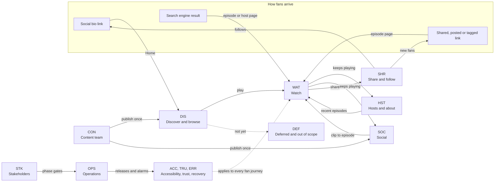

# ExtraTime — Business Requirements Document

*The conversation beyond the game*

| Field | Value |
|---|---|
| Document | ExtraTime website — Business Requirements Document (BRD) |
| Version | 0.3 |
| Status | Draft for review |
| Date | 2026-11-09 |
| Owner | Product owner (CEO) |
| Authors | Business Analysis |
| Reviewers | Founders (Shungu Dutiro, Henry Nzuzi), Content lead, Engineering Lead, Legal adviser (consent, privacy and safety) |
| Related | HLD v0.2 (`football-podcast-website-hld.md`) |

## Table of Contents

- [1. Executive Summary](#1-executive-summary)
- [2. Business Context & Objectives](#2-business-context--objectives)
- [3. Scope](#3-scope)
- [4. Stakeholders & Personas](#4-stakeholders--personas)
- [5. Customer Journey Catalog](#5-customer-journey-catalog)
  - [5.1 How to Read the Catalog](#51-how-to-read-the-catalog)
  - [5.2 Journey Summary](#52-journey-summary)
  - [5.3 Discover & Browse](#53-discover--browse)
  - [5.4 Watch](#54-watch)
  - [5.5 Hosts & About](#55-hosts--about)
  - [5.6 Social](#56-social)
  - [5.7 Share & Follow](#57-share--follow)
  - [5.8 Accessibility & Devices](#58-accessibility--devices)
  - [5.9 Trust, Privacy & Consent](#59-trust-privacy--consent)
  - [5.10 Errors & Recovery](#510-errors--recovery)
  - [5.11 Content Team](#511-content-team)
  - [5.12 Operations](#512-operations)
  - [5.13 Stakeholders](#513-stakeholders)
  - [5.14 Deferred & Out-of-Scope Journeys](#514-deferred--out-of-scope-journeys)
- [6. Business Requirements](#6-business-requirements)
- [7. Assumptions, Constraints & Dependencies](#7-assumptions-constraints--dependencies)
- [8. Risks & Open Questions](#8-risks--open-questions)
- [9. Approval & Sign-off](#9-approval--sign-off)
- [Appendix A: HLD Coverage](#appendix-a-hld-coverage)
- [Appendix B: Glossary](#appendix-b-glossary)
- [Appendix C: Proposed HLD/LLD Changes (for review; not in scope until approved)](#appendix-c-proposed-hldlld-changes-for-review-not-in-scope-until-approved)

## 1. Executive Summary

ExtraTime needs one fast, shareable home for *The conversation beyond the game*: every episode, a player that keeps playing while fans explore, the hosts and the show's clips, drawn from YouTube and Instagram with no extra publishing work, within platform policies and US$120 a month.

This BRD tables the 87 customer journeys the site must support or consciously excludes (58 Must, 12 Should, 1 Could, 16 Won't for now) and 30 business requirements. Phase 1 is a lean local demo on visual fixtures with no audio (CEO demo in the week of 2026-12-07); the Phase 1 iteration completes the demo journeys and Phase 2 brings live data, both by 2027-01-15; Phase 3 launches publicly in the week of 2027-02-15. Decisions fall due from BRD approval on 2026-11-13 (§8); proposed HLD changes await review (Appendix C).

## 2. Business Context & Objectives

### 2.1 About ExtraTime

ExtraTime (styled ExtraTIME on its channels), founded by Shungu Dutiro and Henry Nzuzi, helps young people see their value beyond the pitch through conversations with coaches, players and creatives about identity, purpose and mentorship.

- **Channels** (checked 2026-11-08). YouTube [@extratimeorg](https://www.youtube.com/@extratimeorg) holds all 7 public episodes (about 1,860 views in total); Instagram [@extra.timeorg](https://www.instagram.com/extra.timeorg) feeds the social feed; TikTok [@extra.timeorg](https://www.tiktok.com/@extra.timeorg) is a follow link only (Q19). No Facebook Page is confirmed and no audio feed exists (A2).
- **Content.** Long, evergreen episodes of 16 to 67 minutes, seven in 29 months. Titles lack episode codes, descriptions lack timestamps (A7) and Season 1's parts are unconfirmed (BQ-17).
- **Audience.** Young, mostly mobile, arriving from social apps, often on prepaid data, in South Africa, DR Congo and the UK diaspora (BA-01).

| Published | Episode | Featuring |
|---|---|---|
| 2024-06-10 | JOURNEY (opens Season 1) | Not named |
| 2024-10-14 | AUTHENTICITY | Visual artist Kay Kay Ribane |
| 2025-02-17 | Meet The Founders \|\| Passion to Purpose | Shungu Dutiro, Henry Nzuzi |
| 2025-03-19 | Purpose - Bigger Than Football | Coach Cavin Johnson, Jesse Donn |
| 2025-05-22 | Purpose - Bigger Than Football Pt.2 | Coach Cavin Johnson, Jesse Donn |
| 2025-07-08 | Full Circle - Coach Pitso Mosimane | Coach Pitso Mosimane |
| 2026-04-22 | Plus que le football : construire son identité \| ExtraTime Kinshasa (French; the newest) | Daniel and Haggi |

### 2.2 Business Problem

Fans who see a clip have no easy route to the full conversation: a bio holds one link, captions carry none and the archive is only YouTube's upload list. Host bios live nowhere. Nothing ties episodes, hosts and clips together, keeps playing while fans explore, or previews well in a group chat. The site must be safe for under-18s and add no publishing work within US$120 a month.

### 2.3 Business Objectives

Baselines come from the first month after launch; the CEO then sets targets (CJ-STK-04).

| ID | Objective | KPI and target | Phase | HLD goal |
|---|---|---|---|---|
| BO-01 | Prove the experience early | CEO approves Phase 2 at the demo | 1 | G1 |
| BO-02 | Fresh content, no extra publishing | YouTube uploads on the site within 21 minutes, Meta posts within 16 | 2 / 3 | G3, G4 |
| BO-03 | Turn clips into full conversations | At least 80% of new clips linked to their episode (BQ-02) | 2 / 3 | HLD 1.2 |
| BO-04 | Watch where you are | Plays inside the widget where it was started, one at a time; never a floating player | 1 | G2 |
| BO-05 | Engagement and reach | Play starts, shares, follow taps and enquiries against baselines | 3 | New |
| BO-06 | Fast on fans' phones | Core Web Vitals "good" at mobile p75 | 3 | G5 |
| BO-07 | Accessible to everyone | WCAG 2.2 AA on every Must journey | 1 / 3 | G5 |
| BO-08 | Launch safely and affordably | Live over HTTPS in the week of 2027-02-15; 99.9% available; within US$120 a month | 3 | G6, G7 |

## 3. Scope

| Phase | Dates | What fans and the team get | Journeys first shown |
|---|---|---|---|
| 1 Local demo (lean) | 2026-11-16 to 2026-12-04; CEO demo in the week of 2026-12-07 | Home, archive list and search, episode and host pages, in-place YouTube playback with YouTube's own controls, share and follow links, a mock social feed and About, on visual fixtures; no audio | 33 |
| 1+ Phase 1 iteration | Done by the Phase 2 exit | Archive filters and pagination, the "updates delayed" notice | 0 |
| 2 Platform integration | 2026-12-07 to 2027-01-15 | Live content on engineers' laptops, chapters, clip matching, corrections, graceful failure, the in-app playback test, checks on GitHub | 15 |
| 3 Public launch | 2027-01-18 to 2027-02-12; launch in the week of 2027-02-15 | Consent and legal pages, link previews, automated journey and page-speed (Lighthouse) checks, alarms, runbooks, budget controls, hypercare | 23 |
| Not in Phases 1-3 | — | Audio until an RSS/MP3 source exists; accounts, comments, payments, native apps, live coverage, a CMS (§5.14); queue, resume, custom player controls and shortcuts (dropped, HLD Q21) | 16 |

Additions go through scope control (BR-29, CJ-STK-05).

## 4. Stakeholders & Personas

### 4.1 Stakeholders

| Stakeholder | Responsibility | Signs off |
|---|---|---|
| Product owner (CEO or delegate) | Scope, budget, onboarding, CEO-owned decisions | BRD; phase gates; go-live |
| Founders (Shungu Dutiro, Henry Nzuzi) | Mission, brand, their own bios and photo consent | BRD (mission, brand, personas) |
| Content lead and Content Team | Conventions, bios, captions, corrections, takedowns | Content rules; editorial changes |
| Engineering Lead, engineers and release managers | Build, release and monitor; only release managers publish | Feasibility; go-live checklist |
| Legal adviser (external) | Consent, legal wording, Children's Code, safeguarding | Legal pages and consent wording |

### 4.2 Personas

Personas are named by description only. The first eight are condensed from HLD 2.1; the last two are proposed — needs product-owner approval (BQ-01), marked "(proposed)" in the journey tables.

| Persona | Description | Needs |
|---|---|---|
| Regular Fan | Watches every week, on desktop and mobile | The newest episode in one tap; a player that never stops |
| Social Newcomer | First visit on mobile from a social post or shared link, often in an in-app browser | The exact episode, fast; a reason to follow |
| Archive Explorer | Hunts for one conversation by guest, theme or series; long desktop sessions | Search, filters and chapters |
| Aspiring Player | 17, plays for a school or academy team; mostly mobile | Honest advice on identity; easy sharing |
| Commuter Listener | Audio-first on the bus or train; patchy signal | Background audio once a source exists; resume |
| Content Team | Hosts and producer; publish with platform tools | Publish once; no second CMS |
| CEO / Stakeholder | Sponsors the site; judges the demo, then staging | A convincing experience early |
| Engineer / Operator | 1-3 engineers who build, release and monitor | Safe releases, clear alarms |
| Partner or Guest (proposed — needs product-owner approval) | Academies, clubs, schools, brands, journalists and featured guests | A contact that reaches the founders |
| Parent or Youth Leader (proposed — needs product-owner approval) | A parent, teacher or coach responsible for under-18 players | Evidence the site is safe; episodes easy to share |

## 5. Customer Journey Catalog

### 5.1 How to Read the Catalog

- **Scope.** HLD journeys J1-J12 are persona narratives; this catalog lists every journey to support, plus those consciously excluded (§5.14). IDs are fixed.
- **Priority.** *Must*: required at the exit of each phase named. *Should*: may slip only with product-owner agreement. *Could*: if time allows. *Won't (now)*: not in Phases 1-3.
- **Phase.** *1*: lean local demo on visual fixtures. *1+*: Phase 1 iteration backlog (HLD 5.2), done by the Phase 2 exit. *2*: live data on engineers' laptops, checks on GitHub. *3*: public launch with automated journey and page-speed (Lighthouse) checks. "1 / 2": first shown in 1, completed in 2; counts use the first phase.
- **HLD trace.** HLD journeys · HLD requirements.

### 5.2 Journey Summary

| Area | Journeys | Must | Should | Could | Won't (now) | Phase 1 | Phase 1+ | Phase 2 | Phase 3 | Deferred / Out |
|---|---|---|---|---|---|---|---|---|---|---|
| [DIS Discover & browse](#53-discover--browse) | 8 | 5 | 2 | 1 | 0 | 6 | 0 | 1 | 1 | 0 |
| [WAT Watch](#54-watch) | 8 | 5 | 1 | 0 | 2 | 5 | 0 | 1 | 0 | 2 |
| [HST Hosts & about](#55-hosts--about) | 3 | 2 | 1 | 0 | 0 | 3 | 0 | 0 | 0 | 0 |
| [SOC Social](#56-social) | 3 | 2 | 1 | 0 | 0 | 2 | 0 | 1 | 0 | 0 |
| [SHR Share & follow](#57-share--follow) | 5 | 4 | 1 | 0 | 0 | 3 | 0 | 0 | 2 | 0 |
| [ACC Accessibility & devices](#58-accessibility--devices) | 6 | 6 | 0 | 0 | 0 | 5 | 0 | 1 | 0 | 0 |
| [TRU Trust, privacy & consent](#59-trust-privacy--consent) | 6 | 6 | 0 | 0 | 0 | 1 | 0 | 0 | 5 | 0 |
| [ERR Errors & recovery](#510-errors--recovery) | 8 | 7 | 1 | 0 | 0 | 3 | 0 | 1 | 4 | 0 |
| [CON Content team](#511-content-team) | 9 | 6 | 3 | 0 | 0 | 1 | 0 | 6 | 2 | 0 |
| [OPS Operations](#512-operations) | 11 | 10 | 1 | 0 | 0 | 2 | 0 | 3 | 6 | 0 |
| [STK Stakeholders](#513-stakeholders) | 6 | 5 | 1 | 0 | 0 | 2 | 0 | 1 | 3 | 0 |
| [DEF Deferred & out of scope](#514-deferred--out-of-scope-journeys) | 14 | 0 | 0 | 0 | 14 | 0 | 0 | 0 | 0 | 14 |
| **Total** | **87** | **58** | **12** | **1** | **16** | **33** | **0** | **15** | **23** | **16** |

### 5.3 Discover & Browse

| ID | Journey | Persona(s) | Trigger | Key steps | Success outcome | Priority | Phase | HLD trace |
|---|---|---|---|---|---|---|---|---|
| CJ-DIS-01 | Catch the latest episode from Home | Regular Fan | A new episode drops. | Opens Home → Taps play on the hero; it plays in the hero → Opens the episode to read more | Newest episode plays in one tap, two at most; from Phase 2 uploads reach Home within 21 minutes. | Must | 1 / 2 (live) | J1 · FR-01, FR-06, NFR-04 |
| CJ-DIS-02 | Arrive from a social bio link | Social Newcomer | Taps "link in bio" under a Reel. | Bio link opens the promoted episode, or Home → Finds it in one tap → Plays | Reaches the promoted episode within one tap, in 2.5 seconds, inside an in-app browser. | Must | 1 (in-site) / 2 (in-app) / 3 (live bio link, speed) | J2 · FR-01, NFR-12 |
| CJ-DIS-03 | Open a shared, posted or tagged episode link cold | Social Newcomer, Aspiring Player | A chat message or Story links one episode. | Taps the link → Episode page loads directly → Plays or explores | Any episode link, tagged or not, opens that episode within 2.5 seconds with more episodes shown. | Must | 1 / 3 (public links, speed) | J2, J8 · FR-04, FR-14 |
| CJ-DIS-04 | Browse and filter the archive | Archive Explorer | Wants every episode one host led, or Season 1. | Opens Episodes, newest first → Filters → Opens an episode → Back restores filters, page and scroll | Right subset in three interactions; filtered views survive reload, Back and new tab, playback uninterrupted. | Must | 1 (list) / 1+ (filters) / 2 (season) | J3 · FR-02 |
| CJ-DIS-05 | Search the archive by guest or theme | Archive Explorer, Aspiring Player | Remembers a talk on identity, not its title. | Searches "identity" or "Jesse Donn" → Opens "Purpose - Bigger Than Football" → Plays it | The right conversation is found and playing in under a minute. | Should | 1 | J3 · FR-03 |
| CJ-DIS-06 | Find and watch French-language episodes | Aspiring Player, Social Newcomer | A Kinshasa fan searches "identité" or "Kinshasa". | Searches in French → Opens the Kinshasa special, text as published → Plays with YouTube captions | "identite", "identité" and "Kinshasa" find the Kinshasa special first; screen readers read it in French. | Should | 1 / 2 (accents, French marking) | J3 · FR-03, NFR-05 |
| CJ-DIS-07 | Follow a multi-part series in order | Regular Fan, Archive Explorer | Finishes "Purpose" Pt.1 and wants Pt.2. | Finishes Pt.1 → Finds Pt.2 first under more episodes → Plays it | Each part of a multi-part conversation links to its next part in one tap. | Could | 2 | J3 · FR-04, FR-19 |
| CJ-DIS-08 | Find ExtraTime through a search engine | Social Newcomer, Partner or Guest (proposed) | Searches "Pitso Mosimane ExtraTime". | Sees the episode's own title and snippet → Taps through → Plays or explores | Every episode and host page is indexed under its canonical address; no staging page appears. | Must | 3 | J2, J8 · FR-15 |

### 5.4 Watch

| ID | Journey | Persona(s) | Trigger | Key steps | Success outcome | Priority | Phase | HLD trace |
|---|---|---|---|---|---|---|---|---|
| CJ-WAT-01 | Read an episode page and choose where to watch | Social Newcomer, Archive Explorer | Opens an episode from anywhere on the site. | Reads summary, guests and hosts → Plays in place, or opens the platform original | Every episode page plays in place, credits YouTube and links each platform original. | Must | 1 | J2, J3 · FR-04, FR-20 |
| CJ-WAT-02 | Start an episode at a chapter | Archive Explorer, Aspiring Player | Wants only the mentorship part of an episode. | Opens the episode → Selects "Mentorship" → Playback starts there | Playback starts within ±1 s of the chapter; episodes without timestamps show no chapter list. | Should | 2 | J3 · FR-05 |
| CJ-WAT-03 | Watch in place and control the video | Regular Fan, Aspiring Player | Wants to watch without leaving the page. | Plays the video inside its card or panel → Changes speed with YouTube's controls → Closes it, or opens it on YouTube | Plays where pressed, never in a floating window; one video at a time; ≥ 200x200 px; controls work by touch and keyboard; Close video or leaving the page unloads it (revised 2026-11-09). | Must | 1 / 1+ (custom controls) | J4 · FR-06, FR-07 |
| CJ-WAT-04 | Queue the next episode | Regular Fan, Archive Explorer | Wants another conversation after this one. | Finds no queue → Picks the next episode from the carousel or YouTube's own suggestions | Dropped 2026-11-09 (HLD Q21): no queue; the next conversation is one tap away in "More conversations". | Won't (now) | Dropped | J4 · FR-07 |
| CJ-WAT-05 | Resume where I left off | Regular Fan, Commuter Listener | Returns to the same browser after closing mid-episode. | Finds no saved position → Uses YouTube, which keeps signed-in viewers' watch progress | Dropped 2026-11-09 (HLD Q21): the site stores no player state. | Won't (now) | Dropped | J4 · FR-08 |
| CJ-WAT-06 | Watch on a phone or tablet | Commuter Listener, Aspiring Player | Plays on a 360 px phone or a tablet. | The video plays full width in its widget → Keeps scrolling → Turns to landscape | From 360 px the video stays ≥ 200x200 px, hides no content or focus, and nothing scrolls sideways. | Must | 1 / 2 (real devices) | J1, J4 · FR-09, NFR-12 |
| CJ-WAT-07 | Leave the page mid-episode | Commuter Listener, Regular Fan | Locks the phone, expecting audio to continue. | Player pauses, as YouTube requires → Returns → One tap on YouTube's control plays on | Never breaches YouTube policy, never promises background audio, and plays on from where it paused in one tap while the page stays open. | Must | 1 (desktop) / 2 (phones) | J4, J5 · FR-09 |
| CJ-WAT-08 | Start playback when the browser blocks scripted play | Social Newcomer, Aspiring Player | In iOS Safari or an in-app browser, play fails. | Taps play → Sees YouTube's own play button → Taps it; playback starts | Playback starts within two taps, consent included, on every listed browser, never failing silently. | Must | 1 / 2 (in-app test) / 3 | J1, J2 · FR-01, FR-09 |

### 5.5 Hosts & About

| ID | Journey | Persona(s) | Trigger | Key steps | Success outcome | Priority | Phase | HLD trace |
|---|---|---|---|---|---|---|---|---|
| CJ-HST-01 | Meet the hosts | Social Newcomer, Regular Fan | Wants to know who is behind the show. | Taps a host chip → Opens a founder's profile → Plays a recent episode | Every host is one tap from any episode, with bio, role, links and recent episodes at a shareable address. | Must | 1 | J6 · FR-11 |
| CJ-HST-02 | Learn the mission and contact the hosts | Social Newcomer, Aspiring Player | Moved by an episode, wants to ask a question. | Opens About → Reads the story → Sends a question through the contact form | About shows the story and slogan; messages reach a shared ExtraTime inbox, which sends every reply. | Must | 1 (placeholder) / 3 (live) | J6 · FR-24 |
| CJ-HST-03 | Propose a collaboration, guest appearance or talk | Partner or Guest (proposed) | An academy, brand or journalist wants to work together. | Reads About → Picks partnership, guest or press → Sends the enquiry | Every partnership, guest or press enquiry reaches the founders' shared inbox. | Should | 1 (placeholder) / 3 (live) | None (proposed J13) · FR-24 |

### 5.6 Social

| ID | Journey | Persona(s) | Trigger | Key steps | Success outcome | Priority | Phase | HLD trace |
|---|---|---|---|---|---|---|---|---|
| CJ-SOC-01 | Catch up on the social feed by platform | Regular Fan | Wants the week's clips without opening several apps. | Opens Social, newest first → Filters to Instagram → Loads more → Opens an original | Every post links its original; from Phase 2, new posts appear within 16 minutes. | Must | 1 (mock) / 2 (live) | J7 · FR-12, FR-13 |
| CJ-SOC-02 | Go from a clip to its full episode | Social Newcomer, Regular Fan | A Reel on mentorship prompts the full conversation. | Taps the related-episode link → Plays the episode → Back returns to the feed | Every matched post opens its episode in one tap; Back restores the feed position while playing. | Should | 2 | J7, J2 · FR-13, FR-20 |
| CJ-SOC-03 | See posts whose images expired or were withheld | Regular Fan | An Instagram image expired or was withheld. | Card shows the thumbnail → Otherwise a placeholder linking the post | No broken images or layout jumps, and every post still opens its original. | Must | 1 | J7 · FR-12 |

### 5.7 Share & Follow

| ID | Journey | Persona(s) | Trigger | Key steps | Success outcome | Priority | Phase | HLD trace |
|---|---|---|---|---|---|---|---|---|
| CJ-SHR-01 | Share an episode or host profile | Aspiring Player, Regular Fan | Wants teammates to hear an episode. | Taps share → Native share or copy link → Teammates open the same page | Every share gives the clean canonical address, which reopens the same page. | Must | 1 | J8 · FR-14 |
| CJ-SHR-02 | See a rich preview when a link is shared | Aspiring Player, Partner or Guest (proposed) | An episode link is pasted into a messaging app. | App reads the link → Shows title, description and artwork → Recipient taps through | Episode and host links preview with title and artwork in WhatsApp, Instagram, Facebook, X, iMessage, LinkedIn and Slack. | Must | 3 | J2, J8 · FR-15 |
| CJ-SHR-03 | Follow, subscribe or react on the show's own channels | Social Newcomer, Aspiring Player | Wants future episodes in their own feeds. | Taps a follow link → Opens the profile in its app → Follows or comments there | Every follow link opens a confirmed ExtraTIME profile, so engagement counts on the platforms. | Must | 1 | J8 · FR-16 |
| CJ-SHR-04 | Reach the site by any form of its address | Social Newcomer, Regular Fan | Types the bare domain or scans a poster's QR code. | Any address form forwards to the secure official address → The requested page opens | Every address form lands securely on the same page in one step. | Must | 3 | J8 · FR-14, NFR-06 |
| CJ-SHR-05 | Recommend an episode to a team, class or group | Parent or Youth Leader (proposed) | A coach plans a session on identity. | Searches the theme → Checks the summary → Shares the link or plays it to the group | A suitable episode is found and shared with the group in under two minutes. | Should | 1 | J3, J8 · FR-03, FR-14 |

### 5.8 Accessibility & Devices

| ID | Journey | Persona(s) | Trigger | Key steps | Success outcome | Priority | Phase | HLD trace |
|---|---|---|---|---|---|---|---|---|
| CJ-ACC-01 | Operate the site by keyboard, switch access or voice control | Archive Explorer, Regular Fan | A visitor cannot use a mouse or touch screen. | Skips to content → Tabs through in order, focus visible → Plays by keyboard or voice | Every Must journey completes by keyboard alone and by voice, to WCAG 2.2 AA. | Must | 1 (keyboard pass) / 1+ (custom controls, shortcuts) / 3 (voice check) | J3, J4 · FR-07, NFR-05 |
| CJ-ACC-02 | Use the site and player with a screen reader | Regular Fan, Archive Explorer | A blind visitor uses VoiceOver, TalkBack or NVDA. | Landmarks and named controls give structure → Playback state and errors are announced | Every Must journey passes with VoiceOver, TalkBack and NVDA; no decorative emoji is read aloud. | Must | 1 (VoiceOver pass) / 2 (French marking) / 3 (TalkBack, NVDA, scripted runs) | J4, J6 · NFR-05 |
| CJ-ACC-03 | Follow an episode with captions | Regular Fan, Aspiring Player | A deaf visitor, or one on mute, watches. | Starts the episode → Turns on YouTube captions → Follows at any speed | The captions control works in the in-place embed; episodes from launch have reviewed captions, exceptions listed. | Must | 1 / 3 (reviewed captions) | J4 · NFR-05 |
| CJ-ACC-04 | Browse with reduced motion, zoom, larger text or forced colours | Regular Fan, Archive Explorer | A visitor sets reduced motion, large text or forced colours. | Nothing animates by itself → Content reflows at 400% zoom → Focus and controls stay visible | Meets WCAG 2.2 AA resize, reflow, contrast and focus criteria, honouring motion and colour preferences. | Must | 1 / 3 (forced colours) | J4 · NFR-05 |
| CJ-ACC-05 | Use the site inside a social app's browser | Social Newcomer, Aspiring Player | Taps a link inside a social app. | Page opens → Plays, using YouTube's button if needed → Shares with copy link | Checks pass in Instagram, Facebook and TikTok on iOS and Android: play within two taps, copy link works. | Must | 2 (in-app test) / 3 (release check) | J2 · FR-09, NFR-12 |
| CJ-ACC-06 | Browse on a low-end phone or a slow, patchy connection | Commuter Listener, Aspiring Player | On prepaid data, an entry-level phone or a patchy train. | Sized placeholders while loading → Failed requests offer Retry → Watch on YouTube if video fails | Pages appear within 2.5 seconds on slow data, never jump, and always offer recovery. | Must | 1 / 3 (speed check) | J1, J2 · FR-21, NFR-01 |

### 5.9 Trust, Privacy & Consent

| ID | Journey | Persona(s) | Trigger | Key steps | Success outcome | Priority | Phase | HLD trace |
|---|---|---|---|---|---|---|---|---|
| CJ-TRU-01 | Consent to load YouTube on first play, or browse without it | Social Newcomer, Regular Fan | A first-time visitor taps play. | Play button carries a one-line notice → Tapping consents and plays → Choice remembered | Nothing from YouTube or analytics loads before consent; play within two taps; declining never blocks content. | Must | 3 | J2, J12 · FR-25 |
| CJ-TRU-02 | Change or withdraw privacy choices | Regular Fan, Social Newcomer | Wants to withdraw consent. | Opens Privacy choices → Changes consent → Player stops | Withdrawing takes no more steps than consenting and takes effect at once; the site keeps no listening data to clear. | Must | 3 | J12 · FR-25 |
| CJ-TRU-03 | Check the legal and safety position before recommending the site | Parent or Youth Leader (proposed), Social Newcomer | A parent checks the site suits young players. | Opens legal pages → Reads what is stored → Reads the safety position | Legal pages list what is stored, state the safety and Children's Code position, and meet platform rules. | Must | 3 | J12 · FR-25, NFR-07 |
| CJ-TRU-04 | Report a problem, request a takedown or make a data request | Regular Fan, Parent or Youth Leader (proposed) | A visitor reports an error, asks for removal or data. | Picks a request type → It reaches the named owner → Owner acts and replies in time | Each request is answered within its stated time (data requests: one month); minors' takedowns follow the urgent path. | Must | 3 | J6, J12 · FR-19, FR-24 |
| CJ-TRU-05 | Publish interim privacy pages for the Meta app | Engineer / Operator, CEO / Stakeholder | Meta app setup needs both URLs by 2026-12-04. | Approved text published at an interim address → Entered in the Meta app → Switched at launch | The Meta app has working URLs by 2026-12-04 and points at the site's own pages from launch. | Must | 1 / 3 (switch) | J12 · FR-25 |
| CJ-TRU-06 | Choose whether to allow analytics | Social Newcomer, Regular Fan | A first visit with no analytics choice stored. | One-line notice, covering nothing → Allow or Decline, equally prominent → Choice remembered | Nothing is counted before Allow; the notice appears once and never blocks content or playback. | Must | 3 | J12 · FR-25 |

### 5.10 Errors & Recovery

| ID | Journey | Persona(s) | Trigger | Key steps | Success outcome | Priority | Phase | HLD trace |
|---|---|---|---|---|---|---|---|---|
| CJ-ERR-01 | Keep browsing when a platform fails | Regular Fan, Social Newcomer | Instagram or YouTube stops sending new content. | Site keeps the last good content → Shows "updates delayed" → Clears it after recovery | One platform failing never blanks a page; visitors see which updates are delayed. | Must | 1 (fixtures) / 1+ (notice) / 2 (real) | J10, J7 · FR-21 |
| CJ-ERR-02 | Reach the site when its own server fails | Regular Fan, Social Newcomer | The site's server fails, or a release goes wrong. | Saved pages keep loading → Others show "reconnecting" → Site recovers or is rolled back | Saved pages load for up to 24 hours; no raw error page; recovery needs no reload. | Must | 3 | J10, J12 · FR-21, FR-26, NFR-02 |
| CJ-ERR-03 | Recover when YouTube cannot play an episode | Regular Fan, Aspiring Player | A video was removed, or a school network blocks YouTube. | Taps play → Player fails or stalls → Plain message with Watch on YouTube | A plain explanation and next step appear within 15 seconds, never a silent player. | Must | 1 (YouTube's own error, Watch on YouTube) / 2 (15-second message, removal) | J1, J4 · FR-09, FR-19 |
| CJ-ERR-04 | Recover from a dead end | Social Newcomer, Archive Explorer | Opens a dead link, or a search finds nothing. | Sees "not found" or an empty state → Taps back into the catalog | Every dead end offers one tap back to the catalog and never blames the visitor. | Must | 1 | J2, J3 · FR-02, FR-04 |
| CJ-ERR-05 | Open an old link after an episode is renamed or recoded | Regular Fan, Aspiring Player | A months-old link points at a renamed episode. | Opens the old address → Lands on the episode's current address → Re-shares it | Every previously shared episode link still opens its episode after title edits or new episode codes. | Must | 2 | J8 · FR-14 |
| CJ-ERR-06 | Keep browsing across a release | Regular Fan, Archive Explorer | A release goes live during a long visit. | Opens a new page → It loads, or refreshes on the next click → Player returns | No page breaks across a release or rollback, and the player keeps its episode and position. | Must | 3 | J4, J12 · FR-26 |
| CJ-ERR-07 | Browse from a shared network without being blocked | Aspiring Player | A class browses together on one school network. | Thirty pupils browse at once → None is blocked | A class of 30 browses and plays together, and any limit shows a friendly ExtraTime message. | Must | 3 | J2 · FR-21, NFR-06 |
| CJ-ERR-08 | Open the site where JavaScript does not run | Social Newcomer, Aspiring Player | Opens a link in Opera Mini or an old browser. | Sees a plain message with follow links → Episode links also show the title | No entry link shows a blank page; episode links name the episode and offer Watch on YouTube. | Should | 3 | J2, J8 · FR-15, NFR-12 |

### 5.11 Content Team

| ID | Journey | Persona(s) | Trigger | Key steps | Success outcome | Priority | Phase | HLD trace |
|---|---|---|---|---|---|---|---|---|
| CJ-CON-01 | Publish once and see the episode on the site | Content Team | The producer uploads an episode and a Reel. | Publishes only on the platforms, with episode code → Checks the site | No double entry; uploads appear once, within 21 minutes (YouTube) or 16 minutes (Instagram, Facebook). | Must | 2 | J9 · FR-17, FR-18 |
| CJ-CON-02 | Time a scheduled, premiered or urgent release | Content Team, Engineer / Operator | An episode is scheduled, premiered or urgent. | Publishes on YouTube as usual → For urgent releases, an operator refreshes the site | A one-page guide says when each release type appears; urgent releases are live once refreshed. | Must | 2 | J9 · FR-18 |
| CJ-CON-03 | Add episode codes and chapter timestamps to the back catalog | Content Team | Conventions agreed and Season 1 confirmed (BQ-17). | Adds codes and timestamps to the 7 episodes → Checks seasons, chapters and old links | Every existing episode shows its season and chapters within 6 hours; old links still open. | Should | 2 | J9, J3 · FR-05, FR-20 |
| CJ-CON-04 | Correct episode details | Content Team, Engineer / Operator | A guest name, tag or description is wrong. | Fixes it on YouTube, or requests a correction → Reviewed change approved on staging → Released | Routine corrections go live within 2 business days, YouTube fixes within 6 hours, without a CMS. | Must | 2 / 3 (staging approval) | J9 · FR-19 |
| CJ-CON-05 | Fix a wrongly linked clip or a duplicate | Content Team, Engineer / Operator | A Reel lacks its episode link, or a video repeats. | Adds the episode code to the caption → Next refresh re-matches it | Every clip leads to the right episode within 16 minutes of the fix, and no episode appears twice. | Should | 2 | J9, J7 · FR-19, FR-20 |
| CJ-CON-06 | Add, update or retire a host profile | Content Team, Engineer / Operator | New bios and consented photos, or a host leaves. | Host approves bio and photo → Engineer makes a reviewed change → Released | Profiles show approved bios and consented photos; a retired host's address never breaks. | Must | 1 (fixture bios) / 3 (staging approval) | J6, J9 · FR-11, FR-19 |
| CJ-CON-07 | Urgently hide an episode or post | Content Team, Engineer / Operator | Consent withdrawn, an unconsented minor, or a legal issue. | Content lead requests a hide → Published at once → Platform original removed → Requester told | Gone from the site, sitemap and fresh previews within 1 hour; originals removed or a reason recorded. | Must | 3 (hide works from 2) | J9 · FR-19 |
| CJ-CON-08 | Point the show's channels at the site at launch | Content Team | The domain goes live in launch week. | Updates channel bios and links → Adds the address to new descriptions → Checks in-app links | From launch day every channel bio and new episode description links to the official site. | Must | 3 | J2, J8 · FR-16 |
| CJ-CON-09 | Turn on Facebook once a Page exists | Content Team, Engineer / Operator | An ExtraTIME Facebook Page is confirmed (Q19). | Page joins the business portfolio, two admins → Engineer switches the source on | Facebook posts and video copies appear within one refresh cycle, without duplicates or page changes. | Should | 2 or after launch (Q19) | J7, J9 · FR-12, FR-20 |

### 5.12 Operations

| ID | Journey | Persona(s) | Trigger | Key steps | Success outcome | Priority | Phase | HLD trace |
|---|---|---|---|---|---|---|---|---|
| CJ-OPS-01 | Set up and run the site locally | Engineer / Operator | A new engineer joins, or a demo laptop is prepared. | Gets the code → Starts the site with one command → Checks health | A new engineer runs the whole site within 30 minutes, fixtures and live data in one format. | Must | 1 / 2 (live logins) | J11 · FR-17, FR-22, FR-23, NFR-09 |
| CJ-OPS-02 | Connect the platform accounts and logins | Engineer / Operator, CEO / Stakeholder | The onboarding track starts in week 1. | Business owns every account, two admins each → Limited logins created → Each platform tested | Live data starts 2026-12-07 on business-owned accounts, without Meta review, or YouTube-only. | Must | 1 | None (HLD 5.5) · FR-17, NFR-06 |
| CJ-OPS-03 | Check every change before it is accepted | Engineer / Operator | An engineer proposes a change. | Automatic checks run → Breaking or unsafe changes are blocked → A second engineer approves | Every accepted change passes checks in under 10 minutes; none exposes a password or breaks the data format. | Must | 2 (GitHub checks) / 3 (end-to-end) | J12 · NFR-10 |
| CJ-OPS-04 | Release through staging, and undo a bad release | Engineer / Operator, Content Team | A change is ready, or a release misbehaves. | Staging checks pass → Content Team approves editorial changes → Release manager publishes | Production runs exactly what staging checked; a bad release is undone within 15 minutes. | Must | 3 | J12 · FR-23, FR-26 |
| CJ-OPS-05 | Respond to a site outage or freshness alarm | Engineer / Operator | An outage or stale-content alarm fires. | Alert arrives → Operator follows the runbook → Recovers and records the cause | Outages alert within 5 minutes; every alarm has a runbook followed to recovery. | Must | 3 | J10, J12 · NFR-11 |
| CJ-OPS-06 | Renew an invalidated Meta login | Engineer / Operator | The daily check finds Meta rejecting the login. | Operator renews the login by runbook → Delay notice clears | Meta content recovers within 4 business hours, with nothing broken for visitors. | Must | 2 (runbook) / 3 (alarm) | J10 · FR-21 |
| CJ-OPS-07 | Absorb a traffic spike and respond to a budget alert | Engineer / Operator, CEO / Stakeholder | A clip goes viral, or a budget alert fires. | Saved copies absorb the spike → Operator checks costs → CEO decides on the ceiling | A tenfold 15-minute spike is served without errors; spend stays within US$120 unless the CEO decides. | Must | 3 | J1, J12 · NFR-03, NFR-08 |
| CJ-OPS-08 | Keep security, versions and platform compliance current | Engineer / Operator | A regular duty or platform notice falls due. | Opens the runbook → Applies the update or answers the audit → Logs completion | Every duty and notice has a runbook and logged completion; no platform access lapses. | Must | 3 | J12 · NFR-06, NFR-07 |
| CJ-OPS-09 | Revoke access after a leaked login or when someone leaves | Engineer / Operator, CEO / Stakeholder | A login leaks, or an admin leaves. | Replaces affected logins → Removes the old access → Reviews logs → Records it | Access is revoked without a Meta outage or dropping below two release managers or admins. | Must | 2 / 3 | J12 · NFR-06 |
| CJ-OPS-10 | Rebuild an environment or recover from a region outage | Engineer / Operator | An environment is lost, or London hosting fails. | Rebuilds from the stored definition → Content reloads → Checks health and links | Rebuilt within 1 hour; region outage recovered within 1 business day; the domain never lapses. | Should | 3 | J12 · FR-26 |
| CJ-OPS-11 | Respond to a security incident or data breach | Engineer / Operator, CEO / Stakeholder | An account is hijacked or personal data is exposed. | Freezes the affected source → Replaces logins → CEO decides on reporting | Hijacked content gone within 1 hour; a compromised site restored within 15 minutes; breaches assessed in 72 hours. | Must | 3 (freeze from 2) | J10, J12 · FR-19, FR-21 |

### 5.13 Stakeholders

| ID | Journey | Persona(s) | Trigger | Key steps | Success outcome | Priority | Phase | HLD trace |
|---|---|---|---|---|---|---|---|---|
| CJ-STK-01 | Run the CEO demo on a laptop | CEO / Stakeholder, Engineer / Operator | The demo in the week of 2026-12-07. | Walks Home, search, episode, hosts and social → Narrates the delayed notice → Shows decisions needed | The CEO approves Phase 2 and records decisions on Q2 and Q19. | Must | 1 | J11 · FR-22, NFR-08 |
| CJ-STK-02 | Confirm live data at the Phase 2 exit | CEO / Stakeholder, Engineer / Operator | The Phase 2 exit on 2027-01-15. | Same site runs on live data → 1+ items shown → A broken source shows the notice | Live content flows through the Phase 1 experience unchanged, and the CEO approves Phase 3. | Must | 2 | J9, J11 · FR-17 |
| CJ-STK-03 | Sign off go-live and switch the domain | CEO / Stakeholder, Engineer / Operator | The go/no-go on 2027-02-12. | Walks the journeys on staging → Signs the go-live checklist → Domain switched; timed publish confirms | Live on the custom domain over HTTPS in launch week with a tested fallback, or a dated no-go. | Must | 3 | J11, J12 · FR-25, FR-26 |
| CJ-STK-04 | Review monthly audience and cost | CEO / Stakeholder | The monthly 30-minute review after launch. | Reviews spend and top costs → Reviews consented audience counts → Records decisions | Each month the CEO sees spend and audience counts and records tier and scope decisions. | Should | 3 | J12 · NFR-08 |
| CJ-STK-05 | Decide open questions and scope changes on time | CEO / Stakeholder | An approval or decision falls due, or scope is requested. | Approves HLD and BRD → Decides each question or adopts its default → Estimates each addition | Every question has a recorded decision by its date; every scope change is recorded before work starts. | Must | 1-3 | None (HLD 6.2) · None |
| CJ-STK-06 | Close hypercare and hand over to steady state | CEO / Stakeholder, Engineer / Operator | About two weeks after launch. | Reviews alarms and incidents → Confirms slipped items done → Signs the exit | Hypercare closes on a recorded date with slipped items done and no open High alarms. | Must | 3 | J12 · FR-26 |

### 5.14 Deferred & Out-of-Scope Journeys

Journeys Phases 1-3 consciously do not support; key steps show the alternative.

| ID | Journey | Persona(s) | Trigger | Key steps | Success outcome | Priority | Phase | HLD trace | Reason and revisit trigger |
|---|---|---|---|---|---|---|---|---|---|
| CJ-DEF-01 | Filter the archive by topic or guest | Archive Explorer | Wants every episode about mentorship. | Opens Episodes → Picks a topic or guest → Sees matches | Themes and guests are one tap from the archive. | Won't (now) | Deferred | J3 · FR-02, FR-03 | Search covers it (Could if promoted). Revisit: BQ-08. |
| CJ-DEF-02 | Share a moment at a timestamp | Aspiring Player | Wants teammates to hear one answer. | Shares from a moment → Teammate plays from there | Shared advice lands on the exact moment. | Won't (now) | Deferred | J8 · FR-05, FR-14 | Shares use clean addresses only. Revisit: after launch, if sharing shows demand. |
| CJ-DEF-03 | Listen audio-only, in the background or a podcast app | Commuter Listener | Wants to pocket the phone and keep listening. | Starts audio → Locks the phone; audio continues → Or subscribes in a podcast app | Uninterrupted audio with lock-screen controls; podcast apps handle downloads. | Won't (now) | Deferred (Q2) | J5 · FR-10, FR-16 | No audio source; YouTube forbids background play (Should once a source exists). Revisit: Q2. |
| CJ-DEF-04 | See TikTok clips in the social feed | Regular Fan | Expects TikTok clips beside Instagram posts. | Opens Social → Uses the TikTok follow link instead | TikTok is reachable by its follow link. | Won't (now) | Deferred | J7 · FR-12 | Not a feed source in Phases 1-3. Revisit: Q19 or the roadmap. |
| CJ-DEF-05 | Get new-episode alerts or install the site as an app | Regular Fan | Wants an alert for each new episode. | Looks for sign-up → Follows the show on the platforms instead | Platform follows announce new episodes. | Won't (now) | Out of scope / Deferred (newsletter) | J8 · FR-16, FR-24 | Newsletters add personal-data duties; apps are out of scope. Revisit: Q7 or a scope change. |
| CJ-DEF-06 | Sign in, personalise or comment | Regular Fan, Aspiring Player | Wants a watch list or to comment. | Finds no sign-in → Uses YouTube for watch history and comments | No accounts or user content in Phases 1-3. | Won't (now) | Out of scope | None (HLD 3.4) · None | Privacy and moderation duties, heavier with under-18s. Revisit: a scope change after launch. |
| CJ-DEF-07 | Watch live match coverage or a live stream | Regular Fan | Expects live matchday reaction. | Finds no live stream → Watches live on YouTube | Live broadcasts stay off the catalog. | Won't (now) | Out of scope | None (HLD 3.4) · None | A recorded series. Revisit: if live shows start. |
| CJ-DEF-08 | Donate, buy merchandise or sponsor the mission | Partner or Guest (proposed) | A brand wants to fund the mission. | Finds no shop or sponsorship → Uses the contact route | No payments or sponsorship at launch. | Won't (now) | Out of scope | None (HLD 3.4) · None | Payment and legal duties; no sponsorship at launch (Q8). Revisit: Q8, never betting brands. |
| CJ-DEF-09 | Edit site content without an engineer | Content Team | Wants to fix a bio directly. | Finds no editor → Requests the change (CJ-CON-04) | No CMS in Phases 1-3. | Won't (now) | Out of scope | None (HLD 3.4) · None | No database planned. Revisit: Q6, above one edit a week. |
| CJ-DEF-10 | Use the site in French | Aspiring Player | Wants the interface in French. | Finds English only → Reads French episode text as published | French episodes stay findable in the English interface. | Won't (now) | Out of scope | None (HLD 3.4) · None | Localization excluded. Revisit: Q20. |
| CJ-DEF-11 | Cast to a TV or embed an episode on another site | Regular Fan, Partner or Guest (proposed) | Wants it on a TV or a school website. | Uses YouTube's cast control → Or copies YouTube's embed code | YouTube's own player and site handle casting and embeds. | Won't (now) | Deferred | J4, J8 · FR-09 | YouTube offers both. Revisit: partner demand. |
| CJ-DEF-12 | Find ExtraTime initiatives, events or trials | Aspiring Player, Parent or Youth Leader (proposed) | Wants to join an initiative or trial. | Finds the mission on About → Asks through the contact route | Enquiries use the contact route under the safeguarding rule (BR-10). | Won't (now) | Deferred | J6 · FR-24 | Under-18 sign-ups need safeguarding review (Could if promoted). Revisit: BQ-08. |
| CJ-DEF-13 | Read an episode instead of watching it | Commuter Listener, Archive Explorer | Wants the conversation as text. | Finds no transcript → Uses YouTube's transcript | Transcripts exist only on YouTube, where captions exist. | Won't (now) | Deferred | J3, J5 · NFR-05 | Editing transcripts is Content Team work (Should if promoted). Revisit: Q16. |
| CJ-DEF-14 | Open a guest's page | Partner or Guest (proposed) | Wants one page listing a guest's appearances. | Finds the name as text → Searches it (CJ-DIS-05) | Guests appear on episode pages and in search. | Won't (now) | Deferred | J3 · FR-03 | Not planned. Revisit: with BQ-08. |

## 6. Business Requirements

These 30 requirements replace v0.1's 78, renumbered. Each is Must wherever a Must journey depends on it, fixing v0.1's BR-43 French marking (now BR-14), BR-47 blocked-player explanation (now BR-08), BR-73 runbooks (now BR-27) and BR-41 Back-navigation (now BR-02).

| ID | Requirement | Priority | Phase | Journeys | HLD trace |
|---|---|---|---|---|---|
| BR-01 | Home leads with the brand, slogan and newest episode, playable from the hero, then latest episodes, hosts, social highlights and follow links. | Must | 1 | CJ-DIS-01, CJ-DIS-02 | FR-01 |
| BR-02 | Fans browse episodes newest first and search by guest, theme or title, with or without accents; filtered views keep shareable addresses, and Back restores them. | Must (search Should) | 1 / 1+ (filters, Back) / 2 (season, accents) | CJ-DIS-04, CJ-DIS-05, CJ-DIS-06 | FR-02, FR-03 |
| BR-03 | Every episode has its own page with summary, guests, hosts, YouTube attribution, platform links and more episodes; any link, tagged or not, opens it. | Must | 1 / 3 (public links) | CJ-DIS-03, CJ-WAT-01 | FR-04, FR-14 |
| BR-04 | Chapters from description timestamps start playback where chosen; parts of a multi-part conversation link to the next. | Should (series Could) | 2 | CJ-WAT-02, CJ-DIS-07 | FR-05, FR-19 |
| BR-05 | A video plays visibly (at least 200x200 px) inside the widget where it was started, or on YouTube; one at a time; it covers no content and unloads on close or when the visitor leaves the page; audio-only waits for an RSS/MP3 source (Q2) (revised 2026-11-09). | Must (audio Should once a source exists) | 1 | CJ-WAT-03, CJ-WAT-06, CJ-WAT-07, CJ-DEF-03 | FR-06, FR-09, FR-10 |
| BR-06 | Playback starts within two taps, counting the consent tap and YouTube's own play button where scripted play is blocked. | Must | 1 / 3 (consent) | CJ-WAT-08, CJ-TRU-01 | FR-01, FR-09 |
| BR-07 | YouTube's own controls work by touch and keyboard and Close video is keyboard operable; there is no queue, resume or custom control (dropped, HLD Q21). | Must | 1 | CJ-WAT-03 | FR-07 |
| BR-08 | When YouTube cannot play, including on blocking networks, the player explains plainly within 15 seconds and offers Watch on YouTube; removed videos leave within 6 hours. | Must | 1 / 2 (15-second message, removal) | CJ-ERR-03 | FR-09, FR-21 |
| BR-09 | Every host has a profile one tap from any episode; hosts approve their bios, photos need recorded consent, and retired hosts' addresses never break (BQ-09). | Must | 1 / 3 (approved bios) | CJ-HST-01, CJ-CON-06 | FR-11, FR-19 |
| BR-10 | About tells the story and mission; contact requests, including partnership, guest and press enquiries, reach named owners with response times; replies come only from a shared inbox, and under-18s' requests involve a parent or coach (BQ-18). | Must (partnership option Should) | 1 (placeholder) / 3 (live) | CJ-HST-02, CJ-HST-03, CJ-TRU-04 | FR-24 |
| BR-11 | One feed shows the show's posts newest first, filterable by platform, each linking its original, with image fallbacks; matched clips link to their episode (BQ-02). | Must (clip links Should) | 1 (mock) / 2 (live) | CJ-SOC-01, CJ-SOC-02, CJ-SOC-03 | FR-12, FR-13, FR-20 |
| BR-12 | Pages share as clean canonical links and link the confirmed profiles; every address form reaches the same secure page; old links survive renames. | Must | 1 / 2 (old links) / 3 (domain) | CJ-SHR-01, CJ-SHR-03, CJ-SHR-04, CJ-SHR-05, CJ-ERR-05 | FR-14, FR-16 |
| BR-13 | From launch, links preview with their own title and artwork, pages are indexed only at canonical addresses, and pages without JavaScript still name the episode. | Must (no-JavaScript fallback Should) | 3 | CJ-SHR-02, CJ-DIS-08, CJ-ERR-08 | FR-15 |
| BR-14 | Every Must journey, player included, meets WCAG 2.2 AA; French text is marked as French; an accessibility statement is live from launch. | Must | 1 (manual pass) / 2 (French marking) / 3 | CJ-ACC-01, CJ-ACC-02, CJ-ACC-04 | NFR-05 |
| BR-15 | Captions on every episode published from launch are reviewed by the Content lead; the most-viewed back-catalog episodes follow (BQ-07). | Must (new episodes) / Should (back catalog) | 3 | CJ-ACC-03 | NFR-05 |
| BR-16 | The site works from 360 px, in in-app browsers and on slow data: pages within 2.5 seconds, no layout jumps, Retry on failure. | Must | 1 / 2 (in-app test) / 3 (speed check) | CJ-ACC-05, CJ-ACC-06 | NFR-01, NFR-12 |
| BR-17 | Nothing from YouTube or analytics loads before consent; declining never blocks content; Allow and Decline are equal; withdrawing is as easy as consenting. | Must | 3 | CJ-TRU-01, CJ-TRU-02, CJ-TRU-06 | FR-25, NFR-07 |
| BR-18 | Legal pages list what is stored and loaded before consent, name the form provider and state the safety and Children's Code positions (BQ-05); interim privacy pages are public by 2026-12-04; no ads or betting brands. | Must | 1 (interim pages) / 3 | CJ-TRU-03, CJ-TRU-05, CJ-DEF-08 | FR-25, NFR-07 |
| BR-19 | A failing platform, server or release never blanks a page: last good content stays, with an "updates delayed" notice; a class of 30 on one network is not blocked. | Must | 1 / 1+ (notice) / 2 / 3 | CJ-ERR-01, CJ-ERR-02, CJ-ERR-06, CJ-ERR-07 | FR-21, FR-26, NFR-02 |
| BR-20 | Unknown links, hidden episodes, empty searches and stale filters show a plain in-site message and one tap back to the catalog. | Must | 1 | CJ-ERR-04 | FR-02, FR-04 |
| BR-21 | The Content Team publishes only on the platforms; YouTube uploads appear within 21 minutes, Meta posts within 16; urgent releases need no code change; Facebook joins once a Page exists. | Must (Facebook Should) | 2 | CJ-CON-01, CJ-CON-02, CJ-CON-09 | FR-17, FR-18 |
| BR-22 | From 2026-12-04 titles and captions carry episode codes and descriptions carry timestamps; from launch, descriptions carry the site address; old links redirect before back-catalog coding (BQ-13). | Must (timestamps and back catalog Should) | 1 (adopted) / 2 | CJ-CON-01, CJ-CON-03, CJ-CON-05 | A7, FR-20 |
| BR-23 | The Content lead owns bios and corrections, which engineers make as reviewed changes approved on staging, live within 2 business days. | Must | 2 / 3 (staging approval) | CJ-CON-04, CJ-CON-05 | FR-19 |
| BR-24 | Content involving withdrawn consent, an unconsented minor or a legal issue is off the site and fresh previews within 1 hour at any time (BQ-04). | Must | 3 (hide from 2) | CJ-CON-07, CJ-TRU-04 | FR-19 |
| BR-25 | Brand, slogan and handles appear exactly (BQ-16); channel bios point at the site from launch day (BQ-03, BQ-11); a launch content plan keeps Home current. | Must (content plan Should) | 1 / 3 (channel bios) | CJ-DIS-02, CJ-SHR-03, CJ-CON-08 | FR-01, FR-16 |
| BR-26 | YouTube plays only in a visible, attributed player; the business owns every account with two admins; logins are least-privilege and cannot read fans' messages. | Must | 1 | CJ-WAT-01, CJ-OPS-02, CJ-OPS-09 | NFR-06, NFR-07 |
| BR-27 | Production changes only through staging; bad releases undo within 15 minutes; outages alert within 5; environments rebuild within 1 hour; runbooks cover alarms, platform notices, leaks, incidents and the DNS cut-over with its HTTPS fallback (HSTS). | Must (rebuild Should) | 2 (checks, Meta-login runbook, source freeze) / 3 | CJ-OPS-03 to CJ-OPS-11, CJ-STK-03 | FR-26, NFR-10, NFR-11 |
| BR-28 | Demo data is visual fixtures only, with no audio or simulated failures; a new engineer runs the site within 30 minutes; spend stays within US$120 a month. | Must | 1 / 3 (budget) | CJ-STK-01, CJ-OPS-01, CJ-OPS-07 | FR-22, NFR-08, NFR-09 |
| BR-29 | The CEO approves each phase gate, go-live and hypercare exit; questions are decided by their dates; additions are estimated first; no accounts, comments, payments, apps or CMS. | Must | 1-3 | CJ-STK-01, CJ-STK-02, CJ-STK-05, CJ-STK-06, CJ-DEF-06 | HLD 3.4, 6.2 |
| BR-30 | Consented, cookieless counts of visits, plays, shares, follow taps and enquiries feed a monthly report stating the opt-in share (BQ-12). | Should | 3 | CJ-STK-04 | FR-25 |

## 7. Assumptions, Constraints & Dependencies

C and A IDs are the HLD's (HLD 3.3); BC, BA and D IDs are BRD additions.

| ID | Type | Statement | Business consequence | Owner |
|---|---|---|---|---|
| C1 | Constraint | YouTube: a visible player of at least 200x200 px, never hidden or audio-only | No background listening until an audio source exists | Product owner |
| C2 | Constraint | Meta: business-owned assets, privacy pages, expiring media links | Interim legal pages by 2026-12-04; image fallbacks | CEO |
| C3 | Constraint | UK GDPR and PECR: consent before embeds or analytics | A consent tap before first play | Legal adviser |
| C4, C5 | Constraint | One to three engineers; Phase 1 code complete 2026-12-04 | A lean Phase 1; business-hours support | Engineering Lead |
| BC-01 | Constraint | US$120 a month; no new publishing work | Cost levers before tier changes | CEO |
| A2 | Assumption | No audio RSS feed or podcast host exists | If one appears, audio becomes possible (CJ-DEF-03) | CEO |
| A4 | Assumption | About 10,000 visitors a month at launch | Only 1,860 lifetime views so far; baselines must be measured | CEO |
| A5 | Assumption | Phase 1 runs locally; GitHub from Phase 2; AWS by 2027-01-18 | Phase 2 checks or Phase 3 start late | Engineering Lead |
| A7 | Assumption | Episode codes in titles and captions from 2026-12-04 | No seasons; weak clip matching | Content lead |
| BA-01 | Assumption | A young, mobile audience in three regions (Q20) | Device and privacy-law priorities change | CEO |
| BA-02 | Assumption | Consented photos by 2026-11-23; final bios by 2027-01-15 (Q18); weekly clips | Demo on placeholders; a dormant-looking site | Content lead |
| D-01 | Dependency | Business-owned accounts by 2026-11-20 (Q3); logins tested by 2026-12-04 | Phase 2 starts YouTube-only | CEO; Engineering Lead |

## 8. Risks & Open Questions

**Key business risks** (likelihood/impact before mitigation)

| ID | Risk (rating) | Mitigation | Owner |
|---|---|---|---|
| RB-01 | Clips stay unlinked because episode codes are not adopted (M/H) | Conventions from 2026-12-04 (BR-22); decide BQ-02 | Content lead |
| RB-02 | Meta access is late or tied to one person (M/H) | Onboarding from week 1; two business admins (BR-26); YouTube-only fallback | CEO |
| RB-03 | Fans expect background audio, which YouTube forbids (M/H) | Honest copy (BR-05); audio only via an RSS/MP3 source (Q2) | Product owner |
| RB-04 | A privacy or safeguarding failure involving under-18s (M/H) | Consent first (BR-17); shared-inbox replies (BR-10); 1-hour removal (BR-24) | CEO; Legal adviser |
| RB-05 | Seven episodes in 29 months make the site look dormant (H/M) | Launch content plan and weekly clips (BR-25, BA-02) | Content lead |
| RB-06 | The CEO demo fails through Wi-Fi, laptop or YouTube (M/H) | Offline mode, rehearsal, hotspot, backup recording | Engineering Lead |
| RB-07 | Scope creep from demo feedback (H/M) | The lean Phase 1; additions estimated first (BR-29) | CEO |
| RB-08 | Business-hours support stalls takedowns or recovery (H/H) | Runbooks; two release managers; an out-of-hours contact (BQ-04) | Engineering Lead; CEO |

**Dated decisions.** Q IDs are the HLD's (HLD 6.2); BQ IDs are BRD-only. Past its date the default is adopted and recorded. Q9, Q14 and Q15 stay with the engineers; Q6 (CMS) keeps its HLD default, due 2027-03 (Content lead); v0.1 defaults for Q8, Q12, Q13 and Q17 stand.

| Needed by | ID | Question | Recommended default | Owner |
|---|---|---|---|---|
| BRD approval | BQ-01 | Approve the proposed personas and journey J13 "Partner with the show"? | Approve | Product owner |
| 2026-11-20 | Q3 | Who owns the Meta assets? | The company's Meta business portfolio | CEO |
| 2026-11-20 | BQ-14, BQ-15 | Show the delayed notice at the demo? Offline artwork (by 2026-11-27)? | Narrate it; placeholders offline | Product owner |
| 2026-11-23 | BQ-16 | Wordmark, logo and colours? | The channels' ExtraTIME wordmark | Founders |
| 2026-12-04 | BQ-03, BQ-10, BQ-17 | Bio-link approach? Interim privacy-page publisher? Season 1 line-up? | Repoint per clip; Engineering Lead; Content lead codes all 7 | Content lead; CEO and Engineering Lead (BQ-10) |
| 2026-12-07 | Q2, Q19 | Audio source? Facebook Page? TikTok feed? | YouTube-first; Facebook off until a Page exists; no TikTok feed | CEO |
| 2026-12-07 | BQ-02, BQ-08 | Clip linking Must, with the 80% target? Promote topic filters or initiatives? | Must for Phase 2; keep both deferred | Product owner |
| 2027-01-04 | Q20 | Audience regions? French a regular format? | Three regions; English interface | CEO |
| 2027-01-15 | Q1, Q4, Q10 | Domain, hosting and budget ceiling? | .com and .co.uk; Option A; US$120 | CEO; Engineering Lead (Q4) |
| 2027-01-15 | Q18, BQ-09, BQ-13 | Final hosts and bios? Retired-host addresses? Redirect old links first? | Founders, full bios before Phase 3; alumni profiles; yes | Content Team; Engineering Lead |
| 2027-01-18 | Q16, BQ-07 | Who reviews captions and transcripts? Which back-catalog episodes? | Editors, before any RSS episode; the most-viewed | Content lead |
| 2027-01-18 | Q7, BQ-06, BQ-18 | Contact form or newsletter? Request owners? Safeguarding lead? | A hosted form; the Content lead, with the CEO for data requests; the CEO | CEO |
| 2027-01-29 | Q5, BQ-05, BQ-12 | Analytics and consent? Children's Code? KPIs? | Cookieless opt-in; assume it applies; §2.3 | CEO; Legal adviser |
| 2027-02-05 | Q11, BQ-04, BQ-11 | Support model? Out-of-hours removal? Bio repointing (by 2027-02-12)? | UK business hours; one out-of-hours contact; the Content lead | CEO |

## 9. Approval & Sign-off

Approval baselines this BRD as v1.0, alongside the HLD (due 2026-11-13).

| Role | Name | Scope of approval | Decision | Date |
|---|---|---|---|---|
| Product owner (CEO) | TBD | The whole BRD; BQ-01 and BQ-02 | Pending | |
| Founder | Shungu Dutiro | Mission, brand, personas and host content | Pending | |
| Founder | Henry Nzuzi | Mission, brand, personas and host content | Pending | |
| Content lead | TBD | Content rules (BR-09, BR-15, BR-21 to BR-25) and Content Team journeys | Pending | |
| Engineering Lead | TBD | Feasibility, traceability and Appendix C | Pending | |
| Legal adviser | TBD | Consent, privacy and safety (BR-10, BR-17, BR-18, BR-24); review only | Pending | |

Decision values: Approve, Approve with changes, Reject.

| Version | Date | Author | Change |
|---|---|---|---|
| 0.1 | 2026-11-08 | Business Analysis | First draft: 87 journeys, 78 requirements |
| 0.2 | 2026-11-08 | Business Analysis | Condensed; aligned with the lean Phase 1 |
| 0.3 | 2026-11-09 | Business Analysis | Demo review: in-place playback (or Watch on YouTube) replaces the floating player; BR-05, BO-04, CJ-DIS-01, CJ-WAT-03, CJ-WAT-06, CJ-WAT-07 and CJ-ACC-03 revised. HLD Q21: queue, resume, custom controls and shortcuts dropped; CJ-WAT-04 and CJ-WAT-05 become Won't; BR-07, BO-05, CJ-TRU-02, CJ-DEF-06 and HC-05 revised; counts updated (12 Should, 16 Won't) |

## Appendix A: HLD Coverage

Journeys exercising each HLD journey and functional requirement, from the §5 traces.

| HLD item | Catalog journeys |
|---|---|
| J1 | CJ-DIS-01, CJ-WAT-06, CJ-WAT-08, CJ-ACC-06, CJ-ERR-03, CJ-OPS-07 |
| J2 | CJ-DIS-02, CJ-DIS-03, CJ-DIS-08, CJ-WAT-01, CJ-WAT-08, CJ-SOC-02, CJ-SHR-02, CJ-ACC-05, CJ-ACC-06, CJ-TRU-01, CJ-ERR-04, CJ-ERR-07, CJ-ERR-08, CJ-CON-08 |
| J3 | CJ-DIS-04 to CJ-DIS-07, CJ-WAT-01, CJ-WAT-02, CJ-SHR-05, CJ-ACC-01, CJ-ERR-04, CJ-CON-03, CJ-DEF-01, CJ-DEF-13, CJ-DEF-14 |
| J4 | CJ-WAT-03 to CJ-WAT-07, CJ-ACC-01 to CJ-ACC-04, CJ-ERR-03, CJ-ERR-06, CJ-DEF-11 |
| J5 | CJ-WAT-07, CJ-DEF-03, CJ-DEF-13 |
| J6 | CJ-HST-01, CJ-HST-02, CJ-ACC-02, CJ-TRU-04, CJ-CON-06, CJ-DEF-12 |
| J7 | CJ-SOC-01, CJ-SOC-02, CJ-SOC-03, CJ-ERR-01, CJ-CON-05, CJ-CON-09, CJ-DEF-04 |
| J8 | CJ-DIS-03, CJ-DIS-08, CJ-SHR-01 to CJ-SHR-05, CJ-ERR-05, CJ-ERR-08, CJ-CON-08, CJ-DEF-02, CJ-DEF-05, CJ-DEF-11 |
| J9 | CJ-CON-01 to CJ-CON-07, CJ-CON-09, CJ-STK-02 |
| J10 | CJ-ERR-01, CJ-ERR-02, CJ-OPS-05, CJ-OPS-06, CJ-OPS-11 |
| J11 | CJ-OPS-01, CJ-STK-01, CJ-STK-02, CJ-STK-03 |
| J12 | CJ-TRU-01 to CJ-TRU-06, CJ-ERR-02, CJ-ERR-06, CJ-OPS-03, CJ-OPS-04, CJ-OPS-05, CJ-OPS-07 to CJ-OPS-11, CJ-STK-03, CJ-STK-04, CJ-STK-06 |
| J13 (proposed) | CJ-HST-03 |
| FR-01 | CJ-DIS-01, CJ-DIS-02, CJ-WAT-08 |
| FR-02 | CJ-DIS-04, CJ-ERR-04, CJ-DEF-01 |
| FR-03 | CJ-DIS-05, CJ-DIS-06, CJ-SHR-05, CJ-DEF-01, CJ-DEF-14 |
| FR-04 | CJ-DIS-03, CJ-DIS-07, CJ-WAT-01, CJ-ERR-04 |
| FR-05 | CJ-WAT-02, CJ-CON-03, CJ-DEF-02 |
| FR-06 | CJ-DIS-01, CJ-WAT-03 |
| FR-07 | CJ-WAT-03, CJ-WAT-04 (dropped), CJ-ACC-01 |
| FR-08 | CJ-WAT-05 (dropped) |
| FR-09 | CJ-WAT-06, CJ-WAT-07, CJ-WAT-08, CJ-ACC-05, CJ-ERR-03, CJ-DEF-11 |
| FR-10 | CJ-DEF-03 |
| FR-11 | CJ-HST-01, CJ-CON-06 |
| FR-12 | CJ-SOC-01, CJ-SOC-03, CJ-CON-09, CJ-DEF-04 |
| FR-13 | CJ-SOC-01, CJ-SOC-02 |
| FR-14 | CJ-DIS-03, CJ-SHR-01, CJ-SHR-04, CJ-SHR-05, CJ-ERR-05, CJ-DEF-02 |
| FR-15 | CJ-DIS-08, CJ-SHR-02, CJ-ERR-08 |
| FR-16 | CJ-SHR-03, CJ-CON-08, CJ-DEF-03, CJ-DEF-05 |
| FR-17 | CJ-CON-01, CJ-OPS-01, CJ-OPS-02, CJ-STK-02 |
| FR-18 | CJ-CON-01, CJ-CON-02 |
| FR-19 | CJ-DIS-07, CJ-TRU-04, CJ-ERR-03, CJ-CON-04 to CJ-CON-07, CJ-OPS-11 |
| FR-20 | CJ-WAT-01, CJ-SOC-02, CJ-CON-03, CJ-CON-05, CJ-CON-09 |
| FR-21 | CJ-ACC-06, CJ-ERR-01, CJ-ERR-02, CJ-ERR-07, CJ-OPS-06, CJ-OPS-11 |
| FR-22 | CJ-OPS-01, CJ-STK-01 |
| FR-23 | CJ-OPS-01, CJ-OPS-04 |
| FR-24 | CJ-HST-02, CJ-HST-03, CJ-TRU-04, CJ-DEF-05, CJ-DEF-12 |
| FR-25 | CJ-TRU-01, CJ-TRU-02, CJ-TRU-03, CJ-TRU-05, CJ-TRU-06, CJ-STK-03 |
| FR-26 | CJ-ERR-02, CJ-ERR-06, CJ-OPS-04, CJ-OPS-10, CJ-STK-03, CJ-STK-06 |

## Appendix B: Glossary

- **Canonical address:** a page's one official address, used by shares, previews and search engines.
- **CMS:** content management system; none in Phases 1-3.
- **Core Web Vitals:** Google's page-speed and stability measures.
- **DNS cut-over:** the moment the domain starts pointing at the new site.
- **Episode code:** a tag such as S02E01 in titles and captions that links clips to episodes.
- **HSTS:** a rule making browsers use only HTTPS for the site, remembered for a year.
- **Hypercare:** about two weeks of closer monitoring after launch.
- **In-app browser:** the browser inside a social app that opens tapped links.
- **p75:** the 75th percentile: three in four visits are at least this fast.
- **Phase 1 iteration (1+):** cheap follow-ups after the demo, done by the Phase 2 exit.
- **RSS:** a podcast feed format; an RSS/MP3 source would allow audio-only listening.
- **Runbook:** a step-by-step guide for a known problem or duty.
- **Staging:** a private copy of the site where changes are approved before release.
- **Visual fixtures:** Phase 1 mock data: the real episodes and founders, placeholder posts, no audio.
- **WCAG 2.2 AA:** Web Content Accessibility Guidelines, level AA: the site's accessibility standard.

## Appendix C: Proposed HLD/LLD Changes (for review; not in scope until approved)

Each needs HLD-owner and product-owner approval; "Doc" marks document-only changes.

| ID | Proposal | HLD/LLD item | Suggested phase |
|---|---|---|---|
| HC-01 | Add the proposed personas and J13 (BQ-01); the Commuter Listener gets audio once a source exists. | HLD 2.1, 2.2 | Doc |
| HC-02 | Make FR-24 Must; About and a placeholder contact route are already in the lean Phase 1 scope. | FR-24 | 1 (already in scope) / 3 |
| HC-03 | Restate FR-01 and J2: playback within two taps, consent included. | FR-01, FR-25 | 3 |
| HC-04 | Back restores archive filters, page and scroll; invalid filters are dropped; search ignores accents. | FR-02, FR-03 | 1+ (Back, filters) / 2 (accents) |
| HC-05 | Close unloads the video; YouTube's own error message shows inside the embed, with Watch on YouTube beside it; hidden-page pause tested on devices. | FR-06, FR-07, FR-09 | 1 (close) / 2 (device tests) |
| HC-06 | Split FR-13: original-post links become Must with the mock feed; related-episode links stay Should. | FR-12, FR-13 | 1 (mock feed, in scope) / 2 |
| HC-07 | Old episode addresses redirect after renames or new episode codes (BQ-13). | FR-14 | 2 |
| HC-08 | Check previews in WhatsApp, iMessage, X, LinkedIn and Slack; keep staging out of search results. | FR-15 | 3 |
| HC-09 | Add TalkBack, NVDA, voice control, forced colours, French marking and reviewed captions for new episodes. | NFR-05, Q16 | 2 (French marking) / 3 |
| HC-10 | Add the TikTok in-app browser, slow-connection checks, a no-JavaScript message and an optional offline notice. | NFR-01, NFR-12 | 2 / 3 |
| HC-11 | Phones reach the local build over Wi-Fi or a secure tunnel for the playback test. | HLD 5.3 | 2 |
| HC-12 | Contact request types, owners and the safeguarding rule; the form provider in the privacy notice. | FR-24, FR-25 | 3 |
| HC-13 | Corrections cover clip matches, seasons, series links and post hides; monthly matched-clip counts (BO-03). | FR-19, FR-20 | 2 |
| HC-14 | Freeze a platform source without code changes; visits survive releases; rate limits suit a class of 30. | FR-21, FR-26 | 2 (freeze) / 3 |
| HC-15 | Add a requirement for consented analytics, the first-visit choice and the monthly report (Q5). | New FR, FR-25 | 3 |
| HC-16 | Runbooks for platform notices, leaks, incidents and domain renewal; a rehearsed DNS cut-over. | HLD 4.10, 5.4 | 3 |
| HC-17 | Reword Q7: the form provider holds contact messages for ExtraTime, which remains data controller; "stores no personal data" is inaccurate. | Q7 | Doc |
| HC-18 | Align HLD 5.5's GitHub date and HLD 2.1's "GitHub from Phase 3" with GitHub from Phase 2 (A5); name the interim-page publisher. | HLD 2.1, 5.5 | Doc |
| HC-19 | The LLD drops v0.1 failure switches, demo audio and fictional hosts. | LLD | Doc |
| HC-20 | At 400% zoom a full-width player is under 200 px tall; the LLD sets its layout. | FR-09, NFR-05 | Doc |
