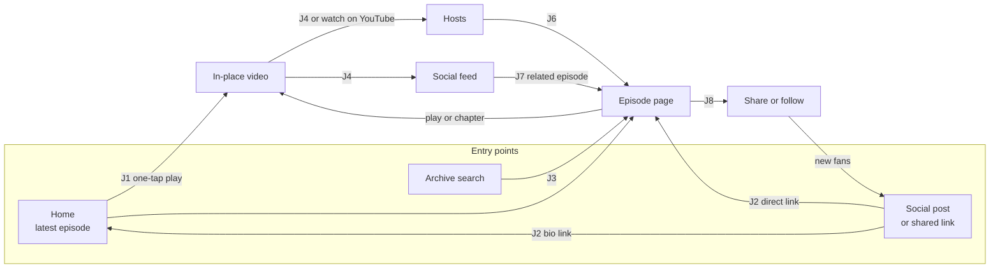
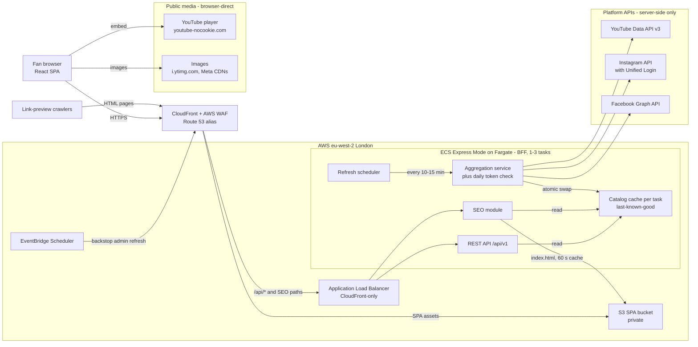
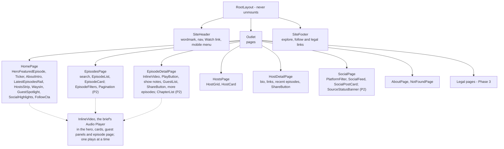
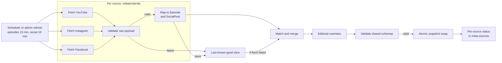
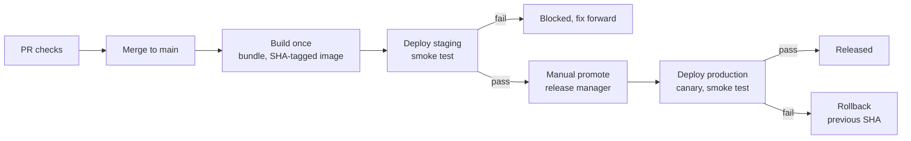
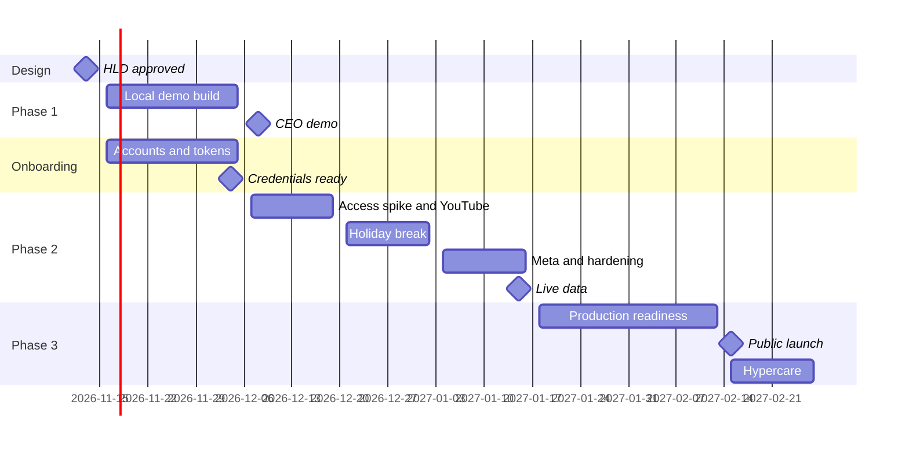

# ExtraTime — High-Level Design

*The conversation beyond the game*

| Field | Value |
|---|---|
| Document | ExtraTime website — High-Level Design |
| Version | 0.3 |
| Status | Draft for review |
| Date | 2026-11-09 |
| Author | Solutions Architecture |
| Reviewers | Senior Engineer; CEO |
| Supersedes | v0.2 (2026-11-08); v0.1 (2026-11-07), archived at `docs/archive/hld-v0.1-detailed.md` |
| Related | Business Requirements Document v0.3 (`football-podcast-website-brd.md`): the full customer-journey catalog |
| Next step | Low-Level Design |

> **v0.3 (2026-11-09):** after the demo review, video plays in place (inside the hero, card or panel where it was started) or on YouTube, never in a floating player; one plays at a time. Resume after reload, a queue, custom player controls and keyboard shortcuts are dropped (Q21), so the player keeps nothing in browser storage. The layout follows a Filthy Fellas-style structure in the ExtraTime preview palette (§4.3, `docs/figma/figma-prompt.md`). Changes are listed under "What changed in v0.3" (Appendix B).

> **Note:** Domains use the reserved `.example` TLD until the real domain is chosen. Prices and policies are as of Nov 2026.

## Table of Contents

- [1. Overview](#1-overview)
- [2. Users & User Journeys](#2-users--user-journeys)
- [3. Requirements](#3-requirements)
- [4. Proposal](#4-proposal)
- [5. Phased Delivery Plan](#5-phased-delivery-plan)
  - [5.1 Phasing Overview](#51-phasing-overview)
  - [5.2 Phase 1: Local Functional Demo (Frontend Heavy)](#52-phase-1-local-functional-demo-frontend-heavy)
  - [5.3 Phase 2: Platform Integration (Backend Heavy)](#53-phase-2-platform-integration-backend-heavy)
  - [5.4 Phase 3: Full Production Launch](#54-phase-3-full-production-launch)
  - [5.5 Dependencies & Critical Path](#55-dependencies--critical-path)
- [6. Risks & Open Questions](#6-risks--open-questions)
  - [6.3 Guidance for the Low-Level Design](#63-guidance-for-the-low-level-design)
- [Appendix A: Research Findings (Nov 2026)](#appendix-a-research-findings-nov-2026)
- [Appendix B: Brief Coverage & Changes from v0.1](#appendix-b-brief-coverage--changes-from-v01)
- [Appendix C: Glossary](#appendix-c-glossary)

## 1. Overview

### 1.1 Purpose of This Document

This document sets the design direction for the ExtraTime website. It is for the senior engineer who reviews it and then writes the Low-Level Design (LLD); the CEO reads it for scope, phasing and cost. It decides the requirements (§2, §3), the architecture, hosting and API contract (§4), and the phasing and risks (§5, §6). Module internals, field-level validation, infrastructure code, pipelines and test cases are left to the LLD (see §6.3). The companion Business Requirements Document (BRD) tables every customer journey the product must support, traced to the journeys and requirements here.

v0.2 restructures v0.1 around user journeys and requirements; decisions and research are unchanged and a few targets are restated (see Appendix B).

### 1.2 Background & Problem Statement

ExtraTime (styled ExtraTIME on its channels) is a football conversation series whose slogan, *The conversation beyond the game*, sums up its mission: helping young people see their value beyond what they do on the pitch, through conversations with coaches, players and creatives about identity, purpose, mentorship and life after the final whistle. Founded by Shungu Dutiro and Henry Nzuzi, it has published 7 episodes on YouTube ([@extratimeorg](https://www.youtube.com/@extratimeorg)) since June 2024: a Season 1 series opened by "JOURNEY", the two-part "Purpose - Bigger Than Football" with Coach Cavin Johnson and Jesse Donn, "Full Circle" with Coach Pitso Mosimane and a French-language special filmed in Kinshasa. Clips run on Instagram ([@extra.timeorg](https://www.instagram.com/extra.timeorg)) and TikTok. A Facebook Page is assumed by the brief but not yet confirmed (Q19), and there is no confirmed audio RSS feed or podcast host.

A fan who sees a Reel has no easy route to the full episode, the archive is browsable only as a YouTube upload list, and host bios live nowhere. Fans lack one home that ties episodes, hosts and clips together, keeps playing while they browse, and gives every episode a shareable link.

Constraints (detail in §3.3): no new publishing work, 1-3 engineers, YouTube and Meta policies, UK GDPR/PECR consent, US$120/month.

**Problem statement:** ExtraTime needs one fast, shareable home for the conversation beyond the game that gathers its YouTube, Instagram and Facebook content and keeps playing while fans explore, without adding publishing work, breaching platform policies or exceeding a small team's budget.

### 1.3 Goals & Success Measures

| # | Goal | Success measure | Traces to |
|---|---|---|---|
| G1 | Prove the experience early | Every content route demoed to the CEO on localhost with mock data, offline except YouTube embeds; week of 2026-12-07 | J11, FR-22 |
| G2 | Watch where you are | A video plays in place inside the widget that was pressed, or opens on YouTube; one at a time; no floating player | J4, FR-06, FR-09 |
| G3 | Real content without rework | By 2027-01-15, live platform content flows through the Phase 1 contract with zero frontend changes and no extra publishing steps | J9, FR-17 |
| G4 | Fresh and resilient | YouTube uploads visible within ~21 min, Instagram/Facebook posts within ~16 min; one platform failing never causes a blank page or 5xx | NFR-04, FR-21 |
| G5 | Fast, accessible, shareable | Core Web Vitals "good" at mobile p75; WCAG 2.2 AA; rich previews for episode and host URLs | NFR-01, NFR-05, FR-15 |
| G6 | Launch safely | Live on the custom domain over HTTPS by the week of 2027-02-15, deployed only via CI/CD; site 99.9%, API 99.5% availability | FR-26, NFR-02 |
| G7 | Stay affordable | Staging + production within US$120/month (estimate ~US$85), with budget alerts | NFR-08 |

Audience goals are set once Q5 (§6.2) is decided.

### 1.4 Scope

| Phase | Dates | In scope |
|---|---|---|
| 1. Local Functional Demo | 2026-11-16 → 2026-12-04 | Full UI and in-place YouTube playback on localhost; mock-backed API on the final contract |
| 2. Platform Integration | 2026-12-07 → 2027-01-15 | Live platform ingestion, normalization, matching, overrides and refresh; still on localhost |
| 3. Full Production Launch | 2027-01-18 → 2027-02-12 | AWS hosting, domain and TLS, CI/CD, link previews, legal and consent, monitoring |

Out of scope (accounts, comments, payments, native apps): see §3.4.

### 1.5 Solution at a Glance

- **Shape.** A React 19 single-page application (Vite, TypeScript) and a Node.js 26 / Express 5 Backend-for-Frontend (BFF) serving a versioned REST API (`/api/v1`); shared Zod schemas in `@extratime/shared` are the contract, in one monorepo (§4.1, §4.7).
- **Aggregation.** Only the BFF holds platform credentials. In the background it refreshes, normalizes and matches platform content into one in-memory catalog, serving last-known-good data when a platform fails. No database in Phases 1-3; editorial content is version-controlled JSON (§4.4, §4.6).
- **Swappable data.** Mock and live catalogs sit behind the same contract, so the Phase 1 frontend ships unchanged.
- **In-place player (revised 2026-11-09).** Pressing play swaps the artwork for the YouTube embed in the same hero, card or panel; small surfaces link to YouTube instead. A shared store allows one video at a time, and leaving the page stops it. The embed is visible and ≥ 200x200 px; audio-only playback with lock-screen controls is added only once an audio RSS/MP3 source exists (Q2) (§4.3).
- **Hosting (Phase 3, recommended Option A).** AWS eu-west-2: private S3 and one CloudFront distribution routing API and share-preview paths to Amazon ECS Express Mode on Fargate; AWS CDK; GitHub Actions. AWS App Runner is ruled out: closed to new customers since 2026-04-30 (§4.8).
- **Phases.** Mock demo by 2026-12-04, live data by 2027-01-15, public launch the week of 2027-02-15; platform onboarding, from week 1, is the critical path (§5).
- **Cost (as of Nov 2026 — verify).** About US$85/month at launch (~10k visitors), US$142 at ~100k, US$331 in a ~1M-visitor month (§4.12).

## 2. Users & User Journeys

The website is the home of *The conversation beyond the game*: episodes that play in place, the hosts and social posts from YouTube, Instagram and Facebook. Its job is to keep fans in the conversation after the final whistle: catch the latest conversation, find past ones by guest or theme, meet the hosts and follow the show. The persona narratives below (J1-J12) explain why the requirements exist; the BRD's customer-journey catalog lists every journey the product must support.

### 2.1 Personas

| Persona | Who and context | Needs |
|---|---|---|
| Regular Fan | Watches or listens every week, on desktop and mobile | The newest episode in one tap; a player that never stops; social catch-up |
| Social Newcomer | First visit on mobile from a social post or shared link, often in the Instagram or Facebook in-app browser | The exact episode, fast; who the hosts are; a reason to follow |
| Archive Explorer | Hunts for one conversation (a guest, a theme such as identity or mentorship, a series); long desktop or tablet sessions | Search and filters by topic, guest, host and season; chapters |
| Aspiring Player | 17, plays for a school or academy team; the young audience ExtraTIME's mission speaks to; mostly mobile | Honest advice from coaches and players on identity, mentorship and life beyond the game; easy to share with teammates |
| Commuter Listener | Audio-first on the bus or train; phone in pocket, headphones, patchy signal | Background audio, lock-screen controls, resume |
| Content Team | Hosts and producer; publish with platform tools; own host bios. Engineers make bio and override edits as reviewed JSON changes, approved on staging | Publish once; the site updates itself; no second CMS |
| CEO / Stakeholder | Sponsors the site; judges the Phase 1 demo on a laptop, then staging | A convincing experience early; confidence in budget and launch date |
| Engineer / Operator | 1-3 engineers on macOS + VS Code who build, release and monitor; AWS and GitHub from Phase 3 | One contract, safe releases, clear alarms, little operations work |

Delivery roles: **Product owner** (CEO or delegate): scope, onboarding track, go-live sign-off. **Engineering Lead** (an engineer): architecture, ADRs, credentials, AWS and GitHub setup. **Release managers** (Engineering Lead plus one engineer): the only people who can promote to production (§4.11). **Content lead** (Content Team): bios, publishing conventions, captions. **Legal adviser** (external): privacy, terms, consent.

### 2.2 User Journeys



**J1 Catch the latest episode** — Regular Fan — Phase 1 (mock) / Phase 2 (live)
- Trigger: a new episode drops ("Full Circle" with Coach Pitso Mosimane); the Regular Fan wants to watch it tonight.
- Steps: 1. Opens home: brand, slogan, featured latest episode. 2. Taps play; the video plays inside the hero. 3. Scrolls the latest-episodes rail, where each card can also play in place. 4. Opens the episode page to read more.
- Success: one tap from landing to playing; the episode appeared within ~21 minutes of upload.
- Requirements: FR-01, FR-06, FR-09, NFR-01, NFR-03, NFR-04

**J2 From a social post to the full episode** — Social Newcomer — Phase 1 in-site; rich link preview Phase 3
- Trigger: a Social Newcomer sees a Reel captioned "Coach Cavin Johnson on mentorship: full conversation, link in bio" and taps the bio link, or a link in a post or Story.
- Steps: 1. The bio link opens Home, headed by the newest episode; a Facebook or Story link opens the episode page directly. 2. Reads the summary; sees hosts and platform links. 3. Taps play (from Phase 3, after consenting to load YouTube). 4. Matched social posts link back to the episode.
- Success: reaches the exact episode (from Home, one tap); plays in one tap after one-time consent; works in the Instagram and Facebook in-app browsers.
- Requirements: FR-04, FR-09, FR-13, FR-15, FR-25, NFR-07, NFR-12

**J3 Find an episode in the archive** — Archive Explorer, Aspiring Player — Phase 1
- Trigger: an Aspiring Player remembers a conversation about identity beyond football with a former Bafana Bafana player.
- Steps: 1. Opens Episodes, newest first. 2. Filters to Season 1 or a host (kept in the URL). 3. Searches "identity" across titles, summaries, guests and tags. 4. Starts the episode at its "Mentorship" chapter.
- Success: the right episode in under a minute.
- Requirements: FR-02, FR-03, FR-04, FR-05, NFR-01

**J4 Watch in place, then keep exploring** — Regular Fan — Phase 1
- Trigger: mid-episode, the Regular Fan wants a host bio and the latest posts.
- Steps: 1. Plays the episode inside its card or panel and scrolls the page while it plays. 2. Changes speed or turns on captions with YouTube's controls, or opens it on YouTube to keep watching elsewhere. 3. Closes the video, or opens Hosts or Social, which stops it.
- Success: playback starts where the visitor pressed play, never in a floating window; at most one video plays; no account needed.
- Requirements: FR-06, FR-07, FR-09, NFR-05

**J5 Audio-first listening** — Commuter Listener — not in Phases 1-3 unless an audio RSS/MP3 source is confirmed (Q2); the Phase 1 demo has no audio
- Trigger: a Commuter Listener starts an audio episode at the bus stop and pockets the phone.
- Steps: 1. Locks the phone; audio continues. 2. Skips back 15 seconds from the lock screen. 3. Pauses on arrival; resumes later.
- Success: uninterrupted audio with lock-screen artwork and controls.
- Constraint: YouTube forbids hidden, background or audio-only playback (see §6.2).
- Requirements: FR-10, NFR-05, NFR-07

**J6 Meet the hosts** — Social Newcomer, Regular Fan — Phase 1
- Trigger: a Social Newcomer wants to know who is behind the conversations.
- Steps: 1. Opens Hosts. 2. Sees the founders and hosts, Shungu Dutiro and Henry Nzuzi (line-up and bios confirmed by the Content Team, Q18). 3. Opens a profile: bio, role, social links, recent episodes. 4. Plays one, or reads About for the ExtraTime story and sends the hosts a question through the contact route.
- Success: every host is one tap from any episode.
- Requirements: FR-11, FR-24, NFR-05

**J7 Catch up on social in one place** — Regular Fan — Phase 1 (mock) / Phase 2 (live)
- Trigger: midweek, the Regular Fan wants the week's clips without opening three apps.
- Steps: 1. Opens Social: Instagram, Facebook and YouTube Shorts, newest first. 2. Filters to Instagram. 3. Loads more. 4. Opens a post's original, or its related episode.
- Success: one feed; every post credits its original; new Instagram and Facebook posts within ~16 minutes.
- Requirements: FR-12, FR-13, FR-20, NFR-04

**J8 Share an episode and follow the show** — Regular Fan, Social Newcomer, Aspiring Player — Phase 1 links; rich previews Phase 3
- Trigger: an Aspiring Player wants teammates to hear Coach Pitso Mosimane on giving back.
- Steps: 1. Uses share or copy link. 2. Friends open a stable, readable URL to the same episode. 3. A Social Newcomer taps follow links to YouTube, Instagram and Facebook.
- Success: shared links never break; from Phase 3 they unfurl with title and artwork.
- Requirements: FR-14, FR-15, FR-16

**J9 Publish once, appear everywhere** — Content Team — Phase 2
- Trigger: the producer uploads the next episode to YouTube and a clip as a Reel.
- Steps: 1. Publishes only on the platforms, putting the episode code (e.g., S03E14) in the YouTube title and Reel caption. 2. Within a refresh cycle the episode, chapters and Reel appear, matched by episode code. 3. Asks an engineer to add a missing guest name as an editorial override (a reviewed JSON change). 4. Urgent release: an operator triggers an admin refresh (from Phase 3, plus a CDN invalidation; see §4.4).
- Success: no double entry; no duplicate episodes across platforms.
- Requirements: FR-17, FR-18, FR-19, FR-20, NFR-04, NFR-07

**J10 Stay useful when a platform fails** — fans + Operator — Phase 1 visuals from mock source statuses / Phase 2 real
- Trigger: on a busy Saturday, Instagram's API fails or its token is invalidated (Graph error 190).
- Steps: 1. That source's refresh fails; last-known-good posts stay. 2. Fans see everything, with a small "Instagram updates delayed" notice. 3. The operator is alerted (Phase 3) and re-mints the token; the notice clears.
- Success: no blank page and no 5xx for catalog reads.
- Requirements: FR-21, NFR-02, NFR-11

**J11 Demo the experience** — CEO — Phase 1
- Trigger: the CEO demo, week of 2026-12-07.
- Steps: 1. An engineer runs the mock-data site on a laptop. 2. Walks a 5-7 minute storyline: home, search, episode, hosts, social, with playback continuing across pages. 3. Shows mobile, the launch budget (~US$85 against US$120/month) and the decisions needed (see §6.2).
- Success: everything works offline except YouTube embeds; Phase 2 approved.
- Requirements: FR-22, NFR-08, NFR-09

**J12 Release and operate safely** — Engineer / Operator — Phase 3
- Trigger: a reviewed change merges to main.
- Steps: 1. Automated checks pass; the build deploys to staging. 2. Smoke tests confirm health and version. 3. A release manager promotes the same build. 4. Alarms watch it; a bad release rolls back.
- Success: production changes only through the pipeline; outages alert within 5 minutes; legal pages and consent live.
- Requirements: FR-23, FR-25, FR-26, NFR-06, NFR-08, NFR-10, NFR-11

### 2.3 Journey Priorities by Phase

| Phase | Journeys demonstrable | Not yet |
|---|---|---|
| 1 Local demo (mock data) | J1-J4, J6-J8, J11; J10 visuals from mock source statuses (J5 waits for an RSS/MP3 source) | J9; rich previews; J12 beyond health checks |
| 2 Live data on localhost | J1-J4, J6-J8 and J11 live, with matched posts (J2, J7) and YouTube-parsed chapters (J3); J9; J10 real | Public URL; rich previews; J5 real audio unless RSS confirmed |
| 3 Public launch (§5) | Every journey on the production domain; rich previews (J2, J8); alerts (J10); J11 on staging; pipeline and monitoring (J12) | J5 real audio unless RSS confirmed |

## 3. Requirements

Every FR and NFR traces to the journeys in §2.2. Phase is where a requirement is first demonstrable; MoSCoW applies within it. Acceptance criteria seed LLD test cases.

### 3.1 Functional Requirements

| ID | Requirement | Journeys | MoSCoW | Phase | Acceptance criteria |
|---|---|---|---|---|---|
| FR-01 | Home page: brand + slogan, featured latest episode with one-tap play, latest-episodes rail, hosts strip, social highlights | J1 | Must | 1 | One tap on the hero starts the newest episode (two where the browser blocks scripted playback). |
| FR-02 | Episode archive: paginated list, filter by season/host/platform, newest first | J3 | Must | 1 (list and search); filter and pagination UI 1+ | Newest first; the API honours page and filter parameters; filters, once in the UI, survive reload. |
| FR-03 | Episode search across title, summary, guests and tags | J3 | Should | 1 | Results match the term in any listed field, within active filters. |
| FR-04 | Episode page: title, summary, show notes, guests, hosts, platform links, more episodes | J2, J3 | Must | 1 | Deep-link reloads render fully; unknown slugs show the 404 page. |
| FR-05 | Chapters: listed on the episode page; start playback at a chapter | J3 | Should | 2 (parsed from YouTube descriptions) | Selecting a chapter starts the in-place video at its start (±1 s). |
| FR-06 | In-place player: a video plays inside the widget where it was started, or opens on YouTube from small surfaces; one at a time | J1, J4 | Must | 1 | No floating player; a second play stops the first; Close video or leaving the page stops playback. |
| FR-07 | Player controls: YouTube's built-in controls (play/pause, seek, speed, volume, captions, fullscreen) plus Close video; no custom controls, queue or keyboard shortcuts (Q21) | J4 | Must | 1 | Close video works by pointer, touch and keyboard; nothing covers YouTube's controls. |
| FR-08 | Resume after reload: dropped (Q21, 2026-11-09); the player keeps nothing in browser storage | J4 | Won't | — | — |
| FR-09 | Policy-compliant YouTube playback in a visible ≥ 200x200 px embed inside its widget; never hidden, covered or audio-only | J1, J2 | Must | 1 | The embed stays visible, unobscured, ≥ 200x200 px at every breakpoint. |
| FR-10 | Audio playback for MP3 sources with lock-screen (Media Session) controls; audio RSS source when available | J5 | Should (RSS source Could) | When an RSS/MP3 source is confirmed (Q2) | An RSS episode obeys lock-screen controls. |
| FR-11 | Hosts directory and host profiles: bio, role, social links, recent episodes | J6 | Must | 1 | Each profile shows bio, role, links and playable recent episodes. |
| FR-12 | Unified social feed: Instagram, Facebook and YouTube Shorts, newest first, load more, filter by platform | J7 | Must | 1 mock / 2 live | 24 mock posts load 12 at a time; a filter isolates one platform; Shorts join in Phase 2. |
| FR-13 | Social posts link to the original post and, when matched, to the related episode | J7, J2 | Should | 2 | Every post opens its original; matched posts also open their episode. |
| FR-14 | Shareable canonical URLs for episodes and hosts, with a share/copy-link action | J8 | Must | 1 | Sharing yields the canonical URL, which reloads to the same page. |
| FR-15 | Rich link previews for crawlers without JavaScript (title, description, Open Graph/Twitter Card, JSON-LD) and a sitemap | J2, J8 | Must | 3 | Meta's Sharing Debugger shows each episode's preview; the sitemap lists all. |
| FR-16 | Follow/subscribe links to the show's YouTube, Instagram and Facebook (podcast apps if RSS exists) | J8 | Must | 1 | Every page links each confirmed profile: YouTube, Instagram and TikTok (link only), plus Facebook once a Page exists (Q19). |
| FR-17 | One aggregated, normalized catalog behind a versioned REST API; the frontend is unchanged between mock and live data | J9 | Must | 1 mock / 2 live | Both modes pass identical contract tests with no frontend change. |
| FR-18 | Automatic refresh of platform content plus an admin-triggered refresh | J9 | Must | 2 | Refreshes run without traffic; an admin refresh publishes at once on the receiving task, everywhere within one interval. |
| FR-19 | Editorial content (host bios, episode overrides such as guests, tags, hide) maintained as version-controlled JSON | J9 | Must | 1 hosts / 2 overrides | Merged edits ship with the next promotion; an urgent hide is live within 1 hour; invalid JSON fails CI. |
| FR-20 | Cross-platform matching: the same episode on YouTube and Facebook; Reels and Shorts linked to episodes | J9, J7 | Should | 2 | A cross-posted episode appears once with both links (rules in §4.6). |
| FR-21 | Graceful degradation: last-known-good content and a non-blocking source-status notice; never a blank page or a 5xx for catalog reads | J10 | Must | 2 (the status notice may land in 1+) | One source failing: reads return 200 with last-known-good data and a notice. Exceptions (§4.4): before a task's first snapshot, reads wait ≤ 10 s, then 503 + Retry-After 30 (the edge serves its cached copy; the SPA retries); unknown-slug share pages return 503 while YouTube is in `error`. |
| FR-22 | Local demo mode: full site on localhost; mock data is visual fixtures only (no demo audio, no latency or failure simulation code); offline except YouTube embeds | J11 | Must | 1 | Offline, every route renders from mock data; editing the mock source-status data shows the degraded notice without code changes. |
| FR-23 | Health and readiness endpoints; API documentation page outside production | J12 | Must | 1 (health); readiness and API docs 2 | Health reports the running commit; production serves no API docs. |
| FR-24 | About page: ExtraTime story, slogan, contact route | J6 | Should | 1 | Footer-linked; shows story, slogan and contact route. |
| FR-25 | Legal and consent: privacy, terms and data-deletion pages; consent before YouTube embeds or analytics load | J2, J12 | Must | 3 | Embeds wait for the consent tap, analytics for opt-in; the footer links all three pages and privacy choices. |
| FR-26 | Automated build, test and deploy: staging on merge, manual promotion to production, rollback | J12 | Must | 3 | Promotion ships the staged SHA; rollback completes within 15 minutes. |

### 3.2 Non-Functional Requirements

Targets bind production from launch; Phases 1-2 track them locally (as of Nov 2026 — verify).

| NFR | Journeys | Target | How verified |
|---|---|---|---|
| NFR-01 Performance | J1, J3 | LCP ≤ 2.5 s (p75 mobile), INP ≤ 200 ms, CLS ≤ 0.1; initial JS ≤ 180 KB gzip; API p95 ≤ 200 ms cached at origin | Lighthouse CI; bundle-size gate; Sentry Web Vitals; load test |
| NFR-02 Availability | J10 | Site 99.9%, API 99.5% monthly at launch; a platform outage never takes the site down; rests on automatic recovery (§4.10) | Uptime checks; CloudWatch alarms; staging failure test |
| NFR-03 Scalability | J1 | 10x spikes via CDN caching and 1-3 API tasks; platform quota use independent of traffic; baseline: Growth tier (§4.12; the LLD derives the peak-hour rate) | k6 at 10x for 15 min: origin p95 ≤ 200 ms, no 5xx, 1 → 3 tasks, flat platform calls |
| NFR-04 Freshness | J1, J7, J9 | New YouTube uploads within ~21 min; Instagram/Facebook posts within ~16 min | Timed production publish before DNS cut-over (staging refreshes slower); `catalog_age_seconds` alarm |
| NFR-05 Accessibility | J4, J5, J6 | WCAG 2.2 AA, player included: keyboard, screen reader, focus, contrast, reduced motion; reviewed YouTube captions and transcripts for audio-only episodes (Q16) | Playwright + axe on every PR; manual VoiceOver audit |
| NFR-06 Security | J12 | No credentials in the browser; secrets in a managed store; least privilege; TLS 1.2+, HSTS, CSP; rate limiting and WAF; origin protection | CI secret scanning; ZAP baseline; header smoke checks |
| NFR-07 Privacy & platform compliance | J2, J5, J9 | UK GDPR/PECR consent; YouTube API Services Terms and Developer Policies; Meta Platform Terms | Compliance checklist; Playwright consent check |
| NFR-08 Cost | J11, J12 | Staging + production within US$120/month at launch (estimate ~US$85) | AWS Budgets alerts at 50/80/100% |
| NFR-09 Maintainability | J11 | TypeScript strict; one shared contract; small reviewed changes; a new engineer runs the stack locally within 30 minutes | Lint and typecheck gates; onboarding dry run |
| NFR-10 Testability & quality gates | J12 | Unit, component and contract tests gate every merge (end-to-end tests from Phase 3); contract tests guarantee mock/live parity | Phase 1: local `npm run verify`; from Phase 2: required PR checks on GitHub; from Phase 3: OpenAPI diff, e2e and Lighthouse |
| NFR-11 Observability | J10, J12 | Errors, structured logs, metrics and alarms; alert within 5 minutes of a site or API outage | Pre-launch alarm fire drill |
| NFR-12 Compatibility | J2 | Latest two versions of Chrome, Safari (macOS/iOS), Firefox and Edge, plus Instagram and Facebook in-app browsers; responsive from 360 px to wide desktop | Playwright on Chromium, Firefox and WebKit; in-app J2 check on iOS and Android before each release |

### 3.3 Constraints & Assumptions

Policies and quotas are as of Nov 2026 — verify.

**Constraints**

| ID | Constraint | If ignored |
|---|---|---|
| C1 | YouTube: visible embeds ≥ 200x200 px, never hidden, background or audio-only; API data refreshed or deleted within 30 days; restricted server-side key; 10,000 units/day plus 100 `search.list` calls/day | Loss of API and embed access |
| C2 | Meta: Instagram API with Unified Login; owned assets, a Development-mode app, Standard Access and admin roles need no App Review or Business Verification; privacy and data-deletion pages required; CDN media URLs expire | Weeks of review delay; broken media if URLs are stored |
| C3 | UK GDPR/PECR: consent before embeds or analytics use cookies or device storage | Regulatory exposure; blocks launch (FR-25) |
| C4 | 1-3 engineers on macOS + VS Code, no operations team; Phases 1-2 on localhost | Managed services only; business-hours support |
| C5 | Phase 1 code complete 2026-12-04; CEO demo week of 2026-12-07 | Should items drop first (§5.2) |

**Assumptions**

| ID | Assumption | If wrong |
|---|---|---|
| A1 | The business administers the YouTube channel, Facebook Page and a professional Instagram account | Meta sources disabled; YouTube-first launch |
| A2 | No audio RSS feed or podcast host exists yet | Audio-only listening and podcast-app links become possible (J5) |
| A3 | The catalog stays in the hundreds of items, in memory | A datastore or search index is needed |
| A4 | ~10k visitors/month at launch, growing toward 100k | Scaling and cost revisited (§4.12) |
| A5 | Phase 1 runs locally (local git only); company GitHub organization and private repository by 2026-12-07 (Phase 2); company AWS account by 2027-01-18 | Phase 2 PR checks or Phase 3 starts late |
| A6 | Engineers edit editorial JSON through pull requests | Frequent non-engineer edits need a CMS (§6.2) |
| A7 | The Content Team adopts an episode code (e.g., S02E01) in YouTube titles and Reel, Short and post captions; today's titles carry none (e.g., "Full Circle - Coach Pitso Mosimane") | Until adopted: no season numbers, matching by title similarity only (FR-20), IDs fall back to `ep_yt_{videoId}` |

### 3.4 Out of Scope

Not in Phases 1-3; additions go through §6.2.

- User accounts, login or personalization.
- User-generated content; e-commerce, memberships or payments.
- Self-hosting or transcoding media (the Phase 1 demo has no audio files).
- Native apps; live streaming or match coverage; localization (English only).
- A CMS or database.
- Publishing to the platforms; integrations are read-only.

## 4. Proposal

Subsections are tagged by phase (1 demo, 2 integration, 3 production) and traced to requirement IDs; detail is left to the Low-Level Design (see §6.3).

### 4.1 Solution Overview & Architecture

A React single-page application (SPA) talks only to the Node.js/Express BFF, which refreshes YouTube, Instagram and Facebook content on a schedule into one normalized catalog behind a cacheable REST API (`/api/v1`). Browsers load only public media directly; editorial content is version-controlled JSON, with no database (FR-17, FR-19, NFR-06).

Phase 3 target (platform facts as of Nov 2026 — verify).



**Runtime by phase**

- **Phase 1 (localhost, mock):** Vite dev server or preview build; Express with `DATA_SOURCE=mock` (visual fixtures only).
- **Phase 2 (localhost, live):** the same, with `DATA_SOURCE=live` and per-developer, least-privilege credentials outside git (§4.9).
- **Phase 3 (AWS):** S3 + CloudFront on the custom domain; ECS Express Mode with Secrets Manager.

**Principles:** contract-first (D1), credentials only in the BFF (D2), cache-first with last-known-good (D3), same-origin (D8), swappable mock and live sources (§4.4), and no database (D3).

### 4.2 Key Design Decisions

Facts as of Nov 2026 — verify. D10, D11 and D14 are proposed until Q14 and Q4 (§6.2) and the Phase 3 week-1 Express Mode spike (§5.4) confirm them; the rest are accepted. IDs name the v0.1 ADR for the LLD decision records (§6.3).

| ID (v0.1) | Decision | Why | Rejected | Phase |
|---|---|---|---|---|
| D1 (ADR-002) | Shared Zod 4 schemas are the contract; OpenAPI generated | Mock-to-live swap needs no frontend change; one schema set for fixtures, responses and tests (NFR-10) | OpenAPI-first codegen; duplicated types; GraphQL | 1 |
| D2 (ADR-006) | BFF aggregates and normalizes platform data | Credentials server-side; quota independent of traffic | Browser calls platforms; per-request proxying | 1 (mock), 2 |
| D3 (ADR-006, ADR-007) | Background refresh into an in-memory catalog with last-known-good; no database | Hundreds of items fit in memory; outages never reach users | PostgreSQL, DynamoDB; Redis; headless CMS | 2 |
| D4 (ADR-005) | In-place YouTube embed per widget, one playing at a time; plain `youtube-nocookie` iframe with YouTube's controls, no IFrame API; HTML audio only once an RSS/MP3 source exists (Q2) | Plays where the visitor pressed play; YouTube policy met with the least code | Persistent docked player (rejected after the 2026-11-09 demo review); IFrame API engine with custom controls, queue and resume (dropped, Q21); audio extraction (prohibited) | 1 |
| D5 (ADR-003, ADR-004) | Zustand v5 player state (the one playing widget); TanStack Query v5 server state; URL filters | Right tool per state kind; any widget can stop the others without prop drilling | React Context; Redux Toolkit; Jotai; SWR | 1 |
| D6 (new) | React Router v8 data mode, lazy routes | Loaders, error boundaries, code splitting without a server runtime | TanStack Router; SSR | 1 |
| D7 (ADR-008, ADR-009) | REST: page-based episodes, cursor social feed, RFC 9457 errors | Shareable, cacheable pages; Meta cursors hidden; one error shape | GraphQL; one pagination style | 1 |
| D8 (ADR-010) | Same-origin: Vite proxy locally, one CloudFront distribution in production | No CORS; one domain and certificate | `api.` subdomain with CORS | 1, 3 |
| D9 (ADR-001) | npm workspaces monorepo; Node.js 26; TypeScript 6.x pinned | Atomic contract changes (NFR-09); TypeScript 7 lacks the API typescript-eslint needs | pnpm; Turborepo or Nx; multiple repositories | 1 |
| D10 (ADR-016) | **Proposed:** Instagram via Unified Login system-user token; Facebook long-lived Page token | Non-expiring; owned assets need no App Review | Instagram Login (closed to new apps); 60-day tokens | 2 (Q14, 2026-12-04) |
| D11 (ADR-011, ADR-012) | **Proposed:** Option A: S3 + CloudFront + WAF, ALB and ECS Express Mode on Fargate, eu-west-2 | UK region; always-on tasks keep the localhost runtime; managed scaling and rollback (NFR-08) | App Runner (closed to new customers); Options B-E (§4.8) | 3 (Q4, 2027-01-15; spike, 2027-01-20) |
| D12 (ADR-013) | seo module injects share tags into the deployed `index.html` for episode and host pages (the SPA removes them at boot); sitemap | Crawlers do not run JavaScript; previews match the current frontend (§4.4) | SSR or prerendering; prerender service | 3 |
| D13 (ADR-014) | GitHub Actions with OIDC; automatic staging deploys; manual production promotion | No stored AWS keys; production gets the staging-tested artifact (FR-26) | CodePipeline; long-lived keys | 1 (CI), 3 (CD) |
| D14 (ADR-015) | **Proposed:** AWS CDK (TypeScript), `ExtraTime-*` stacks | Application language; repeatable environments | Terraform; console changes | 3 (with D11) |
| D15 (new) | CSS Modules; design tokens (custom properties) are the only style values | Zero runtime; scoped, per-route CSS (NFR-01); one home for the brand | Tailwind; runtime CSS-in-JS | 1 |

**Revisit when:**

- **D3:** thousands of items, weekly non-engineer edits or divergent task snapshots → shared cache, datastore or CMS (Q6, Q15).
- **D4:** RSS confirmed (Q2) → an `rss` audio source.
- **D10:** expiring tokens required → 60-day rotation.
- **D11:** the prefix-list rule is lost in Express reconciliation, or a needed load-balancer customization is impossible → Option E; near-zero traffic for a quarter → Lambda; edge cost near US$200 → CloudFront Business flat-rate.
- **D12:** SEO beyond episode and host pages → framework-mode prerendering.
- **D13:** GitHub Enterprise or a public repository → environment required reviewers.

### 4.3 Frontend Architecture

#### Component hierarchy

Only the outlet changes on navigation; header and footer carry the follow links (FR-16).



**States:** every data view has loading (sized skeletons; NFR-01), empty (such as zero search results, with follow links) and error states (retry, honoring `Retry-After` on 503). Any view whose `meta.sources` reports `stale` or `error` shows `SourceStatusBanner` beside its content (FR-21). Expired Meta images fall back to the thumbnail, then a placeholder linking to the post.

#### State management

- **Server state:** TanStack Query v5 caches, de-duplicates and retries episodes, hosts and the social feed, never copied elsewhere (D5).
- **Player state:** a minimal Zustand v5 store holding only the key of the widget that is playing (`activeKey`); never persisted, so the player writes nothing to browser storage (D5, Q21).
- **URL state:** filters and pages (`page`, `season`, `host`, `q`, `platform`) live in shareable search params; defaults are never written.

Player direction (YouTube policy as of Nov 2026 — verify):

- **In place, never floating:** `InlineVideo` swaps a widget's artwork for the embed in the same hero, card, guest panel or episode panel. Social cards and other small surfaces link to YouTube instead (FR-06).
- **One at a time:** the store holds the key of the playing widget; starting another stops the first, and Close video or leaving the page unmounts the iframe, which stops playback.
- **Plain embed, YouTube's controls:** a `youtube-nocookie.com/embed` iframe is created only after the tap (`autoplay=1&playsinline=1&rel=0`); YouTube's own controls cover play/pause, seek, speed, volume, captions and fullscreen. There is no IFrame API, custom control, queue, resume or keyboard shortcut (Q21). Chapters (FR-05, Phase 2) reload the embed with `start=<seconds>`. A click-to-load consent facade precedes the first embed in Phase 3 (§4.9). An HTML audio element is added only when an RSS/MP3 source exists (FR-10, Q2); nothing audio-related is built before then.
- **YouTube rules:** visible, unobscured, at least 200x200 px; never hidden, background or audio-only; nothing overlays a playing embed (the hero's "Latest" caption hides while it plays); autoplay only after the visitor's tap. Where a browser blocks it (likely on iOS and in in-app browsers), YouTube's own play button is the second tap (FR-09, R16).
- **Accessibility:** play buttons are named "Play {title}" with `aria-pressed`; the iframe title names the episode; Close video is a labelled button that takes focus when focus would otherwise be lost (NFR-05).

#### Styling and layout

- **Design direction (2026-11-09):** layout and interaction follow Filthy Fellas' patterns: a header that compacts on scroll, a full-screen mobile menu, stacked uppercase headlines with one accent line, an accent ticker band, swipeable carousels with a "Swipe or scroll" hint, colour-block tiles and a full-bleed follow section. Colours come from the ExtraTime preview: ink #0A0A0A, paper #F5F4EF and a provisional lime accent #B4F071. Patterns only, never Filthy Fellas' copy, logo or imagery; the Figma brief is `docs/figma/figma-prompt.md`; the design it produced is snapshotted in `docs/figma/` (renders, journeys, tokens and the raw Figma data).
- **Tokens (Phase 1):** colour, type, spacing, breakpoints and z-order layers are custom-property tokens, the only values CSS Modules use (D15). Token colours meet AA contrast on ink and paper and define the focus ring (lime on ink, ink on paper and lime) (NFR-05). System font stacks (Helvetica Neue or Inter, SF Mono, Iowan Old Style) need no font files, so the offline demo works (FR-22).
- **Mobile-first from 360 px:** no fixed player bar; embeds sit in normal flow at 16:9, never below 200x200 px, and nothing scrolls sideways from 360 to 1440 px (FR-09). Supports the latest two versions of Chrome, Safari, Firefox and Edge (NFR-12).
- **Motion:** the ticker and hover zooms stop under `prefers-reduced-motion` (NFR-05).

#### Routing strategy

| Path | Page | Purpose | Phase |
|---|---|---|---|
| `/` | Home | Brand, slogan, latest episode (FR-01) | 1 |
| `/episodes` | Episodes | Filtered, searchable archive (FR-02, FR-03) | 1 |
| `/episodes/:slug` | Episode detail | Notes, chapters, links, share (FR-04, FR-05, FR-14) | 1 (previews 3) |
| `/hosts`, `/hosts/:slug` | Hosts, host detail | Directory and profiles (FR-11) | 1 |
| `/social` | Social | Unified feed (FR-12) | 1 |
| `/about` | About | Story, slogan, contact (FR-24) | 1 |
| `/privacy`, `/terms`, `/data-deletion` | Legal | Consent and platform terms (FR-25) | 3 |
| `*` | Not found | 404 inside the layout | 1 |

- **Lazy routes:** one chunk per page; the YouTube engine loads on first play (NFR-01). Error and 404 boundaries sit under `RootLayout`, so playback survives.
- **Canonical slugs:** stable kebab-case (`s03e14-derby-day-fallout`) on `https://www.extratime.example`; no IDs in URLs (FR-14).
- **Deep links:** Vite's SPA fallback locally; in production a CloudFront Function rewrites extension-less paths on the S3 behavior only, and the seo module serves episode and host paths (FR-15, §4.8).

### 4.4 Backend Architecture

#### API design

| Method | Path | Purpose | Phase |
|---|---|---|---|
| GET | `/api/v1/health`, `/api/v1/health/ready` | Liveness with deployed `commit`; readiness with per-source status (FR-23) | 1 |
| GET | `/api/v1/episodes` | `page`, `pageSize` (12, max 50), `season`, `host`, `platform`, `q`, `sort` | 1 |
| GET | `/api/v1/episodes/:slug` | Episode detail | 1 |
| GET | `/api/v1/hosts`, `/api/v1/hosts/:slug` | All hosts; one host with recent episodes | 1 |
| GET | `/api/v1/social/feed` | `platform`, `limit` (12, max 30), `cursor` | 1 |
| POST | `/api/v1/admin/refresh` | Out-of-cycle refresh; `X-Admin-Key`; live only | 2 |
| GET | `/api/docs` | API docs outside production (FR-23) | 1 |
| GET | `/episodes/:slug`, `/hosts/:slug`, `/sitemap.xml` | Share-preview HTML; sitemap | 3 |

- **Resources:** plural nouns; slugs in URLs, opaque IDs in payloads; read-only except the admin refresh; unknown parameters rejected; 120 requests/min/IP, admin 10/min (§4.9); versioning and Problem Details per §4.5.
- **Pagination:** page-based for episodes (totals free in memory; shareable, cacheable page URLs); the social feed's opaque keyset cursor (`publishedAt`, `id`) hides Meta cursors and survives snapshot swaps, so any task serves the next page.
- **Caching:** catalog reads send `public, max-age=60, s-maxage=300, stale-while-revalidate=600, stale-if-error=86400`; while a source is `error`, freshness drops to `max-age=0, s-maxage=30`. 5xx responses are never edge-cached, so with no healthy task CloudFront serves the last good copy for up to 24 h (NFR-01, NFR-02, NFR-04).
- **Share previews (Phase 3, FR-15):** the seo module reads the deployed `index.html` from S3 (cached 60 s, last copy kept if S3 fails), so web deploys and rollbacks reach share pages within 60 s without an API deploy. It injects marked title, canonical, Open Graph, Twitter Card and JSON-LD tags; the SPA removes them at boot, so React 19 owns head metadata without duplicates. Responses send `public, s-maxage=300, stale-if-error=86400`. While YouTube is in `error`, an unknown episode slug gets 503 with `Retry-After: 60`, not a `noindex` 404, so outages never de-index pages.

#### Separation of concerns

Feature modules (episodes, hosts, social, health, admin in live mode, seo in Phase 3) each follow Routes → Controller → Service; one composition root wires concrete classes by constructor injection. `CatalogRepository` is implemented by `MockCatalogRepository` (fixtures validated at startup) and `AggregatedCatalogRepository`, which reads the catalog cache that background work fills.

Each layer has one job: routes map paths; controllers validate input, call one service and set envelope and cache headers; services query the snapshot without Express, config or integrations; repositories return immutable, validated snapshots; only background work calls platforms, never inside a request or leaking platform types.

#### Data sources, caching and refresh

- **Mock vs live:** `DATA_SOURCE` picks the repository at startup; mock fixtures are visual data only, with no latency or failure simulation code; degraded-state visuals come from the mock source-status data (FR-21, FR-22). Only the composition root branches on the mode (plus the live-only admin router). Everything above it, including the frontend, is unchanged (FR-17).
- **Refresh:** each task refreshes episodes every 15 min and social every 10 via the §4.6 pipeline, discarding invalid snapshots (FR-18, FR-20, NFR-04); requests never call platforms, so quota tracks task count, not visitors (NFR-03). The cache is per task: an admin or backstop refresh updates only the receiving task, others converge within one cycle (≤ 15 min), and the `catalog_age_seconds` alarm catches a stalled scheduler. Urgent publish: admin refresh plus a CloudFront invalidation of `/api/v1/*`.
- **Cold start:** liveness, the only load-balancer check, never calls platforms, so an outage cannot make ECS replace healthy tasks and lose last-known-good data. Until a task's first snapshot, requests wait up to 10 s, then get 503 with `Retry-After: 30` while the edge serves its cached copy and the SPA shows a retrying state. Warm-up always publishes a snapshot, even if every source failed (200, empty data, source errors); readiness serves smoke tests and monitors only. This and the share-page 503 above are the only FR-21 exceptions (§3.1); R9 covers a lone task restarting.

#### Error handling and resilience

- **Upstream failures are not HTTP errors:** reads return 200 with last-known-good data, marking the source `stale` or `error` for a non-blocking notice (FR-21, NFR-02).
- **Resilient fetch:** 8 s timeout; up to 3 retries with backoff and jitter on 429, 5xx and network errors, honoring `Retry-After`; other 4xx fail fast. YouTube 403 `quotaExceeded` opens a circuit until midnight America/Los_Angeles; Meta throttling (codes in A.1) cools down until `estimated_time_to_regain_access` (15 min if absent); both serve last-known-good. Meta error 190 stops retries and raises the token alert.
- **One error taxonomy:** 400, 401, 404, 429, 503 and 500 render as Problem Details, never with stack traces or upstream bodies.

### 4.5 API & Data Contracts

*Satisfies FR-17, FR-21; NFR-09, NFR-10.*

The web-to-API contract is identical for mock data (Phase 1) and the live aggregated catalog (Phase 2 onward), so the frontend ships unchanged across phases.

**Contract principles**

- **One source of truth.** Zod 4 schemas in `@extratime/shared` define every payload; types and the OpenAPI document derive from them. The API validates every item before publishing a snapshot; production web bundles import types only. Contract and OpenAPI breaking-change checks gate every merge (§4.11).
- **Field policy.** Every documented field is always present (`null` when unknown, `[]` when empty). Timestamps are ISO 8601 UTC, durations integer seconds, IDs opaque strings; slugs serve routing only. URLs are absolute `https`, except site-hosted images (host avatars, editorial artwork), which are root-relative `/images/...` paths served from the SPA's own origin in every environment. Text is plain, never HTML.
- **Versioning.** `/api/v1` changes are additive only (fields, endpoints, optional parameters, response enum values). Removals, renames, type or default changes go to `/api/v2`, run alongside v1 for a deprecation window.
- **Tolerant reader.** The web app ignores unknown fields, renders unknown enum values with a fallback, handles every `null` and never parses IDs or cursors.

**Payloads exchanged**

| Payload | Used by | Key fields | Endpoint | Phase |
|---|---|---|---|---|
| `EpisodeSummary` | Episode list, home rails, host profiles | `slug`, `title`, `summary`, `publishedAt`, `artwork`, `hosts`, `media`, `platforms` | `GET /api/v1/episodes` | 1 |
| `Episode` | Episode page, player | Summary fields plus `description`, `guests`, `tags`, `chapters`, `sources` | `GET /api/v1/episodes/:slug` | 1 |
| `Host`, `HostDetail` | Hosts directory, profiles | `name`, `role`, `bio`, `avatar`, `socialLinks`; detail adds `recentEpisodes` | `GET /api/v1/hosts`, `/hosts/:slug` | 1 |
| `SocialPost` | Social feed, home highlights | `platform`, `kind`, `caption`, `permalink`, `media[]`, `metrics`, `relatedEpisodeId`, `relatedEpisodeSlug` (both nullable) | `GET /api/v1/social/feed` | 1 mock, 2 live |
| `SourceStatus` | Status banner, platform filter, monitors | `platform`, `status` (`ok`, `stale`, `error`, `disabled`), `lastSuccessAt`, `message` | `meta.sources`; readiness | 1 from mock data, 2 real |
| Envelopes | API client | `data`, `meta.generatedAt`, `meta.sources`; collection adds page counts, cursor adds opaque `nextCursor` | All catalog reads | 1 |
| Problem Details | API client errors | RFC 9457 `type` (`https://www.extratime.example/problems/<type>`), `status`, `detail`, `requestId` | Any error | 1 |
| Admin refresh | Operators, EventBridge backstop | Optional `sources[]`; `202` with `refreshId` | `POST /api/v1/admin/refresh` | 2 |

**Example: Episode contract**

Values are fictional and show the proposed episode-code convention (A7); the Phase 1 fixtures use the real channel episodes. `GET /api/v1/episodes/s03e14-derby-day-fallout` (single envelope, live mode): the YouTube video and its matched Facebook copy form one episode while Instagram is stale.

```json
{
  "data": {
    "id": "ep_s03e14",
    "slug": "s03e14-derby-day-fallout",
    "title": "Derby Day Fallout",
    "season": 3,
    "episodeNumber": 14,
    "episodeType": "full",
    "summary": "Jordan and Sam pick apart a chaotic derby and what it means for the title race.",
    "description": "Jordan Reyes and Sam Okafor review the derby with coach Ellis Marchetti.\n\n00:00 Intro\n03:05 Derby reaction\n24:50 Tactical breakdown\n\nQuestions: https://www.extratime.example/about",
    "publishedAt": "2026-11-02T18:00:00Z",
    "updatedAt": "2026-11-03T08:20:00Z",
    "durationSeconds": 3725,
    "artwork": {
      "url": "https://i.ytimg.com/vi/Xk3pQ9vL2mA/maxresdefault.jpg",
      "width": 1280,
      "height": 720,
      "alt": "Episode artwork for Derby Day Fallout"
    },
    "hosts": [
      { "id": "host_jordan-reyes", "slug": "jordan-reyes", "name": "Jordan Reyes", "avatarUrl": "https://www.extratime.example/images/hosts/jordan-reyes.jpg" },
      { "id": "host_sam-okafor", "slug": "sam-okafor", "name": "Sam Okafor", "avatarUrl": "https://www.extratime.example/images/hosts/sam-okafor.jpg" }
    ],
    "guests": [{ "name": "Ellis Marchetti", "description": "Youth football coach" }],
    "tags": ["derby", "tactics", "title-race"],
    "chapters": [
      { "startSeconds": 0, "title": "Intro" },
      { "startSeconds": 185, "title": "Derby reaction" },
      { "startSeconds": 1490, "title": "Tactical breakdown" }
    ],
    "media": {
      "preferred": "youtube",
      "audio": null,
      "video": {
        "provider": "youtube",
        "videoId": "Xk3pQ9vL2mA",
        "embedUrl": "https://www.youtube-nocookie.com/embed/Xk3pQ9vL2mA",
        "watchUrl": "https://www.youtube.com/watch?v=Xk3pQ9vL2mA"
      }
    },
    "sources": [
      { "platform": "youtube", "externalId": "Xk3pQ9vL2mA", "url": "https://www.youtube.com/watch?v=Xk3pQ9vL2mA", "publishedAt": "2026-11-02T18:00:00Z", "metrics": { "views": 48210, "likes": 2140, "comments": 312 }, "fetchedAt": "2026-11-06T21:45:00Z" },
      { "platform": "facebook", "externalId": "1093847562019384", "url": "https://www.facebook.com/watch/?v=1093847562019384", "publishedAt": "2026-11-02T19:30:00Z", "metrics": { "views": null, "likes": 412, "comments": 37 }, "fetchedAt": "2026-11-06T21:45:00Z" }
    ],
    "platforms": ["youtube", "facebook"]
  },
  "meta": {
    "generatedAt": "2026-11-06T21:45:00Z",
    "sources": [
      { "platform": "youtube", "status": "ok", "lastSuccessAt": "2026-11-06T21:45:00Z", "message": null },
      { "platform": "instagram", "status": "stale", "lastSuccessAt": "2026-11-06T19:40:00Z", "message": "Instagram posts may be out of date" },
      { "platform": "facebook", "status": "ok", "lastSuccessAt": "2026-11-06T21:45:00Z", "message": null }
    ]
  }
}
```

| Field | Meaning | Source in Phase 2 |
|---|---|---|
| `id`, `slug`, `title`, `season`, `episodeNumber` | Stable ID from the episode code (`ep_yt_{videoId}` if uncoded); routing slug; title without the code | YouTube title |
| `summary`, `description`, `chapters` | Card and share text (≤ 280 characters); plain-text show notes; chapter start times | YouTube description |
| `durationSeconds`, `artwork`, `publishedAt` | Integer seconds; best thumbnail with dimensions; earliest publication across sources | YouTube details; aggregation |
| `hosts`, `guests`, `tags`, `episodeType` | Host summaries, guests, searchable topics; `full`, `bonus` or `trailer` | Default line-up (Lead host, Co-host) unless an editorial override names the hosts; guests and the Analyst via override; YouTube tags merged |
| `media` | `audio` when an MP3 exists, else the visible YouTube player | YouTube video ID; MP3 from a future RSS source (none in Phases 1-2) |
| `sources`, `platforms` | Each platform copy with link-back and raw metrics; badges and filters | YouTube plus matched Facebook videos |

Phase 1 fixtures supply every field and every null or enum case. Metrics are raw, dated counts; YouTube policy forbids derived scores.

### 4.6 Platform Integration & Data Normalization

*Satisfies FR-12, FR-13, FR-17, FR-18, FR-19, FR-20, FR-21; NFR-03, NFR-04, NFR-06, NFR-07.*

The backend calls platforms on a schedule, never per visitor or from the browser; requests read an in-memory snapshot, so traffic never drives platform usage (§4.4). Credentials stay server-side (§4.9).

Platform access (as of Nov 2026 — verify):

| Platform | What we use it for | Access model & credentials | Key constraints | Phase |
|---|---|---|---|---|
| YouTube Data API v3 | Full episodes, metadata, raw stats; Shorts for the feed | Restricted server-side API key; public data, no OAuth | 10,000 units/day plus 100 `search.list` calls/day; uploads playlist, `playlistItems.list`, `videos.list`, never `search.list`; refresh or delete within 30 days | 2 (embeds 1) |
| Instagram | Reels and posts for the feed | Unified Login on `graph.facebook.com`; Business Integration System User token, non-expiring by default; fallback Facebook Login for Business | New apps cannot use Instagram Login (`graph.instagram.com`); `media_url` may be absent; CDN URLs expire; poll, no new-media webhook | 2 |
| Facebook Graph API | Page posts; Page videos merged into episodes | Long-lived Page token (no expiry) or system-user token | Video fields confirmed in the spike; pinned Graph version; alert on error 190 | 2 |

**Aggregation pipeline**



A failing source serves its last-known-good slice as `stale` (then `error` once it ages out) without blocking the others. If canonical validation fails, the previous snapshot stays and an alert fires; readers never see a half-built catalog. Fetch resilience and cold start follow §4.4.

**Normalization rules**

- **Canonical forms.** UTC timestamps, integer seconds, numeric or `null` counts, absolute URLs, plain text only.
- **Stable identity.** IDs and slugs derive from the `S<season>E<episode>` code, so links survive title edits.
- **Shorts and live content.** Videos ≤ 180 s that are vertical or square become social posts (heuristic; editorial override wins); live and upcoming broadcasts are excluded.
- **Meta media.** Signed CDN URLs are re-fetched every refresh and held only in memory, with a thumbnail-and-permalink fallback.

Precedence, sanitization, chapter and slug rules are set in the LLD (§6.3).

**Matching rules** (one-to-one; ties stay unmatched and are logged for editorial review; needs the episode-code convention in §3.3):

1. Episode code in a Facebook video title or description, a post caption or a Short title.
2. A caption containing the episode's YouTube link or video ID.
3. Facebook videos only: title similarity ≥ 0.85 and publish times within 72 h.

A matched Facebook video becomes an extra `Episode.sources` entry; a matched post gets `relatedEpisodeId` and `relatedEpisodeSlug`. Editorial overrides (hosts, guests, tags, hide) apply last and always win.

**Refresh and quota**

Episodes refresh every 15 min, social every 10 min, reconciliation (edits, deletions) every 6 h and the Meta token check daily. In Phase 3 an EventBridge backstop calls the admin refresh. With CDN caching this meets NFR-04 (~21 min YouTube, ~16 min Meta: refresh interval + 5 min edge + 1 min browser; stale-while-revalidate can serve one older copy while the edge refetches). Last-known-good ceilings: 24 h for Meta, 7 days for YouTube.

One instance uses about 374 YouTube units/day; the worst case (2 developers, 3 production tasks, staging) is about 2,100, or 21% of the shared 10,000, with alerts at 50% and 80%. Meta clients read usage headers and back off above 80%.

**Editorial workflow** (FR-19, from Phase 3)

The Content Team requests changes (bios, guests, tags, hide), an engineer opens the PR, the Content Team approves on staging and a release manager promotes. Proposed targets: routine within 2 business days; urgent hide within 1 hour (expedited promotion, admin refresh with reconciliation, CloudFront invalidation). Without a hide, a video removed on YouTube disappears at the next reconciliation (≤ 6 h).

**Onboarding prerequisites**

- Owned assets, a Meta business portfolio and Development-mode app with Standard Access, admin roles, restricted Google Cloud keys and a privacy policy URL run as a parallel track from Phase 1 week 1 (§5.5). This combination needs **no App Review or Business Verification**; re-check if third-party accounts or Advanced Access are ever needed.
- Link the Instagram professional account to the Facebook Page; the Facebook Login for Business fallback requires it.
- Gate 2026-12-04: tokens minted and one test call per platform; otherwise Phase 2 starts YouTube-only.
- **Unified Login spike (Phase 2 week 1):** fall back to Facebook Login for Business if Unified Login omits captions (needed to match Reels) or requires messaging permissions (Meta lists `instagram_manage_messages` as required; that scope exposes fans' DMs, §6.1).

### 4.7 Codebase Structure

*Satisfies FR-22; NFR-09, NFR-10.*

One npm-workspaces monorepo rooted at `footy/`; later phases add the (P2) and (P3) folders without moving Phase 1 code. The file-level tree belongs to the LLD (§6.3).

```text
footy/                         # repo root (holds this document)
├── .github/workflows/         # PR checks; deploy and promote (P3)
├── .vscode/                   # extensions, debug launch, tasks
├── apps/
│   ├── web/                   # @extratime/web: React SPA
│   │   ├── src/app/           # router; root layout mounts the player
│   │   ├── src/features/      # player, episodes, hosts, social, home, about, legal (P3)
│   │   ├── src/components/    # shared layout and UI primitives
│   │   ├── index.html         # default meta tags
│   │   └── vite.config.ts     # dev proxy to the API
│   └── api/                   # @extratime/api: Express BFF
│       ├── src/container.ts   # composition root; DATA_SOURCE switch
│       ├── src/modules/       # episodes, hosts, social, health, admin (P2), seo (P3)
│       ├── src/catalog/       # mock and aggregated (P2) repositories
│       ├── src/aggregation/   # matching, chapters, overrides (P2)
│       ├── src/cache/         # snapshot, last-known-good (P2)
│       ├── src/jobs/          # refresh scheduler (P2)
│       ├── src/integrations/  # platform clients and mappers (P2)
│       ├── src/middleware/    # logging, rate limits, errors, admin key
│       ├── src/data/mock/     # Phase 1 visual fixtures, incl. host bios and source statuses
│       ├── src/content/       # real host bios, episode overrides (P2)
│       ├── test/fixtures/     # recorded platform responses (P2)
│       └── Dockerfile         # ARM64, non-root (P3)
├── packages/shared/           # @extratime/shared: the contract
├── infra/                     # AWS CDK, ExtraTime-* stacks (P3)
├── scripts/                   # mock validation, token bootstrap, smoke
├── e2e/                       # Playwright journey tests
├── docs/                      # ADRs, OpenAPI v1, runbooks, demo script, archive
├── extratime.code-workspace   # multi-root workspace
├── package.json               # npm workspaces, root scripts
├── tsconfig.base.json         # strict shared settings
├── eslint.config.js           # flat config, boundary rules
└── .env.example               # safe local defaults
```

- **VS Code.** A multi-root workspace (root, web, api, shared, infra), format-on-save and the repo-pinned TypeScript 6 match CI. Recommended extensions: ESLint, Prettier, Vitest, Playwright, Mermaid, Container Tools. Debug configurations cover API, web (Chrome) and both; tasks wrap root scripts, including a failing-source demo.
- **One-command dev.** One root script starts shared, API and web behind the Vite proxy; a new engineer runs the stack within 30 minutes (NFR-09).
- **Package boundaries.** Web and api each import shared (web types only), never each other; shared depends only on Zod; infra, scripts and e2e import no application source. ESLint enforces this.

### 4.8 Hosting & Infrastructure

Phase 3 hosts the Phase 2 build at `https://www.extratime.example` in AWS eu-west-2 (London). Satisfies NFR-02, NFR-03, NFR-06, NFR-08 and FR-15 routing.

**Recommendation: Option A (AWS-native).** Always-on tasks run the scheduler and cache as on localhost, keeping platform calls flat (§4.4, §4.6). All options share the SPA bundle and API image, so the choice is reversible.

**Options evaluated** (staging + production, as of Nov 2026 — verify):

| Option | Launch/month | Assessment | Verdict |
|---|---|---|---|
| A. S3 + CloudFront + ECS Express Mode on Fargate | ~US$85 | Low ops: Express adds ALB, HTTPS, scaling and canary rollback at no charge; UK region | **Recommended** |
| B. Vercel Pro + Render | ~US$59 | Lowest ops, two vendors; no UK region | If nobody owns AWS, or per-PR previews outweigh UK hosting |
| C. Lightsail containers | ~US$43 | Weaker IAM; manual, fixed nodes | Budget fallback |
| D. Lambda + Lambda Web Adapter | ~US$17 | Cold starts; refresh needs external trigger and persisted snapshot | Very low traffic only |
| E. Hand-built ECS + ALB | ~US$85 | High ops, full control | Fallback if Express falls short |

AWS App Runner is ruled out: maintenance mode, closed to new customers since 2026-04-30.

**Target infrastructure (Option A):**

- **Edge:** one CloudFront distribution, pay-as-you-go plus an AWS WAF web ACL; flat-rate Free/Pro plans lack the custom cache, origin-request and response-headers policies needed.
- **Hosting:** private, versioned S3 bucket via Origin Access Control (hashed assets immutable, `index.html` never cached); ECS Express Mode on Fargate behind an ALB: ARM64, 0.5 vCPU / 1 GB, 1-3 tasks, images in ECR.
- **Routing:** `/api/*`, `/episodes/*`, `/hosts/*` and `/sitemap.xml` go to the ALB; the rest to S3, where a CloudFront Function serves SPA deep links (distribution-wide error pages would turn API 404s into HTML); apex 301 to `www`. The seo module reads `index.html` from the bucket, and API and share-preview responses carry `stale-if-error` (§4.4), so the edge serves its last good copy for 24 h if no task is healthy.
- **Origin protection and network:** the ALB security group admits only the CloudFront origin-facing prefix list; the API checks a secret `X-Origin-Verify` header. Two-AZ VPC, public subnets, no NAT gateway; tasks accept only ALB traffic, send only HTTPS.
- **Secrets, DNS, TLS:** Secrets Manager (injected at task start) and SSM Parameter Store, never in images or git (§4.9); Route 53 apex and `www` aliases; an auto-renewing, DNS-validated ACM certificate in us-east-1.
- **Scheduling:** in-process (§4.4); every 30 min an EventBridge Scheduler backstop calls `POST /api/v1/admin/refresh` through an EventBridge API destination holding `X-Admin-Key` (spike item), reaching one task.
- **Infrastructure as code:** AWS CDK: `ExtraTime-Global` (us-east-1: DNS, certificate, WAF, OIDC), `ExtraTime-ApiShared`, and per environment `ExtraTime-Api-*`, `ExtraTime-Edge-*`, `ExtraTime-Observability-*` (CloudFront alarms in us-east-1).
- **Environments:** one account, isolated by stack, role, secret path and tag. Staging (`https://staging.extratime.example`): 1 task, noindex, deployed on merge, refresh every 60/30 min (episodes/social), as it shares the Google Cloud quota and Meta app. Production: 15/10 min, manual promotion.
- **Recovery:** tasks are stateless (content in git, catalog rebuilt from platforms; CDK rebuilds an environment within 1 h). Task or AZ failure: ECS replaces it (≤ 10 min at 1 task, ≈ 0 at 2) while the edge serves stale copies. Meta token invalidated: re-mint ≤ 4 business hours. eu-west-2 outage: redeploy to another EU region, ≤ 1 business day (accepted risk).

A Week 1 spike (§5.4; decision by 2027-01-20) confirms ARM64 0.5 vCPU / 1 GB sizing, port and `/api/v1/health` check, JSON-key secret injection, log retention, canary rollback, the Express domain as CloudFront origin, the prefix-list rule surviving reconciliation and the Scheduler API destination; otherwise the image moves to Option E.

### 4.9 Security, Privacy & Compliance

Satisfies NFR-06, NFR-07 and FR-25. Phase 3 unless the Phase column differs; platform terms as of Nov 2026 — verify.

| Concern | Approach | Phase |
|---|---|---|
| Credentials and secrets | Only the BFF holds platform credentials. Phase 2: git-ignored `.env` on laptops, CI secret scanning, per-developer restricted YouTube keys, a Meta token without messaging scope. Phase 3: laptop tokens revoked; separate staging and production credentials minted into Secrets Manager; admin and origin secrets rotate every 90 days, the YouTube key every 180; Meta tokens re-minted on error 190 | 2 local, 3 managed |
| Transport | TLS 1.2+ at the edge, HTTPS to origin; one-year HSTS, preload after 3 stable months | 3 |
| Browser hardening | CSP allowing only the site, YouTube, Meta CDN and Sentry, Report-Only until 7 clean days; `strict-origin-when-cross-origin` referrer (YouTube embeds need one); framing denied | 3 |
| Abuse | 120 req/min/IP API limit (admin 10/min), strict input validation; WAF managed rules, edge rate rule | 1 API limits, 3 WAF |
| Origin and access | Prefix list plus `X-Origin-Verify` (§4.8); per-environment IAM roles, no wildcards; GitHub OIDC, no stored AWS keys | 3 |
| Supply chain and logs | Pinned actions, Dependabot, dependency review and secret scanning in CI; image scanning, non-root image; logs redact secrets, never record bodies | 1 CI, 3 image |
| Consent | No accounts or first-party cookies. The first YouTube play shows a click-to-load `youtube-nocookie.com` facade with a one-line notice and privacy link; the tap is consent, remembered in functional storage until withdrawn via a footer "Privacy choices" link. Analytics only after opt-in. Sentry: no cookies or storage, PII and replay off; legal basis per Q5 | 3 |
| Platform terms and legal pages | YouTube: attribution, a visible player ≥ 200x200 px, API data refreshed or deleted within 30 days. Meta: owned assets only, CDN URLs never stored. Launch checklist: footer links to `/privacy`, `/terms`, `/data-deletion` and YouTube Terms; privacy policy naming YouTube API Services, linking Google's privacy policy and disclosing device storage; Meta app privacy and data-deletion URLs | 1 embeds, 2 data, 3 checklist |

**Data held** (privacy-page inventory): no player state in browser storage (Q21); from Phase 3 only the consent choice; platform data only in task memory (Meta ≤ 24 h, YouTube ≤ 7 days after last success); logs (§4.10); Sentry (no PII); editorial JSON in git.

### 4.10 Observability & Operations

Satisfies NFR-11; measures NFR-01, NFR-02, NFR-04. Phases 1-2 have structured logs with request IDs and the health endpoints; Sentry, metrics, alarms, uptime checks and the dashboard arrive in Phase 3.

- **Logs:** pino JSON to CloudWatch (30 days, staging 7), with request IDs and release SHA; no health checks.
- **Errors:** Sentry for browser and API; release = git SHA; source maps uploaded from CI, never served; Web Vitals against NFR-01.
- **Metrics:** CloudWatch EMF, few dimensions: requests, latency, upstream fetches per platform, `catalog_age_seconds`, `youtube_quota_units_used`; one production dashboard.
- **Product analytics** (Q5): cookieless page and event counts for the CEO's monthly review, after consent; no personal data.

| Alarm | Threshold | Severity |
|---|---|---|
| Edge 5xx rate | > 1% over 5 min | High |
| Running healthy tasks | < 1 (< 2 from Growth) | High |
| Origin 5xx and p95 latency | p95 > 1 s for 15 min or ≥ 10 5xx in 10 min (initial; tune after load test) | Medium |
| `catalog_age_seconds` | > 3,600 s production; > 7,200 s staging (Slack only) | Medium |
| Upstream failures, per platform | Repeated within 30 min | Medium |
| Meta token invalid (error 190) | Any (daily health check) | High |
| YouTube quota | > 5,000 (early warning) and > 8,000 of 10,000 units/day | Medium |
| Budget and cost anomaly | 50/80/100% of US$120; anomaly > US$20 | Low |

- **Uptime checks:** every 5 minutes on the home page, `/api/v1/health/ready` and a pinned episode page (`og:title`), confirming within ~10 minutes; the edge 5xx and healthy-task alarms (1-minute periods) meet NFR-11's 5 minutes; a scripted home → episode → play canary from Growth.
- **On-call:** no 24/7 pager: High to email and Slack (same day), Medium to Slack (next business day), Low weekly by email. Runbooks: deploy, rollback, token re-mint, secret rotation, incidents. Alarms are fire-drilled before go-live, reviewed daily in hypercare.
- **Availability assumptions:** NFR-02 relies on §4.8's automatic recovery. Support is business hours (Q11), so an out-of-hours failure needing a person can breach the monthly target; accepted until Growth brings a 2-task minimum.
- **Steady state:** weekly Dependabot triage; monthly drift detection; twice-yearly Graph API version bump after contract tests; October Node.js LTS review; yearly Meta token and role audit (plus Data Use Checkup if the app goes Live or gains Advanced Access); track the YouTube API revision history.

### 4.11 CI/CD & Release Strategy

Satisfies FR-26 and NFR-10. Phase 1 runs the quality gates locally (`npm run verify`); PR checks run on GitHub from Phase 2, when the repository is created; end-to-end tests, Lighthouse and the deployment stages arrive in Phase 3.



- **Merge gates:** from Phase 2, `npm run verify` (lint, typecheck, unit, component and contract tests with mock validation), build and dependency review; from Phase 3, an OpenAPI diff that blocks breaking v1 changes, Playwright smoke and the Docker build; under 10 minutes.
- **Build once:** environment-agnostic bundle and SHA-tagged image, so production runs what staging verified; the API deploys before the web, so additive contract changes go live first.
- **Smoke gates:** `/api/v1/health` `commit` must equal the deployed SHA, plus readiness, episode data, Problem Details, share-preview tags and deep links; `stale` or `error` sources only warn, so platform incidents never block hotfixes.
- **Access and promotion:** per-environment AWS roles trust only `main` and the named GitHub environment (environment secrets and branch rules in a private repository need GitHub Team, Q9); a read-only role posts infrastructure diffs to PRs. Required reviewers need Enterprise for private repositories (as of Nov 2026 — verify), so a release-manager-only `workflow_dispatch` "promote" workflow promotes SHAs that passed staging.
- **Rollback:** failed canaries and infrastructure updates roll back automatically; regressions redeploy the previous SHA (≤ 15 min, rehearsed); a broken frontend restores the prior `index.html` from S3 versioning (≤ 5 min; share pages follow within 60 s).

### 4.12 Cost Model

Satisfies NFR-08. Staging plus production, USD list prices excluding VAT (as of Nov 2026 — verify); unit prices in Appendix A.3. Launch cost is mostly fixed (ALB, minimum tasks, public IPv4, WAF); traffic drives CloudFront beyond its free 1 TB and 10M requests, WAF requests, ALB capacity units (LCU), extra tasks and logs. YouTube and Meta carry all media bandwidth.

**Assumptions** (Launch/Growth/Viral month): 10k/100k/1M visitors at 5 page views each; edge transfer 20/200/2,000 GB (0.4 MB per view) and requests 0.5M/5M/50M (10 per view); 3 API calls per view at 80/85/90% edge hits; 1/2/3 production tasks plus 1 staging; ALB LCU 0.05/0.2/1.0; logs 1/3/10 GB; 10 billable metrics and 8 alarms.

**Option A line items** (USD/month, Launch/Growth/Viral): ALB hours 19.32/19.32/19.32; ALB LCU 0.31/1.23/6.13; Fargate production (tasks × 16.58) 16.58/33.16/49.74; Fargate staging 16.58/16.58/16.58; public IPv4 ((2 ALB + tasks) × 3.65) 14.60/18.25/21.90; CloudFront 0/0/133.30; AWS WAF 9.30/12.00/39.00; S3, ECR, Route 53 0.80/0.90/1.20; Secrets Manager (8) 3.25/3.25/3.25; CloudWatch 3.83/8.06/11.28; Sentry 0/29/29; **total 84.57/141.75/330.70**.

**Option B:** Vercel Pro seats 20/40/40; Render workspace US$25 plus Starter instances 39/46/53; Render bandwidth 0/0/0.75; Sentry 0/29/29; **total 59.00/115.00/122.75** before possible Vercel overage.

Option A's ~US$26/month premium over B buys UK hosting, AWS WAF and native IAM, secrets and observability. Sensitivity: ~96 metrics (every route × status class, both environments) add ~US$25-30/month, within budget. Excluded: people time, domain, GitHub plan (Team assumed), VAT, platform APIs (free within quota).

**Guardrails:** AWS Budgets at US$120/month (alerts at 50/80/100% actual and 100% forecast; raised per traffic tier); Cost Anomaly Detection above US$20; `project=extratime` and `env` tags; monthly 30-minute review of actuals, top five line items and tier decisions; Vercel Spend Management for B.

**Cost levers:** ARM64 with explicit sizing (~20% below x86, far below the ~US$41 Express default); no NAT gateway (saves US$36.50-73/month); one production task until Growth; CloudFront Business flat rate (US$200) above ~5.5M page views/month; Compute Savings Plans after 3 stable months.

## 5. Phased Delivery Plan

### 5.1 Phasing Overview

Each phase ends in a demonstrable, testable state. Phase 1 proves the experience on mock data through the final API contract, Phase 2 swaps in live data behind it unchanged, and Phase 3 productionizes the same code.

| Phase | Dates | Journeys enabled |
|---|---|---|
| 1. Local Functional Demo | 2026-11-16 → 12-04; CEO demo week of 2026-12-07 | J1-J4, J6-J8, J10 (visual, mock statuses), J11, J12 (health checks) |
| 2. Platform Integration | 2026-12-07 → 2027-01-15; break 12-21 → 01-01 | J1-J4, J6-J8 and J11 live (J2/J7 matched posts, J3 chapters); J9; J10 real |
| 3. Full Production Launch | 2027-01-18 → 02-12; launch week of 2027-02-15 | All journeys public (J5 audio needs RSS); J2/J8 rich previews; J10 alerts; J12 |



### 5.2 Phase 1: Local Functional Demo (Frontend Heavy)

**Goal.** A working ExtraTime site on a MacBook for the CEO demo, on mock data served through the final `/api/v1` contract, so Phase 2 needs no frontend rework.

**Scope (lean):** FR-01, FR-02 (list and search), FR-03, FR-04, FR-06, FR-07 (YouTube's built-in controls), FR-09, FR-11, FR-12 and FR-17 on mock data, FR-14, FR-16, FR-19 (hosts), FR-22, FR-23 (health), FR-24; NFR-05 (manual pass), NFR-09, NFR-10 (local gates), NFR-12. **Phase 1 iteration backlog** (cheap follow-ups after the demo): filter and pagination UI, custom player controls and queue, resume (FR-08), keyboard shortcuts, the source-status notice. Moved to Phase 2: chapters (FR-05), readiness and API docs (FR-23), the mobile and in-app playback spike. Waits for an RSS/MP3 source: FR-10.

**Workstreams**

- **Week 1:** monorepo and toolchain (§4.7); shared schemas (§4.5); local quality gates (`npm run verify`, §4.11); mock API on the final contract.
- **Mock data (§4.4), visual fixtures only:** the 7 published episodes with their real titles, thumbnails and embeddable video IDs from the public channel feed, the founders as hosts (bios limited to public channel text until Q18), and about 24 social posts with placeholder images, covering every case the contract allows (null media URLs and metrics, a broken image URL, uncoded episodes, unmatched posts, each `SourceStatus` value via the mock source-status data) so the frontend handles them before Phase 2. No latency or failure simulation code.
- **Week 2:** home, archive with search, episode and host pages; in-place YouTube playback with YouTube's own controls (§4.3).
- **Week 3:** social feed and About; manual accessibility and responsive pass; unit, component and contract tests; demo rehearsal, backup recording; iteration-backlog items only if time allows.

**Cut line.** Phase 1 is deliberately lean; anything beyond the scope above waits for an iteration after the demo.

**Exit criteria**

- [ ] Every route works by navigation and deep-link reload; unknown paths show 404.
- [ ] A video plays inside the widget where it was started, one at a time, visible and unobscured at ≥ 200x200 px from 360 to 1440 px; leaving the page stops it.
- [ ] No horizontal scroll from 360 px to 1440 px (NFR-12); offline, all but YouTube works.
- [ ] Every mock `SourceStatus` value in the fixtures is served by the API without breaking any page (the visible notice is an iteration item).
- [ ] `npm run verify` passes (unit, component and contract tests); a manual keyboard and screen-reader pass finds no blockers; a non-engineer completes the 7-minute dry run.

### 5.3 Phase 2: Platform Integration (Backend Heavy)

**Goal.** Real YouTube, Instagram and Facebook content on localhost (`DATA_SOURCE=live`) through the unchanged v1 contract. **Entry:** Phase 1 exit met, contract frozen at v1 (additive only), credentials ready (else a YouTube-only start, §4.6), Meta token mode decided (Q14).

**Scope,** on live data: FR-05 (chapters from YouTube descriptions), FR-23 (readiness and API docs), FR-12, FR-13, FR-17, FR-18, FR-19 (overrides), FR-20, FR-21; NFR-02 to NFR-04, NFR-06, NFR-07.

**Workstreams** (§4.6)

- **Week 1:** GitHub organization and private repository with required PR checks running `npm run verify` (§4.11); access spike on fields, scopes and least-privilege tokens (R15); YouTube playback spike on iOS Safari, Android Chrome and in-app browsers (R16); anonymized fixtures.
- **Weeks 2-3 (YouTube, then Meta):** resilient server-side clients, credentials outside git; scheduled and admin refresh; map, match, override, validate, swap atomically; last-known-good and per-source status.
- **Week 4:** failure injection, quota measurement, live smoke test, deferred Should items.

**Exit criteria**

- [ ] Three platforms live, no source-specific frontend code; contract tests pass for mock and live.
- [ ] Breaking one source (bad token, blocked host, injected 429) leaves the site working, with the right notice.
- [ ] All sources down at cold start: catalog reads return 200 with empty data, readiness 503, recovery without restart.
- [ ] Fixture tests run in CI without secrets; token alert and re-mint runbook tested.
- [ ] Measured quota fits the budget: YouTube worst case ≈ 21% of 10,000 units/day, Meta below 50% (as of Nov 2026 — verify).

### 5.4 Phase 3: Full Production Launch

**Goal.** The Phase 2 build, public at https://www.extratime.example in AWS eu-west-2: pipeline-deployed, secure, observable and cost-governed from day one.

**Scope:** FR-15, FR-25, FR-26; production verification of NFR-01 to NFR-04, NFR-06 to NFR-08 and NFR-11.

**Workstreams**

- **Week 1 (§4.8):** account hardening; 3-day ECS Express Mode spike, including Scheduler → API destination, picks Option A or fallback E by 2027-01-20; laptop tokens re-minted into Secrets Manager; staging over HTTPS.
- **Week 2:** CI/CD (§4.11) with the end-to-end journey suite (Playwright + axe) and Lighthouse as release gates, observability (§4.10), budgets and cost tags (§4.12).
- **Weeks 3-4:** TLS, edge security and origin protection (§4.8, §4.9); legal pages and consent; previews and sitemap; dark production load-tested and drilled; go/no-go on 2027-02-12, DNS cut-over the next week.

**Cut line.** If week 3 slips (checkpoint 2027-02-03), only the security scan, soak test and CSP enforcement may move to hypercare.

**Exit criteria**

- [ ] TLS 1.2+ with HSTS; apex redirects to www; deep links and previews verified.
- [ ] Staging → manual promotion → production works; rollback drill under 15 minutes.
- [ ] Alarms (fire-drilled), Sentry, uptime checks, budgets and anomaly detection live.
- [ ] The load test meets NFR-01 and NFR-03 with flat platform calls; a timed publish meets NFR-04.
- [ ] No YouTube embed or analytics loads before consent (Playwright); `/privacy`, `/terms` and `/data-deletion` live, in the footer and in the Meta app (FR-25, NFR-07).
- [ ] YouTube compliance: attribution, Terms link, privacy wording, visible player ≥ 200x200 px (§4.9).
- [ ] The product owner signs the go-live checklist: these criteria, published runbooks, revoked laptop tokens, Sharing Debugger checks, a DNS cut-over plan.

### 5.5 Dependencies & Critical Path

The onboarding track (product owner plus one engineer, from week 1) is the critical path: engineering cannot control account ownership or Meta setup, and with the holiday break a one-week slip moves Phase 3.

| Dependency | Needed by | Owner | Risk if late |
|---|---|---|---|
| GitHub organization (Team plan), private repository, branch protection (Q9) | 2026-11-20 | Engineering Lead | Phase 1 CI gates late |
| Business owns channel, Instagram professional account and Page (two or more admins) | 2026-11-20 | CEO | Meta blocked; YouTube-only launch |
| Consented host photos; real bios if ready (Q18) | 2026-11-23 | Content Team | Demo on placeholders |
| Meta business portfolio, Development-mode app, asset roles | 2026-11-27 | Product owner | Phase 2 week 3 slips |
| Google Cloud project and restricted YouTube keys; Meta tokens minted; one test call per platform | 2026-12-04 | Engineering Lead | Phase 2 stalls or starts YouTube-only |
| Privacy policy and data-deletion instructions at an interim public URL; `/privacy` and `/data-deletion` at launch | 2026-12-04 | CEO; Legal adviser | Meta app setup and launch blocked |
| Publishing conventions: episode code in titles and captions (A7) | 2026-12-04 | Content lead | Matching and host filters degrade |
| Company AWS account; GitHub OIDC and environments | 2027-01-18 | Engineering Lead | Phase 3 starts late |

## 6. Risks & Open Questions

### 6.1 Key Risks

Ratings (likelihood/impact) are pre-mitigation, reviewed at each gate; IDs follow v0.1, R16 is new (as of Nov 2026 — verify).

| ID | Risk (rating) | Mitigation | Owner |
|---|---|---|---|
| R1 | Meta access delayed or refused (M/H) | Onboarding from week 1; Standard Access; YouTube-only fallback | Engineering Lead |
| R2 | Graph API breaking change; new version every 4-5 months (H/M) | Pinned version; tolerant schemas; twice-yearly bump | Backend engineer |
| R4 | Meta token invalidated, error 190 (M/M) | Daily check; alarm; re-mint runbook | Backend engineer |
| R5 | YouTube policy breach: hidden or audio-only playback, no Referer, betting sponsors (M/H) | Visible in-place embed (FR-09); referrer policy; no betting brands; audio-only via RSS only (Q2) | Frontend lead |
| R7 | CEO demo fails: Wi-Fi, laptop or YouTube outage (M/H) | Offline mode; rehearsal 48 h before; hotspot and recording | Engineering Lead |
| R9 | A lone task restarts in a YouTube outage, serving no episodes (M/M) | Warm-up; 503 with Retry-After; edge `stale-if-error`; canary deploys; S3 snapshot (Q15) | Backend engineer |
| R11 | Key-person dependency in a 1-3 engineer team (H/H) | ADRs, runbooks, infrastructure as code, fast onboarding (NFR-09) | Engineering Lead |
| R12 | UK GDPR/PECR breach: embeds or analytics before consent (M/H) | Click-to-load embeds; consent gating (Q5); legal pages | CEO |
| R13 | Scope creep from demo feedback (H/M) | Out-of-scope list (§3.4); additions estimated | CEO |
| R14 | Accounts or credentials tied to one person (M/H) | Business-owned accounts, two or more admins | CEO |
| R15 | A messaging-scope token (`instagram_manage_messages`, required by Unified Login) leaks from a laptop or log, exposing fans' DMs (L/H) | Spike falls back to read-only Facebook Login for Business (`instagram_basic`, `pages_read_engagement`, `pages_show_list`, `business_management`) if messaging scope is required; secret scanning; redaction; laptop tokens re-minted at Phase 3 | Engineering Lead |
| R16 | Mobile or in-app browsers block YouTube autoplay after the tap (M/M) | Phase 2 week 1 spike (§5.3); the iframe allows autoplay; if blocked, YouTube's own play button is the second tap | Frontend lead |

Designed out (IDs and ratings from the v0.1 archive, Appendix A): R3 quota exhaustion (L/M) and R8 Meta CDN URL expiry (H/L) in §4.6; R6 weak share previews (H/M) by D12 (§4.2); R10 cost spikes (L/M) in §4.12.

### 6.2 Open Questions & Decisions Required

Past the needed-by date the default is adopted and recorded as an ADR; IDs follow v0.1, Q18 is new.

| ID | Question | Why it matters | Recommended default | Owner (needed by) |
|---|---|---|---|---|
| Q1 | Real domain? | DNS, certificates, canonical URLs | .com and .co.uk; www canonical | CEO (2027-01-15) |
| Q2 | Audio RSS feed or podcast host? | Audio-first listening (J5) | YouTube-first; RSS when confirmed | CEO (2026-12-07) |
| Q3 | Who owns the Meta assets? | Unified Login prerequisites (R1, R14) | Company portfolio owns app, Page and professional Instagram | CEO (2026-11-20) |
| Q4 | Hosting Option A or B? | Cost, effort, UK region | A; E if the spike fails | CEO; Engineering Lead (2027-01-15) |
| Q5 | Analytics and consent? | PECR (FR-25); launch KPIs (visits, play starts, social-referral landings, shares) | Cookieless analytics; click-to-load embeds; legal review of the notice (no player storage since Q21) | CEO; Legal adviser (2027-01-29) |
| Q6 | CMS later? | Edits need an engineer | JSON in git; revisit above one edit a week | Content lead (2027-03) |
| Q7 | Contact form or newsletter sign-up? | FR-24 contact route; personal data | Hosted form link, so ExtraTime stores no personal data | CEO (2027-01-18) |
| Q9 | GitHub organization, plan and visibility? | Private repos: environment secrets and branch rules need Pro/Team, required reviewers Enterprise; OIDC trust uses environments (as of Nov 2026 — verify) | Company organization on GitHub Team, private repository, release-manager-only `workflow_dispatch` promotion | Engineering Lead (repo 2026-11-20; pipeline 2027-01-18) |
| Q10 | Monthly budget ceiling? | Hosting option, task count | US$120 (estimate ≈ US$85) | CEO (2027-01-15) |
| Q11 | Post-launch support model? | No 24/7 on-call with 1-3 engineers | UK business hours; runbooks | CEO (2027-02-05) |
| Q14 | Meta token mode: non-expiring or 60-day? | Rotation code; Phase 2 entry | Non-expiring; daily check; yearly rotation | Engineering Lead (2026-12-04) |
| Q15 | Warm-start tasks from an S3 snapshot? | Empty episode list after a restart in an outage (R9) | Only if R9 fires; YouTube and editorial data only, 7-day lifecycle | Engineering Lead (2027-01-18) |
| Q16 | Who produces transcripts and reviewed captions? | Audio accessibility; auto-captions miss names | Editors, before any RSS episode ships | Content lead (2027-01-18) |
| Q18 | Final host line-up and bios? The Kinshasa special is presented by Daniel and Haggi: regular hosts or guests? | Host pages (FR-11), photo consent | Founders Shungu Dutiro and Henry Nzuzi for the demo, bios limited to public channel text; full bios and photos before Phase 3 | Content Team (2027-01-15) |
| Q19 | Does ExtraTIME have a Facebook Page, and should TikTok (@extra.timeorg) join the social feed? | Facebook integration (FR-12, FR-20) and onboarding | Facebook client built but `disabled` until a Page exists; TikTok out of scope for Phases 1-3 (future source) | CEO (2026-12-07) |
| Q20 | Where is the audience (South Africa, DR Congo, UK diaspora)? Are French-language episodes a regular format? | Hosting region and edge latency, privacy law (UK GDPR, POPIA), content language | eu-west-2 origin behind CloudFront edges (incl. Johannesburg, Cape Town, Lagos, Nairobi); privacy notice covers UK GDPR and POPIA; UI in English, episode text shown as published | CEO (2027-01-04) |
| Q21 | **Decided 2026-11-09 (product owner):** resume after reload, a queue, custom player controls and keyboard shortcuts are dropped; YouTube's own controls only | They assumed a persistent player | FR-07 revised; FR-08 Won't; D4, §4.3 updated | Product owner (closed) |

Other v0.1 defaults stand (IDs from the v0.1 archive, Appendix B): Q8 no sponsorship at launch (if sold, original-content pages only, legal review, no betting brands); Q12 WCAG 2.2 AA; Q13 Shorts feed-only; Q17 one AWS account until Growth.

### 6.3 Guidance for the Low-Level Design

The LLD is written per phase, ahead of or alongside the work; a section is done when its FRs map to test cases, its §4.2 decisions have ADRs and its work is split into small, tested pull requests. Depth lives in the archived HLD v0.1 (`docs/archive/hld-v0.1-detailed.md`) and research log (`docs/archive/research-log-2026-11.md`). v0.1 uses the former codename; where it differs in names, IDs or values, v0.2 wins (Appendix B).

- [ ] **Phase 1, by 2026-11-20:** module structure and naming; schemas and compatibility; the in-place player (`InlineVideo`, one-at-a-time store) and the Phase 1 iteration backlog; empty and error states for each null and `SourceStatus` case; configuration and mock toggles; tests and CI gates traced to FRs.
- [ ] **Phase 2, by 2026-12-04:** platform clients, cache, scheduler, token service; matching, chapters, slugs, cursor format, Shorts classification, sanitization; degradation, cold start, per-task cache consistency; credentials per environment; editorial workflow and publishing conventions (A7).
- [ ] **Phase 3, by 2027-01-15:** CDK stacks, CDN, headers, IAM, alarms, DNS; deployment workflows; consent UX and analytics events after Q5 (2027-01-29).

The LLD re-verifies Nov 2026 prices, quotas, policies and versions before freezing them.

## Appendix A: Research Findings (Nov 2026)

Findings are verified against primary sources unless marked *unverified*; *Corrected belief* marks a finding that overturned a common assumption. Two companion documents are archived in the repository: the research log (130 facts with sources), `docs/archive/research-log-2026-11.md`, and the detailed HLD v0.1, `docs/archive/hld-v0.1-detailed.md`. Both use the former codename; where they differ from v0.2 in names, IDs or values, v0.2 wins (Appendix B).

### A.1 Platform APIs & Policies

As of Nov 2026 — verify.

| Finding | Implication | Source |
|---|---|---|
| **ExtraTIME channel (fetched 2026-11-08):** channel ID `UCSiJFaUsB6NwpkfO3GSZ5_A` (@extratimeorg); 7 public videos (2024-06-10 to 2026-04-22), all embeddable (oEmbed 200); public channel feed lists them with titles, descriptions and 480x360 thumbnails; descriptions name founders Shungu Dutiro and Henry Nzuzi and Instagram/TikTok @extra.timeorg; titles carry no episode codes. | Phase 1 fixtures use the real episodes for visuals; the uploads playlist covers the whole archive in Phase 2; matching starts title-based (A7). | [Channel](https://www.youtube.com/@extratimeorg); feed `youtube.com/feeds/videos.xml?channel_id=UCSiJFaUsB6NwpkfO3GSZ5_A` |
| **YouTube quota:** 10,000 units/day default plus 100 `search.list` calls/day (granular since 2026-06-01). Reads cost 1 unit, invalid calls included. Reset at midnight Pacific: 08:00 UK most of the year, 07:00 when US and UK DST dates differ. | About 374 units/day per instance, 2,100 worst case (21%); one project quota serves all environments. Counters and circuits use America/Los_Angeles. | [Quota costs](https://developers.google.com/youtube/v3/determine_quota_cost) |
| *Corrected belief:* `search.list` no longer costs 100 units, but 100 calls/day cannot support listings. The uploads playlist (50 per page) plus `videos.list` (50 IDs per call, *unverified*: enforced but not documented) covers the catalog. `videos:batchGetStats` (2026-06-03) has its own bucket. | Sync never uses `search.list`; a 400 splits the batch. Stats refreshes can leave the main bucket. | [search.list](https://developers.google.com/youtube/v3/docs/search/list) |
| Public data needs only an API key; IP restriction needs static egress. | One restricted server-side key per environment; without NAT, quota alarms replace IP restriction. | [API keys](https://docs.cloud.google.com/docs/authentication/api-keys) |
| No official Shorts flag; Shorts run up to 3 minutes. Probing `/shorts/` URLs breaches III.E.6 and III.I.14. | A Short is ≤ 180 s and vertical or square; editorial override wins; no probing (FR-12, FR-20). | [Developer Policies](https://developers.google.com/youtube/terms/developer-policies) |
| API data may be stored at most 30 days, must stay current and must not feed derived metrics (III.E.4). | 15-minute refresh, 6-hour reconciliation, 7-day last-known-good ceiling; no "trending" scores. | Developer Policies |
| No audio-only, separated or background playback (III.I.7-9). Embeds need ≥ 200x200 px, no overlays, at most one autoplaying player and a Referer (error 153 since 2025-07-09); helmet defaults to `no-referrer`. | Visible in-place embed, autoplay only after the visitor's tap and one player at a time, `strict-origin-when-cross-origin` on all HTML (FR-09). Audio-first needs MP3/RSS (J5). | [Minimum functionality](https://developers.google.com/youtube/terms/required-minimum-functionality) |
| Tested: `youtube-nocookie.com` set no cookies on load; `youtube.com` set six. | Use it, still behind click-to-load consent (FR-25). | [Privacy-enhanced mode](https://support.google.com/youtube/answer/171780) |
| Required: attribution, a Terms link, YouTube wording in the privacy policy. Forbidden: YouTube marks on gambling-promoting sites, ads in the player. | "Watch on YouTube" links; betting sponsors need legal review (FR-25). | [Branding](https://developers.google.com/youtube/terms/branding-guidelines) |
| Dislikes are private; since 2026-08-24 views count from playback start. `maxres` thumbnails are not guaranteed. The quota-free Atom feed and WebSub can detect uploads. | Nullable counts; thumbnail fallback chain. Feed and WebSub are post-launch options. | [videos](https://developers.google.com/youtube/v3/docs/videos) |
| Instagram Basic Display ended 2024-12-04; every Instagram API needs a professional account. *Corrected belief:* new apps cannot set up "Instagram API with Instagram Login" (`graph.instagram.com`); new features ship only on Unified Login (`graph.facebook.com`, Business Integration System User token). | Convert the show's account during onboarding. Instagram adapter on Unified Login, Facebook Login for Business as fallback; host and version configurable. | [Meta blog](https://developers.facebook.com/blog/post/2024/09/04/update-on-instagram-basic-display-api/), [migration guide](https://developers.facebook.com/documentation/instagram-platform/instagram-api-with-instagram-login/migration-guide.md) |
| System-user and long-lived Page tokens do not expire by default (60-day expiry is opt-in, though Meta's system-user doc labels it "Recommended") but fail with error 190 if invalidated. Unified Login lists `instagram_manage_messages`. | Secrets Manager, daily health check, error-190 alert, re-mint runbook. Q14 keeps non-expiring tokens; revisit if Meta or a security review requires expiry. The Phase 2 spike avoids messaging scope. | [Login for Business](https://developers.facebook.com/docs/facebook-login/facebook-login-for-business), [Page tokens](https://developers.facebook.com/docs/facebook-login/guides/access-tokens/get-long-lived) |
| Standard Access needs no App Review for app-role users; Advanced needs App Review and Business Verification. Development mode serves role users only. | Owned assets, Development mode and admin roles: no review. Re-check at each phase gate. | [Access levels](https://developers.facebook.com/docs/graph-api/overview/access-levels) |
| `caption` and `media_product_type` are documented for Facebook Login only. Since 2026-07-30, `media_url` is omitted for copyrighted audio. Hidden likes omit `like_count`. Views replace deprecated Instagram impressions. | Nullable `SocialPost` fields; cards fall back to thumbnail and permalink. The spike confirms `caption`, which Reel matching needs. | [IG Media](https://developers.facebook.com/docs/instagram-platform/reference/instagram-media), [changelog](https://developers.facebook.com/documentation/instagram-platform/changelog.md) |
| Impression-based Facebook Page, Post and Video insights were deprecated on all versions with v26.0 (2026-07-29); `*_total_media_view_*` metrics replace them. | Never promise Facebook impressions or reach; show likes and comments, `views` null unless a replacement metric is adopted. | [v25.0 changelog](https://developers.facebook.com/docs/graph-api/changelog/version25.0) |
| *Unverified:* signed Meta CDN URLs expire within days (HTTP 403). | Re-fetched every refresh, never persisted, dropped 24 h after the last success. | Not documented by Meta |
| No Instagram webhook for new media. Meta oEmbed Read needs App Review and Business Verification; Instagram oEmbed is tokenless since 2026-05-15 (1,000/hour, no persistence). | Poll every 10 minutes; render own cards with link-outs. | [oEmbed](https://developers.facebook.com/docs/instagram-platform/oembed) |
| `/{page-id}/published_posts` returns the Page's own posts (`limit` up to 100), not Reels. *Unverified:* the `/video_reels` docs conflict. | The week-1 spike confirms video and Reel fields. | [published_posts](https://developers.facebook.com/docs/graph-api/reference/page/published_posts) |
| Graph API v27.0 is the latest. Versions last at least two years, a new one ships every 4-5 months, and expired versions fall back silently. | Pin v27.0 (fallback v26.0); bump twice a year after contract tests. | [Versioning](https://developers.facebook.com/docs/graph-api/guides/versioning) |
| Business Use Case limits: 4,800 × engaged users (Pages) or impressions (Instagram) per 24 h; usage headers report percentages. Throttling codes 4, 17, 32, 613, 80001, 80002. Cursors must not be stored. | Never call Meta per visitor; back off above 80%; serve last-known-good; opaque BFF cursor. | [Rate limiting](https://developers.facebook.com/docs/graph-api/overview/rate-limiting) |
| Platform Terms require a public privacy policy and easy deletion requests, ban selling Platform Data, and need a deletion callback or instructions URL. | `/privacy` and a static `/data-deletion` page (FR-25); memory-only retention. | [Platform Terms](https://developers.facebook.com/terms/dfc_platform_terms/) |

### A.2 Hosting & AWS Services

As of Nov 2026 — verify.

| Finding | Implication | Source |
|---|---|---|
| App Runner has been closed to new customers since 2026-04-30 (maintenance only); AWS recommends ECS Express Mode. | Ruled out (§4.8). | [Availability change](https://docs.aws.amazon.com/apprunner/latest/dg/apprunner-availability-change.html) |
| ECS Express Mode provisions an HTTPS ALB, canary deploys with rollback and CPU scaling at 60%. Defaults: 1 vCPU / 2 GB x86, port 80, health check `/`. Up to 25 services share one ALB; deployment strategy and load-balancer settings are fixed. Free; CDK has only an L1 construct. | Set 0.5 vCPU / 1 GB ARM64, the port and `/api/v1/health` explicitly. A Phase 3 week-1 spike proves the customizations; Option E is the fallback. | [Express Mode](https://docs.aws.amazon.com/AmazonECS/latest/developerguide/express-service-work.html) |
| Public subnets are the default; private subnets need NAT (US$36.50/month per AZ). The Express HTTPS domain can be the CloudFront origin. | Public subnets locked down by security groups; no NAT; no eu-west-2 certificate. | [Customization](https://docs.aws.amazon.com/AmazonECS/latest/developerguide/express-service-advanced-customization.html) |
| CloudFront flat-rate Free and Pro lack custom cache, origin-request and response-headers policies and VPC origins; Free Tier accounts are ineligible. No overage charges, but sustained excess may slow delivery. New-account credits (since July 2025) are temporary. | Pay-as-you-go plus AWS WAF; Business (US$200) pays off only above about 5.5M page views/month. Credits are not baseline. | [Flat-rate plans](https://docs.aws.amazon.com/AmazonCloudFront/latest/DeveloperGuide/flat-rate-pricing-plan.html), [Free Tier](https://aws.amazon.com/about-aws/whats-new/2025/07/aws-free-tier-credits-month-free-plan/) |
| Custom error responses apply to the whole distribution. | The SPA rewrite is a CloudFront Function on the S3 behavior only, so API 404s stay Problem Details. | [DistributionConfig](https://docs.aws.amazon.com/AWSCloudFormation/latest/TemplateReference/aws-properties-cloudfront-distribution-distributionconfig.md) |
| OAC replaces the legacy OAI. The CloudFront prefix list uses 55 of 60 default security-group rules. VPC origins are free on pay-as-you-go. | Private S3 with OAC; ALB limited to the prefix list plus `X-Origin-Verify`. VPC origins are the hardened path. | [Prefix list](https://aws.amazon.com/blogs/networking-and-content-delivery/limit-access-to-your-origins-using-the-aws-managed-prefix-list-for-amazon-cloudfront/) |
| The managed security-headers policy has no CSP. Transfer from AWS origins to CloudFront is free. | A custom response-headers policy carries the CSP; same-origin `/api/*` adds no egress cost. | [Managed policies](https://docs.aws.amazon.com/AmazonCloudFront/latest/DeveloperGuide/using-managed-response-headers-policies.html) |
| CloudFront certificates come from ACM in us-east-1: free, valid 198 days since 2026-02-18, auto-renewed. | One us-east-1 certificate, DNS-validated in Route 53. | [ACM FAQ](https://aws.amazon.com/certificate-manager/faqs/) |
| Lambda Web Adapter (now under `aws/`) reached v1.0 on 2026-03-27. | The same container could run on Lambda (Option D). | [Repository](https://github.com/aws/aws-lambda-web-adapter) |
| Vercel Hobby is non-commercial. Free Render services sleep after 15 minutes; Render has no UK region and defaults to Node 24. | Option B needs Vercel Pro and Render Starter or larger in Frankfurt, with Node pinned. | [Vercel Hobby](https://vercel.com/docs/plans/hobby), [Render free](https://render.com/docs/free) |

### A.3 Pricing Reference

USD list prices excluding VAT, eu-west-2 unless noted (as of Nov 2026 — verify). Scenario line items are in §4.12.

| Item | Unit price |
|---|---|
| Fargate ARM64 | US$0.03725/vCPU-h, US$0.00409/GB-h; 0.5 vCPU / 1 GB ≈ US$16.58/task-month |
| Fargate x86 | US$0.04656/vCPU-h, US$0.00511/GB-h; same size US$20.72, Express default US$41.45 |
| ALB | US$0.02646/h (≈ US$19.32/month) + US$0.0084/LCU-h |
| Public IPv4; NAT (avoided) | US$0.005/h per address (US$3.65/month), one per ALB AZ (*unverified*); NAT US$0.05/h + US$0.05/GB |
| CloudFront pay-as-you-go | Free monthly: 1 TB, 10M requests, 2M Function invocations; then US$0.085/GB, US$0.0120/10k requests (Europe), Functions US$0.10/M |
| CloudFront flat-rate | Free US$0, Pro US$15, Business US$200, Premium US$1,000 (not used, A.2) |
| AWS WAF | US$5/web ACL + US$1/rule + US$0.60/M requests |
| S3; Route 53 | US$0.024/GB-month, GET US$0.0042/10k; US$0.50/zone, US$0.40/M queries, alias queries free |
| Secrets Manager; ECR; others | US$0.40/secret-month; ECR US$0.10/GB-month; SSM standard parameters, Scheduler (14M invocations), ACM and Budgets free |
| CloudWatch | Logs US$0.5985/GB ingested, US$0.0315/GB-month stored; alarm US$0.10; metric US$0.30; Synthetics US$0.0015/run. Free: 10 metrics, 10 alarms, 5 GB logs |
| Lightsail; Lambda | Containers Nano US$7, Micro US$10, Small US$15, Medium US$40 per node-month (500 GB included); Lambda US$0.20/M requests, ARM US$0.0000133334/GB-s (free: 1M requests, 400,000 GB-s) |
| Vercel Pro; Render | US$20/developer seat (US$20 credit, 1 TB, 10M requests; US$200 default spend cap); Render workspace US$25 flat, Starter US$7, Standard US$25, US$0.15/GB over 25 GB |
| Sentry; UptimeRobot | Developer free (1 user, 5k errors), Team US$29 (US$26 annual), Business US$89; UptimeRobot free (50 monitors, 5-minute checks, commercial use), Solo EUR 9-10 |

### A.4 Tooling & Versions

As of Nov 2026 — verify.

| Tool | Finding | Decision |
|---|---|---|
| Node.js | 26 is Active LTS (since 2026-10-28, end of life 2029-04-30); 24 is Maintenance LTS to 2028-04-30. From v27, one major ships per year, becoming LTS after Alpha and Current phases. | Pin Node 26 (React Router 8 needs ≥ 22.22); 24 is the fallback if a host lacks 26. Option B must pin 26 on Render (default 24) and verify Vercel offers 26 before choosing B. Review each October; never deploy Alpha. |
| React 19.2.7+ | Native `<title>`/`<meta>` hoisting; social crawlers do not run JavaScript. | No head library; previews come from the `seo` module (FR-15). |
| Vite 8.3 | Rolldown and Oxc replace esbuild and Rollup. | Check custom bundler options against Rolldown. |
| React Router 8.5 | *Corrected belief:* v8 is current (2026-06-17): ESM-only, needs React 19.2.7+ and Node 22.22+, drops `react-router-dom`. Prerendering is framework-mode only. | Data mode with lazy routes; prerendering is the later alternative. |
| TanStack Query 5.107 | `ensureQueryData`, `fetchQuery` and `prefetchQuery` are deprecated for a new `query` method. | Loaders use the new method. |
| Zustand 5.1 | No default exports; `persist` no longer stores initial state. | One small, unpersisted player store (`activeKey`). |
| Express 5.3 | Rejected async handlers reach the error middleware automatically; 5.3.0 fixes CVE-2026-2391. | No async wrappers; one Problem Details handler. |
| Zod 4.6 | zod-to-openapi 9 requires Zod 4. | One Zod version; OpenAPI generated from `@extratime/shared`. |
| TypeScript | *Corrected belief:* npm `latest` is 7.0, with no programmatic API until 7.1; typescript-eslint supports versions below 6.1. | Pin ~6.0.3; TypeScript 7 optional for fast type-checks. |
| ESLint 10.14 | eslintrc is removed; only flat config remains. | Flat config per package. |
| Vitest 5.1; Playwright 1.65 | Vitest no longer searches parent folders for config. | Per-package test configs; Playwright against the built app. |
| MSW 3.0 | *Corrected belief:* v3 is current, ESM-only, and renames `onUnhandledRequest` to `onUnhandledFrame`. | MSW 3 for frontend tests. |
| Sentry SDK 11 | Released 2026-09-23; supports React Router 8; source maps upload via the bundler plugin. | Hidden source maps uploaded from CI, then deleted. |
| helmet 8.3 | Defaults to `no-referrer` and a CSP that blocks YouTube. | Override the referrer policy; the SPA's CSP lives at the edge. |
| Mermaid 12; VS Code | GitHub may render an older Mermaid. `vscode-containers` supersedes `vscode-docker`. | Core diagram syntax only; recommend `vscode-containers`. |

### A.5 Delivery Tooling & Compliance

As of Nov 2026 — verify.

| Finding | Implication | Source |
|---|---|---|
| On GitHub Free, Pro and Team, environment required reviewers work only in public repositories; private ones need Enterprise. Environment secrets in private repos need Pro, Team or Enterprise; deployment branch/tag rules and environment variables work there on Pro and Team. | GitHub Team is the minimum plan for the §4.11 design (Q9). Release managers alone run a manual `workflow_dispatch` promotion from `main` (FR-26). | [Environments](https://docs.github.com/en/actions/reference/workflows-and-actions/deployments-and-environments) |
| `aws-actions/configure-aws-credentials` v6 supports OIDC trust scoped to a branch or environment. | No long-lived AWS keys. | [AWS blog](https://aws.amazon.com/blogs/security/use-iam-roles-to-connect-github-actions-to-actions-in-aws/) |
| UK GDPR and PECR require prior consent for non-essential device storage, including embeds and analytics. | Click-to-load embeds and cookieless analytics; the player stores nothing (Q21), so legal review covers the consent record only (Q5, §6.2). | *Unverified*: v0.1 constraint; legal review (Q5) |
| YouTube requires a Terms link, Google privacy wording, a storage disclosure, one API project per client, and an audit for more quota. | Launch checklist (§4.9), signed off at go-live (§5.4). | Developer Policies |
| Meta app settings need privacy and deletion URLs, an icon, a category and an email. Going Live or Advanced adds an annual Data Use Checkup. | Configure these in Phase 3; audit tokens and roles every year (§4.10, Q14). | [Data Use Checkup](https://developers.facebook.com/docs/development/maintaining-data-access/data-use-checkup) |

## Appendix B: Brief Coverage & Changes from v0.1

| Brief item | Where addressed |
|---|---|
| React (Vite) frontend; Node.js + Express backend | §1.5, §4.2-§4.4 |
| Localhost development (macOS, VS Code) for stakeholder demos | §4.7, §5.2 |
| Architecture overview with Mermaid flowchart | §4.1 |
| Component hierarchy (Audio Player, Episode List, Social Feed, Host Bios); player state (in place, one at a time); routing | §4.3 |
| RESTful API (Routes, Controllers, Services); JSON payloads and example Episode contract | §4.4, §4.5 |
| Monorepo directory tree for VS Code, with comments | §4.7 (condensed; full tree in v0.1) |
| Phase 1: Local Functional Demo | §5.2 |
| Phase 2: authenticate, fetch, aggregate, normalize | §4.6, §5.3, A.1 |
| Phase 3: frontend and backend hosting (decided in Phase 3); SSL/TLS, custom domain routing | §4.8, §4.9, §5.4, §6.2, A.2 |
| Phase 3: basic CI/CD; error logging, performance monitoring | §4.10, §4.11, A.5 |
| Phase 3: monthly cost evaluation framework | §4.12, A.3 |

**What changed in v0.3** (2026-11-09)

- **In-place playback (demo review, product owner):** the floating bottom-corner player is removed. A video plays inside the widget where it was started, or on YouTube; one plays at a time and navigation stops it. G2, J1, J4, FR-06, FR-07, FR-09, D4, D5, §4.3, the Phase 1 exit criteria and R5/R16 are revised.
- **Player backlog dropped (Q21):** no resume after reload (FR-08 is Won't), queue, custom controls, keyboard shortcuts or IFrame API engine; YouTube's own controls only. The player writes nothing to browser storage, so Q5 no longer covers a player key. Chapters (FR-05) stay in Phase 2 through the embed's `start` parameter.
- **Visual direction:** a Filthy Fellas-style layout in the ExtraTime preview palette, with system fonts (§4.3); Figma brief in `docs/figma/figma-prompt.md`.

**What changed in v0.2**

- **Rebrand.** ExtraTime ("The conversation beyond the game") replaces the codename: `www.extratime.example`, `@extratime/*` packages, storage key `extratime.player.v1`, `ExtraTime-*` stacks and `project=extratime` tags.
- **Journey-driven requirements.** Personas and journeys (§2) drive FR-01 to FR-26 and NFR-01 to NFR-12 (§3), each phase-tagged.
- **Design direction.** §4 states decisions and rationale, traced to requirement IDs.
- **Explicit phases.** Phase tags run through §4; §5 covers dates, exit criteria and the critical path.
- **Detail moved to the LLD.** Code, configuration, commands, workflows, IAM policies, field-by-field platform mappings (§4.5 keeps a summary) and the full tree, with v0.1 as reference; §6.3 lists what the LLD must settle.
- **Research consolidated** here; risks and open questions in §6.
- **Lean Phase 1 (2026-11-08, product owner):** Phase 1 stays local (GitHub from Phase 2), has no end-to-end tests (Phase 3), no Lighthouse or performance CI (Phase 3), and uses YouTube's built-in player controls; filters UI, custom controls, queue, resume, shortcuts and the status notice move to a Phase 1 iteration backlog; chapters, readiness, API docs and the playback spike move to Phase 2.
- **Personas without aliases (2026-11-08):** personas are referred to by their descriptions only; a new Aspiring Player persona reflects ExtraTIME's young audience.
- **Companion BRD (2026-11-08):** the full customer-journey catalog moved to a separate Business Requirements Document; §2 keeps the persona narratives J1-J12.
- **Scope change (2026-11-08, product owner):** no audio in the demo and no mock-only code that full integration would remove. Mock data is visual fixtures only; demo MP3s, the `/media/audio` mount and the latency/failure toggles are dropped; degraded-state visuals come from mock source-status data; audio playback (FR-10, J5) waits for an RSS/MP3 source (Q2); site-hosted images use root-relative `/images/...` paths.
- **Decisions unchanged; some targets restated to match the requirements** (v0.1 value in brackets):
  - Onboarding within 30 minutes (15), NFR-09.
  - Smallest viewport 360 px (375); browsers: latest two versions of Chrome, Safari (macOS/iOS), Firefox and Edge, plus Instagram and Facebook in-app browsers (last two evergreen majors plus iOS Safari 16.4+), NFR-12.
  - Production `catalog_age_seconds` alarm above 3,600 s (1,800 s; staging 7,200 s), §4.10.
  - Public launch milestone 2027-02-15 (2027-02-16), §5.1.
  - Phase 1 cut line: resume (FR-08) is Should (Must); playback speed (FR-07) and the API docs page (FR-23) are Must (Should).
- **IDs remapped.** ADR-001 to ADR-016 → D1-D15, each naming its v0.1 ADR; D6 and D15 record v0.1 choices that had no ADR (§4.2); v0.1 assumptions → constraints C1-C5 and assumptions A1-A7 (§3.3); alarm severities P1-P3 → High/Medium/Low (§4.10), avoiding a clash with phase labels; R and Q IDs unchanged, with R16 and Q18 new (§6.1, §6.2).

## Appendix C: Glossary

- **BFF:** Backend-for-Frontend, a server built for one frontend that holds credentials and shapes platform data.
- **CSP:** Content Security Policy; lists which origins may supply scripts, frames and images.
- **ECS Express Mode:** deploys a container on Fargate with an ALB, HTTPS, scaling and canary rollback.
- **Last-known-good:** the latest valid data from a source, served when a refresh fails.
- **LCP, INP, CLS:** Core Web Vitals for loading, responsiveness and layout stability.
- **Media Session API:** browser API for lock-screen and hardware media controls.
- **MoSCoW:** prioritization as Must, Should, Could or Won't.
- **OIDC:** OpenID Connect; CI swaps a short-lived token for AWS credentials.
- **Problem Details:** RFC 9457, the standard JSON error format (`application/problem+json`).
- **Shorts; Reels:** short vertical videos on YouTube, and on Instagram and Facebook.
- **Stale-while-revalidate:** serves a slightly stale copy while fetching a fresh one.
- **Standard Access; App Review:** Meta access tiers; Standard (app-role users) needs no review, Advanced needs review and Business Verification.
- **UK GDPR; PECR:** UK data-protection law; PECR requires consent for non-essential device storage.
- **Unified Login:** Meta's recommended Instagram API setup, on `graph.facebook.com`; its Business Integration System User token is non-expiring by default.
- **WAF:** AWS Web Application Firewall; managed rules and rate limits at the edge.
- **WCAG 2.2 AA:** Web Content Accessibility Guidelines 2.2, level AA.
