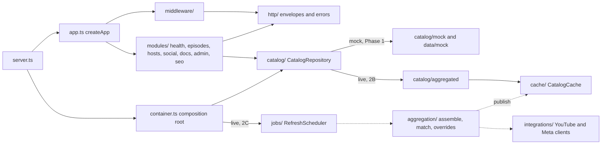
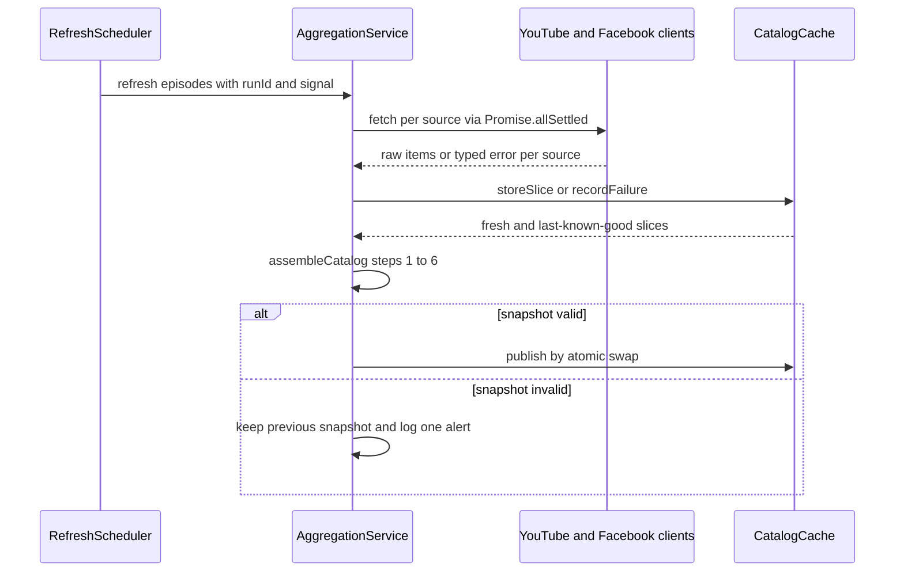
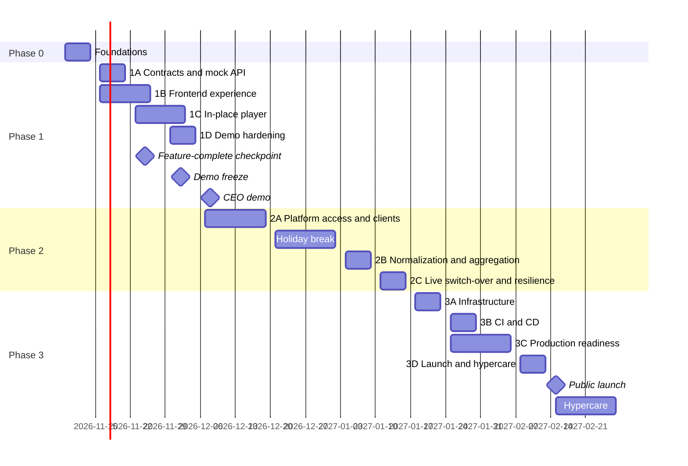

# ExtraTime — Low-Level Design

*The conversation beyond the game*

| Field | Value |
|---|---|
| Version | 0.2 |
| Status | Draft for review |
| Date | 2026-11-09 |
| Author | Senior Software Engineer |
| Reviewers | Solutions Architect, Engineering team |
| Implements | HLD v0.3 |
| Related | BRD v0.3 (`football-podcast-website-brd.md`) |
| Repository | `footy/` |

> **v0.2 (2026-11-09):** implements HLD v0.3. Video plays in place: `InlineVideo` swaps the artwork for the `youtube-nocookie` embed inside the hero, card or panel that was pressed, and `usePlayerStore` keeps one `activeKey`, so one video plays at a time and unmounting stops it. The IFrame API engine, custom controls, queue, resume and keyboard shortcuts are dropped (HLD Q21). The UI follows a Filthy Fellas-style layout in the ExtraTime preview palette (§3.6.6, `docs/figma/figma-prompt.md`). Retired IDs, never reused: LFR-22, LFR-23, LFR-27; LD-07; IB-03, IB-04, IB-06 to IB-08; T2A.17 to T2A.21, T2C.5, T2C.8 to T2C.10; M-WEB-15, M-WEB-17; TC-WEB-034 to TC-WEB-040, TC-WEB-042 to TC-WEB-050, TC-WEB-054, TC-WEB-056, TC-WEB-057, TC-WEB-064, TC-E2E-010 and TC-PERF-008.

## Table of Contents

- [1. Overview](#1-overview)
- [2. Problem Statement and Requirements](#2-problem-statement-and-requirements)
- [3. Proposal](#3-proposal)
  - [3.1 Implementation Approach & Key Decisions](#31-implementation-approach--key-decisions)
  - [3.2 Repository Layout & Tooling](#32-repository-layout--tooling)
  - [3.3 Engineering Conventions](#33-engineering-conventions)
  - [3.4 Shared Contracts Package](#34-shared-contracts-package)
  - [3.5 Backend Design](#35-backend-design)
  - [3.6 Frontend Design](#36-frontend-design)
  - [3.7 Platform Integration Design](#37-platform-integration-design)
  - [3.8 Infrastructure & Delivery Pipeline Design](#38-infrastructure--delivery-pipeline-design)
  - [3.9 Test Strategy & Test Design](#39-test-strategy--test-design)
- [4. Delivery Plan](#4-delivery-plan)
  - [4.1 Delivery Approach](#41-delivery-approach)
  - [4.2 Phase Plan Overview](#42-phase-plan-overview)
  - [4.3 Phase 0: Foundations](#43-phase-0-foundations)
  - [4.4 Phase 1: Local Functional Demo](#44-phase-1-local-functional-demo)
  - [4.5 Phase 2: Platform Integration](#45-phase-2-platform-integration)
  - [4.6 Phase 3: Production Launch](#46-phase-3-production-launch)
  - [4.7 Milestones & Definition of Done](#47-milestones--definition-of-done)
- [5. Open Questions](#5-open-questions)
- [Appendix A: Requirements Traceability Matrix](#appendix-a-requirements-traceability-matrix)
- [Appendix B: Test Case Catalog](#appendix-b-test-case-catalog)
- [Appendix C: Configuration Reference](#appendix-c-configuration-reference)
- [Appendix D: Module Catalog](#appendix-d-module-catalog)
- [Appendix E: References](#appendix-e-references)

## 1. Overview

### 1.1 Purpose & Audience

For engineers building and reviewing ExtraTime from 2026-11-09: the detail HLD §6.3 leaves to the LLD (paths, schemas, algorithms, configuration, tests, PR-sized tasks). Per task: find it in §4, read its modules (Appendix D) and §3 design, write its Appendix B tests, then implement.

### 1.2 Relationship to the HLD

- **The HLD governs** architecture and requirements (FR-01..FR-26, NFR-01..NFR-12, J1-J12, D1-D15, phases, Q-IDs); **the LLD governs** implementation. LFRs implement FRs and LNFRs implement NFRs (Appendix A); the BRD's CJ-* journeys are context only.
- **Conflicts** favour the HLD unless an LD (§3.1) says otherwise; v0.2 overrides the archived v0.1 (`docs/archive/hld-v0.1-detailed.md`) on names, IDs and values.
- **Product-owner decisions (2026-11-08) override HLD v0.2 text:** no audio until an RSS/MP3 source exists (LQ-17), so FR-10 and J5 have no tasks; visual-only mock data (LD-17); a lean, local-only Phase 1 gated by `npm run verify` (LD-24, LD-25). LQ-27 lists the resulting HLD v0.3 amendments.
- **Convention deviations:** conventions enforced by review until T2A.12 lint (LD-15); 40-line TSX functions; Express's four-parameter `error-handler.ts`; log-then-throw exceptions for `resilientFetch` attempts and `token-alert` (§3.3).
- **Revisions** (Engineering Lead): freeze on the HLD §6.3 dates; an LD change updates this LLD and any ADR in one PR.

### 1.3 Repository & Document Conventions

**Repository.** Root `footy/`; paths are repository-relative. T0.1 runs `git init -b main` (local until T2A.11; remote per LQ-03) and moves the HLD, BRD and LLD into `docs/design/`; `docs/archive/` stays. Workspaces `apps/*` and `packages/*`; `infra` joins in T3A.1, `e2e` in T3B.4 (LD-01, §3.2).

| ID | Meaning | Where |
|---|---|---|
| `LFR-nn`, `LNFR-nn` | Requirements | §2 |
| `LD-nn` | Implementation decisions | §3.1 |
| `M-{SH,API,WEB,INT,TOOL,INF}-nn` | Modules (TOOL: repository tooling; INF: cloud infra and deploy pipeline) | Appendix D |
| `T0.n` … `T3D.n` | Tasks | §4 |
| `TC-{SH,API,INT,WEB,E2E,A11Y,PERF,INF}-nnn` | Test cases (E2E from Phase 3B) | Appendix B |
| `IB-nn`, `OB-n` | Iteration backlog (LD-24), onboarding gate (LD-22) | §4 |
| `LQ-nn` | Open questions; HLD Q-IDs by reference | §5 |

Gaps in any ID series are retired IDs and are never reused.

**Data and naming.** Personas by HLD description only. Test data is fictional (S03E14, Jordan Reyes, `extratime.example`; LD-04); demo fixtures are real public videos (LD-17).

**Snippets.** First line `// File: <path>`: a complete, compilable file matching Appendix D (JSON: path in the preceding sentence); `// Illustrative`: an unchecked fragment. Versions and platform facts carry "(as of Nov 2026 — verify)".

**Task tables (§4).** Phase 0-1 tasks carry acceptance notes (MoSCoW, lane, production/test lines; LD-18). A Phase 2-3 task is accepted when its tests pass and the §2.2 acceptance of the LFRs they cover (Appendix B) holds, within its LD-19 size; notes follow in per-phase planning.

- One task = one PR (a reviewed branch in Phase 1) = one squashed commit `type(scope): summary (T1A.3)`, tests included (LD-11); ≤ 150 production and ≤ 150 test lines, S ≤ 60; data, docs and generated files exempt (LD-19).
- File lists include modified files; the first task in dependency order creates each.
- Done = acceptance met and `npm run verify` green (in CI from T2A.11); "test-first" = GIVEN / WHEN / THEN tests before code (§3.9).

### 1.4 Implementation Summary

Versions as of Nov 2026 — verify.

- **Foundations (Phase 0, 3 tasks).** npm workspaces, Node.js 26, strict TypeScript ~6.0, ESLint 10 (typescript-eslint recommended) and Prettier, Vitest 5; one gate, `npm run verify` (LD-25).
- **Contract first.** `@extratime/shared`: Zod 4 schemas, Zod-free `constants` and builders, resolved from source (LD-03, LD-04); Phase 1A ships the final `/api/v1` shapes and keyset feed cursor (LD-05).
- **One API, swappable catalog.** `container.ts` wires the Express 5 BFF to `MockCatalogRepository` or, from Phase 2C, the live catalog; one contract suite covers both (LD-16).
- **Visual-only mock data.** 7 public episodes, the two founders (initials avatars), 12 posts and `source-statuses.json`, validated at startup; no audio, local media or simulation code (LD-17).
- **In-place player.** A Zustand `activeKey` store (`play(key)`, `stop(key?)`) lets one `InlineVideo` at a time swap its artwork for a visible ≥ 200x200 px `youtube-nocookie` embed with YouTube's own controls; small surfaces link to YouTube. No IFrame API, custom controls, queue, resume or shortcuts (LD-08, HLD Q21).
- **Visual direction.** A Filthy Fellas-style layout (stacked headlines, ticker, carousels, colour-block tiles, follow section) in the ExtraTime ink, paper and lime palette, with system fonts (§3.6.6).
- **Lean schedule.** Phases 0-1: 22 tasks, about 20 engineer-days; feature-complete 2026-11-25, frozen 2026-12-02, CEO demo week of 2026-12-07 (LD-18).
- **Live data (Phase 2).** GitHub, CI, strict lint and OpenAPI (T2A.11-T2A.13), then `resilientFetch`, platform clients, episode identity (LD-06), matching, overrides, cache and scheduler; live by 2027-01-15 (§3.7).
- **Production (Phase 3).** `aws-cdk-lib` v2 `ExtraTime-*` stacks (LD-21), build-once promotion, Playwright + axe tests for every journey except J5, performance gates, SEO, legal, consent, observability; launch week of 2027-02-15, 2 weeks of hypercare (§3.8, §4.7).

## 2. Problem Statement and Requirements

### 2.1 Problem Statement

Turn `footy/` (only design documents on 2026-11-09; product problem: HLD §1.2) into a tested TypeScript monorepo delivering:

1. a localhost CEO demo on mock fixtures and the final `/api/v1` contract by 2026-12-04 (lean Phase 1, LD-24);
2. live platform data behind that contract, without frontend change, by 2027-01-15;
3. an AWS launch via CI/CD, week of 2027-02-15.

Constraints:

- 1-3 engineers, no operations team (LD-18).
- One task = one PR (≤ ~150 production and ~150 test lines, tests included; LD-19); domain logic test-first.
- Phases 0-1: local only, gated by `npm run verify` (no GitHub, CI, e2e or performance automation; LD-25).
- No audio until an RSS/MP3 source exists (LQ-17): FR-10 and J5 have no LFR, task or test; mock data is visual only (LD-17).
- Platform policies, UK GDPR/PECR consent, US$120/month, no database (HLD §3.3); infrastructure in `aws-cdk-lib` v2 (LD-02).

LFRs implement HLD §3.1 FRs, LNFRs HLD §3.2 NFRs. Phase = first demonstrable; IB-nn = Phase 1 iteration backlog (LD-24); "Verified by" = every covering Appendix B test or checklist; ID gaps are retired. Versions and platform facts as of Nov 2026 — verify.

### 2.2 Functional Requirements

|ID|Implements|Requirement|Acceptance|Phase|Verified by|
|---|---|---|---|---|---|
|LFR-01|FR-22,FR-17|npm workspaces; `npm run dev` runs API :4000 and Vite :5173 proxying only `/api`; shared from source (LD-03); scripts dev, build, lint, typecheck, test, verify|Clean clone: `npm ci && npm run dev` needs no build or `.env`; verify exits 0|0|TC-API-001–003, TC-INF-001–002|
|LFR-02|FR-17|Zod 4 schemas and types for every Phase 1 payload, envelope and Problem Details; zod-free `/constants`; HLD §4.5 field policy (https only, except root-relative `/images/`)|Golden examples parse; 281-character summary, +01:00 timestamp, any http URL and non-`/images/` paths rejected|1A|TC-SH-002, TC-SH-004–005, TC-SH-007–008, TC-SH-010–011|
|LFR-03|FR-17,FR-19,FR-22|Fixtures in `apps/api/src/data/mock`: 7 public ExtraTIME episodes (S01E01 and S01E02 coded; Full Circle, both Purpose parts, the trailer and the Kinshasa bonus uncoded until codes are confirmed, LQ-01; audio null), 2 founders (avatar null), 12 posts (8 Instagram, 4 YouTube; 6 related), `source-statuses.json` (facebook disabled) served verbatim|Broken fixture stops startup, naming file and path|1A|TC-API-014, TC-API-016–018|
|LFR-04|FR-17,FR-21|Envelopes with `meta.generatedAt` and `meta.sources`; RFC 9457 Problem Details (`no-store`) for 400, 404, 500, no stack traces; strict query schemas; pino-http logs. Hardening: LFR-51|Unknown path 404; thrown error 500, logged once; unknown key 400 at `query.<key>`|1A|TC-SH-010–011, TC-API-007, TC-API-009–011, TC-API-024, TC-API-026–027|
|LFR-05|FR-02,FR-03|`GET /api/v1/episodes`: page, pageSize (12, max 50), season, host, platform, q (≤ 100 chars, diacritic-insensitive over title, summary, guests, tags), sort (id tie-break); filter UI: LFR-55|Page 2 of 16 holds the oldest 4; `sort=popular` 400; `?q=identity` finds both Purpose episodes on the fixtures|1A|TC-API-021–022, TC-API-024, TC-API-027, TC-E2E-002|
|LFR-06|FR-04,FR-14|`GET /api/v1/episodes/:slug`: full Episode on exact slug, else 404; fallback in LFR-34|s03e14-derby-day-fallout parses; s03e99-unknown 404|1A|TC-SH-004, TC-API-020, TC-API-025–026|
|LFR-07|FR-11,FR-19|`GET /api/v1/hosts` in editorial order; `/hosts/:slug`: HostDetail with ≤ 6 recent episodes, newest first|henry-nzuzi: role, bio, links, avatar null; unknown slug 404|1A|TC-SH-007, TC-API-028–029|
|LFR-08|FR-12,FR-13|`GET /api/v1/social/feed`: platform list, limit (12, max 30), LD-05 keyset cursor|24 posts page 12 + 12, then null cursor; tampered cursor 400; newer posts never shift page 2|1A|TC-SH-008, TC-API-030, TC-API-032–034|
|LFR-10|FR-23|`GET /api/v1/health`: status, version, commit (`RELEASE_SHA`, else 'dev'), uptimeSeconds; no catalog access|Commit matches|0|TC-API-003, TC-API-035, TC-API-064|
|LFR-12|FR-04,FR-14|React Router 8 data mode: `/`, `/episodes`, `/episodes/:slug`, `/hosts`, `/hosts/:slug`, `/social`, `/about`, `*`; RootLayout never unmounts; in-layout error boundary; h1 focus; React 19 `<title>`|Deep links reload; unknown paths and slugs: in-layout 404, no retry; errors keep header and footer|1B|TC-WEB-010, TC-WEB-023, TC-E2E-001, TC-E2E-006|
|LFR-13|FR-17|`apiClient.ts`, the only fetch caller (base `/api/v1`, AbortSignal, problem+json to ApiError); `lib/queries` factories (staleTime 60 s, social 30 s; retry ≤ 2 on network/5xx)|404 body maps to ApiError http; rejected fetch to network|1B|TC-WEB-006, TC-PERF-002|
|LFR-14|FR-21|Loading, empty and error (Retry) states per view; tolerant reader (enum fallbacks, nulls, artwork placeholder at reserved size); no runtime toggle|Archive states; EpisodeCard edge cases|1B|TC-API-017, TC-WEB-015, TC-WEB-018|
|LFR-15|FR-01|HomePage: hero (slogan h1; the newest episode in an InlineVideo with 'Play latest'), ticker, about split, latest-episodes carousel of 6, founders, three ways in, featured guests, a social carousel of 6 numbered '01 / 06', follow section; blocks fail independently|Kinshasa special in the hero; failing social leaves episodes|1B|T1D.1 checklist, TC-WEB-010, TC-E2E-008|
|LFR-16|FR-02,FR-03|EpisodesPage: cards newest first (code badge when coded, 'Watch on YouTube'); submit-on-enter search writes `?q`|'identity' lists both Purpose episodes, surviving reload and Back|1B|TC-WEB-015, TC-WEB-018, TC-E2E-002|
|LFR-17|FR-04,FR-14|EpisodeDetailPage: InlineVideo with PlayButton, plain-text description, guests, host links, 'Watch on YouTube', a 'More conversations' carousel, ShareButton (navigator.share, else clipboard)|Shared full-circle-coach-pitso-mosimane URL reloads to it|1B|T1D.1 checklist, TC-WEB-019, TC-E2E-003, TC-E2E-009|
|LFR-18|FR-11,FR-14|HostsPage grid; HostDetailPage: role, bio, links, initials avatar, share, ≤ 6 playable episodes|/hosts/henry-nzuzi renders all|1B|T1D.1 checklist, TC-E2E-004|
|LFR-19|FR-12,FR-13|SocialPage: 'Load more' on `meta.nextCursor` (6 per page), `?platform` filter, cards linking originals and related episodes; no Meta scripts|12 posts newest first; Instagram filter leaves 8|1B|T1D.1 checklist, TC-API-016, TC-E2E-005|
|LFR-20|FR-16,FR-24|Sticky header (compacts on scroll; full-screen menu below 960 px), footer and skip link on every page; YouTube, Instagram and TikTok follow links (Facebook per LQ-24); AboutPage: story, slogan, contact placeholder (LQ-04)|Named follow links; About footer-linked with story, slogan, contact|1B|T1D.1 checklist, TC-WEB-010, TC-E2E-003|
|LFR-21|FR-06|usePlayerStore (Zustand 5, no persistence): `activeKey`, `play(key)`, `stop(key?)`; each `InlineVideo` takes a `useId` key and stops on unmount|A second play stops the first; Close video or navigation removes the iframe|1C|TC-WEB-010, TC-WEB-033, TC-WEB-051|
|LFR-24|FR-09|InlineVideo: one youtube-nocookie iframe per widget, created after a play tap (LD-08), with YouTube's controls; visible ≥ 200x200 px inside its widget, never covered|Unobscured ≥ 200x200 px at 360 and 1440 px (T1D.1 checklist)|1C|TC-SH-005, TC-WEB-051, TC-E2E-008–009, TC-E2E-015, TC-INF-022|
|LFR-26|FR-01|PlayButton (`playerKey`, constant name 'Play {title}', aria-pressed, toggles play and stop) beside the hero and episode-page InlineVideo; every card and panel has its own InlineVideo play overlay|One tap starts the newest episode in the hero (two if autoplay blocked)|1C|TC-WEB-052, TC-E2E-008|
|LFR-28|FR-22|Demo: `npm run demo` (production build served by `vite preview` on :4173 with the API; Cloudflare Quick Tunnel hosts allowed) or `npm run dev`; `docs/demo-script.md`: storyline ending on cost (~US$85 of US$120/month, HLD §4.12) and pre-Phase 2 decisions (§5), checklist (manual accessibility, Lighthouse, viewports, offline, onboarding), backup recording, rehearsal 48 h before|Non-engineer finishes in ≤ 7 minutes, clean console|1D|TC-INF-002, TC-A11Y-005, TC-PERF-009, TC-E2E-014|
|LFR-29|FR-18,FR-21|resilientFetch: 8 s per attempt; ≤ 3 retries on 429, 5xx, network (full jitter, 500 ms base, 8 s cap); Retry-After ≤ 60 s; egress allow-list; no logged query strings|No retry on 404; unlisted host rejected|2A|TC-INT-002–006|
|LFR-30|FR-17,FR-18|YouTube client: uploads playlist once, newest page per cycle, full paging on reconciliation; videos.list ≤ 50 IDs; never search.list; Pacific-day quota circuit|No batch above 50; circuit serves last-known-good|2A|TC-INT-001, TC-INT-006–008|
|LFR-31|FR-18,FR-21|GraphClient: pinned v27.0, appsecret_proof, back-off above 80% usage, throttling cool-downs, token alert on 190; MetaTokenService; re-mint runbook|190: one alert, no retries|2A|TC-INT-009–012, TC-INT-015|
|LFR-32|FR-12|Instagram media: explicit fields, since, ≤ 20 pages; no Stories; login mode by configuration|Fields and since on every request|2A|TC-INT-013|
|LFR-33|FR-12,FR-20|Facebook posts (limit 100) and videos; invalid items dropped and counted; SchemaDriftError above 20%|25% invalid raises SchemaDriftError|2A|TC-INT-014|
|LFR-34|FR-17,FR-12,FR-14|YouTube normalization: LD-06 identity, 280-character summaries, plain text, durations, thumbnails; live/upcoming excluded; Shorts become `sp_yt_` posts. IB-09: code-segment slug fallback, canonical URL replacement|180 s horizontal stays an episode; s03e14-old-title resolves|2B|TC-API-023, TC-API-042–043, TC-INT-017–023, TC-INT-026, TC-WEB-023|
|LFR-35|FR-12,FR-13|Meta mappers (§3.7): `sp_ig_`/`sp_fb_` ids, null media url keeps thumbnail, Z timestamps, views null; CDN URLs in memory only|Every fixture variant parses|2B|TC-INT-017, TC-INT-024–025|
|LFR-36|FR-05|parseChapters: ≥ 3 lines from 0, ascending, below duration, else []. IB-05: ChapterList starts the episode's InlineVideo at the chapter (`start=<seconds>`)|S03E14 yields 0, 185, 1490 and 2870 s|2B|TC-INT-027, TC-WEB-053, TC-E2E-012|
|LFR-37|FR-20,FR-13|matchEpisodes, one-to-one: episode code; watchUrl or videoId (posts); Jaro-Winkler ≥ 0.85 within 72 h (Facebook videos); ties logged|Cross-posted S03E14 appears once|2B|TC-API-045–048, TC-E2E-016|
|LFR-38|FR-19|`apps/api/src/content`: hosts.json and episode-overrides.json (hosts, guests, tags, episodeType, isShort, hidden), validated at startup and in verify; overrides win|Hidden episodes vanish everywhere; urgent hide ≤ 1 hour|2B|TC-API-019, TC-API-049–050, TC-INF-011, TC-INF-030|
|LFR-39|FR-17,FR-21|CatalogCache last-known-good (Meta 24 h, YouTube 7 days) with SourceStatus; AggregationService merges, matches, overrides, dedupes, sorts, validates, swaps atomically|Instagram failing: fresh YouTube, stale Instagram|2B|TC-API-051–055|
|LFR-40|FR-18,FR-21,FR-23|Scheduler: episodes 15 min, social 10 min (±10% jitter), reconcile 6 h, single-flight; 20 s warm-up always publishes; reads wait ≤ 10 s, then 503 Retry-After 30; `/api/v1/health/ready`|All sources down at boot: reads 200, readiness 503|2B|TC-API-036, TC-API-056–059|
|LFR-41|FR-18|`POST /api/v1/admin/refresh` (live only): X-Admin-Key ≥ 32 chars, constant-time check; 10/min/IP; 202 with coalesced refreshId|Wrong key 401, never logged|2C|TC-SH-015, TC-API-060–062|
|LFR-42|FR-17|`container.ts` wires the mock or live runtime; `server.ts` runs the scheduler; LD-16 parity suite; `npm run smoke:live`|Both containers pass one contract suite|2C|TC-API-019, TC-API-040–041, TC-API-063–064, TC-E2E-016, TC-INF-008|
|LFR-43|FR-21|Failure injection: Meta 190, blocked host, 429, quotaExceeded, drift, cold start, absent credentials|Catalog reads 200 except the cold-start 503|2C|TC-API-065, TC-INT-026|
|LFR-44|FR-15,FR-26|LD-21 stacks: S3 with OAC; CloudFront (`/api/*`, `/sitemap.xml` to the ALB; rest to S3 with spa-rewrite); apex 301; ECS Express Mode (ARM64, 1-3 tasks); 30-minute backstop|Staging serves SPA, API and deep links over HTTPS|3A|TC-INF-009–010, TC-INF-012–016, TC-INF-025–026, TC-INF-029, TC-INF-032|
|LFR-45|FR-26,FR-23|`deploy.yml` builds `web/{sha}/` and `extratime-api:{sha}` once, deploys staging; `promote.yml` ships the staged SHA; one SHA everywhere|Rollback ≤ 15 minutes; index.html restored ≤ 5|3B|TC-API-070–071, TC-WEB-063, TC-E2E-018, TC-INF-008, TC-INF-011, TC-INF-017–019, TC-INF-033|
|LFR-46|FR-15|seo module: `/episodes/:slug` and `/hosts/:slug` as index.html with escaped Open Graph, Twitter Card, JSON-LD; 404 noindex or 503 while YouTube errors; `/sitemap.xml`|Sharing Debugger shows previews|3C|TC-API-066–069, TC-WEB-058, TC-E2E-020, TC-E2E-022, TC-INF-016, TC-INF-029|
|LFR-47|FR-25|`/privacy`, `/terms`, `/data-deletion` with approved copy; footer links them, the YouTube Terms and Privacy choices|Privacy page holds every required statement|3C|TC-WEB-059–060, TC-A11Y-007|
|LFR-48|FR-25|LD-08 consent gate: no YouTube or analytics load before consent; withdrawal destroys the player|No YouTube request before the tap|3C|TC-WEB-061–062, TC-WEB-066, TC-E2E-019, TC-A11Y-006–007|
|LFR-49|FR-15,FR-25,FR-26|Go-live: drills pass, monitoring live, CSP enforced after 7 clean days (T3D.3), laptop tokens revoked, checklist signed 2027-02-12, 2-week hypercare|Production deployed only by the pipeline; canary passes|3D|TC-E2E-020–021, TC-INF-020–021, TC-INF-024–025, TC-INF-028, TC-PERF-005–007|
|LFR-51|FR-17,FR-21|Deferred hardening: Cache-Control per HLD §4.4 (error no-store: T1A.3), weak ETag, X-Request-Id, helmet and LD-20 CSPs, 120/min/IP (admin 10), 429 and 413 Problem Details, compression|Request 121 returns 429; JSON CSP on `/api/v1` only|2C|TC-API-005–006, TC-API-008, TC-API-012–013|
|LFR-52|FR-23,FR-17|OpenAPI 3.1 from shared schemas, committed at `docs/api/openapi.v1.json`; drift test in verify; oasdiff in CI; Swagger UI outside production; v1 additive-only|Production `/api/docs` 404; removed field fails oasdiff|2A|TC-API-037–038, TC-INF-007|
|LFR-54|FR-21|IB-01: SourceStatusBanner for stale or error sources (unknown = degraded); disabled sources hidden from filters; OfflineNotice; 'Reference: {requestId}'; Retry-After on 503|Editing `source-statuses.json` shows 'Instagram updates delayed'|2A|TC-WEB-004–005, TC-WEB-032, TC-E2E-007, TC-E2E-014|
|LFR-55|FR-02|IB-02: EpisodeFilters and Pagination in URL params (defaults omitted, page reset, values clamped); previous results dimmed|`?season=1&host=henry-nzuzi&q=identity` survives reload and Back|2A|TC-WEB-016, TC-E2E-002|

### 2.3 Non-Functional Requirements

|ID|Implements|Requirement|Measure|Enforced by|
|---|---|---|---|---|
|LNFR-01|NFR-01|Initial JS ≤ 180 KB gzip, route chunk ≤ 60 KB, CSS ≤ 30 KB; no Zod or testing code in bundles|Vite manifest gzip sizes; marker scan|TC-PERF-001–002 via `check-bundle-size` from T3B.8|
|LNFR-02|NFR-01|Lab (mobile Lighthouse, production build): LCP ≤ 2.0 s, CLS ≤ 0.1, TBT ≤ 200 ms. Field p75: LCP ≤ 2.5 s, INP ≤ 200 ms, CLS ≤ 0.1|Manual pre-demo run; lhci median of 3; Sentry|TC-PERF-009 (1D checklist); TC-PERF-004 from T3B.8; TC-WEB-063 in hypercare|
|LNFR-03|NFR-01,NFR-03|Origin p95 ≤ 200 ms on cached reads; no request-path I/O. Growth peak hour (HLD §4.12; assumed 15% of ~16.7k daily views): ~0.7 views/s ≈ 2.1 edge API req/s, ~0.3 at origin. 10x for 15 min (~21 req/s, at origin too when cache-busting): no 5xx, 1 → 3 tasks, flat platform calls|k6 on dark production; rates as constants in `scripts/perf/k6`|TC-PERF-005 (10x; go-live blocker); TC-PERF-007 (1x, 2 h)|
|LNFR-04|NFR-02|Site 99.9%, API 99.5%: catalog-free liveness, graceful SIGTERM, stale-if-error, 5xx never edge-cached, warm-up always publishes, SPA honours Retry-After|5-minute uptime checks; alarms|TC-API-006, TC-API-035, TC-API-059; TC-INF-016; TC-INF-024 drill|
|LNFR-05|NFR-04|Refresh 15/10 min (staging 60/30), reconcile 6 h; uploads visible ≤ ~21 min, posts ≤ ~16 min; `catalog_age_seconds` alarm > 3,600 s (staging 7,200)|Fake-timer tests; timed publish|TC-API-056, TC-API-041; TC-PERF-006 (go-live blocker); TC-INF-020|
|LNFR-06|NFR-05|WCAG 2.2 AA with the player. Phase 1: landmarks, keyboard, focus never hidden, contrast ≥ 4.5:1 (3:1 large/UI), reduced motion. From 3B: no serious axe violations|Manual VoiceOver and keyboard passes; axe from 3B|TC-A11Y-005 (Phase 1); TC-A11Y-002–004, TC-A11Y-007; TC-A11Y-006 at go-live|
|LNFR-07|NFR-06|No browser credentials; secrets in git-ignored `.env` or Secrets Manager; least-privilege IAM (two LD-02 exceptions); LD-20 headers; rate limits; egress allow-list; redaction; TLS 1.2+, HSTS, CSP|gitleaks, npm audit, Trivy, cdk-nag, ZAP|TC-INF-006, TC-INF-027; TC-API-010, TC-API-013, TC-API-061, TC-API-072, TC-INT-005; TC-INF-010, TC-INF-012, TC-INF-026; TC-INF-022–023|
|LNFR-08|NFR-07|No embed or analytics before consent; visible nocookie embeds ≥ 200x200 px; no player state in browser storage; Meta data in memory ≤ 24 h, YouTube ≤ 7 days; raw metrics only; anonymized fixtures|Network capture; retention tests; fixture scan|TC-E2E-019; TC-API-051, TC-INT-001; compliance checklist|
|LNFR-09|NFR-08|≤ US$120/month: budget alerts 50/80/100% and forecast, anomaly detection > US$20, tags, ARM64 0.5 vCPU/1 GB, no NAT|CDK assertions; monthly review|TC-INF-009, TC-INF-012, TC-INF-021|
|LNFR-10|NFR-09|TypeScript strict (~6.0); ESLint 10 zero warnings (recommended plus Prettier; strict rules and name guard from T2A.12); TSDoc on exports; onboarding ≤ 30 minutes|tsc -b, eslint, prettier; dry run|TC-INF-001 in verify (CI: TC-INF-005); TC-INF-003–004; TC-INF-002|
|LNFR-11|NFR-10|Unit, component and contract tests gate every merge via verify; coverage from T2A.12 (LD-10); OpenAPI drift from T2A.13; parity from 2C; e2e from T3B.4|Vitest reports; oasdiff; Playwright|TC-INF-001, TC-INF-005; TC-API-016; TC-INF-007; TC-API-063|
|LNFR-12|NFR-10|Required PR checks ≤ 10 minutes (p90) with npm and browser caches|Job durations, weekly|`timeout-minutes: 10`; TC-INF-005|
|LNFR-13|NFR-11|pino JSON logs (reqId, commit, upstream fields, redaction); EMF metrics in ExtraTime/Api; Sentry (no PII, replay off); HLD §4.10 alarms; outage alerts ≤ 5 minutes|Unit tests; alarm assertions; fire drill|TC-API-008, TC-API-010, TC-API-070; TC-INF-020; TC-INF-024|
|LNFR-14|NFR-12|Latest two Chrome, Safari, Firefox, Edge plus Instagram and Facebook in-app browsers; 360 px to wide, no horizontal scroll; embeds ≥ 200x200 px|Manual in Phase 1; Playwright from 3B|T1D.1 checklist; TC-E2E-009, TC-E2E-015; in-app check per release|
|LNFR-15|NFR-03|Quota independent of traffic: requests never call platforms; YouTube ≈ 374 units/day per instance (≤ 21% worst case); alarms at 5,000 and 8,000; Meta back-off above 80%|Boundary lint; quota tests; 3 measured days|TC-INF-004; TC-INT-008, TC-INT-012, TC-INT-026|

## 3. Proposal

§3.1 to §3.3 fix the approach, repository and conventions every task follows; §3.4 to §3.9 design each layer; IDs and paths match Appendix D.

### 3.1 Implementation Approach & Key Decisions

Delivery is vertical-slice (one behaviour through every layer, tests included, per PR), contract-first (§3.4 schemas before endpoints and components), test-first for domain logic, mock-first with visual fixtures behind the final `CatalogRepository`, and lean in Phase 1. Decisions:

- **LD-01** `footy/` is the git root on `main`, local until T2A.11; design docs in `docs/design/`. Workspaces `apps/*`, `packages/*` (`infra` from T3A.1, `e2e` from T3B.4), one lockfile, ESM, Node 26 in `.nvmrc`, `mise.toml` and `engines` (`engine-strict`); `scripts/` is not a workspace (HLD D9).
- **LD-02** Infrastructure in `aws-cdk-lib` v2, hardened with cdk-nag, assertion tests, explicit encryption, `RETAIN` and a scoped bootstrap policy. No `*` actions; bare `*` resources only for the two ADR-015 exceptions; wildcard-suffixed ARNs only within one owned prefix (`web/*`, `/extratime/{env}/*`, log streams, CDK cross-region readers), each suppressed per resource and listed in ADR-015 and the TC-INF-010 allow-list.
- **LD-03** One `schemas/<entity>.schema.ts` per entity (`<Entity>Schema` plus type); zod-free `constants/`; exports `.`, `./constants`, `./testing`, each with a `source` condition to `src`. The web value-imports only `./constants` and validates nothing at runtime (HLD D1, NFR-01).
- **LD-04** Validating `EpisodeBuilder`, `HostBuilder`, `SocialPostBuilder` (default S03E14) and golden HLD JSON from `@extratime/shared/testing`, tests only.
- **LD-05** Feed cursor: unpadded base64url of `{"v":1,"p":publishedAt,"i":id}`, <= 200 characters; keyset (publishedAt desc, id desc); invalid is 400 at `query.cursor` (HLD D7).
- **LD-06** Code `/\bS(\d{1,2})\s*E(\d{1,3})\b/i`; id `ep_s03e14` or `ep_yt_{videoId}`; slug `{code}-{kebab(title)}` <= 60 characters, collisions `-2`. Phase 1 fixtures hand-author ids and slugs; the algorithm ships in T2B.2 (FR-14).
- **LD-07** Retired 2026-11-09 (HLD Q21): no player persistence; the web writes nothing to browser storage until Phase 3's consent record (LFR-48).
- **LD-08** No IFrame API: `InlineVideo` creates one `youtube-nocookie` iframe inside its own widget after the tap, and the store keeps one `activeKey`; chapters reload the embed with `start` (T2B.16); the consent facade arrives in T3C.4.
- **LD-09** One runtime mock (the API with `DATA_SOURCE=mock`); MSW 3 only in tests (`onUnhandledFrame: 'error'`).
- **LD-10** Coverage on demand in Phases 0-1; thresholds from T2A.12 (85% lines shared and API, 70% web, 80% scripts), ratchet up only (NFR-10).
- **LD-11** Branch `<type>/<task-id>-<slug>`; the author runs `npm run verify`; a second engineer reviews `git diff main...branch` and squash-merges `type(scope): summary (T1A.3)` (body: LFR and TC IDs, line counts). Critical-chain PRs are reviewed within four working hours; a dependent branch may start from its unmerged parent and rebase. Origin is a shared bare repository (LQ-03) until T2A.11.
- **LD-12** `DomainError` subclasses carry a problem type (Phase 1: `ValidationError`, `NotFoundError`); services return `null` for not found and never import Express; controllers throw; only `error-handler.ts` logs request failures (exceptions: §3.3 row 6).
- **LD-13** `apps/api/src/config/env.ts` alone reads `process.env` (Zod-parsed once, frozen, injected); the Phase 1 web reads none (NFR-06).
- **LD-14** Injected `Clock`; `Date.now()`, argument-less `new Date()`, `Math.random()` and `AbortSignal.timeout` are banned from T2A.12.
- **LD-15** Phase 0 lint: typescript-eslint `recommended` and Prettier at zero warnings; T2A.12 adds `strictTypeChecked`, the §3.3 limits, TSDoc, boundaries, LD-13/LD-14 bans and the file-name guard (decision G).
- **LD-16** One Supertest suite per endpoint over a builder-made container, bodies parsed with shared schemas; mock/live parity from 2C; OpenAPI drift test and oasdiff from T2A.13 (FR-17).
- **LD-17** Fixtures in `apps/api/src/data/mock` (7 real episodes, 2 founders, 12 posts, source statuses); no local images, audio, `/media`, `MOCK_*` or failure code. `MockCatalogRepository.fromDirectory` validates before `listen()`; a committed-dataset test replaces a validator CLI.
- **LD-18** S = 0.5, M = 1 engineer-day; Phases 0-1: 22 PRs, about 20 engineer-days for two or three engineers. WEB starts when T0.3 merges (about 2026-11-11); the longest chain is 12 PRs (§4.2), feature-complete by 2026-11-25.
- **LD-19** Production lines: non-blank, non-comment TS, TSX, CSS, JS, YAML and CDK; S <= 60, M <= 150, tests <= 150; data, docs, generated and binary files exempt.
- **LD-20** From T2C.7: helmet without CSP app-wide, JSON CSP on `/api/v1`, Swagger CSP on `/api/docs`, SPA CSP at CloudFront; Express defaults before.
- **LD-21** `ExtraTime-Global` (us-east-1), then `-ApiShared`, `-Api-{env}`, `-Edge-{env}`, `-Backstop-{env}`, `-Observability-{env}` (eu-west-2) and `-Observability-{env}-Edge` (us-east-1: CloudFront and ACM alarms); no stack references a later one.
- **LD-22** Onboarding gate OB-1 to OB-8 in `docs/runbooks/platform-onboarding.md` from T0.1; Phase 2 entry needs OB-1, OB-2 and OB-4 to OB-6, else it starts YouTube-only.
- **LD-23** Pins below, locked in `package-lock.json`; each package arrives with the task that first uses it; no `lru-cache`; shared depends on `zod` only.
- **LD-24** Phase 1: every route, search, share, social filter and Load more, and in-place playback; backlog IB-01, IB-02, IB-05 and IB-09 in T2A.15, T2A.16, T2B.16 and T2B.2; demo freeze 2026-12-02 (decision G).
- **LD-25** Phases 0-1 gate on local `npm run verify` only; `ci.yml` calls it from T2A.11; Playwright, axe, bundle and Lighthouse jobs arrive in 3B (decisions A, B, C).

### 3.2 Repository Layout & Tooling

End state after Phase 3. Unmarked items arrive in Phase 0 or their folder comment's phase; a marker covers items to its left back to the previous marker; braces expand as in bash.

```text
footy/                                     # git root on main (LD-01)
  .editorconfig  .env.example  .gitignore  .npmrc  .nvmrc  .prettierrc  .prettierignore  mise.toml
  README.md  package.json  package-lock.json  tsconfig.base.json  eslint.config.js  vitest.config.ts
  .vscode/{settings,extensions}.json
  .gitleaks.toml (P2)
  .github/                                 # (P2) T2A.11
    dependabot.yml  pull_request_template.md  workflows/ci.yml
    CODEOWNERS  workflows/{deploy,promote,security-scan}.yml  actions/release/action.yml (P3)
  packages/shared/                         # @extratime/shared (LD-03)
    package.json  tsconfig.json  src/{index,constants/index,testing/index}.ts
    src/constants/{platforms,api-limits,problem-types,site-images}.constants.ts (P1)
    src/schemas/{primitives,episode,host,social-post,source-status,envelope,problem-details}.schema.ts (P1)
    src/schemas/{primitives,episode,host,social-post,envelope,problem-details}.schema.test.ts (P1)
    src/schemas/{health.schema,admin-refresh.schema,admin-refresh.schema.test}.ts (P2)
    src/testing/builders/{episode,host,social-post}.builder.ts (P1)
    src/testing/golden/{episode.s03e14,host.jordan-reyes,social-feed.page-1,problem.not-found,problem.validation-error}.json (P1)
    src/testing/golden/admin-refresh.accepted.json (P2)
  apps/api/                                # @extratime/api on :4000
    package.json  tsconfig.json  tsconfig.build.json  vitest.config.ts
    Dockerfile  Dockerfile.dockerignore (P3)
    src/
      app.ts  server.ts  container.ts  config/env{,.test}.ts  modules/health/health.{routes,controller}.ts
      server.test.ts (P3)
      http/{response-envelope,domain-errors,problem-details}.ts (P1)  http/{cache-headers,cache-headers.test,http.constants}.ts (P2)
      middleware/{request-logger,validate-request,not-found,error-handler}.ts (P1)
      middleware/{request-id,rate-limit,security-headers,require-admin-key}.ts (P2)  middleware/verify-origin{,.test}.ts (P3)
      catalog/{catalog.repository,clock}.ts  catalog/mock/{mock-dataset,mock-catalog.repository}{,.test}.ts (P1)
      catalog/{episode-identity,package-paths}{,.test}.ts  catalog/catalog.constants.ts (P2)
      catalog/aggregated/{aggregated-catalog.repository,warm-up}{,.test}.ts (P2)
      data/mock/{episodes,hosts,social-posts,source-statuses}.json  data/mock/{README.md,committed-dataset.test.ts} (P1)
      content/{hosts,episode-overrides}.json (P2)
      modules/
        episodes/{episodes.service,episodes.constants,episodes.query-schema,episodes.controller,episodes.routes}.ts (P1)
        episodes/{episode-search,episodes.service.test}.ts  hosts/hosts.{service,constants,controller,routes,service.test}.ts (P1)
        social/{feed-cursor,social.service}{,.test}.ts  social/social.{constants,query-schema,controller,routes}.ts (P1)
        docs/{openapi-document,docs.routes,write-openapi.cli}.ts  admin/admin.{routes,controller}.ts (P2)
        seo/seo.{service,constants,routes,controller}.ts  seo/sitemap.ts  seo/{seo-tags,index-html.provider}{,.test}.ts (P3)
      cache/{catalog-cache,source-status-policy}{,.test}.ts  cache/{cache.constants,source-status-messages}.ts (P2)
      jobs/{refresh-scheduler,refresh-backoff}{,.test}.ts  jobs/refresh.constants.ts (P2)
      aggregation/                         # (P2)
        {aggregation.service,catalog-assembly}{,.test}.ts  aggregation.constants.ts
        matching/{episode-matcher,title-similarity}{,.test}.ts  matching/matching.constants.ts
        overrides/{content.schema,editorial-overrides,editorial-overrides.test}.ts
      integrations/                        # (P2)
        http/{resilient-fetch,backoff-policy,paginate}{,.test}.ts  http/{upstream-errors,egress-allow-list,integrations-http.constants}.ts
        normalization/{plain-text,iso-duration,thumbnail-chain,summary,normalization.constants,normalization.test}.ts
        normalization/chapter-parser{,.test}.ts
        youtube/youtube.{client,raw-schemas,constants,mapper,client.test,mapper.test}.ts  youtube/{shorts-classifier,youtube-quota,youtube-quota.test}.ts
        meta/{graph-client,usage-headers,meta-token.service}{,.test}.ts  meta/{meta-errors,meta.constants}.ts
        {instagram/instagram,facebook/facebook}.{client,raw-schemas,mapper,client.test,mapper.test}.ts
      observability/{emf-metrics,instrument}{,.test}.ts  observability/observability.constants.ts (P3)
    test/
      health.test.ts
      request-pipeline.test.ts  support/test-app.ts  contract/{episodes,hosts,social}.contract.test.ts (P1)
      contract/{docs,health,admin,parity,headers}.contract.test.ts  {request-logger,content-dataset,request-guards}.test.ts (P2)
      support/{live-fixture-container,fault-injecting-fetch}.ts  resilience/{failure-injection,quota-budget}.test.ts  msw/platform-server.ts (P2)
      contract/seo.contract.test.ts (P3)
      fixtures/                            # (P2) anonymized recordings
        fixtures-hygiene.test.ts  meta/error.{190,rate-limited}.json  facebook/{published-posts,videos}.page-1.json
        youtube/{channels.uploads,playlist-items.page-1,playlist-items.page-2,videos.batch-1,videos.live-and-shorts,error.quota-exceeded}.json
        instagram/media.{page-1,missing-media-url}.json
  apps/web/                                # @extratime/web on :5173
    package.json  tsconfig.json  vite.config.ts  index.html
    public/images/hosts/{shungu-dutiro,henry-nzuzi}.jpg (P3)
    src/
      main.tsx  test/setup.ts
      test/{renderWithProviders.tsx,msw/handlers.ts,msw/server.ts} (P1)
      styles/{tokens,global}.css (P1)
      app/{AppProviders,router,RootLayout,RouteErrorBoundary,router.test}.tsx  app/{RootLayout.module.css,queryClient.ts} (P1)
      app/queryClient.test.tsx (P2)  app/serverMeta{.ts,.test.ts} (P3)
      components/                          # (P1)
        layout/{SiteHeader,PrimaryNav,SiteFooter,SkipLink,NotFoundPage}.tsx  layout/layout.{constants.ts,module.css}
        ui/{ArtworkImage,ShareButton,ExternalLink,SectionHeading,Ticker,Carousel}.tsx  ui/ui.module.css
        layout/SiteFooter.test.tsx (P3)
        feedback/{LoadingState,ErrorState,EmptyState,QueryContent}.tsx  feedback/feedback.module.css
        feedback/{SourceStatusBanner,OfflineNotice,feedback.test}.tsx (P2)
      lib/                                 # (P1)
        api/{apiClient,ApiError,api.constants,apiClient.test}.ts  formatting/{formatDuration,formatDate,formatPlatform}.ts  formatting/formatDuration.test.ts
        queries/{episodeQueries,hostQueries,socialQueries}.ts
      features/
        home/                              # (P1)
          home.constants.ts  pages/HomePage.tsx  components/home.module.css
          components/{HeroFeaturedEpisode,AboutIntro,LatestEpisodesRail,HostsStrip,WaysIn,GuestSpotlight,SocialHighlights,FollowCta}.tsx
        episodes/components/{EpisodeCard,EpisodeList,GuestList,EpisodeCard.test}.tsx  episodes/components/episodes.module.css (P1)
        episodes/pages/{EpisodesPage,EpisodesPage.test,EpisodeDetailPage}.tsx (P1)
        episodes/components/{EpisodeFilters,Pagination,ChapterList,ChapterList.test}.tsx  episodes/hooks/useEpisodeSearchParams{,.test}.ts  episodes/pages/EpisodeDetailPage.test.tsx (P2)
        hosts/components/{HostCard,HostAvatar,HostGrid}.tsx  hosts/components/hosts.module.css  hosts/pages/{HostsPage,HostDetailPage}.tsx (P1)
        social/components/{SocialFeed,SocialPostCard,PlatformFilter}.tsx  social/components/social.module.css (P1)
        social/pages/SocialPage.tsx  social/social.constants.ts  about/{about.constants.ts,about.module.css,pages/AboutPage.tsx} (P1)
        player/                            # in-place player (LD-08)
          store/{playerStore,player.types,player.constants,playerStore.test}.ts (P1)
          components/{InlineVideo,PlayButton,InlineVideo.test,PlayButton.test}.tsx  components/InlineVideo.module.css (P1)
          components/YouTubeConsentFacade.tsx (P3)
        legal/legal.constants.ts  legal/pages/{PrivacyPage,TermsPage,DataDeletionPage,legal.test}.tsx (P3)
        consent/{consentStore,analyticsLoader,consent.constants,analyticsProvider,analyticsProvider.test}.ts  consent/{PrivacyChoicesDialog,consent.test}.tsx (P3)
      observability/{sentry,webVitals,sentry.test}.ts (P3)
  infra/                                   # (P3) @extratime/infra (LD-02, LD-21)
    package.json  tsconfig.json  cdk.json  vitest.config.ts  bin/extratime.ts  lib/resource-tags.ts
    lib/{global,api,edge,backstop,observability}-stack.ts  functions/spa-rewrite{.js,.test.ts}
    bootstrap/{cfn-execution-policy.json,bootstrap-template.yaml}  assets/robots/robots.{staging,prod}.txt
    test/{global,api,edge,backstop,observability}-stack.test.ts  test/{nag-checks,bootstrap-policy.test}.ts
  e2e/                                     # (P3) @extratime/e2e from T3B.4 (LD-25)
    package.json  tsconfig.json  playwright.config.ts  support/{axe,youtubeStub,sourceStatusOverride}.ts
    tests/{smoke,latest-episode,inline-playback,social-entry,archive-search,archive-chapter}.spec.ts
    tests/{meet-the-hosts,social-catch-up,share-and-follow,navigation,degraded-source,demo-storyline}.spec.ts
    tests/{a11y,keyboard-only,responsive,consent,a11y-phase3}.spec.ts
    tests/release/{release-smoke,publish-once,production-canary,share-previews}.spec.ts
  scripts/                                 # (P2) not a workspace; root tsx; imports only @extratime/shared
    tsconfig.json  {check-file-names,smoke-live}{,.test}.ts  eslint-config.test.ts
    {check-bundle-size,check-headers}{,.test}.ts  perf/lighthouserc.json  perf/k6/{browse,spike,soak}.js (P3)
  docs/
    design/football-podcast-website-{hld,lld,brd}.md  runbooks/platform-onboarding.md
    figma/{README,figma-prompt,structure,journeys,design-system,content,outline}.md  figma/tokens.json  figma/data/*.json  figma/{renders,assets}/ (design snapshot, 2026-11-09)
    demo-script.md (P1)
    archive/{hld-v0.1-detailed,research-log-2026-11,brd-v0.1-full}.md, channel-facts-2026-11-08.json (T0.1)
    api/openapi.v1.json  spikes/{meta-unified-login,youtube-playback-r16}.md (P2)
    adr/{ADR-005-in-place-player,ADR-016-meta-token-mode}.md (P2)
    adr/{ADR-011-ecs-express-mode,ADR-015-aws-cdk}.md  accessibility/voiceover-audit-2027-02.md (P3)
    runbooks/{local-credentials,meta-token-remint,github-setup,editorial-changes,quota-exhaustion,phase-2-exit}.md (P2)
    runbooks/{aws-account-setup,deploy-and-rollback,secret-rotation,uptime-checks,load-test,timed-publish,go-live-checklist,incident-response}.md (P3)
```

`eslint-config.test.ts` (T2A.12) lints each TC-INF-004 case via `ESLint.lintText(code, { filePath })` inside the scoped folder; no violation fixture is committed. `editorial-changes.md` starts in T2B.6; T3B.2 adds the urgent hide.

#### Workspaces

Versions as of Nov 2026 — verify; `package-lock.json` pins exact versions. Apps declare `"@extratime/shared": "*"` (npm has no `workspace:` protocol). `package.json` files keep npm's expanded layout (`prettier --check`).

| Workspace | Purpose | Phase 0-1 dependencies | Added later (task) |
|---|---|---|---|
| root `extratime` | Toolchain, scripts | dev: as in `package.json` below | `eslint-plugin-jsdoc` ^65 (T2A.12); `@sentry/cli` ^3.8 (T3B.1); `@lhci/cli` (T3B.8) |
| `@extratime/shared` | Contract | `zod` ^4.6 | none |
| `@extratime/api` | Express BFF | `express` ^5.3, `zod` ^4.6, `pino` ^10.4, `pino-http` ^11; dev `supertest` ^7, `@types/express` ^5, `@types/supertest` ^7 | `@asteasolutions/zod-to-openapi` ^9, `swagger-ui-express` ^5 (T2A.13); `helmet` ^8.3, `express-rate-limit` ^8.7, `compression` ^1.8 (T2C.7); `@aws-sdk/client-s3` ^3 (T3C.1); `@sentry/node` ^11 (T3C.5) |
| `@extratime/web` | React SPA | `react`, `react-dom` ^19.2.7, `react-router` ^8.5, `@tanstack/react-query` ^5.107, `zustand` ^5.1; dev `vite` ^8.3, `@vitejs/plugin-react` ^6.2, `@types/react`, `@types/react-dom` ^19.2, `@testing-library/react` ^16, `jsdom` ^31, `msw` ^3.0 | `@sentry/react` ^11 (T3C.6) |
| `@extratime/infra` | CDK app (T3A.1) | none | `aws-cdk-lib` ^2.275, `constructs` ^10, `cdk-nag` ^3, `aws-cdk` CLI |
| `@extratime/e2e` | Playwright specs (T3B.4) | none | `@playwright/test` ^1.65, `@axe-core/playwright` ^4 |

#### Principal configuration files

Root `package.json` after T0.3 (as of Nov 2026 — verify; in T0.2 `typecheck` covers only shared and `test` adds `--passWithNoTests`). `dev` needs no build: the API runs `tsx watch --conditions=source --env-file-if-exists=../../.env src/server.ts` and Vite resolves `source` (LD-03). `--allowOnly=false` fails any run containing `.only`:

```json
{
  "name": "extratime",
  "version": "0.1.0",
  "private": true,
  "type": "module",
  "workspaces": [
    "apps/*",
    "packages/*"
  ],
  "engines": {
    "node": ">=26"
  },
  "scripts": {
    "dev": "concurrently -k -n api,web \"npm run dev -w @extratime/api\" \"npm run dev -w @extratime/web\"",
    "build": "npm run build -w @extratime/shared && npm run build -w @extratime/api -w @extratime/web",
    "lint": "eslint . --max-warnings 0 && prettier --check .",
    "typecheck": "tsc -b packages/shared apps/api apps/web",
    "test": "vitest run --allowOnly=false",
    "verify": "npm run lint && npm run typecheck && npm test"
  },
  "devDependencies": {
    "@eslint/js": "^10.0.1",
    "@types/node": "^26.6.0",
    "@vitest/coverage-v8": "^5.1.0",
    "concurrently": "^9.2.1",
    "eslint": "^10.14.0",
    "eslint-config-prettier": "^10.1.8",
    "prettier": "^3.9.10",
    "tsx": "^4.23.15",
    "typescript": "~6.0.3",
    "typescript-eslint": "^8.72.1",
    "vitest": "^5.1.0"
  }
}
```

| Later root config change | Task |
|---|---|
| `lint` appends `tsx scripts/check-file-names.ts`; coverage thresholds; `scripts/tsconfig.json` (`noEmit`, references shared) joins `typecheck`; typed lint uses `projectService.allowDefaultProject: ['*.config.ts']` and `disableTypeChecked` on `**/*.js` | T2A.12 |
| `openapi`: `npm run openapi -w @extratime/api` | T2A.13 |
| `smoke:live`: `tsx scripts/smoke-live.ts` | T2C.4 |
| `'infra'` joins `test.projects` and `typecheck` | T3A.1 |
| ESLint `{ files: ['infra/functions/**/*.js'], languageOptions: { sourceType: 'script' } }` for `/* exported handler */` | T3A.5 |
| `preview:e2e` (API `dist` with `DATA_SOURCE=mock`, `vite preview` on :4173) and `e2e`; `e2e` joins `typecheck` | T3B.4 |
| Never: `mocks:validate` (LD-17); `demo` is backlog (LD-24) | none |

`tsconfig.base.json` (TypeScript ~6.0: typescript-eslint lacks TypeScript 7 support). `verbatimModuleSyntax` forces `import type`; under `nodenext`, API and shared relative imports end in `.js`:

```json
{
  "compilerOptions": {
    "target": "es2024",
    "lib": ["es2024"],
    "module": "nodenext",
    "moduleResolution": "nodenext",
    "customConditions": ["source"],
    "strict": true,
    "noUncheckedIndexedAccess": true,
    "noImplicitOverride": true,
    "noFallthroughCasesInSwitch": true,
    "verbatimModuleSyntax": true,
    "isolatedModules": true,
    "resolveJsonModule": true,
    "forceConsistentCasingInFileNames": true,
    "skipLibCheck": true,
    "types": []
  }
}
```

TypeScript 6 defaults `rootDir` to the tsconfig folder, so emitting projects set it (the exports map expects `dist/index.js`). `packages/shared/tsconfig.json` (T0.2) keeps build info in `dist`; a stale one would make `tsc -b` skip shared (TS6305):

```json
{
  "extends": "../../tsconfig.base.json",
  "compilerOptions": {
    "composite": true,
    "rootDir": "src",
    "outDir": "dist",
    "tsBuildInfoFile": "dist/tsconfig.tsbuildinfo"
  },
  "include": ["src/**/*.ts", "src/**/*.json"]
}
```

`apps/api/tsconfig.json` (T0.3), a `noEmit` leaf:

```json
{
  "extends": "../../tsconfig.base.json",
  "compilerOptions": { "noEmit": true, "types": ["node"] },
  "include": ["src", "test", "vitest.config.ts"],
  "references": [{ "path": "../../packages/shared" }]
}
```

`apps/api/tsconfig.build.json` (T0.3) emits `dist` with empty `customConditions`, resolving shared from its `dist`:

```json
{
  "extends": "./tsconfig.json",
  "compilerOptions": {
    "noEmit": false,
    "rootDir": "src",
    "outDir": "dist",
    "customConditions": []
  },
  "include": ["src"],
  "exclude": ["src/**/*.test.ts"]
}
```

`apps/web/tsconfig.json` (T0.3):

```json
{
  "extends": "../../tsconfig.base.json",
  "compilerOptions": {
    "noEmit": true,
    "module": "esnext",
    "moduleResolution": "bundler",
    "lib": ["es2024", "dom", "dom.iterable"],
    "jsx": "react-jsx",
    "types": ["vite/client"]
  },
  "include": ["src", "vite.config.ts"],
  "references": [{ "path": "../../packages/shared" }]
}
```

Phase 0 ESLint (LD-15). `recommended` already rejects `any`, `debugger` and empty blocks; ESLint does not read `.gitignore`, so generated folders are listed:

```js
// File: eslint.config.js
import js from '@eslint/js';
import prettier from 'eslint-config-prettier/flat';
import { defineConfig } from 'eslint/config';
import tseslint from 'typescript-eslint';

export default defineConfig([
  {
    ignores: [
      '**/dist/**',
      '**/coverage/**',
      '**/cdk.out/**',
      '**/playwright-report/**',
      '**/test-results/**',
    ],
  },
  js.configs.recommended,
  tseslint.configs.recommended,
  prettier,
]);
```

T2A.12 turns the HLD §4.7 boundaries and the LD-03 web rule (`no-restricted-imports` with `allowTypeImports`) into lint errors (TC-INF-004); reviewers check them until then.

Root Vitest projects: an inline `shared` project limited to `src` (so `tsc -b` output in `dist` is never collected), `apps/api` and `apps/web` with their own configs, and an inline `scripts` project, empty until T2A.12. Root `test.env` reaches every project but `restoreMocks` is not inherited, so each config sets it and `unstubGlobals` (shared needs neither). Coverage runs on demand (`npm test -- --coverage`, LD-10):

```ts
// File: vitest.config.ts
import { defineConfig } from 'vitest/config';

const SOURCE_CONDITIONS = ['source', 'module', 'node', 'development|production'];

export default defineConfig({
  test: {
    env: { TZ: 'Europe/London' },
    projects: [
      { test: { name: 'shared', root: './packages/shared', include: ['src/**/*.test.ts'] } },
      'apps/*',
      {
        resolve: { conditions: SOURCE_CONDITIONS },
        ssr: { resolve: { conditions: SOURCE_CONDITIONS } },
        test: {
          name: 'scripts',
          environment: 'node',
          include: ['scripts/**/*.test.ts'],
          restoreMocks: true,
          unstubGlobals: true,
        },
      },
    ],
    coverage: {
      provider: 'v8',
      include: ['packages/shared/src/**', 'apps/*/src/**', 'scripts/**/*.ts'],
      exclude: ['**/*.test.{ts,tsx}', '**/testing/**', '**/test/**'],
    },
  },
});
```

API tests resolve through Vitest's SSR resolver, so both condition lists carry `source`; otherwise a clean clone cannot find `@extratime/shared/testing`:

```ts
// File: apps/api/vitest.config.ts
import { defineConfig } from 'vitest/config';

const SOURCE_CONDITIONS = ['source', 'module', 'node', 'development|production'];

export default defineConfig({
  resolve: { conditions: SOURCE_CONDITIONS },
  ssr: { resolve: { conditions: SOURCE_CONDITIONS } },
  test: { name: 'api', environment: 'node', restoreMocks: true, unstubGlobals: true },
});
```

Vite 8's `resolve.conditions` replaces the defaults, so `source` is prepended to `defaultClientConditions`; `preview` also proxies `/api` for the T1D.1 Lighthouse run:

```ts
// File: apps/web/vite.config.ts
import react from '@vitejs/plugin-react';
import { defaultClientConditions } from 'vite';
import { defineConfig } from 'vitest/config';

const DEV_PORT = 5173;
const PREVIEW_PORT = 4173;
const API_PROXY = { '/api': 'http://localhost:4000' };

export default defineConfig({
  plugins: [react()],
  resolve: { conditions: ['source', ...defaultClientConditions] },
  server: { port: DEV_PORT, strictPort: true, proxy: API_PROXY },
  preview: { port: PREVIEW_PORT, strictPort: true, proxy: API_PROXY },
  test: {
    name: 'web',
    environment: 'jsdom',
    setupFiles: ['./src/test/setup.ts'],
    restoreMocks: true,
    unstubGlobals: true,
  },
});
```

#### VS Code and environment files

- `.vscode/settings.json` (T0.2): Prettier as default formatter, format and `source.fixAll.eslint` on save, `typescript.tsdk` `node_modules/typescript/lib`; `extensions.json`: `dbaeumer.vscode-eslint`, `esbenp.prettier-vscode`, `vitest.explorer`. No `.code-workspace` or `launch.json` (backlog, LD-24).
- `.env.example` (T0.3): `PORT=4000`, `LOG_LEVEL=info`, `NODE_ENV=development`, `RELEASE_SHA=dev`, `DATA_SOURCE=mock`; later variables in Appendix C. The API `dev` script loads an optional git-ignored root `.env`. The web reads no environment until `VITE_SENTRY_DSN` and `VITE_RELEASE_SHA` (3C), never secrets.
- `.gitignore`: `node_modules/`, `dist/`, `coverage/`, `*.tsbuildinfo`, `.env`, `.env.*`, `!.env.example`, `.DS_Store`; `infra/cdk.out/` and Playwright reports in P3.
- `.npmrc` `engine-strict=true`; `.nvmrc` `26`; `mise.toml` `node = "26"` under `[tools]`.
- `.prettierrc` `singleQuote`, `printWidth` 100, `trailingComma` all; `.prettierignore` `package-lock.json`, `docs/design/`, `docs/archive/`, plus `docs/api/` from T2A.13; `.editorconfig` LF, 2 spaces.

README first run: `nvm use` or `mise install`, `npm ci`, `npm run dev`, http://localhost:5173.

### 3.3 Engineering Conventions

Reviewers check every row on every PR (LD-11); "then" names the T2A.12 gate unless stated.

| Rule | How it applies here | Enforced by |
|---|---|---|
| 1 No `utils` or `helpers` names | Name modules by job (`episode-search.ts`); a homeless function joins its caller's feature | Review; then `check-file-names.ts` (TC-INF-003) |
| 2 No commented-out or debugging code | No `console.log`, `debugger`, `.only` or dead code; the API logs through pino | `no-debugger`; `--allowOnly=false`; then `no-console` outside `scripts/` |
| 3 No magic numbers | Named constants per feature (`RECENT_EPISODES_LIMIT` in `hosts.constants.ts`); contract limits come from `@extratime/shared/constants`, never copied | Review |
| 4 Do not export private functions for tests | Test through exports, or extract a module | Review |
| 5 No obvious comments | Comments say why; names say what | Review |
| 6 Never log then throw | Throw a `DomainError`; `error-handler.ts` and job boundaries log once (LD-12). Exceptions (§1.2): one `info` line per `resilientFetch` attempt (LFR-29) and one `token-alert` per invalid Meta token (LFR-31) | Review; TC-API-009 asserts one log line |
| 7 No swallowed errors | A `catch` rethrows, maps to a `DomainError` or renders a documented fallback | `no-empty`; then `no-floating-promises` |
| 8 DRY | One contract; builders feed tests and MSW handlers; `apiClient` is the only fetch caller | Review |
| 9 SRP limits | Functions <= 15 lines (components 40), nesting <= 3, parameters <= 3, else an options object; `error-handler.ts` keeps Express's four parameters (per-file override) | Review; then `max-lines-per-function`, `max-depth`, `max-params`, `complexity` 10 (TC-INF-004) |
| 10 Naming | camelCase values, PascalCase types and components, UPPER_CASE module constants. Files: `PascalCase.tsx` components and `PascalCase.ts` class or interface modules (`ApiError.ts`, `PlaybackEngine.ts`); `useX.ts` hooks; other web files camelCase; API and shared kebab-case with a role suffix (`.service`, `.controller`, `.routes`, `.constants`, `.schema`, `.client`, `.mapper`) when it plays that role; tests beside code | Review; then `naming-convention` |
| 11 Single level of abstraction | Controllers parse and delegate; services compose pure functions; I/O only in repositories, clients and `apiClient` | Review |
| 12 <= 3 abstraction layers | API: controller, service, repository; web: page, feature component, `components/ui` | Review; then boundary rules |
| 13 Organize by feature | `apps/web/src/features/<feature>`, `apps/api/src/modules/<resource>`; cross-feature data through `lib/queries` | Review; then boundary rules |
| 14 Builder pattern | Test data via validating builders (LD-04); production data via Zod parsing | Review |
| 15 Tests in the same PR | Test-first for domain logic; GIVEN / WHEN / THEN titles; `it.each` for variants (§3.9) | `npm run verify`; review (LD-19) |
| 16 TSDoc on exports | Exported functions, classes, interfaces, type aliases and enums; Zod `*Schema` constants are documented on their inferred type, plain constants by their names | Review; then `jsdoc/require-jsdoc` (`publicOnly`) |
| 17 Backward-compatible contract | `/api/v1` changes are additive; schema and contract tests change in one PR | Contract suites (LD-16); OpenAPI drift and oasdiff from T2A.13 (TC-INF-007) |
| 18 No `any`, no `as` | Zod parsing or type guards; `as const` allowed. Only `getJson<T>` may use a generic `value is T` guard (a checked envelope narrowed to its shared type), since the web does no runtime validation (LD-03) | `no-explicit-any`; then `consistent-type-assertions: never` |
| 19 Boundaries | Web value-imports only `@extratime/shared/constants`; `process.env` only in `config/env.ts` (LD-13); injected `Clock` (LD-14) | Review; then ESLint and the bundle check (T3B.8) |
| 20 Boy-scout rule | Fix small issues in touched files; anything over about 30 lines gets its own PR | Review |

### 3.4 Shared Contracts Package

`@extratime/shared` is the single source of the `/api/v1` contract (HLD §4.5, D1; LFR-02; LD-03, LD-04). Zod 4.6, zod-to-openapi 9.1, TypeScript ~6.0 (as of Nov 2026 — verify).

#### 3.4.1 Package Layout

| Path (in `packages/shared/`) | Contents | Module; task |
|---|---|---|
| `package.json`, `tsconfig.json`, `src/index.ts` | Manifest; composite build (`rootDir` src, output and build info in dist, `src/**/*.json` included, no DOM lib; see §3.2); barrel of constants and schemas | M-SH-01; T0.2 |
| `src/constants/*.constants.ts`, `src/constants/index.ts` | Zod-free values (the web's only value imports) | M-SH-02; T1A.1 |
| `src/schemas/<entity>.schema.ts` | `<Entity>Schema` plus `type <Entity> = z.infer<typeof <Entity>Schema>` | M-SH-03 to M-SH-09 (T1A.1, T1A.2); M-SH-10 (T2A.13, T2B.15); M-SH-11 (T2C.1) |
| `src/testing/` | `index.ts`, `builders/*.builder.ts`, `golden/*.json` | M-SH-12; T1A.1, T1A.2, T2C.1 |

The `package.json` (condition order matters: `source` first):

```json
{
  "name": "@extratime/shared",
  "version": "0.1.0",
  "private": true,
  "type": "module",
  "sideEffects": false,
  "exports": {
    ".": { "source": "./src/index.ts", "types": "./dist/index.d.ts", "default": "./dist/index.js" },
    "./constants": { "source": "./src/constants/index.ts", "types": "./dist/constants/index.d.ts", "default": "./dist/constants/index.js" },
    "./testing": { "source": "./src/testing/index.ts", "types": "./dist/testing/index.d.ts", "default": "./dist/testing/index.js" }
  },
  "scripts": { "build": "tsc -b" },
  "dependencies": { "zod": "^4.6.0" }
}
```

Dev, lint, typecheck and tests resolve `source` (`customConditions`, Vite/Vitest `resolve.conditions` plus `ssr.resolve.conditions` for node tests, `tsx --conditions=source`) without a prior build; app tsconfigs reference `packages/shared`, so `tsc -b` checks its declarations. Only `dist` runs (Docker, `preview:e2e`) need `npm run build`.

| Consumer | May import | Usage |
|---|---|---|
| `apps/api` | `.` | Fixtures parsed before `listen()` (LFR-03); envelopes; `*.query-schema.ts` built from shared constants |
| `apps/web` | `import type` from `.`; values from `./constants` | No runtime validation, no Zod in bundles (LD-03, LNFR-01): review rule in Phase 1, ESLint from T2A.12, bundle scan from T3B.8 |
| `scripts/` | `.` | `smoke-live.ts` parsing (TC-INF-008) |
| Test files | also `./testing` | MSW handlers (LD-09), `test-app.ts` (LD-16) |

#### 3.4.2 Constants

```ts
// File: packages/shared/src/constants/platforms.constants.ts
/** Aggregated platforms, in canonical meta.sources order. */
export const PLATFORMS = ['youtube', 'instagram', 'facebook'] as const;
```

```ts
// File: packages/shared/src/constants/api-limits.constants.ts
export const DEFAULT_PAGE_SIZE = 12;
export const MAX_PAGE_SIZE = 50;
export const DEFAULT_FEED_LIMIT = 12;
export const MAX_FEED_LIMIT = 30;
export const MAX_QUERY_LENGTH = 100;
export const MAX_SLUG_LENGTH = 60;
export const MAX_SUMMARY_LENGTH = 280;
export const MAX_SHORT_BIO_LENGTH = 160;
```

```ts
// File: packages/shared/src/constants/site-images.constants.ts
/** Root-relative images served by the SPA origin in every environment. */
export const SITE_IMAGE_PATH_PREFIX = '/images/';
```

```ts
// File: packages/shared/src/constants/problem-types.constants.ts
/** Placeholder domain until LQ-10 is decided. */
export const PROBLEM_TYPE_BASE_URI = 'https://www.extratime.example/problems/';

/** Phase 1 slugs; later DomainError subclasses append theirs (LD-12). */
export const PROBLEM_TYPES = ['validation-error', 'not-found', 'internal-error'] as const;

/** v1 problem-type slug. */
export type ProblemType = (typeof PROBLEM_TYPES)[number];

/** Returns the absolute URI of a problem type. */
export function problemTypeUri(type: ProblemType): string {
  return `${PROBLEM_TYPE_BASE_URI}${type}`;
}
```

`constants/index.ts` re-exports all four. Web storage keys live in web feature constants; the LD-05 cursor cap is API-only (`social.constants.ts`).

#### 3.4.3 Schemas

- **Always present:** no `.optional()` in responses (except Problem Details `errors`); unknown is `.nullable()`, empty is `[]`.
- **Responses strip, requests reject:** `z.object` for responses, `z.strictObject` for bodies; strict query schemas live in `apps/api`.
- **Closed here, open in the browser:** the web renders unknown enum values with fallbacks (LFR-14).
- **URLs:** `PublicUrlSchema` is absolute https on a domain; only image fields use `ImageUrlSchema`, which adds root-relative `/images/` paths. No http or localhost exception.
- **Lengths** count UTF-16 code units. Dataset-wide rules (unique slugs, references) belong to `validateMockDataset` (TC-API-014).

```ts
// File: packages/shared/src/schemas/primitives.schema.ts
import { z } from 'zod';
import { MAX_SLUG_LENGTH } from '../constants/api-limits.constants.js';
import { PLATFORMS } from '../constants/platforms.constants.js';
import { SITE_IMAGE_PATH_PREFIX } from '../constants/site-images.constants.js';

const PATH_SEGMENT = '[A-Za-z0-9_-]+(?:\\.[A-Za-z0-9_-]+)*';
const SITE_IMAGE_PATH = new RegExp(
  `^${SITE_IMAGE_PATH_PREFIX}${PATH_SEGMENT}(?:/${PATH_SEGMENT})*$`,
);

export const PlatformSchema = z.enum(PLATFORMS);
export const SlugSchema = z
  .string()
  .max(MAX_SLUG_LENGTH)
  .regex(/^[a-z0-9]+(?:-[a-z0-9]+)*$/);
export const TimestampSchema = z.iso.datetime();
export const CountSchema = z.int().nonnegative().nullable();
export const PublicUrlSchema = z.url({ protocol: /^https$/, hostname: z.regexes.domain });
export const SiteImagePathSchema = z.string().regex(SITE_IMAGE_PATH);
export const ImageUrlSchema = z.union([PublicUrlSchema, SiteImagePathSchema]);

export const ImageSchema = z.object({
  url: ImageUrlSchema,
  width: z.int().positive(),
  height: z.int().positive(),
  alt: z.string(),
});

/** Builds the schema of an opaque ID with a type prefix such as 'ep_'. */
export function prefixedIdSchema(prefix: `${string}_`) {
  return z.string().regex(new RegExp(`^${prefix}[A-Za-z0-9_-]+$`));
}

/** Aggregated platform. */
export type Platform = z.infer<typeof PlatformSchema>;
/** Lowercase kebab-case routing key. */
export type Slug = z.infer<typeof SlugSchema>;
/** ISO 8601 UTC timestamp ending in Z. */
export type Timestamp = z.infer<typeof TimestampSchema>;
/** Absolute https URL. */
export type PublicUrl = z.infer<typeof PublicUrlSchema>;
/** Root-relative /images/ path. */
export type SiteImagePath = z.infer<typeof SiteImagePathSchema>;
/** PublicUrl or SiteImagePath. */
export type ImageUrl = z.infer<typeof ImageUrlSchema>;
/** Image with intrinsic dimensions. */
export type Image = z.infer<typeof ImageSchema>;
```

```ts
// File: packages/shared/src/schemas/source-status.schema.ts
import { z } from 'zod';
import { PLATFORMS } from '../constants/platforms.constants.js';
import { PlatformSchema, TimestampSchema } from './primitives.schema.js';

const CANONICAL_ORDER = PLATFORMS.join(',');

export const SourceStatusSchema = z.object({
  platform: PlatformSchema,
  status: z.enum(['ok', 'stale', 'error', 'disabled']),
  lastSuccessAt: TimestampSchema.nullable(),
  message: z.string().nullable(),
});

export const SourceStatusListSchema = z
  .array(SourceStatusSchema)
  .refine((list) => list.map((entry) => entry.platform).join(',') === CANONICAL_ORDER, {
    error: 'sources must list every platform once, in enum order',
  });

/** Freshness of one platform in the serving snapshot. */
export type SourceStatus = z.infer<typeof SourceStatusSchema>;
```

`EpisodeAudioSchema` reserves the v1 shape for a future RSS source (LQ-17); nothing produces it in Phases 1-3.

```ts
// File: packages/shared/src/schemas/episode.schema.ts
import { z } from 'zod';
import { MAX_SUMMARY_LENGTH } from '../constants/api-limits.constants.js';
import {
  CountSchema,
  ImageSchema,
  ImageUrlSchema,
  PlatformSchema,
  PublicUrlSchema,
  SlugSchema,
  TimestampSchema,
  prefixedIdSchema,
} from './primitives.schema.js';

const YOUTUBE_VIDEO_ID = /^[A-Za-z0-9_-]{11}$/;

export const HostSummarySchema = z.object({
  id: prefixedIdSchema('host_'),
  slug: SlugSchema,
  name: z.string().min(1),
  avatarUrl: ImageUrlSchema.nullable(),
});

export const EpisodeAudioSchema = z.object({
  url: PublicUrlSchema,
  mimeType: z.string().min(1),
  sizeBytes: CountSchema,
});

export const EpisodeMediaSchema = z
  .object({
    preferred: z.enum(['audio', 'youtube']),
    audio: EpisodeAudioSchema.nullable(),
    video: z
      .object({
        provider: z.literal('youtube'),
        videoId: z.string().regex(YOUTUBE_VIDEO_ID),
        embedUrl: PublicUrlSchema,
        watchUrl: PublicUrlSchema,
      })
      .nullable(),
  })
  .refine(
    (media) =>
      media.audio === null
        ? media.preferred === 'youtube' && media.video !== null
        : media.preferred === 'audio',
    { error: 'audio when audio exists, else youtube with video', path: ['preferred'] },
  );

export const EpisodeSourceSchema = z.object({
  platform: PlatformSchema,
  externalId: z.string().min(1),
  url: PublicUrlSchema,
  publishedAt: TimestampSchema,
  metrics: z.object({ views: CountSchema, likes: CountSchema, comments: CountSchema }).nullable(),
  fetchedAt: TimestampSchema,
});

export const ChapterSchema = z.object({
  startSeconds: z.int().nonnegative(),
  title: z.string().min(1),
});
export const GuestSchema = z.object({
  name: z.string().min(1),
  description: z.string().nullable(),
});

export const EpisodeSummarySchema = z.object({
  id: prefixedIdSchema('ep_'),
  slug: SlugSchema,
  title: z.string().min(1),
  season: z.int().positive().nullable(),
  episodeNumber: z.int().positive().nullable(),
  episodeType: z.enum(['full', 'bonus', 'trailer']),
  summary: z.string().max(MAX_SUMMARY_LENGTH),
  publishedAt: TimestampSchema,
  durationSeconds: z.int().nonnegative(),
  artwork: ImageSchema,
  hosts: z.array(HostSummarySchema),
  media: EpisodeMediaSchema,
  platforms: z.array(PlatformSchema).min(1),
});

export const EpisodeSchema = EpisodeSummarySchema.extend({
  description: z.string(),
  updatedAt: TimestampSchema,
  guests: z.array(GuestSchema),
  tags: z.array(SlugSchema),
  chapters: z.array(ChapterSchema),
  sources: z.array(EpisodeSourceSchema).min(1),
});

/** Host reference inside episodes. */
export type HostSummary = z.infer<typeof HostSummarySchema>;
/** Audio file reserved for a future RSS source. */
export type EpisodeAudio = z.infer<typeof EpisodeAudioSchema>;
/** Playback options; preferred selects the engine. */
export type EpisodeMedia = z.infer<typeof EpisodeMediaSchema>;
/** One platform copy with raw, dated metrics. */
export type EpisodeSource = z.infer<typeof EpisodeSourceSchema>;
/** Chapter start. */
export type Chapter = z.infer<typeof ChapterSchema>;
/** Episode guest. */
export type Guest = z.infer<typeof GuestSchema>;
/** List projection for cards and rails. */
export type EpisodeSummary = z.infer<typeof EpisodeSummarySchema>;
/** Full episode. */
export type Episode = z.infer<typeof EpisodeSchema>;
```

```ts
// File: packages/shared/src/schemas/host.schema.ts
import { z } from 'zod';
import { MAX_SHORT_BIO_LENGTH } from '../constants/api-limits.constants.js';
import { EpisodeSummarySchema } from './episode.schema.js';
import {
  ImageSchema,
  PlatformSchema,
  PublicUrlSchema,
  SlugSchema,
  prefixedIdSchema,
} from './primitives.schema.js';

export const SocialLinkSchema = z.object({
  platform: PlatformSchema,
  url: PublicUrlSchema,
  handle: z.string().regex(/^[^@\s]+$/),
});

export const HostSchema = z.object({
  id: prefixedIdSchema('host_'),
  slug: SlugSchema,
  name: z.string().min(1),
  role: z.enum(['Lead host', 'Co-host', 'Analyst', 'Producer']),
  shortBio: z.string().max(MAX_SHORT_BIO_LENGTH),
  bio: z.string(),
  avatar: ImageSchema.nullable(),
  favoriteClub: z.string().nullable(),
  socialLinks: z.array(SocialLinkSchema),
});

export const HostDetailSchema = HostSchema.extend({
  recentEpisodes: z.array(EpisodeSummarySchema),
});

/** Editorial host profile; a null avatar renders initials. */
export type Host = z.infer<typeof HostSchema>;
/** Host plus recent episodes, newest first. */
export type HostDetail = z.infer<typeof HostDetailSchema>;
```

```ts
// File: packages/shared/src/schemas/social-post.schema.ts
import { z } from 'zod';
import {
  CountSchema,
  ImageUrlSchema,
  PlatformSchema,
  PublicUrlSchema,
  SlugSchema,
  TimestampSchema,
  prefixedIdSchema,
} from './primitives.schema.js';

const DimensionSchema = z.int().positive().nullable();

export const SocialMediaSchema = z.object({
  type: z.enum(['image', 'video']),
  url: PublicUrlSchema.nullable(),
  thumbnailUrl: PublicUrlSchema.nullable(),
  width: DimensionSchema,
  height: DimensionSchema,
});

export const SocialPostSchema = z
  .object({
    id: prefixedIdSchema('sp_'),
    platform: PlatformSchema,
    kind: z.enum(['image', 'video', 'carousel', 'text', 'link']),
    caption: z.string().nullable(),
    permalink: PublicUrlSchema,
    publishedAt: TimestampSchema,
    media: z.array(SocialMediaSchema),
    author: z.object({
      name: z.string().min(1),
      handle: z.string().nullable(),
      avatarUrl: ImageUrlSchema.nullable(),
    }),
    metrics: z
      .object({
        likes: CountSchema,
        comments: CountSchema,
        shares: CountSchema,
        views: CountSchema,
      })
      .nullable(),
    relatedEpisodeId: prefixedIdSchema('ep_').nullable(),
    relatedEpisodeSlug: SlugSchema.nullable(),
    fetchedAt: TimestampSchema,
  })
  .refine((post) => (post.relatedEpisodeId === null) === (post.relatedEpisodeSlug === null), {
    error: 'relatedEpisodeId and relatedEpisodeSlug are both set or both null',
    path: ['relatedEpisodeSlug'],
  });

/** Unified social feed item. */
export type SocialPost = z.infer<typeof SocialPostSchema>;
```

```ts
// File: packages/shared/src/schemas/envelope.schema.ts
import { z } from 'zod';
import { MAX_FEED_LIMIT } from '../constants/api-limits.constants.js';
import { EpisodeSchema, EpisodeSummarySchema } from './episode.schema.js';
import { HostDetailSchema, HostSchema } from './host.schema.js';
import { TimestampSchema } from './primitives.schema.js';
import { SocialPostSchema } from './social-post.schema.js';
import { SourceStatusListSchema } from './source-status.schema.js';

const MetaSchema = z.object({ generatedAt: TimestampSchema, sources: SourceStatusListSchema });

const CollectionMetaSchema = MetaSchema.extend({
  page: z.int().positive(),
  pageSize: z.int().positive(),
  totalItems: z.int().nonnegative(),
  totalPages: z.int().nonnegative(),
});

const CursorMetaSchema = MetaSchema.extend({
  limit: z.int().min(1).max(MAX_FEED_LIMIT),
  nextCursor: z.string().min(1).nullable(),
});

/** Page-based list envelope. */
export function collectionEnvelope<T extends z.ZodType>(item: T) {
  return z.object({ data: z.array(item), meta: CollectionMetaSchema });
}

/** Keyset list envelope; nextCursor is null on the last page. */
export function cursorEnvelope<T extends z.ZodType>(item: T) {
  return z.object({ data: z.array(item), meta: CursorMetaSchema });
}

/** Single-resource envelope. */
export function singleEnvelope<T extends z.ZodType>(data: T) {
  return z.object({ data, meta: MetaSchema });
}

export const EpisodeListResponseSchema = collectionEnvelope(EpisodeSummarySchema);
export const EpisodeResponseSchema = singleEnvelope(EpisodeSchema);
export const HostListResponseSchema = collectionEnvelope(HostSchema);
export const HostResponseSchema = singleEnvelope(HostDetailSchema);
export const SocialFeedResponseSchema = cursorEnvelope(SocialPostSchema);

/** GET /api/v1/episodes body. */
export type EpisodeListResponse = z.infer<typeof EpisodeListResponseSchema>;
/** GET /api/v1/episodes/:slug body. */
export type EpisodeResponse = z.infer<typeof EpisodeResponseSchema>;
/** GET /api/v1/hosts body. */
export type HostListResponse = z.infer<typeof HostListResponseSchema>;
/** GET /api/v1/hosts/:slug body. */
export type HostResponse = z.infer<typeof HostResponseSchema>;
/** GET /api/v1/social/feed body. */
export type SocialFeedResponse = z.infer<typeof SocialFeedResponseSchema>;
```

`requestId` stays `null` until T2C.6 (LFR-51); non-null later is additive.

```ts
// File: packages/shared/src/schemas/problem-details.schema.ts
import { z } from 'zod';
import { PROBLEM_TYPE_BASE_URI, problemTypeUri } from '../constants/problem-types.constants.js';

const MIN_ERROR_STATUS = 400;
const MAX_ERROR_STATUS = 599;
const VALIDATION_ERROR_URI = problemTypeUri('validation-error');

export const FieldErrorSchema = z.object({
  path: z.string().regex(/^(?:query|params|body)(?:\.[^.]+)*$/),
  message: z.string().min(1),
});

export const ProblemDetailsSchema = z
  .object({
    type: z.string().startsWith(PROBLEM_TYPE_BASE_URI),
    title: z.string().min(1),
    status: z.int().min(MIN_ERROR_STATUS).max(MAX_ERROR_STATUS),
    detail: z.string(),
    instance: z.string().startsWith('/'),
    requestId: z.string().min(1).nullable(),
    errors: z.array(FieldErrorSchema).min(1).optional(),
  })
  .refine((problem) => (problem.errors !== undefined) === (problem.type === VALIDATION_ERROR_URI), {
    error: 'errors is present exactly when type is validation-error',
    path: ['errors'],
  });

/** RFC 9457 error body. */
export type ProblemDetails = z.infer<typeof ProblemDetailsSchema>;
```

`admin-refresh.schema.ts` (T2C.1): `AdminRefreshRequestSchema` strictly allows optional `sources` (non-empty, unique; omit to refresh all); `AdminRefreshResponseSchema` is the single envelope of `{ refreshId: 'rf_…', sources, acceptedAt }` (TC-SH-015).

`health.schema.ts` (bare objects): `LivenessSchema` `{ status: 'ok', version, commit (40-hex or 'dev'), uptimeSeconds }` (T2A.13); `ReadinessSchema` `{ status: 'ready' | 'not_ready', version, commit, dataSource: 'mock' | 'live', catalogGeneratedAt (nullable), sources }` (T2B.15). `index.ts` re-exports every schema file.

#### 3.4.4 Testing Entry Point

`'@extratime/shared/testing'` exports the LD-04 builders and golden fixtures typed `unknown` (tests must parse them). Golden files are HLD v0.1 contract examples renamed to ExtraTime, host avatars rewritten to `/images/hosts/{slug}.jpg`: `episode.s03e14.json` (T1A.1); `host.jordan-reyes.json`, `social-feed.page-1.json`, `problem.not-found.json`, `problem.validation-error.json` (T1A.2); `admin-refresh.accepted.json` (T2C.1). TC-SH-010 parses the feed page as a cursor envelope and wraps the golden episode and host in-test for collection and single envelopes.

`EpisodeBuilder` drops the golden Facebook copy (the file keeps it for TC-SH-004); `withSource()` adds copies. `HostBuilder` and `SocialPostBuilder` follow the same pattern (`relatedTo(episode)` sets both related fields). Every `build()` parses, so test data is valid by construction:

```ts
// File: packages/shared/src/testing/builders/episode.builder.ts
import {
  EpisodeSchema,
  EpisodeSummarySchema,
  type Episode,
  type EpisodeSource,
  type EpisodeSummary,
} from '../../schemas/episode.schema.js';
import goldenEpisode from '../golden/episode.s03e14.json' with { type: 'json' };

type EpisodeFields = Omit<Episode, 'platforms'>;

const GOLDEN_EPISODE = EpisodeSchema.parse(goldenEpisode);
const YOUTUBE_ONLY_EPISODE: EpisodeFields = {
  ...GOLDEN_EPISODE,
  sources: GOLDEN_EPISODE.sources.filter((source) => source.platform === 'youtube'),
};
const DEFAULT_TITLE_SLUG = 'derby-day-fallout';
const CODE_DIGITS = 2;

/** Fluent builder of valid Episodes; defaults to golden S03E14 with its YouTube source only. */
export class EpisodeBuilder {
  private fields: EpisodeFields = YOUTUBE_ONLY_EPISODE;

  /** Overrides fields; platforms is always derived from sources. */
  with(overrides: Partial<EpisodeFields>): this {
    this.fields = { ...this.fields, ...overrides };
    return this;
  }

  /** Appends one platform copy; platforms follow on build(). */
  withSource(source: EpisodeSource): this {
    return this.with({ sources: [...this.fields.sources, source] });
  }

  /** Sets season and episode number with the matching LD-06 id and slug. */
  withCode(season: number, episodeNumber: number): this {
    const code = `s${padCode(season)}e${padCode(episodeNumber)}`;
    return this.with({
      id: `ep_${code}`,
      slug: `${code}-${DEFAULT_TITLE_SLUG}`,
      season,
      episodeNumber,
    });
  }

  /** Builds and validates the Episode. */
  build(): Episode {
    const platforms = [...new Set(this.fields.sources.map((source) => source.platform))];
    return EpisodeSchema.parse({ ...this.fields, platforms });
  }

  /** Builds the validated summary projection (detail fields stripped). */
  buildSummary(): EpisodeSummary {
    return EpisodeSummarySchema.parse(this.build());
  }
}

function padCode(value: number): string {
  return String(value).padStart(CODE_DIGITS, '0');
}
```

#### 3.4.5 OpenAPI Generation (T2A.13)

- `apps/api/src/modules/docs/openapi-document.ts` (M-API-12) calls `extendZodWithOpenApi(z)`, registers the named response schemas, `ProblemDetailsSchema` and `LivenessSchema`, adds `registerPath` per v1 path (module query schemas) and emits `new OpenApiGeneratorV31(registry.definitions).generateDocument({ openapi: '3.1.0', info })`. Shared carries no OpenAPI metadata (LD-23).
- Shared schemas predate the extension, so `register` throws `zodSchema.openapi is not a function` on them; register clones and use the result: `registry.register('EpisodeListResponse', EpisodeListResponseSchema.clone())` (verified with zod 4.6.7, zod-to-openapi 9.1.0).
- `npm run openapi` (`write-openapi.cli.ts`) writes `docs/api/openapi.v1.json`; Swagger UI serves it at `/api/docs` outside production (TC-API-037).

#### 3.4.6 Compatibility Rules and Checks

v1 is additive only from 2026-12-04, gated from T2A.13 (HLD §4.5 and HLD §5.3): new fields (always present, nullable if unknowable), response enum values, endpoints and optional query parameters. Removing, renaming or retyping a field, making it nullable, tightening request validation or changing a default needs `/api/v2`. Order: schema, fixtures, API, web.

| Rule | Check |
|---|---|
| HLD examples parse as golden fixtures | TC-SH-004, TC-SH-007, TC-SH-008, TC-SH-010, TC-SH-011, TC-SH-015 |
| Known-invalid values fail (http, localhost, protocol-relative, oversize summary, bad videoId, offset timestamp, unplayable media) | TC-SH-002, TC-SH-004, TC-SH-005 |
| Fixtures validate at startup and in `npm run verify` | TC-API-014, TC-API-016, TC-API-018 |
| Responses and errors parse with shared schemas | TC-API-024 to TC-API-029, TC-API-034; Phase 2: TC-API-035, TC-API-036, TC-API-060, TC-API-063 |
| Web never ships Zod or testing code | TC-INF-004 (T2A.12), TC-PERF-002 (T3B.8) |
| Committed document is current; no breaking diff against `main` | TC-API-038 (verify), TC-INF-007 (oasdiff) |

### 3.5 Backend Design

*Implements LFR-03 to LFR-08, LFR-10, the API parts of LFR-34, LFR-38 to LFR-43, LFR-46, LFR-51 and LFR-52; LNFR-03, LNFR-04, LNFR-07, LNFR-13, LNFR-15. Modules M-API-01 to M-API-26.*

`@extratime/api` is one Express 5.3 BFF (HLD §4.4): requests read an immutable in-memory snapshot; only background jobs call platforms (§3.7); later phases extend Phase 1 seams compatibly.

#### 3.5.1 Module structure



Dashed edges are background work. Phase 1 builds server, container, app, middleware, http, catalog, catalog/mock and the health, episodes, hosts and social modules. `modules/*` import only `catalog/`, `http/` and shared, never `integrations/`, `aggregation/`, `cache/` or `jobs/` (LNFR-15); services import neither Express nor config (ESLint from T2A.12, LD-15).

#### 3.5.2 Startup and composition root

`server.ts` (T0.3): `loadConfig()` → `createContainer(config)` → `createApp(container)` → `listen(PORT)`; any startup error (`ConfigError`, from T1A.4 `MockDatasetError`) becomes one `fatal` line and exit 1 (checked in review). T2C.2 starts and stops the scheduler; T3A.2 adds timeouts and graceful SIGTERM shutdown (TC-API-001, TC-API-002).

`container.ts` (shown as of T1A.7) starts in T0.3 with config, logger and health. T1A.4 wires the mock catalog: given a broken temporary `mockDataDirectory`, `createContainer` rejects with `MockDatasetError` naming file and JSON path (TC-API-018). T1A.5 to T1A.7 add one service and controller each. T2C.2 swaps the catalog line for `createCatalogRuntime(config, deps)`, the single mode branch, adding the admin controller only with a scheduler; `test/support/test-app.ts` injects a builder-made repository (LD-16).

```ts
// File: apps/api/src/container.ts
import { pino, type Logger } from 'pino';
import type { CatalogRepository } from './catalog/catalog.repository.js';
import { systemClock } from './catalog/clock.js';
import { MockCatalogRepository } from './catalog/mock/mock-catalog.repository.js';
import type { AppConfig } from './config/env.js';
import { EpisodesController } from './modules/episodes/episodes.controller.js';
import { EpisodesService } from './modules/episodes/episodes.service.js';
import { HealthController } from './modules/health/health.controller.js';
import { HostsController } from './modules/hosts/hosts.controller.js';
import { HostsService } from './modules/hosts/hosts.service.js';
import { SocialController } from './modules/social/social.controller.js';
import { SocialService } from './modules/social/social.service.js';

const SERVICE_NAME = 'extratime-api';

/** Request handlers mounted by createApp. */
export interface Controllers {
  readonly health: HealthController;
  readonly episodes: EpisodesController;
  readonly hosts: HostsController;
  readonly social: SocialController;
}

/** Wired once at startup. */
export interface Container {
  readonly config: AppConfig;
  readonly logger: Logger;
  readonly controllers: Controllers;
}

/** Test seams; production passes none. */
export interface ContainerDeps {
  readonly catalog?: CatalogRepository;
  readonly mockDataDirectory?: URL;
}

/** Builds every class by constructor injection. */
export async function createContainer(
  config: AppConfig,
  deps: ContainerDeps = {},
): Promise<Container> {
  const catalog =
    deps.catalog ??
    (await MockCatalogRepository.fromDirectory({
      clock: systemClock,
      directory: deps.mockDataDirectory,
    }));
  const episodes = new EpisodesService(catalog);
  const controllers: Controllers = {
    health: new HealthController(config),
    episodes: new EpisodesController(episodes),
    hosts: new HostsController(new HostsService(catalog, episodes)),
    social: new SocialController(new SocialService(catalog)),
  };
  return Object.freeze({ config, logger: createLogger(config), controllers });
}

function createLogger(config: AppConfig): Logger {
  const { LOG_LEVEL: level, RELEASE_SHA: commit, DATA_SOURCE: dataSource } = config;
  return pino({ level, base: { service: SERVICE_NAME, commit, dataSource } });
}
```

`catalog/clock.ts` (T1A.4) exports `Clock` (`now(): Date`) and `systemClock`, the only argument-less `new Date()` (LD-14); Phase 2A adds `RandomSource` (`next(): number`) and `systemRandom`, the only `Math.random()` caller (§3.7.1).

#### 3.5.3 Configuration

`config/env.ts` as shipped in T0.3, the only `process.env` reader (LD-13, TC-API-003).

```ts
// File: apps/api/src/config/env.ts
import { z } from 'zod';

const DEFAULT_PORT = 4000;
const MAX_PORT = 65_535;
const RELEASE_SHA_PATTERN = /^[0-9a-f]{40}$/;
const LOG_LEVELS = ['fatal', 'error', 'warn', 'info', 'debug', 'trace', 'silent'] as const;

const EnvSchema = z.object({
  NODE_ENV: z.enum(['development', 'test', 'production']).default('development'),
  PORT: z.coerce.number().int().min(1).max(MAX_PORT).default(DEFAULT_PORT),
  LOG_LEVEL: z.enum(LOG_LEVELS).default('info'),
  RELEASE_SHA: z.union([z.string().regex(RELEASE_SHA_PATTERN), z.literal('dev')]).default('dev'),
  DATA_SOURCE: z.literal('mock').default('mock'),
});

/** Validated, frozen process configuration. */
export type AppConfig = Readonly<z.infer<typeof EnvSchema>>;

/** Invalid environment; names the variables, never their values. */
export class ConfigError extends Error {
  constructor(readonly variables: readonly string[]) {
    super(`Invalid configuration: ${variables.join(', ')}`);
    this.name = 'ConfigError';
  }
}

/** Parses the environment once at startup. */
export function loadConfig(source: NodeJS.ProcessEnv = process.env): AppConfig {
  const result = EnvSchema.safeParse(source);
  if (!result.success) {
    const names = result.error.issues.map((issue) => String(issue.path[0]));
    throw new ConfigError([...new Set(names)]);
  }
  return Object.freeze(result.data);
}
```

**Modes (T2A.2).** `EnvSchema` becomes `z.discriminatedUnion('DATA_SOURCE', [MockEnvSchema, LiveEnvSchema])` over a shared base (`loadConfig` defaults `DATA_SOURCE` to `mock` first); `Extract<AppConfig, { DATA_SOURCE: 'live' }>` types live-only classes. Appendix C lists later variables; extra rules: `YOUTUBE_CHANNEL_ID` matches `^UC[\w-]{22}$` and `META_GRAPH_API_VERSION` `^v\d+\.\d+$`; a half-set Facebook or Instagram pair is a `ConfigError`, and a set pair requires `META_APP_ID` and `META_APP_SECRET`; `TRUST_PROXY_HOPS` is 0 to 3; `DEPLOY_ENV` is `local`, `staging` or `prod`; `ORIGIN_VERIFY_SECRET` values have at least 32 characters.

#### 3.5.4 Feature modules

Each route binds `validateRequest` and one controller method, which calls one service method, builds the envelope (`http/response-envelope.ts`) and throws `NotFoundError` on `null`. Query schemas are `z.strictObject`s from shared constants.

| Module (task) | Routes | Controller | Service methods | Errors |
|---|---|---|---|---|
| health M-API-11 (T0.3, T2B.15) | `GET /api/v1/health`, `/api/v1/health/ready` | `live`, `ready` | none (§3.5.12) | readiness 503 |
| episodes M-API-08 (T1A.5) | `GET /api/v1/episodes`, `/api/v1/episodes/:slug` | `list`, `getBySlug` | `listEpisodes(query: EpisodeListQuery): Promise<CatalogPage<EpisodeSummary>>`; `getEpisodeBySlug(slug: string): Promise<CatalogResult<Episode> \| null>` | 400, 404 |
| hosts M-API-09 (T1A.6) | `GET /api/v1/hosts`, `/api/v1/hosts/:slug` | `list`, `getBySlug` | `listHosts(): Promise<CatalogPage<Host>>` (editorial order; `pageSize` `Math.max(totalItems, 1)`, `totalPages` 0 if empty, else 1); `getHostBySlug(slug: string): Promise<CatalogResult<HostDetail> \| null>` (recent via `listEpisodes`, `RECENT_EPISODES_LIMIT` 6) | 400, 404 |
| social M-API-10 (T1A.7) | `GET /api/v1/social/feed` | `feed` (decodes `cursor`) | `getFeed(query: SocialFeedQuery): Promise<CatalogCursorPage<SocialPost>>`; `SocialFeedQuery` = `{ platforms, limit, after: FeedCursorKey \| null }` | 400 |
| admin M-API-23 (T2C.1) | `POST /api/v1/admin/refresh`, live only | `refresh` | `RefreshControl.requestRefresh(sources: readonly Platform[]): RefreshTicket` | 400, 401, 413, 429 |
| seo M-API-24 (T3C.2) | `GET /episodes/:slug`, `/hosts/:slug`, `/sitemap.xml` | `episodePage`, `hostPage`, `sitemap` | `SeoService` builders (LFR-46) | HTML 404, 503 |

`getFeed` filters by platform, sorts a copy (`publishedAt` desc, `id` desc), keeps posts `isAfterCursor(after)`, takes `limit + 1` and encodes `nextCursor` from the last returned post if the extra one exists.

#### 3.5.5 Catalog boundary

```ts
// File: apps/api/src/catalog/catalog.repository.ts
import type { Episode, Host, SocialPost, SourceStatus } from '@extratime/shared';

/** Envelope metadata of one snapshot. */
export interface SnapshotMeta {
  readonly generatedAt: string;
  readonly sources: readonly SourceStatus[];
}

/** Immutable catalog, replaced by one reference swap. */
export interface CatalogSnapshot {
  readonly episodes: readonly Episode[];
  readonly hosts: readonly Host[];
  readonly socialPosts: readonly SocialPost[];
  readonly meta: SnapshotMeta;
}

/** One item with its snapshot metadata. */
export interface CatalogResult<T> {
  readonly data: T;
  readonly meta: SnapshotMeta;
}

/** One numbered page. */
export interface CatalogPage<T> {
  readonly items: readonly T[];
  readonly page: number;
  readonly pageSize: number;
  readonly totalItems: number;
  readonly totalPages: number;
  readonly meta: SnapshotMeta;
}

/** One keyset page; nextCursor is null on the last page. */
export interface CatalogCursorPage<T> {
  readonly items: readonly T[];
  readonly limit: number;
  readonly nextCursor: string | null;
  readonly meta: SnapshotMeta;
}

/** Service read boundary; never calls platforms. */
export interface CatalogRepository {
  /** Mock resolves at once; live waits up to 10 s for the first snapshot (T2B.10). */
  getSnapshot(): Promise<CatalogSnapshot>;
}
```

2B adds `CatalogRuntime` = `{ catalog, peekSnapshot(): CatalogSnapshot | null, scheduler: RefreshControl | null }`.

#### 3.5.6 Mock catalog repository

`MockCatalogRepository` (T1A.4, LD-17) is a thin loader for development and tests without latency, failure or mode toggles.

- **`static fromDirectory({ clock, directory? })`** reads the four fixtures (default `new URL('../../data/mock/', import.meta.url)`; package root from T2B.6) and throws `MockDatasetError` listing `{ file, path, message }` on any issue.
- **`validateMockDataset(raw)`** (`mock-dataset.ts`) returns the dataset or issues: shared schemas, unique ids and slugs, known host slugs, related id and slug naming one episode, one status per platform in `PLATFORMS` order, `media.audio` null (TC-API-014).
- **`constructor(dataset, clock)`** builds one frozen snapshot: `generatedAt` = `clock.now()`, `meta.sources` = `source-statuses.json` verbatim (TC-API-017); `getSnapshot()` resolves it.
- **Provenance.** `episodes.json` and host bios derive from `docs/archive/channel-facts-2026-11-08.json` (cited in `data/mock/README.md`), with `+00:00` timestamps rewritten to `Z` and each video's 480x360 `hqdefault` artwork.

Editing a fixture restarts the API (`tsx watch --include src/data/mock`), so degraded states come from data; `committed-dataset.test.ts` (TC-API-016) runs in `npm run verify`.

#### 3.5.7 Catalog cache, refresh scheduler and cold start

- **Slices (T2B.7).** One per feed; failed refreshes keep last-known-good items until 24 h (Meta, memory only) or 7 days (YouTube) after `lastSuccessAt`. Status: `disabled` without credentials, `error` if never succeeded or expired, `stale` if the last attempt failed, else `ok`; platforms report their worst feed (TC-API-051).
- **Publish (T2B.8, T2B.13).** Jobs fan out with `Promise.allSettled`; `assembleCatalog` merges, dedupes by episode id, matches, applies overrides, joins hosts, sorts and validates (§3.7.7; invalid items dropped, counted); `publish` swaps one frozen reference, keeping the previous one with one alert log if invalid (TC-API-052).
- **Scheduler (T2B.9, T2B.14).** Episodes every 15 min, social every 10 (±10% jitter), as `setTimeout` chains re-armed when a run settles; mid-run triggers join it (single-flight). Each cycle has a 60 s deadline (`AbortController` plus `setTimeout`, joined with shutdown by `AbortSignal.any`). Until first success, retries back off from 30 s, doubling to 300 s; reconciliation every 6 h, token check daily.
- **Cold start (T2B.10).** The warm-up (20 s deadline) starts before `listen` and always publishes (all failing: editorial hosts, empty lists, `error` statuses); earlier reads wait up to 10 s, then throw `ServiceUnavailableError(30)`.
- **Per task.** A refresh updates the receiving task's snapshot (TC-API-060); others converge within one cycle (HLD §4.4), and cursors survive swaps (TC-API-033).

#### 3.5.8 Algorithms

**Episode list (T1A.5, LFR-05).** `filter` copies before `sort`, so the frozen snapshot is never mutated; `EpisodeSummarySchema.parse` strips detail fields. `episodes.constants.ts` exports `EPISODE_SORTS = ['-publishedAt', 'publishedAt'] as const` and `type EpisodeSort`. T2B.2 moves `foldText` and `COMBINING_MARKS` to `catalog/episode-identity.ts`; `episode-search.ts` imports it and drops its copy.

```ts
// File: apps/api/src/modules/episodes/episode-search.ts
import type { Episode, Platform } from '@extratime/shared';
import type { EpisodeSort } from './episodes.constants.js';

/** Undefined filters are not applied. */
export interface EpisodeFilters {
  readonly season?: number;
  readonly host?: string;
  readonly platform?: Platform;
  readonly q?: string;
}

const COMBINING_MARKS = /\p{M}/gu;

/** Every active filter matches; q searches title, summary, guests and tags. */
export function matchesEpisodeFilters(episode: Episode, filters: EpisodeFilters): boolean {
  const { season, host, platform, q } = filters;
  if (season !== undefined && episode.season !== season) return false;
  if (host !== undefined && !episode.hosts.some((summary) => summary.slug === host)) return false;
  if (platform !== undefined && !episode.platforms.includes(platform)) return false;
  return q === undefined || searchableText(episode).includes(foldText(q));
}

/** publishedAt, then id, in the sort direction. */
export function compareEpisodes(sort: EpisodeSort): (a: Episode, b: Episode) => number {
  const direction = sort === '-publishedAt' ? -1 : 1;
  return (a, b) =>
    direction * (Date.parse(a.publishedAt) - Date.parse(b.publishedAt) || compareText(a.id, b.id));
}

function foldText(text: string): string {
  return text.normalize('NFKD').replace(COMBINING_MARKS, '').toLowerCase();
}

function searchableText(episode: Episode): string {
  const guestNames = episode.guests.map((guest) => guest.name);
  return foldText([episode.title, episode.summary, ...guestNames, ...episode.tags].join('\n'));
}

function compareText(a: string, b: string): number {
  return Number(a > b) - Number(a < b);
}
```

```ts
// File: apps/api/src/modules/episodes/episodes.service.ts
import { EpisodeSummarySchema, type Episode, type EpisodeSummary } from '@extratime/shared';
import type {
  CatalogPage,
  CatalogRepository,
  CatalogResult,
} from '../../catalog/catalog.repository.js';
import { compareEpisodes, matchesEpisodeFilters, type EpisodeFilters } from './episode-search.js';
import type { EpisodeSort } from './episodes.constants.js';

/** Validated query, defaults applied. */
export interface EpisodeListQuery extends EpisodeFilters {
  readonly page: number;
  readonly pageSize: number;
  readonly sort: EpisodeSort;
}

/** Episode reads over the snapshot. */
export class EpisodesService {
  constructor(private readonly catalog: CatalogRepository) {}

  /** A page past the end is empty. */
  async listEpisodes(query: EpisodeListQuery): Promise<CatalogPage<EpisodeSummary>> {
    const { episodes, meta } = await this.catalog.getSnapshot();
    const { page, pageSize } = query;
    const matches = episodes
      .filter((episode) => matchesEpisodeFilters(episode, query))
      .sort(compareEpisodes(query.sort));
    const start = (page - 1) * pageSize;
    const items = matches
      .slice(start, start + pageSize)
      .map((episode) => EpisodeSummarySchema.parse(episode));
    const totalPages = Math.ceil(matches.length / pageSize);
    return { items, page, pageSize, totalItems: matches.length, totalPages, meta };
  }

  /** Exact slug, else null (fallback: T2B.2). */
  async getEpisodeBySlug(slug: string): Promise<CatalogResult<Episode> | null> {
    const { episodes, meta } = await this.catalog.getSnapshot();
    const episode = episodes.find((candidate) => candidate.slug === slug);
    return episode === undefined ? null : { data: episode, meta };
  }
}
```

**Feed cursor (T1A.7, LD-05).** Opaque, stateless and independent of the platform filter; `social.constants.ts` holds `FEED_CURSOR_VERSION = 1` and `MAX_CURSOR_LENGTH = 200` (LD-05; API-only).

```ts
// File: apps/api/src/modules/social/feed-cursor.ts
import { TimestampSchema } from '@extratime/shared';
import { z } from 'zod';
import { ValidationError } from '../../http/domain-errors.js';
import { FEED_CURSOR_VERSION, MAX_CURSOR_LENGTH } from './social.constants.js';

/** Last post of the previous page. */
export interface FeedCursorKey {
  readonly publishedAt: string;
  readonly id: string;
}

/** Invalid cursor; 400 at query.cursor. */
export class FeedCursorError extends ValidationError {
  constructor(options?: ErrorOptions) {
    super([{ path: 'query.cursor', message: 'Cursor is invalid' }], options);
    this.name = 'FeedCursorError';
  }
}

const BASE64URL = /^[A-Za-z0-9_-]+$/;
const CursorPayloadSchema = z.strictObject({
  v: z.literal(FEED_CURSOR_VERSION),
  p: TimestampSchema,
  i: z.string().min(1),
});

/** Unpadded base64url of JSON {"v":1,"p":publishedAt,"i":id}. */
export function encodeFeedCursor(key: FeedCursorKey): string {
  const payload = { v: FEED_CURSOR_VERSION, p: key.publishedAt, i: key.id };
  return Buffer.from(JSON.stringify(payload), 'utf8').toString('base64url');
}

/** Inverse of encodeFeedCursor; throws FeedCursorError. */
export function decodeFeedCursor(cursor: string): FeedCursorKey {
  if (cursor.length > MAX_CURSOR_LENGTH || !BASE64URL.test(cursor)) throw new FeedCursorError();
  const json = parseJson(Buffer.from(cursor, 'base64url').toString('utf8'));
  const parsed = CursorPayloadSchema.safeParse(json);
  if (!parsed.success) throw new FeedCursorError({ cause: parsed.error });
  return { publishedAt: parsed.data.p, id: parsed.data.i };
}

/** Post sorts after key in (publishedAt desc, id desc). */
export function isAfterCursor(post: FeedCursorKey, key: FeedCursorKey): boolean {
  const delta = Date.parse(post.publishedAt) - Date.parse(key.publishedAt);
  return delta < 0 || (delta === 0 && post.id < key.id);
}

function parseJson(text: string): unknown {
  try {
    return JSON.parse(text);
  } catch (error) {
    throw new FeedCursorError({ cause: error });
  }
}
```

**Episode identity (T2B.2, LD-06).** Phase 1 fixtures hand-author ids and slugs in this format; T2B.2 also makes `getEpisodeBySlug` fall back to the episode matching `episodeCodeFromSlug(slug)` (TC-API-023). `catalog.constants.ts` holds the prefixes and `CODE_MIN_DIGITS` (2).

```ts
// File: apps/api/src/catalog/episode-identity.ts
import { MAX_SLUG_LENGTH } from '@extratime/shared/constants';
import {
  CODE_MIN_DIGITS,
  CODED_ID_PREFIX,
  UNCODED_ID_PREFIX,
  UNCODED_SLUG_PREFIX,
} from './catalog.constants.js';

/** Numbers of a code such as S03E14. */
export interface EpisodeCode {
  readonly season: number;
  readonly episode: number;
}

/** Stable identity of one YouTube video. */
export interface EpisodeIdentity {
  readonly id: string;
  readonly slug: string;
  readonly code: EpisodeCode | null;
  readonly displayTitle: string;
}

/** Input to collision handling. */
export interface SlugCandidate {
  readonly id: string;
  readonly slug: string;
  readonly publishedAt: string;
}

const TITLE_CODE = /\bS(\d{1,2})\s*E(\d{1,3})\b/i;
const SLUG_CODE = /^s(\d{2})e(\d{2,3})(?=-|$)/;
const CODE_WITH_SEPARATORS = /\s*[|:–-]?\s*\bS\d{1,2}\s*E\d{1,3}\b\s*[|:–-]?\s*/i;
const COMBINING_MARKS = /\p{M}/gu;
const NON_ALPHANUMERIC_RUNS = /[^a-z0-9]+/g;
const EDGE_HYPHENS = /^-+|-+$/g;

/** 'Café' folds to 'cafe'. */
export function foldText(text: string): string {
  return text.normalize('NFKD').replace(COMBINING_MARKS, '').toLowerCase();
}

/** Folded; non [a-z0-9] runs become '-'. */
export function toKebab(text: string): string {
  return foldText(text).replace(NON_ALPHANUMERIC_RUNS, '-').replace(EDGE_HYPHENS, '');
}

/** First code in a title, else null. */
export function parseEpisodeCode(title: string): EpisodeCode | null {
  return toEpisodeCode(TITLE_CODE.exec(title));
}

/** Leading s03e14 segment, else null. */
export function episodeCodeFromSlug(slug: string): EpisodeCode | null {
  return toEpisodeCode(SLUG_CODE.exec(slug));
}

/** Id, slug and code-free title. */
export function buildEpisodeIdentity(video: { title: string; videoId: string }): EpisodeIdentity {
  const code = parseEpisodeCode(video.title);
  const displayTitle = video.title.replace(CODE_WITH_SEPARATORS, ' ').trim();
  return code === null
    ? uncodedIdentity(video.videoId, displayTitle)
    : codedIdentity(code, displayTitle);
}

/** Earliest keeps the slug, later get -2, -3. */
export function resolveSlugCollisions<T extends SlugCandidate>(items: readonly T[]): T[] {
  const seen = new Map<string, number>();
  return [...items].sort(byPublishOrder).map((item) => {
    const count = (seen.get(item.slug) ?? 0) + 1;
    seen.set(item.slug, count);
    if (count === 1) return item;
    const suffix = `-${String(count)}`;
    return { ...item, slug: truncateSlug(item.slug, MAX_SLUG_LENGTH - suffix.length) + suffix };
  });
}

function codedIdentity(code: EpisodeCode, displayTitle: string): EpisodeIdentity {
  const token = codeToken(code);
  const slug = [token, toKebab(displayTitle)].filter((part) => part.length > 0).join('-');
  return { id: `${CODED_ID_PREFIX}${token}`, slug: truncateSlug(slug), code, displayTitle };
}

function uncodedIdentity(videoId: string, displayTitle: string): EpisodeIdentity {
  const slug = toKebab(displayTitle) || `${UNCODED_SLUG_PREFIX}${toKebab(videoId)}`;
  const id = `${UNCODED_ID_PREFIX}${videoId}`;
  return { id, slug: truncateSlug(slug), code: null, displayTitle };
}

function toEpisodeCode(match: RegExpExecArray | null): EpisodeCode | null {
  if (match === null) return null;
  const [, season = '', episode = ''] = match;
  return { season: Number(season), episode: Number(episode) };
}

function codeToken(code: EpisodeCode): string {
  const pad = (value: number): string => String(value).padStart(CODE_MIN_DIGITS, '0');
  return `s${pad(code.season)}e${pad(code.episode)}`;
}

function truncateSlug(slug: string, max = MAX_SLUG_LENGTH): string {
  if (slug.length <= max) return slug;
  const lastHyphen = slug.slice(0, max + 1).lastIndexOf('-');
  return lastHyphen > 0 ? slug.slice(0, lastHyphen) : slug.slice(0, max);
}

function byPublishOrder(a: SlugCandidate, b: SlugCandidate): number {
  const delta = Date.parse(a.publishedAt) - Date.parse(b.publishedAt);
  return delta || Number(a.id > b.id) - Number(a.id < b.id);
}
```

#### 3.5.9 Middleware pipeline

`createApp(container)` mounts, in order (Phase 1: rows 2 and 7 to 9, Express default headers, LD-20):

| # | Middleware | From | Behaviour |
|---|---|---|---|
| 1 | `request-id.ts` | T2C.6 | Inbound `X-Request-Id` if at most 64 `[A-Za-z0-9-]` characters, else a UUID; echoed |
| 2 | `request-logger.ts` | T1A.3 | pino-http, one line per request, health checks skipped; redaction T2A.2 |
| 3 | `security-headers.ts` | T2C.7 | helmet without CSP, Referrer-Policy `strict-origin-when-cross-origin`; per-router CSP (LD-20) |
| 4 | `compression`, `express.json` | T2C.7 | Above 1 KB; `limit: '16kb'` |
| 5 | `rate-limit.ts` | T2C.7 | `/api/v1/*` at `RATE_LIMIT_PER_MINUTE`, draft-8 headers, liveness exempt; `trust proxy` from `TRUST_PROXY_HOPS` |
| 6 | `verify-origin.ts` | T3C.8 | With `ORIGIN_VERIFY_SECRET` set: 403 unless `X-Origin-Verify` matches (constant time); liveness exempt |
| 7 | Routers | T0.3 on | health, episodes, hosts, social; docs outside production; admin (live, 10/min limiter, `require-admin-key`); seo with a bucket |
| 8 | `not-found.ts` | T1A.3 | 404 Problem Details |
| 9 | `error-handler.ts` | T1A.3 | Renders Problem Details; the only place request failures are recorded |

`validateRequest(schema, source)` (`query`, `params`, `body`) stores parsed values in `res.locals.validated[source]` (Express 5 `req.query` is read-only) or throws `ValidationError`: each Zod issue maps to `{source}.{issue.path.join('.')}`, and an `unrecognized_keys` issue (path `[]`) expands to one `{source}.{key}` entry per key (TC-API-011, TC-API-027).

#### 3.5.10 Errors and Problem Details

`http/domain-errors.ts` (LD-12). `toProblemDetails` renders the HLD §4.5 contract (`type` = base URI + slug, fixed `title`, `instance` = request path, `requestId` always present, `null` until T2C.6, TC-API-007) as `application/problem+json`, `no-store`, without stack traces.

| Class (constructor) | Status, type | From | Raised by |
|---|---|---|---|
| `ValidationError(issues: readonly { path, message }[], options?: ErrorOptions)` | 400 `validation-error`, `errors[]` | T1A.3 | `validateRequest`, `FeedCursorError`, bad JSON (T2C.7) |
| `NotFoundError(detail: string)` | 404 `not-found` | T1A.3 | controllers on `null`; `not-found.ts` |
| `ServiceUnavailableError(retryAfterSeconds: number)` | 503 `service-unavailable`, `Retry-After` | T2B.10 | `AggregatedCatalogRepository` |
| `UnauthorizedError()` | 401 `unauthorized`, `WWW-Authenticate: ApiKey realm="extratime-admin"` | T2C.1 | `require-admin-key.ts` |
| `PayloadTooLargeError()` | 413 `payload-too-large` | T2C.7 | body over 16 KB |
| none | 429 `rate-limited`, `Retry-After`, `RateLimit` | T2C.7 | rate-limit handler |
| `ForbiddenError()` | 403 `forbidden` | T3C.8 | `verify-origin.ts` |
| anything else | 500 `internal-error`, generic `detail` | T1A.3 | `error-handler.ts` |

`error-handler.ts` sets `res.err`, so the pino-http line is the only log entry (5xx `error`, 4xx `info`; Sentry from T3C.5; TC-API-009). Upstream failures are `SourceStatus` values, never HTTP errors. Cache-Control and weak ETags (T2C.6) follow HLD §4.4 (TC-API-006).

#### 3.5.11 Logging and metrics

- **Fields.** Phase 1: base `service`, `commit`, `dataSource` plus pino-http fields; then `reqId` (T2C.6), the LNFR-13 upstream fields (2A), job `runId` (2B), `env` and `version` (T3C.5).
- **Redaction (T2A.2).** `authorization`, `cookie`, `x-admin-key` and `x-origin-verify` become `[Redacted]`; bodies are never logged (TC-API-010).
- **Metrics (T3C.5).** LNFR-13 EMF metrics on stdout (namespace `ExtraTime/Api`, `env` on each); `http_requests` carries route and statusClass, and `catalog_age_seconds` measures the oldest enabled source's last success (TC-API-070).

#### 3.5.12 Health, readiness and admin refresh

- **Liveness (T0.3).** `{ status: 'ok', version, commit, uptimeSeconds }`: `version` read once via `readFileSync(new URL('../../../package.json', import.meta.url), 'utf8')` and parsed by `z.object({ version: z.string() })` (same depth from `src/` and `dist/`), `commit` = `RELEASE_SHA`, integer `process.uptime()`. It never touches the catalog (LNFR-04, TC-API-035).
- **Readiness (T2B.15).** `{ status, version, commit, dataSource, catalogGeneratedAt, sources }` from `peekSnapshot()`: 200 `ready` once a snapshot exists and a source has `lastSuccessAt` (mock: at once), else 503 `not_ready`; `no-store` (TC-API-036).
- **Admin refresh (T2C.1).** Mounted only with a scheduler (mock: 404, TC-API-062). Behind its limiter, `require-admin-key` compares SHA-256 digests with `timingSafeEqual`; the body parses with `AdminRefreshRequestSchema`. `requestRefresh` maps `youtube` to the episodes job, `instagram` to social and `facebook` to both, joining running jobs (same `refreshId`); 202 `{ refreshId, sources, acceptedAt }` returns at once (TC-API-060, TC-API-061).

### 3.6 Frontend Design

`@extratime/web` is a React 19.2 SPA built with Vite 8, React Router 8 (data mode), TanStack Query 5 and Zustand 5 (as of Nov 2026 — verify). It calls only the same-origin `/api/v1` contract (§3.4, §3.5), imports `@extratime/shared` with `import type` and value-imports only `@extratime/shared/constants` (LD-03). Phase 1 builds exactly the LD-24 demo scope; later additions name their landing tasks.

#### 3.6.1 Bootstrap and Routing

`main.tsx` (T1B.2): later tasks only prepend `initSentry()` (T3C.6), then `stripServerMeta(document.head)`, which removes the seo module's `data-server-meta` tags (T3C.2, TC-WEB-058).

```tsx
// File: apps/web/src/main.tsx
import { StrictMode } from 'react';
import { createRoot } from 'react-dom/client';
import { RouterProvider } from 'react-router/dom';
import { AppProviders } from './app/AppProviders';
import { createAppRouter } from './app/router';
import './styles/global.css';

const ROOT_ELEMENT_ID = 'root';
const rootElement = document.getElementById(ROOT_ELEMENT_ID);
if (rootElement === null) throw new Error(`Missing #${ROOT_ELEMENT_ID} in index.html`);
const router = createAppRouter();

createRoot(rootElement).render(
  <StrictMode>
    <AppProviders>
      <RouterProvider router={router} />
    </AppProviders>
  </StrictMode>,
);
```

The route table (LFR-12) puts every page under a pathless child route that owns the `ErrorBoundary`, so a failing page or an unknown path renders inside `RootLayout` and the player keeps playing. Pages are imported statically; lazy route modules appear only if the T3B.8 budgets require them (LD-24).

```tsx
// File: apps/web/src/app/router.tsx
import { createBrowserRouter, type RouteObject } from 'react-router';
import { NotFoundPage } from '../components/layout/NotFoundPage';
import { AboutPage } from '../features/about/pages/AboutPage';
import { EpisodeDetailPage } from '../features/episodes/pages/EpisodeDetailPage';
import { EpisodesPage } from '../features/episodes/pages/EpisodesPage';
import { HomePage } from '../features/home/pages/HomePage';
import { HostDetailPage } from '../features/hosts/pages/HostDetailPage';
import { HostsPage } from '../features/hosts/pages/HostsPage';
import { SocialPage } from '../features/social/pages/SocialPage';
import { RootLayout } from './RootLayout';
import { RouteErrorBoundary } from './RouteErrorBoundary';

/** Phase 1 routes; tests mount them with createMemoryRouter(routes, { initialEntries }). */
export const routes: RouteObject[] = [
  {
    path: '/',
    Component: RootLayout,
    children: [
      {
        ErrorBoundary: RouteErrorBoundary,
        children: [
          { index: true, Component: HomePage },
          { path: 'episodes', Component: EpisodesPage },
          { path: 'episodes/:slug', Component: EpisodeDetailPage },
          { path: 'hosts', Component: HostsPage },
          { path: 'hosts/:slug', Component: HostDetailPage },
          { path: 'social', Component: SocialPage },
          { path: 'about', Component: AboutPage },
          { path: '*', Component: NotFoundPage },
        ],
      },
    ],
  },
];

/** Creates the browser router; main.tsx calls it once. */
export function createAppRouter(): ReturnType<typeof createBrowserRouter> {
  return createBrowserRouter(routes);
}
```

- **`RootLayout`** renders `ScrollRestoration`, `SkipLink`, `SiteHeader`, `<main id="main">` with the `Outlet`, and `SiteFooter`; pages own their containers, so `main` is full width. It focuses the page `<h1>` (`tabIndex={-1}`) on each pathname change after the first render, not on search-parameter changes. Leaving a page unmounts its `InlineVideo`s, which stops playback (LFR-21).
- **Pages** render their `<h1>` in every state and set a React 19 `<title>` ("{page} | ExtraTime"). URLs carry slugs only. `NotFoundPage` adds `<meta name="robots" content="noindex">`.
- **`RouteErrorBoundary`** renders `NotFoundPage` for a 404 route error, otherwise `ErrorState` with Reload (TC-WEB-010). Pages map a query 404 to `NotFoundPage` with `isNotFoundError`.
- **Later:** `/privacy`, `/terms` and `/data-deletion` join the child list in T3C.3 (LFR-47); canonical-slug replacement lands in T2B.2 (LFR-34).

#### 3.6.2 API Client

`lib/api/apiClient.ts` (M-WEB-04, T1B.3) is the only `fetch` caller (LFR-13). The web reads no environment variables in Phase 1 (LD-13); Vite proxies only `/api` to `:4000`. There is no runtime contract validation in the browser (LD-03); a dev-only schema check and request timeout are unscheduled backlog.

```ts
// File: apps/web/src/lib/api/api.constants.ts
/** Same-origin API base path; Vite proxies it to the local API (LD-13). */
export const API_BASE_PATH = '/api/v1';
/** Media type of RFC 9457 error bodies. */
export const PROBLEM_JSON_MEDIA_TYPE = 'application/problem+json';
/** HTTP status that pages render as NotFoundPage. */
export const HTTP_NOT_FOUND = 404;
```

```ts
// File: apps/web/src/lib/api/ApiError.ts
import { HTTP_NOT_FOUND } from './api.constants';

/** 'http': the API answered with a failure; 'network': no usable response. */
export type ApiErrorKind = 'http' | 'network';

/** Failure kind plus the Problem Details fields the UI reads; null when absent. */
export interface ApiErrorFields {
  readonly kind: ApiErrorKind;
  readonly status: number | null;
  readonly type: string | null;
  readonly title: string | null;
  readonly detail: string | null;
  readonly instance: string | null;
}

/** Every failure apiClient raises, except the caller's own abort (LFR-13). */
export class ApiError extends Error {
  readonly fields: ApiErrorFields;

  constructor(fields: ApiErrorFields, options?: ErrorOptions) {
    super(fields.title ?? fields.detail ?? `API ${fields.kind} error`, options);
    this.name = 'ApiError';
    this.fields = fields;
  }
}

/** True for an API 404; detail pages then render NotFoundPage. */
export function isNotFoundError(error: unknown): boolean {
  return error instanceof ApiError && error.fields.status === HTTP_NOT_FOUND;
}
```

```ts
// File: apps/web/src/lib/api/apiClient.ts
import { API_BASE_PATH, PROBLEM_JSON_MEDIA_TYPE } from './api.constants';
import { ApiError, type ApiErrorFields } from './ApiError';

/** Query values for getJson; undefined entries are dropped. */
export type QueryParams = Readonly<Record<string, string | number | undefined>>;

/** Options for getJson. */
export interface GetJsonOptions {
  readonly query?: QueryParams;
  readonly signal?: AbortSignal;
}

const NO_PROBLEM_FIELDS = { type: null, title: null, detail: null, instance: null } as const;

function toQueryString(query: QueryParams): string {
  const params = new URLSearchParams();
  for (const [key, value] of Object.entries(query)) {
    if (value !== undefined) params.set(key, String(value));
  }
  const encoded = params.toString();
  return encoded === '' ? '' : `?${encoded}`;
}

function httpFields(response: Response, detail: string | null = null): ApiErrorFields {
  return { ...NO_PROBLEM_FIELDS, kind: 'http', status: response.status, detail };
}

function problemFields(body: unknown): Omit<ApiErrorFields, 'kind' | 'status'> {
  const fields = new Map(typeof body === 'object' && body !== null ? Object.entries(body) : []);
  const read = (key: string): string | null => {
    const value: unknown = fields.get(key);
    return typeof value === 'string' ? value : null;
  };
  return {
    type: read('type'),
    title: read('title'),
    detail: read('detail'),
    instance: read('instance'),
  };
}

async function toHttpError(response: Response): Promise<ApiError> {
  const contentType = response.headers.get('content-type') ?? '';
  if (!contentType.startsWith(PROBLEM_JSON_MEDIA_TYPE)) return new ApiError(httpFields(response));
  try {
    const body: unknown = await response.json();
    return new ApiError({ ...httpFields(response), ...problemFields(body) });
  } catch (cause) {
    return new ApiError(httpFields(response, 'Malformed problem body'), { cause });
  }
}

async function send(url: string, signal: AbortSignal | undefined): Promise<Response> {
  try {
    return await fetch(url, { credentials: 'omit', signal });
  } catch (cause) {
    if (signal?.aborted === true) throw cause;
    throw new ApiError(
      { ...NO_PROBLEM_FIELDS, kind: 'network', status: null, detail: url },
      { cause },
    );
  }
}

/** GETs API_BASE_PATH + path; T is the shared envelope type of that endpoint (LFR-13). */
export async function getJson<T>(path: string, options: GetJsonOptions = {}): Promise<T> {
  const isEnvelope = (value: unknown): value is T =>
    typeof value === 'object' && value !== null && 'data' in value;
  const url = `${API_BASE_PATH}${path}${toQueryString(options.query ?? {})}`;
  const response = await send(url, options.signal);
  if (!response.ok) throw await toHttpError(response);
  const body: unknown = await response.json().catch((cause: unknown) => {
    throw new ApiError(httpFields(response, `${path} returned invalid JSON`), { cause });
  });
  if (!isEnvelope(body)) throw new ApiError(httpFields(response, `${path} returned no envelope`));
  return body;
}
```

TC-WEB-006: a problem+json 404, an HTML 502 (status only) and a rejected fetch (`network`). `isEnvelope` is the one sanctioned generic `value is T` guard (§3.3): it checks only the envelope shape and trusts the shared type (LD-03).

#### 3.6.3 Query Layer

`lib/queries/` (M-WEB-22) holds one file per entity with typed fetchers and `queryOptions` factories, shared by pages and the player so features never import each other. Phase 1 uses plain `useQuery` and `useInfiniteQuery`, no route loaders (LFR-12); loader prefetch (`queryClient.query({ ...options, staleTime: 'static' })`) comes only if Phase 3 budgets show a waterfall.

```ts
// File: apps/web/src/lib/queries/episodeQueries.ts
import type { EpisodeListResponse, EpisodeResponse } from '@extratime/shared';
import { queryOptions } from '@tanstack/react-query';
import { getJson } from '../api/apiClient';

const EPISODES_STALE_TIME_MS = 60_000;
/** Newest episodes shown by the home hero (1) and rail (6) and by "More episodes". */
export const LATEST_EPISODES_COUNT = 7;

/** GET /api/v1/episodes parameters the Phase 1 UI sends; filters arrive in T2A.16. */
export type EpisodeListParams = {
  readonly page?: number;
  readonly pageSize?: number;
  readonly q?: string;
};

function listOptions(params: EpisodeListParams) {
  return queryOptions({
    queryKey: ['episodes', params],
    queryFn: ({ signal }) => getJson<EpisodeListResponse>('/episodes', { query: params, signal }),
    staleTime: EPISODES_STALE_TIME_MS,
  });
}

/** Query option factories for episode data (LFR-13). */
export const episodeQueries = {
  list: listOptions,
  latest: () => listOptions({ page: 1, pageSize: LATEST_EPISODES_COUNT }),
  detail: (slug: string) =>
    queryOptions({
      queryKey: ['episode', slug],
      queryFn: ({ signal }) =>
        getJson<EpisodeResponse>(`/episodes/${encodeURIComponent(slug)}`, { signal }),
      staleTime: EPISODES_STALE_TIME_MS,
    }),
};
```

| Query key | Factory (file, task) | `staleTime` | Used by |
|---|---|---|---|
| `['episodes', { page: 1, pageSize: 7 }]` | `episodeQueries.latest` (T1B.4) | 60 s | `HeroFeaturedEpisode` (item 0), `LatestEpisodesRail` (items 1-6), "More episodes" on the detail page; one shared cache entry |
| `['episodes', { q }]` | `episodeQueries.list` | 60 s | `EpisodesPage`; `q` comes from `useSearchParams` |
| `['episode', slug]` | `episodeQueries.detail` (T1B.4) | 60 s | `EpisodeDetailPage` |
| `['hosts']` | `hostQueries.list` (T1B.6) | 60 s | `HostsPage`, `HostsStrip`; host options in T2A.16 |
| `['host', slug]` | `hostQueries.detail` (T1B.6) | 60 s | `HostDetailPage` |
| `['social', { limit: 6, platform? }]` | `socialQueries.feed`, infinite (T1B.7) | 30 s | `SocialPage` (Load more), `SocialHighlights` (first page) |

- `socialQueries.feed` sets `initialPageParam: ''` (the first page) and `getNextPageParam: (last) => last.meta.nextCursor ?? undefined`. The fetcher sends `cursor` only when it is non-empty and never parses it (LD-05).
- `app/queryClient.ts` exports `createQueryClient(overrides?: { retry?: false })`: by default at most 2 retries, only for kind `network` or status >= 500. `AppProviders` holds one client (`useState(() => createQueryClient())`). `renderWithProviders` creates `createQueryClient({ retry: false })` per render, so error states appear on the first failure; the retry predicate and `Retry-After` waits are tested in T2A.15 (`queryClient.test.tsx`, TC-WEB-032).
- `placeholderData: keepPreviousData` arrives with pagination in T2A.16 (LFR-55). The query cache is never persisted.

#### 3.6.4 In-place Player

**Phase 1 (T1C.1, T1C.2).** Every widget that can play (the hero, each `EpisodeCard`, the featured-guest panels and the episode page) renders an `InlineVideo` with its own `useId` key. Pressing play swaps the artwork for the embed in the same place. There is no floating player and nothing player-related in `RootLayout` (LFR-21, LFR-24, TC-WEB-051).

```ts
// File: apps/web/src/features/player/store/player.types.ts
import type { EpisodeSummary } from '@extratime/shared';

/** Episode fields a player needs; a projection of EpisodeSummary. */
export type PlayableEpisode = Pick<EpisodeSummary, 'id' | 'slug' | 'title' | 'artwork' | 'media'>;

/**
 * Inline playback state: at most one InlineVideo plays at a time, identified by the key of the
 * widget it sits in (hero, card, panel). There is no floating player.
 */
export interface PlayerStore {
  /** Key of the widget playing now, or null. */
  readonly activeKey: string | null;
  /** Plays in the widget with this key; any other widget stops. */
  readonly play: (key: string) => void;
  /** Stops playback; with a key, only when that widget is the one playing. */
  readonly stop: (key?: string) => void;
}
```

```ts
// File: apps/web/src/features/player/store/playerStore.ts
import { create } from 'zustand';
import type { PlayerStore } from './player.types';

/** The single inline-playback store; no persistence (LD-24). */
export const usePlayerStore = create<PlayerStore>()((set, get) => ({
  activeKey: null,
  play: (key) => {
    set({ activeKey: key });
  },
  stop: (key) => {
    if (key === undefined || get().activeKey === key) set({ activeKey: null });
  },
}));
```

```ts
// File: apps/web/src/features/player/store/player.constants.ts
/** Privacy-enhanced embed base URL (LD-08). */
export const YOUTUBE_EMBED_BASE_URL = 'https://www.youtube-nocookie.com/embed';
/** Start after the user's tap, play inline on iOS, related videos from the same channel. */
export const YOUTUBE_EMBED_PARAMS = 'autoplay=1&playsinline=1&rel=0';
/** Permissions policy of the embed iframe. */
export const YOUTUBE_IFRAME_ALLOW = 'autoplay; encrypted-media; picture-in-picture; fullscreen';
```

```tsx
// File: apps/web/src/features/player/components/InlineVideo.tsx
import { useEffect, useRef } from 'react';
import { ArtworkImage } from '../../../components/ui/ArtworkImage';
import {
  YOUTUBE_EMBED_BASE_URL,
  YOUTUBE_EMBED_PARAMS,
  YOUTUBE_IFRAME_ALLOW,
} from '../store/player.constants';
import { usePlayerStore } from '../store/playerStore';
import type { PlayableEpisode } from '../store/player.types';
import styles from './InlineVideo.module.css';

/** Props of InlineVideo. */
export interface InlineVideoProps {
  /** Unique per widget on the page (useId), so the same episode can sit in two widgets. */
  readonly playerKey: string;
  readonly episode: PlayableEpisode;
  /** Marks the LCP artwork (hero, episode page). */
  readonly priority?: boolean;
  /** Black-and-white artwork until it plays (hero and feature panels). */
  readonly mono?: boolean;
}

function useStopOnUnmount(playerKey: string): void {
  const stop = usePlayerStore((state) => state.stop);
  useEffect(() => () => stop(playerKey), [playerKey, stop]);
}

function useFocusWhenStarted(isActive: boolean) {
  const closeRef = useRef<HTMLButtonElement>(null);
  useEffect(() => {
    const focusIsLost = document.activeElement === null || document.activeElement === document.body;
    if (isActive && focusIsLost) closeRef.current?.focus();
  }, [isActive]);
  return closeRef;
}

/**
 * Artwork with a play button that swaps in the YouTube embed in the same place (no floating
 * player). The embed is youtube-nocookie, created only after a tap, never smaller than 200x200 px
 * (LFR-24); one plays at a time and leaving the page stops it.
 */
export function InlineVideo({
  playerKey,
  episode,
  priority = false,
  mono = false,
}: InlineVideoProps) {
  const isActive = usePlayerStore((state) => state.activeKey === playerKey);
  const { play, stop } = usePlayerStore.getState();
  const closeRef = useFocusWhenStarted(isActive);
  useStopOnUnmount(playerKey);
  const video = episode.media.video;
  if (video === null) return <ArtworkImage image={episode.artwork} priority={priority} />;
  return (
    <div className={styles.player} data-playing={isActive ? '' : undefined}>
      <div className={styles.media} data-mono={mono && !isActive ? '' : undefined}>
        {isActive ? (
          <iframe
            className={styles.frame}
            src={`${YOUTUBE_EMBED_BASE_URL}/${video.videoId}?${YOUTUBE_EMBED_PARAMS}`}
            title={`YouTube video: ${episode.title}`}
            allow={YOUTUBE_IFRAME_ALLOW}
            referrerPolicy="strict-origin-when-cross-origin"
            allowFullScreen
          />
        ) : (
          <>
            <ArtworkImage image={episode.artwork} priority={priority} fill />
            <button
              className={styles.playOverlay}
              type="button"
              aria-label={`Play ${episode.title}`}
              aria-pressed={false}
              onClick={() => play(playerKey)}
            >
              <span className={styles.playIcon} aria-hidden="true">
                ▶
              </span>
            </button>
          </>
        )}
      </div>
      {isActive && (
        <div className={styles.nowPlaying}>
          <span className={styles.nowPlayingLabel} role="status">
            Now playing
          </span>
          <button
            className={styles.closeButton}
            type="button"
            ref={closeRef}
            onClick={() => stop(playerKey)}
          >
            Close video
          </button>
        </div>
      )}
    </div>
  );
}
```

- **`InlineVideo`** shows `ArtworkImage` filling a 16:9 frame (at least 200x200 px) under a play overlay named "Play {title}" until its key is active. Then it renders the iframe, a "Now playing" label (`role="status"`) and a "Close video" button (`stop(key)`) that takes focus when focus would otherwise fall to `body`. Unmounting calls `stop(key)`, so navigation stops playback; without `media.video` it renders the artwork only. `mono` keeps hero and guest artwork black and white until it plays.
- **`PlayButton`** (`{ playerKey, episode, text? }`) controls a nearby `InlineVideo` (the hero's "Play latest", the episode page's "Play"). Its accessible name stays "Play {title}", `aria-pressed` shows whether that key plays, its text reads "Now playing" while it does, and pressing it again stops playback (TC-WEB-052). It renders nothing when `media.video` is null.
- **Subscriptions:** each widget selects `activeKey === playerKey`, so a play re-renders only the widget that starts and the one that stops.
- **Engine selection:** YouTube only; no audio element, Media Session or audio URLs until an RSS/MP3 source is confirmed (LQ-17); fixtures carry `media.audio: null` and `preferred: "youtube"`.

**YouTube constraints** (YouTube Developer Policies, as of Nov 2026 — verify):

- Each embed is visible, unobscured and at least 200x200 px at every breakpoint; nothing overlays a playing embed (the hero's "Latest" caption hides while it plays); never hidden, offscreen or audio-only (LNFR-08).
- Nothing loads from YouTube hosts before the tap except `i.ytimg.com` thumbnails; `autoplay=1` applies only after that tap, and where a browser blocks it, YouTube's own play button is the second tap (LFR-26).
- `referrerpolicy` stays `strict-origin-when-cross-origin` (else error 153); "Watch on YouTube" links on cards and episode pages give attribution.
- From T3C.4 a `YouTubeConsentFacade` precedes the first embed; withdrawing consent (`extratime.consent.v1`) stops any playing video (LFR-48).

**Later changes.** T2B.16 adds an optional start time to `play` that `InlineVideo` appends as `start=<seconds>`, reloading the embed at the chapter (LFR-36). The IFrame API engine, custom controls, queue, resume and shortcuts are dropped (HLD Q21), so no other player work is planned.

#### 3.6.5 Component Catalog

States: **L** loading (`LoadingState`, `aria-busy`, sized like the content), **E** empty (`EmptyState` with follow links), **X** error (`ErrorState` with Retry), **P** partial (each block loads and fails independently in Phase 1; `SourceStatusBanner` from T2A.15).

| Component (module, task) | Props | Data source | States | Tests |
|---|---|---|---|---|
| `RootLayout`, `RouteErrorBoundary` (M-WEB-06, T1B.2) | none | router | X, 404 | TC-WEB-010 |
| `SiteHeader`, `PrimaryNav`, `SiteFooter`, `SkipLink` (M-WEB-07, T1B.1, LFR-20) | `PrimaryNav`: `{ variant?, onNavigate? }` (bar or menu) | `layout.constants.ts` (nav items, follow links, Watch URL, site name) | header compacts after 24 px of scroll; menu open or closed (Escape and navigation close it) | TC-WEB-010 |
| `NotFoundPage` (M-WEB-07), `AboutPage` (M-WEB-13, T1B.2) | none | `about.constants.ts` (story, contact placeholder, LQ-04) | static | TC-WEB-010 |
| `LoadingState`, `ErrorState`, `EmptyState` (M-WEB-11, T1B.3) | `{ label }`; `{ error, onRetry }`; `{ title, children }` | caller | n/a | TC-WEB-018 |
| `ArtworkImage` (M-WEB-03, T1B.4) | `{ image: Image; priority?: boolean; fill?: boolean }` | contract `width`, `height` and `alt` | 16:9 frame with `object-fit: cover`, cropping hqdefault letterbox bars; placeholder on error or offline | TC-WEB-015 |
| `ShareButton` (M-WEB-03, T1B.5) | `{ path, title }` | `navigator.share`, else clipboard | "Link copied" (`role="status"`) | T1D.1 checklist |
| `SectionHeading`, `StackedLines`, `Ticker`, `Carousel`, `ExternalLink` (M-WEB-03, T1D.3) | `{ lines, accentLine?, eyebrow?, level?, id? }`; `{ words }`; `{ label, children, hint? }`; `{ href, children, className? }` | caller | static; Carousel arrows scroll by 90% of the track | TC-WEB-010 (heading names) |
| `EpisodeCard`, `EpisodeList` (M-WEB-08, T1B.4) | `{ episode: EpisodeSummary }`; `{ episodes }` | parent | null code, unknown `episodeType`, failed image; E | TC-WEB-015, TC-WEB-019 (`formatDuration`) |
| `EpisodesPage` (M-WEB-08, T1B.4, LFR-16) | none | `['episodes', { q }]` | L, E, X | TC-WEB-018 |
| `EpisodeDetailPage`, `GuestList` (M-WEB-08, T1B.5, LFR-17) | none; `{ guests }` | `['episode', slug]`, `episodeQueries.latest()` | L, X, 404 | T1D.1 checklist |
| `HostCard`, `HostAvatar`, `HostGrid`, `HostsPage`, `HostDetailPage` (M-WEB-09, T1B.6, LFR-18) | `{ host }`; `{ name, avatar }` | `['hosts']`, `['host', slug]` | L, X, 404; initials when `avatar` is null | T1D.1 checklist |
| `SocialFeed`, `SocialPostCard`, `PlatformFilter`, `SocialPage` (M-WEB-10, T1B.7, LFR-19) | `{ post: SocialPost; position? }`; `{ value, onChange }` | `['social', { limit: 6, platform? }]`, `?platform` from `PLATFORMS` | L, E, X; null caption or metrics omitted | T1D.1 checklist |
| `HeroFeaturedEpisode`, `AboutIntro`, `LatestEpisodesRail`, `HostsStrip`, `WaysIn`, `GuestSpotlight`, `SocialHighlights`, `FollowCta`, `HomePage` (M-WEB-12, T1B.8, T1D.3, LFR-15) | none | `episodeQueries.latest()`, `['hosts']`, first social page; sizes and copy in `home.constants.ts` | L, E, X, P per block | TC-WEB-010, T1D.1 checklist |
| `InlineVideo`, `PlayButton` (M-WEB-16, T1C.1, T1C.2; LFR-21, LFR-24, LFR-26) | `{ playerKey, episode, priority?, mono? }`; `{ playerKey, episode, text? }` | `usePlayerStore` | artwork or playing; artwork only without a video | TC-WEB-033, TC-WEB-051, TC-WEB-052 |

Tolerant reader (HLD §4.5, LFR-14): unknown enum values get a neutral fallback, `null` hides its element, `[]` hides its section, descriptions are plain text (`white-space: pre-line`), never HTML. External links use `rel="noopener noreferrer"`.

#### 3.6.6 Styling and Responsive Rules

- **Direction (2026-11-09, T1D.3):** Filthy Fellas' layout and interaction patterns (a header that compacts on scroll, a full-screen mobile menu, stacked uppercase headlines with one accent line, an accent ticker, swipeable carousels, colour-block tiles, a full-bleed follow section) in the ExtraTime preview colours; patterns only, never their copy, logo or imagery. The Figma brief is `docs/figma/figma-prompt.md`; the design it produced is snapshotted in `docs/figma/` (renders, journeys, tokens and the raw Figma data).
- **Tokens:** `styles/tokens.css` (M-WEB-02) holds the custom properties CSS Modules use exclusively: the `--et-*` palette (ink #0A0A0A, raised #131311 and #1B1B18, paper #F5F4EF, lime accent #B4F071, soft text #A8A69C on ink and #55534C on paper) mapped to semantic roles (`--color-surface`, `--color-text`, `--color-text-soft`, `--color-accent`, `--color-on-accent`, `--color-focus`); system font stacks (`--font-display` Helvetica Neue or Inter, `--font-mono` SF Mono, `--font-editorial` Iowan Old Style); a `clamp()` type scale; a 4 px spacing scale; `--container: 1360px`; `--header-height` 86 px compacting to 68 px; `--video-min-size: 200px`; `--carousel-card-width`; `--letterbox-crop`; z-layers; and motion durations that drop to 0 ms under `prefers-reduced-motion`, which also stops the ticker.
- **Sections:** ink by default; `ui.paper` re-maps the colour roles for light sections (About intro, featured guests, About story); the ticker and follow section are lime with ink text and an ink focus ring.
- **Layout:** mobile-first from 360 px; the 640 px and 960 px breakpoints are literals because `@media` rules cannot read custom properties. Below 960 px the header shows the Watch link and a Menu button; from 960 px the nav sits in the bar.
- **Carousels:** native horizontal scroll with snap points, arrow buttons and a "Swipe or scroll for more" hint. The carousel track and the ticker are `position: relative`, so their visually hidden (absolutely positioned) descendants stay clipped and the page never scrolls sideways.
- **Embeds:** in normal flow at 16:9, never below 200x200 px; artwork crops YouTube's 4:3 letterbox with `object-fit: cover`, scaled by `--letterbox-crop` in tall tiles.

#### 3.6.7 Accessibility Checklist

Verified manually in the demo checklist (TC-A11Y-005, T1D.1); automated axe from T3B.7.

- [ ] Landmarks: `header`, `nav` ("Primary"), `main`, `footer`; one `<h1>` per page; the skip link is the first focusable element.
- [ ] Focus moves to the page `<h1>` on navigation (TC-WEB-010) and shows a visible `:focus-visible` ring (lime on ink; ink on paper and lime).
- [ ] Native `button` and `a` elements only; play buttons are named "Play {title}" with `aria-pressed`, the iframe `title` names the episode and Close video is labelled; the menu button has `aria-expanded` and `aria-controls`, and Escape closes the menu.
- [ ] Stacked headings keep the spaces between their line spans, so names read "Meet the hosts", not "Meet thehosts"; the ticker's words are read once and its animated copies are `aria-hidden`; carousel arrows are named "Previous {label}" and "Next {label}".
- [ ] `LoadingState` uses `aria-busy`; "Link copied" and the now-playing line use `role="status"`; images use the contract `alt`; initials avatars are `aria-hidden` next to the visible name.
- [ ] The search field has a `<label>` and the shared `maxLength`; `PlatformFilter` is a labelled group marking the current option.
- [ ] Nothing plays before a tap; reduced motion is honoured; no horizontal scroll at 360, 768 and 1440 px.

#### 3.6.8 Performance Budget Enforcement

| Budget | Phase 1 technique | Gate |
|---|---|---|
| LNFR-01: initial JS <= 180 KB gzip; no Zod or `@extratime/shared/testing` code | Type-only shared imports (ESLint from T2A.12); no UI kit, player library or IFrame API | `vite build` size report read in T1D.1; TC-PERF-001, TC-PERF-002 from T3B.8 |
| LNFR-02: LCP <= 2.0 s, CLS <= 0.1, TBT <= 200 ms (lab) | Hero `fetchpriority="high"`; contract `width` and `height`; `preconnect` to `https://i.ytimg.com`; sized loading states; system fonts | Manual Lighthouse, TC-PERF-009 (T1D.1); TC-PERF-004 from T3B.8 |
| INP <= 200 ms | Each widget selects `activeKey === playerKey`, so a play re-renders two widgets at most; no position polling | TC-WEB-051 |
| LNFR-08: no YouTube connection before intent | The iframe is created only after `play(key)` | TC-WEB-051; TC-E2E-019 from T3C.4 |

### 3.7 Platform Integration Design

*Phase 2 (§4.5); LFR-29 to LFR-43, LNFR-15; HLD §4.6.*

Platform folders in `apps/api/src/integrations/` hold `*.client.ts` (HTTP only), `*.raw-schemas.ts` and `*.mapper.ts`. Only `aggregation/` and `jobs/` import them (LNFR-15).

#### 3.7.1 Resilient fetch (M-INT-01, T2A.8, T2A.3)

- **Tasks.** T2A.8: constants, backoff policy, errors, allow-list and `paginate` (TC-INT-002, TC-INT-006). T2A.3: `resilientFetch` and the MSW platform server (TC-INT-003 to TC-INT-005).
- **Responses.** 429, 5xx and network failures retry; other responses go to the client mapper (§3.7.2).
- **Backoff.** `backoffDelay(attempt, unitRandom)` = `unitRandom` × min(`BACKOFF_CAP_MS`, `BACKOFF_BASE_MS` × 2^(attempt − 1)), the caller passing `random.next()`; T2A.8 adds `RandomSource` (`next(): number`) and `systemRandom`, the only `Math.random()` caller, to `catalog/clock.ts`. `parseRetryAfter` reads delta-seconds only.
- **Egress.** `assertAllowedHost` rejects non-https or unlisted hosts (`EGRESS_ALLOWED_HOSTS`) with `EgressDeniedError` before any call.
- **Errors.** `UpstreamError(message, upstreamStatus, options)` never reaches clients. `RetryAfterTooLongError`, `EgressDeniedError`, `SchemaDriftError` and the §3.7.2 errors extend it.
- **Logging.** Per-attempt info lines omit query strings (LD-12 exception, §3.3 row 6). The job logs the failure once.
- **Paging.** `paginate` stops at `MAX_PAGES` with one warning.

```ts
// File: apps/api/src/integrations/http/integrations-http.constants.ts
export const ATTEMPT_TIMEOUT_MS = 8_000;
export const MAX_RETRIES = 3;
export const BACKOFF_BASE_MS = 500;
export const BACKOFF_GROWTH_FACTOR = 2;
export const BACKOFF_CAP_MS = 8_000;
export const RETRY_AFTER_MAX_MS = 60_000;
export const MS_PER_SECOND = 1_000;
export const HTTP_TOO_MANY_REQUESTS = 429;
export const HTTP_SERVER_ERROR_MIN = 500;
export const MAX_PAGES = 20;
export const EGRESS_ALLOWED_HOSTS: ReadonlySet<string> = new Set([
  'www.googleapis.com',
  'graph.facebook.com',
]);
```

```ts
// File: apps/api/src/integrations/http/resilient-fetch.ts
import type { Logger } from 'pino';
import type { Clock, RandomSource } from '../../catalog/clock.js';
import { backoffDelay, parseRetryAfter } from './backoff-policy.js';
import { assertAllowedHost } from './egress-allow-list.js';
import {
  ATTEMPT_TIMEOUT_MS,
  HTTP_SERVER_ERROR_MIN,
  HTTP_TOO_MANY_REQUESTS,
  MAX_RETRIES,
  RETRY_AFTER_MAX_MS,
} from './integrations-http.constants.js';
import { RetryAfterTooLongError, UpstreamError } from './upstream-errors.js';

/** Collaborators injected by container.ts (LD-14). */
export interface ResilientFetchDeps {
  readonly fetchFn: typeof fetch;
  readonly clock: Clock;
  readonly random: RandomSource;
  readonly logger: Logger;
}

/** One platform call within the job's signal and deadline (LFR-29). */
export interface UpstreamRequest {
  readonly url: URL;
  readonly platform: string;
  readonly operation: string;
  readonly signal: AbortSignal;
  readonly deadlineAtMs: number;
  readonly init?: RequestInit;
}

type AttemptOutcome = { response: Response } | { failure: unknown };

interface AttemptContext {
  request: UpstreamRequest;
  deps: ResilientFetchDeps;
  attempt: number;
}

/** Calls an allow-listed host with timeouts, retries and backoff (LFR-29). */
export async function resilientFetch(
  request: UpstreamRequest,
  deps: ResilientFetchDeps,
): Promise<Response> {
  assertAllowedHost(request.url);
  for (let attempt = 1; ; attempt += 1) {
    const context = { request, deps, attempt };
    const outcome = await attemptOnce(context);
    if ('response' in outcome && !isRetryable(outcome.response.status)) {
      return outcome.response;
    }
    await waitBeforeRetry(outcome, context);
  }
}

async function attemptOnce(context: AttemptContext): Promise<AttemptOutcome> {
  const { request, deps } = context;
  const timeout = new AbortController();
  const timer = setTimeout(() => {
    timeout.abort();
  }, ATTEMPT_TIMEOUT_MS);
  const startedMs = deps.clock.now().getTime();
  const signal = AbortSignal.any([request.signal, timeout.signal]);
  const outcome = await settle(deps.fetchFn(request.url, { ...request.init, signal }));
  clearTimeout(timer);
  logAttempt(context, outcome, deps.clock.now().getTime() - startedMs);
  return outcome;
}

function settle(pending: Promise<Response>): Promise<AttemptOutcome> {
  return pending.then(
    (response) => ({ response }),
    (failure: unknown) => ({ failure }),
  );
}

function isRetryable(status: number): boolean {
  return status === HTTP_TOO_MANY_REQUESTS || status >= HTTP_SERVER_ERROR_MIN;
}

function statusOf(outcome: AttemptOutcome): number | null {
  return 'response' in outcome ? outcome.response.status : null;
}

async function waitBeforeRetry(outcome: AttemptOutcome, context: AttemptContext): Promise<void> {
  if ('response' in outcome) {
    await outcome.response.body?.cancel();
  }
  await sleep(retryDelay(outcome, context), context.request.signal);
  context.request.signal.throwIfAborted();
}

function retryDelay(outcome: AttemptOutcome, context: AttemptContext): number {
  if (context.attempt > MAX_RETRIES) {
    throw exhaustedError(outcome, context.request);
  }
  const header = 'response' in outcome ? outcome.response.headers.get('retry-after') : null;
  const retryAfterMs = parseRetryAfter(header);
  if (retryAfterMs === null) {
    return backoffDelay(context.attempt, context.deps.random.next());
  }
  return boundRetryAfter(retryAfterMs, statusOf(outcome), context);
}

function boundRetryAfter(
  retryAfterMs: number,
  status: number | null,
  context: AttemptContext,
): number {
  const remainingMs = context.request.deadlineAtMs - context.deps.clock.now().getTime();
  if (retryAfterMs > Math.min(RETRY_AFTER_MAX_MS, remainingMs)) {
    const message = `${context.request.platform} Retry-After ${String(retryAfterMs)} ms`;
    throw new RetryAfterTooLongError(message, status);
  }
  return retryAfterMs;
}

function exhaustedError(outcome: AttemptOutcome, request: UpstreamRequest): UpstreamError {
  const attempts = String(MAX_RETRIES + 1);
  const message = `${request.platform} ${request.operation} failed after ${attempts} attempts`;
  const cause = 'failure' in outcome ? outcome.failure : undefined;
  return new UpstreamError(message, statusOf(outcome), { cause });
}

function sleep(ms: number, signal: AbortSignal): Promise<void> {
  return new Promise((resolve) => {
    const timer = setTimeout(resolve, signal.aborted ? 0 : ms);
    signal.addEventListener(
      'abort',
      () => {
        clearTimeout(timer);
        resolve();
      },
      { once: true },
    );
  });
}

function logAttempt(context: AttemptContext, outcome: AttemptOutcome, durationMs: number): void {
  const { request, deps, attempt } = context;
  deps.logger.info(
    {
      platform: request.platform,
      operation: request.operation,
      url: request.url.origin + request.url.pathname,
      attempt,
      upstreamStatus: statusOf(outcome),
      reason: 'failure' in outcome ? String(outcome.failure) : null,
      durationMs,
    },
    'upstream attempt',
  );
}
```

#### 3.7.2 Platform clients (M-INT-03 to M-INT-06)

As of Nov 2026 — verify in T2A.1.

- **YouTube** sends the restricted key as `X-Goog-Api-Key`.
- **Meta.** `GraphClient` (T2A.5) calls `https://graph.facebook.com/{META_GRAPH_API_VERSION}` (v27.0, logged at startup) with `Authorization: Bearer {token}`, explicit `fields` and `appsecret_proof` (token HMAC-SHA256 with the app secret, TC-INT-009).

| Client (task) | Call | Request | Paging |
|---|---|---|---|
| YouTube (T2A.4) | `channels.list` | `part=contentDetails&id={channel}` (uploads playlist) | Once per process |
| | `playlistItems.list` | `part=contentDetails&playlistId={uploads}&maxResults=50` | Newest page per cycle; all pages on reconciliation |
| | `videos.list` | `part=snippet,contentDetails,statistics,player&maxWidth=1280`, at most 50 IDs (a 400 splits the batch) | None; no `search.list` |
| Instagram (T2A.6) | `/{ig-user-id}/media` | `fields=id,caption,media_type,media_product_type,media_url,thumbnail_url,permalink,timestamp,like_count,comments_count,username,children{media_type,media_url,thumbnail_url}&since={window}` | `paging.next` |
| Facebook (T2A.10) | `/{page-id}/published_posts` | `limit=100&fields=id,message,created_time,permalink_url,full_picture,attachments{media_type,media,subattachments},shares,reactions.summary(total_count).limit(0),comments.summary(total_count).limit(0)` | `paging.next` |
| | `/{page-id}/videos` | `fields=id,title,description,length,permalink_url,picture,created_time` (LQ-08) | `paging.next` |

- **Quota (T2A.9).** `youtube-quota.ts` wraps the YouTube `fetchFn`, counting 1 unit per attempt per America/Los_Angeles day (about 374 per instance). An open circuit throws before the network (TC-INT-008, TC-INT-026).
- **Missing credentials** make a source `disabled`; Facebook stays so until a Page exists (LQ-24).

| Signal | Typed error | Behaviour (last-known-good served) |
|---|---|---|
| YouTube 403 `quotaExceeded` | `QuotaExceededError` | Circuit open until the next Pacific midnight |
| Meta code 190 | `TokenInvalidError` | No retry; one `token-alert` log (TC-INT-011) |
| Meta codes 4, 17, 32, 613, 80001, 80002 | `RateLimitedError` | Wait `estimated_time_to_regain_access` minutes, default 15 (TC-INT-010) |
| Usage headers above 80% | None | Skip remaining calls (TC-INT-012) |
| Drift (§3.7.3) | `SchemaDriftError` | Cycle rejected |
| Other 4xx, or retries exhausted | `UpstreamError` | Retry next cycle |

#### 3.7.3 Raw response schemas

Raw schemas use `z.looseObject` and require only mapped fields; envelopes parse strictly. Items are `safeParse`d singly, invalid ones dropped and counted. An invalid envelope or over 20% invalid items throws `SchemaDriftError` (TC-INT-014).

`RawYouTubeVideoSchema` requires an 11-character `id`, the §3.7.4 `snippet` fields and `contentDetails.duration`; `player.embedWidth` and `embedHeight` are optional coerced numbers.

#### 3.7.4 Mapping rules (M-INT-02, T2B.1, T2B.4, T2B.11, T2B.12)

As of Nov 2026 — verify. Inputs are sanitized (`sanitizePlainText`); outputs parse with the shared schemas (§3.4).

| YouTube video | Episode field | Rule |
|---|---|---|
| `id` | `media.video`, `sources[0]` | `https://www.youtube-nocookie.com/embed/{id}`; `https://www.youtube.com/watch?v={id}` |
| `snippet.title` | `id`, `slug`, `season`, `episodeNumber`, `title` | `buildEpisodeIdentity` (LD-06) |
| `snippet.description` | `summary`, `chapters` | `buildSummary` (280 characters); `parseChapters` |
| `snippet.thumbnails` | `artwork` | maxres > standard > high > medium > default |
| `snippet.liveBroadcastContent` | Filter | Only `none` is kept (TC-INT-023) |
| `contentDetails.duration` | `durationSeconds` | `parseIsoDuration`; null drops the video |
| `statistics.*Count` | `sources[0].metrics` | Integers, or `null` when absent |
| None | `media`, `hosts`, `guests` | Audio `null` with preferred `youtube`; Lead host and Co-host; `[]` |

| SocialPost | Instagram | Facebook post | YouTube Short |
|---|---|---|---|
| `id` | `sp_ig_{id}` | `sp_fb_{id}` | `sp_yt_{videoId}` |
| `kind` | image, video, carousel | image, video, carousel, link, text | video |
| `permalink` | `permalink` | `permalink_url` | `https://www.youtube.com/shorts/{videoId}` |
| `media[]` | `media_url` or `null`, keeping `thumbnail_url`; children expanded | Attachment `src`, else `full_picture` | Thumbnail |
| `metrics` | Likes, comments | Reactions as likes, comments, shares | Views, likes, comments |

**Shorts** (`shorts-classifier.ts`, TC-INT-022): an `isShort` override wins, else `durationSeconds <= 180` and `embedHeight >= embedWidth` (missing dimensions mean episode). Shorts come from the episodes job, so the social job never calls YouTube, and `/shorts/` is never probed.

**Meta:** views `null`, `Z` timestamps, signed CDN URLs in memory only (LFR-35).

#### 3.7.5 Chapter parser (M-INT-02, T2B.3)

```ts
// File: apps/api/src/integrations/normalization/chapter-parser.ts
import type { Chapter } from '@extratime/shared';

const MIN_CHAPTERS = 3;
const TIME_UNIT_BASE = 60;
const CHAPTER_LINE = /^(\d{1,2}:[0-5]\d:[0-5]\d|\d{1,2}:[0-5]\d)\s+(?:[-–—|:]\s*)?(\S.*)$/u;

/** Description chapters, or [] unless 3+ start at 0, ascend strictly and end before duration. */
export function parseChapters(description: string, durationSeconds: number): Chapter[] {
  const chapters = description.split('\n').flatMap((line) => parseChapterLine(line.trim()));
  return isValidChapterList(chapters, durationSeconds) ? chapters : [];
}

function parseChapterLine(line: string): Chapter[] {
  const match = CHAPTER_LINE.exec(line);
  if (match === null) {
    return [];
  }
  const [, timestamp = '', title = ''] = match;
  return [{ startSeconds: toSeconds(timestamp), title: title.trim() }];
}

function toSeconds(timestamp: string): number {
  return timestamp.split(':').reduce((total, part) => total * TIME_UNIT_BASE + Number(part), 0);
}

function isValidChapterList(chapters: readonly Chapter[], durationSeconds: number): boolean {
  const starts = chapters.map((chapter) => chapter.startSeconds);
  return (
    starts.length >= MIN_CHAPTERS &&
    starts.at(0) === 0 &&
    starts.every((start, index) => index === 0 || start > (starts.at(index - 1) ?? start)) &&
    (starts.at(-1) ?? durationSeconds) < durationSeconds
  );
}
```

#### 3.7.6 Episode matcher (M-API-19, T2B.5)

Rules run in order; the first with any candidate decides. Links are one-to-one; titles compare after `foldText` with the code removed.

| Rule | Applies to | Evidence | Outcome |
|---|---|---|---|
| 1 | Facebook videos, posts, Shorts | LD-06 code in title, description or caption | Link |
| 2 | Posts | `watchUrl` or `videoId` in caption | Link |
| 3 | Facebook videos | Jaro-Winkler >= `SIMILARITY_THRESHOLD` 0.85 and publish gap <= `MATCH_WINDOW_HOURS` 72 | Highest score links |
| Tie | Any | Equal support | Unmatched; one review log |
| None | Any | No rule fires | A Facebook video becomes a `video` post |

Matched Facebook videos join `Episode.sources`. Matched posts get `relatedEpisodeId` and `relatedEpisodeSlug` (TC-API-045 to TC-API-048).

#### 3.7.7 Editorial overrides and merge order (M-API-21, T2B.6, T2B.8)

`assembleCatalog` (pure) runs in order; overrides are keyed by episode id and win:

1. Merge fresh or last-known-good slices (the YouTube mapper already drops live and upcoming broadcasts and splits off Shorts, §3.7.4).
2. Dedupe by episode id, newest upload wins (TC-API-054), before matching so re-uploads cannot tie on rule 1.
3. `matchEpisodes`.
4. `applyEditorialOverrides` (TC-API-049): `hosts`, `guests`, `tags` and `episodeType` replace values; `hidden` removes the episode and nulls references to it.
5. Join `content/hosts.json`; sort by `publishedAt` desc, then `id`.
6. Validate, dropping and counting invalid items.

**Editorial workflow.** T2B.6 writes `docs/runbooks/editorial-changes.md` for routine overrides: JSON pull request, content dataset test (TC-API-050) in `npm run verify`, review, merge, next promotion. T3B.2 appends the urgent hide, live within 1 hour (TC-INF-030).

#### 3.7.8 Aggregation sequence (M-API-18, T2B.13)

Episodes job shown; the social job reads Instagram media and Facebook posts, never YouTube.



#### 3.7.9 Meta token health (M-INT-04, T2A.7)

- **Check.** `MetaTokenService` calls `GET /debug_token` for both tokens at startup and daily (T2B.14).
- **Alert.** Invalid tokens, error 190 or missing scopes: one `token-alert` per token per day, degraded source, no retries (TC-INT-015). Phase 3 alarms on it (TC-INF-020).
- **Default mode.** Non-expiring system-user or Page tokens. `docs/runbooks/meta-token-remint.md` covers Graph API Explorer, `fb_exchange_token` and `/{user-id}/accounts`, with secrets only in environment variables.
- **Optional 60-day mode (ADR-016).** Also alerts below 7 days left; rotation by runbook.

#### 3.7.10 Recorded fixtures (M-INT-07, T2A.1)

| `apps/api/test/fixtures/` | Files (`.json`) |
|---|---|
| `youtube/` | `channels.uploads`, `playlist-items.page-1`, `playlist-items.page-2`, `videos.batch-1`, `videos.live-and-shorts`, `error.quota-exceeded` |
| `instagram/` | `media.page-1`, `media.missing-media-url` |
| `facebook/` | `published-posts.page-1`, `videos.page-1` (hand-authored until a Page exists, LQ-24) |
| `meta/` | `error.190`, `error.rate-limited` |

Fixtures hold fake IDs, placeholder handles, fictional captions and no tokens (TC-INT-001). Tests run offline in `npm run verify`:

| Tests | Run against | Test cases |
|---|---|---|
| Clients | `test/msw/platform-server.ts` with `onUnhandledFrame: 'error'` | TC-INT-007, TC-INT-013, TC-INT-014 |
| Mappers | Fixture in, shared-schema parse out | TC-INT-021 to TC-INT-025 |
| Failure injection | `fault-injecting-fetch.ts` | TC-API-065 |

#### 3.7.11 Week-1 Unified Login spike (T2A.1, 2026-12-07 to 12-11)

Uses OB-5 credentials (LD-22). As of Nov 2026 — verify: Meta lists `instagram_manage_messages` as required for Unified Login (HLD §4.6).

| Check | Pass | On failure |
|---|---|---|
| `GET /me/assigned_instagram_accounts` | Account ID | Facebook Login for Business |
| `/media` returns `caption` and `media_product_type` | Both | Facebook Login for Business |
| Granted scopes | No `instagram_manage_messages` | Facebook Login for Business: `instagram_basic`, `pages_read_engagement`, `pages_read_user_content`, `pages_show_list`, `business_management` |
| Facebook `/videos` fields; `/video_reels` readable (LQ-08) | Confirmed | `/videos` only |
| Bearer header with `appsecret_proof` | 200 | `access_token` query, stripped from logs |

**Exit by 2026-12-11 (LQ-07):** `docs/spikes/meta-unified-login.md` records mode and scopes, ADR-016 the token mode, and fixtures pass TC-INT-001.

### 3.8 Infrastructure & Delivery Pipeline Design

Phase 3 (§4.6) hosts the Phase 2 build on HLD §4.8 Option A, deployed only by the pipeline (HLD §4.11): LFR-44 to LFR-46, LFR-49. Infrastructure is `aws-cdk-lib` v2, hardened with cdk-nag, IAM assertions and a scoped bootstrap (LD-02, ADR-015). Service facts as of Nov 2026 — verify.

#### 3.8.1 API Container Image (M-API-26)

Built from the root (T3A.2): `docker buildx build --platform linux/arm64 -f apps/api/Dockerfile --build-arg RELEASE_SHA=<sha> .`.

```dockerfile
# File: apps/api/Dockerfile
FROM node:26-slim AS build
WORKDIR /repo
COPY . .
RUN npm ci --ignore-scripts --include-workspace-root -w @extratime/shared -w @extratime/api \
 && npm run build -w @extratime/shared && npm run build -w @extratime/api

FROM build AS deps
RUN npm ci --ignore-scripts --omit=dev -w @extratime/api \
 && mkdir -p apps/api/node_modules packages/shared/node_modules

FROM node:26-slim AS runtime
ARG RELEASE_SHA
ENV NODE_ENV=production PORT=4000 RELEASE_SHA=${RELEASE_SHA}
WORKDIR /app
COPY --from=deps /repo/node_modules node_modules
COPY --from=deps /repo/packages/shared/node_modules packages/shared/node_modules
COPY --from=deps /repo/apps/api/node_modules apps/api/node_modules
COPY --from=build /repo/packages/shared/package.json packages/shared/
COPY --from=build /repo/packages/shared/dist packages/shared/dist
COPY --from=build /repo/apps/api/package.json apps/api/
COPY --from=build /repo/apps/api/dist apps/api/dist
COPY --from=build /repo/apps/api/src/content apps/api/src/content
WORKDIR /app/apps/api
USER node
CMD ["node", "dist/server.js"]
```

- **Context allow-list:** `apps/api/Dockerfile.dockerignore` (BuildKit reads it beside the Dockerfile, never `apps/api/.dockerignore`) starts with `*`, re-includes root manifests, `tsconfig.base.json`, every workspace `package.json` and the shared and API sources, then drops `**/*.test.ts`, `apps/api/test`, `apps/api/src/data`, `.env*` (TC-INF-011).
- **Layout:** the package root stays, so `package-paths.ts` finds `src/content` (T2B.6); `node` is PID 1 as non-root `node`, so SIGTERM reaches graceful shutdown. T3A.2 commits the base as `node:26-slim@sha256:…`, updated by Dependabot (docker); the snippet shows the tag. T3C.5 adds `--import ./dist/observability/instrument.js` to `CMD`.

#### 3.8.2 CDK Application (M-INF-09 to M-INF-13, M-INF-16)

`infra/bin/extratime.ts` builds `staging` and `prod` stacks with `crossRegionReferences: true`, tagged `project=extratime` and `env`. Context: `domainName` (LQ-10), `githubRepo`, `goLive` (false until launch week), `imageTag` and `distributionDomains` (for Global's aliases). Order: Global, ApiShared, Api, Edge, Backstop, Observability, Observability-Edge; none references a later stack (LD-21). T3A.1 appends `infra` to the root Vitest projects and `typecheck`, so `npm run verify` runs its assertion and cdk-nag tests.

| Stack (file, region) | Resources | Key properties | IAM grants |
|---|---|---|---|
| `ExtraTime-Global` (`global-stack.ts`, us-east-1) | Hosted zone; ACM certificate (apex, `www`, `staging`); CloudFront-scope WAF; OIDC provider; `extratime-cdk-diff` role; CAA, SPF, DMARC; staging alias; apex and `www` aliases when `goLive` | WAF Common, KnownBadInputs, IP reputation, `/api/` 1,000 per 5 min per IP; Count until T3D.1 (TC-INF-009, TC-INF-025) | Diff role: bootstrap lookup roles only |
| `ExtraTime-ApiShared` (`api-stack.ts`, eu-west-2) | VPC (2 AZs, public subnets, no NAT); ECR `extratime-api`; artifact bucket; `extratime-build` role | Immutable tags, scan on push, 10 images; bucket versioned, TLS-only | Build role: ECR push, `ecr:GetAuthorizationToken` (`*`, exception 1), `s3:PutObject` on `web/*` |
| `ExtraTime-Api-{env}` (`api-stack.ts`) | Secrets `extratime/{env}/youtube`, `meta`, `admin-api-key`, `origin-verify`; SSM `/extratime/{env}/*`; log group; execution, task, infrastructure and `extratime-deploy-{env}` roles; `CfnExpressGatewayService` | ARM64, 0.5 vCPU / 1 GB, port 4000, health `/api/v1/health`, 1-3 tasks at 60% CPU, canary; refresh 15/10 min (staging 60/30); ALB 443 only from the CloudFront prefix list; Option E swaps only this construct (LQ-09) (TC-INF-012, TC-INF-013) | Execution: ECR pull, own log streams, the four secrets, `/extratime/{env}/*`. Task: `s3:GetObject` on site `index.html`. Infrastructure: AWS-managed Express policy (exception 2). Deploy: assumes bootstrap roles, reads `web/*` |
| `ExtraTime-Edge-{env}` (`edge-stack.ts`, eu-west-2) | Site bucket `extratime-site-{env}-{account}`; OAC; distribution; policies; both Functions (§3.8.3) | Bucket private, versioned (noncurrent 30 days), TLS-only; `TLSv1.2_2021`; `X-Origin-Verify` from the secret's `header` key (TC-INF-016, TC-INF-032) | OAC read; deploy role: this bucket's object puts and version reads, this distribution's invalidation |
| `ExtraTime-Backstop-{env}` (`backstop-stack.ts`) | Connection (`X-Admin-Key` from `admin-api-key`); API destination `POST https://{distributionDomainName}/api/v1/admin/refresh`; default-bus rule; Scheduler `rate(30 minutes)` | Scheduler cannot target API destinations: it puts an `extratime.backstop` event the rule forwards (TC-INF-014) | Scheduler: `events:PutEvents` on the default bus. Rule: `events:InvokeApiDestination` on this destination |
| `ExtraTime-Observability-{env}` (eu-west-2) and `ExtraTime-Observability-{env}-Edge` (us-east-1) (`observability-stack.ts`) | SNS High, Medium, Low; HLD §4.10 alarms; `extratime-prod` dashboard; prod Budget, Cost Anomaly monitor; `-Edge`: its own High topic, CloudFront `5xxErrorRate`, ACM `DaysToExpiry` < 30 | TC-INF-020, TC-INF-021; staging to Slack only | Publishers: CloudWatch, Budgets, Cost Anomaly Detection |

- **OIDC trust:** `aud` `sts.amazonaws.com`; `sub` `repo:ORG/extratime:pull_request` (diff), `…:ref:refs/heads/main` (build) or `…:environment:{staging,production}` (deploy).
- **No cycles:** Api grants `index.html` by the deterministic bucket name; Edge extends the imported deploy role.
- **Least privilege (LD-02, TC-INF-010):** no `*` actions; bare `*` resources only for the two LD-02 exceptions; path wildcards only inside one owned prefix (`web/*`, site-bucket objects, `parameter/extratime/{env}/*`, the service log group's `:*` streams, CDK's `parameter/cdk/exports/` cross-region parameters), each suppressed per resource with `NagSuppressions` `appliesTo` and a reason, listed in ADR-015 and the TC-INF-010 allow-list, never stack-wide. Zone, ECR, buckets, secrets: `RETAIN`. No `BucketDeployment` (its handler needs wildcard S3 actions); the release action uploads `robots.txt` (TC-E2E-018).
- **Secrets:** `admin-api-key` is generated; `youtube` and `meta` start as placeholders with every injected key, so tasks boot with sources in `error` until §3.8.6 step 4; `origin-verify` holds `accepted` (`ORIGIN_VERIFY_SECRET`) and `header` (Appendix C).

#### 3.8.3 CloudFront Behaviours and Functions (M-INF-12)

In evaluation order (T3A.6, T3C.12); all use `redirect-to-https`, compression and `extratime-security-headers`.

| Path pattern | Origin | Cache policy | Origin request policy | Viewer-request function |
|---|---|---|---|---|
| `/api/*` (all methods) | ALB via `serviceDomain`, HTTPS, `X-Origin-Verify` | `extratime-api`: TTL 0/0/86,400 s, origin `Cache-Control` rules; key: the documented query parameters (TC-INF-016) | All query strings, `X-Admin-Key`, `X-Request-Id`, `Content-Type`; no cookies or viewer `Host` | None |
| `/sitemap.xml`; from T3C.12 `/episodes/*`, `/hosts/*` | ALB as above | `extratime-seo-html`: origin `Cache-Control`, empty key | None | `apex-redirect` |
| Default `*` (including `/episodes/*` and `/hosts/*` until T3C.12) | Site bucket via OAC | `CachingOptimized` | None | `spa-rewrite` |

- **Errors:** nothing maps to 200 (API 404s would become HTML); 500-504 only set `ErrorCachingMinTTL: 0`, so `stale-if-error` serves the last copy.
- **Headers policy** (overriding the origin): one-year HSTS (`includeSubDomains`), `strict-origin-when-cross-origin` (else YouTube error 153), `nosniff`, `X-Frame-Options: DENY`, `Permissions-Policy`; the CSP below as `Content-Security-Policy-Report-Only` with `Reporting-Endpoints` at Sentry; staging adds `X-Robots-Tag: noindex`. T3D.3 enforces it without origin override, so `/api/v1` keeps its JSON CSP (LD-20, TC-INF-028).

```text
default-src 'self'; script-src 'self' https://www.youtube.com; frame-src https://www.youtube-nocookie.com https://www.youtube.com; img-src 'self' data: https://*.ytimg.com https://*.cdninstagram.com https://*.fbcdn.net; connect-src 'self' https://*.ingest.de.sentry.io; style-src 'self'; font-src 'self'; object-src 'none'; base-uri 'self'; form-action 'self'; frame-ancestors 'none'; report-uri <sentry-csp-url>; report-to csp
```

Both functions (`cloudfront-js-2.0`) share one file: `edge-stack.ts` substitutes `domainName` into the host constants and builds `apex-redirect` with `REWRITE_SPA_ROUTES = false` (rewriting would break seo paths); redirects drop the query; `spa-rewrite.test.ts` runs both variants in `node:vm` (TC-INF-015). ESLint honours `/* exported */` only in scripts, so T3A.5 adds `{ files: ['infra/functions/**/*.js'], languageOptions: { sourceType: 'script' } }` to `eslint.config.js`; T3A.1 ignores `**/cdk.out/**`.

```js
// File: infra/functions/spa-rewrite.js
/* exported handler */
const APEX_HOST = 'extratime.example';
const CANONICAL_ORIGIN = 'https://www.extratime.example';
const REWRITE_SPA_ROUTES = true;
const MOVED_PERMANENTLY = 301;
const SPA_ENTRY = '/index.html';

function redirectToCanonical(uri) {
  return {
    statusCode: MOVED_PERMANENTLY,
    statusDescription: 'Moved Permanently',
    headers: { location: { value: CANONICAL_ORIGIN + uri } },
  };
}

function isSpaRoute(uri) {
  const lastSegment = uri.split('/').pop();
  return lastSegment.indexOf('.') === -1;
}

function handler(event) {
  const request = event.request;
  const host = request.headers.host ? request.headers.host.value : '';
  if (host === APEX_HOST) {
    return redirectToCanonical(request.uri);
  }
  if (REWRITE_SPA_ROUTES && isSpaRoute(request.uri)) {
    request.uri = SPA_ENTRY;
  }
  return request;
}
```

#### 3.8.4 SEO Module (M-API-24, T3C.1, T3C.2)

Share crawlers run no JavaScript, so the API serves preview HTML (LFR-46) from a root router, mounted only with `SITE_BUCKET_NAME` and sending no CSP (LD-20).

- `index-html.provider.ts`: `index.html` from S3 (`@aws-sdk/client-s3`), cached 60 s on the injected Clock, last copy kept on failure (TC-API-067).
- `seo-tags.ts`: title, description, canonical and `og:url` from `PUBLIC_SITE_URL`, `og:*` (`/images` paths made absolute), `twitter:card` `summary_large_image`, JSON-LD `PodcastEpisode` or `Person`; HTML-escaped (`<` as `\u003c` in JSON-LD), marked `data-server-meta` (TC-API-066).
- `seo.service.ts` fills `<!--server-meta:start-->`…`<!--server-meta:end-->` for visible slugs; `sitemap.ts` lists static routes, visible episodes (`lastmod` = `updatedAt`) and hosts (TC-API-069); the web strips default tags before first render (TC-WEB-058).

| Case (TC-API-068) | Response | Cache-Control |
|---|---|---|
| Known slug | 200 HTML with page tags | `public, s-maxage=300, stale-if-error=86400` |
| Unknown or hidden slug | 404 shell, `noindex` | `public, s-maxage=60` |
| Unknown episode slug while `youtube` is `error` | 503, `Retry-After: 60`, no `noindex` | `no-store` |
| Trailing slash | 301 without the slash | `public, max-age=3600` |
| `/sitemap.xml` | 200 `application/xml` | `public, s-maxage=3600, stale-if-error=86400` |

#### 3.8.5 GitHub Actions Workflows (M-TOOL-04, M-INF-14)

Majors (as of Nov 2026 — verify): `actions/checkout@v7`, `actions/setup-node@v7`, `aws-actions/configure-aws-credentials@v6`. Committed `uses:` lines carry the full commit SHA plus a `# vN` comment, updated by Dependabot (github-actions); snippets show tags. Only AWS jobs get `id-token: write`; CLIs run from the lockfile via `npx --no` (T3B.1 adds root dev dependency `@sentry/cli` ^3.8). Every `ci.yml` job (task; tests) is required, with `timeout-minutes: 10` (LNFR-12):

- `verify` (T2A.11; TC-INF-001, TC-INF-005): `setup-node` from `.nvmrc` with npm cache, `npm ci`, `npm run verify` (infra and cdk-nag tests from T3A.1).
- `security` (T2A.11; TC-INF-006): gitleaks, `npm audit --audit-level=high`, dependency review.
- `openapi` (T2A.13; TC-INF-007): oasdiff breaking changes against `main`.
- `docker` (T3A.2; TC-INF-011, TC-INF-027): buildx `linux/arm64` (QEMU, LQ-13), no push; Trivy fails on fixable HIGH or CRITICAL.
- `e2e` (T3B.4; TC-E2E-001 to TC-E2E-015, TC-A11Y-002 to TC-A11Y-004): Playwright (cached browsers) and axe on `npm run preview:e2e`.
- `bundle`, `lighthouse` (T3B.8; TC-PERF-001, TC-PERF-002, TC-PERF-004): `check-bundle-size`; `lhci autorun` (mobile, 3 runs).

**deploy.yml** (T3B.1, T3B.3): `cdk-diff` comments read-only diffs on `infra/` PRs. On push to `main`, `build` uploads the web bundle (`VITE_RELEASE_SHA`; hidden source maps sent by `sentry-cli sourcemaps upload`, then deleted) to `web/{sha}/` and pushes `extratime-api:{sha}`. `deploy-staging` (`environment: staging`) runs the release action (stacks Global, ApiShared, Edge, Backstop, Observability, Observability-Edge), `release-smoke.spec.ts` (J12; share tags from T3C.12, TC-E2E-022) and the `@staging` publish-once spec (J9) (TC-INF-033, TC-E2E-018, TC-E2E-016). `security-scan.yml` (T3C.8) runs `check-headers` and ZAP on staging nightly.

**Release action** (`.github/actions/release/action.yml`, composite, T3B.3) for both deploy jobs:

1. `actions/setup-node@v7` (`node-version-file: .nvmrc`, npm cache) and `npm ci`.
2. If the deployed health `commit` is unreadable or `infra/` changed since it (callers check out with `fetch-depth: 0`), `npx --no cdk deploy <infra stacks> --exclusively`; then `ExtraTime-Api-{env}` with `-c imageTag=<sha>`.
3. Poll `/api/v1/health` until `commit` equals the SHA (10-minute cap).
4. Copy `web/{sha}/` to the site bucket: `assets/` immutable without `--delete`, root files `max-age=300`, `infra/assets/robots/robots.{env}.txt` as `robots.txt`, `index.html` last with `no-cache`; invalidate `/index.html`.
5. `npm run smoke:live -- --base-url <site> --expect-version <sha>` (health `commit`, readiness, episodes, unknown-slug 404); `stale` or `error` sources only warn.

**promote.yml** (T3B.2, TC-INF-018); rollback reruns it with the previous SHA:

```yaml
# File: .github/workflows/promote.yml
name: promote
on:
  workflow_dispatch:
    inputs:
      release_sha:
        required: true
concurrency: deploy-production
jobs:
  promote:
    if: contains(fromJSON(vars.RELEASE_MANAGERS), github.actor)
    runs-on: ubuntu-24.04
    environment: production
    permissions:
      contents: read
      deployments: read
      id-token: write
    env:
      RELEASE_SHA: ${{ inputs.release_sha }}
    steps:
      - uses: actions/checkout@v7
        with:
          ref: ${{ inputs.release_sha }}
          fetch-depth: 0
      - name: Verify SHA
        env:
          GH_TOKEN: ${{ github.token }}
        run: |
          [[ "$RELEASE_SHA" =~ ^[0-9a-f]{40}$ ]]
          git merge-base --is-ancestor "$RELEASE_SHA" origin/main
          id=$(gh api "repos/$GITHUB_REPOSITORY/deployments?environment=staging&sha=$RELEASE_SHA" --jq '.[0].id')
          gh api "repos/$GITHUB_REPOSITORY/deployments/$id/statuses" --jq '.[0].state' | grep -qx success
      - uses: aws-actions/configure-aws-credentials@v6
        with:
          role-to-assume: ${{ vars.AWS_DEPLOY_ROLE_ARN }}
          aws-region: eu-west-2
      - uses: ./.github/actions/release
        with:
          environment: prod
          release-sha: ${{ inputs.release_sha }}
          infra-stacks: ExtraTime-Edge-prod ExtraTime-Backstop-prod ExtraTime-Observability-prod ExtraTime-Observability-prod-Edge
          site-url: ${{ vars.SITE_URL }}
          site-bucket: ${{ vars.SITE_BUCKET }}
          distribution-id: ${{ vars.DISTRIBUTION_ID }}
          artifact-bucket: ${{ vars.ARTIFACT_BUCKET }}
      - run: npx --no sentry-cli releases finalize "$RELEASE_SHA"
        env:
          SENTRY_AUTH_TOKEN: ${{ secrets.SENTRY_AUTH_TOKEN }}
          SENTRY_ORG: ${{ vars.SENTRY_ORG }}
          SENTRY_PROJECT: ${{ vars.SENTRY_PROJECT }}
```

**Rollback (TC-INF-019):** failed canaries and stack updates roll back automatically; a regression promotes the previous SHA (≤ 15 min; ECR keeps 10 images); a broken frontend restores the previous `index.html` version and invalidates it (≤ 5 min). T3D.2 adds `production-canary.spec.ts` (TC-E2E-021).

#### 3.8.6 Environments and Secrets Bootstrap

Done once by the Engineering Lead (OB-8, by 2027-01-18) in an Identity Center session; afterwards only the pipeline deploys.

1. **Account:** Root MFA, Identity Center, CloudTrail; registrar delegates `extratime.example` to the Global zone.
2. **CDK bootstrap:** Create `ExtraTimeCfnExecution` from `infra/bootstrap/cfn-execution-policy.json`; `npx --no cdk bootstrap` both regions with `--template infra/bootstrap/bootstrap-template.yaml` and that policy, never AdministratorAccess; its roles trust only listed `aws:PrincipalArn`s (deploy, diff for lookup, admin), valid before those roles exist (TC-INF-026).
3. **First stacks:** Global, ApiShared; push a first image; Api (`-c imageTag=<sha>`).
4. **Secret values:** `aws secretsmanager put-secret-value --secret-string file://…` (file deleted, never typed inline) for `youtube` (restricted key per environment, OB-5), `meta` (`meta-token-remint.md`), `origin-verify` (`openssl rand -hex 32` in both keys); force a new deployment; deploy Edge, Backstop, both Observability stacks; commit `distributionDomains`; redeploy Global. Laptop tokens are revoked at go-live (T3D.2).
5. **GitHub:** Environments `staging` and `production` (main only): variables `AWS_DEPLOY_ROLE_ARN`, `SITE_URL` (distribution domain until go-live), `SITE_BUCKET`, `DISTRIBUTION_ID`, secret `SENTRY_AUTH_TOKEN`; repository variables `AWS_BUILD_ROLE_ARN`, `AWS_DIFF_ROLE_ARN`, `ARTIFACT_BUCKET`, `RELEASE_MANAGERS` (JSON array), `SENTRY_ORG`, `SENTRY_PROJECT`.
6. **External:** Sentry DSN in SSM (LQ-15); UptimeRobot (T3C.9); SNS email and Slack (T3C.7, LQ-23).

#### 3.8.7 Runbooks (M-TOOL-08)

In `docs/runbooks/`:

- **T0.1, T2A.2, T2A.7, T2A.11:** `platform-onboarding.md` (OB-1 to OB-8), `local-credentials.md`, `meta-token-remint.md` (error 190), `github-setup.md`.
- **T2B.6:** `editorial-changes.md`, routine overrides: JSON pull request, content dataset test (TC-API-050) in `npm run verify`, review, ships with the next promotion.
- **T2C.4, T3A.1:** `quota-exhaustion.md`, `phase-2-exit.md`; `aws-account-setup.md` (§3.8.6).
- **T3B.2:** `deploy-and-rollback.md` (`index.html` restore); `editorial-changes.md` gains the urgent hide (within 1 hour: expedited PR, promotion, invalidating `/api/v1/*`, `/episodes/*`, `/hosts/*`); `secret-rotation.md` (admin and origin secrets 90 days, YouTube key 180; origin: `accepted` = `current,next`, switch `header`, confirm no 403s, drop `current`; redeploy Backstop after admin-key changes; rehearsed in T3C.8).
- **T3C.9, T3D.1, T3D.2:** `uptime-checks.md`; `load-test.md`, `timed-publish.md`; `incident-response.md`, `go-live-checklist.md` (signed).

### 3.9 Test Strategy & Test Design

Appendix B catalogs every test case; its titles, inputs and expected values are the oracles. Tests ship in the PR of the code they cover (LD-19); services, algorithms, mappers and stores are written test-first. Phases 0-1 stay lean (decision G): 37 automated cases, all in `npm run verify`, plus 3 manual checks; e2e, axe, Lighthouse and bundle gates start in Phase 3B (LD-25).

#### 3.9.1 Test Pyramid, Tooling and Budgets

Counts follow Appendix B levels; versions as of Nov 2026 — verify.

| Level | Phases 0-1 | All phases | Tools (arrives in) | Budget |
|---|---|---|---|---|
| unit | 16 | 67 | Vitest 5 projects shared, api, web (T0.2, T0.3), scripts (T2A.12) | < 20 ms per test |
| component | 5 | 13 | Vitest jsdom and Testing Library (T0.3); MSW 3 handlers (T1B.3) | < 300 ms per test |
| contract | 12 | 24 | Golden fixtures (T1A.1); Supertest suites (T1A.5); mapper fixtures (2B); OpenAPI drift (T2A.13) | with unit |
| integration | 3 | 15 | Supertest on `createApp` (T0.3; container from T1A.4); MSW platform server (T2A.3) | < 1 s per test |
| security | 0 | 14 | Vitest; gitleaks, `npm audit` (T2A.11); cdk-nag (T3A.1); Trivy (T3A.2); ZAP (T3C.8) | security job < 5 min |
| e2e | 0 | 19 | Playwright 1.65, stubbed YouTube embed (T3B.4) | < 8 min per job |
| a11y | 1 manual | 6 | Manual VoiceOver pass (T1D.1); `@axe-core/playwright` (T3B.4) | with e2e |
| perf | 1 manual | 8 | Manual Lighthouse (T1D.1); quota simulation (T2C.3); `check-bundle-size`, Lighthouse CI (T3B.8); k6 (T3D.1) | < 6 min |
| infra | 2 (1 manual) | 20 | Clean-clone `verify` (TC-INF-001); CDK assertions (T3A.1); drills | < 60 s |

- `npm run verify` stays under 2 minutes locally; from T2A.11 required checks finish within 10 minutes p90 (LNFR-12).
- Vitest never retries; from 3B Playwright retries twice in CI, and a pass-on-retry spec is fixed or quarantined within two working days. Specs for unmerged Should leaves (TC-E2E-012; the chapter steps of TC-A11Y-002/003) ship as `test.fixme` linked to their task, whose PR enables them.

#### 3.9.2 Conventions

1. **Titles:** `describe` starts with the TC ID; `it` titles use GIVEN / WHEN / THEN.
2. **Parameterize** with `it.each` over `as const` tables and `$field` title interpolation.
3. **Builders, not literals:** The LD-04 builders from `@extratime/shared/testing` validate on `build()`; tests override only fields under test. Only TC-API-016 and, from 3B, e2e read `apps/api/src/data/mock`; TC-API-017 and TC-API-018 write temporary datasets.
4. **No shared mutable state:** constants are never mutated; stores reset with `getInitialState()`; `apps/web/src/test/setup.ts` runs `cleanup()` and `server.resetHandlers()` after each test. The apps/api `vitest.config.ts`, the apps/web `vite.config.ts` test block and the inline scripts project set `restoreMocks` and `unstubGlobals`. `renderWithProviders` uses `createQueryClient({ retry: false })`, so errors render on the first failure.
5. **Deterministic time:** Phase 1 injects a fixed `Clock` (LD-14). From 2A timer logic uses `vi.useFakeTimers({ toFake: ['setTimeout', 'clearTimeout', 'Date'] })` with `vi.advanceTimersByTimeAsync` and a scripted `RandomSource`. Tests run with `TZ=Europe/London` (§3.2); shared tests use explicit `Z` timestamps.
6. **No network:** constructor injection; MSW fails unhandled requests (`onUnhandledFrame: 'error'`, LD-09); Supertest runs in-process; from 3B Playwright aborts non-local requests except the YouTube stub.
7. **No runtime toggles (LD-17):** loading, empty and error states use one `server.use(...)` override per test; degraded states come from data (TC-API-017; later TC-WEB-004, TC-E2E-007).
8. **Query by role** and accessible name; no CSS-class assertions or snapshots.
9. **Public APIs only:** nothing is exported for tests (§3.3). Tests are exempt only from `max-lines-per-function`.

#### 3.9.3 Coverage Gates

Phases 0-1 report coverage on demand (`npm test -- --coverage`) without gating. T2A.12 adds the LD-10 Vitest v8 thresholds to `npm run verify` (`packages/shared` and `apps/api/src` 85% lines, `apps/web` 70%, `scripts/` 80%), ratcheting toward 90% for shared and API domain folders by 3B; `infra/` is gated by assertion tests.

#### 3.9.4 Journey Coverage

| Journey | Phases 1-2 (unit, component, contract) | Phase 3 (e2e, checks) |
|---|---|---|
| J1 Catch the latest episode | TC-WEB-010, TC-WEB-051, TC-WEB-052 (1C); TC-INT-021 (2B) | TC-E2E-001, TC-E2E-008, TC-E2E-013 (3B) |
| J2 Social post to episode | T1D.1 checklist (1D) | TC-E2E-006, TC-E2E-009, TC-E2E-015 (3B); TC-API-068, TC-E2E-019 (3C); TC-E2E-020 (3D) |
| J3 Archive search | TC-API-021 (1A), TC-WEB-018 (1B); TC-WEB-016 (2A); TC-INT-027, TC-WEB-053 (2B) | TC-E2E-002, TC-E2E-012, TC-PERF-004 (3B) |
| J4 Watch in place | TC-WEB-033, TC-WEB-051 (1C) | TC-E2E-013, TC-A11Y-002, TC-A11Y-003 (3B) |
| J5 Audio-first | None; deferred with FR-10 (LQ-17) | None |
| J6 Meet the hosts | TC-API-028 (1A); T1D.1 checklist (1D) | TC-E2E-004 (3B) |
| J7 Social in one place | TC-API-032 (1A); T1D.1 checklist (1D); TC-INT-022, TC-INT-024 (2B) | TC-E2E-005 (3B) |
| J8 Share and follow | T1D.1 checklist (1D) | TC-INF-015 (3A); TC-E2E-003, TC-E2E-006 (3B); TC-API-068, TC-E2E-022 (3C); TC-E2E-020 (3D) |
| J9 Publish once | TC-API-045, TC-API-049 (2B); TC-API-060, TC-API-063 (2C) | TC-E2E-016 on staging (3B); TC-INF-030, TC-PERF-006 (3D) |
| J10 Platform failure | TC-API-017 (1A); TC-INT-011, TC-WEB-004 (2A); TC-API-053 (2B); TC-API-065 (2C) | TC-E2E-007 (3B); TC-INF-024 (3D) |
| J11 Demo | T1D.1 checklist: TC-INF-002 dry run, TC-A11Y-005, TC-PERF-009 (1D) | TC-E2E-014 (3B) |
| J12 Release safely | TC-API-035 (0); TC-INF-008 `smoke:live` (2C) | TC-INF-017 to TC-INF-019, TC-INF-033, TC-E2E-018 (3B); TC-E2E-022 (3C); TC-E2E-021, TC-INF-024 (3D) |

3B specs replay the storyline TC-API-016 pins, so fixture edits fail `verify` first.

#### 3.9.5 Contract Testing

Shared schemas (§3.4) are the single oracle:

1. Golden fixtures parse; known-invalid values (any http URL, paths outside `/images/`) fail (TC-SH-002 to TC-SH-011).
2. Builders parse on `build()`, so MSW handlers serve contract-valid data; the web has no runtime validation (LD-03).
3. `validateMockDataset` checks the visual fixtures at startup and in `verify` (TC-API-014, TC-API-016 to TC-API-018); editorial JSON joins in 2B (TC-API-050).
4. Every Supertest response parses with its shared schema and every error with `ProblemDetailsSchema` (LD-16: TC-API-024 to TC-API-027, TC-API-029, TC-API-034; TC-API-035 from Phase 2); from 2C they run against mock and live-fixture containers (TC-API-063).
5. Recorded platform payloads map to schema-valid objects (TC-INT-021, TC-INT-024, TC-INT-025).
6. From T2A.13 the generated OpenAPI must equal `docs/api/openapi.v1.json` (`verify`) and `oasdiff breaking` against `main` runs in CI (TC-API-038, TC-INF-007); `smoke:live` and the release smoke parse a running API (TC-INF-008, TC-E2E-018).

#### 3.9.6 Test Data Strategy

| Source | Location | Used by | Refresh rule |
|---|---|---|---|
| Golden fixtures | `packages/shared/src/testing/golden/` | Contract tests, builder defaults | With the schema change |
| Builders | `packages/shared/src/testing/builders/` | Unit, component, Supertest, MSW | Default S03E14, YouTube-only, `media.audio` null; `withSource()` adds platform copies |
| Visual fixtures | `apps/api/src/data/mock/*.json` | Dev, demo, TC-API-016; `preview:e2e` from 3B | Data-only edits pass TC-API-016; LQ-01 corrections via T1D.2 |
| Web MSW handlers | `apps/web/src/test/msw/handlers.ts` | Every data-driven component test | Built from builders; slice by `page`/`pageSize` and `limit`, `nextCursor` = next start index or null, filters ignored; other cases use `server.use` |
| Editorial content | `apps/api/src/content/` (2B) | Live mode, override tests | Reviewed JSON PR; content dataset test |
| Recorded platform fixtures | `apps/api/test/fixtures/{youtube,instagram,facebook,meta}/` (T2A.1) | Clients, mappers, failure injection, live-fixture container | Re-record on a Graph API version bump, `SchemaDriftError` or field change |

Recorded fixtures are anonymized (TC-INT-001 rejects tokens and personal data) but keep field presence and `null`s exact.

#### 3.9.7 Test Execution Matrix

| When | How | Runs | From |
|---|---|---|---|
| Before every merge | Author and reviewer: `npm run verify` (LD-11) | ESLint, Prettier, `tsc -b`, every Vitest project incl. TC-API-016 | 0 |
| Before the CEO demo | Manual, recorded in `docs/demo-script.md` | TC-INF-002, TC-A11Y-005, TC-PERF-009 | 1D |
| Every PR and push to `main` | `ci.yml` verify job (`npm ci`, `npm run verify`) and security job | The same `verify`; TC-INF-005, TC-INF-006 | T2A.11 |
| Added to `verify` and `ci.yml` | Lint guards, coverage (T2A.12); drift test, `oasdiff` (T2A.13) | TC-INF-003, TC-INF-004, TC-API-038, TC-INF-007 | 2A |
| Phase 2 exit | `npm run smoke:live` plus manual walkthrough (T2C.4) | TC-INF-008 | 2C |
| Every PR and push to `main` | `ci.yml` docker job (3A); e2e on `npm run preview:e2e`, bundle and Lighthouse jobs (3B) | TC-INF-011, TC-INF-027; J1-J4, J6-J8, J10, J11 specs; TC-PERF-001, TC-PERF-002, TC-PERF-004 | 3A, 3B |
| After each staging deploy | `deploy.yml` | TC-INF-033, TC-E2E-018, TC-E2E-016 | 3B |
| Promotion | `promote.yml` | TC-INF-018, TC-E2E-021 | 3B, 3D |
| Nightly | `security-scan.yml` against staging | TC-INF-022, TC-INF-023 | 3C |
| Drills and audits | Manual, recorded | TC-PERF-005 to TC-PERF-007, TC-INF-019, TC-INF-024, TC-INF-030, TC-A11Y-006 | 3B-3D |

#### 3.9.8 Example: Service Test

TC-API-021 and TC-API-022 (T1A.5), written before `EpisodesService` (§3.5) over an in-memory `CatalogRepository`. The builder default is golden S03E14 with only its YouTube source (hosts Jordan Reyes and Sam Okafor, guest Ellis Marchetti).

```ts
// File: apps/api/src/modules/episodes/episodes.service.test.ts
import { describe, expect, it } from 'vitest';
import type { Episode } from '@extratime/shared';
import { EpisodeBuilder } from '@extratime/shared/testing';
import type { CatalogRepository, CatalogSnapshot } from '../../catalog/catalog.repository.js';
import { EpisodesService, type EpisodeListQuery } from './episodes.service.js';

const PAGE_SIZE = 12;
const ARCHIVE_SIZE = 16;
const DAY_MS = 86_400_000;
const NEWEST_MS = Date.parse('2026-11-02T18:00:00Z');
const DERBY_ID = 'ep_s03e14';
const CAFE_ID = 'ep_s02e03';

const ids = (items: readonly { id: string }[]): string[] => items.map((item) => item.id);

function serviceOver(episodes: readonly Episode[]): EpisodesService {
  const meta = { generatedAt: '2026-11-08T09:00:00Z', sources: [] };
  const snapshot: CatalogSnapshot = { episodes, hosts: [], socialPosts: [], meta };
  const catalog: CatalogRepository = { getSnapshot: () => Promise.resolve(snapshot) };
  return new EpisodesService(catalog);
}

function listQuery(overrides: Partial<EpisodeListQuery> = {}): EpisodeListQuery {
  return { page: 1, pageSize: PAGE_SIZE, sort: '-publishedAt', ...overrides };
}

const FACEBOOK_COPY = {
  platform: 'facebook',
  externalId: '1093847562019384',
  url: 'https://www.facebook.com/watch/?v=1093847562019384',
  publishedAt: '2026-11-02T19:30:00Z',
  metrics: { views: null, likes: 412, comments: 37 },
  fetchedAt: '2026-11-06T21:45:00Z',
} as const;

const CAFE_FIELDS = {
  id: CAFE_ID,
  slug: 's02e03-cafe-culture',
  season: 2,
  episodeNumber: 3,
  title: 'Café Culture',
  summary: 'Matchday habits in the stands.',
  hosts: [],
  guests: [],
  tags: ['rituals'],
  publishedAt: '2026-01-20T18:00:00Z',
};

function filterArchive(): Episode[] {
  const derby = new EpisodeBuilder().withSource(FACEBOOK_COPY).build();
  return [derby, new EpisodeBuilder().with(CAFE_FIELDS).build()];
}

function datedArchive(): Episode[] {
  return Array.from({ length: ARCHIVE_SIZE }, (_, index) =>
    new EpisodeBuilder()
      .with({
        id: archiveId(index),
        publishedAt: new Date(NEWEST_MS - index * DAY_MS).toISOString(),
      })
      .build(),
  );
}

function archiveId(index: number): string {
  return `ep_archive_${String(index).padStart(2, '0')}`;
}

describe('TC-API-021 EpisodesService.listEpisodes filters', () => {
  it.each([
    { filter: 'season 2', query: { season: 2 }, expected: [CAFE_ID] },
    { filter: 'host', query: { host: 'jordan-reyes' }, expected: [DERBY_ID] },
    { filter: 'platform', query: { platform: 'facebook' }, expected: [DERBY_ID] },
    { filter: 'q in a title', query: { q: 'FALLOUT' }, expected: [DERBY_ID] },
    { filter: 'q in a summary', query: { q: 'stands' }, expected: [CAFE_ID] },
    { filter: 'q in a guest name', query: { q: 'marchetti' }, expected: [DERBY_ID] },
    { filter: 'q in a tag', query: { q: 'rituals' }, expected: [CAFE_ID] },
    { filter: 'q without diacritics', query: { q: 'cafe' }, expected: [CAFE_ID] },
    { filter: 'season 2 and q derby', query: { season: 2, q: 'derby' }, expected: [] },
  ] as const)(
    'GIVEN two episodes WHEN filtering by $filter THEN returns only episodes matching every filter',
    async ({ query, expected }) => {
      const result = await serviceOver(filterArchive()).listEpisodes(listQuery(query));

      expect(ids(result.items)).toEqual(expected);
    },
  );
});

describe('TC-API-022 EpisodesService.listEpisodes paging and sorting', () => {
  it.each([
    { sort: '-publishedAt', page: 2, expected: [12, 13, 14, 15] },
    { sort: 'publishedAt', page: 2, expected: [3, 2, 1, 0] },
    { sort: '-publishedAt', page: 3, expected: [] },
  ] as const)(
    'GIVEN 16 episodes WHEN sort=$sort and page=$page THEN returns $expected of 2 pages',
    async ({ sort, page, expected }) => {
      const result = await serviceOver(datedArchive()).listEpisodes(listQuery({ sort, page }));

      expect(ids(result.items)).toEqual(expected.map(archiveId));
      expect(result).toMatchObject({ page, totalItems: ARCHIVE_SIZE, totalPages: 2 });
    },
  );

  it('GIVEN equal publishedAt values WHEN listing newest first THEN the higher id comes first', async () => {
    const twins = ['ep_twin_a', 'ep_twin_b'].map((id) => new EpisodeBuilder().with({ id }).build());

    const result = await serviceOver(twins).listEpisodes(listQuery());

    expect(ids(result.items)).toEqual(['ep_twin_b', 'ep_twin_a']);
  });
});
```

#### 3.9.9 Example: Component Test

TC-WEB-052 (T1C.2) against the real Phase 1 store (§3.6.4). The accessible name stays "Play {title}" while `aria-pressed` and the visible text change.

```tsx
// File: apps/web/src/features/player/components/PlayButton.test.tsx
import { fireEvent, render, screen } from '@testing-library/react';
import { afterEach, describe, expect, it } from 'vitest';
import { EpisodeBuilder } from '@extratime/shared/testing';
import { usePlayerStore } from '../store/playerStore';
import { PlayButton } from './PlayButton';

const KEY = 'episode-video';
const episode = new EpisodeBuilder().buildSummary();
const PLAY_NAME = 'Play Derby Day Fallout';

afterEach(() => {
  usePlayerStore.setState(usePlayerStore.getInitialState(), true);
});

describe('TC-WEB-052 PlayButton', () => {
  it('GIVEN its video is stopped WHEN the button is clicked THEN that video plays and the button is pressed', () => {
    render(<PlayButton playerKey={KEY} episode={episode} text="Play latest" />);

    fireEvent.click(screen.getByRole('button', { name: PLAY_NAME, pressed: false }));

    expect(usePlayerStore.getState().activeKey).toBe(KEY);
    const button = screen.getByRole('button', { name: PLAY_NAME, pressed: true });
    expect(button.textContent).toContain('Now playing');
  });

  it('GIVEN its video plays WHEN the button is clicked again THEN the video stops', () => {
    usePlayerStore.getState().play(KEY);
    render(<PlayButton playerKey={KEY} episode={episode} />);

    fireEvent.click(screen.getByRole('button', { name: PLAY_NAME, pressed: true }));

    expect(usePlayerStore.getState().activeKey).toBeNull();
  });

  it('GIVEN an episode without a video WHEN PlayButton renders THEN no button is shown', () => {
    const withoutVideo = { ...episode, media: { ...episode.media, video: null } };

    render(<PlayButton playerKey={KEY} episode={withoutVideo} />);

    expect(screen.queryByRole('button')).toBeNull();
  });
});
```

## 4. Delivery Plan

Phases match HLD §5; sub-phases list single-PR tasks. `shared/`, `api/` and `web/` abbreviate `packages/shared/src/`, `apps/api/src/` and `apps/web/src/`; braces expand as in bash. Tests: Appendix B; modules: Appendix D. Acceptance notes open with MoSCoW, lane and production/test lines (LD-18).

### 4.1 Delivery Approach

**Branches and merges (LD-11).** Trunk-based on `main`; until T2A.11 `origin` is a local bare repository on a backed-up host with a nightly `git bundle` (LQ-03).

- Branch per task: `<type>/<task-id>-<slug>` (`feat/T1A.3-problem-details`).
- The author rebases on `main`, runs `npm run verify` and pushes; the reviewer reads `git diff main...<branch>` and squash-merges:

```bash
git switch main && git pull --ff-only
git merge --squash feat/T1A.3-problem-details
git commit    # feat(api): problem details errors and request validation (T1A.3)
git push origin main && git push origin --delete feat/T1A.3-problem-details
```

- One Conventional Commit `type(scope): summary (T1A.3)`, scope `shared|api|web|int|tool|infra|e2e|ci|docs` (`tool`: root configuration, `scripts/`, `.vscode`); the body lists LFR and TC IDs and production/test line counts.
- From T2A.11 the flow runs as GitHub pull requests on a protected `main`.

**PR size (LD-19).** One task = one PR = one squashed commit with its tests. Production lines (non-blank, non-comment code): S ≤ 60, M ≤ 150; test lines ≤ 150; data, docs, generated files and binaries exempt. Larger tasks are split before review.

**Definition of ready.** Dependencies merged, or the parent in review (stacked branch); blocking open questions answered or defaults accepted (§5); test IDs known; for UI, loading, empty and error states known.

**Definition of done.**

- Acceptance holds and the listed tests pass in the same commit; domain logic test-first with GIVEN / WHEN / THEN titles (§3.9).
- `npm run verify` green on the rebased branch (CI from T2A.11); §3.3 conventions hold.
- Docs change in the same PR (README, Appendix C, named runbooks or demo script); an ADR only where the task decides one.

**Review rules.**

- Critical-chain PRs (§4.2) are reviewed within four working hours, others by the next working day; authors never merge their own work.
- A dependent task may branch from its parent under review, then `git rebase --onto main <parent-branch> <child-branch>` after the parent's squash-merge.
- Blocking comments only for bugs or contract and §3.3 breaches (others `nit`); over 15, talk instead; every comment is acknowledged, blocking ones resolved by the commenter.
- `packages/shared` changes are reviewed by the other lane: API-authored PRs by a WEB engineer and vice versa (HLD D1); a third reviewer is optional.

**Tracking.** Git is the progress record (`git log --oneline --grep '(T1'`); capacity S = 0.5, M = 1 engineer-day including review. The 11-25 checkpoint also reviews onboarding (LD-22).

### 4.2 Phase Plan Overview

| Sub-phase | Dates | Goal | Tasks | Exit criteria |
|---|---|---|---|---|
| 0 Foundations | 2026-11-09 → 11-13 | Repository, toolchain, skeletons, one-command dev | T0.1-T0.3 | TC-INF-001 on a clean clone |
| 1A Contracts & Mock API | 11-16 → 11-20 | Shared schemas; Phase 1 endpoints on fixtures | T1A.1-T1A.7 | Final v1 shapes; contract suites green |
| 1B Frontend Experience | 11-16 → 11-25 | Every route on the mock API | T1B.1-T1B.8 | Every route demoable on 11-25 |
| 1C In-place Player | 11-23 → 12-02 | In-place YouTube playback and play buttons | T1C.1-T1C.2 | TC-WEB-051, TC-WEB-052 green |
| 1D Demo Hardening | 11-30 → 12-04 | Rehearsed CEO demo (week of 12-07); redesign from the demo review | T1D.1-T1D.3 | Demo checklist green; Phase 1 exit |
| 2A Platform Access & Clients | 12-07 → 12-18 | GitHub CI, spikes, clients, IB-01 and IB-02 | T2A.1-T2A.16 | Clients fixture-tested; CI required |
| 2B Normalization & Aggregation | 2027-01-04 → 01-08 | Mappers, matching, cache, scheduler, readiness | T2B.1-T2B.16 | Snapshots published from fixtures |
| 2C Live Switch-over & Resilience | 01-11 → 01-15 | Live container, HTTP hardening, failure injection | T2C.1-T2C.4, T2C.6-T2C.7 | HLD §5.3 exit (`smoke:live`, walkthrough) |
| 3A Infrastructure | 01-18 → 01-22 | CDK stacks, API image, HTTPS staging | T3A.1-T3A.7 | Staging serves SPA, API, deep links |
| 3B CI/CD | 01-25 → 01-29 | Build once, promote; e2e, axe, performance gates | T3B.1-T3B.8 | Staging deploys gated by smoke and journeys |
| 3C Production Readiness | 01-25 → 02-05 | SEO, legal, consent, observability, security | T3C.1-T3C.12 | Previews, consent, alarms verified on staging |
| 3D Launch & Hypercare | 02-08 → 02-12 | Load tests, drills, go-live (launch week 02-15) | T3D.1-T3D.3 | Checklist signed 02-12; hypercare to 02-26 |



**Staffing (LD-18, LQ-26).** Phases 0-1: 22 PRs, about 20 engineer-days. E1: Phase 0, then API. E2: all of WEB from T0.3's merge (about 11-11). E3: PLAYER (once T1B.2 and T1A.1 merge) and the demo; with two engineers E1 takes PLAYER after T1A.7 and T1D.1 goes to whoever is free first. 1A, 1C and 1D dates are latest starts (stacked branches, §4.1). Longest chain (12 PRs, about 10 engineer-days): T0.1 > T0.2 > T0.3 > T1B.1 > T1B.2 > T1B.3 > T1B.4 > T1B.5 > T1B.6 > T1B.8 > T1C.2 > T1D.1. T1B.8 merges about 11-20, so the demo is feature-complete by the 11-25 checkpoint, leaving 7 working days of slack.

### 4.3 Phase 0: Foundations

**Goal.** Repository, workspaces, pinned toolchain, API and web skeletons and `npm run verify` in `footy/`, with nothing Phase 1 must remove. **Dates:** 2026-11-09 → 11-13; 3 PRs, about 2 engineer-days (E1).

**Entry criteria.** macOS with git, VS Code and Node 26 (nvm or mise); no GitHub, AWS or platform account.

**Day 1 (T0.1).** The root commit on `main`, committed by E1 and reviewed together with T0.2; write `.gitignore`, `.editorconfig`, a README stub and `docs/runbooks/platform-onboarding.md` before `git add`:

```bash
cd footy
git init -b main
mkdir -p docs/design docs/runbooks
mv football-podcast-website-*.md docs/design/
cp path/to/channel-facts.json docs/archive/channel-facts-2026-11-08.json  # facts gathered during research
printf '26\n' > .nvmrc
printf '[tools]\nnode = "26"\n' > mise.toml
git add -A && git commit -m "chore(docs): initialize repository and move design documents (T0.1)"
```

| ID | Task | Modules / files | Tests | Size | Depends on |
|---|---|---|---|---|---|
| T0.1 | Initialize the repository, move the design documents and start the onboarding checklist | M-TOOL-01, M-TOOL-08: `.gitignore`, `.editorconfig`, `.nvmrc`, `mise.toml`, `README.md`; `docs/design/football-podcast-website-{hld,lld,brd}.md`; `docs/archive/channel-facts-2026-11-08.json`; `docs/runbooks/platform-onboarding.md` | — | S | — |
| T0.2 | Root workspace, toolchain, shared package skeleton and verify script | M-TOOL-01, M-TOOL-02, M-TOOL-03, M-TOOL-05, M-SH-01: `package.json`, `package-lock.json`, `.npmrc`, `tsconfig.base.json`, `eslint.config.js`, `.prettier{rc,ignore}`, `vitest.config.ts`, `.vscode/{settings,extensions}.json`; `packages/shared/{package,tsconfig}.json`; `shared/{index,constants/index,testing/index}.ts` | — | S | T0.1 |
| T0.3 | API and web skeletons with liveness and one-command local dev | M-API-01, M-API-02, M-API-11, M-API-13, M-WEB-01, M-WEB-21, M-TOOL-01: `apps/api/{package.json,tsconfig.json,tsconfig.build.json,vitest.config.ts}`; `api/{app,server,container}.ts`; `api/config/env{,.test}.ts`; `api/modules/health/health.{routes,controller}.ts`; `apps/api/test/health.test.ts`; `.env.example`; `apps/web/{package.json,tsconfig.json,vite.config.ts,index.html}`; `web/main{,.test}.tsx`; `web/test/setup.ts`; `package.json`; `README.md` | TC-API-003, TC-API-035, TC-INF-001 | M | T0.2 |

- **T0.1** (Must, TOOL, 0/0): existing `docs/archive/` files unchanged, plus the channel facts sourcing T1A.4; the BRD moves once present; `platform-onboarding.md` tracks OB-1 to OB-8 (LD-22) with owners, dates and the Graph API Explorer token steps.
- **T0.2** (Must, TOOL, 40/0): the §3.2 root files; workspaces `apps/*`, `packages/*`; ESM; engine-strict Node `>=26`; pins per LD-23 (as of Nov 2026 — verify); scripts `dev`, `build`, `lint` (ESLint `--max-warnings 0`, `prettier --check`), `typecheck`, `test` (`passWithNoTests` until T0.3), `verify`; shared exports with the `source` condition (LD-03), zod ^4 only.
- **T0.3** (Must, API, 130/60): `npm run dev` runs the API on :4000 (`tsx watch`, §3.2) and Vite on :5173, proxying only `/api`; frozen `loadConfig` (§3.5, LD-13); `container.ts` (config, logger, `HealthController`), so `server.ts` runs `createContainer` → `createApp(container)` → `listen` from Phase 0; LFR-10 liveness; jsdom web placeholder; README run instructions.

**Exit criteria.**

- [ ] TC-INF-001: on a clean clone with Node 26, `npm ci && npm run verify` exits 0 without a prior build or `.env`.
- [ ] `npm run dev` serves :5173 and `http://localhost:4000/api/v1/health` reports commit `dev`.
- [ ] Before the first review: `git remote add origin <LQ-03 location> && git push -u origin main` (LQ-03 default if unanswered) and the nightly backup; onboarding owners set (OB-2 due 11-20).
- [ ] LQ-26 (staffing) and LQ-27 (HLD amendment) answered or defaults accepted.

### 4.4 Phase 1: Local Functional Demo

**Goal.** An interactive localhost CEO demo from visual fixtures through the final `/api/v1` contract, so Phase 2 needs no frontend rework (HLD §5.2 as amended by LD-24). **Dates:** 2026-11-16 → 12-04; checkpoint 11-25; freeze 12-02; CEO demo week of 2026-12-07. **Scope:** LFR-02 to LFR-08, LFR-12 to LFR-21, LFR-24, LFR-26, LFR-28; journeys J1, J2 in-site, J3 by search, J4 without resume, J6, J7, J8 by links, J10 API statuses only (TC-API-017), J11 without the outage beat (LQ-27), J12 health check (TC-API-035). FR-10 and J5 have no tasks.

**Quality gate (LD-25).** Only `npm run verify` before every merge (no CI, Playwright, axe, Lighthouse CI or bundle budget); T1D.1 manually checks accessibility, performance and the pages without component tests (decision G).

**Entry criteria.** Phase 0 exit (earlier task starts per §4.2).

#### 4.4.1 Phase 1A: Contracts & Mock API

**2026-11-16 → 11-20.** Shared schemas, then every Phase 1 endpoint on `MockCatalogRepository` (§3.4, §3.5); E1 runs T1A.1-T1A.3 in the Phase 0 week. **Entry:** T0.3 merged.

| ID | Task | Modules / files | Tests | Size | Depends on |
|---|---|---|---|---|---|
| T1A.1 | Shared constants, primitive and episode schemas and the episode builder | M-SH-02, M-SH-03, M-SH-04, M-SH-12: `shared/constants/{platforms,api-limits,problem-types,site-images}.constants.ts`, `shared/constants/index.ts`; `shared/schemas/{primitives,episode}.schema{,.test}.ts`; `shared/testing/builders/episode.builder.ts`; `shared/testing/golden/episode.s03e14.json`; `shared/{testing/index,index}.ts` | TC-SH-002, TC-SH-004, TC-SH-005 | M | T0.2 |
| T1A.2 | Host, social post, source status and envelope schemas with builders | M-SH-05 to M-SH-08, M-SH-12: `shared/schemas/{host,social-post,envelope}.schema{,.test}.ts`, `shared/schemas/source-status.schema.ts`; `shared/testing/builders/{host,social-post}.builder.ts`; `shared/testing/golden/{host.jordan-reyes,social-feed.page-1}.json`; `shared/{testing/index,index}.ts` | TC-SH-007, TC-SH-008, TC-SH-010 | M | T1A.1 |
| T1A.3 | Problem Details schema and errors, strict query validation and request logging | M-SH-09, M-API-03, M-API-04, M-API-01: `shared/schemas/problem-details.schema{,.test}.ts`; `shared/testing/golden/problem.{not-found,validation-error}.json`; `shared/index.ts`; `api/http/{response-envelope,domain-errors,problem-details}.ts`; `api/middleware/{request-logger,validate-request,not-found,error-handler}.ts`; `api/app.ts`; `apps/api/test/request-pipeline.test.ts` | TC-SH-011, TC-API-007, TC-API-009, TC-API-011 | M | T0.3, T1A.2 |
| T1A.4 | Mock catalog repository and visual fixtures | M-API-05, M-API-06, M-API-07, M-API-13: `api/catalog/{catalog.repository,clock}.ts`; `api/catalog/mock/{mock-dataset,mock-catalog.repository}{,.test}.ts`; `api/data/mock/{episodes,hosts,social-posts,source-statuses}.json`, `api/data/mock/{README.md,committed-dataset.test.ts}`; `api/container.ts`; `apps/api/package.json` | TC-API-014, TC-API-016, TC-API-017, TC-API-018 | M | T1A.2, T0.3 |
| T1A.5 | Episodes API: service, routes and contract test app | M-API-08, M-API-13, M-API-01: `api/modules/episodes/{episodes.service,episode-search,episodes.constants,episodes.service.test,episodes.query-schema,episodes.controller,episodes.routes}.ts`; `api/{container,app}.ts`; `apps/api/test/support/test-app.ts`; `apps/api/test/contract/episodes.contract.test.ts` | TC-API-021, TC-API-022, TC-API-024, TC-API-025, TC-API-026, TC-API-027 | M | T1A.3, T1A.4 |
| T1A.6 | Hosts API | M-API-09, M-API-13: `api/modules/hosts/{hosts.service,hosts.constants,hosts.service.test,hosts.routes,hosts.controller}.ts`; `api/{container,app}.ts`; `apps/api/test/contract/hosts.contract.test.ts` | TC-API-028, TC-API-029 | M | T1A.5 |
| T1A.7 | Social feed API with keyset cursor | M-API-10, M-API-13: `api/modules/social/{feed-cursor,social.constants,feed-cursor.test,social.service,social.service.test,social.query-schema,social.controller,social.routes}.ts`; `api/{container,app}.ts`; `apps/api/test/contract/social.contract.test.ts` | TC-API-030, TC-API-032, TC-API-033, TC-API-034 | M | T1A.5 |

- **T1A.1** (Must, API, 110/120): zod-free constants through `@extratime/shared/constants`; primitive through `EpisodeSchema` schemas with inferred types and TSDoc; `EpisodeBuilder` validates on `build()` (LD-04); golden S03E14 parses; test-first.
- **T1A.2** (Must, API, 138/130): a post's related id and slug are both null or both set; `HostBuilder` and `SocialPostBuilder` validate on `build()`; goldens parse; Problem Details moved to T1A.3 (150-line cap).
- **T1A.3** (Must, API, 124/120): goldens from the HLD v0.1 404 and 400 examples; `ValidationError` and `NotFoundError` (LD-12) as problem+json; `validateRequest(schema, source)` maps Zod issues to `errors[].path`; logger first, not-found and error-handler last, the latter the only failure logger; no stack traces.
- **T1A.4** (Must, API, 100/150, fixtures exempt): `fromDirectory` validates before `listen()`, stamps `generatedAt` from the Clock and serves one frozen snapshot with `source-statuses.json` verbatim; `container.ts` wires it, with `ContainerDeps.mockDataDirectory` (URL) for TC-API-018. Fixtures (LFR-03) derive from `docs/archive/channel-facts-2026-11-08.json`, cited in `data/mock/README.md`, with `+00:00` rewritten to `Z` and 480x360 `hqdefault` artwork; `tsx watch --include src/data/mock` restarts on edits.
- **T1A.5** (Must, API, 130/150): `listEpisodes` filters, searches q with NFKD folding, sorts with an id tie-break and paginates without mutating the snapshot; exact-slug lookup or null; strict query schemas; `test-app.ts` from builder data (LD-16); service test-first.
- **T1A.6** (Must, API, 80/100): LFR-07 with `RECENT_EPISODES_LIMIT = 6`.
- **T1A.7** (Must, API, 100/140): LD-05 cursor codec with a Zod-validated payload; `FeedCursorError` renders 400 at `query.cursor`; codec and service test-first.

**Exit (2026-11-20).** Every Phase 1 endpoint returns its final v1 shape; contract suites and TC-API-016 pass in `npm run verify`; a broken fixture stops the API before `listen()` (TC-API-018).

#### 4.4.2 Phase 1B: Frontend Experience

**2026-11-11 → 11-25.** Shell, data layer and every route on the mock API (§3.6), tested with MSW handlers from the shared builders (LD-09). **Entry:** T0.3 merged; T1B.1-T1B.2 run in the Phase 0 week (E2); T1B.3 once T1A.2 merges.

| ID | Task | Modules / files | Tests | Size | Depends on |
|---|---|---|---|---|---|
| T1B.1 | Design tokens, global styles, site header and footer | M-WEB-02, M-WEB-07: `web/styles/{tokens,global}.css`; `web/components/layout/{SiteHeader,PrimaryNav,SiteFooter,SkipLink}.tsx`, `web/components/layout/{layout.constants.ts,layout.module.css}` | — | M | T0.3 |
| T1B.2 | App shell, router, error boundary, 404 and About page | M-WEB-06, M-WEB-07, M-WEB-13: `web/app/{AppProviders,router,RootLayout,RouteErrorBoundary,router.test}.tsx`, `web/app/{queryClient.ts,RootLayout.module.css}`; `web/components/layout/NotFoundPage.tsx`; `web/features/about/{pages/AboutPage.tsx,about.constants.ts}`; `web/main.tsx`; `web/main.test.tsx` (deleted, superseded by TC-WEB-010) | TC-WEB-010 | M | T1B.1 |
| T1B.3 | API client, MSW test handlers and data states | M-WEB-04, M-WEB-11, M-WEB-21: `web/lib/api/{apiClient,ApiError,api.constants,apiClient.test}.ts`; `web/components/feedback/{LoadingState,ErrorState,EmptyState}.tsx`, `web/components/feedback/feedback.module.css`; `web/test/msw/{handlers,server}.ts`, `web/test/{setup.ts,renderWithProviders.tsx}` | TC-WEB-006 | M | T1B.2, T1A.2 |
| T1B.4 | Episode queries, card, list and searchable archive page | M-WEB-22, M-WEB-08, M-WEB-05, M-WEB-03, M-WEB-06: `web/lib/queries/episodeQueries.ts`; `web/lib/formatting/{formatDuration,formatDate}.ts`, `web/lib/formatting/formatDuration.test.ts`; `web/components/ui/ArtworkImage.tsx`; `web/features/episodes/components/{EpisodeCard,EpisodeList,EpisodeCard.test}.tsx`, `web/features/episodes/components/episodes.module.css`; `web/features/episodes/pages/EpisodesPage{,.test}.tsx`; `web/app/router.tsx` | TC-WEB-015, TC-WEB-018, TC-WEB-019 | M | T1B.3 |
| T1B.5 | Episode detail page with share action | M-WEB-08, M-WEB-03, M-WEB-06: `web/features/episodes/pages/EpisodeDetailPage.tsx`; `web/features/episodes/components/GuestList.tsx`; `web/components/ui/ShareButton.tsx`; `web/app/router.tsx` | — | M | T1B.4 |
| T1B.6 | Hosts directory and host profiles | M-WEB-09, M-WEB-22, M-WEB-06: `web/lib/queries/hostQueries.ts`; `web/features/hosts/components/{HostCard,HostAvatar,HostGrid}.tsx`, `web/features/hosts/components/hosts.module.css`; `web/features/hosts/pages/{HostsPage,HostDetailPage}.tsx`; `web/app/router.tsx` | — | M | T1B.4, T1B.5 |
| T1B.7 | Social feed page with platform filter and load more | M-WEB-10, M-WEB-22, M-WEB-06: `web/lib/queries/socialQueries.ts`; `web/features/social/components/{SocialFeed,SocialPostCard,PlatformFilter}.tsx`, `web/features/social/components/social.module.css`; `web/features/social/social.constants.ts`; `web/features/social/pages/SocialPage.tsx`; `web/app/router.tsx` | — | M | T1B.3 |
| T1B.8 | Home page | M-WEB-12, M-WEB-06: `web/features/home/pages/HomePage.tsx`; `web/features/home/components/{HeroFeaturedEpisode,LatestEpisodesRail,HostsStrip,SocialHighlights}.tsx`, `web/features/home/components/home.module.css`; `web/features/home/home.constants.ts`; `web/app/router.tsx` | — | M | T1B.4, T1B.6, T1B.7 |

- **T1B.1** (Must, WEB, 130/0): one tokens file (≥ 4.5:1 body contrast, 4 px spacing, `--video-min-size` 200 px, header and menu z-layers, 0 ms reduced motion; palette and type per §3.6.6) and system fonts; LFR-20 landmarks with YouTube, Instagram and TikTok follow links (LQ-24).
- **T1B.2** (Must, About Should, WEB, 130/70): `RouterProvider` from `react-router/dom`; a pathless child route owns `ErrorBoundary`, so errors and the 404 render inside `RootLayout`; h1 focus on navigation; React 19 `<title>`; `/about` with the LQ-04 placeholder.
- **T1B.3** (Must, WEB, 80/120): `getJson` is the only fetch caller (LFR-13); the LFR-14 states; default MSW handlers for every Phase 1 endpoint, `onUnhandledFrame: 'error'`, overridable per test.
- **T1B.4** (Must, search Should, WEB, 148/130): `queryOptions` factories (staleTime 60 s) with plain `useQuery`; `formatDate` (Intl, en-GB) for every dated card; `EpisodeCard` with reserved-size artwork and placeholder, code badge when coded, "Watch on YouTube"; `/episodes` per LFR-16, search submitted on enter to `?q`.
- **T1B.5** (Must, WEB, 110/0): LFR-17; plain-text description (`white-space: pre-line`); `ShareButton`: `navigator.share`, else clipboard with role=status "Link copied"; a 404 renders `NotFoundPage`.
- **T1B.6** (Must, WEB, 120/0): LFR-18; initials when avatar is null; reuses `EpisodeList` and `ShareButton`.
- **T1B.7** (Must, WEB, 133/0): infinite query on `meta.nextCursor` (staleTime 30 s, `SOCIAL_PAGE_LIMIT` 6, so the 12 fixture posts show Load more); `PlatformFilter` writes `?platform` and offers `PLATFORMS` minus `disabled` sources in `meta.sources`; no Meta scripts.
- **T1B.8** (Must, WEB, 120/0): LFR-15; list sizes as named constants; hero artwork with `fetchpriority="high"` and reserved dimensions; blocks fail independently.

**Exit (checkpoint 2026-11-25).** Every route renders by navigation and deep-link reload; in-layout 404 (TC-WEB-010).

#### 4.4.3 Phase 1C: In-place Player

**2026-11-23 → 12-02.** One `InlineVideo` per playable widget with YouTube's own controls, Close video and one video at a time (LD-08, §3.6.4); no custom controls, queue, resume or IFrame API (HLD Q21). **Entry:** T1B.2 and T1A.1 merged.

| ID | Task | Modules / files | Tests | Size | Depends on |
|---|---|---|---|---|---|
| T1C.1 | Player store and in-place video | M-WEB-14, M-WEB-16: `web/features/player/store/{playerStore,player.types,player.constants,playerStore.test}.ts`; `web/features/player/components/{InlineVideo,InlineVideo.test}.tsx`, `web/features/player/components/InlineVideo.module.css`; `web/app/router.test.tsx` | TC-WEB-010, TC-WEB-033, TC-WEB-051 | M | T1B.2, T1A.1 |
| T1C.2 | Play buttons and playable widgets | M-WEB-16, M-WEB-08, M-WEB-12: `web/features/player/components/PlayButton{,.test}.tsx`; `web/features/episodes/components/EpisodeCard.tsx`; `web/features/episodes/pages/EpisodeDetailPage.tsx`; `web/features/home/components/{HeroFeaturedEpisode,GuestSpotlight}.tsx` | TC-WEB-052 | S | T1C.1, T1B.5, T1B.8 |

- **T1C.1** (Must, PLAYER): `usePlayerStore` (no persistence) holds `activeKey` with `play(key)` and `stop(key?)`; `InlineVideo` per LFR-24 (iframe created after the tap) with Close video and a "Now playing" status; unmounting stops playback; TC-WEB-010 asserts hero playback and that navigation stops it; store test-first.
- **T1C.2** (Must, PLAYER): LFR-26 on the hero and episode page, and an `InlineVideo` in every `EpisodeCard` and featured-guest panel; where autoplay is blocked, YouTube's play control is the second tap.

**Exit (2026-12-02).** TC-WEB-051 and TC-WEB-052 pass; manually, each in-place embed is ≥ 200x200 px and unobscured at 360 and 1440 px.

#### 4.4.4 Phase 1D: Demo Hardening

**2026-11-30 → 12-04.** **Entry:** T1C.2, T1A.6 and T1A.7 merged; LQ-01 answered or default accepted by 11-23, corrections via T1D.2.

| ID | Task | Modules / files | Tests | Size | Depends on |
|---|---|---|---|---|---|
| T1D.1 | Demo script, readiness checklist and rehearsal | M-TOOL-08: `docs/demo-script.md`; `README.md` | TC-INF-002, TC-A11Y-005, TC-PERF-009 | S | T1C.2, T1A.6, T1A.7 |
| T1D.2 | Demo-readiness fixes (buffer) | M-WEB-02, M-WEB-07, M-WEB-16, M-API-07: `web/styles/global.css`; `web/components/layout/layout.module.css`; `web/features/player/components/InlineVideo.module.css`; `api/data/mock/{episodes.json,README.md}` | — | M | T1D.1 |
| T1D.3 | Redesign from the demo review (done 2026-11-09) | M-WEB-02, M-WEB-03, M-WEB-07, M-WEB-08 to M-WEB-13, M-WEB-16: `web/styles/{tokens,global}.css`; `web/components/ui/{SectionHeading,Ticker,Carousel,ExternalLink,ArtworkImage}.tsx`, `web/components/ui/ui.module.css`; `web/components/layout/*`; `web/features/{home,episodes,hosts,social,about,player}/**`; `docs/figma/figma-prompt.md` | TC-WEB-010, TC-WEB-033, TC-WEB-051, TC-WEB-052 | 4 × M | T1C.2 |

- **T1D.1** (Must, TOOL, docs only): LFR-28 storyline (5-7 minutes) and checklist, closing on the launch budget (~US$85 vs US$120/month, HLD §4.12) and the open decisions due before Phase 2 (§5); the offline check uses the exit wording below; backup recording and a rehearsal 48 h before, dated, findings becoming T1D.2 fixes. The demo runs on `npm run demo` (built site plus the dev API), shareable through a Cloudflare Quick Tunnel, or on `npm run dev`.
- **T1D.2** (Should, WEB, each PR ≤ 150/150): one PR per fix (focus, contrast, overflow, embed overlap, LQ-01 fixtures), regression tests for logic fixes; merged by the 12-02 freeze, then blockers only.
- **T1D.3** (Must, WEB): the Filthy Fellas-style layout in the ExtraTime palette and in-place playback (§3.6.4, §3.6.6), replacing the docked player; split into one PR per area (tokens and shell; home; episodes and player; hosts, social and About) when the repository gets its first commits (LD-19).

**Phase 1 exit (2026-12-04; HLD §5.2 as amended by LD-24 and LQ-27).**

- [ ] Every route works by navigation and deep-link reload with an in-layout 404 (TC-WEB-010); each video plays inside the widget where it was started, one at a time, at ≥ 200x200 px, and navigation stops it (TC-WEB-051).
- [ ] No horizontal scroll at 360-1440 px. Offline, every route renders and artwork shows its placeholder at the reserved size; a started embed shows the browser's offline frame beside "Watch on YouTube", so video needs a connection, with the hotspot and backup recording as fallback (HLD R7).
- [ ] Every `SourceStatus` in the fixtures is served without breaking a page (TC-API-017); the visible notice is IB-01.
- [ ] `npm run verify` green; TC-A11Y-005 finds no blockers; TC-PERF-009, TC-INF-002, recording and rehearsal recorded; a non-engineer completes the storyline within 7 minutes, clean console.

**Phase 1 iteration backlog (LD-24).** Pulled in order once the Must tasks merge and the checklist is green, else delivered by the landing task.

| ID | Item | Implements | Lands in |
|---|---|---|---|
| IB-01 | Source-status and offline notices; J11 outage beat | LFR-54 | T2A.15 (pullable before the freeze) |
| IB-02 | Episode filters and pagination UI | LFR-55 | T2A.16 |
| IB-05 | Chapter list and start at chapter (FR-05) | LFR-36 | T2B.16 |
| IB-09 | Renamed-slug fallback and canonical URL replacement | LFR-34 | T2B.2 |

IB-03, IB-04 and IB-06 to IB-08 (IFrame API engine, custom controls, queue, resume, keyboard shortcuts) were retired on 2026-11-09 (HLD Q21).

Deferred API work: OpenAPI and Swagger UI (T2A.13), readiness (T2B.15), request IDs and caching headers (T2C.6), helmet, rate limits and compression (T2C.7), graceful shutdown (T3A.2). Unscheduled Could items: linkified show notes, web request timeout, dev contract check, self-hosted fonts, VS Code workspace and launch configurations. ADRs come from the deciding tasks (T2A.1, T2A.14, T3A.1, T3A.4).

### 4.5 Phase 2: Platform Integration

**Goal.** Live platform data on localhost (`DATA_SOURCE=live`) through the unchanged v1 contract, GitHub CI and backlog IB-01, IB-02, IB-05 and IB-09 (§4.4.4). **Dates:** 2026-12-07 → 2027-01-15, break 12-21 → 01-01. **Entry:** Phase 1 exit; OB-1, OB-2, OB-4, OB-5, OB-6 (LD-22), else YouTube-only (LFR-43). **Cut line:** Should leaves move to 3C if the 2027-01-06 checkpoint slips (LD-18). Unit test files are implied; acceptance per §1.3.

#### 4.5.1 Phase 2A: Platform Access & Clients

**2026-12-07 → 12-18. Goal:** GitHub CI (T2A.11 first), Meta login and R16 spikes, offline-tested clients (Graph API v27.0, as of Nov 2026 — verify), IB-01 and IB-02. **Entry:** per-developer keys in `.env` (OB-5).

| ID | Task | Modules / files | Tests | Size | Depends on |
|---|---|---|---|---|---|
| T2A.1 | Access spike, recorded fixtures | M-INT-07, M-TOOL-08: `apps/api/test/fixtures/{youtube,instagram,facebook,meta}/*.json`; `docs/{spikes/meta-unified-login,adr/ADR-016-meta-token-mode}.md` | TC-INT-001 | S | T0.1, T0.3 |
| T2A.2 | Live config, log redaction | M-API-02, M-API-04, M-TOOL-01, M-TOOL-08: `api/{config/env,middleware/request-logger}.ts`; `.env.example`; `docs/runbooks/local-credentials.md` | TC-API-040–041, TC-API-010 | S | T0.3, T1A.3 |
| T2A.3 | Resilient fetch | M-INT-01: `apps/api/{src/integrations/http/resilient-fetch,test/msw/platform-server}.ts` | TC-INT-003–005 | M | T2A.8 |
| T2A.4 | YouTube client, raw schemas | M-INT-03: `api/integrations/youtube/{youtube.client,youtube.raw-schemas,youtube.constants}.ts` | TC-INT-007 | M | T2A.3, T2A.8, T2A.1 |
| T2A.5 | Meta Graph client | M-INT-04: `api/integrations/meta/{graph-client,meta-errors,usage-headers,meta.constants}.ts` | TC-INT-009–012 | M | T2A.3, T2A.1 |
| T2A.6 | Instagram client | M-INT-05: `api/integrations/instagram/{instagram.client,instagram.raw-schemas}.ts` | TC-INT-013 | M | T2A.5, T2A.8 |
| T2A.7 | Meta token check, re-mint runbook | M-INT-04, M-TOOL-08: `api/integrations/meta/meta-token.service.ts`; `docs/runbooks/meta-token-remint.md` | TC-INT-015 | S | T2A.5 |
| T2A.8 | HTTP primitives, `RandomSource`, paging | M-INT-01: `api/{integrations/http/{backoff-policy,upstream-errors,egress-allow-list,integrations-http.constants,paginate},catalog/clock}.ts` | TC-INT-002, TC-INT-006 | M | T2A.2 |
| T2A.9 | YouTube quota circuit | M-INT-03: `api/integrations/youtube/{youtube-quota,youtube.client}.ts` | TC-INT-008 | S | T2A.4 |
| T2A.10 | Facebook client | M-INT-06: `api/integrations/facebook/{facebook.client,facebook.raw-schemas}.ts` | TC-INT-014 | M | T2A.5, T2A.8 |
| T2A.11 | GitHub repository and CI | M-TOOL-04, M-TOOL-08: `.github/{workflows/ci.yml,dependabot.yml,pull_request_template.md}`; `{.gitleaks.toml,README.md,docs/runbooks/github-setup.md}` | TC-INF-005–006 | M | T0.2 |
| T2A.12 | Strict lint, name guard, coverage | M-TOOL-02, M-TOOL-07, M-TOOL-05: `{eslint.config.js,vitest.config.ts,package.json,scripts/check-file-names.ts,scripts/tsconfig.json}` | TC-INF-003–004 | M | T2A.11 |
| T2A.13 | OpenAPI, Swagger UI, drift checks | M-API-12, M-SH-10, M-API-13, M-TOOL-04, M-TOOL-08: `shared/{schemas/health.schema,index}.ts`; `api/{modules/docs/openapi-document,modules/docs/docs.routes,modules/docs/write-openapi.cli,container}.ts`; `{.github/workflows/ci.yml,package.json,apps/api/package.json,docs/api/openapi.v1.json}` | TC-API-037–038, TC-INF-007 | M | T2A.11, T1A.7 |
| T2A.14 | YouTube playback spike (R16) | M-TOOL-08: `docs/{spikes/youtube-playback-r16,adr/ADR-005-in-place-player}.md` | — | S | T1D.1 |
| T2A.15 | Source-status and offline notices | M-WEB-11, M-WEB-10, M-WEB-06, M-TOOL-08: `web/{components/feedback/SourceStatusBanner,components/feedback/OfflineNotice,components/feedback/ErrorState,features/social/components/PlatformFilter,features/social/pages/SocialPage,features/episodes/pages/EpisodesPage}.tsx`; `web/{app/queryClient.ts,components/feedback/feedback.module.css}`; `docs/demo-script.md` | TC-WEB-004–005, TC-WEB-032 | M | T1D.1 |
| T2A.16 | Episode filters and pagination | M-WEB-08: `web/features/episodes/{components/EpisodeFilters.tsx,components/Pagination.tsx,hooks/useEpisodeSearchParams.ts,pages/EpisodesPage.tsx}` | TC-WEB-016 | M | T1D.1 |

**Exit.** Protected `main` requires verify and security (TC-INF-003–006); v1 frozen additive-only (TC-INF-007); ADR-016 and ADR-005 recorded; TC-INT-001–015 green offline; one real call per configured platform.

#### 4.5.2 Phase 2B: Normalization & Aggregation

**2027-01-04 → 01-08. Goal:** mappers, matching, overrides, cache, scheduler, readiness (T2B.1–T2B.3 may start in 2A). **Entry:** 2A clients merged; episode codes per OB-7 or LQ-14.

| ID | Task | Modules / files | Tests | Size | Depends on |
|---|---|---|---|---|---|
| T2B.1 | Normalization primitives | M-INT-02: `api/integrations/normalization/{plain-text,iso-duration,thumbnail-chain,summary,normalization.constants}.ts` | TC-INT-017–020 | M | T2A.1 |
| T2B.2 | Episode identity, canonical URLs | M-API-05, M-API-08, M-WEB-08: `api/{catalog/episode-identity,catalog/catalog.constants,modules/episodes/episodes.service,modules/episodes/episode-search}.ts`; `web/features/episodes/pages/EpisodeDetailPage.tsx` | TC-API-020, TC-API-023, TC-API-042–043, TC-WEB-023 | M | T1A.5, T1B.5 |
| T2B.3 | Chapter parser | M-INT-02: `api/integrations/normalization/chapter-parser.ts` | TC-INT-027 | S | T2B.1 |
| T2B.4 | Instagram mapper | M-INT-05: `api/integrations/instagram/instagram.mapper.ts` | TC-INT-024 | M | T2A.6, T2B.1 |
| T2B.5 | Episode matcher | M-API-19: `api/aggregation/matching/{episode-matcher,title-similarity,matching.constants}.ts` | TC-API-045–048 | M | T2B.2 |
| T2B.6 | Editorial content, package paths | M-API-21, M-API-22, M-API-05, M-API-06: `api/content/{hosts,episode-overrides}.json`; `api/{aggregation/overrides/content.schema,aggregation/overrides/editorial-overrides,catalog/package-paths,catalog/mock/mock-catalog.repository}.ts`; `docs/runbooks/editorial-changes.md` | TC-API-049–050, TC-API-019 | M | T1A.4, T2B.2 |
| T2B.7 | Catalog cache, source status | M-API-16: `api/cache/{catalog-cache,source-status-policy,cache.constants}.ts` | TC-API-051–052 | M | T1A.4 |
| T2B.8 | Catalog assembly (pure) | M-API-18: `api/aggregation/{catalog-assembly,aggregation.constants}.ts` | TC-API-054–055 | M | T2B.5, T2B.6 |
| T2B.9 | Scheduler cadence, single-flight | M-API-17: `api/jobs/{refresh-scheduler,refresh.constants}.ts` | TC-API-056 | M | T2B.13 |
| T2B.10 | Aggregated repository, cold start | M-API-15: `api/catalog/aggregated/{aggregated-catalog.repository,warm-up}.ts` | TC-API-058–059 | M | T2B.9 |
| T2B.11 | YouTube mapper, Shorts | M-INT-03: `api/integrations/youtube/{youtube.mapper,shorts-classifier}.ts` | TC-INT-021–023 | M | T2A.4, T2B.1, T2B.2, T2B.3 |
| T2B.12 | Facebook mapper | M-INT-06: `api/integrations/facebook/facebook.mapper.ts` | TC-INT-025 | M | T2A.10, T2B.1 |
| T2B.13 | Aggregation service, atomic publish | M-API-18: `api/aggregation/aggregation.service.ts` | TC-API-053 | M | T2B.8, T2B.7, T2B.11, T2B.4, T2B.12, T2A.9 |
| T2B.14 | Scheduler backoff, reconciliation, token checks | M-API-17: `api/jobs/{refresh-scheduler,refresh-backoff}.ts` | TC-API-057 | M | T2B.9, T2A.7 |
| T2B.15 | Readiness endpoint | M-API-11, M-SH-10, M-API-13: `shared/schemas/health.schema.ts`; `api/modules/health/{health.controller,health.routes}.ts`; `docs/api/openapi.v1.json` | TC-API-036 | S | T2B.10, T2A.13 |
| T2B.16 | Start at chapter (Should) | M-WEB-08, M-WEB-16, M-API-07: `web/features/episodes/{components/ChapterList,pages/EpisodeDetailPage}.tsx`; `web/features/player/{components/InlineVideo.tsx,store/playerStore.ts}`; `api/data/mock/episodes.json` | TC-WEB-053 | S | T1C.1, T1B.5 |

**Exit.** From fixtures, one refresh publishes a validated snapshot with per-source status (TC-API-053).

#### 4.5.3 Phase 2C: Live Switch-over & Resilience

**2027-01-11 → 01-15. Goal:** live container, admin refresh, HTTP hardening (LFR-51), failure injection. **Entry:** T2B.10, T2B.14, T2B.15 merged; live credentials in `.env`.

| ID | Task | Modules / files | Tests | Size | Depends on |
|---|---|---|---|---|---|
| T2C.1 | Admin refresh endpoint | M-SH-11, M-API-23, M-API-04, M-API-13: `shared/{schemas/admin-refresh.schema.ts,testing/golden/admin-refresh.accepted.json,index.ts}`; `api/{modules/admin/admin.routes,modules/admin/admin.controller,middleware/require-admin-key,container}.ts`; `docs/api/openapi.v1.json` | TC-SH-015, TC-API-060–062 | M | T2B.9, T2A.13, T2C.7 |
| T2C.2 | Live container, parity | M-API-13: `apps/api/{src/container,src/server,test/support/live-fixture-container}.ts` | TC-API-063–064 | M | T2B.10, T2B.14, T2C.1, T2B.15 |
| T2C.3 | Failure injection | M-API-18, M-API-16, M-INT-01, M-INT-03, M-INT-04: `apps/api/{test/support/fault-injecting-fetch,src/cache/source-status-messages,src/aggregation/aggregation.service}.ts` | TC-API-065, TC-INT-026 | S | T2C.2 |
| T2C.4 | Live smoke, exit walkthrough | M-TOOL-07, M-TOOL-08, M-TOOL-01: `{scripts/smoke-live.ts,package.json}`; `docs/runbooks/{quota-exhaustion,phase-2-exit}.md` | TC-INF-008 | M | T2C.3 |
| T2C.6 | Request IDs, Cache-Control, ETags | M-API-03, M-API-04: `api/{http/cache-headers,http/http.constants,http/problem-details,middleware/request-id,middleware/request-logger,app,modules/episodes/episodes.controller,modules/hosts/hosts.controller,modules/social/social.controller}.ts` | TC-API-006, TC-API-008 | M | T2C.2 |
| T2C.7 | Helmet, scoped CSP, rate limits | M-API-04, M-API-02: `api/{middleware/rate-limit,middleware/security-headers,app,config/env,modules/docs/docs.routes}.ts` | TC-API-005, TC-API-012–013 | M | T2A.13, T2A.2 |

**Exit = Phase 2 exit (HLD §5.3).**

- Configured sources live, no source-specific frontend code (Facebook `disabled` without a Page, LQ-24); parity green (TC-API-063).
- One broken source degrades with its notice (TC-API-065); all down at cold start: 200 reads, readiness 503, self-recovery (TC-API-059); token alert (TC-INT-011) and re-mint runbook rehearsed (T2A.7).
- Three measured days: YouTube about 374 units/day per instance, Meta below 50% (as of Nov 2026 — verify).
- `smoke:live` passes (TC-INF-008); J1–J4 and J6–J11 (J11: demo storyline) walkthrough recorded in `docs/runbooks/phase-2-exit.md`.

### 4.6 Phase 3: Production Launch

**Goal.** The Phase 2 build public at https://www.extratime.example, pipeline-deployed, with e2e gates, consent, previews and observability. **Dates:** 2027-01-18 → 02-12; launch week of 02-15; hypercare to 02-26. **Entry:** Phase 2 exit; OB-8 by 01-18; domain decided (LQ-10). **Cut line (02-03):** only ZAP baseline, soak and CSP enforcement may slip into hypercare.

#### 4.6.1 Phase 3A: Infrastructure

**2027-01-18 → 01-22. Goal:** CDK stacks (LD-02, LD-21), API image, staging over HTTPS. **Entry:** account hardened before first deploy.

| ID | Task | Modules / files | Tests | Size | Depends on |
|---|---|---|---|---|---|
| T3A.1 | CDK scaffold, bootstrap, global stack | M-INF-09, M-INF-10, M-TOOL-01: `infra/{package.json,tsconfig.json,cdk.json,vitest.config.ts,bin/extratime.ts,lib/global-stack.ts,lib/resource-tags.ts,test/nag-checks.ts,bootstrap/cfn-execution-policy.json,bootstrap/bootstrap-template.yaml}`; `docs/{runbooks/aws-account-setup,adr/ADR-015-aws-cdk}.md`; `{package.json,vitest.config.ts,eslint.config.js}` | TC-INF-009–010, TC-INF-026 | M | T2A.11 |
| T3A.2 | Graceful shutdown, API image | M-API-26, M-API-01, M-TOOL-04: `apps/api/{Dockerfile,Dockerfile.dockerignore,src/server.ts}`; `.github/{workflows/ci.yml,dependabot.yml}` | TC-INF-011, TC-INF-027, TC-API-001–002 | M | T2C.4 |
| T3A.3 | Shared API stack, secrets, roles | M-INF-11: `infra/{lib/api-stack,bin/extratime}.ts` | TC-INF-012 | M | T3A.1 |
| T3A.4 | ECS Express Mode service | M-INF-11, M-TOOL-08: `infra/lib/api-stack.ts`; `docs/adr/ADR-011-ecs-express-mode.md` | TC-INF-013 | M | T3A.3, T3A.2 |
| T3A.5 | Site bucket, SPA rewrite, robots.txt | M-INF-12: `infra/{lib/edge-stack.ts,bin/extratime.ts,functions/spa-rewrite.js,assets/robots/robots.staging.txt,assets/robots/robots.prod.txt}`; `eslint.config.js` | TC-INF-015, TC-INF-032 | M | T3A.1 |
| T3A.6 | CloudFront distribution | M-INF-12: `infra/lib/edge-stack.ts` | TC-INF-016 | M | T3A.4, T3A.5 |
| T3A.7 | Refresh backstop stack | M-INF-16: `infra/{lib/backstop-stack,bin/extratime}.ts` | TC-INF-014 | S | T3A.6 |

**Exit.** TC-INF-009–016, TC-INF-026–027 and TC-INF-032 green; ADR-011 by 01-20 (LQ-09); staging serves SPA, API and deep links; backstop refresh returns 202.

#### 4.6.2 Phase 3B: CI/CD

**2027-01-25 → 01-29. Goal:** build once, promote, roll back; e2e, axe and performance gates (LD-25). **Entry:** T3A.6, T3A.7 merged; Sentry ready or disabled (LQ-15).

| ID | Task | Modules / files | Tests | Size | Depends on |
|---|---|---|---|---|---|
| T3B.1 | Deploy workflow: build once | M-INF-14, M-WEB-01: `{.github/workflows/deploy.yml,package.json,apps/web/vite.config.ts}` | TC-INF-017 | M | T3A.3, T3A.2 |
| T3B.2 | Promotion, rollback, runbooks | M-INF-14, M-TOOL-08: `.github/{workflows/promote.yml,CODEOWNERS}`; `docs/runbooks/{deploy-and-rollback,editorial-changes,secret-rotation}.md` | TC-INF-018–019 | M | T3B.3 |
| T3B.3 | Staging deploy, smoke gate | M-INF-14, M-TOOL-06: `.github/{workflows/deploy.yml,actions/release/action.yml}`; `e2e/{playwright.config.ts,tests/release/release-smoke.spec.ts,tests/release/publish-once.spec.ts}` | TC-INF-033, TC-E2E-016, TC-E2E-018 | M | T3B.1, T3A.7, T3B.4 |
| T3B.4 | Playwright and axe harness | M-TOOL-06, M-TOOL-01, M-TOOL-04, M-WEB-01: `e2e/{package.json,tsconfig.json,playwright.config.ts,support/axe.ts,support/youtubeStub.ts,tests/smoke.spec.ts}`; `{package.json,eslint.config.js,apps/web/vite.config.ts,.github/workflows/ci.yml}` | TC-E2E-001 | M | T2A.11, T2B.6 |
| T3B.5 | Journeys J1–J4 | M-TOOL-06: `e2e/tests/{latest-episode,inline-playback,social-entry,archive-search,archive-chapter}.spec.ts` | TC-E2E-002, TC-E2E-008–009, TC-E2E-012–013 | M | T3B.4, T2A.16 |
| T3B.6 | Journeys J6–J8, J10, J11 | M-TOOL-06: `e2e/{tests/{meet-the-hosts,social-catch-up,share-and-follow,navigation,degraded-source,demo-storyline}.spec.ts,support/sourceStatusOverride.ts}` | TC-E2E-003–007, TC-E2E-014 | M | T3B.4, T2A.15 |
| T3B.7 | Accessibility and responsive gates | M-TOOL-06: `e2e/tests/{a11y,keyboard-only,responsive}.spec.ts` | TC-A11Y-002–004, TC-E2E-015 | M | T3B.4 |
| T3B.8 | Bundle and Lighthouse gates | M-TOOL-07, M-TOOL-15, M-TOOL-04, M-WEB-06: `scripts/{check-bundle-size.ts,perf/lighthouserc.json}`; `web/app/router.tsx`; `{.github/workflows/ci.yml,package.json}` | TC-PERF-001–002, TC-PERF-004 | M | T3B.4 |

Specs needing unmerged Should leaves (TC-E2E-012; the chapter steps of TC-A11Y-002–003) ship as `test.fixme` linked to the leaf, whose PR enables them.

**Exit.** Merges deploy staging behind the smoke gate (TC-INF-033); the staged SHA reaches dark production and rolls back within 15 minutes (TC-INF-019); e2e, axe, bundle and Lighthouse jobs required.

#### 4.6.3 Phase 3C: Production Readiness

**2027-01-25 → 02-05. Goal:** seo module, legal pages, consent, observability, origin protection. **Entry:** T2C.3 merged; approved legal copy (LQ-25); LQ-05, LQ-06 by 01-29 or defaulted.

| ID | Task | Modules / files | Tests | Size | Depends on |
|---|---|---|---|---|---|
| T3C.1 | SEO service, index.html provider | M-API-24: `api/modules/seo/{seo.service,seo-tags,index-html.provider,seo.constants}.ts` | TC-API-066–067 | M | T2C.2 |
| T3C.2 | SEO routes, sitemap, head ownership | M-API-24, M-API-13, M-WEB-06, M-WEB-01: `api/{modules/seo/seo.routes,modules/seo/seo.controller,modules/seo/sitemap,container}.ts`; `apps/web/{index.html,src/app/serverMeta.ts,src/main.tsx}` | TC-API-068–069, TC-WEB-058 | M | T3C.1 |
| T3C.3 | Legal pages, footer links | M-WEB-18, M-WEB-07, M-WEB-06: `web/{features/legal/legal.constants.ts,features/legal/pages/PrivacyPage.tsx,features/legal/pages/TermsPage.tsx,features/legal/pages/DataDeletionPage.tsx,components/layout/SiteFooter.tsx,app/router.tsx}` | TC-WEB-059–060 | M | T1B.1, T1B.2 |
| T3C.4 | Consent-gated embeds and analytics | M-WEB-19, M-WEB-16, M-WEB-07, M-TOOL-06: `web/features/consent/{consentStore,analyticsLoader,consent.constants}.ts`; `web/{features/consent/PrivacyChoicesDialog,features/player/components/YouTubeConsentFacade,features/player/components/InlineVideo,components/layout/SiteFooter}.tsx`; `e2e/tests/{consent,a11y-phase3}.spec.ts` | TC-WEB-061–062, TC-E2E-019, TC-A11Y-007 | M | T3C.3, T1C.1, T3B.4 |
| T3C.5 | API observability | M-API-25, M-API-04, M-API-17, M-API-26: `api/{observability/emf-metrics,observability/instrument,observability/observability.constants,middleware/request-logger,jobs/refresh-scheduler}.ts`; `apps/api/{package.json,Dockerfile}` | TC-API-070–071 | M | T2C.3 |
| T3C.6 | Web observability | M-WEB-20, M-WEB-01: `apps/web/{vite.config.ts,src/observability/sentry.ts,src/observability/webVitals.ts,src/main.tsx}` | TC-WEB-063 | S | T3B.1 |
| T3C.7 | Alarms, SNS routes | M-INF-13: `infra/{lib/observability-stack,bin/extratime}.ts` | TC-INF-020 | M | T3A.6, T3C.5 |
| T3C.8 | Origin check, security scans | M-API-04, M-TOOL-07, M-TOOL-04: `api/{middleware/verify-origin,app}.ts`; `{scripts/check-headers.ts,.github/workflows/security-scan.yml}` | TC-API-072, TC-INF-022–023 | M | T3B.3 |
| T3C.9 | Dashboard, budgets, uptime checks | M-INF-13, M-TOOL-08: `infra/lib/observability-stack.ts`; `docs/runbooks/uptime-checks.md` | TC-INF-021 | S | T3C.7 |
| T3C.10 | Analytics provider (Could, Q5) | M-WEB-19, M-INF-12: `web/features/consent/{analyticsProvider,consent.constants}.ts`; `infra/lib/edge-stack.ts` | TC-WEB-066 | S | T3C.4 |
| T3C.11 | Real host content (Should) | M-API-22, M-WEB-13: `api/content/hosts.json`; `apps/web/public/images/hosts/{shungu-dutiro,henry-nzuzi}.jpg`; `web/features/about/about.constants.ts` | — | S | T2B.6, T1B.2 |
| T3C.12 | Share paths to seo origin | M-INF-12, M-TOOL-06: `infra/lib/edge-stack.ts`; `e2e/tests/release/release-smoke.spec.ts` | TC-INF-029, TC-E2E-022 | S | T3C.2, T3B.3 |

**Exit.** 3C tests green on staging; previews pass the release smoke; CSP reports reach Sentry; legal URLs in the Meta app.

#### 4.6.4 Phase 3D: Launch & Hypercare

**2027-02-08 → 02-12. Goal:** drills, go-live, hypercare. **Entry:** T3B.2 and Must 3C tasks merged; release candidate in dark production.

| ID | Task | Modules / files | Tests | Size | Depends on |
|---|---|---|---|---|---|
| T3D.1 | Load, soak, freshness | M-TOOL-15, M-TOOL-08: `scripts/perf/k6/{browse,spike,soak}.js`; `docs/runbooks/{load-test,timed-publish}.md` | TC-PERF-005–007 | S | T3C.7, T3C.8, T3B.2 |
| T3D.2 | Drills, DNS cut-over, go-live | M-INF-10, M-INF-13, M-TOOL-08, M-TOOL-06: `infra/lib/global-stack.ts`; `docs/{runbooks/go-live-checklist,runbooks/incident-response,accessibility/voiceover-audit-2027-02}.md`; `e2e/tests/release/{production-canary,share-previews}.spec.ts` | TC-INF-024–025, TC-INF-030, TC-E2E-020–021, TC-A11Y-006 | M | T3D.1, T3B.2, T3C.12, T3C.4, T3C.6, T3C.9 |
| T3D.3 | Enforce the CSP | M-INF-12: `infra/lib/edge-stack.ts` | TC-INF-028 | S | T3D.2 |

**Exit (LFR-49).**

- 02-12 go/no-go: load and freshness (TC-PERF-005–006), drills (fire, rollback, restore, token, urgent hide) and VoiceOver audit pass; laptop tokens revoked; product owner signs.
- Launch week: `goLive` aliases (TC-INF-025); TLS, HSTS, redirects, deep links, previews and canary verified (TC-E2E-020–021).
- Hypercare: daily review of alarms, Sentry, Web Vitals, WAF and spend; CSP enforced after 7 clean days (TC-INF-028).

### 4.7 Milestones & Definition of Done

| Milestone | Date | Evidence |
|---|---|---|
| Phase 0 exit | 2026-11-13 | TC-INF-001 (clean clone) |
| Phase 1 exit | 2026-12-04 | Demo checklist recorded |
| CEO demo | Week of 12-07 | Storyline run |
| Contract frozen | 2026-12-18 | Committed OpenAPI, oasdiff gate |
| Phase 2 exit | 2027-01-15 | `phase-2-exit.md`; quota measured |
| Hosting decision | 2027-01-20 | ADR-011 |
| Pipeline green | 2027-01-29 | Staged SHA promoted; rollback drilled |
| Go/no-go | 2027-02-12 | Signed go-live checklist |
| Public launch | Week of 02-15 | TC-E2E-020–021 |
| Hypercare end | 2027-02-26 | CSP enforced (TC-INF-028) |

**Definition of done (each phase).** Must tasks merged via `verify` and review (LD-11); each LFR and LNFR traced to a passing test or check (Appendix A); due open questions closed or defaulted (§5); runbooks rehearsed; no open high-severity defect; unfinished Should or Could tasks moved by ID. Sign-off: Engineering Lead (0), CEO (1), Engineering Lead and product owner (2), product owner (3).

## 5. Open Questions

Defaults stand past their needed-by date (HLD §6.2), reviewed at the 2026-11-25 checkpoint and phase exits. Facts as of Nov 2026 — verify.

|ID|Question|Impact on implementation|Default assumption (so work is not blocked)|Owner|Needed by (task ID / date)|
|---|---|---|---|---|---|
|LQ-01|Are the 7 videos and authored codes, guests, tags (A7) right?|Wrong data undermines J1-J3, J11 (Q18).|As fixtured (all embeddable); T1D.2 fixes by 2026-12-02.|Content lead|T1A.4, T1D.2; 2026-11-23|
|LQ-03|Local-only repository sharing (decision A); GitHub organization creator (Q9)?|No remote, no backup or review; OB-1 gates Phase 2 CI.|Bare backed-up SSH `origin`, nightly `git bundle`, LD-11 review; GitHub Team organization 2026-12-07.|Engineering Lead|T0.1, T2A.11; 2026-11-13|
|LQ-04|About contact route (Q7)?|FR-24 link; personal data adds privacy work.|Hosted-form placeholder in `about.constants.ts`; no personal data.|CEO|T1B.2, T3C.11; 2027-01-18|
|LQ-05|Analytics provider and events (Q5)?|`analyticsLoader`; launch KPIs.|No-op adapter; `page_view`, `play_start`, `social_referral_landing`, `share` in `consent.constants.ts`.|CEO; Legal adviser|T3C.4, T3C.10; 2027-01-29|
|LQ-06|Closed 2026-11-09: the player stores nothing (HLD Q21), so no player key needs a legal view.|—|—|—|—|
|LQ-07|Unified Login: Instagram captions without `instagram_manage_messages` (Q14, R15)?|No captions, no Reel matching (FR-20); messaging scope exposes DMs.|Else Facebook Login for Business (read-only scopes), by configuration.|Engineering Lead|T2A.1 (ADR-016); 2026-12-11|
|LQ-08|Facebook video fields; `/video_reels` readable?|Facebook matching (FR-20), episode sources.|`/{page-id}/videos` only; no Facebook Reels.|Backend engineer|T2A.1, T2A.10; 2026-12-11|
|LQ-09|`CfnExpressGatewayService`: ARM64, durable prefix-list SG, Scheduler API destinations (D11)?|Option A or E.|Else Option E (`FargateService`, ALB), same stack outputs.|Engineering Lead|T3A.4 (ADR-011); 2027-01-20|
|LQ-10|Production domain (Q1)?|Canonical URLs, certificates, Meta app domains, previews.|`extratime.example` in one constant per package and CDK `domainName`.|CEO|T3A.1, T3D.2; 2027-01-15|
|LQ-11|Final hosts, bios, consented photos (Q18); Daniel and Haggi hosts?|Host pages (FR-11), `content/hosts.json`.|Founders, public bios, initials avatars; Daniel and Haggi guests; real content by 2027-02-05.|Content Team|T2B.6, T3C.11; 2027-01-15|
|LQ-12|Hosted Lighthouse CI stable enough to fail PRs?|Flaky gates block or get ignored (NFR-01).|Median of 3; LCP, CLS, TBT error, accessibility warns; Phase 1 manual (TC-PERF-009).|Engineering Lead|T3B.8; 2027-01-25|
|LQ-13|Hosted arm64 runners on our plan?|Docker build time.|QEMU plus buildx on `ubuntu-24.04`; `ubuntu-24.04-arm` once available.|Engineering Lead|T3A.2, T3B.1; 2027-01-25|
|LQ-14|Episode codes S03E100, "S03E14-15", or only in Facebook descriptions?|IDs, slugs, matching (LD-06, A7).|1-3 digits; ranges take the first; Facebook title or description codes count (OB-7).|Content lead|T2B.2, T2B.5; 2026-12-04|
|LQ-15|Sentry plan, region, DSN date?|Errors, Web Vitals, CSP reports (LD-20).|Developer plan, EU, PII and replay off; no DSN disables Sentry.|Engineering Lead|T3A.6 2027-01-18; T3C.5, T3C.6 2027-01-25|
|LQ-16|Warm-start from an S3 snapshot (Q15)?|Restart mid-outage serves no episodes (R9).|Not built; revisit if R9 fires.|Engineering Lead|T3A.3; 2027-01-18|
|LQ-17|Audio RSS feed or podcast host (Q2)?|FR-10, J5 deferred; no audio code.|YouTube-first; later an HTML audio element in the episode's player panel plays `media.audio`.|CEO|New LLD increment; 2026-12-07|
|LQ-18|Meta asset ownership (Q3)?|OB-2, OB-4, T2A.1 (R1, R14).|Company portfolio owns app, Page and Instagram; two-plus admins.|CEO|OB-2, OB-4; 2026-11-20|
|LQ-19|Hosting Option A or B (Q4)?|Phase 3 stacks, cost.|A; E if LQ-09 fails.|CEO; Engineering Lead|T3A.1; 2027-01-15|
|LQ-20|CMS later (Q6)?|Edits need an engineer.|JSON in git; revisit above one edit weekly.|Content lead|Post-launch; 2027-03-31|
|LQ-21|Transcripts and reviewed captions (Q16)?|LNFR-06 go-live caption review.|Editors review YouTube captions; transcripts before RSS episodes.|Content lead|T3D.2; 2027-01-18|
|LQ-22|Monthly budget ceiling (Q10)?|LNFR-09 alerts, task count.|US$120 (estimate US$85).|CEO|T3C.9; 2027-01-15|
|LQ-23|Support model (Q11)?|Alarm routing, runbooks.|UK business hours; High alarms by email and Slack.|CEO|T3C.7; 2027-02-05|
|LQ-24|Facebook Page; TikTok (Q19)?|Facebook client, follow links (FR-16), mock statuses.|No Page: facebook `disabled` in mocks and client, no Facebook posts or link; TikTok as a follow link only, no TikTok feed.|CEO|T2A.10, OB-2; 2026-12-07|
|LQ-25|Audience; French episodes regular (Q20)?|Privacy copy, latency, language.|eu-west-2 behind CloudFront; UK GDPR and POPIA; English UI, episodes as published.|CEO|T3C.3; 2027-01-04|
|LQ-26|Two or three engineers from 2026-11-09?|Phases 0-1 ~20 engineer-days; Phase 2 ~34 of 60 after the HLD Q21 cuts (LD-18).|Two suffice for Phases 0-1; a third by 2026-12-07, else T2B.16 moves to 3C.|CEO; Engineering Lead|Phase 0 exit; 2026-11-13|
|LQ-27|Amend HLD v0.2 for lean Phase 1 (decision G)?|HLD-LLD drift (LD-24, LD-25).|Yes; HLD v0.3 records: FR-12, HLD §5.2: 12 fixture posts reusing thumbnails, 6 per page (TC-API-032: 24 posts by 12), statuses ok and disabled (stale, error: TC-API-017; broken image: TC-WEB-015); FR-16 without TikTok (LQ-24); FR-22 notice, J10 visuals, J11 outage beat in T2A.15; static routes, plain `useQuery` (D6 splitting only for T3B.8); OB-1 2026-12-07, OB-3 2027-01-18; ADRs only ADR-005/011/015/016, others LD-nn; automated gates in 3B; (HLD v0.3 already records system fonts and the player changes) local `npm run verify` gates Phase 1.|Product owner|Phase 0 exit; 2026-11-13|

HLD §6.2 owners keep business decisions; Q14's default holds until ADR-016; v0.1 defaults Q8, Q12, Q13, Q17 stand; LQ-02 retired.

## Appendix A: Requirements Traceability Matrix

Derived from §2.2-§2.3 (Implements), Appendix D (module LFRs), §4 (task tests, T1D.1 checklist) and Appendix B (Covers); journeys: §3.9.4. Ranges are inclusive.

|HLD requirement|LFR/LNFR|Modules|Tasks|Tests|
|---|---|---|---|---|
|FR-01 Home|LFR-15,LFR-26|M-WEB-08,M-WEB-12,M-WEB-16|T1B.8,T1C.2,T1D.1,T1D.3,T3B.5|T1D.1 checklist–030,TC-WEB-052,TC-E2E-008|
|FR-02 Archive|LFR-05,LFR-16,LFR-55|M-SH-02,M-API-08,M-WEB-05,M-WEB-08,M-WEB-22|T1A.5,T1B.4,T2A.16,T3B.5|TC-API-021–022,TC-API-024,TC-API-027,TC-WEB-015–016,TC-WEB-018,TC-E2E-002|
|FR-03 Search|LFR-05,LFR-16|M-SH-02,M-API-08,M-WEB-05,M-WEB-08,M-WEB-22|T1A.5,T1B.4,T3B.5|TC-API-021–022,TC-API-024,TC-API-027,TC-WEB-015,TC-WEB-018,TC-E2E-002|
|FR-04 Episode page|LFR-06,LFR-12,LFR-17|M-SH-04,M-API-08,M-WEB-03,M-WEB-05–08,M-TOOL-06|T1A.1,T1A.5,T1B.2,T1B.4–6,T1D.1,T2B.2,T3B.4–6|TC-SH-004,TC-API-020,TC-API-025–026,TC-WEB-010,TC-WEB-019–023,TC-E2E-001,TC-E2E-003,TC-E2E-006,TC-E2E-009|
|FR-05 Chapters|LFR-36|M-INT-02,M-WEB-08,M-WEB-16|T2B.3,T2B.16,T3B.5|TC-INT-027,TC-WEB-053,TC-E2E-012|
|FR-06 In-place player|LFR-21|M-WEB-14,M-WEB-16,M-TOOL-06|T1B.2,T1C.1,T1D.3,T3B.5|TC-WEB-010,TC-WEB-033,TC-WEB-051,TC-E2E-013|
|FR-07 Player controls|LFR-24,LFR-26|M-WEB-16|T1C.1,T1C.2,T3B.7|TC-WEB-051–052,TC-A11Y-003|
|FR-08 Resume|dropped (HLD Q21)|—|—|—|
|FR-09 YouTube embed|LFR-24|M-WEB-02,M-WEB-14,M-WEB-16|T1A.1,T1C.1,T2A.14,T3B.5,T3B.7,T3C.8|TC-SH-005,TC-WEB-051,TC-E2E-008–009,TC-E2E-013,TC-E2E-015,TC-INF-022|
|FR-10 Audio|deferred (LQ-17)|—|—|—|
|FR-11 Hosts|LFR-07,LFR-18|M-SH-05,M-API-09,M-WEB-09,M-WEB-22|T1A.2,T1A.6,T1B.6,T1D.1,T3B.6,T3C.11|TC-SH-007,TC-API-028–029,TC-E2E-004|
|FR-12 Social feed|LFR-08,LFR-19,LFR-32–35|M-SH-06,M-API-05,M-API-08,M-API-10,M-INT-02–03,M-INT-05–07,M-WEB-10,M-WEB-22|T1A.2,T1A.4,T1A.7,T1B.7,T1D.1,T2A.6,T2A.10,T2B.1–2,T2B.4,T2B.11–12,T2C.3,T3B.6|TC-SH-008,TC-API-016,TC-API-023,TC-API-030,TC-API-032–034,TC-API-042–043,TC-INT-013–014,TC-INT-017–026,TC-WEB-023–027,TC-E2E-005|
|FR-13 Post links|LFR-08,LFR-19,LFR-35,LFR-37|M-SH-06,M-API-10,M-API-19,M-INT-02,M-INT-05–06,M-WEB-10,M-WEB-22|T1A.2,T1A.4,T1A.7,T1B.7,T1D.1,T2B.1,T2B.4–5,T2B.12,T3B.3,T3B.6|TC-SH-008,TC-API-016,TC-API-030,TC-API-032–034,TC-API-045–048,TC-INT-017,TC-INT-024–025–027,TC-E2E-005,TC-E2E-016|
|FR-14 Canonical URLs|LFR-06,LFR-12,LFR-17–18,LFR-34|M-SH-04,M-API-05,M-API-08,M-INT-02–03,M-WEB-03,M-WEB-05–09,M-WEB-22,M-TOOL-06|T1A.1,T1A.5,T1B.2,T1B.4–6,T1D.1,T2B.1–2,T2B.11,T2C.3,T3B.4–6|TC-SH-004,TC-API-020,TC-API-023,TC-API-025–026,TC-API-042–043,TC-INT-017–023,TC-INT-026,TC-WEB-010,TC-WEB-019–023,TC-E2E-001,TC-E2E-003–004,TC-E2E-006,TC-E2E-009|
|FR-15 Link previews|LFR-44,LFR-46,LFR-49|M-API-24,M-API-26,M-WEB-06,M-TOOL-15,M-INF-09–13,M-INF-16|T3A.1,T3A.3–7,T3C.1–2,T3C.7,T3C.9,T3C.12,T3D.1–3|TC-API-066–069,TC-WEB-058,TC-E2E-020–022,TC-PERF-005–007,TC-INF-009–010,TC-INF-012–016,TC-INF-020–021,TC-INF-024–026,TC-INF-028–029,TC-INF-032|
|FR-16 Follow links|LFR-20|M-WEB-02,M-WEB-07,M-WEB-13|T1B.1,T1D.1,T3B.6|TC-E2E-003|
|FR-17 Catalog API|LFR-01–04,LFR-13,LFR-30,LFR-34,LFR-39,LFR-42,LFR-51–52|M-SH-01–10,M-SH-12,M-API-01–08,M-API-12–13,M-API-16,M-API-18,M-INT-02–03,M-INT-07,M-WEB-01,M-WEB-04,M-WEB-06,M-WEB-21–22,M-TOOL-01–08|T0.3,T1A.1–5,T1B.3,T1D.1,T2A.1–2,T2A.4,T2A.8–9,T2A.13,T2B.1–2,T2B.6–8,T2B.11,T2B.13,T2C.2–4,T2C.6–7,T3A.2,T3B.3,T3B.8|TC-SH-002,TC-SH-004–005,TC-SH-007–008,TC-SH-010–011,TC-API-001–003,TC-API-005–014,TC-API-016–019,TC-API-023–024,TC-API-026–027,TC-API-037–038,TC-API-040–043,TC-API-051–055,TC-API-063–064,TC-INT-001,TC-INT-006–008,TC-INT-017–023,TC-INT-026,TC-WEB-006,TC-WEB-023,TC-E2E-016,TC-PERF-002,TC-INF-001–002,TC-INF-007–008|
|FR-18 Refresh|LFR-29–31,LFR-40–41|M-SH-10–11,M-API-04,M-API-11,M-API-15,M-API-17,M-API-23,M-INT-01,M-INT-03–04,M-INT-07|T2A.1,T2A.3–5,T2A.7–9,T2B.9–10,T2B.14–15,T2C.1|TC-SH-015,TC-API-036,TC-API-056–062,TC-INT-001–012,TC-INT-015|
|FR-19 Editorial JSON|LFR-03,LFR-07,LFR-38|M-SH-05,M-API-05–07,M-API-09,M-API-21–22|T1A.2,T1A.4,T1A.6,T2B.6,T3A.2,T3C.11,T3D.2|TC-SH-007,TC-API-014,TC-API-016–019,TC-API-028–029,TC-API-049–050,TC-INF-011,TC-INF-030|
|FR-20 Matching|LFR-33,LFR-37|M-API-19,M-INT-06–07|T2A.10,T2B.5,T3B.3|TC-API-045–048,TC-INT-014,TC-E2E-016|
|FR-21 Degradation|LFR-04,LFR-14,LFR-29,LFR-31,LFR-39–40,LFR-43,LFR-51,LFR-54|M-SH-07–10,M-API-02–04,M-API-11,M-API-13,M-API-15–18,M-INT-01,M-INT-04,M-WEB-03,M-WEB-11|T1A.2–5,T1B.4,T1B.8,T2A.2–3,T2A.5,T2A.7–8,T2A.15,T2B.7–10,T2B.13–15,T2C.3,T2C.6–7,T3B.6|TC-SH-010–011,TC-API-005–013,TC-API-017,TC-API-024,TC-API-026–027,TC-API-036,TC-API-051–059,TC-API-065,TC-INT-002–006,TC-INT-009–012,TC-INT-015,TC-INT-026,TC-WEB-004–005,TC-WEB-015,TC-WEB-018,TC-WEB-032,TC-E2E-007,TC-E2E-014|
|FR-22 Local demo|LFR-01,LFR-03,LFR-28|M-SH-01,M-API-01–02,M-API-05–07,M-WEB-01,M-WEB-21,M-TOOL-01–06,M-TOOL-08|T0.1–3,T1A.4,T1D.1–2,T3A.2,T3B.6|TC-API-001–003,TC-API-014,TC-API-016–018,TC-E2E-014,TC-INF-001–002|
|FR-23 Health, docs|LFR-10,LFR-40,LFR-45,LFR-52|M-SH-10,M-API-01–02,M-API-11–12,M-API-15,M-API-17,M-API-25–26,M-WEB-20,M-TOOL-04,M-TOOL-08,M-INF-11,M-INF-14|T0.3,T2A.13,T2B.9–10,T2B.14–15,T2C.2,T2C.4,T3A.2,T3B.1–3,T3C.5–6|TC-API-003,TC-API-035–038,TC-API-056–059,TC-API-064,TC-API-070–071,TC-WEB-063,TC-E2E-018,TC-INF-007–008,TC-INF-011,TC-INF-017–019,TC-INF-033|
|FR-24 About|LFR-20|M-WEB-02,M-WEB-07,M-WEB-13|T1B.1–2,T1D.1,T3B.6,T3C.11|TC-WEB-010,TC-E2E-003|
|FR-25 Legal, consent|LFR-47–49|M-WEB-07,M-WEB-18–19,M-TOOL-06,M-TOOL-15,M-INF-10,M-INF-12–13|T3C.3–4,T3C.7,T3C.9–10,T3D.1–3|TC-WEB-059–062,TC-WEB-066,TC-E2E-019–021,TC-A11Y-006–007,TC-PERF-005–007,TC-INF-020–021,TC-INF-024–025,TC-INF-028|
|FR-26 CI/CD|LFR-44–45,LFR-49|M-API-25–26,M-WEB-20,M-TOOL-15,M-INF-09–14,M-INF-16|T2C.4,T3A.1–7,T3B.1–3,T3C.5–7,T3C.9,T3C.12,T3D.1–3|TC-API-070–071,TC-WEB-063,TC-E2E-018,TC-E2E-020–021,TC-PERF-005–007,TC-INF-008–021,TC-INF-024–026,TC-INF-028–029,TC-INF-032–033|
|NFR-01 Performance|LNFR-01–03|M-WEB-14,M-WEB-16,M-WEB-20,M-TOOL-07–08,M-TOOL-15|T1D.1,T3B.8,T3C.6,T3D.1|TC-WEB-063,TC-PERF-001–002,TC-PERF-004–005,TC-PERF-007,TC-PERF-009|
|NFR-02 Availability|LNFR-04|M-API-01,M-API-03,M-API-11,M-API-15–16,M-API-18,M-API-24,M-WEB-06,M-INF-11–14|T0.3,T2A.15,T2B.7,T2B.10,T2C.3,T2C.6,T3A.2,T3A.4,T3A.6,T3B.2,T3C.1,T3C.7|TC-API-001–002,TC-API-006,TC-API-035,TC-API-052,TC-API-058–059,TC-API-065,TC-API-067,TC-WEB-032,TC-INF-013,TC-INF-016,TC-INF-019–020|
|NFR-03 Scalability|LNFR-03,LNFR-15|M-API-17,M-INT-03–04,M-TOOL-02,M-TOOL-15|T2A.4–5,T2A.9,T2A.12,T2B.9,T2C.3,T3D.1|TC-API-056,TC-INT-007–008,TC-INT-012,TC-INT-026,TC-PERF-005,TC-PERF-007,TC-INF-004|
|NFR-04 Freshness|LNFR-05|M-API-02–03,M-API-17,M-API-25,M-TOOL-15,M-INF-11,M-INF-16|T2A.2,T2B.9,T2C.6,T3A.4,T3A.7,T3C.5,T3D.1|TC-API-006,TC-API-041,TC-API-056,TC-API-070,TC-PERF-006,TC-INF-013–014|
|NFR-05 Accessibility|LNFR-06|M-WEB-03,M-WEB-06,M-WEB-07,M-WEB-16,M-TOOL-06,M-TOOL-08|T1B.2,T1D.1,T1D.3,T3B.7,T3C.4,T3D.2|TC-WEB-010,TC-WEB-051–052,TC-A11Y-002–007|
|NFR-06 Security|LNFR-07|M-API-02,M-API-04,M-API-10,M-API-23–26,M-INT-01–02,M-INT-04,M-INT-07,M-TOOL-04,M-TOOL-07,M-INF-09,M-INF-11–12|T0.3,T1A.7,T2A.1–3,T2A.5,T2A.11,T2B.1,T2C.1,T2C.7,T3A.1–3,T3A.5–6,T3C.1,T3C.5,T3C.8,T3D.3|TC-API-003,TC-API-010,TC-API-012–013,TC-API-030,TC-API-040,TC-API-061,TC-API-066,TC-API-071–072,TC-INT-001,TC-INT-005,TC-INT-009,TC-INT-017,TC-INF-006,TC-INF-010–012,TC-INF-016,TC-INF-022–023,TC-INF-026–028,TC-INF-032|
|NFR-07 Privacy, compliance|LNFR-08|M-API-16,M-INT-07,M-WEB-07,M-WEB-16,M-WEB-18–19,M-TOOL-06|T1C.1,T2A.1,T2B.7,T3C.3–4,T3C.10|TC-API-051,TC-INT-001,TC-WEB-051,TC-WEB-059–062,TC-WEB-066,TC-E2E-019|
|NFR-08 Cost|LNFR-09|M-INF-10–11,M-INF-13|T3A.1,T3A.3,T3C.9|TC-INF-009,TC-INF-012,TC-INF-021|
|NFR-09 Maintainability|LNFR-10|M-TOOL-01–02,M-TOOL-07|T0.2–3,T1D.1,T2A.12|TC-INF-001–004|
|NFR-10 Testability|LNFR-11–12|M-API-12–13,M-TOOL-01,M-TOOL-04|T0.3,T2A.11,T2A.13,T2C.2|TC-API-038,TC-API-063,TC-INF-001,TC-INF-005,TC-INF-007|
|NFR-11 Observability|LNFR-13|M-API-04,M-API-25,M-INT-04,M-WEB-20,M-INF-13|T1A.3,T2A.2,T2A.7,T2C.6,T3C.5–7,T3D.2|TC-API-008–010,TC-API-070–071,TC-INT-015,TC-WEB-063,TC-INF-020,TC-INF-024|
|NFR-12 Compatibility|LNFR-14|M-WEB-16,M-TOOL-06|T1D.3,T2A.14,T3B.5,T3B.7|TC-E2E-009,TC-E2E-015|

## Appendix B: Test Case Catalog

Grouped by level (counts: §3.9.1). Rows condense the GIVEN / WHEN / THEN `it()` titles (§3.9.2); slash lists pair in order; §2.2 acceptance holds remaining values. Covers: requirements, then journeys.

**Unit (67)**

|ID|GIVEN|WHEN|THEN|Target|Covers|
|---|---|---|---|---|---|
|TC-SH-002|https, `/images/a.jpg`, `/images/../x.jpg`, `//cdn`, http incl. localhost, ftp|parse|PublicUrl https only; ImageUrl adds `/images/` without `..`|M-SH-03|LFR-02|
|TC-SH-005|youtube with null audio/audio object/preferred audio, null audio/both null|EpisodeMedia parse|pass/pass/fail/fail at `preferred`|M-SH-04|LFR-02,LFR-24|
|TC-API-002|`createServer`|created|keepAlive 65 s; header/request 30 s|M-API-01|LFR-01,LNFR-04|
|TC-API-003|empty; bad PORT/LOG_LEVEL/RELEASE_SHA/DATA_SOURCE|`loadConfig`|defaults mock/4000/info/dev, frozen; ConfigError names variable only|M-API-02|LFR-01,LFR-10,LNFR-07|
|TC-API-005|RATE_LIMIT_PER_MINUTE ''/120/100000/0/100001/abc|`loadConfig`|120/120/100000/error/error/error|M-API-02|LFR-51|
|TC-API-006|each HLD §4.4 case|`setCatalogCacheHeaders`|exact Cache-Control|M-API-03|LFR-51,LNFR-04,LNFR-05|
|TC-API-007|each DomainError|`toProblemDetails`|catalogue status, type, title; no stack|M-API-03|LFR-04|
|TC-API-014|schema, duplicate, dangling-reference, status, audio defects|`validateMockDataset`|one issue each, file and path|M-API-06|LFR-03|
|TC-API-016|committed fixtures|`fromDirectory`|7 episodes (5 full of which 2 coded, trailer, bonus; audio null, i.ytimg); 2 hosts, avatar null; 12 posts (8 Instagram, 4 YouTube, 6 related); facebook disabled; Purpose uncoded, guests Cavin Johnson, Jesse Donn, 'identity' in summary or tags|M-API-07|LFR-03,LFR-19|
|TC-API-017|instagram stale, facebook error|snapshot|sources verbatim, enum order; posts served|M-API-06|LFR-03,LFR-14,J10|
|TC-API-019|src/dist module URLs, any cwd|`resolveApiPackagePath`|same package-root paths|M-API-05|LFR-38,LFR-42|
|TC-API-020|S03E14, s3 e14, S03E100, uncoded, s03e14-old-title|`parseEpisodeCode`, `episodeCodeFromSlug`|{season, episode} or null|M-API-05|LFR-06|
|TC-API-021|builder snapshot|season/host/platform/q filters; 'cafe' finds 'Café'|only all-filter matches|M-API-08|LFR-05,J3|
|TC-API-022|16 episodes, pageSize 12|pages 1-3|page 2 oldest 4, page 3 empty; id tie-break|M-API-08|LFR-05|
|TC-API-023|exact, renamed, unknown code, uncoded|`getEpisodeBySlug` (T2B.2)|first two canonical; rest null|M-API-08|LFR-34|
|TC-API-028|hosts, episodes|`listHosts`, `getHostBySlug`|editorial order; ≤ 6 newest; unknown null|M-API-09|LFR-07,J6|
|TC-API-030|valid keys; malformed, v=2, 201-char cursors|encode/decode|unpadded round-trip ≤ 200; else FeedCursorError|M-API-10|LFR-08,LNFR-07|
|TC-API-032|24 posts, 14 Instagram|limit 12; platform=instagram|12+12, then null cursor; 14 Instagram|M-API-10|LFR-08,J7|
|TC-API-033|page-1 cursor|newer post added|page 2 unchanged|M-API-10|LFR-08|
|TC-API-040|missing live credentials; 31-char ADMIN_API_KEY|`loadConfig`|throws naming variable, never value|M-API-02|LFR-42,LNFR-07|
|TC-API-041|minimal live env|`loadConfig`|v27.0, 15/10 min; bad channel or version rejected|M-API-02|LFR-42,LNFR-05|
|TC-API-042|'S03E14 \| Derby Day Fallout'/'S3E4 – Açaí & Ünited'/140 chars/uncoded|`buildEpisodeIdentity`|s03e14-derby-day-fallout/s03e04-acai-united/≤ 60 at a hyphen/ep_yt_{videoId}|M-API-05|LFR-34|
|TC-API-043|two episodes, one slug|`resolveSlugCollisions`|earlier keeps base, later -2|M-API-05|LFR-34|
|TC-API-045|S03E14 code in Facebook video, Reel, Short|`matchEpisodes`|each matches ep_s03e14|M-API-19|LFR-37,J9|
|TC-API-046|watchUrl or videoId in caption|`matchEpisodes`|post related|M-API-19|LFR-37|
|TC-API-047|0.85/0.84 similarity, 72/73 h|rule 3|only 0.85 within 72 h; never posts|M-API-19|LFR-37|
|TC-API-048|tie; reference Jaro-Winkler pairs|`matchEpisodes`|unmatched, one review log; scores to 3 decimals|M-API-19|LFR-37|
|TC-API-049|each override field|applied last|override wins; hidden nulls references|M-API-21|LFR-38,J9|
|TC-API-051|fresh/failing/Meta 25 h/YouTube 8 d/never/disabled|`sourceStatusFor`|ok/stale/error/error/error/disabled|M-API-16|LFR-39,LNFR-08|
|TC-API-052|reader holds snapshot|publish valid, invalid|reader unchanged; valid current; invalid logged, rejected|M-API-16|LFR-39,LNFR-04|
|TC-API-053|Instagram failing|social refresh|fresh YouTube; Instagram last-known-good, stale|M-API-18|LFR-39,J10|
|TC-API-054|re-upload, equal publishedAt|assembled|newer upload wins unless hidden; id tie-break|M-API-18|LFR-39|
|TC-API-055|one/all items invalid|validated|dropped and counted/previous kept|M-API-18|LFR-39|
|TC-API-056|2 h, fake timers|scheduled|15/10 min ±10%, no overlap, admin joins|M-API-17|LFR-40,LNFR-05,LNFR-15|
|TC-API-057|feed never succeeded|failing refreshes|30/60/120/240/300 s backoff; 6 h reconcile; daily token check; stop aborts|M-API-17|LFR-40|
|TC-API-058|no snapshot|catalog read|waits ≤ 10 s, then 503 Retry-After 30|M-API-15|LFR-40,LNFR-04|
|TC-API-066|`<`, `&`, quotes, `</script>`|`buildSeoTags`|escaped tags incl. JSON-LD `\u003c`; data-server-meta|M-API-24|LFR-46,LNFR-07|
|TC-API-067|stub S3|requests over 61 s, S3 down|≤ 1 S3 read/60 s; last copy on failure|M-API-24|LFR-46,LNFR-04|
|TC-API-070|request and refresh|metrics|EMF ExtraTime/Api, env, route, statusClass; catalog age = oldest source|M-API-25|LFR-45,LNFR-13,LNFR-05|
|TC-INT-002|attempts 1-3; random 0/0.5/0.999|`backoffDelay`|random × min(8000, 500·2^(n−1)) ms|M-INT-01|LFR-29|
|TC-INT-003|Retry-After 5/45 with 20 s left/120|`resilientFetch`|retry after 5 s; others RetryAfterTooLongError|M-INT-01|LFR-29|
|TC-INT-004|503×4, network×4, 404, hang|`resilientFetch`|3 retries then UpstreamError; 404 none; 8 s abort|M-INT-01|LFR-29|
|TC-INT-006|linked pages|`paginate`|stops without link or at 20 with warning|M-INT-01|LFR-29,LFR-30|
|TC-INT-008|winter, summer, DST-gap clocks|quotaExceeded|open until Pacific midnight; retries counted|M-INT-03|LFR-30,LNFR-15|
|TC-INT-009|token, secret|request built|HMAC-SHA256 appsecret_proof; pinned version path|M-INT-04|LFR-31,LNFR-07|
|TC-INT-010|codes 4/17/32/613/80001/80002 ± regain time|handled|cool down that long, else 15 min|M-INT-04|LFR-31|
|TC-INT-011|error 190|handled|no retry; TokenInvalidError; one alert|M-INT-04|LFR-31,J10|
|TC-INT-012|usage 50%/81%|parsed|back off only above 80%|M-INT-04|LFR-31,LNFR-15|
|TC-INT-015|debug_token valid/invalid/190|daily check|one alert per bad token, source degraded|M-INT-04|LFR-31,LNFR-13|
|TC-INT-017|CRLF/bidi/control/ZWJ/blank-run/decomposed text|`sanitizePlainText`|NFC, \n; strip control, bidi; keep emoji; collapse blanks|M-INT-02|LFR-34,LFR-35,LNFR-07|
|TC-INT-018|PT15M33S/PT1H2M5S/P1DT2H/PT0S/bad|`parseIsoDuration`|933/3725/93600/0/null|M-INT-02|LFR-34|
|TC-INT-019|partial thumbnail maps|`pickThumbnail`|first of maxres>standard>high>medium>default, sized|M-INT-02|LFR-34|
|TC-INT-020|paragraph below/at/above 280 chars, emoji|`buildSummary`|≤ 280, word-and-grapheme cut, ellipsis only if cut|M-INT-02|LFR-34|
|TC-INT-022|120 s vertical/180 s square/180 s horizontal/181 s vertical; override|`classifyVideo`|Short/Short/episode/episode; override wins|M-INT-03|LFR-34,J7|
|TC-INT-023|live/upcoming/none|mapped|dropped/dropped/kept|M-INT-03|LFR-34|
|TC-INT-027|valid; no 00:00, 2 lines, unsorted, past duration|`parseChapters`|chapters from 0; [] otherwise|M-INT-02|LFR-36,J3|
|TC-WEB-006|problem 404/HTML 502/rejected fetch|`getJson`|ApiError http with problem fields/http status only/network|M-WEB-04|LFR-13|
|TC-WEB-016|filter change, default, page=-3|`useEpisodeSearchParams`|page reset; defaults unwritten; clamped|M-WEB-08|LFR-55,J3|
|TC-WEB-019|0/59/61/3725/7200 s|`formatDuration`|0:00/0:59/1:01/1:02:05/2:00:00|M-WEB-05|LFR-17|
|TC-WEB-033|player store|play(hero), play(card), stop(hero), stop(card); stop()|hero/card/card/null; stop() clears|M-WEB-14|LFR-21|
|TC-WEB-058|data-server-meta tags|boot|removed before first render|M-WEB-06|LFR-46|
|TC-WEB-062|analytics consent false, then true|loader|no script, then exactly one|M-WEB-19|LFR-48,LNFR-08|
|TC-WEB-063|www/staging/localhost|Sentry options|production/staging/development; release SHA; no PII, replay|M-WEB-20|LFR-45,LNFR-13,LNFR-02|
|TC-WEB-066|consent, adapter|events, withdrawal|four events only, no personal data, none after|M-WEB-19|LFR-48,LNFR-08|
|TC-INF-003|utils, helpers, descriptive paths|check-file-names|utils, helpers reported|M-TOOL-07|LNFR-10|
|TC-INF-004|one fixture per LD-14/LD-15 rule|eslint|each errors; `as const`, '/constants' import, UPPER_CASE, quoted keys pass|M-TOOL-02|LNFR-10,LNFR-15|
|TC-INF-015|extension-less paths, files, apex host|spa-rewrite|/index.html; unchanged; 301 to www|M-INF-12|LFR-44,J8|

**Component (13)**; page rendering in Phase 1 is verified by the T1D.1 checklist, then end to end by TC-E2E-003–006 and TC-E2E-008 (Phase 3B); retired IDs are gaps (§1.3)

|ID|GIVEN|WHEN|THEN|Target|Covers|
|---|---|---|---|---|---|
|TC-WEB-004|ok/stale/error/disabled/unknown|banner, filter|notice for stale, error, unknown; disabled not offered|M-WEB-11|LFR-54,J10|
|TC-WEB-005|requestId; 503 Retry-After 30|ErrorState|'Reference: {requestId}'; Retry disabled 30 s|M-WEB-11|LFR-54|
|TC-WEB-010|memory router|unknown, throwing page, /, /about|in-layout 404 (noindex), boundary; header, footer (player from T1C.1) stay; h1 focus; About h1, story, slogan, contact link|M-WEB-06|LFR-12,LFR-20,LFR-21,LNFR-06|
|TC-WEB-015|null codes, unknown type, broken artwork|EpisodeCard|no badges; core fields; sized placeholder|M-WEB-08|LFR-16,LFR-14|
|TC-WEB-018|pending/empty/500/results|submit 'identity'|?q=identity; busy/EmptyState/ErrorState Retry/cards|M-WEB-08|LFR-16,LFR-14,J3|
|TC-WEB-023|old slug, canonical response|load|URL replaced, no history entry|M-WEB-08|LFR-34,LFR-12|
|TC-WEB-032|503 Retry-After 30, then 200|page query|waits 30 s, then renders|M-WEB-06|LFR-54,LNFR-04|
|TC-WEB-051|InlineVideo|play; play a second widget; Close video; unmount|nocookie iframe replaces the artwork in the same widget; only one iframe; artwork returns; activeKey null. Router: hero Play latest plays in the hero; navigation stops it|M-WEB-16|LFR-21,LFR-24,J1,J4|
|TC-WEB-052|PlayButton|clicked when stopped, clicked when playing|plays with aria-pressed true and 'Now playing'; stops; nothing without a video|M-WEB-16|LFR-26,J1|
|TC-WEB-053|S03E14 'Tactical breakdown'|selected|InlineVideo plays with `start=1490`; a second chapter reloads the same widget|M-WEB-08,M-WEB-16|LFR-36,J3|
|TC-WEB-059|Phase 3 footer|rendered|3 legal links, YouTube Terms, Privacy choices|M-WEB-07|LFR-47,LNFR-08|
|TC-WEB-060|legal pages|rendered|YouTube API Services, Google policy, storage keys, deletion steps|M-WEB-18|LFR-47,LNFR-08|
|TC-WEB-061|no consent|facade tap, withdrawal|consent stored, embed created; withdrawal stops it|M-WEB-19|LFR-48,LNFR-08|

**Contract (24)**

|ID|GIVEN|WHEN|THEN|Target|Covers|
|---|---|---|---|---|---|
|TC-SH-004|golden S03E14, invalid variants|parse|golden passes; uppercase slug/+01:00/281-char summary/10-char videoId/negative start fail|M-SH-04|LFR-02,LFR-06|
|TC-SH-007|golden Jordan Reyes|parse|passes, null club ok; 161-char shortBio fails|M-SH-05|LFR-02,LFR-07|
|TC-SH-008|golden feed page|parse|nulls pass; half related pair fails|M-SH-06|LFR-02,LFR-08|
|TC-SH-010|golden feed page; list, detail envelopes built in-test from EpisodeBuilder with the feed's meta|parse|pass; missing meta.sources fails|M-SH-08|LFR-02,LFR-04|
|TC-SH-011|golden 404, 400|parse|/problems/ type; errors only on validation-error|M-SH-09|LFR-02,LFR-04|
|TC-SH-015|sources arrays; golden 202|parse|unique known platforms only|M-SH-11|LFR-41|
|TC-API-024|test app|GET episodes?season=3|collection of summaries, all sources|M-API-08|LFR-05,LFR-04|
|TC-API-025|test app|GET s03e14-derby-day-fallout|Episode, nullable fields present|M-API-08|LFR-06|
|TC-API-026|unknown slug|GET episode|404 problem+json|M-API-08|LFR-06,LFR-04|
|TC-API-027|pageSize=100/sort=popular/season=three/foo=bar/101-char q|GET episodes|400, one error each|M-API-08|LFR-05,LFR-04|
|TC-API-029|mock container|GET hosts, host|collection, HostDetail; unknown 404|M-API-09|LFR-07|
|TC-API-034|mock container|feed valid/tampered cursor/limit=31|envelope/400 query.cursor/400 query.limit|M-API-10|LFR-08|
|TC-API-035|RELEASE_SHA unset/set|GET health|commit dev/SHA; integer uptime|M-API-11|LFR-10,LNFR-04,J12|
|TC-API-036|mock container|GET ready|200 ready, dataSource mock; no-store|M-API-11|LFR-40|
|TC-API-038|shared schemas|generate OpenAPI|valid 3.1, equals committed file|M-API-12|LFR-52,LNFR-11|
|TC-API-060|live, valid key|two concurrent refreshes|202, same refreshId|M-API-23|LFR-41,J9|
|TC-API-063|mock, live-fixture containers|shared suite|same schemas, problem types|M-API-13|LFR-42,LNFR-11,J9|
|TC-API-064|live container|first refresh|readiness 503, then 200|M-API-13|LFR-42,LFR-10|
|TC-API-068|known/unknown/unknown with YouTube error/trailing slash|GET /episodes/:slug|200 previews, no CSP/404 noindex/503 Retry-After 60/301|M-API-24|LFR-46,J2,J8|
|TC-API-069|hidden episode|GET sitemap|visible pages, lastmod; hidden excluded|M-API-24|LFR-46|
|TC-INT-021|recorded videos.list|`mapYouTubeVideo`|schema-valid Episodes with identity, chapters, artwork|M-INT-03|LFR-34,J1|
|TC-INT-024|IMAGE/Reel/CAROUSEL_ALBUM/hidden likes|`mapInstagramMedia`|image/video, url null/carousel/likes null|M-INT-05|LFR-35,J7|
|TC-INT-025|photo/video/album/share/text|`mapFacebookPost`|image/video/carousel/link/text; Z times; views null|M-INT-06|LFR-35|
|TC-INF-007|breaking change; stale file|CI, verify|oasdiff fails; drift test fails|M-TOOL-04|LFR-52,LNFR-11|

**Integration (15)**

|ID|GIVEN|WHEN|THEN|Target|Covers|
|---|---|---|---|---|---|
|TC-API-001|running API|SIGTERM|drains ≤ 10 s, exits 0|M-API-01|LFR-01,LNFR-04|
|TC-API-008|valid/long/spaced/absent X-Request-Id|request|echoed, else UUID in header, log, Problem Details|M-API-04|LFR-51,LNFR-13|
|TC-API-009|unknown path; throwing route|request|404/500 problem+json, no-store; one error log|M-API-04|LFR-04,LNFR-13|
|TC-API-011|strict schema|unknown key, out of range|400 at `query.<key>`|M-API-04|LFR-04|
|TC-API-012|120/min|121st request|429 with RateLimit, Retry-After; health exempt|M-API-04|LFR-51,LNFR-07|
|TC-API-018|temporary dataset, one invalid item|`createContainer(config, { mockDataDirectory })`|rejects with MockDatasetError naming file and JSON path|M-API-06|LFR-03|
|TC-API-037|NODE_ENV development/test/production|GET /api/docs|Swagger/Swagger/404|M-API-12|LFR-52|
|TC-API-050|bad override|verify, startup|fails naming file, path|M-API-21|LFR-38|
|TC-API-059|every source down|warm-up deadline|hosts-only snapshot, reads 200; ready 503 until a success|M-API-15|LFR-40,LNFR-04|
|TC-API-062|mock container|POST admin refresh|404|M-API-23|LFR-41|
|TC-API-065|each LFR-43 failure|refresh cycle|only that source degraded, last-known-good, reads 200|M-API-18|LFR-43,J10,LNFR-04|
|TC-INT-007|YouTube fixtures|cycle, reconciliation|channels.list once; 1 page/all pages; ≤ 50 IDs; 400 splits|M-INT-03|LFR-30,LNFR-15|
|TC-INT-013|Instagram fixtures|fetch since|fields, since sent; children; page cap|M-INT-05|LFR-32|
|TC-INT-014|Facebook fixtures, 25% invalid|fetch|limit 100; drift error above 20%|M-INT-06|LFR-33|
|TC-INF-008|mock API|no flags/wrong version/stale with --require-sources-ok|exit 0/1/1|M-TOOL-07|LFR-42,LFR-45|

**Security (14)**

|ID|GIVEN|WHEN|THEN|Target|Covers|
|---|---|---|---|---|---|
|TC-API-010|secret headers|logged|[Redacted]; no body|M-API-04|LFR-04,LNFR-07,LNFR-13|
|TC-API-013|/api/v1, /api/docs, other paths|requested|nosniff, Referrer-Policy; JSON CSP /api/v1; Swagger CSP docs|M-API-04|LFR-51,LNFR-07|
|TC-API-061|missing/wrong-length/wrong key|admin refresh|401 ApiKey; constant-time; never logged; 11th 429|M-API-23|LFR-41,LNFR-07|
|TC-API-071|tokens in event|beforeSend|scrubbed; no PII; release SHA|M-API-25|LFR-45,LNFR-07,LNFR-13|
|TC-API-072|secret current,next|none/wrong/current/next|403/403/pass/pass; health exempt|M-API-04|LNFR-07|
|TC-INT-001|recorded fixtures|scanned|no tokens, proofs, emails, real handles|M-INT-07|LFR-30,LNFR-07,LNFR-08|
|TC-INT-005|unlisted host; secret params|`resilientFetch`|rejected pre-network; logs drop query|M-INT-01|LFR-29,LNFR-07|
|TC-INF-006|fake key; high advisory|ci.yml|gitleaks, npm audit fail|M-TOOL-04|LNFR-07|
|TC-INF-010|every stack|cdk-nag, IAM scan|no errors, no '*' action; LD-02 exceptions and allow-listed prefix ARNs only|M-INF-09|LFR-44,LNFR-07|
|TC-INF-011|arm64 image, SHA X|inspect, start live|node:26, non-root, no mock/test/.env, commit X|M-API-26|LFR-45,LFR-38,LNFR-07|
|TC-INF-022|staging|check-headers|HSTS, Report-Only CSP, Referrer-Policy, DENY, nosniff, noindex|M-TOOL-07|LNFR-07,LFR-24|
|TC-INF-023|staging|ZAP baseline|no high alerts|M-TOOL-04|LNFR-07|
|TC-INF-026|bootstrap policy, template|scanned|scoped services; no '*' action; OIDC trust only|M-INF-09|LFR-44,LNFR-07|
|TC-INF-027|image PR|ci.yml|Trivy fails fixable HIGH/CRITICAL; docker in Dependabot|M-TOOL-04|LNFR-07|

**Performance (8)**

|ID|GIVEN|WHEN|THEN|Target|Covers|
|---|---|---|---|---|---|
|TC-INT-026|simulated Pacific day|full cadence|≤ 374 units; social job no YouTube|M-INT-03|LNFR-15,LFR-43,LFR-34|
|TC-PERF-001|production build|gzip measured|≤ 180/60/30 KB initial JS/route/CSS|M-TOOL-07|LNFR-01|
|TC-PERF-002|production build|JS scanned|no Zod, no testing code|M-TOOL-07|LNFR-01,LFR-13|
|TC-PERF-004|preview:e2e|lhci ×3 on /, /episodes, Full Circle|LCP/CLS/TBT ≤ 2.0 s/0.1/200 ms median|M-TOOL-15|LNFR-02,J1,J3|
|TC-PERF-005|dark production|k6 10x LNFR-03 rate (~7 views/s, ~21 API req/s), 15 min|p95 ≤ 200 ms; no 5xx; 1-3 tasks; flat calls|M-TOOL-15|LNFR-03,LNFR-15,LFR-49|
|TC-PERF-006|production pre-cut-over|publish video, posts|visible ≤ 21/16 min|M-TOOL-15|LNFR-05,J9,LFR-49|
|TC-PERF-007|dark production|k6 1x (~0.7 views/s), 2 h|no 5xx; memory < 80%, flat|M-TOOL-15|LNFR-02,LNFR-03,LFR-49|
|TC-PERF-009|vite preview build|manual Lighthouse|LNFR-02 lab targets recorded; misses to T1D.2|M-TOOL-08|LNFR-02,J1,J3,J11|

**Accessibility (6)**

|ID|GIVEN|WHEN|THEN|Target|Covers|
|---|---|---|---|---|---|
|TC-A11Y-002|every route, a playing embed, menu open|axe|no serious or critical|M-TOOL-06|LNFR-06,J4,J6|
|TC-A11Y-003|keyboard only|full storyline, play and Close video|operable; focus visible, never hidden|M-TOOL-06|LNFR-06,LFR-26,J4|
|TC-A11Y-004|reduced motion|render|0 ms durations|M-TOOL-06|LNFR-06|
|TC-A11Y-005|demo build|manual keyboard, VoiceOver|names, roles, visible focus; recorded|M-TOOL-08|LNFR-06,J1,J6,J11|
|TC-A11Y-006|staging candidate|VoiceOver audit incl. consent, legal|names, roles, values; focus returns|M-TOOL-06|LNFR-06,LFR-48,J2|
|TC-A11Y-007|legal pages, dialog, facade|axe|no serious or critical; focus trapped, returned|M-TOOL-06|LNFR-06,LFR-47,LFR-48|

**Infra (20)**

|ID|GIVEN|WHEN|THEN|Target|Covers|
|---|---|---|---|---|---|
|TC-INF-001|clean clone, Node 26|npm ci, verify|exit 0, no build or .env|M-TOOL-01|LFR-01,LNFR-10,LNFR-11|
|TC-INF-002|README only|timed setup; non-engineer runs demo storyline|running ≤ 30 min; storyline ≤ 7 min, clean console, offline except YouTube|M-TOOL-01|LFR-01,LFR-28,LNFR-10,J11|
|TC-INF-005|pull request|ci.yml|verify, security required ≤ 10 min; no duplicated steps|M-TOOL-04|LNFR-11,LNFR-12|
|TC-INF-009|Global stack|asserted|certificate, WAF groups and /api/ rate rule, OIDC, tags|M-INF-10|LFR-44,LNFR-09|
|TC-INF-012|ApiShared, Api-prod|asserted|no NAT; ECR 10; scoped roles|M-INF-11|LFR-44,LNFR-07,LNFR-09|
|TC-INF-013|Api stacks|asserted|ARM64 0.5 vCPU/1 GB, 1-3 tasks, cadences, prefix-list ingress|M-INF-11|LFR-44,LNFR-04,LNFR-05|
|TC-INF-014|Backstop stacks|asserted|30-min admin refresh via edge; earlier refs only|M-INF-16|LFR-44,LNFR-05|
|TC-INF-016|Edge-prod|asserted|LD-21 behaviours, cache key, headers; no 5xx caching; Report-Only CSP|M-INF-12|LFR-44,LFR-46,LNFR-04,LNFR-07|
|TC-INF-017|merge to main|build job|artifacts built once by SHA; maps uploaded, removed|M-INF-14|LFR-45,J12|
|TC-INF-018|non-manager/unstaged SHA/staged SHA|promote.yml|skipped/failed/deployed|M-INF-14|LFR-45,J12|
|TC-INF-019|previous SHA|rollback drill|API ≤ 15 min, web ≤ 5 min|M-INF-14|LFR-45,LNFR-04,J12|
|TC-INF-020|observability stacks|asserted|every HLD §4.10 alarm, threshold, route|M-INF-13|LFR-49,LNFR-13,LNFR-04|
|TC-INF-021|observability stack|asserted|US$120 budget alerts, anomaly > US$20, dashboard|M-INF-13|LFR-49,LNFR-09|
|TC-INF-024|dark production|stop tasks, fake 190|alerts ≤ 5 min|M-INF-13|LFR-49,LNFR-13,J10,J12|
|TC-INF-025|goLive false/true|asserted|aliases absent/present; CAA, SPF, DMARC|M-INF-10|LFR-49,LFR-44|
|TC-INF-028|after T3D.3|asserted|enforced CSP, no Report-Only|M-INF-12|LNFR-07,LFR-49|
|TC-INF-029|after T3C.12|asserted|share paths to ALB, no spa-rewrite|M-INF-12|LFR-46,LFR-44|
|TC-INF-030|dark production|urgent hide|gone everywhere ≤ 1 h|M-TOOL-08|LFR-38,J9|
|TC-INF-032|site bucket|asserted|private, versioned, encrypted, TLS-only, RETAIN|M-INF-12|LFR-44,LNFR-07|
|TC-INF-033|SHA X artifacts|deploy-staging|API first, index.html last, smoke ≤ 10 min|M-INF-14|LFR-45,J12|

**End-to-end (19)**, Playwright (T3B.4), stubbed YouTube embed

|ID|GIVEN|WHEN|THEN|Target|Covers|
|---|---|---|---|---|---|
|TC-E2E-001|preview:e2e|open|shell, clean console|M-TOOL-06|LFR-12,J1|
|TC-E2E-002|Henry Nzuzi, 'identity'|reload|URL kept; both Purpose episodes listed|M-TOOL-06|LFR-16,LFR-55,LFR-05,J3|
|TC-E2E-003|episode page|Share, open link|same episode; follow links|M-TOOL-06|LFR-17,LFR-20,J8|
|TC-E2E-004|Hosts|Henry Nzuzi, recent episode|profile with initials; episode opens|M-TOOL-06|LFR-18,J6|
|TC-E2E-005|Social|Instagram, Load more|newest first; 8 cards, originals linked|M-TOOL-06|LFR-19,J7|
|TC-E2E-006|every route, unknown path, `/episodes/s03e99-unknown`|deep link, reload|renders; 404s in layout|M-TOOL-06|LFR-12,J2,J8|
|TC-E2E-007|rewritten statuses|Social, Episodes|notices beside content|M-TOOL-06|LFR-54,J10|
|TC-E2E-008|Home desktop, 360 px|hero tap|newest plays in the hero; embed ≥ 200x200|M-TOOL-06|LFR-15,LFR-24,LFR-26,J1|
|TC-E2E-009|360 px WebKit|open the Full Circle link|renders; plays in one tap|M-TOOL-06|LFR-17,LFR-24,LNFR-14,J2|
|TC-E2E-012|'Mentorship' 600 s|select|starts 600 ±1 s|M-TOOL-06|LFR-36,J3|
|TC-E2E-013|hero playing|play a card, then navigate|one iframe at a time, ≥ 200x200; navigation removes it|M-TOOL-06|LFR-21,LFR-24,J1,J4|
|TC-E2E-014|YouTube hosts blocked|storyline|renders; placeholders, offline video|M-TOOL-06|LFR-28,LFR-54,J11|
|TC-E2E-015|360/768/1440 px, 3 engines|routes, a video playing|no horizontal scroll; embed ≥ 200x200|M-TOOL-06|LNFR-14,LFR-24,J2|
|TC-E2E-016|staging, coded upload, Reel|refresh|one episode, chapters; Reel linked|M-TOOL-06|LFR-42,LFR-37,J9|
|TC-E2E-018|staging SHA X|release smoke|commit X, ready, data, 404, deep links; `/robots.txt` disallows all|M-TOOL-06|LFR-45,J12|
|TC-E2E-019|fresh 360 px WebKit|facade tap|no YouTube or analytics request before|M-TOOL-06|LFR-48,LNFR-08,J2|
|TC-E2E-020|production, no JS|share URLs, apex|OG tags, canonical; apex 301; debugger previews|M-TOOL-06|LFR-46,LFR-49,J2,J8|
|TC-E2E-021|promoted release|canary|home, episode, play pass; SHA matches|M-TOOL-06|LFR-49,J12|
|TC-E2E-022|staging after T3C.12|no-JS fetch|og:title, absolute og:image, canonical|M-TOOL-06|LFR-46,J8,J12|

## Appendix C: Configuration Reference

`apps/api/src/config/env.ts` is the only reader (LD-13); the web reads no variables until 3C. Locally: optional git-ignored `.env` from `.env.example`. AWS (T3A.3): SSM `/extratime/{env}/*`, Secrets Manager `extratime/{env}/{youtube,meta,admin-api-key,origin-verify}`. As of Nov 2026 — verify.

|Name|Used by|Mode|Default|Secret|
|---|---|---|---|---|
|`DATA_SOURCE`|`container.ts`|all|`mock`; AWS `live`|no|
|`PORT`|`server.ts`|all|`4000`|no|
|`LOG_LEVEL`|pino|all|`info`|no|
|`NODE_ENV`|docs mount (T2A.13)|all|`development`|no|
|`RELEASE_SHA`|health `commit`, Sentry|all|`dev`; 40-hex in images|no|
|`YOUTUBE_API_KEY`, `YOUTUBE_CHANNEL_ID`|YouTube client (T2A.2)|live|required|key|
|`META_APP_ID`, `META_APP_SECRET`|GraphClient|live|required with either pair below|secret|
|`FACEBOOK_PAGE_ID`, `FACEBOOK_PAGE_ACCESS_TOKEN`|Facebook client|live|pair absent: source `disabled` (LQ-24)|token|
|`INSTAGRAM_USER_ID`, `INSTAGRAM_ACCESS_TOKEN`|Instagram client|live|pair absent: `disabled`|token|
|`META_GRAPH_API_VERSION`|GraphClient|live|`v27.0`|no|
|`REFRESH_INTERVAL_EPISODES_MIN`, `REFRESH_INTERVAL_SOCIAL_MIN`|scheduler|live|`15`, `10`; staging `60`, `30`|no|
|`ADMIN_API_KEY`|`require-admin-key.ts`|live|required, ≥ 32 chars|yes|
|`RATE_LIMIT_PER_MINUTE`|rate limiter (T2C.7)|all|`120`, range 1-100000; admin fixed at 10|no|
|`TRUST_PROXY_HOPS`|Express `trust proxy` (T2C.7)|all|`0`; AWS `2`|no|
|`DEPLOY_ENV`|log and metric `env` (T3C.5)|all|`local`|no|
|`SENTRY_DSN`|`instrument.ts` (T3C.5)|optional|unset disables|no|
|`ORIGIN_VERIFY_SECRET`|`verify-origin.ts` (T3C.8)|AWS|unset disables; `current,next`|yes|
|`SITE_BUCKET_NAME`, `PUBLIC_SITE_URL`|seo module (T3C.1)|AWS|bucket unset: seo unmounted; URL required with it|no|
|`VITE_SENTRY_DSN`, `VITE_RELEASE_SHA`|web Sentry (T3C.6)|web build|unset disables|public|
|`SENTRY_AUTH_TOKEN`, `vars.RELEASE_MANAGERS`|deploy, promote (3B)|GitHub|—|token|

**Mode switch.** `DATA_SOURCE` only (LD-17). `mock`: MockCatalogRepository over `apps/api/src/data/mock`, no scheduler, admin route 404, ready at once. `live`: cache, aggregation, scheduler, platform clients, admin router. Other variables enable features by presence; `NODE_ENV=production` hides `/api/docs`. Browser keys: `extratime.consent.v1` (T3C.4) only; the player stores nothing (HLD Q21).

**Ports.** 4000 API and container; 5173 Vite dev; 4173 `vite preview`; both proxy only `/api` to 4000.

|Root script|Runs|From|
|---|---|---|
|`dev`|`concurrently`: API `tsx watch --conditions=source --env-file-if-exists=../../.env`; Vite|T0.3|
|`build`|`npm run build -w @extratime/shared`, then the api (`tsc -p tsconfig.build.json`) and web (`vite build`) workspaces|T0.2 shared; T0.3 all|
|`lint`|`eslint --max-warnings 0`, `prettier --check`; `check-file-names` from T2A.12|T0.2|
|`typecheck`|`tsc -b`|T0.2|
|`test`|`vitest run --allowOnly=false` (fails on `.only`); `-- --coverage` on demand, gated from T2A.12|T0.2|
|`verify`|lint, typecheck, test: the only gate, called by `ci.yml` from T2A.11|T0.2|
|`openapi`|writes `docs/api/openapi.v1.json`|T2A.13|
|`smoke:live`|`--base-url`, `--expect-version`, `--require-sources-ok`|T2C.4|
|`preview:e2e`|builds; API from `dist` (mock, `RATE_LIMIT_PER_MINUTE=100000`); preview on 4173|T3B.4|
|`e2e`|Playwright on `preview:e2e`|T3B.4|

## Appendix D: Module Catalog

Design detail in §3.4-§3.8; Phase is first landing, Depends on the end state.

|ID|Path|Responsibility|Depends on|LFRs|Phase|
|---|---|---|---|---|---|
|M-SH-01|`packages/shared`|Skeleton; `.`, `./constants`, `./testing` exports (LD-03)|—|LFR-01,LFR-02|0|
|M-SH-02|`packages/shared/src/constants`|Zod-free platforms, limits, problem types|M-SH-01|LFR-02,LFR-16|1A|
|M-SH-03|`packages/shared/src/schemas/primitives.schema.ts`|Platform, slug, timestamp, URL, image|M-SH-02|LFR-02|1A|
|M-SH-04|`packages/shared/src/schemas/episode.schema.ts`|Episode, summary, media (audio null, unused), chapter, guest|M-SH-03|LFR-02,LFR-06|1A|
|M-SH-05|`packages/shared/src/schemas/host.schema.ts`|Host, HostDetail|M-SH-03,M-SH-04|LFR-02,LFR-07|1A|
|M-SH-06|`packages/shared/src/schemas/social-post.schema.ts`|SocialPost|M-SH-03|LFR-02,LFR-08|1A|
|M-SH-07|`packages/shared/src/schemas/source-status.schema.ts`|SourceStatus|M-SH-03|LFR-02,LFR-14|1A|
|M-SH-08|`packages/shared/src/schemas/envelope.schema.ts`|Envelopes, named responses|M-SH-07|LFR-02,LFR-04|1A|
|M-SH-09|`packages/shared/src/schemas/problem-details.schema.ts`|Problem Details|M-SH-02|LFR-02,LFR-04|1A|
|M-SH-10|`packages/shared/src/schemas/health.schema.ts`|Liveness, readiness|M-SH-07|LFR-40,LFR-52|2A|
|M-SH-11|`packages/shared/src/schemas/admin-refresh.schema.ts`|Admin refresh request, 202|M-SH-03,M-SH-08|LFR-41|2C|
|M-SH-12|`packages/shared/src/testing`|Builders, golden JSON (LD-04)|M-SH-04–06,M-SH-08,M-SH-09|LFR-02|1A|
|M-API-01|`apps/api`|`app.ts`, `server.ts`, configs|M-SH-01|LFR-01,LFR-10|0|
|M-API-02|`apps/api/src/config`|`env.ts`, sole `process.env` reader|—|LFR-01,LFR-10,LFR-42,LFR-51|0|
|M-API-03|`apps/api/src/http`|Envelopes, DomainError, Problem Details, cache headers|M-SH-08,M-SH-09|LFR-04,LFR-51|1A|
|M-API-04|`apps/api/src/middleware`|Logging, validation, errors; later guards|M-API-02,M-API-03|LFR-04,LFR-41,LFR-51|1A|
|M-API-05|`apps/api/src/catalog`|Repository interface, Clock, identity|M-SH-04–07|LFR-03,LFR-34|1A|
|M-API-06|`apps/api/src/catalog/mock`|MockCatalogRepository, dataset validation|M-API-05,M-API-07|LFR-03|1A|
|M-API-07|`apps/api/src/data/mock`|Visual fixtures (LD-17)|—|LFR-03|1A|
|M-API-08|`apps/api/src/modules/episodes`|Episodes endpoints|M-API-03–05|LFR-05,LFR-06,LFR-34|1A|
|M-API-09|`apps/api/src/modules/hosts`|Hosts endpoints|M-API-03–05|LFR-07|1A|
|M-API-10|`apps/api/src/modules/social`|Feed, cursor codec|M-API-03–05|LFR-08|1A|
|M-API-11|`apps/api/src/modules/health`|Liveness, readiness|M-API-02|LFR-10,LFR-40|0|
|M-API-12|`apps/api/src/modules/docs`|OpenAPI, Swagger UI|M-SH-04–06,M-SH-08–10|LFR-52|2A|
|M-API-13|`apps/api/src/container.ts`|Composition root, mounts|M-API-02,M-API-04,M-API-06,M-API-08–11|LFR-04,LFR-42|0|
|M-API-15|`apps/api/src/catalog/aggregated`|Aggregated repository, warm-up|M-API-03,M-API-05,M-API-16|LFR-40|2B|
|M-API-16|`apps/api/src/cache`|CatalogCache, source status|M-API-05,M-SH-07|LFR-39|2B|
|M-API-17|`apps/api/src/jobs`|RefreshScheduler|M-API-05,M-API-18|LFR-40|2B|
|M-API-18|`apps/api/src/aggregation`|Fan-out, merge, publish|M-API-16,M-API-19,M-API-21,M-INT-03,M-INT-05,M-INT-06|LFR-39,LFR-43|2B|
|M-API-19|`apps/api/src/aggregation/matching`|Episode matcher|M-API-05|LFR-37|2B|
|M-API-21|`apps/api/src/aggregation/overrides`|Editorial overrides|M-API-05,M-API-22|LFR-38|2B|
|M-API-22|`apps/api/src/content`|Editorial JSON|—|LFR-38|2B|
|M-API-23|`apps/api/src/modules/admin`|Admin refresh, live only|M-API-03,M-API-04,M-API-17,M-SH-11|LFR-41|2C|
|M-API-24|`apps/api/src/modules/seo`|Share previews, sitemap|M-API-03,M-API-05|LFR-46|3C|
|M-API-25|`apps/api/src/observability`|EMF metrics, Sentry|M-API-02|LFR-45|3C|
|M-API-26|`apps/api/Dockerfile`|ARM64 image|M-API-01|LFR-44,LFR-45|3A|
|M-INT-01|`apps/api/src/integrations/http`|resilientFetch, allow-list, paginate|M-API-02|LFR-29|2A|
|M-INT-02|`apps/api/src/integrations/normalization`|Normalizers, chapter parser|—|LFR-34,LFR-35,LFR-36|2B|
|M-INT-03|`apps/api/src/integrations/youtube`|Client, quota, mapper|M-API-05,M-INT-01,M-INT-02|LFR-30,LFR-34|2A|
|M-INT-04|`apps/api/src/integrations/meta`|GraphClient, token checks|M-API-02,M-INT-01|LFR-31|2A|
|M-INT-05|`apps/api/src/integrations/instagram`|Client, mapper|M-INT-02,M-INT-04|LFR-32,LFR-35|2A|
|M-INT-06|`apps/api/src/integrations/facebook`|Client, mapper|M-INT-02,M-INT-04|LFR-33,LFR-35|2A|
|M-INT-07|`apps/api/test/fixtures`|Recorded platform fixtures|—|LFR-30,LFR-32,LFR-33|2A|
|M-WEB-01|`apps/web`|Vite config, `index.html`, `main.tsx`|M-SH-01|LFR-01|0|
|M-WEB-02|`apps/web/src/styles`|Tokens, global CSS|—|LFR-20,LFR-24|1B|
|M-WEB-03|`apps/web/src/components/ui`|ShareButton, ArtworkImage, ExternalLink, SectionHeading, Ticker, Carousel|M-WEB-02|LFR-14,LFR-15,LFR-17|1B|
|M-WEB-04|`apps/web/src/lib/api`|apiClient, ApiError|M-SH-01|LFR-13|1B|
|M-WEB-05|`apps/web/src/lib/formatting`|Duration, date|—|LFR-16,LFR-17|1B|
|M-WEB-06|`apps/web/src/app`|Providers, router, RootLayout|M-WEB-04,M-WEB-07–10,M-WEB-12,M-WEB-13,M-WEB-16,M-WEB-22|LFR-12,LFR-13,LFR-46|1B|
|M-WEB-07|`apps/web/src/components/layout`|Header, footer, 404|M-WEB-03|LFR-12,LFR-20,LFR-47|1B|
|M-WEB-08|`apps/web/src/features/episodes`|Archive, detail|M-WEB-03,M-WEB-05,M-WEB-11,M-WEB-16,M-WEB-22|LFR-16,LFR-17,LFR-26,LFR-36,LFR-55|1B|
|M-WEB-09|`apps/web/src/features/hosts`|Directory, profiles|M-WEB-03,M-WEB-08,M-WEB-11,M-WEB-22|LFR-18|1B|
|M-WEB-10|`apps/web/src/features/social`|Feed page|M-WEB-03,M-WEB-11,M-WEB-22|LFR-19|1B|
|M-WEB-11|`apps/web/src/components/feedback`|Data states, notices|M-WEB-03,M-WEB-04|LFR-14,LFR-54|1B|
|M-WEB-12|`apps/web/src/features/home`|Home blocks|M-WEB-08–10,M-WEB-22|LFR-15,LFR-26|1B|
|M-WEB-13|`apps/web/src/features/about`|AboutPage|M-WEB-03|LFR-20|1B|
|M-WEB-14|`apps/web/src/features/player/store`|usePlayerStore (`activeKey`)|M-SH-01|LFR-21|1C|
|M-WEB-16|`apps/web/src/features/player/components`|InlineVideo, PlayButton|M-WEB-02,M-WEB-03,M-WEB-14|LFR-21,LFR-24,LFR-26|1C|
|M-WEB-18|`apps/web/src/features/legal`|Legal pages|M-WEB-07|LFR-47|3C|
|M-WEB-19|`apps/web/src/features/consent`|Consent, analytics loader|—|LFR-48|3C|
|M-WEB-20|`apps/web/src/observability`|Sentry, Web Vitals|—|LFR-45|3C|
|M-WEB-21|`apps/web/src/test`|Vitest setup, MSW (LD-09)|M-SH-12|LFR-01,LFR-13|0|
|M-WEB-22|`apps/web/src/lib/queries`|Query factories|M-SH-01,M-WEB-04|LFR-13,LFR-16,LFR-18,LFR-19|1B|
|M-TOOL-01|`package.json`|Workspaces, scripts, pins, README|—|LFR-01,LFR-28|0|
|M-TOOL-02|`eslint.config.js`|Lint (LD-15)|M-TOOL-01|LFR-01|0|
|M-TOOL-03|`.vscode`|Settings, extensions|M-TOOL-01|LFR-01|0|
|M-TOOL-04|`.github`|CI, Dependabot, PR template|M-TOOL-01|LFR-01,LFR-52|2A|
|M-TOOL-05|`vitest.config.ts`|Projects, coverage|M-TOOL-01|LFR-01|0|
|M-TOOL-06|`e2e`|Playwright, axe|M-SH-01,M-TOOL-01,M-WEB-01|LFR-12,LFR-21,LFR-28,LFR-42,LFR-48|3B|
|M-TOOL-07|`scripts`|Repository scripts|M-SH-01,M-TOOL-01|LFR-42|2A|
|M-TOOL-08|`docs`|Design, runbooks, demo script|—|LFR-28,LFR-52|0|
|M-TOOL-15|`scripts/perf`|Lighthouse CI, k6|M-TOOL-01|LFR-49|3B|
|M-INF-09|`infra`|CDK app, bootstrap, cdk-nag (LD-02)|M-TOOL-01|LFR-44|3A|
|M-INF-10|`infra/lib/global-stack.ts`|DNS, ACM, WAF, OIDC|M-INF-09|LFR-44,LFR-49|3A|
|M-INF-11|`infra/lib/api-stack.ts`|Network, ECR, service, secrets|M-API-26,M-INF-09,M-INF-10|LFR-44,LFR-45|3A|
|M-INF-12|`infra/lib/edge-stack.ts`|Bucket, CloudFront|M-INF-09–11|LFR-44,LFR-46,LFR-49|3A|
|M-INF-13|`infra/lib/observability-stack.ts`|Alarms, budgets|M-INF-11,M-INF-12|LFR-49|3C|
|M-INF-14|`.github/workflows/deploy.yml`|Deploy, promote|M-INF-11,M-INF-12,M-TOOL-04,M-TOOL-07|LFR-45|3B|
|M-INF-16|`infra/lib/backstop-stack.ts`|Refresh backstop|M-INF-11,M-INF-12|LFR-44|3A|

## Appendix E: References

**Internal** (paths after T0.1)

- HLD v0.2, `docs/design/football-podcast-website-hld.md`: HLD §2.2 journeys, HLD §3 requirements, HLD §4.2 decisions, HLD §4.4 to HLD §4.11 design, HLD §5 phases, HLD §6.2 open questions, HLD §6.3 LLD guidance, Appendix A research.
- BRD, `docs/design/football-podcast-website-brd.md` (CJ-* journeys, context only).
- HLD v0.1 archive, `docs/archive/hld-v0.1-detailed.md`; research log, `docs/archive/research-log-2026-11.md`; fixture provenance, `apps/api/src/data/mock/README.md`.

**External** (as of Nov 2026 — verify)

- Standards: https://www.rfc-editor.org/rfc/rfc9457 https://www.w3.org/TR/WCAG22/
- YouTube: https://developers.google.com/youtube/v3/docs/videos/list https://developers.google.com/youtube/v3/docs/playlistItems/list https://developers.google.com/youtube/v3/determine_quota_cost https://developers.google.com/youtube/player_parameters https://developers.google.com/youtube/terms/developer-policies https://developers.google.com/youtube/terms/required-minimum-functionality
- Meta: https://developers.facebook.com/docs/instagram-platform/reference/instagram-media https://developers.facebook.com/docs/graph-api/reference/page/published_posts https://developers.facebook.com/docs/graph-api/overview/rate-limiting https://developers.facebook.com/docs/facebook-login/facebook-login-for-business https://developers.facebook.com/docs/facebook-login/guides/access-tokens/get-long-lived
- AWS and GitHub: https://docs.aws.amazon.com/AmazonECS/latest/developerguide/express-service-work.html https://aws.amazon.com/blogs/networking-and-content-delivery/limit-access-to-your-origins-using-the-aws-managed-prefix-list-for-amazon-cloudfront/ https://aws.amazon.com/blogs/security/use-iam-roles-to-connect-github-actions-to-actions-in-aws/ https://github.com/cdklabs/cdk-nag
- Toolchain: https://expressjs.com/en/guide/migrating-5.html https://zod.dev/v4/changelog https://reactrouter.com/start/data/route-object https://tanstack.com/query/latest/docs/reference/QueryClient https://github.com/pmndrs/zustand/blob/main/docs/migrations/migrating-to-v5.md https://vite.dev/blog/announcing-vite8 https://github.com/vitest-dev/vitest/releases/tag/v5.0.0 https://github.com/mswjs/msw/releases/tag/v3.0.0 https://typescript-eslint.io/users/dependency-versions/ https://github.com/asteasolutions/zod-to-openapi/releases https://github.com/oasdiff/oasdiff
