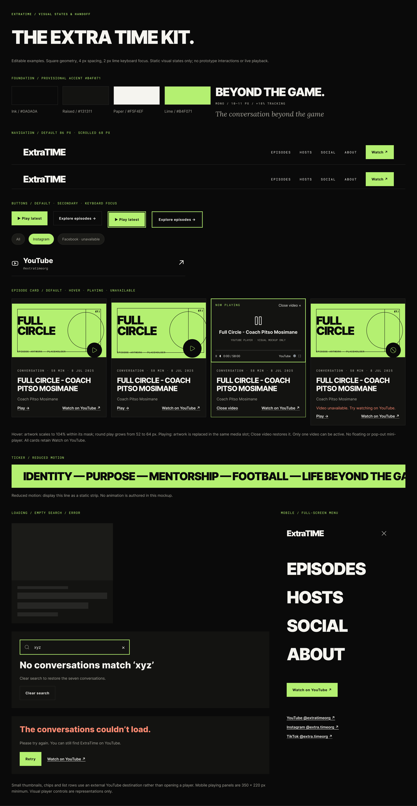

# Design system

Extracted from the Figma file on 2026-11-09: colours, type, spacing and components as drawn. Machine-readable values: [tokens.json](tokens.json) (W3C design-token style, with usage counts) and [data/components.json](data/components.json).

Component sheet: 

## Colour

One shared style: **ExtraTime/Accent/Lime (provisional)**. Provisional ExtraTime accent #B4F071. Change this shared style to update all bound lime fills and outlines.

| Colour | Name (ExtraTime token) | Fill uses | Stroke uses | Used on |
|---|---|---|---|---|
| `#F5F4EF` | paper | 714 | 22 | shape, text |
| `#0A0A0A` | ink | 580 | 211 | shape, text |
| `#A8A69C` | soft text on ink | 433 | 5 | text |
| `#B4F071` | lime accent | 270 | 57 | shape, text |
| `#131311` | ink raised | 119 | 0 | shape |
| `#55534C` | soft text on paper | 95 | 0 | text |
| `#0A0A0A @ 72%` | ink | 30 | 0 | shape |
| `#797970` | — | 30 | 30 | shape |
| `#1B1B18` | ink raised 2 | 28 | 0 | shape |
| `#0A0A0A @ 92%` | ink | 24 | 0 | shape |
| `#000000 @ 0%` | — | 22 | 31 | shape |
| `#E8E7E0` | paper dim | 22 | 0 | shape |
| `#262624` | ink line | 10 | 136 | shape |
| `#FF8A72` | danger on ink | 3 | 0 | text |
| `#0A0A0A @ 13%` | ink | 1 | 0 | shape |
| `#686861` | — | 0 | 30 | strokes |
| `#CFCDC2` | paper line | 0 | 16 | strokes |

## Typography

Families: Inter (400, 600, 700, 800, 900), Lora (400), Roboto Mono (400, 500).

Type scale as used on pages and boards, sizes rounded to whole pixels. Line height and tracking are relative to the font size (tracking −0.045 em on display and 0.18 em on labels match the build). Lettering inside placeholder artwork is listed separately below; every raw combination, including fractional sizes, is in `tokens.json`.

| Role | Family | Weight | Style | Case | Size (px) | Line height | Tracking (em) | Uses | Sample |
|---|---|---|---|---|---|---|---|---|---|
| display | Inter | 900 | normal | as typed | 340 | 0.95 | -0.08 | 1 | SD |
| display | Inter | 900 | normal | as typed | 294 | 0.9 | -0.08 | 6 | SD |
| display | Inter | 900 | normal | as typed | 220 | 0.95 | -0.08 | 3 | SD |
| display | Inter | 900 | normal | upper | 180 | 0.98 | -0.045 | 1 | OFF THE PITCH. |
| display | Inter | 900 | normal | as typed | 154 | 0.9 | -0.08 | 7 | SD |
| display | Inter | 900 | normal | upper | 148 | 0.98 | -0.045 | 2 | BEYOND |
| display | Inter | 900 | normal | upper | 124 | 0.98 | -0.045 | 4 | BEYOND THE GAME. INTO YOUR LIFE. |
| display | Inter | 900 | normal | as typed | 100 | 1.21 | -0.045 | 6 | FOOTBALL |
| display | Inter | 900 | normal | upper | 100 | 0.98 | -0.045 | 2 | SHUNGU DUTIRO. |
| display | Inter | 900 | normal | upper | 96 | 0.98 | -0.045 | 1 | AT OUR TABLE. |
| display | Inter | 900 | normal | upper | 80 | 0.98 | -0.045 | 7 | MEET THE |
| display | Inter | 900 | normal | upper | 78 | 0.98 | -0.045 | 1 | OFF THE PITCH. |
| display | Inter | 900 | normal | as typed | 76 | 1.21 | -0.06 | 8 | ExtraTIME |
| display | Inter | 900 | normal | upper | 76 | 0.98 | -0.045 | 24 | OFF THE PITCH. |
| display | Inter | 900 | normal | upper | 72 | 0.98 | -0.045 | 1 | Plus que le football : construire s… |
| display | Inter | 900 | normal | upper | 68 | 0.98 | -0.045 | 1 | MORE THAN FOOTBALL. OUR STORIES. YO… |
| display | Inter | 900 | normal | upper | 64 | 0.98 | -0.045 | 17 | 08 / Route recovery |
| display | Inter | 900 | normal | upper | 60 | 0.98 | -0.045 | 5 | BEYOND THE GAME. INTO YOUR LIFE. |
| display | Inter | 900 | normal | as typed | 58 | 1.21 | -0.045 | 4 | EPISODES |
| display | Inter | 900 | normal | upper | 56 | 0.98 | -0.045 | 2 | FROM THE SERIES. |
| display | Inter | 900 | normal | upper | 54 | 0.98 | -0.045 | 1 | Plus que le football : construire s… |
| display | Inter | 900 | normal | as typed | 52 | 1.21 | -0.06 | 8 | ExtraTIME |
| display | Inter | 900 | normal | upper | 52 | 0.98 | -0.045 | 3 | AT OUR TABLE. |
| display | Inter | 900 | normal | upper | 50 | 0.98 | -0.045 | 8 | JOIN THE |
| display | Inter | 900 | normal | upper | 48 | 0.98 | -0.045 | 7 | YOU ARE MORE THAN WHAT YOU PLAY. |
| display | Inter | 900 | normal | as typed | 46 | 1.21 | -0.045 | 6 | FOOTBALL |
| display | Inter | 900 | normal | upper | 44 | 0.98 | -0.045 | 1 | Meet The Founders // Passion to Pur… |
| display | Inter | 900 | normal | upper | 43 | 0.98 | -0.045 | 1 | MORE THAN FOOTBALL. OUR STORIES. YO… |
| display | Inter | 900 | normal | upper | 42 | 0.98 | -0.045 | 9 | Plus que le football : construire s… |
| display | Inter | 900 | normal | upper | 40 | 0.98 | -0.045 | 18 | CONVERSATION. |
| display | Inter | 900 | normal | as typed | 38 | 1.21 | -0.045 | 2 | IDENTITY — PURPOSE — MENTORSHIP — F… |
| display | Inter | 900 | normal | upper | 38 | 0.98 | -0.045 | 4 | THE LATEST CONVERSATIONS. |
| display | Inter | 900 | normal | as typed | 36 | 1.21 | -0.045 | 2 | FULL CIRCLE. |
| display | Inter | 900 | normal | upper | 36 | 0.98 | -0.045 | 5 | CONTINUE ON INSTAGRAM. |
| display | Inter | 900 | normal | upper | 34 | 0.98 | -0.045 | 3 | THE CONVERSATION |
| display | Inter | 800 | normal | as typed | 32 | 1.21 | 0.0 | 1 | No conversations match ‘xyz’ |
| display | Inter | 900 | normal | as typed | 32 | 1.21 | -0.06 | 10 | ExtraTIME |
| display | Inter | 900 | normal | upper | 32 | 0.98 | -0.045 | 8 | DON’T JUST WATCH. |
| display | Inter | 800 | normal | upper | 30 | 1.12 | -0.045 | 21 | Plus que le football : construire s… |
| display | Inter | 900 | normal | upper | 30 | 0.98 | -0.045 | 1 | THE PEOPLE AT OUR TABLE |
| display | Inter | 800 | normal | as typed | 28 | 1.21 | 0.0 | 1 | The conversations couldn’t load. |
| display | Inter | 900 | normal | as typed | 28 | 1.21 | -0.06 | 16 | ExtraTIME |
| display | Inter | 900 | normal | upper | 28 | 0.98 | -0.045 | 9 | Shungu Dutiro |
| heading / emphasis | Inter | 900 | normal | as typed | 26 | 1.21 | -0.045 | 2 | FULL CIRCLE. |
| heading / emphasis | Inter | 900 | normal | upper | 26 | 0.98 | -0.045 | 2 | Full Circle - Coach Pitso Mosimane |
| heading / emphasis | Inter | 800 | normal | upper | 25 | 1.12 | -0.045 | 24 | Plus que le football : construire s… |
| heading / emphasis | Inter | 800 | normal | as typed | 24 | 1.21 | 0.0 | 46 | YouTube |
| heading / emphasis | Inter | 700 | normal | as typed | 12 | 1.21 | 0.06 | 53 | Back to Home → |
| heading / emphasis | Inter | 700 | normal | as typed | 11 | 1.21 | 0.0 | 36 | SAMPLE CAPTION |
| editorial standfirst (italic) | Lora | 400 | italic | as typed | 32 | 1.35 | 0.0 | 8 | Wrong turn. The conversation is sti… |
| editorial standfirst (italic) | Lora | 400 | italic | as typed | 30 | 1.35 | 0.0 | 2 | Helping young people see their valu… |
| editorial standfirst (italic) | Lora | 400 | italic | as typed | 28 | 1.35 | 0.0 | 2 | Real conversations. The whole story. |
| editorial standfirst (italic) | Lora | 400 | italic | as typed | 24 | 1.35 | 0.0 | 16 | Wrong turn. The conversation is sti… |
| editorial standfirst (italic) | Lora | 400 | italic | as typed | 22 | 1.35 | 0.0 | 21 | A French-language special on identi… |
| body | Inter | 400 | normal | as typed | 100 | 1.21 | 0.0 | 6 | + |
| body | Inter | 400 | normal | as typed | 44 | 1.21 | 0.0 | 6 | + |
| body | Inter | 400 | normal | as typed | 28 | 1.21 | 0.0 | 48 | ↗ |
| body | Inter | 400 | normal | as typed | 18 | 1.21 | 0.0 | 2 | × |
| body | Inter | 400 | normal | as typed | 16 | 1.21 | 0.0 | 24 | Route not found |
| body | Inter | 400 | normal | as typed | 14 | 1.21 | 0.0 | 41 | Search conversations |
| body | Inter | 400 | normal | as typed | 13 | 1.6 | 0.0 | 84 | Mistyped route → Off the pitch 404 … |
| body | Inter | 400 | normal | as typed | 12 | 1.21 | 0.0 | 28 | All |
| link / button / strong | Inter | 600 | normal | as typed | 13 | 1.21 | 0.0 | 325 | Explore episode → |
| label (mono) | Roboto Mono | 400 | normal | as typed | 24 | 1.32 | 0.0 | 1 | /episo… |
| label (mono) | Roboto Mono | 400 | normal | as typed | 15 | 1.32 | 0.0 | 6 | 01 / |
| label (mono) | Roboto Mono | 400 | normal | as typed | 14 | 1.32 | 0.0 | 1 | @extra.timeorg |
| label (mono) | Roboto Mono | 400 | normal | as typed | 11 | 1.32 | 0.0 | 48 | @extratimeorg |
| label (mono) | Roboto Mono | 400 | normal | upper | 11 | 1.5 | 0.12 | 68 | Entry / Mistyped route |
| label (mono) | Roboto Mono | 400 | normal | as typed | 10 | 1.32 | 0.18 | 76 | 01/06 |
| label (mono) | Roboto Mono | 500 | normal | upper | 10 | 1.6 | 0.18 | 251 | ExtraTime / Visual states & handoff |

Placeholder artwork lettering: Inter 900 (180 layers), Roboto Mono 400 (102 layers), Inter 400 (18 layers), Inter 700 (6 layers); sizes scale with the tile.

## Spacing, radius, strokes and effects

- **Auto-layout gaps (px, uses):** 4 (46), 8 (3), 12 (202), 16 (101), 20 (122), 24 (123), 28 (21), 32 (51), 36 (20), 40 (46), 48 (1), 64 (9), 80 (8), 100 (3).
- **Auto-layout padding values (px, uses):** 4 (16), 12 (84), 16 (90), 20 (506), 24 (206), 28 (88), 32 (4), 36 (1), 40 (157), 48 (74), 56 (28), 64 (9), 72 (1), 80 (44), 96 (2), 100 (2).
- **Corner radii (px, uses):** 100 (70).
- **Stroke weights (px, uses):** 1 (459), 1.7999999523162842 (46), 2 (33).
- **Effects:** none.
- **Breakpoints:** desktop frames 1440 px, mobile frames 390 px.

## Compared with the current build

| Aspect | Figma | Build (`apps/web/src/styles/tokens.css`) | Match |
|---|---|---|---|
| Colour ink | `#0A0A0A` (791 uses) | `--et-ink` | yes |
| Colour ink raised | `#131311` (119 uses) | `--et-ink-raise` | yes |
| Colour ink raised 2 | `#1B1B18` (28 uses) | `--et-ink-raise-2` | yes |
| Colour ink line | `#262624` (146 uses) | `--et-ink-line` | yes |
| Colour paper | `#F5F4EF` (736 uses) | `--et-paper` | yes |
| Colour paper dim | `#E8E7E0` (22 uses) | `--et-paper-dim` | yes |
| Colour paper line | `#CFCDC2` (16 uses) | `--et-paper-line` | yes |
| Colour lime accent | `#B4F071` (327 uses) | `--et-accent` | yes |
| Colour soft text on ink | `#A8A69C` (438 uses) | `--et-on-ink-soft` | yes |
| Colour soft text on paper | `#55534C` (95 uses) | `--et-on-paper-soft` | yes |
| Colour danger on ink | `#FF8A72` (3 uses) | `--et-danger-on-ink` | yes |
| Display font | Inter 900, uppercase, −0.045 em | `--font-display`: Helvetica Neue, then Inter | family differs |
| Label font | Roboto Mono 400/500, uppercase, 0.18 em | `--font-mono`: SF Mono, Cascadia Mono, Consolas | family differs |
| Editorial font | Lora 400 italic | `--font-editorial`: Iowan Old Style, Palatino, Georgia | family differs |
| Body font | Inter 400/600 | `--font-text`: Inter first | yes, where Inter is installed |
| Corners | square; 100 px pills only (filter chips, play buttons) | `--radius: 0`, `--radius-pill: 999px` | yes |
| Header | 86 px, 68 px when scrolled (`Header · Scrolled`) | `--header-height` 86 px, `--header-height-compact` 68 px | yes |
| Keyboard focus | 2 px lime outline | `--focus-ring-width: 2px`, lime on ink | yes |
| Content width | 1360 px inside 40 px gutters at 1440 | `--container: 1360px` | yes |
| Wordmark | "ExtraTIME" in mixed case | "ExtraTime" set in uppercase (EXTRATIME) | differs |

## Components

19 components on the sheet "Components & visual states".

| Component | Group | Size | Fill / stroke | Text | Render |
|---|---|---|---|---|---|
| Header · Default (`3:54140`) | Navigation examples | 1360 × 86 | #0A0A0A @ 92% / #262624 | ExtraTIME · Episodes · Hosts · Social · About | [png](renders/components/library/header-default.png) |
| Header · Scrolled (`3:54141`) | Navigation examples | 1360 × 68 | #0A0A0A @ 92% / #262624 | ExtraTIME · Episodes · Hosts · Social · About | [png](renders/components/library/header-scrolled.png) |
| Button (`3:54142`) | Control examples / Buttons | 124 × 48 | #B4F071 / #000000 @ 0% | ▶ Play latest | [png](renders/components/library/button-primary.png) |
| Button (`3:54143`) | Control examples / Buttons | 168 × 48 | #000000 @ 0% / #262624 | Explore episodes → | [png](renders/components/library/button-secondary.png) |
| Button · Keyboard focus (`3:54144`) | Control examples / Buttons | 132 × 56 | #0A0A0A / #B4F071 | ▶ Play latest | [png](renders/components/library/button-keyboard-focus-primary.png) |
| Button · Keyboard focus (`3:54145`) | Control examples / Buttons | 176 × 56 | #0A0A0A / #B4F071 | Explore episodes → | [png](renders/components/library/button-keyboard-focus-secondary.png) |
| Filter chip (`3:54150`) | Control examples / Filter examples | 46 × 39 | #1B1B18 / #262624 | All | [png](renders/components/library/filter-chip.png) |
| Filter · Active (`3:54151`) | Control examples / Filter examples | 89 × 39 | #B4F071 / #262624 | Instagram | [png](renders/components/library/filter-active.png) |
| Filter · Unavailable (`3:54152`) | Control examples / Filter examples | 162 × 39 | #1B1B18 / #262624 | Facebook · unavailable | [png](renders/components/library/filter-unavailable.png) |
| Follow row (`3:54153`) | Control examples / Follow row example | 600 × 88 | — / #262624 | YouTube · @extratimeorg · ↗ | [png](renders/components/library/follow-row.png) |
| Episode card (`3:54146`) | Episode card examples / Card states | 328 × 409 | #131311 / #262624 | FULL CIRCLE · EPISODE ARTWORK · PLACEHOLDER · ET / · CONVERSATION · 58 MIN · 8 Jul 2025 · Full Circle - Coach Pitso Mosimane | [png](renders/components/library/episode-card.png) |
| Episode card · Hover (`3:54147`) | Episode card examples / Card states | 328 × 409 | #131311 / #262624 | FULL CIRCLE · EPISODE ARTWORK · PLACEHOLDER · ET / · CONVERSATION · 58 MIN · 8 Jul 2025 · Full Circle - Coach Pitso Mosimane | [png](renders/components/library/episode-card-hover.png) |
| Episode card · Playing (`3:54148`) | Episode card examples / Card states | 328 × 409 | #131311 / #B4F071 | NOW PLAYING · Close video × · Full Circle - Coach Pitso Mosimane · YOUTUBE PLAYER · VISUAL MOCKUP ONLY · Ⅱ ◖ 0:00 / 58:00 | [png](renders/components/library/episode-card-playing.png) |
| Episode card · Unavailable (`3:54149`) | Episode card examples / Card states | 328 × 437 | #131311 / #262624 | FULL CIRCLE · EPISODE ARTWORK · PLACEHOLDER · ET / · CONVERSATION · 58 MIN · 8 Jul 2025 · Full Circle - Coach Pitso Mosimane | [png](renders/components/library/episode-card-unavailable.png) |
| Identity ticker · Static (`3:54154`) | Ticker example | 1360 × 80 | #B4F071 / — | IDENTITY — PURPOSE — MENTORSHIP — FOOTBALL — LIFE BEYOND THE GAME — | [png](renders/components/library/identity-ticker-static.png) |
| Episode loading skeleton (`3:54155`) | System states and mobile menu / Collection feedback states | 350 × 345 | #131311 / — | — | [png](renders/components/library/episode-loading-skeleton.png) |
| Empty search · xyz (`3:54156`) | System states and mobile menu / Collection feedback states | 890 × 264 | #131311 / — | xyz · × · No conversations match ‘xyz’ · Clear search to restore the seven conversations. · Clear search | [png](renders/components/library/empty-search.png) |
| Loading error (`3:54157`) | System states and mobile menu / Collection feedback states | 890 × 199 | #131311 / — | The conversations couldn’t load. · Please try again. You can still find ExtraTime on YouTube. · Retry · Watch on YouTube ↗ | [png](renders/components/library/loading-error.png) |
| Mobile menu · Open (`3:54158`) | System states and mobile menu / Mobile menu example | 390 × 844 | #0A0A0A / — | ExtraTIME · EPISODES · HOSTS · SOCIAL · ABOUT | [png](renders/components/library/mobile-menu-open.png) |

## Component sheet sections

- **Metadata:** ExtraTime / Visual states & handoff
- **Heading:** THE EXTRA TIME KIT.
- **Handoff annotation:** Editable examples. Square geometry, 4 px spacing, 2 px lime keyboard focus. Static visual states only; no prototype interactions or live playback.
- **Brand foundation** (1360 × 148): State label, Palette
- **Navigation examples** (1360 × 203): State label, Header · Default, Header · Scrolled
- **Control examples** (1360 × 260): State label, Buttons, Filter examples, Follow row example
- **Episode card examples** (1360 × 536): State label, Card states, Handoff annotation
- **Ticker example** (1360 × 150): State label, Identity ticker · Static, Handoff annotation
- **System states and mobile menu** (1360 × 979): Collection feedback states, Mobile menu example
