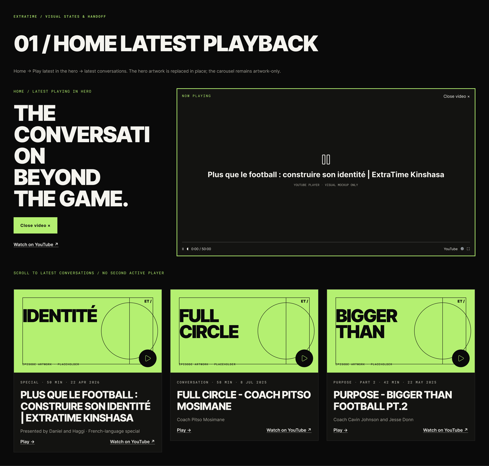
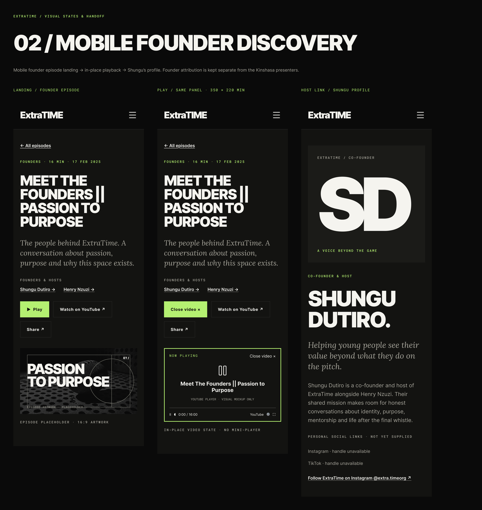
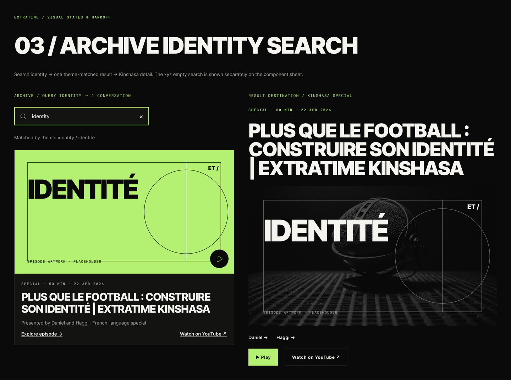
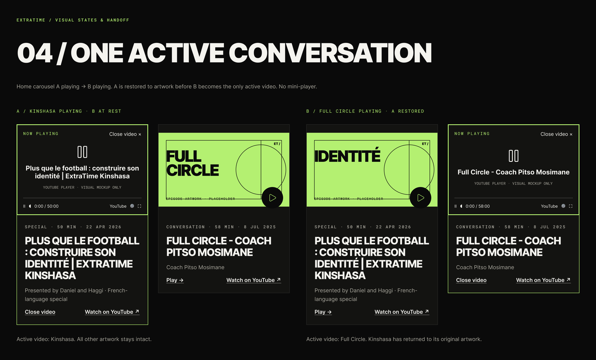
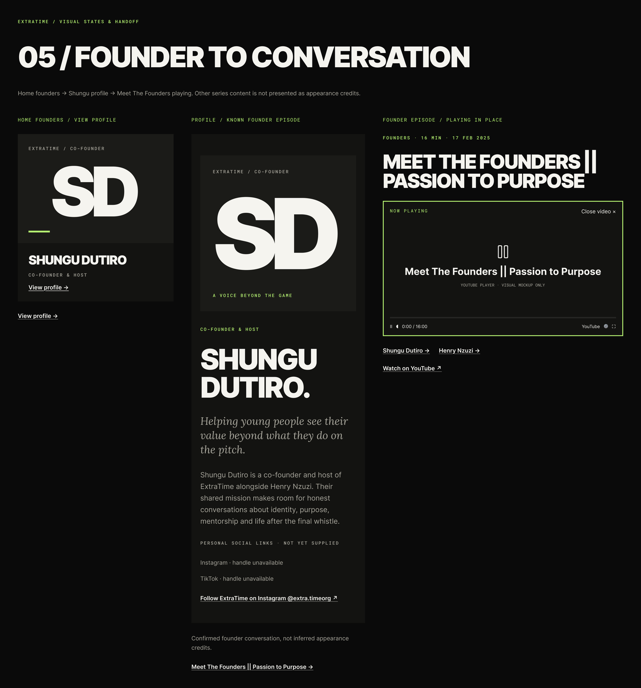
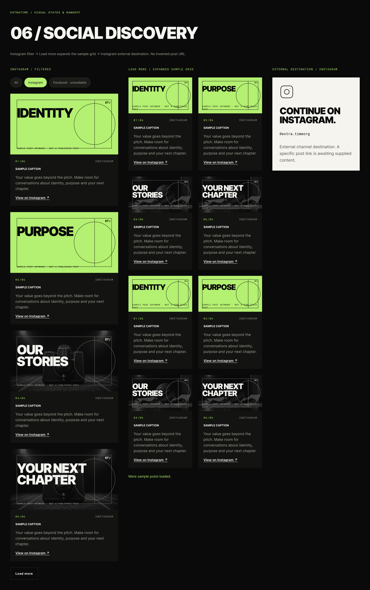
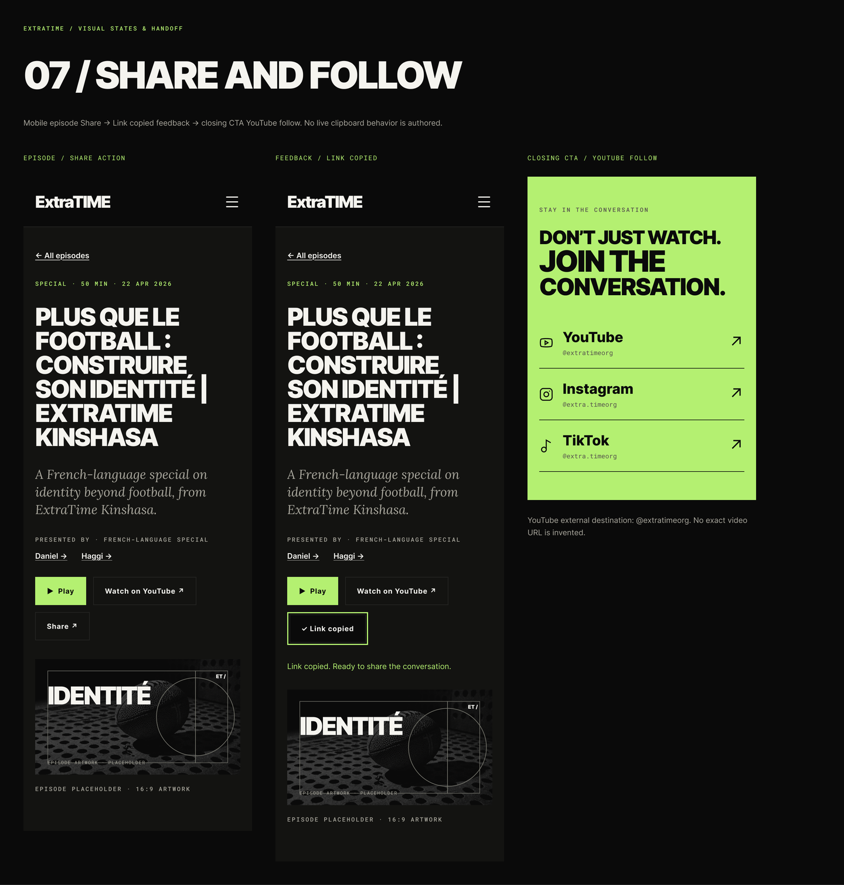
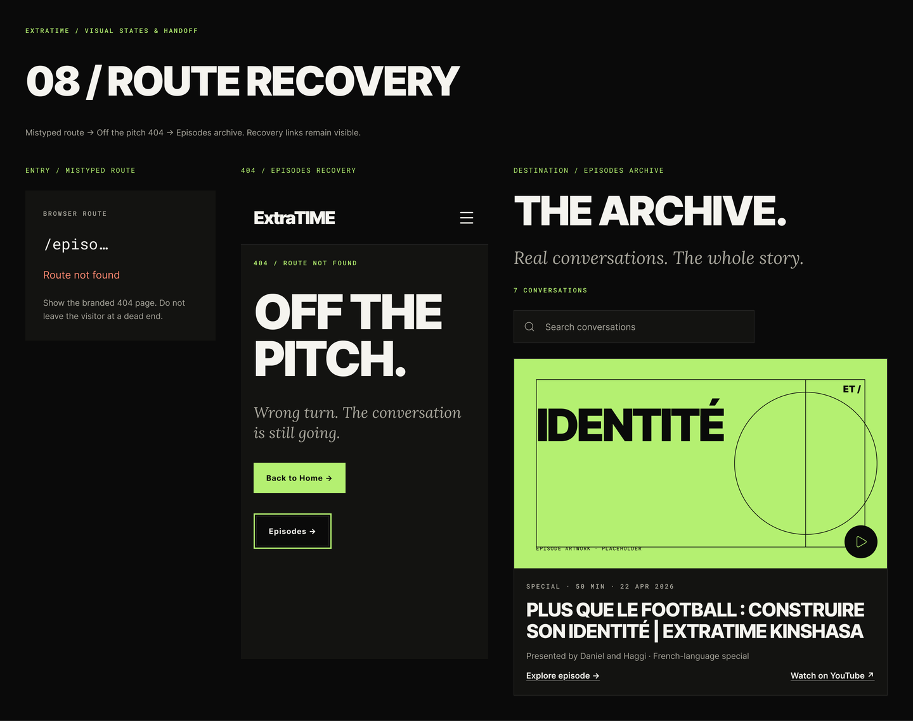

# Customer journeys

The 8 journey boards in the Figma file (generated 2026-11-09). Each board shows the states of one flow left to right, with the designer's hand-off notes. "Prompt journey" maps the board to `figma-prompt.md`; "BRD" lists the closest `docs/design/football-podcast-website-brd.md` journeys (verify before relying on the mapping).

| # | Journey | Prompt journey | BRD | States | Render |
|---|---|---|---|---|---|
| 01 | Home latest playback | 1. Catch the latest episode | CJ-DIS-01, CJ-WAT-03 | 2 | [png](renders/journeys/journey-home-latest-playback.png) |
| 02 | Mobile founder discovery | 2. From an Instagram post to the full episode (mobile) | CJ-DIS-03, CJ-WAT-03, CJ-HST-01 | 3 | [png](renders/journeys/journey-mobile-founder-discovery.png) |
| 03 | Archive identity search | 3. Find an episode in the archive | CJ-DIS-05, CJ-DIS-06 | 2 | [png](renders/journeys/journey-archive-identity-search.png) |
| 04 | One active conversation | 4. Play inside a carousel | CJ-WAT-03 | 2 | [png](renders/journeys/journey-one-active-conversation.png) |
| 05 | Founder to conversation | 5. Meet the founders | CJ-HST-01, CJ-WAT-03 | 3 | [png](renders/journeys/journey-founder-to-conversation.png) |
| 06 | Social discovery | 6. Catch up on social | CJ-SOC-01 | 3 | [png](renders/journeys/journey-social-discovery.png) |
| 07 | Share and follow | 7. Share and follow (mobile) | CJ-SHR-01, CJ-SHR-03 | 3 | [png](renders/journeys/journey-share-and-follow.png) |
| 08 | Route recovery | 8. Not found | CJ-ERR-04 | 3 | [png](renders/journeys/journey-route-recovery.png) |

## 01 / Home latest playback

- **Frame:** Journey · Home latest playback (`3:53040`), 1440 × 1373 px; sequence "Home in-page playback states" (column; gap 40).
- **Board label:** ExtraTime / Visual states & handoff
- **Hand-off note:** Home → Play latest in the hero → latest conversations. The hero artwork is replaced in place; the carousel remains artwork-only.
- **Prompt journey:** 1. Catch the latest episode; **BRD:** CJ-DIS-01, CJ-WAT-03

### States

1. **Hero playing state** (1360 × 495)
   - On screen: “Home / Latest playing in hero” · “THE CONVERSATION BEYOND THE GAME.” · “Close video ×” · “Watch on YouTube ↗” · “NOW PLAYING” · “Close video ×” · “Plus que le football : construire son identité | ExtraTime Kinshasa” · “YOUTUBE PLAYER · VISUAL MOCKUP ONLY” · “Ⅱ ◖ 0:00 / 50:00” · “YouTube ⚙ ⛶”
2. **Scroll to latest conversations / No second active player** (1360 × 481)
   - On screen: “IDENTITÉ” · “EPISODE ARTWORK · PLACEHOLDER” · “ET /” · “SPECIAL · 50 MIN · 22 Apr 2026” · “Plus que le football : construire son identité | ExtraTime Kinshasa” · “Presented by Daniel and Haggi · French-language special” · “Play →” · “Watch on YouTube ↗” · “FULL CIRCLE” · “EPISODE ARTWORK · PLACEHOLDER” · “ET /” · “CONVERSATION · 58 MIN · 8 Jul 2025” · “Full Circle - Coach Pitso Mosimane” · “Coach Pitso Mosimane” …

## 02 / Mobile founder discovery

- **Frame:** Journey · Mobile founder discovery (`3:53122`), 1440 × 1525 px; sequence "Mobile founder journey" (row; gap 40).
- **Board label:** ExtraTime / Visual states & handoff
- **Hand-off note:** Mobile founder episode landing → in-place playback → Shungu’s profile. Founder attribution is kept separate from the Kinshasa presenters.
- **Prompt journey:** 2. From an Instagram post to the full episode (mobile); **BRD:** CJ-DIS-03, CJ-WAT-03, CJ-HST-01

### States

1. **Landing / Founder episode** (390 × 1074)
   - On screen: “ExtraTIME” · “← All episodes” · “FOUNDERS · 16 MIN · 17 Feb 2025” · “Meet The Founders || Passion to Purpose” · “The people behind ExtraTime. A conversation about passion, purpose and why this…” · “FOUNDERS & HOSTS” · “Shungu Dutiro →” · “Henry Nzuzi →” · “▶ Play” · “Watch on YouTube ↗” · “Share ↗” · “PASSION TO PURPOSE” · “EPISODE ARTWORK · PLACEHOLDER” · “ET /” …
2. **Play / Same panel · 350 × 220 min** (390 × 1097)
   - On screen: “ExtraTIME” · “← All episodes” · “FOUNDERS · 16 MIN · 17 Feb 2025” · “Meet The Founders || Passion to Purpose” · “The people behind ExtraTime. A conversation about passion, purpose and why this…” · “FOUNDERS & HOSTS” · “Shungu Dutiro →” · “Henry Nzuzi →” · “Close video ×” · “Watch on YouTube ↗” · “Share ↗” · “NOW PLAYING” · “Close video ×” · “Meet The Founders || Passion to Purpose” …
3. **Host link / Shungu profile** (390 × 1225)
   - On screen: “ExtraTIME” · “ExtraTime / Co-founder” · “SD” · “A voice beyond the game” · “CO-FOUNDER & HOST” · “SHUNGU DUTIRO.” · “Helping young people see their value beyond what they do on the pitch.” · “Shungu Dutiro is a co-founder and host of ExtraTime alongside Henry Nzuzi. Thei…” · “PERSONAL SOCIAL LINKS · NOT YET SUPPLIED” · “Instagram · handle unavailable” · “TikTok · handle unavailable” · “Follow ExtraTime on Instagram @extra.timeorg ↗”

## 03 / Archive identity search

- **Frame:** Journey · Archive identity search (`3:53223`), 1440 × 1070 px; sequence "Search result to episode" (row; gap 40).
- **Board label:** ExtraTime / Visual states & handoff
- **Hand-off note:** Search identity → one theme-matched result → Kinshasa detail. The xyz empty search is shown separately on the component sheet.
- **Prompt journey:** 3. Find an episode in the archive; **BRD:** CJ-DIS-05, CJ-DIS-06

### States

1. **Archive / Query identity → 1 conversation** (620 × 712)
   - Note: Matched by theme: identity / identité
   - On screen: “identity” · “×” · “IDENTITÉ” · “EPISODE ARTWORK · PLACEHOLDER” · “ET /” · “SPECIAL · 50 MIN · 22 Apr 2026” · “Plus que le football : construire son identité | ExtraTime Kinshasa” · “Presented by Daniel and Haggi · French-language special” · “Explore episode →” · “Watch on YouTube ↗”
2. **Result destination / Kinshasa special** (700 × 770)
   - On screen: “SPECIAL · 50 MIN · 22 APR 2026” · “Plus que le football : construire son identité | ExtraTime Kinshasa” · “IDENTITÉ” · “EPISODE ARTWORK · PLACEHOLDER” · “ET /” · “Daniel →” · “Haggi →” · “▶ Play” · “Watch on YouTube ↗”

## 04 / One active conversation

- **Frame:** Journey · One active conversation (`3:53273`), 1440 × 872 px; sequence "Playback exclusivity sequence" (row; gap 40).
- **Board label:** ExtraTime / Visual states & handoff
- **Hand-off note:** Home carousel A playing → B playing. A is restored to artwork before B becomes the only active video. No mini-player.
- **Prompt journey:** 4. Play inside a carousel; **BRD:** CJ-WAT-03

### States

1. **A / Kinshasa playing · B at rest** (660 × 572)
   - Note: Active video: Kinshasa. All other artwork stays intact.
   - On screen: “NOW PLAYING” · “Close video ×” · “Plus que le football : construire son identité | ExtraTime Kinshasa” · “YOUTUBE PLAYER · VISUAL MOCKUP ONLY” · “Ⅱ ◖ 0:00 / 50:00” · “YouTube ⚙ ⛶” · “SPECIAL · 50 MIN · 22 Apr 2026” · “Plus que le football : construire son identité | ExtraTime Kinshasa” · “Presented by Daniel and Haggi · French-language special” · “Close video” · “Watch on YouTube ↗” · “FULL CIRCLE” · “EPISODE ARTWORK · PLACEHOLDER” · “ET /” …
2. **B / Full Circle playing · A restored** (660 × 572)
   - Note: Active video: Full Circle. Kinshasa has returned to its original artwork.
   - On screen: “IDENTITÉ” · “EPISODE ARTWORK · PLACEHOLDER” · “ET /” · “SPECIAL · 50 MIN · 22 Apr 2026” · “Plus que le football : construire son identité | ExtraTime Kinshasa” · “Presented by Daniel and Haggi · French-language special” · “Play →” · “Watch on YouTube ↗” · “NOW PLAYING” · “Close video ×” · “Full Circle - Coach Pitso Mosimane” · “YOUTUBE PLAYER · VISUAL MOCKUP ONLY” · “Ⅱ ◖ 0:00 / 58:00” · “YouTube ⚙ ⛶” …

## 05 / Founder to conversation

- **Frame:** Journey · Founder to conversation (`3:53365`), 1440 × 1545 px; sequence "Founder profile to playback" (row; gap 40).
- **Board label:** ExtraTime / Visual states & handoff
- **Hand-off note:** Home founders → Shungu profile → Meet The Founders playing. Other series content is not presented as appearance credits.
- **Prompt journey:** 5. Meet the founders; **BRD:** CJ-HST-01, CJ-WAT-03

### States

1. **Home founders / View profile** (350 × 457)
   - On screen: “ExtraTime / Co-founder” · “SD” · “Shungu Dutiro” · “Co-founder & host” · “View profile →” · “View profile →”
2. **Profile / Known founder episode** (390 × 1245)
   - Note: Confirmed founder conversation, not inferred appearance credits.
   - On screen: “ExtraTime / Co-founder” · “SD” · “A voice beyond the game” · “CO-FOUNDER & HOST” · “SHUNGU DUTIRO.” · “Helping young people see their value beyond what they do on the pitch.” · “Shungu Dutiro is a co-founder and host of ExtraTime alongside Henry Nzuzi. Thei…” · “PERSONAL SOCIAL LINKS · NOT YET SUPPLIED” · “Instagram · handle unavailable” · “TikTok · handle unavailable” · “Follow ExtraTime on Instagram @extra.timeorg ↗” · “Meet The Founders || Passion to Purpose →”
3. **Founder episode / Playing in place** (540 × 575)
   - On screen: “FOUNDERS · 16 MIN · 17 FEB 2025” · “Meet The Founders || Passion to Purpose” · “NOW PLAYING” · “Close video ×” · “Meet The Founders || Passion to Purpose” · “YOUTUBE PLAYER · VISUAL MOCKUP ONLY” · “Ⅱ ◖ 0:00 / 16:00” · “YouTube ⚙ ⛶” · “Shungu Dutiro →” · “Henry Nzuzi →” · “Watch on YouTube ↗”

## 06 / Social discovery

- **Frame:** Journey · Social discovery (`3:53424`), 1440 × 2293 px; sequence "Social discovery sequence" (row; gap 40).
- **Board label:** ExtraTime / Visual states & handoff
- **Hand-off note:** Instagram filter → Load more expands the sample grid → Instagram external destination. No invented post URL.
- **Prompt journey:** 6. Catch up on social; **BRD:** CJ-SOC-01

### States

1. **Instagram / Filtered** (420 × 1993)
   - On screen: “All” · “Instagram” · “Facebook · unavailable” · “IDENTITY” · “SAMPLE POST ARTWORK · NOT A PUBLISHED POST” · “ET /” · “01/06” · “INSTAGRAM” · “SAMPLE CAPTION” · “Your value goes beyond the pitch. Make room for conversations about identity, p…” · “View on Instagram ↗” · “PURPOSE” · “SAMPLE POST ARTWORK · NOT A PUBLISHED POST” · “ET /” …
2. **Load more / Expanded sample grid** (520 × 1599)
   - On screen: “IDENTITY” · “SAMPLE POST ARTWORK · NOT A PUBLISHED POST” · “ET /” · “01/06” · “INSTAGRAM” · “SAMPLE CAPTION” · “Your value goes beyond the pitch. Make room for conversations about identity, p…” · “View on Instagram ↗” · “PURPOSE” · “SAMPLE POST ARTWORK · NOT A PUBLISHED POST” · “ET /” · “03/06” · “INSTAGRAM” · “SAMPLE CAPTION” …
3. **External destination / Instagram** (340 × 403)
   - On screen: “CONTINUE ON INSTAGRAM.” · “@extra.timeorg” · “External channel destination. A specific post link is awaiting supplied content.”

## 07 / Share and follow

- **Frame:** Journey · Share and follow (`3:53636`), 1440 × 1508 px; sequence "Mobile share journey" (row; gap 40).
- **Board label:** ExtraTime / Visual states & handoff
- **Hand-off note:** Mobile episode Share → Link copied feedback → closing CTA YouTube follow. No live clipboard behavior is authored.
- **Prompt journey:** 7. Share and follow (mobile); **BRD:** CJ-SHR-01, CJ-SHR-03

### States

1. **Episode / Share action** (390 × 1156)
   - On screen: “ExtraTIME” · “← All episodes” · “SPECIAL · 50 MIN · 22 Apr 2026” · “Plus que le football : construire son identité | ExtraTime Kinshasa” · “A French-language special on identity beyond football, from ExtraTime Kinshasa.” · “PRESENTED BY · FRENCH-LANGUAGE SPECIAL” · “Daniel →” · “Haggi →” · “▶ Play” · “Watch on YouTube ↗” · “Share ↗” · “IDENTITÉ” · “EPISODE ARTWORK · PLACEHOLDER” · “ET /” …
2. **Feedback / Link copied** (390 × 1208)
   - On screen: “ExtraTIME” · “← All episodes” · “SPECIAL · 50 MIN · 22 Apr 2026” · “Plus que le football : construire son identité | ExtraTime Kinshasa” · “A French-language special on identity beyond football, from ExtraTime Kinshasa.” · “PRESENTED BY · FRENCH-LANGUAGE SPECIAL” · “Daniel →” · “Haggi →” · “▶ Play” · “Watch on YouTube ↗” · “✓ Link copied” · “Link copied. Ready to share the conversation.” · “IDENTITÉ” · “EPISODE ARTWORK · PLACEHOLDER” …
3. **Closing CTA / YouTube follow** (390 × 658)
   - Note: YouTube external destination: @extratimeorg. No exact video URL is invented.
   - On screen: “Stay in the conversation” · “DON’T JUST WATCH.” · “JOIN THE” · “CONVERSATION.” · “YouTube” · “@extratimeorg” · “↗” · “Instagram” · “@extra.timeorg” · “↗” · “TikTok” · “@extra.timeorg” · “↗”

## 08 / Route recovery

- **Frame:** Journey · Route recovery (`3:53742`), 1440 × 1139 px; sequence "Recovery journey" (row; gap 40).
- **Board label:** ExtraTime / Visual states & handoff
- **Hand-off note:** Mistyped route → Off the pitch 404 → Episodes archive. Recovery links remain visible.
- **Prompt journey:** 8. Not found; **BRD:** CJ-ERR-04

### States

1. **Entry / Mistyped route** (300 × 278)
   - Note: Show the branded 404 page. Do not leave the visitor at a dead end.
   - On screen: “BROWSER ROUTE” · “/episo…” · “Route not found”
2. **404 / Episodes recovery** (390 × 781)
   - On screen: “ExtraTIME” · “404 / Route not found” · “OFF THE PITCH.” · “Wrong turn. The conversation is still going.” · “Back to Home →” · “Episodes →”
3. **Destination / Episodes archive** (590 × 839)
   - On screen: “THE ARCHIVE.” · “Real conversations. The whole story.” · “7 CONVERSATIONS” · “Search conversations” · “IDENTITÉ” · “EPISODE ARTWORK · PLACEHOLDER” · “ET /” · “SPECIAL · 50 MIN · 22 Apr 2026” · “Plus que le football : construire son identité | ExtraTime Kinshasa” · “Presented by Daniel and Haggi · French-language special” · “Explore episode →” · “Watch on YouTube ↗”
